# 美国贝鲁特大学《GPU计算｜CMPS 297S396AA - GPU Computing - Spring 2021》（豆包翻译 - P6：-06-Lecture 06 - Performance Considerations.zh_en - GPT中英字幕课程资源 - BV1bw4m1k7a1

Hello everyone and welcome to lecture 6 of GPU computing today we'll be talking about some more performance considerations we've spoken about performance quite a bit in some of the past lectures and today we'll kind of speak about a few more performance considerations before we kind of proceed to start talking about other things in the course like like different parallel pattern。

So last time we looked at memory in the GP architecture and the CA programming model and we saw how we can optimize memory accesses using shared memory tiling and we applied this to an example application in particular it was matrix matrix multiplication。

😊，So we said that different processors have， you know。

 processor designers tell us about the performance of their processors using various metrics like the peak Fop straight and the peak memory bandwidth。

How many floating point operations per second a processor can do and how many bytes per second the memory of the processor can supply that processor。

And we saw how these things varied across architectures and we also saw that applications can be compute bound or memory bound。

 depending on whether they hit the peak flops rate or the peak memory bandwidth first and we said that the peak flops rate and current processors tends to be pretty far ahead of the memory bandwidth and what that means is that on the volta U 100 for example。

 I would need 15。6 operations per byte that's around 60 something operations per floating point 60 something operation 60 something operations per floating point value that I load in order for me to reach a balance between the peak flops rate and the peak memory bandwidth So anything that does fewer than that is expected to be compute memory bound versus if you're doing more computations than that than you're expected to be compute bound and we did this exercise for various。

😊，呃？Various kernels。 We looked at the matrix multiplication kernel， and we saw how。

We wrote it before we were doing two floating point operations for every 8 byte that we load。

 So the two floating point operations on the addition and the multiplication。

 and the 8 by are the 4 by from a and the 4 by from B。 And that gave us a 0。

25 opts per byte compute to global memory access ratio。

 But we saw how what we actually want to fully utilize thevolta V100 is something like 66 like 15。

6 operations per by or 60 operations per opera end。 and that is way higher than this。

 So we looked we considered how can we improve this compute to global memory access ratio。

 And we said that one way we can do it is by using shared memory。

 So we saw that in the GPU architecture， we have the global memory， but we also have we have caches。

 but the caches are managed by the hardware。 However。

 we have this shared memory that sits on the S that's much faster than the global memory。

 but it's much。😊，maller of course， and we said that for data that we access multiple times what we can do is we can have one thread loaded from the global memory to the shared memory and then have multiple threads access it from the shared memory。

 So we saw how in the KA programming model we have every thread has its own problem registers。

 all threads in the grid have access to the same global memory。

 but we also saw that threads in the same thread block have access to the shared memory。

 and this allows threads in the same thread block to collaborate with each other in order for them to minimize global memory accesses and reuse data from shared memory。

😊，We then looked at how we can apply this to matrix matrix multiplication。

 we observed that in matrix matrix multiplication threads in the same thread blocks， so for example。

 the threads that process these four output elements all share the same all share the same input row from a and also we saw how threads in the same thread block。

 for example， these four threads that process these four values all share load the same column so rather than having these threads。

 each one load the row from a or the column from B。From global memory。

 what we could do is we could have all the thread， we could think of our A and B inputrices as also being tiled or divided into the tiles and we could have the threads inside of this thread block。

 each one be responsible for loading one of the elements of a and one of the elements of B。

 so for example， this thread would be responsible for loading this element in a and this element in B this thread over here would be responsible for loading this element from a and this element from B。

 and then they would all load a tile to shared memory。

 each thread is responsible for loading one element in that tile。

 and then the threads would do the partial dot product from the tile so this thread would be responsible for loading this element and this element。

 however， it'll take advantage of doing the dot product of all the elements in this row or partial row and all the elements in this partial column。

accessing shared memory instead of global memory and then we can do the same thing for the next style and the same thing for the next style and we implemented the code for this and we ran it and we showed how it gave us significantly better performance。

😊，Okay， we then look at boundary conditions， and we said that one thing we have to be careful about in boundary conditions is that when withouttyling。

 you know， we just took out all the threads that are outside of bounds of the output。

 and we only compute with the ones that are within bounds。

 but here we have to be careful because over here， the thread block that's processing this output tile。

 even it has some threads that are processing values that are within bound and some threads that don't process any output values。

 but these threads that don't process any output values may still participate in loading the input。

 So for example， if this corresponds to the threads inside of this thread block and we want to load this tile of a and this tile of B。

 we'll notice that these threads are going to be active when we load this tile of A。

 these threads are going to be active when we load this tile this tile of B。

 but then only these threads are going to be active when we compute and when we store。😊。

So this is something that we have to be careful about and this goes back to the rule of thumb that we said before。

 which is that when when you want to reason about boundary conditions。

 every memory access needs to have a corresponding boundary condition so the memory access that loads the input title of A has its own boundary condition。

 the memory access that loads the input title of B has its own boundary condition and the memory access that stores the output value of C is going to have its own boundary condition so this is the best way to reason about boundary condition and then finally we said that shared memory and also register usage impact occupancy because we only have a limited amount of shared memory per S so how much shared memory we request for our thread block will impact our occupancy so we can't just say that we want all the shared memory in the world because there's a limited amount of shared memory on the S。

Okay， so this was a quick overview I we covered last time， any questions？Yes， professoror。Yes。

 just one question it's so if we're limited by memory。

 why don't they provide GPUs with less scores and set it for cheaper？

Because not all your applications are limited by memory， some of them are not limited by memory。

Okay I see。Okay， so GPU is designed for many kinds of applications。 Some of them are memory bound。

 some of them are。Now if you have an application that's extremely limited by memory。

 then then you know there's there's other might want to consider other types of processors。

 so there's research on processors like that do things like processing and memory and that's designed for memory bound applications。

 but this is a very kind of research level stuff， it's not something that that's in white production。

Okay， but GPUs are they're good at applications for that have。

 you know memory bottleneck because the HBM and the GPU gives you high memory bandwidth。

 but of course， the more compute bounding application is the better you'll find the GPU is at accelerating。

Professor， what happens if we need more shared memory than we have and then we run the code does it does it can it detect it。

 you mean if you request？If yeah， like maybe I need 100 kilobytes and there's only 96。

 Does it give me an error or something So if you if you request So there's two ways to request shared memory like we saw last time。

 you can statically allocate the shared memory so you specify the size of the array using a compile time constant or you can dynamically allocate it by consideringuring the kernel。

 if you statically allocate more shared memory than the SM has。

 the code will fail to compile if you are dynamically allocateocating memory and you dynamically try to allocate more shared memory than then the SM has then in this case。

 the kernel will fail to launch。Professor continuing on that， for example， if my application crashes。

バ。Problem in the code does the memory gets does the memory is there a memory leak？Or no。

So is you can think of it just like the CPU memory so if an application crashes the operating system kind of you delos all the memory that was allocated by that application similarly if a process crashes。

 then all the GPU memory that had allocated will be de so you don't have to worry about memory leaks in case of a crash obviously you do have to worry about memory leaks if you don't have a crash but you allocate and forget to decate and are still running the application。

 but of course， if memory leaks and then the application stops running。

 then everything it had allocated will be free。诶。Thank you。Yeah， you' welcome看。All right。

 so after no further questions then today we will look a little bit about at the DRAM architecture。

 how the DM is organized and after reviewing some DM architecture is going to motivate an optimization that we're going to talk about and we'll also talk about another performance optimization that comes up frequently Okay and performance optimizations in general。

😊，So performance optimizations。 we've seen several performance optimizations so far。

 We've looked at the importance of tuning our resource resource usage to maximize occupancyancy。

 So this is one important optimization。 We've looked at the importance of minimizing control divergence to increase our SD efficiency。

 We actually didn't do an example of this。 We just talked about the， you know。

 we observed that control divergence exists and we observe that it is a source of inefficiency。

 and we observe that it is important to minim it。 but we didn't do an example of how to do so。

 and we will do examples multiple examples later on in the course on minimizing control divergence。

 but it is an optimization that we have we have alluded to。😊。

We also saw shared memory tiling to increase data reuse。

 So whenever we have data that is reused by multiple threads。

 we can use shared memory to load it once and then have all the threads accessed from shared memory。

 we're going to talk about two more optimizations today。 The first one is memory coalescing。

 which we have actually been doing but we just going talk about it。

 and then the second one is thread couring， which we will do an example of today。

 So before I'll start by talking about memory coalescing。

 but before that I would like to talk a little bit about the DM architecture。😊，A D Ram cell。

 for those of you who haveve taken a course in computer architecture。

 you should be familiar with this， but I will review it a DRA cell。

 you can logically think of it as some capacitance。

That stores a charge and some three state device where when you enable it。

 the capacitor discharges in order for you to read that value and and so if the value is one。

 itll discharge and you will detect that there's a discharge， if the value is0。

 it won't discharge and you will detect that there's no discharge so you will know that it's a zero。

Okay， so a DM cell consists of capacitance that stores charge and a three state device that allows the data to be read and written。

A D array。Looks like this。 You have multiple D Ram cells connected to a column wire。 Okay。

 and at any point in time， because all of these are connected to a wire。 at any point in time。

 you will only read one of these cells。All right。And a D Ram bank is going to consist of multiple of these vertical wires connected。

 you know， these DM cells all connected to a wire。 So you're gonna have multiple of these。 Okay。

 so a D bank consists of this 2D array of DM cells。 and at any point in time。

 what we're going do is we're going to activate one row in this DM cell in this DM array in order to read that row。

 So， for example。We have these lines that activate our three state buffers if I set this line to one and all the others to zero。

 what will happen is these three state devices open。

 meaning you close the circuit and then these capacitors will discharge charge and we read these rows。

Okay， if I activate this set this row to one and all the others to0。

 then these three capacitors or this row of capacitors will discharge。

 And were gonna read one bit from each column。 Okay， so this is how DM works。 Now。

 those of you who know know that when we read， we destroy the value。

 So we have to write it back and this makes DM slow。 And you know， yes。

 this is all part of how DM works。 But the key thing is that we read。

 we read one row at a time and and this read involves discharging these cap。So in general。

 if the DRA bank is architected as follows， we provide a row address to a row decoder。

 the row what does the row decoder do， the row decoder takes this address determines which row we want。

 and then sets one of these outputs to one and the others to zero。

 and then we pass this decoded signal to the DRA bank。And in the DM bank。

 what happens is if we activate this row， all the cells in this row are going to discharge。

 And what we do is they will the values will come out over here。

 these values will feed into a sense amplifier， the sense amplifier is are these circuits that will circuit components that will detect the change in charge in the capacitors in order for them to figure out whether the capacitor has a one or a0。

 And then after detecting this this change in charge， we sort it to a column latch。

 Now a column latch is is。😊，It holds on to the value。 So when you read it， it doesn't get destroyed。

 So what happens is that this column latch will then be used to write back the value that we read because reading from a capacitor destroys the value。

 And then this column latch will hold on to the value that we read from the V Ram row And then then then but the row is large。

 right， So the row is larger than a typical size of your request。

 So what happens is the address also has another part， which is the column address。

 So your whole every address is divided into parts part of it is the row address。

 Another part is the column address。 The column address will be passed to a multiplexer to select what what part of this row。

 my my address corresponds to and。And then this multipleexer will select that part and provide it as the data that I am requested。

 Okay， now this entire row that I read。 Okay， I'm not that's not。 I don't pass the entire row。

 I just pass part of it， but this entire row that I read is called a burst。 So this is a Dam burst。

Okay， now what， what part of this whole process is， is the slowest part。De boxx。The D array。

 because it's huge。The D Ram array， the sense amplifiers， these take time， right。

 The mugs is actually not， not that fat， not that slow。 Okay。

 so relatively this this stage of reading from the DM array and sense going through the sense amplifiers and storing in the column match and then writing back the value that we destroyed。

 This is the slow part。 The fast part is using the mugs to select one part of the row we want。😊，Okay。

 so this is the slow part。 The faster part is now that we have the whole burst selecting what part of the burst do we care about。

A professor in 255， I remember you said something about the decoder。

 we can't make it big enough because it becomes too slow or something like that。Right， exactly。

 And that is why this is just a P Ram bank。 It's not my entire D Ram Oh okay this is this Pm array is not going to have。

 you know， four gigys worth of growth。Okay， it's going to have， it's going to be。

 it's going to have a small， small amount。 And I'm going to have multiple D banks。

 and I'll talk about that later on。Okay， so let's do an example just to make this clear。

 So if I have this address over here， I want to read the value at address 010 Okay。

 and I have this this D array that is 4 by4。 Well， what happens in this case is I'm going to divide my address into a row address and a column address。

Okay， so let's say I use 0，1 as my row address。 Okay，0，1 goes through the decoder。

 Each one of these four inputs corresponds to one row address So 0，0，0，1，1，0，1，1， oops。

 maybe this should have been 1，0。 Oh， well。Or maybe we're going from down。 So 0，0，0，1，1，0，1，1。

 So the point is that I use this address to activate  one row。 And then I read this row。

 I read the entire burst into my marks。Okay， and then I now I want to select which part of this entire burst I want。

 and for that I'm going to use this zero as my call and address Okay。

 and then this zero will select will select this this part of the data that I read and provide it to my to my processor。

Okay， so I'm going to use the other part of the address to select columns within a row。Now。

 if my next access is something like 1，0，0， then I have to do this entire process again， right。

 I have to go back， pass the 10， decode it， read the corresponding row and then use the multiplex。

But if my next address that I read happened to be 0，1，1。

Do I have to go back and read the whole go through the decoder and the D array again？No。No。

 right what do I， What do I have to do in this case。go to the right， I just have to change。

 I the only thing that changes is what the multiplexer is doing。 So if my next address is 0，1，1。

 right， So if the other access comes from the same burst。

 then there's no need to read the row again from D Ram。 I can just change the multiplexer。

 And this is why this idea of D Ram bursts is important。In general。

 accessing data and different bursts means that we need to access the array again。

 So in terms of time and accessing the array is the part that takes long。

 the multipleter doesn't take much time。 So if I have an accessing data and different bursts。

 I have all this time I need to wait to access the array and then this green part is the multiplexer part to access the data from it within the bursts。

And then if I go and access data from a different birth。

 I have to wait again until I read the entire array， and then I get my data from my birth。However。

 if I access data in the same verse。Then in this case， I don't need to access the array again。

 I just need to change the multiplexer， so in this case my timeline looks like this。

 I do the I read the entire row， I read the entire burst。

 and then I provide the data from the burst and then if the next axis comes from the same burst I also I just provide that same axis。

Without me having to re go through through the D again。

But those child still have the same clock time。Sorry。Doesn't it depend on the clock？

Every time you read， it's a clock tick。I mean， of course there is some notion of clocks there。

 clocks involved here， I don't want to get into that。

 but the time that it takes for me to change the maxs to get another part of the burst is much less than the time or there's much clock fewer clock cycles to do that than the clock cycles I need to wait in order for me to do this whole sensepl。

And this will read for the burreau。Okay。😊，So the moral of the story is accessing data in the same burst is faster than accessing data in different person。

Okay， and what this does is it brings me to the point about memory coallesing。So， when。The same work。

Access consecutive memory locations in the same verse。Okay。

 so if I have threads that are in the same war。Reading consecutive data in an array。

 that data will likely be in the same DM burst。These aes can be combined and served by one DM burst。

 So that means that one DM transaction is needed。Right， and this is known as memory coalescing。

 I coalesce the memory aes from the different threads into one memory access。😊，However。

 if thread in more access locations that are not in the same burst。

Then these apps not be combined and what that means is I need to make multiple transactions。

So it's going to take and remember that when threads are in the same warp。

 I need to wait for all they all execute together so if threads in the same warp。

 all issue of load instruction right they try to load for memory。

 I need to wait for all the load instructions to complete before I can execute that warp because all the threads need to have their data ready。

 so if all those loads be touching the same DrM burst we coalesce them and that's one memory access but if the threads in the same warp are accessing different locations in DM。

 then I need to wait for all those loads to be served by the DM before the warp can continue execute。

Okay， and what happens here is this is called sometimes we would call this memory divergence。

 so control divergence is when threads in the same warp。Divergent control paths。

 Each one of them wants to execute one branch or of an if statement or a different number of luiterations。

 memory divergence is one threads in the same more access data and different D Ram bursts。

 Each one of them is going to is going to have to issue a separate load。

 I cannot combine their loads。 Okay， and we've actually been adhering to memory requesting quite well so far。

 just because it was so easy to do that in the applications that we've looked at so far。

 So let's go back and see the code that we wrote。 So here in our vector addition code。

And respect vector addition code。When you look at what threads in the same lo are accessing。

 are threads in the same lop likely to access data in the same D burst？No。听到了。

Because it's different row each time。Okay， well， think about it。

 So if if here I have thread zero and thread1 and thread2 are accessing the array X。

They're going're going to issue load instructions to access the array X Well thread  zero is going to access x of0 and thread1 is going to access x of 1 and thread2 is going to access x of 2 right are x of 0 and x of 1 and x of 2 likely to be in the same de reburs。

Yes。When you you but are't the cells arranged by8 bits？Oh no， no， no， Okay。

 and that's a good point I forgot to mention so the typical size of a D row of a row in a DRA bank is not going to be eight bits。

 it's going to be something pretty large。Okay， okay， many， it's going to have many， many bitetes。

Okay， so that that's a good point。 So having cleared that up， it's obvious that in this case。

 I have memory coalescing because threads 0 to 31 are going to access elements 0 to 31 and x of y。

 so these elements 0 to 31 are all are all nearby each other in memory。

 so they're likely going to be within the same B round， which means that I can coalesce these aes。😊。

Okay， similarly with matrix matrix multiplication， right。

 What about matrix matrix multiplication are my aes here coalesce。Be careful here。

 the one thing I should clarify is that when I have that two dimensional thread block。

What I do is I put all the threads of the X dimension together in a warp before going down the y dimension。

Okay， so here what determines if something is the consecutive threads of the warp are going to be the threads with consecutive threat indexdex。

x values。Okay。So threads with consecutive thread indexex。x values are going to be in the same war。

 in other words， threads with the same row index and consecutive column index values are going to be in the same war。

So here if I look at the access to B， right， it's obviously going to be coalesc because all threads have the same value of I and all threads have the same value of n。

Okay， and threads in the same morphp have consecutive values of co。

 so then threads in the same warp will access consecutive values of B。

 so obviously the access to B is going to be column。Okay。What about the access of a。

It's the same And， it's like the same it's， it's the same for all threads in the warp。 exactly。

 assuming that all my threads are have the same value of rows。 If I have a 32 by 32 thread block。

 all threads will have the same row value。 So here all threads in the warp have the same row。

 the same N and the same I。 So they're nots it's， you know。

 they're all accessing the same exact memory location。 So I don't have to worry there either。Okay。

 so just here I was noting thatp warp contains consecutive threads in the x dimension。

 so see that accesses to A and B are coalesced because threads0 to 31 access access consecutive access the same element of A and then consecutive elements of B。

What about matrix tile matrix matrix multiplication were my accesses here at coalesce？

To a lesser extent。Why is it to a lesser extent。Because we load。Like we use shared memory。

 which is good， but in general， when we load we're loading only tiles， maybe。And so， right。

 so we care about going to global memory。So here when I'm loading from global memory are threads in word accessing consecutive elements。

Well they all have the same value for row， same value for n， same value for tile。

 tile dim as a constant， so the threads in the same work are going to have consecutive third index index do x values。

 so they will also access consecutive relevant。Okay。Same thing here call is in terms of Fredinux doX。

 so here these will also be coalesce， so yes， actually it turns out that these all both going to be coalesce。

Okay， so X A and B are coalesce。Now， so far， all the examples we've had are been fairly coalescce。

 but I wanted to you know talk about this today just to clarify know clarify what was going on underneath if our accesses were not were not coalesced。

 we would have seen a significant blow to our performance and later on。

 we will look examples where we will have an application where we start off with something that's not coalesced and see how we can change it in order to make sure that our X is our coalesced。

Can you repeat why elements in the like threads in this。

As this access the access are con coalesced for the rule。

Because threat index the if we have third index do y。

 we're going to access different rows of of the of the matrix。

 So doesn't it depend on the row size of the Dm。Can you say again。

 you mean threads that have the same row but different column values， why are they coalesce？Yes。Okay。

 because。The way that wars are organized is that you have threads with the same y value。

 but consecutive x values will go into the same warp。Okay， so for example。

 the thread with y equals0 and x equals0 is going to be in the same warp as the thread with y equals0 and x equals1。

 and then y equals 0 and x equals to y equals0 and x equals3 once I have hit the block dim dot x of the thread block。

That's when I start taking threads from the next row of the block。

 so thread indext y equal1 through the index dot x equals0 and putting them in my workp。Now。

 in if I have a 32 by 32 thread block， then。In that 32 by 32 thread block。

 the threads with thread index index do y equals0 and thread index。 x going from 0 to 31。

 those are going to be the first work。And then the threads with the index dot y equals1 and third index dot x is going from 0 to 31。

 those are going to be the second word， eta。Okay， okay， thank you。

 So this this covers the topic of memory coalescing。Okay。

 another thing I would like to talk about is the fact that we have multiple DM banks so usually when we organize DM don't just have one big DRAM array for multiple reasons。

 the first reason is that manufacturing a huge DM array is is not feasible but then another reason is that when we have multiple DM banks this allows us to have parallelism when we access our DRAM let me show you what I mean by that so when I have DM is organized into multiple banks and all these banks kind of feed data on the same bust So when I read from DM I usually read from one of these DM arrays at a time or maybe multiple depending on my DM architecture。

 but the idea is that when I have multiple DM arrays one DM array may be serving me while another DM arrays in the middle of finding an operation finding a date data that we request。

そか？And having multiple D arrays is useful。Because it allows us to do latency hiding。 Okay。

 of our memory aes。 Okay， so multiple DM banks allow us to do latency hiding。

 and let's see what I mean by that。 So if I have one D bank， then even if I fully utilize my birth。

 there's always this time that I'm waiting for my burst to be to be read from the DM array。

 and then I have the time that I spend accessing data in that verse。

 But once Ive used all that data in my birth， I still have to go and read the next data in my DM array before I can access that data from the launch。

 Okay， so even if I fully utilize my DM burst， I still have this time that I'm wasting await for my DM array to read the data。

 Now， if I have multiple DM banks。😊，Then what I can do is you know I have this time that I waited for my DM burst to come。

 but then as I'm reading my when I finish reading my DM burst。

 I still have these other DM arrays reading from being read in the other bank they can think of each of these horizontal lines as the timeline for one of the banks and then when I've done reading the from this bank。

 another bank might be ready。 So in this case now I can read the data from the second bank and then by the time I finish reading from the second bank。

 the burst in the third bank is ready， so I can go and I can read the data from the third bank and then the time that I'm reading the bursts from the second bank and the third bank and' serving them to the chip。

 the first bank is going it's doing another DM array read and by the time I've read from my other DM banks now the burst in my first DM bank has arrived。

So having multiple DM banks available to me enables me to hide the latency of these DM banks。

 because as I'm reading the burst from one bank， the other banks are going and they are reading other data。

😊，Okay， so so this so here we're hiding the latency of memory by having many DM banks to always ensure。

 you know， the more DM banks we have， you know， the higher chance that one of these DM banks has finished memory access and is ready to serve me first。

Okay， however， in order for me to effectively utilize these DM banks， what do I need to have okay？

If I need， if I have if I want to have many memory banks reading data at the same time in order for me to overlap to hack their lates。

 I need to give them a lot of memory aes。The service。Right， and for me to give them many memory aes。

 what do I need， I need many threads running simultaneously and requesting data simultaneously so that I can keep my DM banks busy。

Okay， and what does this remind you of？Scheduling works。Warps， what about warps。

Contro theversions or no no。It wasn't divergence， It was another thing about warves。你Now。By Danny。

We move for wars。An adult。Right exactly， so we like to have many more wars running on our SM or scheduled on our SM then then can simultaneously execute so that when one of them is waiting。

 the other one is ready to service similarly， we want to have many more memory accesses then we can simultaneously read from our DRAM so that while we're reading one access from one of the banks or while we're waiting for one access to complete from one of the banks and another one is completing in the bank and the way we achieve this is is using the same technique。

 having high occupancy so by having high occupancy in our SMs。

 this both helps us hide the laency of hide the pipeline latency in the core。

 but these many threads having high occupancy also ensures that we have many memory aes in order for us to be able to hide the memory access latency when accessing DRAM。

This clear。Any questions？ok。So one optimization we spoke about today is memory coalescing and ensuring that our memory aes are coalesced and then we also reviewed this idea of occupancy but this time applied。

 we showed how having eye occupancy not only helps us hide latency in our pipeline but also high latency when accessing memory for the second half of the lecture but I'd like to talk about is another optimization and that is thread coing and for that I want to start to introduce this idea of thread granularity。

So so far， the parallellyzization approaches that we've been using to parallellyze these different applications。

 we've been following the strategy of making threads as fine grain as possible。

 what do I mean by threads being as fine grain as possible。

 I mean that we're assigning threads to the smallest possible unit of parallelism。😊，So for example。

 when I did vector Ed， I had every thread responsible for one vector element， not two。

The smallest possible unit of parallelism is one vector element。

 adding one vector element to one vector element and producing one vector element。

 so we had one thread do that similarly when we did the RGV to gray。

 we assigned a threat to every output pixel。And similarly with matrix matrix multiplication。

 we assigned a thread for every element in the output matrix。 Okay。

 so we've been making threads as fine grain as possible。

 So this is what we mean by the granularity of a thread。

 You know how small or how large the task that we gave it is with respect to what what are all the tasks that can be paralyzed。

😊，Now， what is the advantage of making threats as fine green as possible。

 what is the advantage of making threats the smallest possible unit of parallelism？😡。

We take advantage of all the course we have。we take advantage of all the cores we have。

 so we extract as much panel as possible from our program。

so the advantage of having fine grain thread graularity is that it provides the hardware with as many threats as possible to fully utilize the resources。

Now， what happens if we， if we provide hardware with all these threads。

 But the hardware actually less has less resources these than what what the threads that we gave it。

 What does the hardware do。We wait。Right， and they wait until there are resources for them to execute。

So if there are more threads provided then the GPU can support。

 then the hardware can serialize this work with low overhead。

But if I did not provide it with all the parallelism I had， if I provided with less parallelism。

 the problem is that if I have a future device that has more。

It has more resources then it won't be able to extract more parallelism but by providing all the parallelism that's available in my program in the future。

 if I get a new GP figure that comes out and that GPU has more resources then the hardware can easily extract more parallelism without me having to rewrite the code and remember we gave this a name。

 we call this transparent scalability， this idea that if I have less resources the hardware theoryorizes the thread for me and if I have more resources that the hardware can paralyze the thread。

So giving the hardware as many threads as possible gives it the flexibility to paralyze them if it has enough resources or serialerize them if it doesn't。

Now， what is the disadvantage， is there a disadvantage to this？😡。

Is there a disadvantage of me giving the hardware as many threads as possible。

We don't take power operation provide ratio。you say that again。We don't take advantage ofれレ。

A lower operation per byte ratio。 I'm not sure what you mean by that。 actually it could be that。

 But remember， when we calculated operation。Right so every thread was doing a certain number of operations per bike。

 So if I have more threads， each each of them is going to do more operations but also load more data。

 So it's the operation。It doesn't get affected directly。

 but we will see actually today how it can be affected indirectly。So， so at。被告人。

If the thread does way too little work， wouldn the overhead become very significant？😔，So again。

 we said that the point actually can can。Can schedule these threads with very low overhead。

 the hardware is pretty good at that。The disadvantage actually。

 it's something you guys are kind of alluding to， which is that if there are common operations that are performed redundantly across threads。

Okay， when I run these threads in parallel， that's okay。Okay。

 because that redundancy is a price that I'm paying to get pers。

Okay but so it's okay if the threads are actually running in parallel。

 but if the threads are actually going to be running sequentially。

 so if if I have this redundancy across threads right so there's an operation that that's performed redundantly across threads。

 okay if these threads are actually going to end up being serialized by the hardware。

 then this is suboptimal because I'm paying this redundancy in order for me to get parallelism。

 but then I'm losingm I'm not getting that parallelism because the hardware is serializing the work anyways。

Okay， so let me give an example of what I mean by that。So here。

 if you remember with our tiled matrix matrix multiplication。

What we had is we had every thread block responsible for a tile in the output matrix。Okay。

 and the threads， each thread in that thread block was responsible for one element inside of this output matrix。

 and these threads collaborated to load input types。O。Now， if you'll notice。

What you'll see is that these two thread blockss that are horizontally adjacent to each other。几。😊。

These threadlocks load different tiles of B。But they lo the same tile of a。Okay。

 so in thread blocks processing horizontally adjacent output tiles redundantly load the same tile of a。

 So here this thread block is going to go on some SMm and load this tile of A and this thread block is going to go maybe on the same SM or maybe on a different SM。

 and it's also going to load that same tile of a。Okay。

 so this loading of of having both threads load both thread locks load a is redundant Now。

 if these two thread locks are actually running on parallel on different Fms and loading a at the same time that that's okay because this redundancy is a price that I paid in order for me to be able to compute these output tiles in parallel。

However， if my hardware。😡，Actually ends up if I give my hardware too many thread blocks and my hardware actually ends up serializing these two thread blocks。

And what's going to happen is that this thread lock is going to run。

 it's going to load this style of A。And then load this style of B and compute this this part。

 and then much later， this other thread block is going to come and it's going to load this style of A and load this other type of B and compute the output。

So in this case， if my hardware is going to serialize it。

 is there a benefit for me to serialize it instead in the code？😡，Yes。

 I save like loading the tile twice。 but then I have to make sure it fits in the shared memory。Right。

 exactly， so if if one optimization that we could， if we know that we're providing the hardware with too many thread blocks that can on at the same time。

What we can do is rather than load this a redundantancy for these two output blocks。

 we can assign one thread block to be responsible for this output block and this output block。

 And we can have this thread block first load this block。And this block and compute the partial tile。

 and then before proceeding， it can go and it can using the same tile of a。

 load this thread block and compute this partial output tile。So we can have one thread block。

 process multiple output tiles sequentially and reuse the input tile that it loaded。Okay， so this。

At the。This is an advantage of threat coursing if these two the threat blocks processing these two tunnels were actually running in parallel。

 great redundancy is worth it， but if they were going to get sequentialized。

 then I prefer to get rid of this redundancy and rotate a only once and use it for both of these output the is that clear any questions about this？

So， okay， the， sorry。Yes， good ahead。 Doest that depend on the number， of course。

 And the GPU and your hardware will Yes， of course， it does。 Of course it does。

 So whether or not these the two thread blocks here will be will run sequentially or in parallel is gonna depend on how many Ss I have in my GPU。

 if I have many S in my GPU because I have a very strong GP that I I pay thousands of dollars for。

 then maybe these blocks run in parallel。 But if I have a small GPU that maybe that that。

 you know that， you know， that's just like sitting there in my laptop will be managing my screen。

 that maybe these blocks are more likely to run sequentially。Okay。

 so it does depends on your hardware， and I will talk about that。

So how much we serialize depends on how much hardware we have， so it's going to be data dependent。

Okay， so so let's see how to actually implement this。

 So what I want to do now is I want to make one thread lock responsible for multiple output tiles and in other words。

 I want to make one thread responsible for multiple output elements instead of just one so Im might to do I'm going to have the thread responsible for this output element also be responsible for this output element over here。

😊，Okay。So let's go to the code and write this code so is this is the matrix multiplication code that we wrote before。

 the T matrix con code wrote before I'm going to compile it and I'm going to run it so you guys are kind remember how long it took here the kernel time was 0。

91 milliseconds and I'm going to open this kernel code。😊。

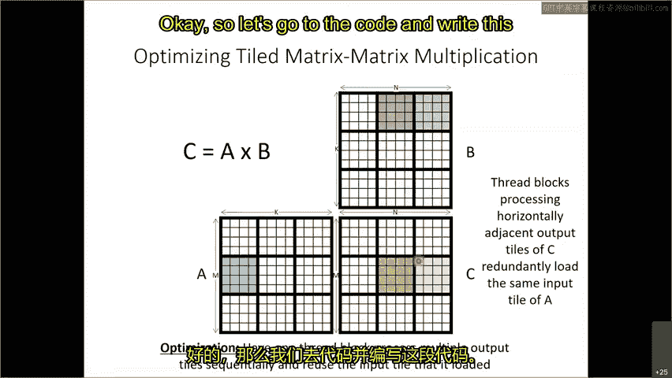

And you'll notice， here's what we did before。 We had we declared these shared memory tiles。

 We found a row index or column index initializer sum to0。

 We looped over the tiles and then over the input tiles and for every input tile。

 we loaded the tile of a we loaded the tile of B syncnc threads was make sure that all threads finished load before any of them started computing and then we looped over the tiles and compute the partial sum and then we did sync threads again to make sure everybody finishes computing before we load the new values and we keep looping through our input tiles until we done and restore the results。

 So this is the code that we wrote last time。 and what I'd like to do is I'd like to modify this code in order for me to accomplish accomplished this idea that we have one thread block responsible for multiple output tiles。

😊。

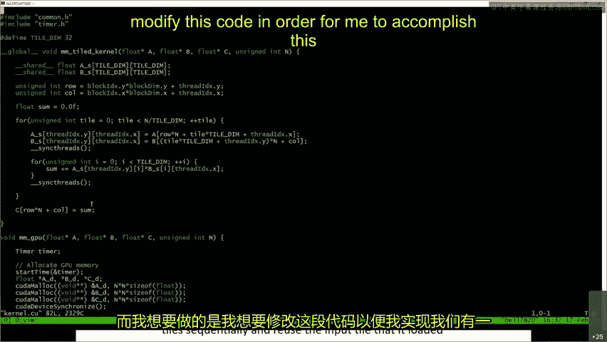

So to do that。

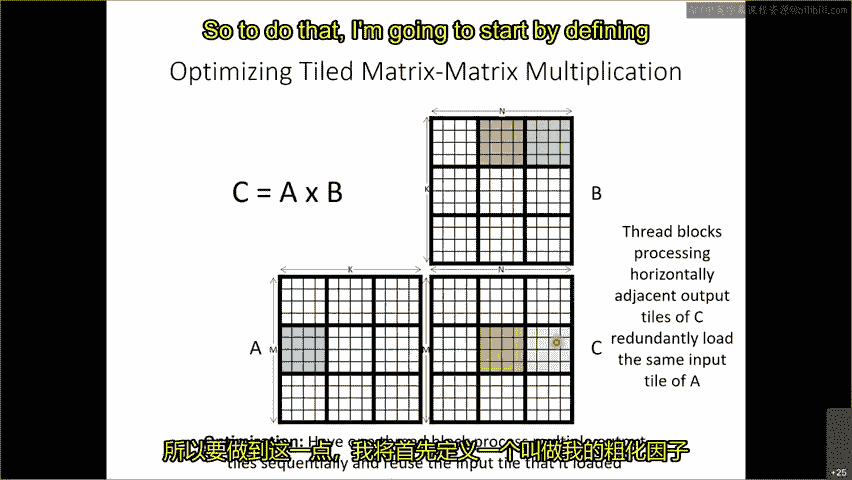

I'm going to start by defining something called my coar factor。

 My coening factor is going to be how many units of parallelism is every thread going to be responsible for Orly。

 every thread was going to responsible for one， but I can I want to I can I want this to be kind of an arbitrary values。

 I'm going to call this coar factor。 And let's just set it to four。

 So let's say that every thread is going to be responsible for four output elements。

 And in other words， every thread block is going to be responsible for four horizontally adjacent output tile。

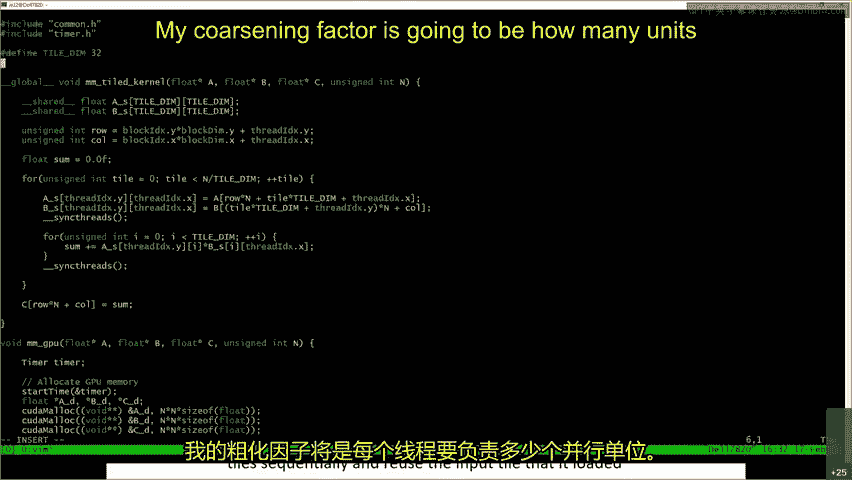

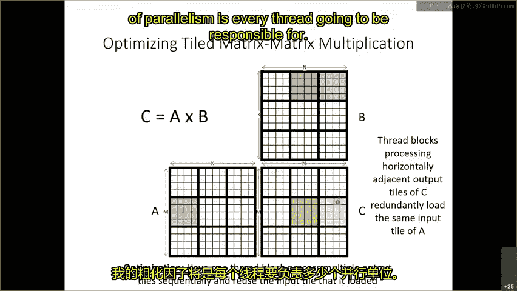

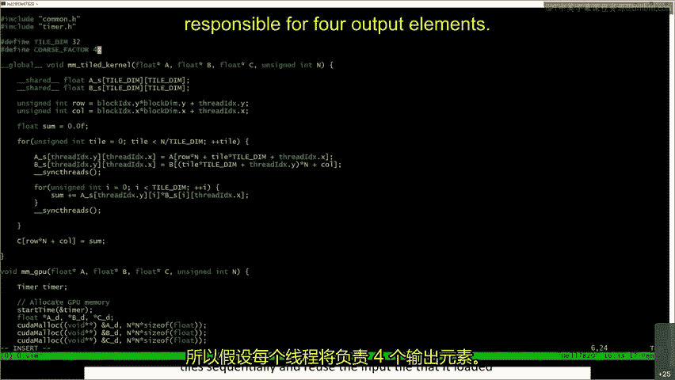

Okay。😊。

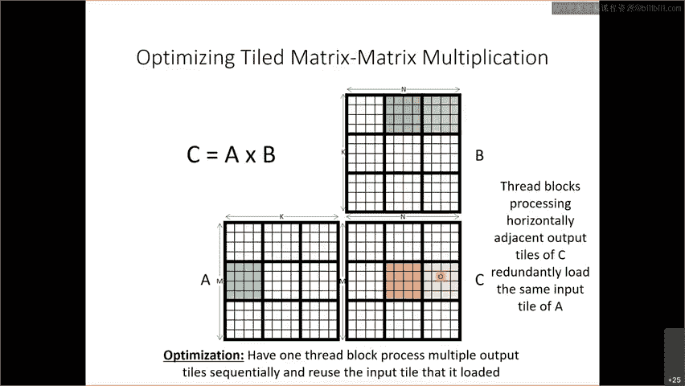

So what do I need to do now， Well， now row still makes sense because here that processing this row processing this element now is processing this element and this element。

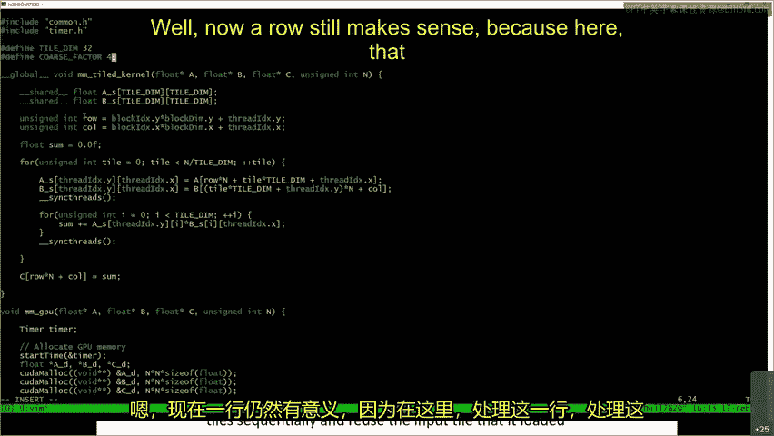

So so they both have the same row。 So this row variable still makes sense。

 but this column variable is now a little bit weird because now we don't just have I third it doesn't just have one column。

 It has a column for each of the elements that it is responsible for。

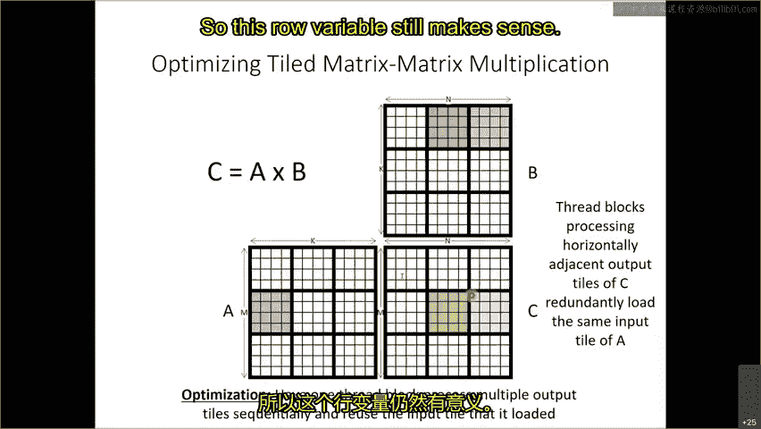

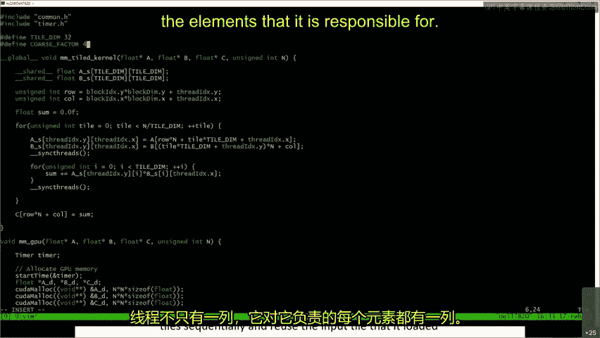

Okay， so what I'm going to do is I'm going to start by finding the column that's for the first element it's responsible for and then later on we'll proceed to kind of go to the following thread box。

So now in the column index， and I'm not going to call this column anymore。 I'm going to call it。

And call start， meaning it's the column index for the first element of thread is responsible for。

 And now what do I have to change in this calculation over here。

So now every thread block is not just responsible for tile dim elements is going to be responsible for tile dim elements times the coing factor so here here the thread block is what' responsible before for four elements now if I have a coing factor of two。

 the thread block is responsible for eight elements so to find the first column that thread block is responsible for I need to have block index do x times block dimm do X times the coening factor。

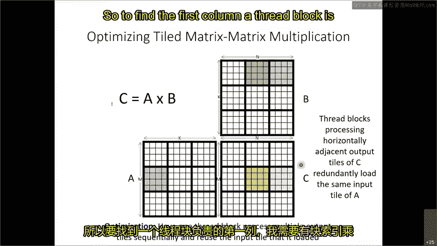

Okay， there I'm gonna have。Time the。Porening。是。ok。😊，Okay， so after I put the ping factor here。

 now I know where every column starts sorry the start column for every thread。Okay。

Next thing I need to do is， I was initializing sum before。

 But now every thread actually has multiple sums， right， So now this。

 the thread responsible for this output element is also responsible for this output element。

 So it's going to partially accumulate to this sum and then partially accumulate to this sum And then it's going to load the next tile of B and the next tile of a and it's going to partially accumulate to this sum and then to this sum。

 So now rather than each thread being responsible for one element is responsible for course factor elements。

 So here sum is no longer going to be a local variable。 sum is going to be。A array。

 who size is as course factor。Okay， and now I want to initialize each of these to zero。

 so what I need to do is I need to loop over for uns and C equals0 C is less than the coarinning factor。

Plus， the C。Okay， and then over here， I'm going to initialize sum of c to zero。ok。😊。

Now I've initialized the sum for all the elements that I the thread is responsible for to 0。 Okay。

 now what do I do， now I'm gonna loop over my tile。

 So this outer loop over here loops over these input tiles。

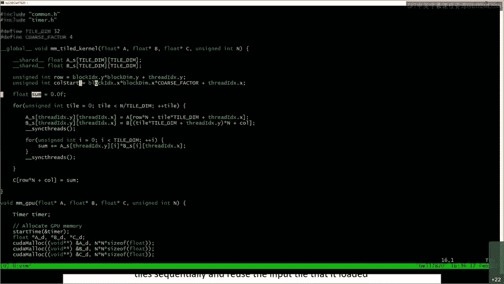

Now， for every intelile。I need to do is I need to load an input tile A。

 and then I need to load multiple input tiles for B。

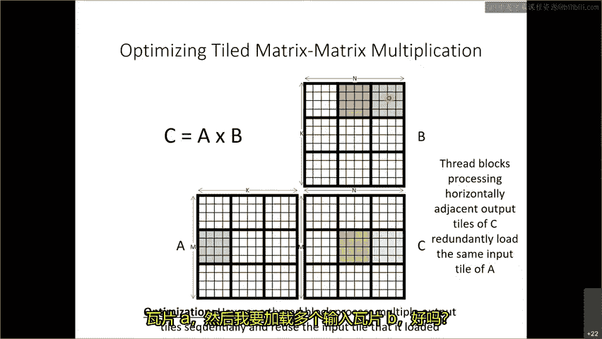

Okay。So if we go back to the。Over here I was loading one input tile of A and one input tile of B。

But now I need to load multiple input tiles of me。Beder for me to load multiple tiles of B and process them。

 What I'm going to have to do is I'm going to have to now insert a loop that loops over the tiles of B and then。

 and then does the sum。 Okay， so here I load the tile of A。

 and then I'm going have a loop that loads the tile of B and then compute and then loads another tile of B and then compute and then loads the third tile of B and then compute。

 etc cetera。 Okay， so here what I will do is I will。

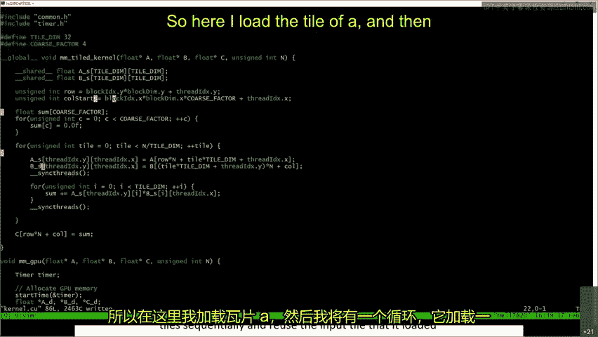

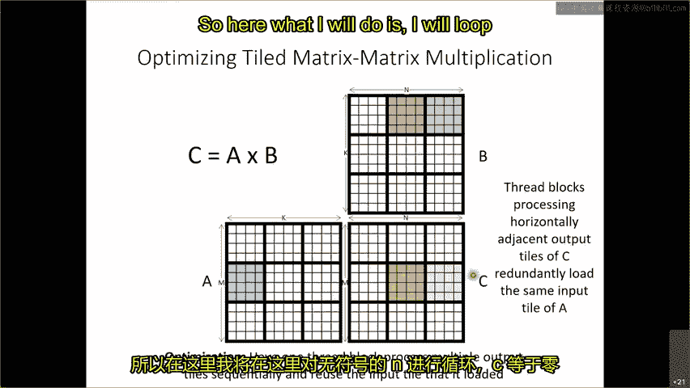

A loop over here， for。安三。Unsign N C equals 0。C is less than the coarening factor。Okaye， what's was C。

And now what this loop is going to do is going to loop over。All this stuff。Okay。

 so this loop is going to load the tile of B sync threads and then do the partial sum and then sync threads。

 and then load the second tile of B， then do the another partial sum for that。 And then sync threads。

 etcter。 Okay， but now what I need to do is when I'm loading this tile of B。

 I'm using the column of the thread。 and I need to make sure to set the column of the thread correctly。

 Okay， so the thread that's processing this element over here is going to have a column value。

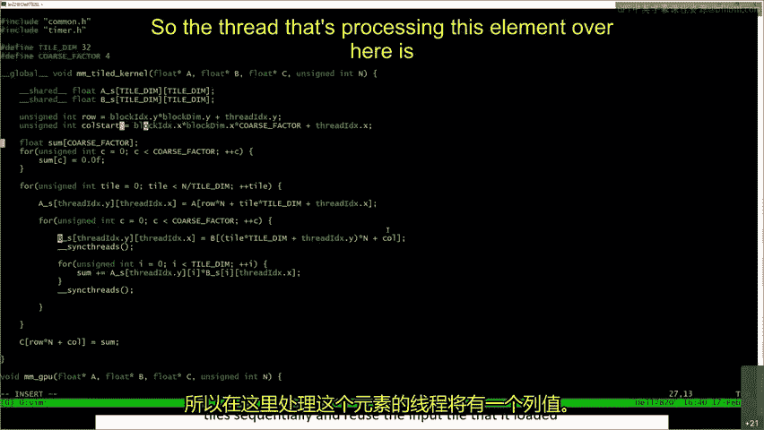

When it goes to the next value of C， it's going to have another column value and when it goes to the next value of C it's going to have another column value and that column value is going to depend on C。

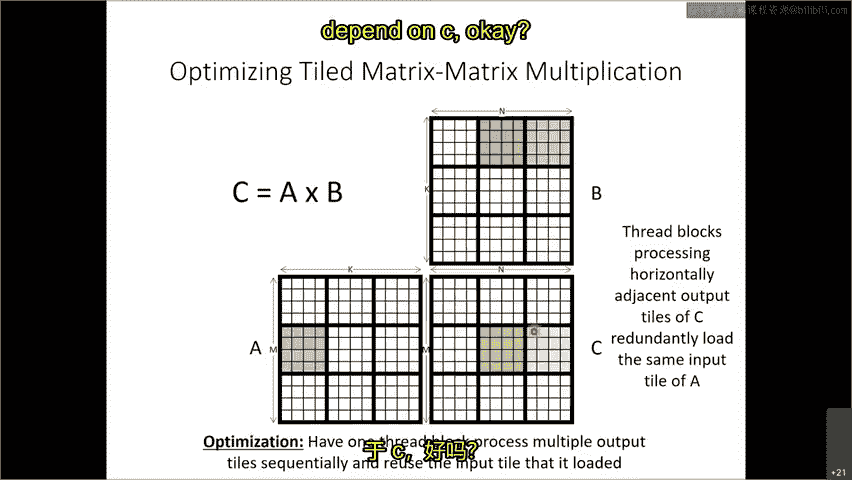

so here， what I need to do is I need to figure out for each value of C。

 so for each step in the coening loop， what column the thread is responsible for。ok。😊，Yeah。

So to figure out the the column index， I write Einstein and call is equal to。

 and then I have the column that I started from。 so call start。Okay。

 so if in when the for the first element。

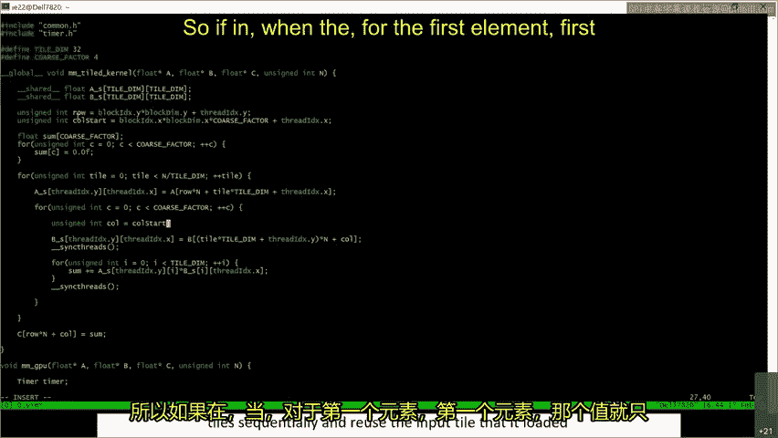

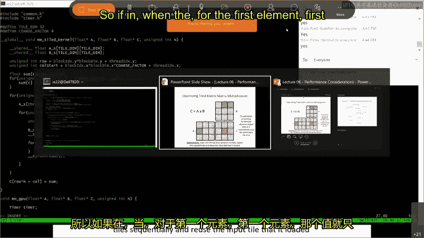

First element， that values is going to be call start。Okay。

 for for the first the value of the course factor， when C is one。

 that value is going to be call start plus the width of an entire tile。Okay， et ceter。

 So here at call start plus the coening factor times the width of an entire type is is going to be call start plus c times styled then is that clear。

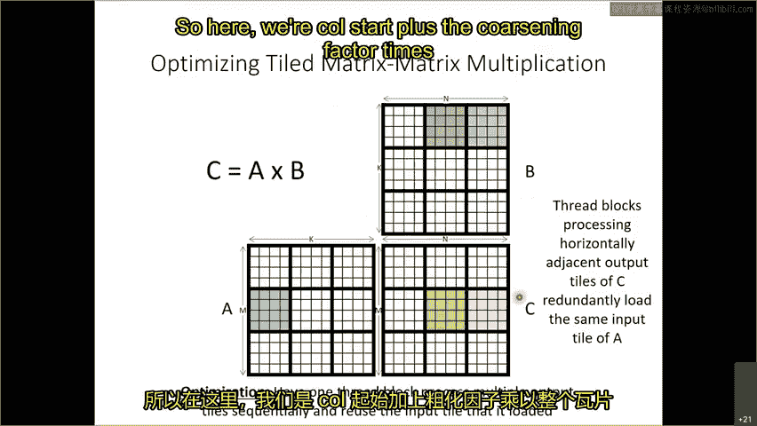

So here this loop， this coarsening loop is going to loop over our different tiles。 Okay。

 and every time it's going to have a different column index and then everything else is going to be the same。

 So here when we load the from B， it's going to be the same thing。

 right all this code is still valid， we sync threads， and then we loop over this。

 and then we multiply the tiles of a with the tile of B。 Okay， but then here， when we have the sum。

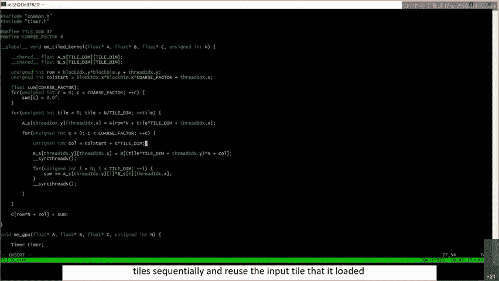

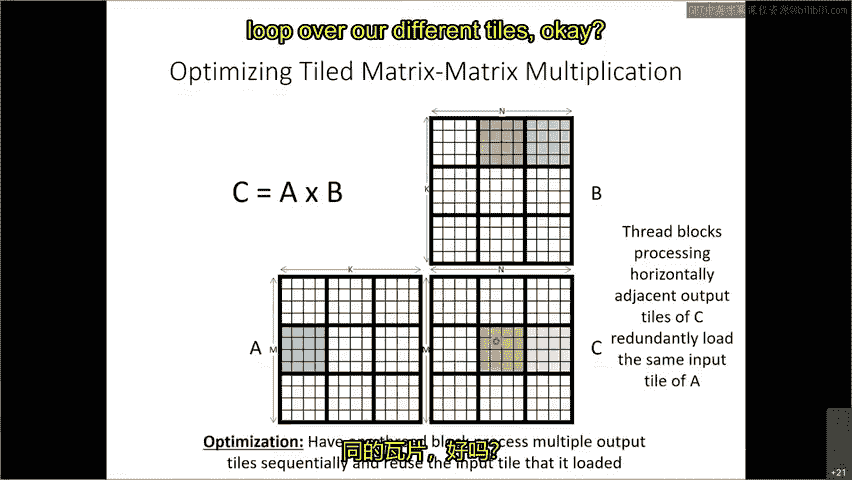

Okay， the sum over here now is an array。 So we need to make sure that we pick the right sum。

 So it's going to be sum of the。So now we have a loop that loops over the input tile and that for every input tile of a。

 we loop over multiple input tiles of B。Okay， and we compute using those enterprise。Okay。

 and then finally， when we are done with all of this now we we are done all the sums already。

 but now we have multiple sums that we need to write out。

 so again we're going to loop over we're going to have this courseing loop that loops over all our our output values that we need to write out and we're going to。

Write them out。Okay， but of course， over here we're going to need the value of the column and here the value of the column is going to be calculated in the same way we did it before。

 it's going to be call start plus d times style of them and of course here we have multiple values of sum so this is going to be some of。

So by doing this， what we have done is we've applied thread coing to our matrix matrix multip matrix matrix multiplication kernel in order for us to reuse the same tile of a that we loaded for multiple tiles of B。

And let's now compile this code。Okay， and now we can run it。And we have a mismatch。

So let me go and figure out where this M is next， Pro。嗯。You change the block dimension。Yes。

 thank you。' that's what I。So so before we when we were loading this now have we had certain number of thread blockss now we have to divide this number of thread blockss by the by the block dimensions so you're absolutely right that's what we forgot we have to change the block dimension so we're going to come down here in the code that was launching。

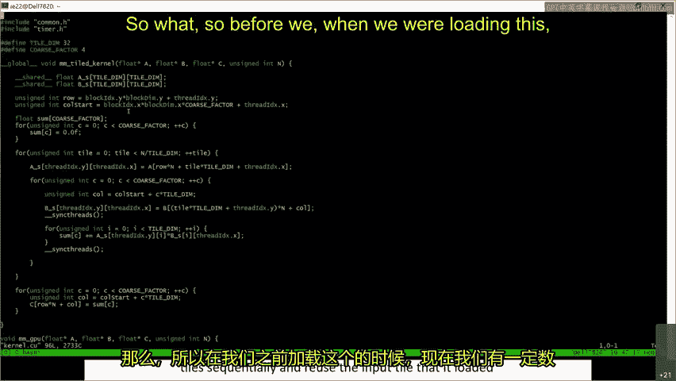

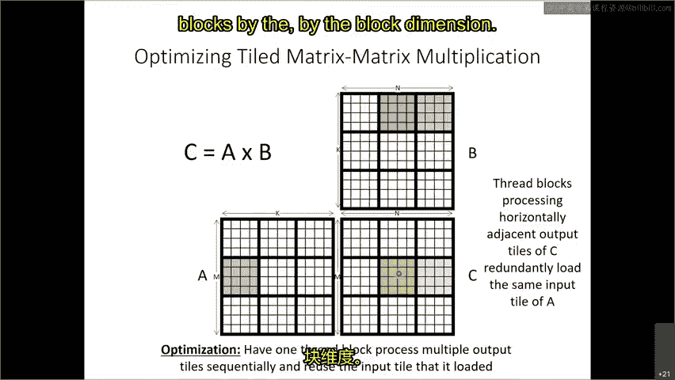

Okay， and we are we need to divide the number of threat logs in the x dimension by the coing factor。

Okay， so once we do that， hopefully that'll work。Okay， and there we go at work。 So you're right。

 Thank you for that correction。 So now you'll see that the time has improved。 So before it was 0。

91 milliseconds and now it's 0。87 millisecond。Okay， and here the performance improvement is is okay。

 you know， we can experiment with different different coing factors。 So for example。

 let's try a larger coening factor so maybe we have rather than four we can have a factor of 16 you know。

 and this may may help performance or may performance if。Let's try this。

And you'll notice that this time it hurt performance because now we have too much serialization Okay。

 so depending on the GPU that you're running on， different coing factors may be better or worse。

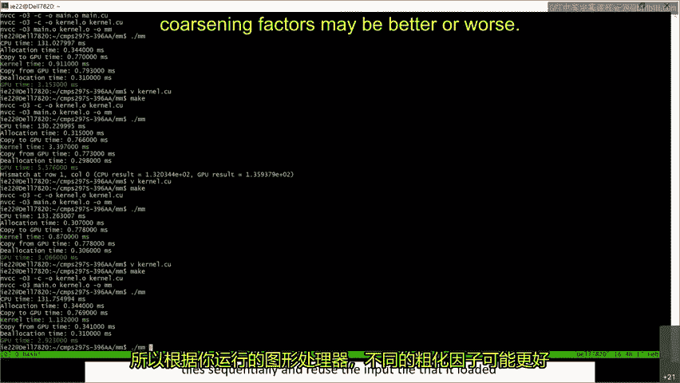

So this is here the code that we wrote so threat coinning is basically an optimization where a thread is assigned to multiple units of parallelism in other words we make the thread more coarse brain the advantages of threat coinning are is that it reduces the price paid for parallellyzization and the example we that today what this is it is it reduce the redundant memory loads from the cloud matrix multiplication but it may reduce other things we could reduce the redundant computations for example so if。

If multiple blocks do some redundant computation and that's the price we paid for parallelism。

 then we can do that redundant computation once and then use it for multiple threat and also it could reduce something like synchronization or divergence so if the price that I paid for parallellyization was synchronization or control divergence then it would reduce that cost for me too。

OkayThe disadvantages of threat coseening are like we saw。

 so when I increased the threat of the coseening factor from 4 to 16 I actually ended up hurting performance。

 so we may underutil resources if the coseening factor is too high。

OkayAnd what that means is that we need to retune the coing factor for every device because different devices have different amounts of resources。

 So different devices will have different coening factors。

 So I'm no longer benefiting from this transparent scalability because I'm interfering with the transparent scalability when I apply a thread coing。

 So these are the advantages of disadvantages of thread coning Another disadvantage thread coening is that we have more resources for thread。

 So now in our code over here a thread now is using more resources because it has to。

 you know it needs to maintain more more。

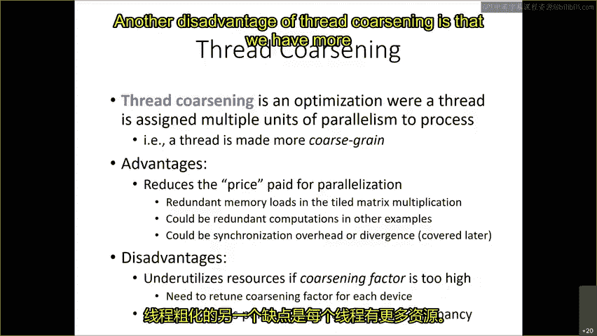

it needs more values， sorry， more memory here in order for it to store all the different partial results。

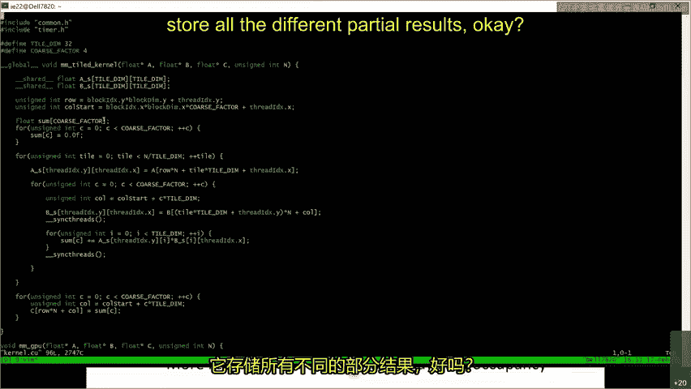

Okay， we need more resources per thread and if we use too many resources per thread， this may limit。

All right， so having covered that， this is a checklist of the optimizations we've looked at so far。

 tuing resources to maximize occupancy， minimizing control divergence。

 having a uniform memory access patterns so that we have memory coalescing shared memory timing to capture data reuse and thread coing to mitigate the price of carization and this on the left here shows you the impact of each of these optimizations on the cores and on memory there's one more optimization we didn't talk about yet and we will talk about that in a few lectures from now and that's privatization and privatization is optimization we'll cover later but it basically tackles the case when we have different threats contending on a common output。

Okay， and with this checklist of common optimizations with these six different optimizations that we have in this list。

 this covers a wide range of the different optimizations that we cover that we apply when doing GPU computing and throughout this throughout kind of in the second part of the course。

 we're going to go through many different parallel patterns and we're going to parallellyze them and when we parallellyze these parallel patterns we'll pass by this checklist and we'll see which of these optimizations apply to those parallel patterns and we'll see how we can apply these optimizations in the different context。

Having said this， it's important to note that sometimes there's tension between optimizations。

 so for example， when I maximize occupancy， sometimes if my occupancy is too high and my threads use a lot of memory having too many threads these threads start competing for the cache and they might evict each other's data out so there's a tension between maximizing occupancy but also controlling the thrashing of my cache。

So sometimes what people like to do is not to maximize occupancy。

 but you know try to limit occupancy a little bit if they know that the threads are thrashing each other's data out of the cache so sometimes sometimes you have to kind of make balance between different optimizations Another example is shared memory timing if I use a lot of shared memory it helps me enable enable more data reuse。

 but then if I use too much shared memory it might limit my occupancy because the ST doesn't have enough shared memory to fully utilize all all the threads that it can have schedule。

Another example is threat coening where coening reduces redundant work but it requires more resources。

 so if I do too much coarening I may end up limiting occupancy as well。

 so it's important for us to find the sweet spot that achieves the best compromise and also it's important for you to know what your bottleneck is right know what your bottleneck is because you don't want to optimize for the wrong thing。

So the constraint that limits your the performance of the application is called a bottleneck。

And the bottleneck depends on the application as well as the device Sometimes what we might be limiting your application is the data reuse or the memory bandwidth。

 sometimes what might limit your performance is out contention。

 sometimes what might limit your performance is occupancy。

 sometimes might limit your performance is control divergence if control divergence is what's limiting your performance and you don't want to go apply shared memory tiling because because you're tackling the wrong bottleneck。

 if your performance is limited by control divergence。

 you want to go and try to minimize the divergence So it's important when we apply optimizations。

 we trade one resources for another to alleviate the bottleneck so it's important for us to know what our bottleneck is so to properly diagnose our application the bottleneck of your application before we select what optimization to apply because if if we have some。

And we apply a different optimization， we might be optimizing for the wrong resource and we might not get any performance or worse we might even hurt performance okay？

Having said that， you can read more about what will be covered today in chapter5 of the course。

 and I'd be happy to take any final questions， does anybody have any final questions？Okay。

 if there are no other questions， then that's all for today amongst the。

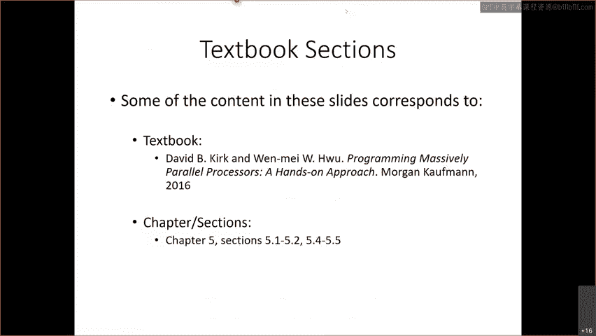

Bye everyone。Yeah。