# 美国贝鲁特大学《GPU计算｜CMPS 297S396AA - GPU Computing - Spring 2021》（豆包翻译 - P8：-08-Lecture 08 - Convolution.zh_en - GPT中英字幕课程资源 - BV1bw4m1k7a1

Hello everyone and welcome to Lec 8 of GPU computing。

 Today we're going to start talking about parallel patterns and the first parallel pattern we're going to talk about is convolution。

Before that， let me review what we've covered so far。 had we have quite a few lectures so far。

 and we've been talking about the fundamentals of GPU computing。

And so before I transition into this new part of the course where we're talking about parallel patterns。

 let me just do a quick review。 So so far we looked at the beginning of the course how you know how a single thread performance has stagnated because frequency has stagnated because of the power wall and this led to this move towards parallel computing and we also looked at the difference between the design of a CPU。

 which is a latnt oriented design design of a GPU which is a throughput oriented design And we saw how latency design。

 we focus on making one task as fast as possible and that includes using powerful AluUs large caches so that the laency the memory operations are as fast as possible so that we have less likelihood of cache misses。

Sophisticated control flow we can do things like brand prediction and data forwarding to minimize pipeline stalls and we have a little bit of multithtic to hide the little bit of latency that's left。

 that's not hidden by that's not hidden by these other techniques。 on the other hand。

 in GPs we have throughput oriented design where we have smaller Aus so an individual orthoed operation will take much longer however。

 we have many of them and this gives us more throughput And we saw how we have smaller caches and simpler control so that we can dedicate more area in order for us to perform more computation and parallel and we compensate for having this。

😊，This high latency in our operations by having a massive number of threats to hide the latency。

And then we looked at know a typical GPU in a system and how it drives on the CPU。 We said that。

 you know you do have a CPU with main memory。 We have a GPU that has its own device memory。

 and we usually you know copy data， allocate memory memory on the GPU and we copy data from the main memory of the CPU to the memory on the GPU。

 And then we execute our kernel on the GPU while accessing memory from user memory。

 and then we copy the data back and then we delocate the GPU memory。 Of course。

 there's other ways like unified memory where you just allocate data on the CPU and use it on the GPU and we'll talk about these kinds of things later。

 But this here is is one of the ways that people typically use GPUs。

 and we started off with a simple。😊，Vctor Edition kernel where we looked at data parallelism and we saw how data parallelism was suitable for GPUs and the hello world of data parallelism was vector edition and we saw how our grids are organized into threads and blocks and how we can calculate the index of the thread and use that index to perform an operation a different operation at the same operation each thread on different pieces of data。

😊，We then looked at how grids are actually organized into multi into multidimensional data to multidimensional arrays of threads so we can have twoD grids。

 we can have 3 d grids and we also looked at how multidimensional data is typically laid out we said it's laid out in row major order and we saw how when we access multidimensional data we need to。

We need to do this index calculation in order for us to convert a two- dimensionsal index。

 which we usually obtained from our threads to a one-disal index order in order for us to access our dynamically allocated array and we did multiple examples of this。

 we did RGB to grayscale conversion we did image blur。

 which is a special case of convolution which we're going to be talking about today and we also did matrix matrix multiplication and this example actually stayed with us for the next few lectures we looked at other kinds of optimizations that we can apply。

After having gone through these basics of the parallel of the C programming model。

 we then switched to talking about the GP architecture and we saw how it's organized it to multiple STs。

 each having multiple cores that share memory and control。

 and all the extentcents have access to the same global memory。

And we said that when grids are scheduled on SMs， they're divided into blocks and at the schedule of the Ss at block veryularity。

 which means that all the threads in the same block will run in the same as ST at the same time。

 but of course we can have multiple thread blocks running on the AS S simultaneously。

 we also said that when threads when blocks are scheduled on SMs they're divided into warps and the unit of scheduling is warps and a special thing about warps is that threads in the same warp execute following the STMD model。

 which means they all execute the same instruction on different pieces of data。

And the warp size has been 32 since since the beginning of GP Ps were introduced， but of course。

 this may change the future it hasn't but it may so you shouldn't just assume that the warp size will always be 32。

Now， having seen that wars execute in CD， this brought up the issue of control divergence。

 we said that if we have threads in the same warp that each want to take a different control path so I can have an if statement。

 some threads won't execute the then part， some threads won't execute the else part then because all the threads must execute the same instruction what happens is that they first all go to the event part and then the threads that take took will execute while the others remain inactive and then they all go to the L part and then the threads that took the first will be inactive while the threads that took the else branch will execute and we observed that when we have this kind of thing these inactive thread are occupying course but they're not doing anything so this results in aren' do utilization。

Of our hardware and we said that we would like to minimize this and we will see examples of how to do this and future parallel patterns that we'll talk about。

We also spoke about latency hiding where we said that by having many more warps and many more threads scheduled on an SM。

 then the number of course that we have on the SMM what we can do is we can benefit from this over-subscription of threads to SM by whenever one of the warps encounters long latency operation。

 we remove it and we bring in another warp to execute and it's placed until and then we keep bringing in new warps until the original warp finishes its long latency operation and by doing this we're able to hide the la and because we're interested in having many threads scheduled on the SM。

In order to hide latency， we said that we have this notion of occupancyency where the number of threads。

 the maximum number of threads per S is some numbered depending on the device， for example。

 on the V 100 it' 2048， but there's other things that might constrain my occupancy such as how many blocks they can have per S or how many registers each thread V SMM has or how much shared memory the SMM has and we spoke about the importance of being aware of our resource utilization in order for us to ensure that we maximize the number of threads on the S。

Next， we looked at memory in the GPU architecture and we saw how threads on the same cores on the same SM have access to shared memory。

And we saw how we could use the shared memory in order for us to place data that we plan to reuse so for example。

 in the tiled matrix matrix multiplication， what we did is we observed that rather than having each thread load that entire row and an entire column of A and B respectively what we did is we had the threads that are in the same block collaborate in loading a tile of a where every thread that's assigned to one of these other elements will load only one element in this file。

 but then the thread that loaded one element of this style can actually use the other elements and this style to benefit from the elements that other threads have loaded so basically what we do is we load these tiles to shared memory and then we compute inside of shared memory which does is that it minimizes the number of global memory accesses in order for us to have a better compute to global memory access ratio。

Then we looked at the organization of DM and we said that in these DRAM banks access to the DRM array is slow。

 but then once you have the DRAM burst accessing part of the DM burst is fast。

 so it would be best if threads when Ts issue their memory requests to be accessing data in the same DM burst because when you access data and different DM burst。

 you have to go to the DM array and then access the data and the burst and then if the next access goes to a different burst then you have to go through DM array again。

And you have to then access the burst， however， if you the same DM burst。

 then you read the DM array once and then you serve the data from the burst and then you serve the other part of the。

 other parts of the burst later on without having to go back to the DM array。

And if we have multiple DM arrays， then what we can do is we can hide latency by while reading from the DM array of one of these DM banks。

 we'd be serving from the birth of another one of these DM banks and this is another motivation for us to maximize occupancy on the GPU because just like maximizing occupancy helps us hide pipeline latencies。

 it also helps us it also gives us a lot of memory accesses which helps us hide the memory access latency。

And with that， we developed this checklist of common optimizations such as tuing resources to maximize occupancy。

 minimizing control divergence， having a new form access pattern to enable memory coalescing。

 shared memory tiling so that we could capture data reuse。

 thread coursing to mitigate the price of paralyzization。

 and privatization which we haven't covered and we will cover later on。

But choosing which of these optimizations to apply depends on what is。

 what is the bottleneck that your particular application is。

Experiencing that limiting its performance and with that we spoke about the importance of knowing your bottleneck because optimization straight off one resource for another。

 so you want to make sure that you're trading a resource that you have plenty of for a resource that is your bottleneck resource and that means that we need to select the proper optimization and in order for you to know your bottleneck coulda provides you with a tool in order for you to profile your application in order to figure out what is being utilized and what is not being utilized so that you can assess what your bottleneck is。

So this was kind of a breeze through what we have covered so far this ends our first part of the course on the fundamentals of GPU computing and the next part of the course what we will do is we're going to parallel patterns and we're going to spend quite a bit of time talking about these parallel patterns and hopefully with each pattern we talk about we're going to introduce maybe a new architecture feature or a new optimization techniques so the objective of the parallel patterns is to learn about the parallel patterns but it's also about using these parallel patterns to learn new optimizations new techniques or new hardware feature and we will start today with convolution but before I get started does anybody have any questions about the overall flow of the course so far。

😊，Okay， well， if there are no questions， then today like I said。

 we're going to be talking about convolution， our first parallel pattern。

 and we're also going to be using convolution to introduce a new feature of the GPU architecture and the K programming model which is constant okay。

Let's begin by talking about what a convolution is。 So a convolution operation。

I an operation where you have some input。And the output of the convolution operation is such that every element of the output。

And here we have a 2D convolution。 Every element of the output is going to be a weighted sum。

Of the corresponding input element and its neighbors。 Okay。

 so every output element is the weighted sum of neighboring input elements。

Now we've seen an example of this before， right， exactly the image blur was a special case of convolution where all the weights were the same。

So at the image blur， we went through these input elements and we simply calculated a an average。

However， an image blur is a special case of convolution in a more general form of convolution。

 we have a different we could have a different weight for each of these input elements。😊。

And these weights would be determined by something like a convolution mask， Okay。

 so we could have some kind of convolution mask。Okay。

 a lot of times people call this the convolution kernel。

 but I'm calling it a mask instead of kernel just to avoid using the same kernel to mean multiple things because we already't using the word kernel to mean the ka kernel functions。

 Okay， so I'm going to call it a mask。 So we have this convolution mask。😊。

And this mask consists of a set of weights。And these weights are applied to the inputs。

 so I could compute a weighted average of these inputs according to the weights in the mask in order for me to get my output。

Okay。So where is convolution useful well convolution turns out has many applications that's commonly to use in signal processing。

 image processing， video processing and。😊，It's usually used to transform signals these could be one dimensionsal signals or pixels or you know like in image so these could be 2D into more desirable values。

 so for example we can have a convolution that computes a Gaussian blur。

 which is a more sophisticated blur than the naive blur that we saw before where you the farther away pixels might have less weight than the pixels that are closer to the center。

We could have a convolution that sharpens an image that does edge detection， etc。

 and the transformation that is done by a convolution operation depends on the weights in the mask okay now we are going to be using 2D as an example。

 it's nice to visualize and it's complex enough， but you can also there can also be a 1D convolution there can also be a 3D convolution。

Okay， so if you have a signal， for example， that you're processing。

 you might be using a 1D convolution as opposed to a 2D convol。

 but we'll be using 2D convolution as our example in this lecture。Now， having said this。

 what do you think is a good way of paralyzing convolution？The base of what we've done so far。 Yes。

 go ahead。A bit in the same way we did for matrices。Which is？Basically。

 we break up the images into two sets of matrices and。And instead of doing multiplication。

 we just multiply each value together and add them off。Okay。

 I was actually looking for something something simpler than that。

 which is a along lines of what we did with blur one thread per pixel per output exactly exactly。

 It's not simple。 So to paralyze convolution， what we could do is we could simply have one thread per output element。

😊，Okay， and this thread would be responsible for going through the neighboring input elements and the mask and calculating the weight and sum。

Okay so this is a very simple approach to paralyzing convolution， that's not the only approach。

 there are other approaches for paralyzing convolution。

 but for today we're going to go with this approach okay。

Now this is a straightforward approach right every thread is responsible for an output element and you just have a loop that goes through your input and your mask。

Now， one thing that you might notice here is that this mask。Is usually small。So for example。

 over here， I have a five by five mask。😡，And the mask is the same for all the different threads。

 so all the threads are going to be accessing a different part of the input。

 but they're all going to be accessing the same mask。So what we can do in this case。

 because the mask is small and because all the threads access the mask and because another important thing is that the mask does not change throughout the execution of the kernelel。

What we can do is we can actually store the mask in a special place called constant memory。

 exactly constant memory。 So storing the mask， some observations， the mask is usually small。😊。

The mask is constant so its ss don't change and the mask is accessed by all the threads in the grid so an optimization that we can apply is to store the mask in constant memory for quicker access So if you remember when we introduced they include a programming model will be said that threads have access to registers and then the threads in the same block each has its own registers。

 threads in the same block have access to a shared memory and then all threads in the grid have access to a global memory well it turns out that all threads in the grid also have access to a constant memory。

Okay they also have access to a constant memory。So what we want to do is we would like to put our mask in constant memory and constant memory is going to be faster to access than global memory and I'll explain about explain why later on but for now let's see how we can access constant memory using the KudDa programming model okay so let's see how we can use constant memory。

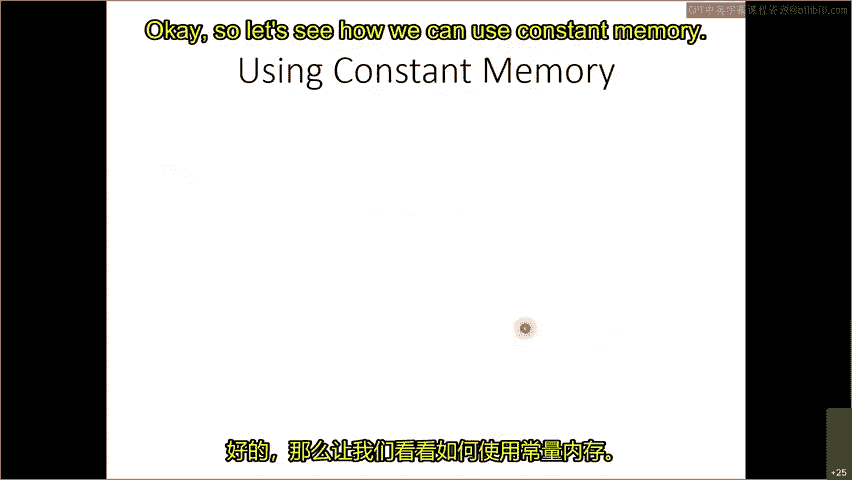

Okay， so I'm going to switch over here to my code。Make this little bigger。

So over here Ive set up this code first to implement convolution。

 so I have this function on the GPU that allocates the input allocates the output copies the input and then you know it copies here we need to copy the mask constant memory and then we call the convolution kernel and then we copy back and then we free the allocate memory okay so what we would like to do is we would like to create a notice here we have we have when we did put a allocate we allocate memory for the input and we allocate memory for the output but what we also like to do is we would like to allocate memory for the mask。

But this Kudamal over here， Kudamal puts data inside of global memory。

 What I'd like to do is I'd like to。Put my data inside of constant memory。

 and the way I can do that is by declaring a global array like this。

 I can write underscore underscore。Constant， underscore， underscore。Okay。

 and I can specify the type of my mask。 In this case， I'm going to make it afloat。 Okay。

 my input's going to be a floatat。 My output's going to be a floatat。

 And then also I'm going to make my mask afloat。Okay， and then I can give it a name。

 I'm going to call it mask underscore C。Okay， just like I use underscore D to say that something is in device memory or global memory I I use before underscore H to indicate that something is in host memory。

 I use underscore C just as a convention to say that something is a constant memory。

 I didn't have to do that。 I could have just written mask， for example， Okay。

 but I write mask underscore C just to indicate that something is a constant。😊，Okay。

 and then the mask is going to be a two D， so I'm going to specify that it's a two D by putting the size over here and then the size over here and what I've done is I've already。

Oops。I specify it in this header file what my mask dimension is。 So my mask radius is going to be2。

 Maybe I go two in each side and the total size of the。

 the total dimension of the mask is going to be two in one side，2 in the other side。

 and then one in the middle。 So that's  two times 2 plus one。 That's5。

 So the dimension of the mask is going to be 5 of like we saw in the slides。

 So here what I can do is I can specify。😊，That this is mascam。啊拜。Mask them to D array。Okay。

 so this is how we declare an array in constant memory。

 And now what I would like to do is I would like to initialize this constant memory array and it's constant memory。

 which means that we cannot write to it when we are executing on the GPU。

 But what we can do is we can copy to it from the CPU。 Okay。

 so what I'm going to do is in this in this convolution GP GP host function。

 I'm receiving this mask array， which is a CPU array and all I have to do is I have to I want to copy this mask array to the constant memory on the GPU and the way to do that is as follows。

 I have a function， a special clue copy function for copying to constant memory。 It's called。😊，Toa。

I have coffee，2。Symbol， okay， so it's not just good un copypy。 It's good have un copy too symbol。

 which indicates that we're copying the constant memory。

And as before we specify our destination pointer， which in this case is mask underscore C。

 we specify our source pointer， which in this case is mask， which corresponds to this over here。

And then we specify the size of the data that we want to copy。

 which in our case is going to be mask dim times mask dim， this is the size of the mask。

 and then the size of each element of the mask is sized of float。😊，Okay。So by doing this。

 this is how we copy data from the host to the constant memory on the GP。

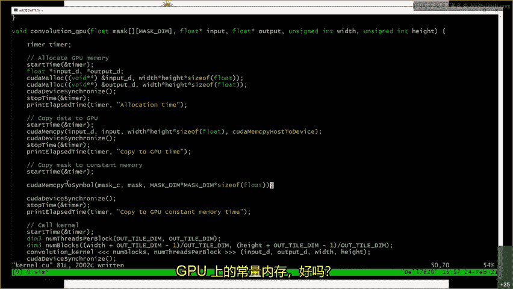

Okay， and this is the code that we wrote。 Now there's a catch with constant memory。😊。

And this catch with constant memory is that we can only allocate 64 kilobytes of constant memory okay and this is important because if it wasn't for this。

 then if you remember our matrix matrix multiplication。

 our whole input matrix A and our whole input matrix B are constant right they don't change throughout the lifetime of the kernel。

 but I'm not going go and put my whole matrix A and my whole matrix B inside of constant memory because constant memory。

 the tradeoff is you know it's fast but the tradeoff is that we can only allocate a small amount of it such as 64 kilobytes。

😊，Okay， so otherwise we could put our input， but we can because it's too large to put in constant memory Now what's the motivation behind having this constant memory and why why is knowing that why does knowing that it's constant make it faster and why do we have only a limited space Well the motivation is as follows First of all。

 when data is constant it's easier to build and efficient cash for it right Why ist that what's the difference between building a cache for data that might change and building a cache for data that is constant。

You don't need to write。 You You only need to write one。Right， you don't write to the cast。

 And what does that mean。What did we have to do with use to write to the cash？

We used to set bits valid bits and dirty bits。 right。

 we had these dirty bits and we had to do right back and had to do all these things。

 So all of that is expensive to is it more expensive to implement right。

 But if I have a constant cache and I don't have to worry about this stuff right I'm just building a cache to be read。

 I'm not building it to be written So I don't need to support writing to the cache。Okay。

 so no need to support tracking changes and writing back。

 tracking changes using a dirty bit and writing back when when there's an eviction。Okay。

 what else do I not need to support if I cannot write to my cash？And remember。

 this is a parallel processor。Red number， and so on。No。

 so what happens if I have many threads that are writing to some value？M access。

 so it can be accessed by multiple threads at once。Right。

 so what happens in my cache hierarchy when multiple threads are accessing the same cache line？You。

 you might get conflict， you。So theyre right conflicts and how do you deal with those。

 there's something called cash coherence right， are you guys familiar with cash coherence？

So you need to make sure your caches are coherent so when you have a cache that you can write to。

 you need these kinds of coherence protocols in order to make sure that the data that you have is consistent across the different caches。

 whereas when some data is constant then you don't need to support cache coherence。Okay。

 you don't need to support cashco here。Okay， so that's。

So then there's no need to support cash coherence。Okay。Allright。

 the other point about constant memory is that it is small in size and being small in size。

 meaning that we can minimize eviction。 So the cash has low miss rate because the total amount of constant memory that you have is small。

 So your constant memory can fit can fit you know， inside of your cache。

 And that is why even though we saw that。The that you know from a programming model perspective。

 all threads have access to the same constant memory。

 there's actually a constant cache that sits inside of each SM that cache is this constant memory and this constant cache is different from the L1 cache or the shared memory。

Okay。😊，Is it clear any questions？Professor， instead of instead of using the constant memory， why。

 since our kernels are quite small， Why don't we just put them into the cash for。The the SM cash。

The shared memory， I mean。And they'll stay in the shared memory， because。

It's the same value you could put them in shared memory。

 but that means you have to do the work for that right so shared memory is managed by the programmer。

So you have to go and load mask and put it in shared memory and do all that stuff。

 but with constant memory you don't have to do any of that right the constant cache is managed by the hardware not by the program。

 but shared memory is managed by the programmer。お返し？ok。😊，Okay。

 so having said this now we've seen how to allocate constant memory and we've seen how to copy to the constant memory。

 the next question is how can we use this constant memory inside inside of our convolution kernel code so let's go now and write the convolution kernel。

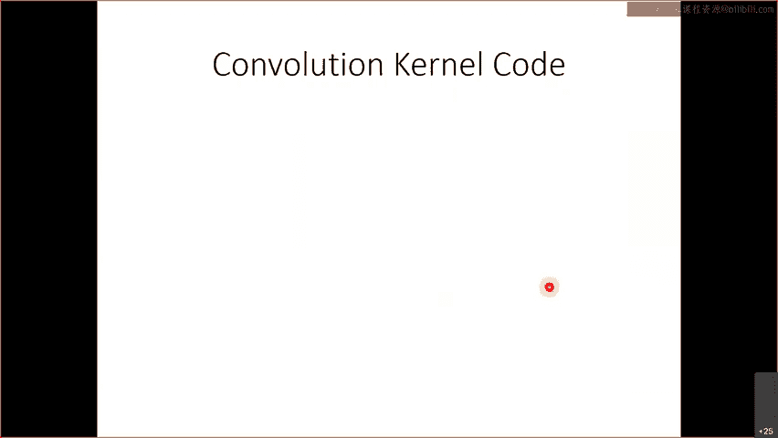

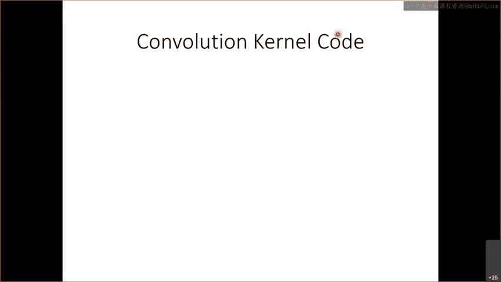

So let's switch back to our code now and now that we have our mask and constant memory。

 let's write our convolution kernel So it's going to be very similar to the image blur kernel right we're going to we said that we want to have a thread assigned to every output element so we're going to have to do is we're going to have to find the row index for that thread and the column index for that thread so how do we do we're going to write endt and what I'm going to do like I did before with the image blur kernel is I'm going to distinguish between the output row and the input row because every thread is assigned to an output element。

 but it processes multiple input element So the the thread index is going to be used to calculate the output row so I'm going to write end。

😊，How true。Ass equal to。 and remember the row corresponds high dimension。 So it's going to be block。

Index dot y times。 lock them dot y plus。Bread index dot y。Okay， and then we're going to have in。

Out column is equal to log index dot x times log dim dot x plus。Thread index， T。Okay。

 so now we have the indices for the output row and output column that the thread needs to compute。

 The next part is the boundary condition。 I want to make sure that only the threads that are within the bounds of the input are going to compute。

 So what do we do， We're going to compare out row and out column to our boundaries。

 We're going to write if。Altro is less than height。And。Out column is less than。With。Okay。

 so we have all of this。 Now what we can do is we can have this thread start going computing。

 So first I'm going to initialize。A floating point value sum。

 which is going to be the accumulator that I'm going to acculate when I when Im calculating the weighted sum。

And now what I'm going to do is I'm going to loop through my neighboring inputs and my mask。

 and I'm going to calculate the weighted zone。Okay， now what are my loop bounds。

 So these loops that loop through my my my input and my weight to thumb。

 what are the loop bounds for these loops？So if I'm looping through my input and my weighted sum。

 it's like I'm looping through the elements of the mask。

 so the loop bounds are going to be simply the dimensions of the mask， which which is mask then。Okay。

 so I'm going to do right。4our。And mass row is equal to 0。Mask crow is less than the mask dim。Okay。

 and then first plus。Mascarrow。Okay， so now I'm loop through the rows and the columns of the mass。

And write for and mass column is equal to 0。 mass column is less than mass them， and then plus plus。

Mass collar。Okay， so now what these tubes are doing is they're looping over all the elements of the mask and now what I need to do is I need to find for each mask element what is the corresponding input value that I need that I need to read from Okay。

 so I need to calculate enroll。Add I need to calculate and column。Okay。

 so let me explain how to do that， let's go back to the image we've that we had before so that we can explain how to do that。

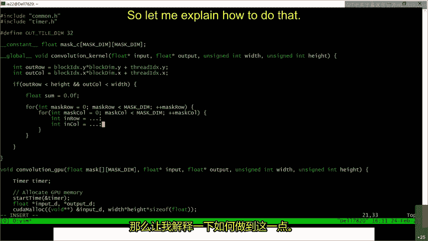

Professor， can we avoid having those loops？And in the case of。高不六0。

I feel like you can maybe deal with it without a loop。

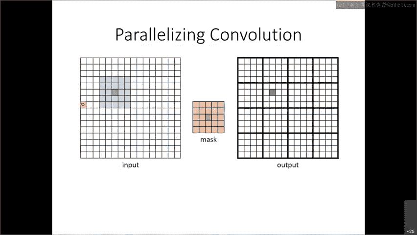

Explain how do you want to deal with it without a loop？Yeah， I know you have maybe if you have the。

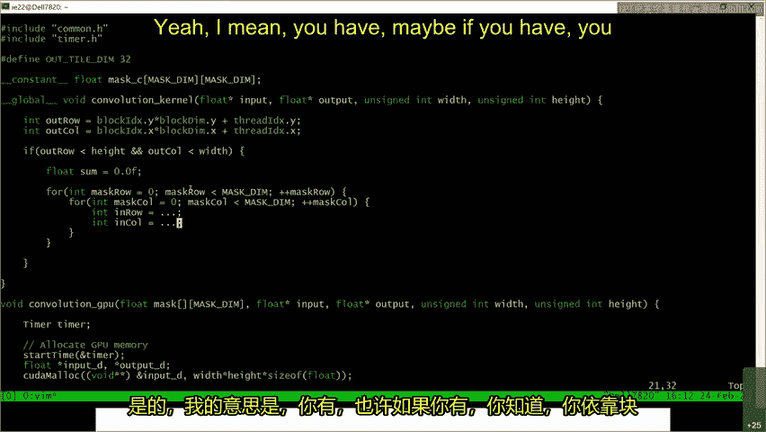

And you depend on blocks to iterate through whatever you need。SoSo right now。

 the way we're our parallellyzization approach is to I find a thread for every output element？Okay。

And this thread is going to loop through our mask and our input and calculate the weight it's done and then store the output value。

So I need the loop to loop through my mask。So if you want to get rid of these loops。

 what do you want to replace them with？Do you mean that would you like to maybe assign a thread to every input element？

Maybe something know I haven't completely thought about it are you trying to paralyze these two loop。

 for example， yes， Okay， well， you could do that right， You could do that。

 but that's only going to be beneficial if you have very little parallelism in your output， Okay。

 but this output is is you know， thousands of pixels by thousands of pixels。

 You already have a lot of parallelism from just assigning a threat to every output。

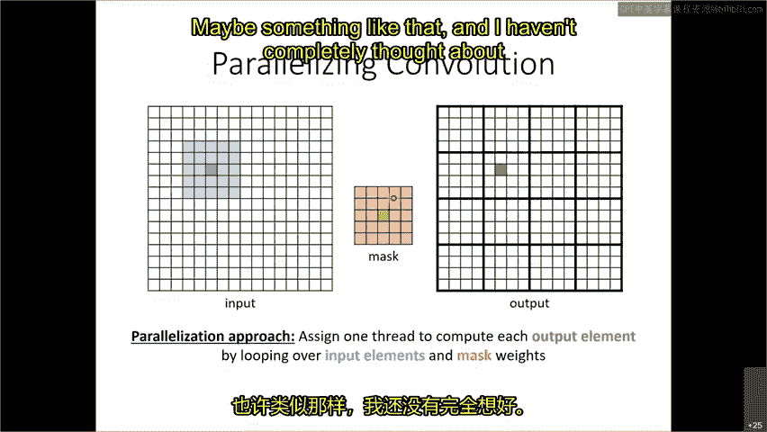

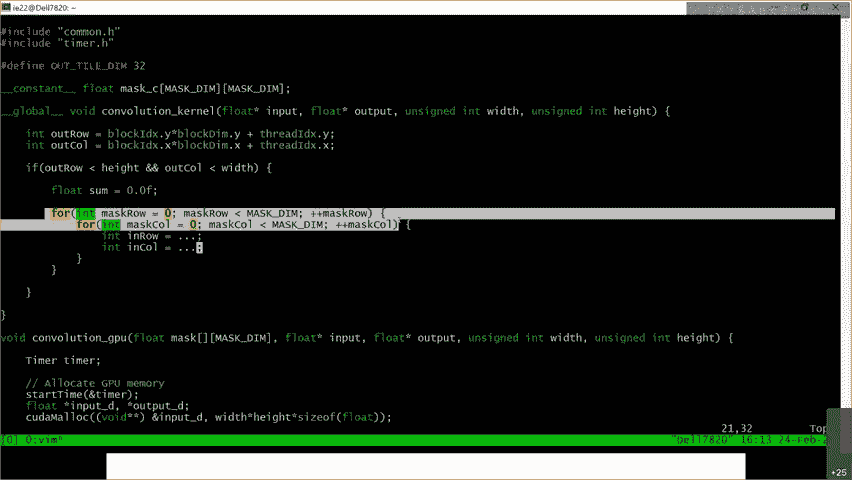

So there's no benefit in trying to extract more parallelism by also paralyzing the weighted summits though。

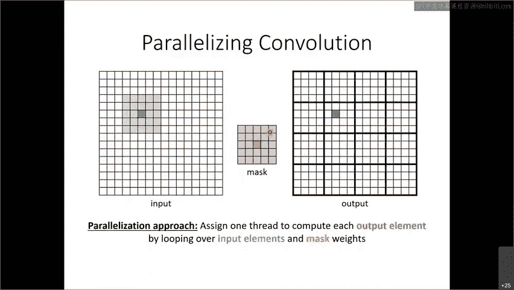

But if your output was very small， such that for some reason by assigning a thread to every output element。

 you have not fully utilized your GPU， then maybe it becomes worth considering whether you want to also extract parallel from the mask by paralyzing these two loops as well。

But for typical workloads， your output should be fairly large。

 such that it's not usually worth paralyzing for the mask。 In fact。

 you might even want to apply thread co settinging to have every thread serialize multiple output elements instead of only be responsible for one output。

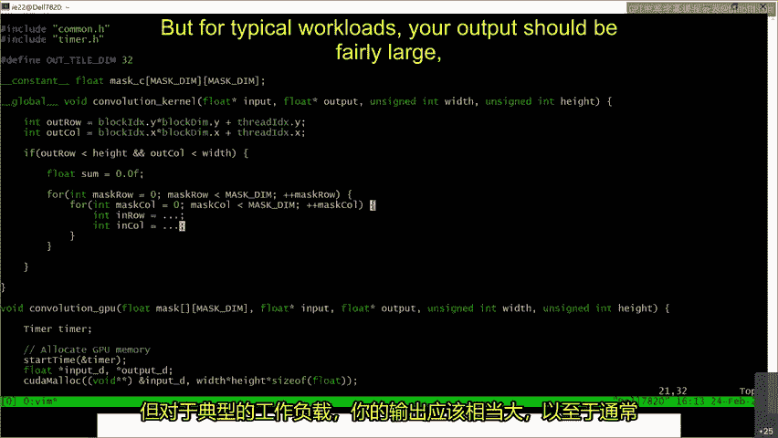

Okay。Yes。Okay， great。 So so let's go back and see what we do see what we do。 So I have my out patrol。

😊。

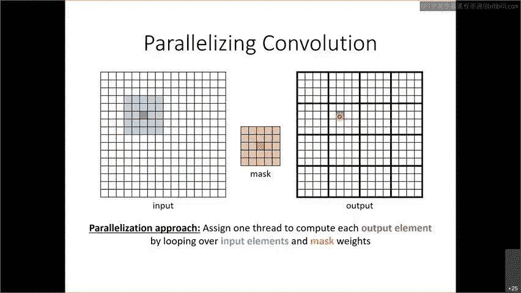

And my output column， and I have my mass row and my master column。

 and I want to find the corresponding input row and input column。 Okay。

 so my output row is going to refer to the row of this element over here， which is this row here。

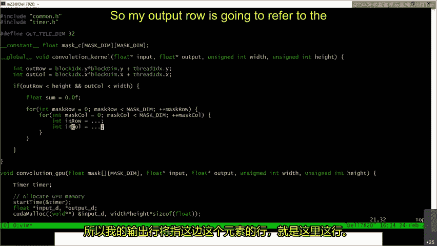

And my mask row is going to refer to the row of the mask element that I'm currently processing。

 So let's say my output row was referred to the row here and my mask row was zero。

 So it was this first element this first row over here。Okay。

 what's my corresponding inputro on to me？😡，It's going to be this row over here， right。

 So it's going to be the row of the element， the output element， which is here minus the mass radius。

The mass radius here is in this case is two， and the mass dimension is defined。Okay。

 so the input row is going to be the output row。Minus the mass radius plus the mass row and if my mass row is0 is just going to be the input row。

 minus the mass radius， if my input row is once so if I'm finding the input element corresponding to this mask element。

 that's going to be this input element so I would do is I would start from my output row and then I would subtract the mass radius and then I would add one which is my mass row。

Okay， so the mass radius， like I said， it's the number of elements in one direction。

 so in this mask over here my mass radius is2 and my mass dimension is5。Alright。

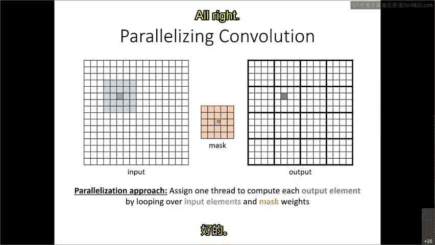

So， then， the impperro。Is going to be。The output rule。Minus v mass radius。ok。Plus， the mask row。

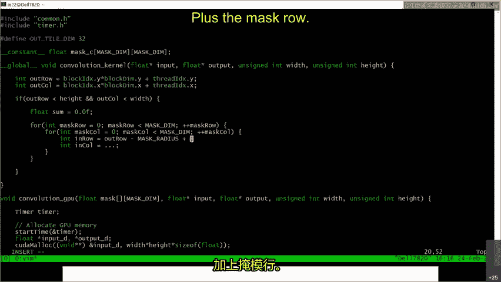

And the same thing for the column， the input column， so in this case。

 the input column refers to over here， the input column is going to be the output column。

Minus the mass radius， which brings us to the beginning of the mask plus the the mass columns of the mass column was 0。

Then then it's going to be the output column minus the mass radius。

 if my output column was one and if my mass column was one。

 then my input column is going to be my output column minus the mass radius plus the mass column。

 which is one。

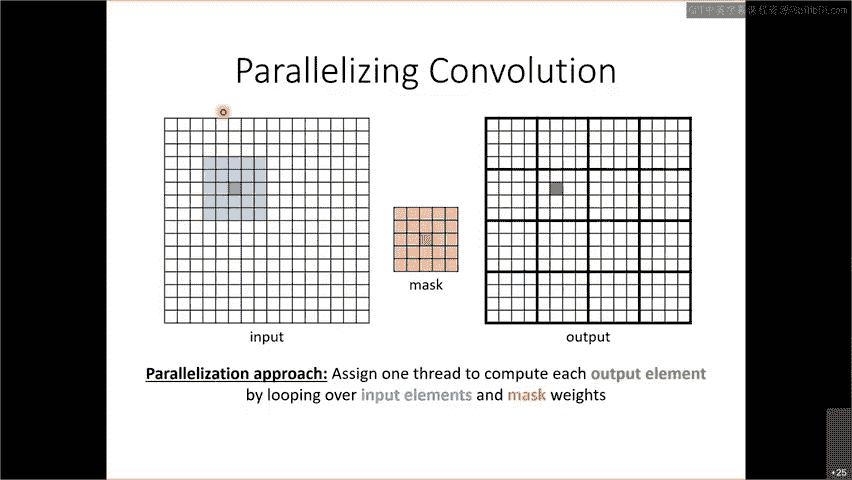

So then my end call is going to be my out column minus the mask radius plus my。M。Okay。

 and just as a reminder， since someone asked what is the mass radius。

 so I've defined the mass radius here to be two and I've just defined the mass dimension in terms of the mass radius。

 those two times the mass radius plus one， which in this case would be fine。Okay。😊。

So now that I have my input true and my input column， what I can do。😡，Is。I can。Acuulate to my son。

Right。呢。Mulplication of I remember I'm doing a weighted sum of the input with the output okay so I'm going to accumulate to my sum the multiplication of the mask element with a corresponding input element and yes you're absolutely right that we need to do a boundary check but let me first do the accumulation okay so you're absolutely right I need to have a boundary check。

Okay， but let me do the accumulation and then show you the boundary check because it becomes easier to extend the boundary check once you've actually written out the intent。

Okay， so my top is going to be sum plus equals。M underscore C。Of my mask。R。Mass color。Okay。

 so did I use the mass grow， the mask called to index the mask。Times。Okay。

 and now I want to index my input， and that's going to be input。Of。My enro。ok。😊。

Times the width of my input。 Okay， so again， I go to my in row， which might be here。

 I multiply it by the width of the input， and then I add to it。 The column。 Okay。

 so iss going to be in row times width。

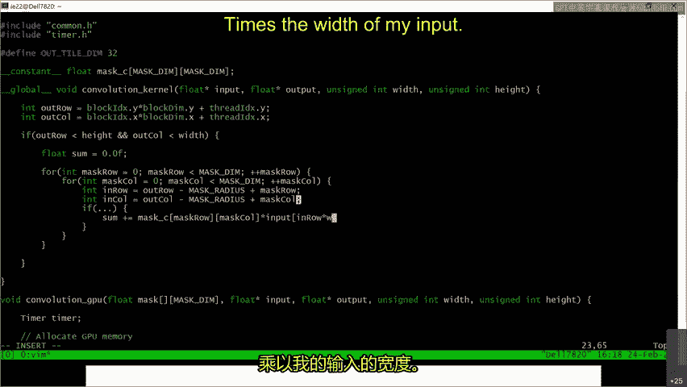

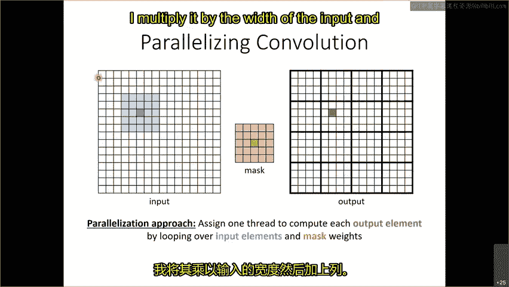

pl。哦了。ok。Okay， now what I want to do is I need to have a boundary check because I want to make sure that my input is within bound right I could be I could be at maybe you know this this input element could be over here。

 so the other input elements could be out of bound。

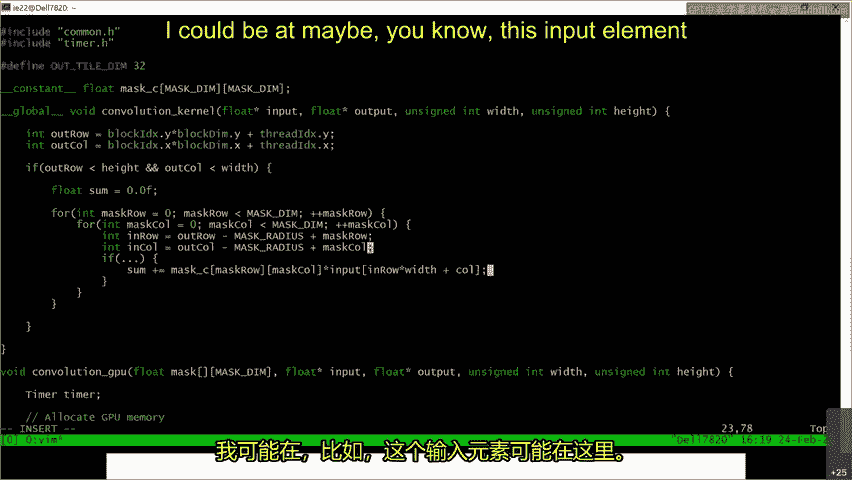

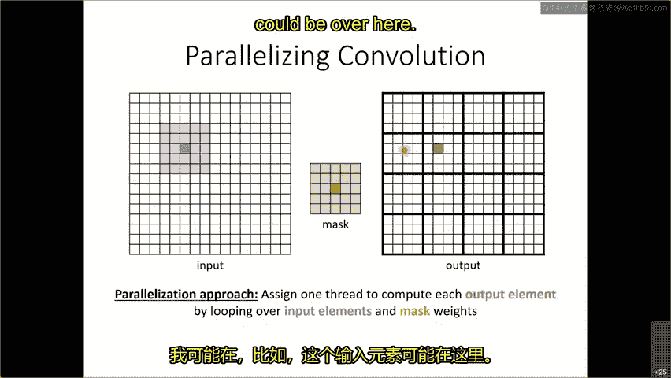

Sorry， my input element could be here at the edge， so some of the input elements could be out of bound。

 and it could be here out of bound。I need to make sure that the inputs elements that in access are within balance。

 and to do that， remember what we said about boundary conditions。

 every memory access needs to have a corresponding check on the ind for that axis。Now， with mask C。

 I don't have a problem because I know that mass row and mass column go from0 to mass them。

 which is all within bound。 So massque and mass column are always going to be within bound。

 The checks need to be on the indexes to input and the indexes to input are basically。

AEn row and end column。Okay， so whenever I need to check for in row， well I need to check。That Edrow。

Is less than。Kite。Okay， but I also need to make sure what I need to make sure that in row is positive because remember in row is being is out row minus mass gradientdius。

 so if mass gradientdius was greater than in row and mass row was zero this input input element in row could be negative right so it could be the case that my in row is as larger than the if I have this element was all the way out here it could be the case that my in row is out of bound here and that's why I need to check that sorry。

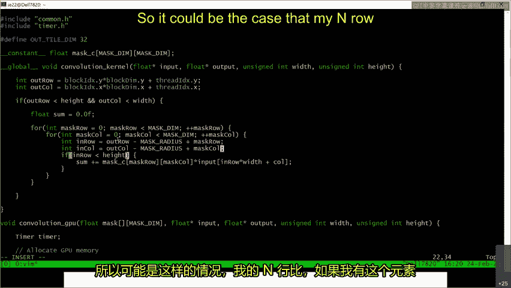

I I was referring the column so it could be the case that this element is all the way down here so I need to make sure that my in row is less than the height。

 that's what I'm doing here but it could also be the case that this output element is all the way over here。

 so I need to make sure that my my in row is also not over here so I need to make sure that my in row is greater than or equal to0。

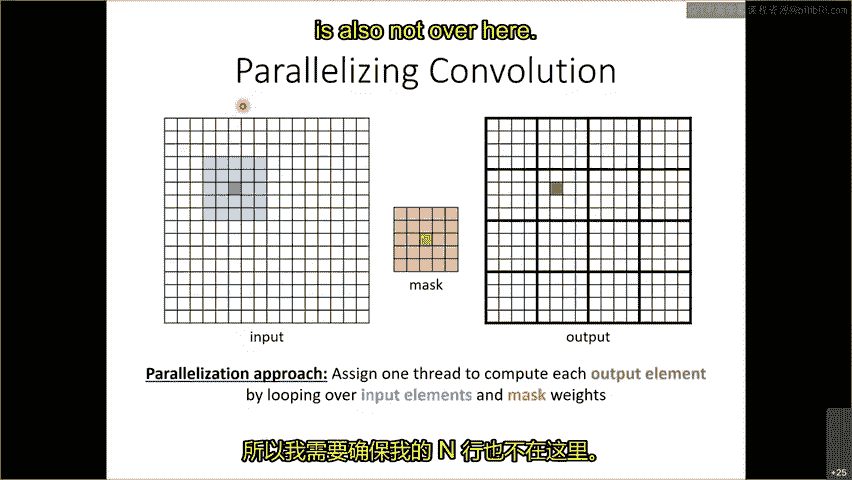

Okay， so inrow is less than height。And。En row is greater than or equal to。0。Okay。

 and the same thing for the column， I need to check that end column is less than width。

And in column is greater than or equal to0。Allright。😊。

So now I do the boundary check and I do the accumulation， Does someone have a question。Yeah。

 don't these boundary checks cause control divergence， Yes， they do。Okay。

 so is there a better way to deal with boundary checks。 Well， I mean， you can imagine that。

 So the amount of control divergence you're going to get is is not significantly high because for most of these threads。

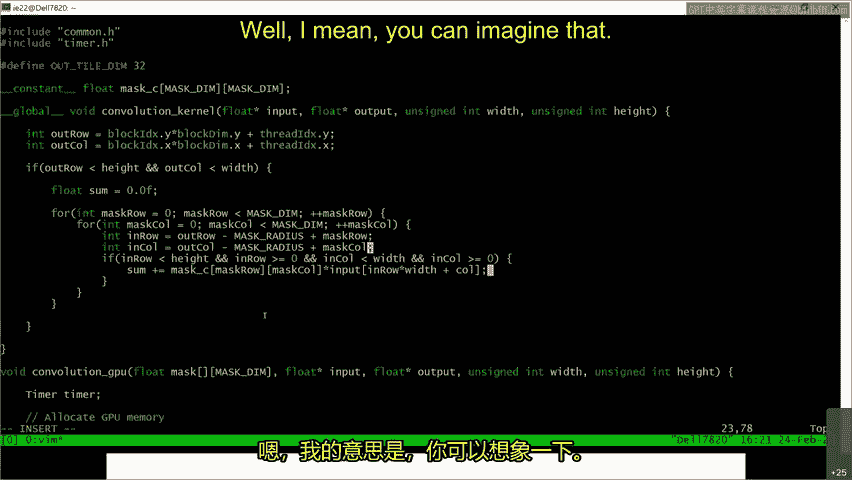

For most of these threads， they're all going to be within bounds。

RightBut only the few threads that are the edges are the ones where you're going to have control divergence。

Okay， so in practice this， the control divergence here is kind of inevitable and it's not really worth optimizing for。

The real control divergence that you want to optimize for is the control divergence where all the threads are experiencing divergence and we will see an example of that in a future lecture。

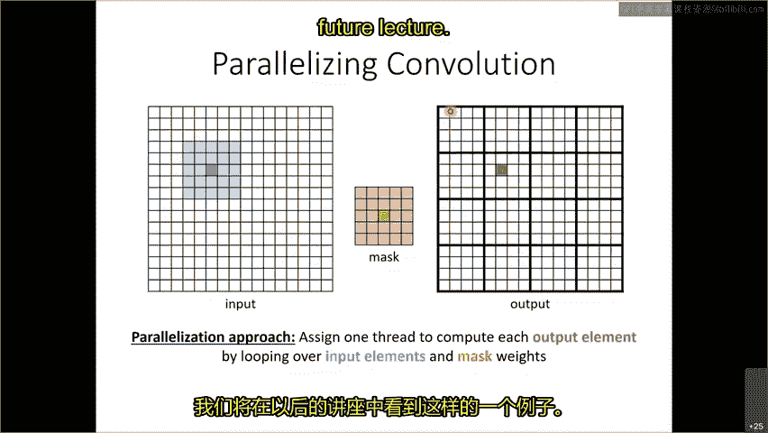

ok ok。Yeah。Okay， so after we have done this， we've accumulated to the sum。

 The final part is to store the output element。 So we're going to write output of。

Outl times with plus alcohol。Equal to。Okay， professor， when you're。Getting the， the input。

 isn't it in row times width plus in column。Oh， right， Thank you。This should be in home。

See one of the things about programming live when you're teaching a class is that you're bound to make these kinds of bugs。

 but fortunately I have many pairs of eyes that are double checking the code that I'm writing。

 so thank you guys for your continuous feedback throughout the course。Okay。

 so so having having having said this， let's now compile and run the code and see how well it perform。

I'm going to compile。And I'm going to run， let's hope for no errors。Okay。

 there we go and as you see we have quite a bit of improvement right the original code。

 the CPU time is around 2000 milliseconds and here we have five milliseconds for the GPU time and the sort for the kernel time alone and if you include the copy time it's still quite fast 85 milliseconds so as you can see convolution actually performs pretty well on the GPU why is that。

😊，Have the amount ofization。Sorry。You have a very heavy amount of parallelization。

But that's also the case for vector addition， but vector addition does not as big of a speedup because if you consider the cache behavior。

 it's going to just put the basically it's like it's doing tiling on itself and it's not really that much memory bound。

Right， you're right。 So so we have a lot of data reused。 So if we are lucky。

 our data is in our cache and we have good cash utilization。Okay， and also。

 one of our inputs is kind in constant memory。 So that one is fast ready。

 And the other input is global memory， but the the memory aes are well behaved， right。

 My memory aes are coalesced and also the all the threads that are in the same block are reusing are are using nearby data。

 Okay， and let's actually take a further look at。😊。

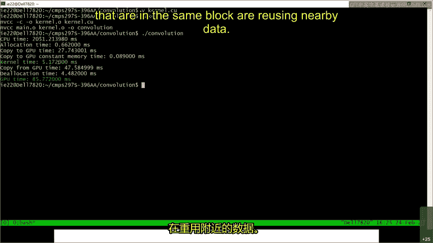

啊 so let me go back。To the slide that we were on when we were writing code。Okay。

 so this is the code that we just wrote。Okay， so data reuse in convolution。

 Now notice this thread over here， the thread that's processing this output element。

 is going to use all of these input elements。Right。But then if we look at what the next thread uses。

 so the threads in the same block load some of the same input elements。

 so if we look at what the next thread uses， the next thread uses all these input elements。

And as you can tell， there's quite a big overlap between the elements used by the spread that this output element and the elements used by the thread that processes this output output。

ok。So given this observation， what do you think we can do to capture this data reuse？It course。Well。

 not exactly coarsening， what was the optimization that we saw before the targeted data review？

I mean， you could probably do a course setting to improve on it。

 but the main optimization for data use is right highly。

So what can do as an optimization is well first， if you look at the amount of the data that all the threads in the same thread block use。

 it's all this data over here。Okay， so this output tile over here。Uses this input tile over here。几。😊。

So an optimization that we could do is we can have each thread load one element of the input into shared memory。

So that the other threads can access。So the other thread can access it。

 So rather than having this thread load this element and then this thread also load this element。

 and then this thread also load this element， we can simply have all the threads load this input tile into shared memory。

 So each thread loads one element。Okay， and then we can have these threads loop over the mask。

And loop over the input tile in shared memory and do the convolution operation。ok。😊。

Is that clear any questions about this？Now， if you can tell there's a slight difference between this tiling and the tiling we saw in shared and tile matrix matrix multiplication。

Theling the tiling here， the input tiles were as large as the output tile。Sorry。

 the tiling in matrix matrix multiplication， the input tiles were as large as the output tiles。

 so we simply had every thread was loading one element in each input tile and every thread was computing one element in the output tile when in this case the input tile is actually larger than the output tile。

And in fact， if you take a look here， we have your input output tile dimension， your mask dimension。

 your mask radius， and your input tile dimension。Okay。

 and the input tile dimension is actually equivalent to the output tile dimension。

 okay plus two times the mass radius， so it's the input outputile dimension which is this。

 and then you have the mass radius in this direction and the mass radius in this direction。

So your inputile dimension is equal to outputile dimension plus two times mass radius。

 so your input and outputiles have different dimension。So what do you do in this case。

 what can you do？Can we we can just have one through H thread load。

 one input tile and calculate one output tile。The solution is and what we can do is we can assign as many threads as we have input as we have input elements in the tile。

 so our thread size is going to correspond to the input tile dimension。However。

 when we come to compute， we would only use some of these threads to calculate the output pipe Okay。

 so in other words， if this is our thread block， the dimension of our thread block is book to correspond to the input tile dimension。

All the threads are going to be active when we are loading the input tile。Okay。

 but then after we load the input tile， only some of the threads are going to be active when we are computing and storing the output time。

So basically， when we have this mismatch between our input tile size and our output tile size。

 what we can do is we can over provisionvis the number of threads such that we have sub threadreads that are only responsible for loading from the input tile without computing。

 and only a subset of these threads are used to compute。Okay。

There's actually another way you could have done it。

 another way you could have done it is you could have had as many threads as you have output tiles and then have these threads in the output tile kind of somehow loop over the input tile values and load them。

Okay， but it turns out that you know the code for doing that is quite complicated and the performance benefit that you get is actually not that high。

Okay， so for the next assignment， I'm not going to show you the code for doing tile convolution because for the next assignment you will do it yourself for the next assignment。

 you will implement code where you will launch as many threads as you have input tile。😊。

As you have published your input tile， you will use all those threads below the input tile and then you will use only some of those threads to calculate the output time。

ok。😊，Okay， so having said that， let's now analyze the compute to global memory access ratio of tile convolution。

 assuming that we implement the tile convolution， let's now look at the compute to memory access ratio for tile convolution。

If we have an M by M mask。ok。What is going to be the compute to global access ratio？

For the non tiled version， Let's start with a non tile version。So without tiing。

 if we have an M by M mask， how many global memory loads do we have？For each thread。

 how many global variabless does each thread perform if we have an M by M mask。

 as many output output pixels or output threads as we Oh no， M squared。Right， M squared。

 So every thread is going to load M squared elements from global memory。

 And let's take a look at the code again so that we can kind of verify that。

 So here you'll notice every thread， our global memory load is basically this axis over here。😊。

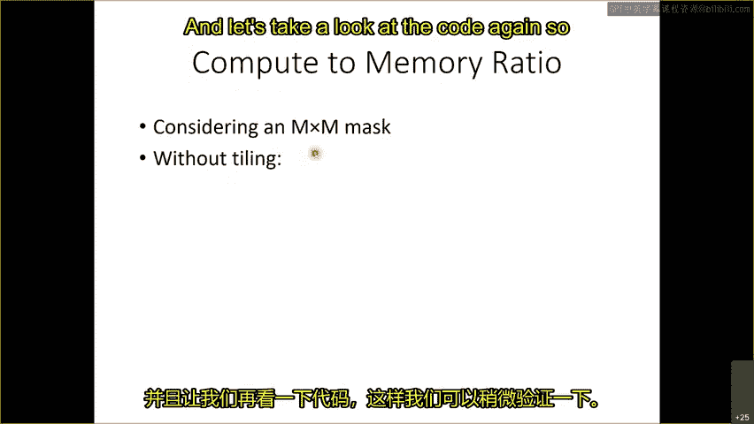

Okay。And every thread is going to do this load M square times。

And each one of those f square timess will be four bytes。

 so every side is going to do M squared times four bytes of loading。

And notice here that mask C does not count as a global memory load。

 so even although I have two opera here， only one of them count as a global memory load because mask C is coming from constant memory。

If Na was coming from global memory， then this would be different。Okay。

 but here I only have this going wherever load， so I'm going to do m squared times4 bytes of loading。

And then how many many how many calculations， how many floating operations does each thread do？2。

Right， does two does a multiplication and it does an addition。Okay。

 and then there's F squared of that。Okay， so if I remove M squared from the nu greater and the denominator。

 my ratio is going to be four bytes of loading。2。1。Plus two operations。

 the two operations per by if that's 0。5 operations per one。

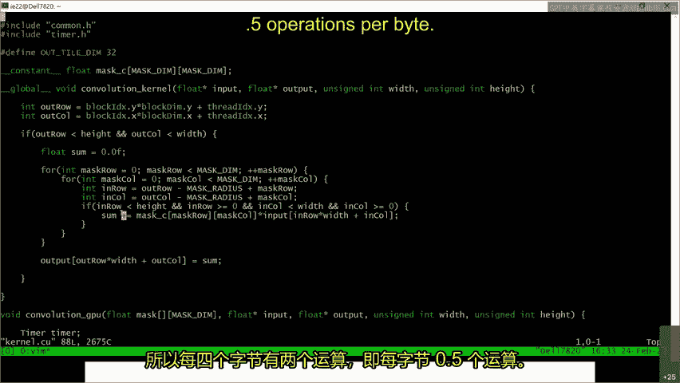

Isn't it for operations？

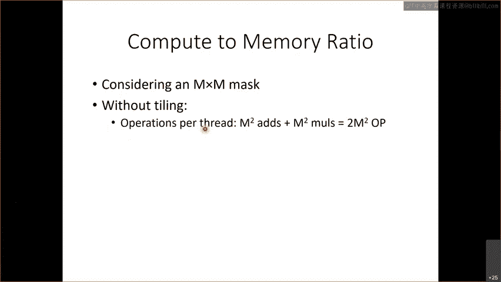

And well why do you stay for operations， We have a multiplication and we have an addition Yes。

 but you also have in road times width plus but we're referring to the floating point operations here。

 so look at floating point operations the mal area。诶呀。Otherwise。

 even this code over here is going to contain some integer arithmetic to calculate the address。

 but we're only concerned with floating point operations。

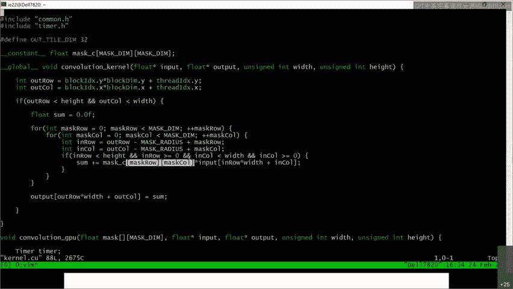

Okay， so we have M squared ads and M squared multiplication that two m squared operations。

 we have of course here I'm ignoring the boundary conditions right so with the boundary conditions threads will also some threads might do less than this。

 but most threads will do this。So the global very loads per thread are m squared times 4 bytes。

 so2 m squared operations over 4 m squared bytes is 0。5 operations per byte。Okay。

 now let's look at the computer global memory access ratio when we do tiling okay。

 so we haven't implemented the code for tiling， but we can reason about it you know just by considering what it does Okay。

 so with tiling let's go back to the illustration。So you're with tiling。Every。Thread block。

Is going to load load how much global memory its going to do inputile dimension times inputile dimension。

Okay，And we said that the input tile is going to be the output tile plus the mass radius plus two times the mass radius。

Okay。😊，chAnd then the every output tile is going to do the block size。Times the block sized。Okay。

 times m squared times m squared accumulations and every accumulation is going to be a multiply n anN。

六几。So we have the tile size， times the tile size， times the mass radius。

 times the mass radius times two， that's the number of operations， and we have the tile size。Sorry。

 sorry， the size and size times the mass dimension times the mass dimension times  two。

 that's the number of operations。And then number of the amount of data that we load is going to be the tile size。

Plus， the mass dimension， -1。Times the tile size plus the mass emission minus。Okay。

 because the tile size by tile size is this， if I want to get the full input dimension is going to be the tile size plus the mass dimension minus1 okay so here the mass dimension is5 so mass dimension minus1 is4。

 so the input tile size is going to be the output tile size plus four it's two in each direction。

Okay， clear where I got that from。So， isn't it plus two times the radius。Right。

 so two times the radius is the same as the mask dimension minus1， right？

Yes two times the radius is going to be four and last dimension minus1 is going to be four。

Can you beat。在大링寺。Can I repeat what？How the you。B of operations for the filing response。Okay。

 so let's we we're rather than focusing on what each thread does。

 We're focusing on what each thread block does， because some threads are only accessing data they're a computer。

 Okay， so it's easier to think about what each thread block is doing。

 So each thread block is going to do how many operations。 while I have tile by tile。

 So I have tile squared threads。Or tile squared output elements， and for each output element。

 I'm doing M by M。 so mass dimension by mass dimension， so mass dimension squared operations。Sorry。

 mass measure squared accumulations and each accumulation is an addition and a an addition and a multiplication。

😊，So I have tile size by tile size by mass dimension by mass dimension times 2 operation。

And each thread block is going to load one input tile and input the size of an input tile is the size of the output tile plus the mass dimension minus1。

 so I'm going to have tile size plus mass dimension minus1 times tile size plus mass dimension minus1 as the number of load memory loads。

 of course times4 bytes， okay because each load is4 byte。ok。😊。

So it kind to summarize we have if our tile dimension is t。

 if our input tile dimension is t oh so here on the slides I'm doing it in terms of the input tile dimension。

 but it's the same thing， the final result is the same in terms of the ratio。

So if my input tile is t， my output tile is t minus l plus1。

So my operations per block are going to be t minus m plus squared。Okay。

 this is the output tile times 2 m squared okay because I have m squared but your t minus m plus1 is squared is my output tile squared so the number of output elements I'm computing in the block and then m squared is the number of mask elements that I go through for every output element and two here is the one from multiplication one for addition the number of golden memory loads is going to be t squared times4 bytes So here remember t is my input size So when I was talking to you on the image we're working it out in terms of the output but here we're working it out in terms of the input which is point the ratio is going to be simple。

So here we have t squared times4 bytes， so the ratio is going to be kind of this operational this this over here t minus m plus t m1 squared times2 m squared up over t squared times4 bytes so comes out to 0。

5 m squared into one minus m minus1 over t now usually m minus1 sorry1 minus m minus1 over t squared now usually m minus1 so if we have a mask of size size 5 for example this will be4 t for example is if you have a 32 by 32 input tile you'll have something like4 over 32 so it's1 over 8 so one minus1 over 8 is 7 over87 over8 squared you know so this number is not very very small okay。

So depending on what M and T are， you'll have something that's of the same order of magnitude as 0。

5 m。I serve。Yeah this operation is mainly done on images so we can optimize for that instead of using floats。

 we can use integer which is one right right so you you've basically redefinineed the problem right so if we have if we have an image that if we're using this convolution on an image where the pixels are the epis of the image are represented in terms of eight by one byte elements then you're gonna to have a different computerary ratio So of course this four bytes is going to be in terms of your data type Okay but here I've defined the definition of the convolution operation that I presented was using using floats okay so yes。

 you can use characters but that would just be kind of a different a different type of convolution as opposed to an optimization because if you really need to use floats because the operation you're performing is not an image but something else that you need to do a convolution。

Okay， then you're going to use floats。 You're not going to use88 bit but yes， you're right。

 if there's an image， then you would。You could have used characters and then when you do the computer gl memory access ratio rather than having four bytes here。

 you would have one point。And also rather than having floating point operations here。

 you would have integer operations。O。😊，Okay， so this is how we calculate compute the loading point operation to global memory access ratio for short I just using compute to memory ratio in for the cloud convolution。

Allright， so here， like I said for n equals 5 and t equals 32， this comes out to be 9。

57 opts per byte， so this is around a 19 times improvement the situation over the implementation without timing。

Okay， so tiling really helps you improve your computer memory access ratio。

And we saw the same thing before with T matrix matrix multiplication over there actually。

 we had even more improvement。 We had when we used 32 by 32 tiles。

 we actually had a 32 times improvement in our in our。Compute and memory access ratio。ok。😊。

One final comment about boundary conditions， if when you do tiling， so like I said。

 we're not going to implement tiling in class because you're going to do that in the assignment。

 but when you do tiling， one thing you have to be careful of is let's say you're computing output this output tile and for that you need to load this input tile。

So when you load this input tile， there's two ways you can do it when you load an input tile and then you start computing using shared memory。

 you can either go back and check if the original global memory access was inbound。

Or another popular way of handling these out of bound elements， which we also call ghost elements。

Okay， as you can simply load zeros in their plates。

 so here when I have this input tile that I'm loading， I will load to shared memory。

 what I can do is I can the values that are inbounds I can just load them as they are the values that are out of bounds I can simply place as zero over there。

😊，And by doing this， what I can by storing as zero in the out of bound element。

 when I'm actually accessing the shared memory array。

 I don't have to worry about having a boundary condition anymore。

The alternative would have been that when I'm doing going through my shared memory I would also have had to have a boundary condition。

 but this solution tends to be a little bit simpler where when you're loading to shared memory you just load zeros for anything that's out of bound and then when you compute and shared memory。

 anything inbound is a valid bound。All right， and with that said。

 you can read more about today's lecture in chapter 7 of the textbook and that as all。

 does anybody have any final questions？Okay， well， if there are no final questions。

 then that's all for today and I will see you next time bye everyone。

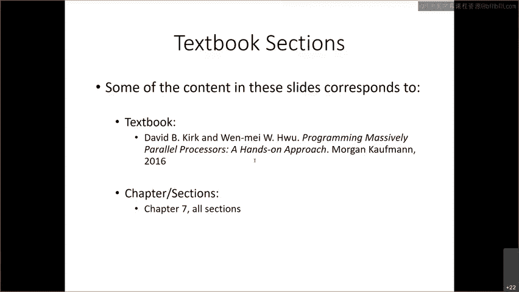