# 美国贝鲁特大学《GPU计算｜CMPS 297S396AA - GPU Computing - Spring 2021》（豆包翻译 - P9：-09-Lecture 09 - Stencil.zh_en - GPT中英字幕课程资源 - BV1bw4m1k7a1

Hello， everyone and welcome to our ninth lecture of GPU computing Today we'll be talking about a new parallel pattern。

 which is cancel。😊，So the last time we looked at convolution and was convolution introduced a new feature which is the use of constant memory and convol where every output element was some linear combination of the corresponding input element and the element around it and usually that weighted sum is defined by some kind of convolution kernel we called it a mask just to avoid confusing just avoid overloading the word kernel to mean multiple things。

 so we had this convolution mask and the way that we applied to this patch of input to get some output and the way we paralyzed it is by simply having one thread assigned to each output element and that thread was responsible for looping through the input elements and the mask and doing the weighted sum and storing the output result。

And we said that since this mask is all。And this constant， we don't change it。

 And it's accessed by all threads in the grid。 A good place to put it is somewhere called constant memory。

 And we saw how all the threads of the grid have access to this constant memory。

 and that there's actually a constant cache in the hardware that is very fast。

 and it's used to cache all this constant memory。 So that allowed us to avoid the global memory loads when we access the mass。

 So we put the mass in constant memory。 And then we also observed that the input that was in global memory。

 we saw that a thread block that was computing a particular output。

 the elements within that thread block actually had a lot of common input。

 So what we did is we decided to load the input tile into shared memory。

 and then the threads computing the output elements will go through shared memory when reading from the input tile。

😊，Now one tricky thing about this was the fact that the size of the input tile。

 the input tile dimension was different from the size of the output tile so what we did is we ended up launching enough threads per block in order for us to be able to load all the input tile elements in parallel。

 however， when we came to actually compute the output tile。

 we ended up only using a subset of these threads to compute the output tile and then finally we said that if we are at the boundary。

 the elements that are outside of the boundary should not be accessed when we are loading from global memory to shared memory so what we did in this case is instead of because we cannot load anything from here because these elements don't exist we instead load zeros into store zeros into shared memory and that way when we do our local loop through the mask and the input shared memory tile in the input through the input tile in the shared memory。

😊，We don't have to worry about boundary conditions here because we know that anything in the input tile is valid so this was a quick overview for what we covered last time and I hope you guys enjoyed the assignment on where you had to implement this we didn't do the code for shared for tile conclusion last time because you guys were implementing it so any questions about we covered last time before we move on to today。

All right， if no questions， then we will look at another parallel pattern， which is scil computation。

What is a stencil computation a stencil computationut pattern refers to a class of computations。

On a structured grid where the value at a grid point is computed based on a subset of the points neighbors。

 So， for example， if I have a grid of points， this， for example。

 could be a 2D grid if five points stenc and a 2D grid is an operation where the next value of some the next value at some grid point is the combination of that grid point and then also the neighboring elements in the grid。

 And we can also do this in three dimensions， So we can have a point7 point sc on the three dimensions where the next value of the grid point is is based on the value of the grid point and its neighbors in the x dimension。

 the Y dimension and also the the dimension。Okay。😊。

Now what I'll do in this lecture is I'll kind of alternate between 2D and 3D。

 We're going to focus on 3D in the implementation。 However。

 we're going to use 2D for some of the illustrations just because it's much easier to illustrate certain concepts with 2D so I'll be alternating between 2D and 3D So if I have 2D5 points scil I basically have a gen points here I show a4 by4 grid and the output grid this element here in the output grid is going to be based on the corresponding element of the input grid and the elements that neighbor it in the input。

😊，Okay， now typically these grid points are conveniently stored as 2D arrays so we can think of the stencil computation as we can think of the output as being a 2D array of grid points。

 and for each of these output grid points， they will be based on the corresponding input grid point and the neighbors to the above below to the left and to the right。

😊，ok。😊，And the same thing applies in three dimensions， so in three dimensions。

 the output grid point is going to be based on the linear combination of the neighboring input grid points and the x dimension and the Y dimension。

 and then also in the Z dimension。😊，Okay， so we typically store these output 3D grids as naturally a 3D array。

For these output grids as 3D arrays。Okay， and over here。

 you'll see things are a little bit more difficult。

Is that each element here here this element is going to is going to this output element is going to be going be based on the corresponding input element and then the neighbors in the y dimension and the x dimension and then also in the z dimension which you don't see over here this for this input element it will be based on this input element and the neighbors in the x dimension and then the y dimension which you don't see and then the z dimension and then over here this element over here is going to be based on the corresponding element to the input and the neighbors in the X dimension which you don't see and then the y dimension and then the z dimension。

Okay。😊，And this。JustJust to visualize what I mean by the three the three dimensional storage。

 So here， for any grid point over here， its value is going to be based on the corresponding elements in the array in each of the data dimensions。

 So the x dimension and the Y dimension。 And here also the Z。😊。

If you you can think of some of the points inside of this cube that we don't see。

 is what this is what the its access the elements and that access will look like Okay。

 does somebody have a question。Yes， is there a difference between this and convol？

that is an excellent question。 That is an excellent question。 Thank you for that。

 And the answer is that stencil is actually very similar to convolution。

 stencil is actually a special case of convolution So you will see today that a lot of what we did for convolution we're also going do with stencil but some differences between stencil and convolution include well。

 what we when we when we did when we did convolution we did a 2D convolution。

 So today in class we're going to do a 3D stencil just because we haven't yet practice using 3D grids and actually a 3D dec。

 So this is one difference that we will have， but we could have done a 3D convolution if we wanted to and we can also implement a 2D stencil if we wanted。

😊，But there are some special things about stencils like the fact that usually with the convolution。

 we assume that the whole block surrounding the input element is what I would like to access however with stencil usually it's not the whole block usually it's only some subset of those neighbors in the whole block and what that does is that enables some optimizations that may not necessarily be possible with convolution and we'll see an example of those optimizations。

😊，Okay but it's an excellent observation that， yes， this is very similar to。Okay。

 so how do we paralyze dentalil？Well， you know， this is what we had seen before。

 We have our output grid where every element corresponds to the course the the value of each output grid is is some combination of the value written and some of the neighbors。

 So how do you， how do you expect that we might go about paralyzing something like this。😊。

Well's kind of the most fine grain and obvious way to do it。Just like convolution。

 output a threat to every output element。Right， exactly。 So just like convolution。

 we can assign one thread per output grid point right so we divide our output grid into these 2D blocks and inside of each 2D block。

 H 2 block is going responsible for a set of threads and each thread in the block is going to be responsible for one of the output to grid Okay。

 and naturally since this is 2D we're going to use a 2D grid of thread。

Now one thing I'm going to do is I'm going to make a simplifying assumption that we're going to carry out throughout the course。

To simplify the way we deal with boundary condition。 Okay。

 what we're going to do is if we have some input array。

 we're only going to compute the stencil for the internal output output values。

 not thevalue of boundary。 And what this does is that it ensures that the input values that we access are always in bound。

 Okay， so I'm going to do， we're going to paraze the stencil。 and I'm going do the computation。

 I'm not going to calculate the output value at the boundary。

 I'm only going to calculate the output value in this green square green in this green part of。😊。

And the nice thing about that is that we don't have to worry about doing a boundary check when we access our neighboring inputs because the neighboring inputs will always be involved Okay and this assumption is is usually a valid one because a lot of times when we do a stencil computation。

 these neighboring elements are actually elements that are computed maybe somewhere else and then there maybe I'm paralyzing this across many many GPUs so usually some other GPU might be responsible for computing these table elements。

😊，So this is， this is a reasonable assumption to think。 Okay。

 this will just simplify our code when we're writing because we're gonna have enough to deal with in our code in terms of。

 in terms of you know， indexing and and and boundary checks。

 So just to simplify that we're going to make the assumption that we only process the input the internal input elements and therefore our。

 our so the internal output elements and therefore our input elements are always enough， okay。😊。

So if we now we move want to paralyze three distance。So if I want to paralyze a 3Dtencil。

 remember we have。G here where my my 3D stenc sorry my output written was a 3D D array and my input grid was a 3D array。

 Okay， so how would we paralyze this。This the 3D case of stencil。

 what's the most fine gray and August way to do it。Thank you。Right。

 so what I think what you mean by that is a 3D grid。 So yes。

 so the most obvious way to do it is to assign one thread per output per output element。

 And naturally， for that， we would need to use a 3D grid of threads。 Okay， so let's。

 let's go and implement this scil using a 3D grid of thread。😊，Let me switch to the code。

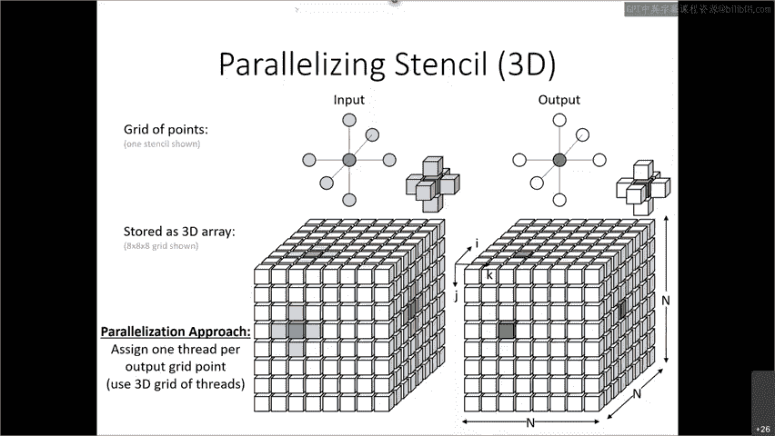

Okay， so this over here is the code for stenscil computation。

 I've already taken care of allocating the input and the output。 And here we're going。

 we're going to have。

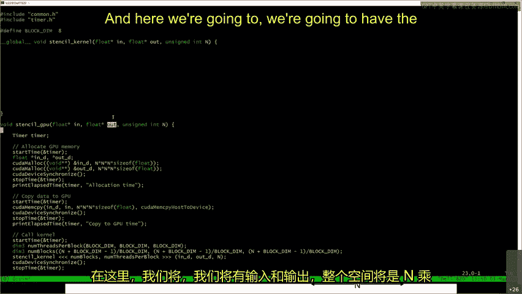

The input and the output and there the whole space is going to be n by n by N。 Okay。

 so the input is going to be n by n by N。 The output is going to be n by n by N。 we allocate。

 we do the copy and then over here， this is something that we haven't seen before。

 What we're going do is we're going to create a 3D thread block。

 So here we're going the thread block is going to be block block dim by block dim by block them Okay。

 and then we're also going to create a 3D grid of blocks where in every dimension we're going to have the ceiling of n over。

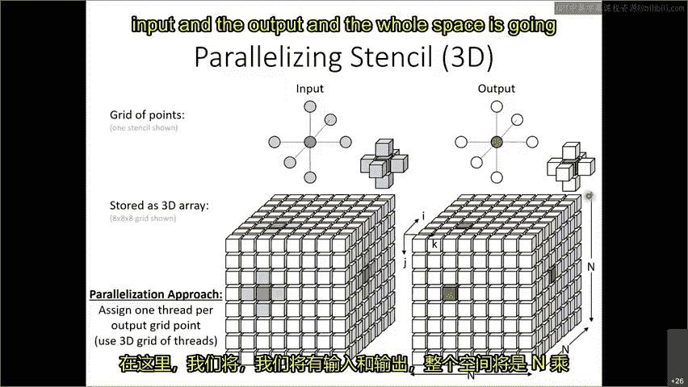

落。Okay， and in this case， since I have a 3D block。Well， because if I have an8 by 8 by 8 block。

 then that is a total of 512 elements at 1212 threads in the block。 And remember that the maximum。

Number of threads on a typical GPU nowadays is usually 1024 threads per block。

 maximum number of threads per block is typically 1024 threads per block。

 so 512 is the best we can we can get if we want to have number that's the perfect view。Okay。

 so having now launched this scil kernel， the next step I would like to do is I would like to do the computation。

 So the first step is。Find what element the thread is responsible for。 Okay。

 and we're going to use I to indicate the Z index in the Z dimension。

 J to indicate the index in the Y dimension and K to indicate the index in the X dimension。

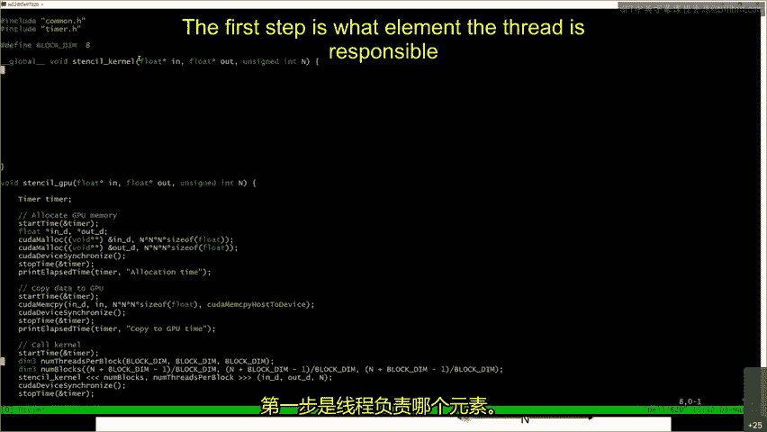

Okay， so how do I start， when I start by calculating I J and K。

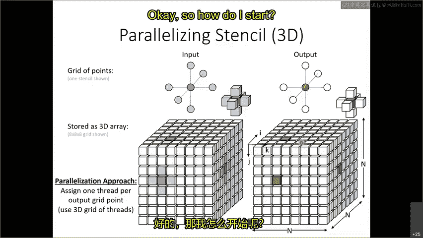

Okay， I can write uns n I is equal to log index that' ga x times sorry nont x do z， remember。

 I is in the D dimension times。Block them dot Z plus。Thread index dot Z， Okay。

 as you can see extending to three dimensional grid is not that hard。

 It's very similar to what we did before， but we just have dot Z in this place instead of dot y and dot X Okay and we're going to do the same thing for J and K So J is going to be block index dot Y times block dim dot y plus3 index dot y。

 and then finally K is going to be block dot block index dot x times block dim dot x plus thread index dot X。

Alright， so now that we have。

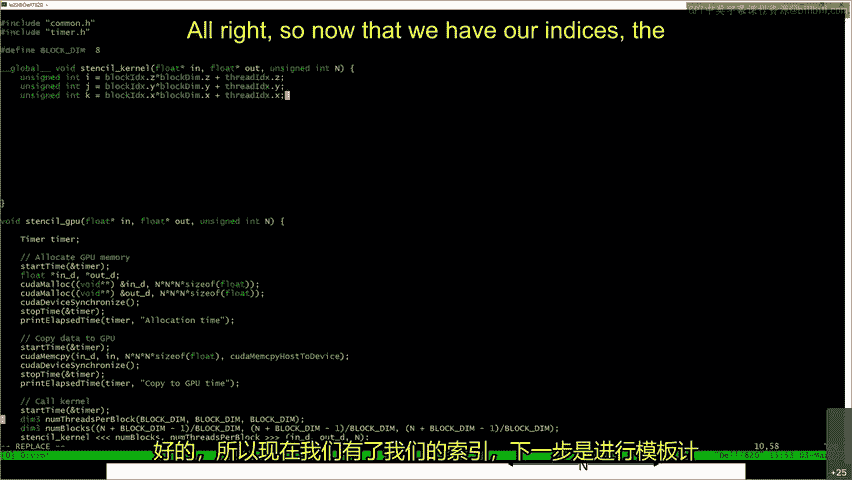

Have our our indices。 The next step is to perform the scil computation。 Now。

 remember what I said before。 what I said before is that we're gonna to simplify the boundary conditions by only computing scil these internal output elements。

 So anything at the boundary is not going to be computed。

 and the same thing applies for our 3D stencil。 Now。

 here I know that I have these elements of the boundary colored。

 but that's because I wasn't able to show you the elements that are inside of this cube in the illustration。

 However， these actually these elements will actually not be computed in the output。

 but I will be computing is the elements that are inside of this cube where all their neighbors are going to be in bounds in the end。

 Okay， So to make sure that I'm doing only the internal elements。

 I'm not going process the elements whose index is 0。

 and I'm not going process the elements whose index is n-1 okay。😊。

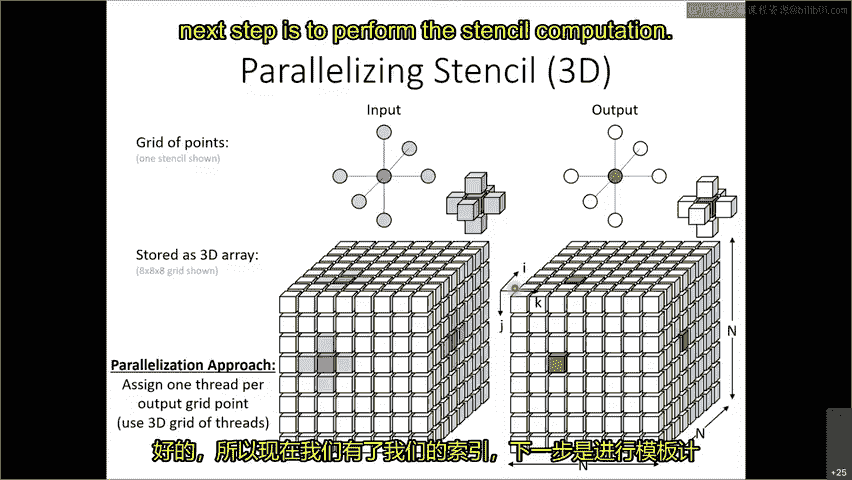

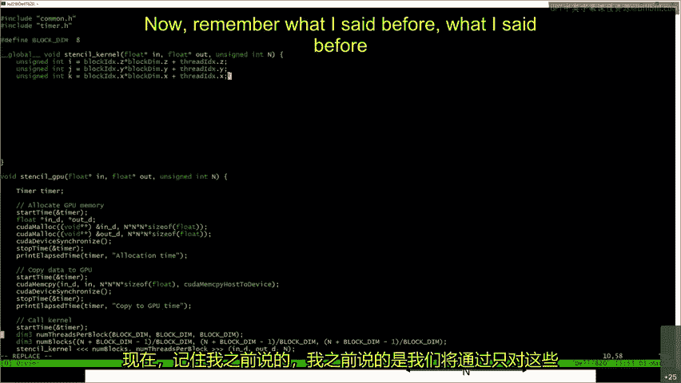

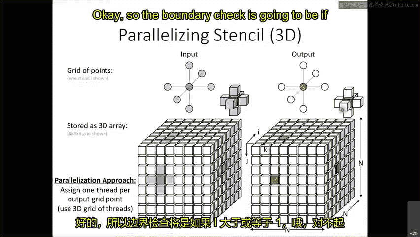

So the boundary check is going to be if。I is greater than or equal to 0。Okay， and。Sorry。

 not greater than equal to0。 greater than equal to one。 Okay， and I is。Less than n-1。

 So usually we used to have I greater than 0 and I less than n。

 This time have I greater than equal to1。 and I less than n -1。

 because we're we're ignoring the elements at the bound。 The output elements at the boundary。 Okay。

 and N we want also J to be greater than equal to one n1 G to be less than n -1。 And of course。

 over here， N is the is the number in all three dimensions。

 because I'm assuming a square grid for the whole for the whole stencil space。

 but it may not be the case。 we could have an example where this was not It was not a square universe that you you were simulating。

😊，Okay， and then finally， we're going to do the same thing for case。 Okay。

 greater than or equal to one。😊，And。😊，K is less than n-1。Okay。

 so now that I have this boundary check that makes sure that I'm processing an output element that's inbounds what I remains。

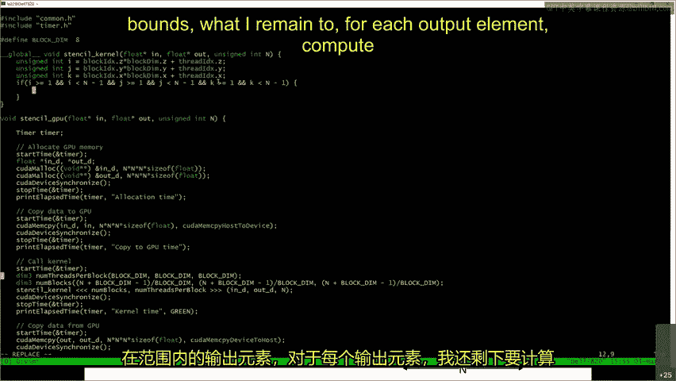

To for each output element， compute the some linear combination of the input elements that surround。

 Okay， now first， let me， so I'm going do out。

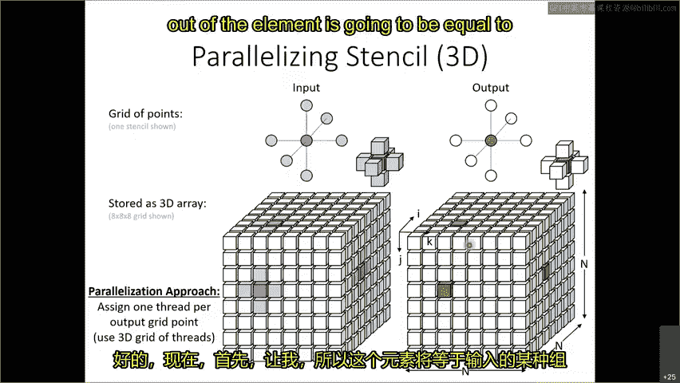

Of the element is going to be equal to some combination of the input element。 Okay。

 now let's see first calculate the index of the output。Okay。

 if I want to calculate the index of the output。

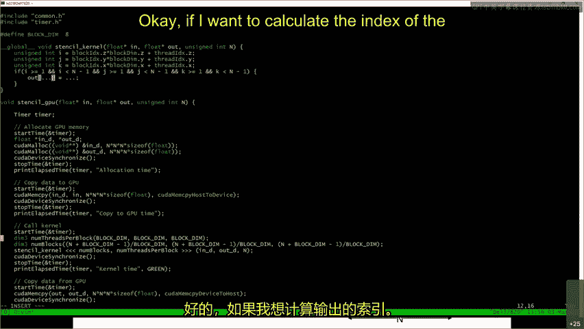

my indices， I， J and K。And this was this output was dynamically allocated， so it's a linear array。

 so I need to take my three indices IJ and K and convert them into a linear index to access this whole 3D array。

😊。

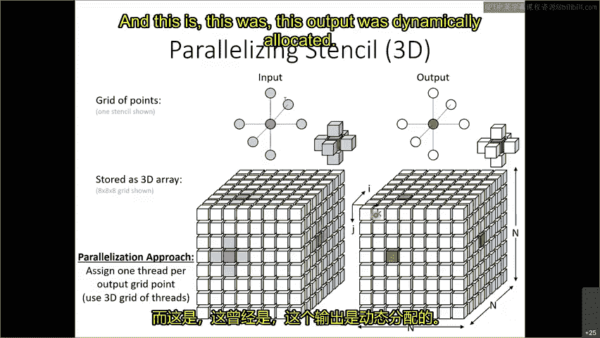

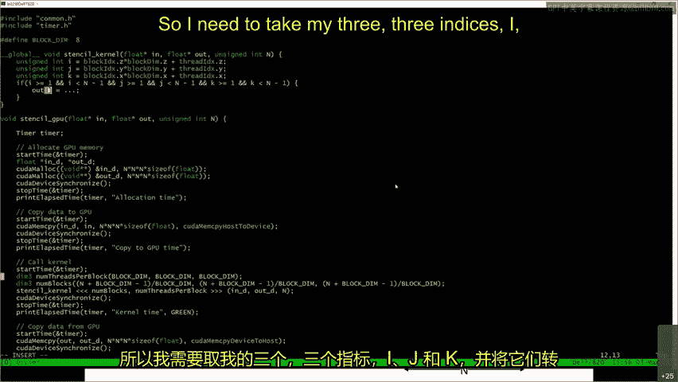

Now we saw how to do that before with 2 d arrays， we basically did the row index。😡。

Times the widths plus the column index。 And we're going to do something very similar for 3D arrays。

 Over here， this array is also going。F your order and the way that works is we store this first row over here。

 followed by the second row over here， all in the same plane followed by the third row over here followed by the fourth row over here until the last row down here and that means we have all these elements in this first plane consecutively to each other and then we go to the next plane and we put the first row followed by the second row followed by the third row etc and then we store the next plane and then we store the next plane and then we store the next plane etc。

😊，Okay， so in order for me to figure out the index of my element in the 3D array。

 I'm going to first take I。 I is gonna tell me which plane I'm computing。 Okay， and I'm gonna take I。

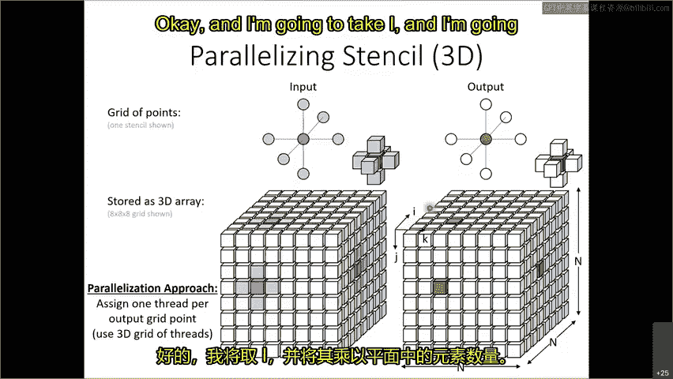

I want to multiply it by the number of elements in a plane。 Now。

 how many elements do I have in a plane if I want to start if I want to compute this plane。

 How many elements do I skip to get to this plane。😡。

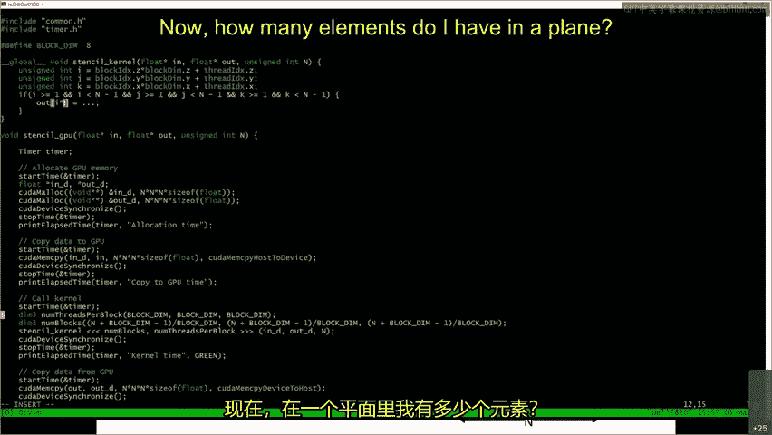

H times n squared。Right， exactly。 it's gonna to be I times n squared。

 because every plane is going be n by N。 So I'm gonna。

 I'm going go to the I plane is going to be start at I times N squared so。😊，N times N。 Okay。

 then plus， now that I'm in the plane that I care about， I wna， I wantna go， I want to find。

 I'm gonna to go to the row that I'm gonna care about。 So J is going to be the index of the row。

 So I'm going do J times。

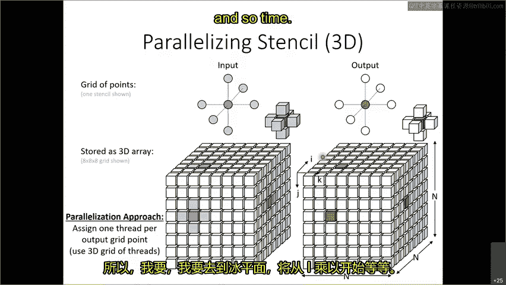

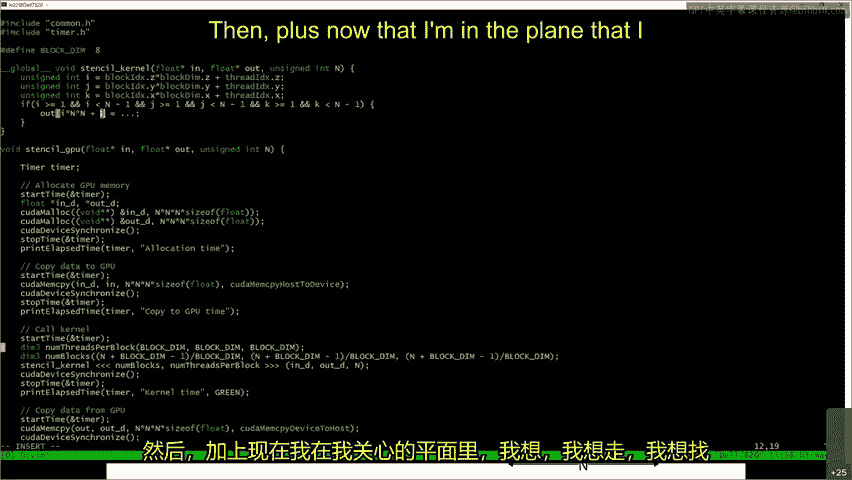

啊，挨症。Ws what， Well， it's going to be J times the size of a row。 What's the size of a row。

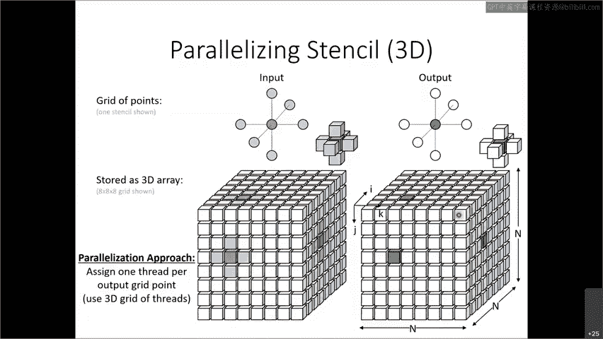

Enless case。ButWell the size of a row is going to be n。 So I'm going to do J times N。

 And then as you said， whether we want to go into the element of the row that we want。

 So the index of that is going to be K。 So that is going to be K。

 So it's going to be I times n times n plus J times N plus K。

 Sometimes all people also like to write this as I times N。

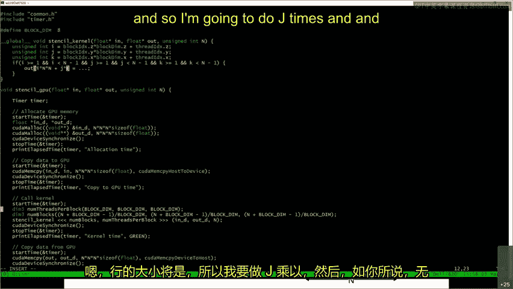

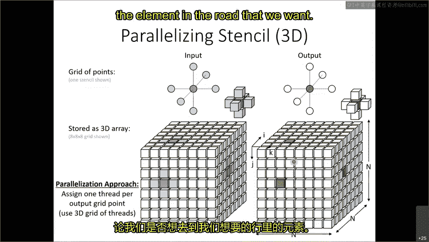

Plus， J。Times N plus squares over here， I times n plus J。 And then you have a times n。

 So here you end up multiplying I by N， I by n squared。Here。

 the way you're reasoning about it here is that you have you go to the if plane and then you multiply by n to get J so this whole thing now is the index of your row in the three dimensional space and then you multiply the index of the row by n and then you add k to get to the offset of the。

Okay。😊，So now that we have indexed our output， let me just for consistency do it this way and now that we have the index of the output the next step is to to。

To go to the inputs that we want。 Okay， now the forever。

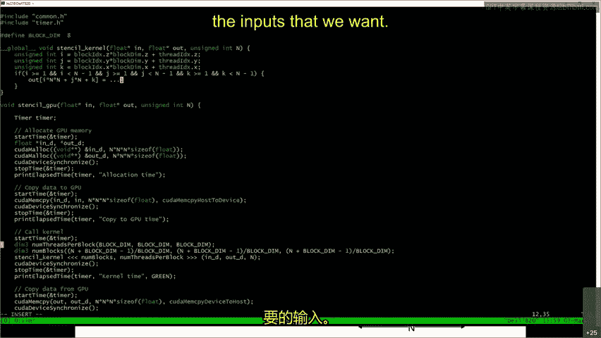

It's going to be some combination of the input and the neighbors and the X Y and z dimension so what I have over here。

 what I've done is I've defined two constants C0 and C1 and what we're going to do is we're going to multiply the corresponding input element by C0 and I'm going to multiply all the neighbors by C1 and we're going to add them okay for different applications these these constant values that you multiply the neighbors with and the input itself with are going to be different but here we don't really care about a specific application where we're implementing an abstract version of stencil but you know depending on your application。

 these constants that you have might have different value Okay so I'm going to multiply the0。😊。

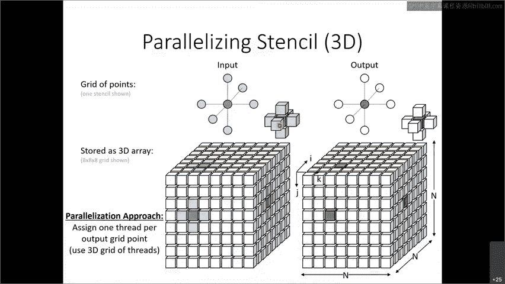

Times the corresponding input element， Well， that's just going to be end of。

 and then I'm going to use the same index。And then I'm going to do plus。

And then next what I'll do is I'm going to multiply t1 times all the neighboring elements I'm going to put I'm going to have parentheseses over here and I'm going to put all my neighboring elements down so the first neighbor so the neighbors in the x dimension are just going to differ by k so rather than having K I'm going to have k minus1 and K plus1 so my neighbors in the x dimension are going to be n of I times n plus times n plus j times n plus and rather than having k I'm going to have k minus1。

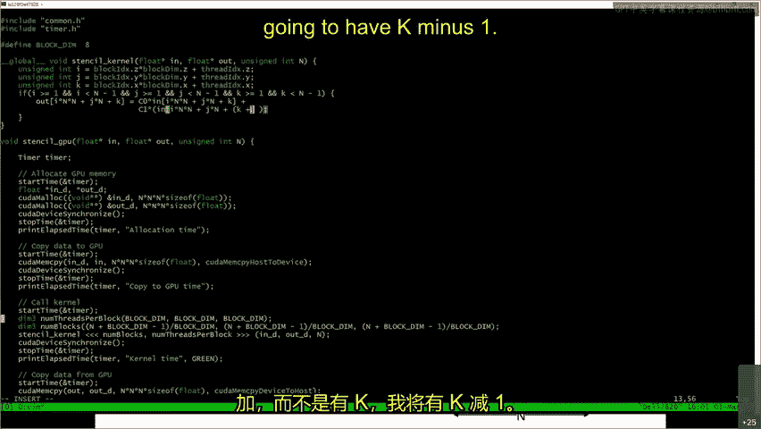

So this。So if this input， this dark blue cube in the middle is IJK。

 then IJK minus1 is going to be this cube over here， this element over here。

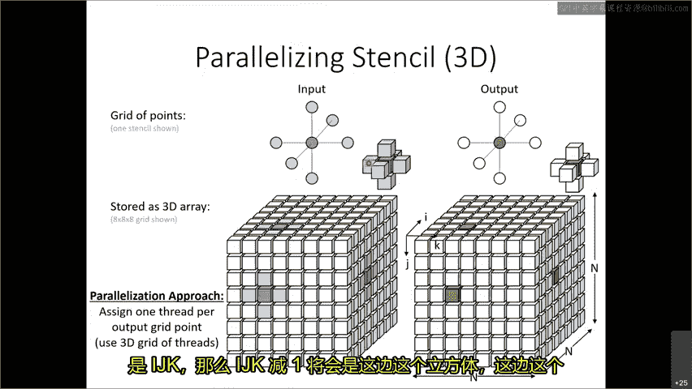

And then I'm going to add， also add。I will also also add。Of。I J K plus one。 So that's going。

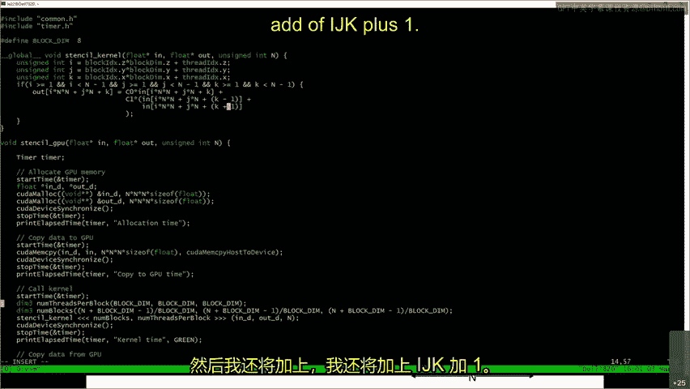

The cube over here， but I have k minus 1 and I have k plus1。

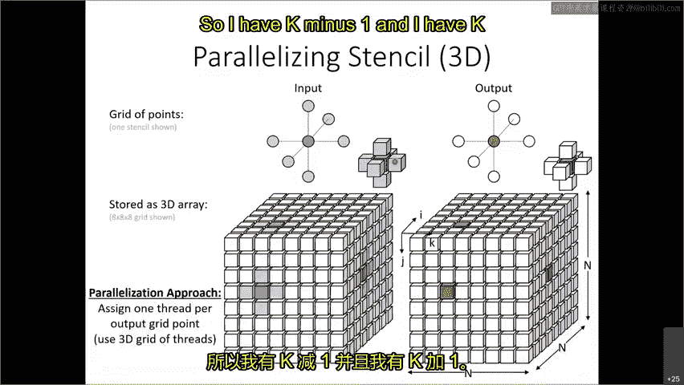

Okay， and then I also want to add the neighbors in the y dimension are going to be this one。

 J -1 and J plus 1。 So we'll do that。 I'm going to write N of。

 And this time I's going to be the same K。 But I will have instead of J。 I'm going have J plus J。

 start with -1 this with consistency。-1。 And then I will also have。

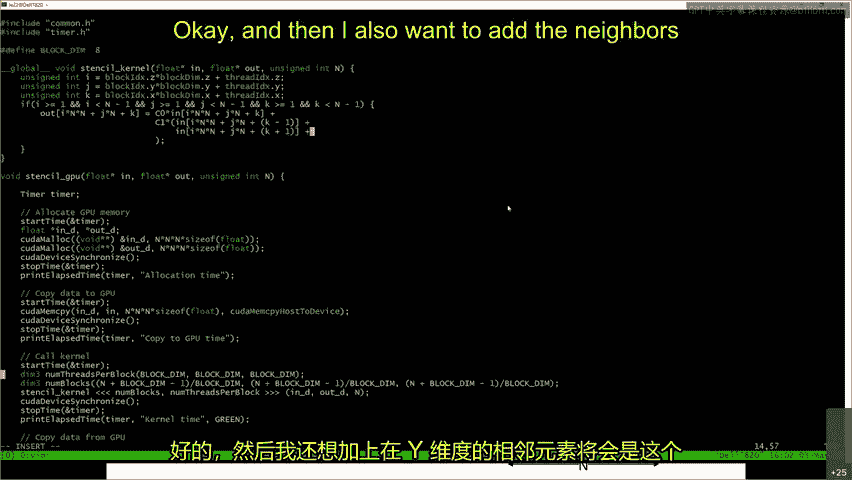

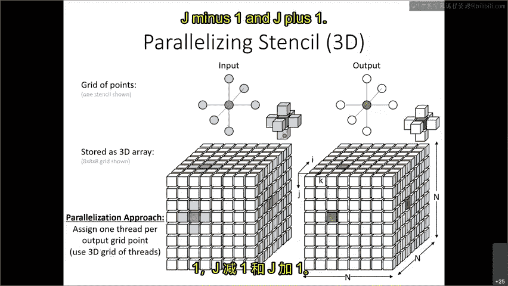

诶 j。

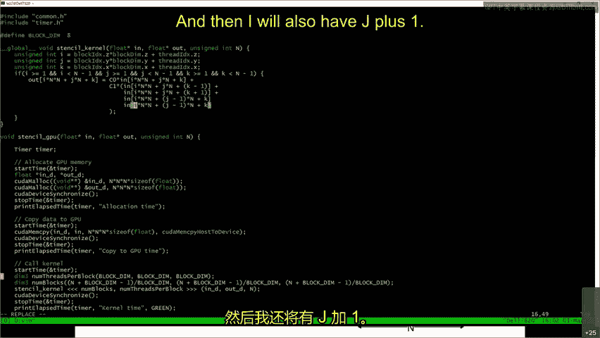

Plus one。D score this is J -1 and this is J plus1。 And then finally。

 I want to have the neighbors in the Z dimension so that's going to correspond to I minus-1 and I plus one so over here。

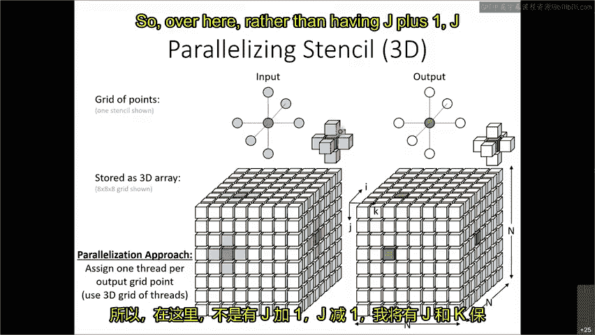

Rather than having J plus 1 J minus4， I'm going to have J and K as is。 But then over here。

 I will have I minus1， okay， and I。plus。Now， of course you don't have to put each of them oops I find to also obviously need to be doing the addition each。

Of course you don't have to put them all on a different line。

 I'm just doing that to make it easy for you guys to speak what's going on so I don't have a very。

 very long time。Okay， so I have the input element。Multiplily by c0。

 and then the neighboring input elements and the x dimension。

 the Y dimension and the Z dimension all added together and multiplied by s。Okay， so this。

To would implement a kind of an initial version of sense， any questions？

A professorfessor of C0 and C1 like the weights。Yes，30 S21 are templates。

 they will be different depending on what your application， Okay， what what your。

 where where were they defined though I defined them in common dot age。😊，嗯，对。Okay， yeah。

 so you can you can maybe your hard code， and maybe this is。

 I know you can just put a constant here if your application is always going to use same the same constants。

Professor。Can you repeat what C 0 at formSo like I said。

 the definition of stencil is that every element is。

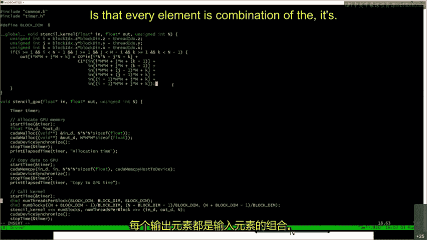

Combination of the it it's every output element is going to be some combination of the input element and its neighbors in each in each dimension。

 Okay， so here， what I'm doing is the output element is going to be C 0 times the input element plus C1 times each of the neighbors。

Okay， and you know and what the values of C0 and C1 are depends on the application。

 but here we're just implementing some abstract stencils so what their values is doesn't matter。

Yeah C0 and C1 would represent， for example， if it was a convolution， a mask， the values of a mask。嗯。

Perhaps perhaps but this isn't a convolution because a 3D convolution would not just have the immediate neighbors you would also have。

 you would have a whole cube around centered around the end。OK，我定为立即。But I mean。

 you could implement this as a convolution where all the other elements in the Q bar zero。

 but that would be an efficient way because you'd be doing a lot of multiplications by zero。Okay。

 Sarah， I have a question， yes。If we have。T more than 7 elements around the input。

 do we have to write the all the indices， hard code them。

 Or is there another way like a formula or something。 Yeah， so typically so。

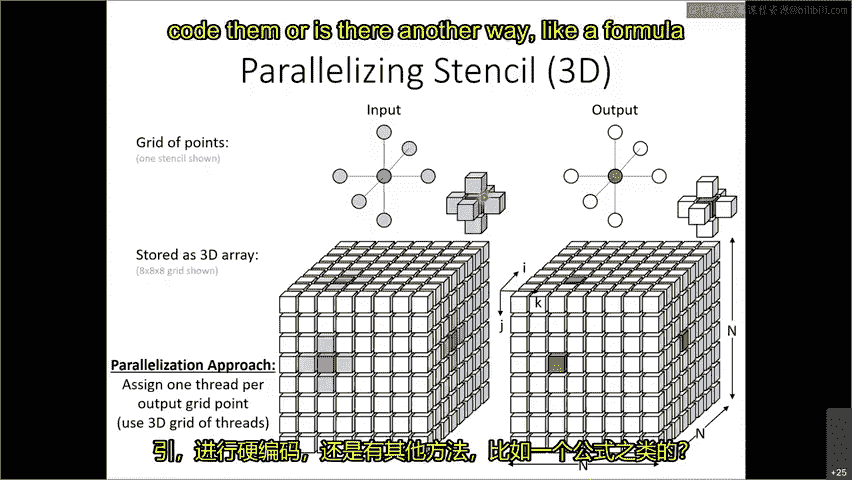

Typically yes， if you had if you had like if you have more just like a 13 point stencil where you want two elements in each dimension which exists。

 then yes， you would have to hard code all of those。

 know but you know but the more more and more dense it becomes the more it looks like a 3D convolution well usually stencils aren't aren't that dense around the。

 but yeah if you if you go further， it can go two elements in each dimension and yes you would have to write。

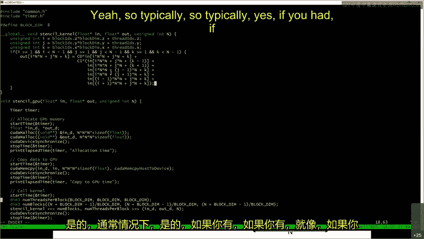

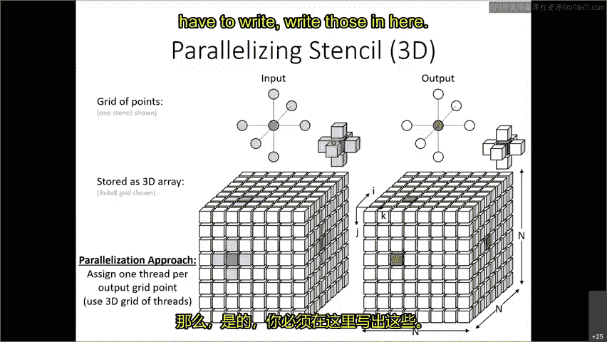

Wite those in here some。Hey， thanks。Yeah， you welcome。Okay。

 so let's run this and see what kind of performance we can get。Some to compile。And I'm going to run。

So on the CPU， that's the run of the GPU as usual。And this is the performance that we get We have 24 milliseconds on the GPU for just the kernel 500 with all the copy time because around this is a cube so this is really huge I'm doing a 512 by 512 by 512 cube by the way and then the time when this CPU is around 2。

2 seconds Okay so we have almost 100 times speed up if if we are looking at just the kernel。😊，Okay。

 not so much， maybe solar times speed off if we're looking at including the copy type。Okay， so。

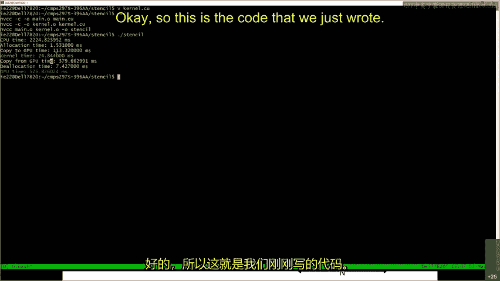

This is the code that we just wrote。 And now that we've written this code， the question is。

 what optimizations can we apply， So what optimizations come to mind。Any suggestion。代理人。

Tilling right tiling exactly so the first pization you might think of is tiling which is to take advantage of data reuse so if we look at the output of if we're looking that now we're back in our 2D stencil example if we look at the output over here。

 okay this output the thread block processing these output elements。

 it's going to access these input elements over here so you'll notice that adjacent elements and the output are going to be loaded some of the same input elements。

😊，Okay， the reuse is not as much as convolution， why， because this element over here。Okay。

 is only going to be accessed by the opt element corresponding to this input element。In stencil。

 in convolution， this element， we have been accessed by the output element corresponding to this input。

 this input and this input。 The convolution does have more data re than stencil。

 But stencil still has a significant amount of data re。

 these boundary elements don't have data reuse。Okay， in this particular stencil。

 maybe other stencils they might， but in this particular stencil。

 these boundary points don't have data reviews， but usually these internal points do have data reviews。

Okay， so the observation is the threads in the same block loads some of the same input elements。

 so the optimize we can apply is we can load。the other hand。

 we can load this tile into shared memory。Okay， and once we load it into shared memory。

 we can just you can just access the our neighbors and the X Y and the X and Y dimension from the shared memory。

 okay。In 3D， it could be the X， Y， and z dimension。Now， one observation here。

 which is the same observation we notice as convolution is that the input tile and the output tile have different dimensions。

 So the question is how many threads do we launch Okay。

 the challenge is the input and the output tiles have different dimensions。

 the output tile is input tile dimension minus-2 because here the input tile corresponds to the output tile plus one in each direction。

 So the input tile dimension is the output tile dimension plus2 that's one in each direction Okay。

 so what we can do what we what we one way to to resolve this issue is to launch enough threads per block to load the input tile and then only use a subset of those threads to compute the output tile and this is similar to what we did with convolution so the thread block that we launch if this here represents the thread block that we launch this thread block is the dimension of the thread block will correspond to the input dimension。

Okay， and when we load the input tile， all the threads in the front block will be active while loading。

 but then when we compute and store the output tile。

 only a subset of these threads are going to be active and here we're going to use the internal subset Okay one way to do it is to use the ones in the top left another way to do it is to do the internal ones with convolution we were doing the ones in the top left but here with stencil we'll just do the one the internal ones for a change。

😊，Okay， and the same thing applies。So in three dimension。

 if I have a thread block processing if I'm to process these output elements over here。

 this output cube， okay then the thread block start with these output elements exhibits some data reuse and by the way again I want to remind you that in our implementation we are not computing these boundary elements。

 but I'm unable to show you show you what's happening inside of the cube。

 this is why I'm illustrating that we're computing the boundary elements。

 but in practice we are not okay so here the thread block assigned to this these output elements will these input elements I will notice that there's data reuse across them so what we can do is we can load the input tile into shared memory and then when we do the sten computation we add the values from shared memory。

ok。😊，So having said that， let's go and do an example of that。 Okay， let's go and do an example。

 So here I'm going to open my code again。

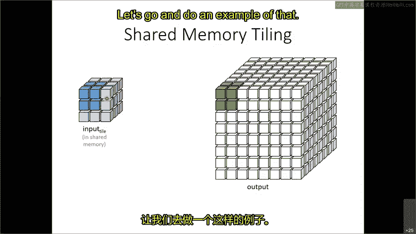

Now we have our block dimension used to be8 by8 by a。

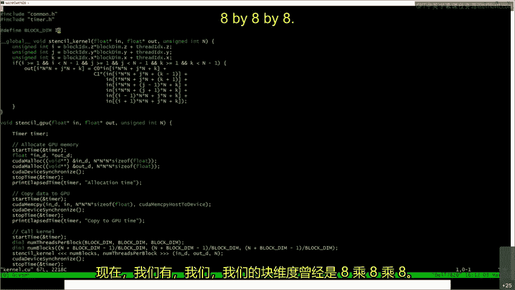

Okay， but now we have I'm going to do some explanations on the 2D version。Okay。

 now we have an output tile dimension and an input tile dimension。

 and the block dimension is going to correspond to the input tile dimension。 Okay。

 so what we're going to do is we're going to define input an output tile dimension。

 So here I'm going to write pound define。

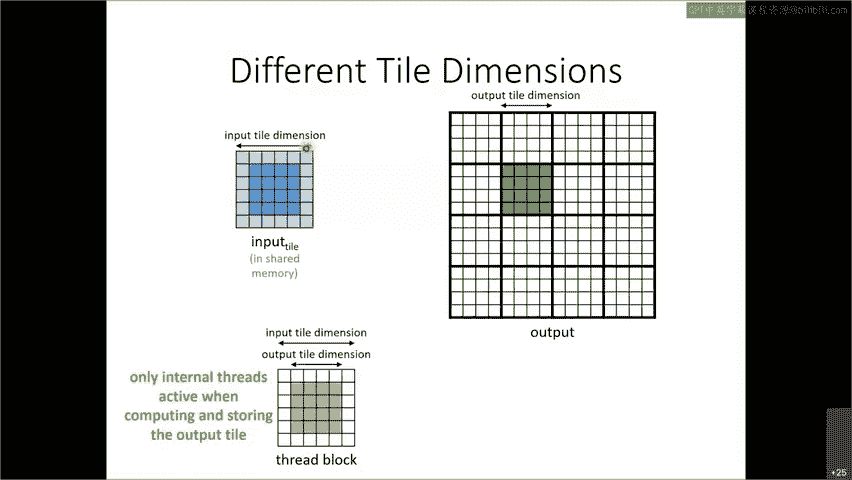

En tired。Then， and that's going be。Mention because the block is going to have as many threads as theile dimension。

Okay， and then we're going to define the output tile dimension。Okay。

 and the output tile dimension is going to correspond to the tile dimension minus two right because the output。

 the input tile dimension is the input is the output plus one on each side。

 so the output is the input minus one on each side。

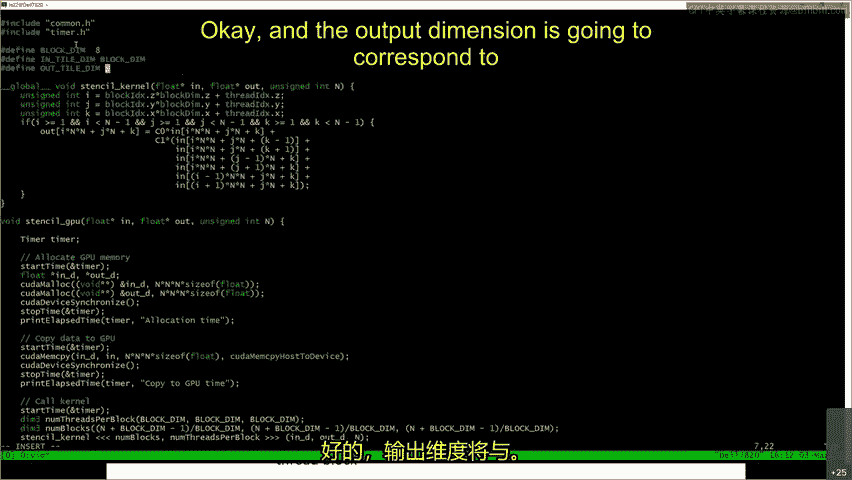

Okay， so here the output tile dimension is going to be the input tile dimension。-2。Okay。

 and then once we have done this， we need to come down here to the code that calls my stencil kernel and now the number of threads per block needs to be configured according to the input tile dimension right because each block needs to have enough enough threads to process an entire input tile dimension well block then is already the same as tile in so here I can leave these as blocked them。

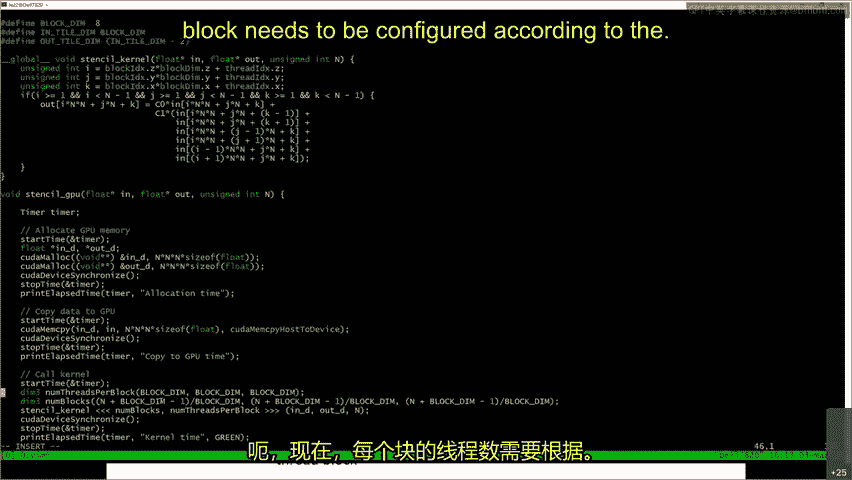

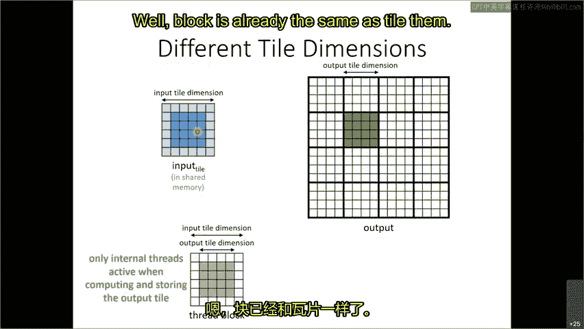

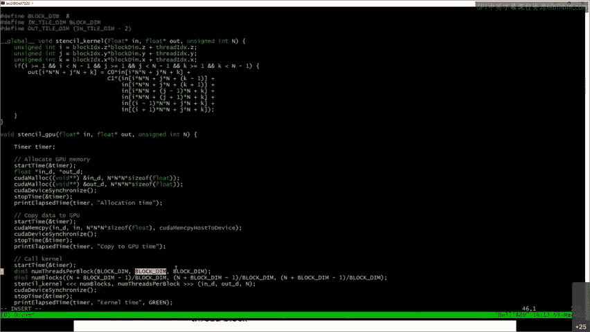

Okay， however， when I get the number of blocks that I need。

 I'm gonna need enough blocks to cover all the output tile。Okay。

 so when I calculate the number of blocks and the output， I'm going to use the output tile dimension。

 not the input tile dimension over。

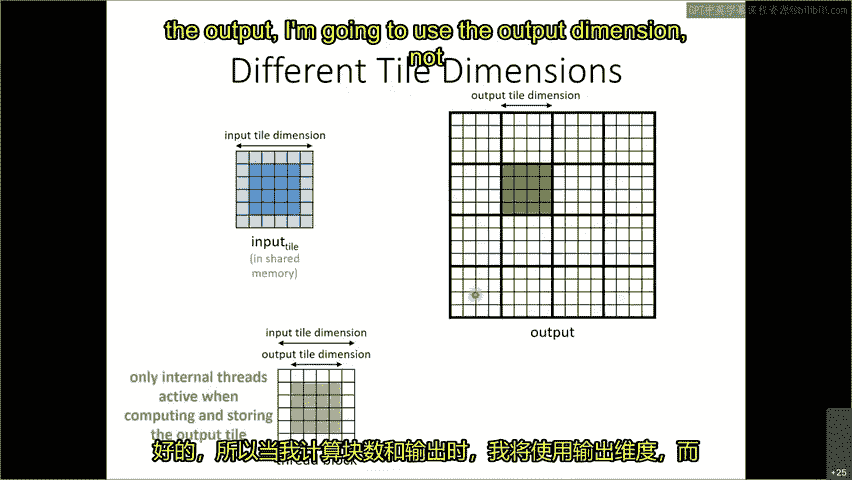

Rather than having using block dim over here， I'm going to use the out。P Tderman。Okay。

 and this will ensure that I have。Ls to cover all of my output elements。

We did the same thing in convolution， by the way， so guys should be familiar with this。嗯。Okay。

 having done this。Now， what we would now what we'd like to do is we would like to load our input tile into shared memory。

 Okay， so we want， let me go back a little bit。

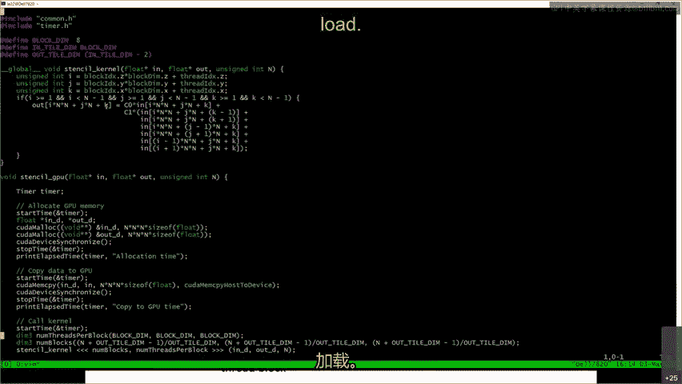

So here were over here， we have identified， well， actually we haven't yet。

 so now we first to identify what output element a threat is responsible for。

So identify what output the defend is responsible for we're going to do block index dot x times something plus turn index index dot x。

 but this time。

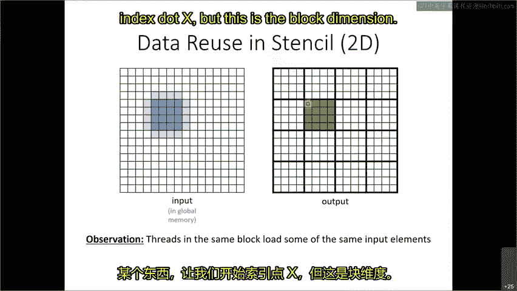

I is the block dimension and the reason is that the block dimension is actually corresponds to the inputile dimension。

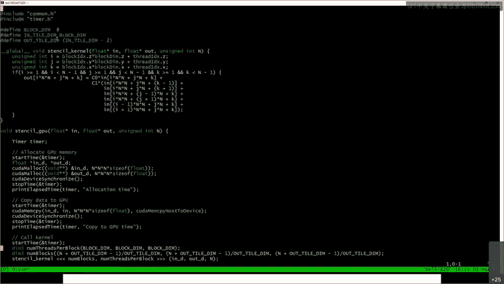

However， when we calculate which which which alpha element a thread is responsible for the way we need to use the outputile dimension。

 So， for example， here， a tile that has an X index of one and a the index of one is going to skip over out tile in element in the x dimension out T them elements in the y dimension。

 it's now going skip over n tile in element。Okay， so over here， rather。D dot Z， block dim dot Y。

 lock in dot X。 We should use the outputile dimension to determine what index the thread is responsible。

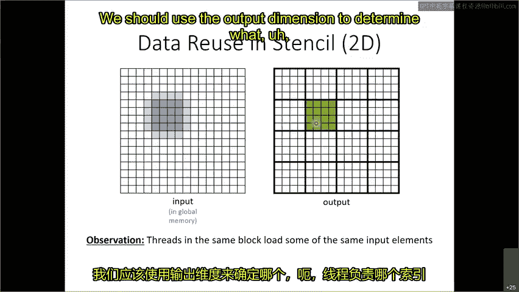

Okay， so I'm going to come down here。And Im going to replace these。With。嗯。Tile them。

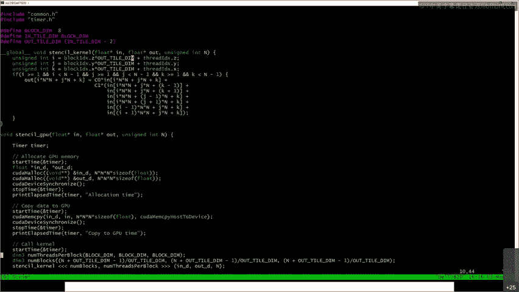

Okay。But then to pay attention to is that though even though you know for I I need to find out where my thread block starts。

 I need to skip over out tiled in element for every block okay。

 thread 00 in the block is actually not going to be computing this output element here thread00 in the block thread 00 is not responsible for this output element over here thread00 is going to be responsible for this output element which is which is out of bound because it's going to be loading this input element to clarify that let me go down a little bit。

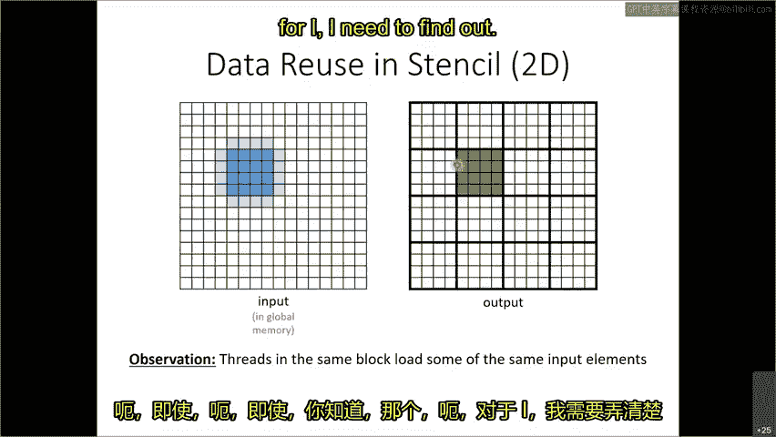

So。So over here， we said that all these threads are active when they load the input tile。

 but then only these ten threads are going to be active when we compute the output file。

So thread00 is not going to be active when I compute the output tile。

 thread00 is going to be responsible for loading this input element。

 which corresponds to this output element， but when it computes， it's not going to be active。

So when I write。Block index do x times out tileed in。

 that brings me over here to the beginning of the output pile。

However， my first thread is not going to start at the beginning of the output。

 You're to start one row，1 column before that and one row before that。 And then three dimensions。

11 depth before that。I guessss what I need to do。

打企。-1。And a -1 and a minus-1。Okay， is the clear light？

Pse I'm going to my to find the output row I'm responsible for or the output column I'm responsible for。

 I'm going use the block index to skip over that many output tile elements。

 So here I'm going to start from here。 If my block index is one。

 I'm going to skip over one times output tile elements。 So that brings me over here Okay。

 and then I'm going to add my spread index。

Okay， so if I'm thread 0，0， that puts me over here。 if I thread0，1， that puts me over here。

 et cetera。 And then I'm going to subtract one so that if I'm thread 0，0。

 I'm actually not supposed to be computing this element。

 I'm going to subtract one to come here from the exponential and subtract one to come here from the y dimension。

 Now we said1，1 is actually the what computes this first element。

好。

My I and my J and my K。 The next step is for me to load the input tile。 Okay to。

I first need to declare an input tile and I'm going to declare it in shared memory Remember putting the input tile in shared memory。

 so I'm going to write。Shared。Load n underscore S and what are the dimensions of the input tile Well the input tile we are using we are doing。

We are doing a 3D stencil okay， so my input tile is actually a three dimensional tile and shared memory。

P dimensionsional array， I simply provide it with three sizes。T is square。

 so it's going to be input tile dimension in each in each place， so I will write。

En tileed them over here。And ined them over here， and in them。Now I have my tile and shared number。

Okay， now that I have this file what I'm going to do is I'm going to load my input elements。

 so the input elements that are over here， I'm going to load them into this tile and remember that the way that we defined the boundary condition this time is that the thread is the thread that as processing some output tile is going to be is going to be responsible for loading the corresponding input element。

Okay， so here I， J and K， they represent the output tile I'm responsible for。

 but they also represent the input tile I'm responsible for loading so the thread that's responsible for this output element is responsible for loading this input element to the tile okay。

Some I can sit。

Right。And underscore score S。ok。😊，Of。Thread index dot Z。Thread index thought why。Thread index， dot X。

As equal to。And。Of my， my industries are I， J and K。

 I'm gonna write I times N times N plus J times N plus。ok。ok。😊，Is that clear。 So now。

 yes what I've done is I have this。

I could tile and I have loaded it into shared memory。

Now there's one thing I need to be careful about， which is that I need to make sure I don't go out of bound。

Okay， Im want to make sure I don't load any elements that are out of bounds in the input tab， Okay。

 that's particularly important at the boundary。

呃。As notice here， I， J and K are the indices that I use to load my inputile。

 so what simple do I need to do and I need to make sure that I J and K are within the bounds of him。

Okay， so that's quite simple。 they have basically they have to be greater than equal to0 and they have to be less than n。

 Okay， so I'm going do F I as greater than a equal to0。And。😊，Then， and。

At J is greater than equal cube0。And J is less than n。 and K is greater than or equal to 0。

And K is less than n。That is when I can do load the input。Okay， so somebody's asking a good question。

 didn't we choose the internal elements to compute the output so that we don't have to do the boundary check。

 you're absolutely right。

I've explained to you why I'm doing this boundary check。Okay。

 let me go all the way back to the assumption that I made。

What we said is we're only going to be processing the internal input output elements。Okay。

 we're only in processing the internal output elements so that we don't have to worry about checking the boundary when we load from the input file。

ok。😊，Well that that that is that is that still holds right we're not going to be processing these input elements。

 but so the question is， how could we be in a situation where we're trying to load it out of bound element Well。

 keep in mind that when we created a thread block to process this。I put title over here。

We did not just create threads for every input element。😡，Pfer every output element。

 we also created threats to load the boundary the boundary element。Okay。

 so the thread that is responsible for loading this value is going to be loading this value sorry。

 I'm going to create a thread when I print this thread block。Okay。

 the thread that' is responsible for loading this value over here for this。

 it's supposed to compute load this element over here， but they're also going to be threads。

I shall let me explain from this threadlog， so here when I have this threadlog。

I'm going to launch enough threads for all for also these elements over here。Okay。

So what that means is that there are threads over here that are responsible for loading the corresponding input element。

 similarly for this thread block， there's going to be threads that are responsible for loading this input element that's out here。

 but none of these exist。These don't exist。So what I'm going to do is I'm simply going to deactivate these red so that they don't do any loading。

咦。Now we're still not computing these output elements。

 so that threads responsible for this output element is only going to be doing loading this input element。

 it's not going to be computing any。If this thread was computing anything。

 then I have a different boundary condition where I need to when this thread goes to try and access the element outside。

 it needs to load a zero instead so that's the boundary check that we are skipping we're not skipping the boundary check where we have to make sure that the threads that are actually loading the input elements are within them。

ok。😊，So I know I know it's a little bit of a nuanced difference。

 so maybe that's something that kind you can think about more if you didn't get it it's fine I think I think you should still be able to follow along with the code。

So back to our diagram over here。What we've done what we're trying to do is we're trying to load this 3D input file Okay。

 and this is exactly what we've done。 and now before we start computing what we need to do is we need to。

What we need to do to。loadad think threads。And I seem to have， for some reason my。

For some reason my terminals are responding， let me check what the problem is。Okay。

 now my my terminal is responding。 So now after that after I've loaded。

T， I need to wait until all the elements are available before I start computing this outputifier。

YouUnder right。Think。Right。ok。Okay， now that I've done sync threads and now this code over here。

That done the stencil computation needs to use shared memory instead。

Now this first boundary check is still valid， I want to make sure this one checks that I'm only computing output internal output elements。

But now another boundary check I need to do is。MakeSure。Let me go back。

Or that only the internal threads in the thread lock are active during the computation。

Because the other threads were only responsible for loading input on。Okay。

 so the way I do that is I need to make sure that my threads are also internal threads。

Can't we just set the ghost elements to 0 and the first if when we load into the shared memory， Well。

 but that would require。In larger input tile。 And I'm trying to avoid having such a large input tile because the shared memory requirement。

Okay， yes。

And as I could have let actually know， I want to make sure these threads don't compute because the output element they're computing is not valid。

Okay， these threads shouldn't compute。Okay， the idea the idea of loading ghost elements corresponds to the output elements that I am to making sure that I only use the I only process output elements that are within bound in the entire grid here we're looking at making sure to process output elements that are within bounds of the block。

好见。My next step is to do a boundary check to make sure that only these internal threads are active and to do that。

 I'm going to do if。

Tread indexdex dot X。And greater than or equal to one and。The index got X is less than。

Block then dot X。One。And。T index dialex。Equal to sorry，3 minutes y is greater than equal to one and。

Good index stop Y is less than。Bgged in the y -1 and thread index x sorry about Z is greater than a equal to1 and。

Wage index dot Z is less than。Block then does the minus one Okay， and it was quite long。

 but I hope it's clear why it's important to do the job。Okay。

So now what we've done is we've made sure that only the internal elements are computing okay。

 the next step is to replace all these aes to global memory with aes from local shared memory Okay。

 so let's do that。做埋啊。Yeah。So here phi0 of so this input element over here， n of I。

 JK is simply going to be replaced with n underscore S of thread index index。 x threaden index。

 y3 index do。Okay， because。So here're integral square S of。Good in next。Good index for why。And。

P index got Z。Okay， and then similar for all these all these other values， I'm going to。

 I'm going I'm going to actually， it's just little easier for me to write these from scratch。Okay。

 I'm also going to use the shared memory array to load these values， but in one case， actually oops。

I made a mistake here， I'm supposed to use Z。Y and X over here。Okay。

 so make sure not to make that mistake， remember the most significant dimension is the one on the left when you're exiting in or right。

ok。😊，So this is x， and then over here I'm going to do 3 x dot x minus1。

 3 x dot x plus one for the neighbors in the x dimension，3 x dot y minus1。

Enter next dot y plus one for the y dimension and then index dot z minus1 and in next dot z plus one for the z dimension。

ok。😊。

And by doing this， what we by doing。Toly， as。are are we've loaded the shared memory tile and now we are when we access for this element。

 we are loading the neighbors in the X and y dimension and the Z dimension from the shared memory tile and notice that this shared memory tile is its own selfcontained array So that's why we're just using3ex by Z3 index y and3 index dot X to access it。

ok。😊，Is this clear to everyone， any questions about this codeV？A professor should we not load。

Zero elements or is it taken care of by the fact that we're not considering the boundary elements right so remember there reason。

Because if I go back to my。咪新部。I am never going to'm not'm never commuting this at the。

 so I'm never accessing an element that is I'm never accessing an element that is out of bounds。

Compute the compute and output output。Okay， thank you。

 Well I don't need to load zeros out here because I never compute this。Okay。Yeah。

 so it's one thing to avoid reading this element so there's a boundary check to avoid reading this element into a tile and then there's another boundary check to avoid actually you know。

 using such an element in a computation the latter is avoided by not processing boundary element the former is the one that we need to have the boundary check。

Okay， so now。

Ire this code， let's run it。I see the performance that we get。Okay， there's a warning。t somewhere。o。

 okay， oop。So this should not be unsigned， right because。

So remember we made the same mistake in convolution and the original version where we weren't dealing with Tling。

 it wasn't a problem for them to be on time， but in this case they should not be un so it's a good thing that it warrant't about that so I'm going to compile。

And I'm going to run。Yes professor， can you explain why IJK can be less than 0。Yes， IJ。

So， because when I when I have， I'm processing this output tile here at the boundary。Okay。

 the threads that need to load the corresponding。Now the thread that loads So here when I'm processing this tile over here。

 I have a thread responsible so loading the element of correspond， Similarlyly。

 when I have a thread block assigned to this block tile over here。

 I'm going to have a thread responsible for this input here， but this input's not in bound。

So this is how a threat could be minus。

Okay。And that's represented in over here in the kernel this is why I added that's I subtracted one。

Okay， so the code run。そうです。Took more time。Right， is actually slower， right？It's actually slower。

 Well， that's a bummer。 you know that's you know we're expecting to get performance improvement from shared memory。

 Well it seems that the the benefit of using shared memory。

 the overhead of loading to shared memory and synchronizing and then access from shared memory in this case was not worth the performance improvement that we got。

 Okay， and let's analyze why this happened。 Let's analyze what's the。😊。

Okay， so let me skip back。ok so this。Shared memory。

 we use this and then this over here is the code that we wrote together。

 but we noticed that we did not get any performance of it， so what happened？Well。

 let's analyze the compute to memory ratio and the original kernel。

 each thread perfect what in the original kernel， each thread。Performed eight operations。

 so the the step。

Involves performing eight operations， where you have two multiplication locations and you have six editions Okay so eight operations。

Okay， for every thread okay， and every thread loaded 1 different values that were reached four bytes。

 so every thread loaded 28 bytes， so the computer norm ratio was 0。29 ox byte。Okay。

 now in our tile kernel， what we did is we had the threads in the block collaborate to load the input tile。

And then we used this input tile to access all the elements Okay， if my input tile size is t。

Okay， in this case， my upper tile size will be t minus-2。

Each thread block going is going to do operations for every thread in the output tile。

 but it's going to load elements for the threads in the input tile Okay so every block is going to perform eight operations。

😡，Times the number t minus2 Q because the threads that operate are the threats corresponding to output。

So eight operations times t minus2 cubed。Okay， however。

 each thread block is going to load one element， but the number of sorry each thread in the block is going to load one element。

 but the number of threads that loads corresponds to the input file。

 so the number of loads that a block does is going to be four bytes quantity。Okay。

 so this up here is the number of operations that a thread block performs collectively。

 and then this over here is the amount of data that a thread block collectively load。So8。

 so this ratio over here， if you calculate it， it comes out to t times 1 minus2 over Tq。

Now for t equals8， the block dimension that I chose was t equals8 for t equals 8。

 this ratio becomes 0。84 ops per byte。 which is a decent improvement。

 but the improvement is not that grade actually。Okay， not that great。

 So I encourage all this overhead to do the。To do the tiling， but my improvement was not that great。

Now what we can do is we can， if you look at this ratio here， if I increase T。

This whole term that I'm subtracting decreases， so I expect that my ratio will increase。Okay。

 so as we increase T， we improve this ratio， so for example， if t was 32。

Then the raised field is going to be 1。65， so it's two times better than this ratio that we have over here。

Okay and the intuition behind this behind this idea of increasing T is that the boundary elements have low data reuse so if I increase T I'm increasing the number of elements I'm increasing the tile size。

 so I'm increasing the number of internal elements which makes the ratio of boundary elements that turn out of with left so for example。

😊，When my thread block over here was this small， I noticed I had a lot of these these boundary elements compared to my internal elements and the internal elements are the ones that have data reus。

 the boundary elements don't have data reuse if I use a larger tile size if my I use a big tile like this。

Okay， now I have many more internal elements compared to the external elements， Okay。

 so now I have fewer boundary elements relative to the internal element。

 There's still a lot of boundary elements， but there' are fewer。ok。😊。

So can I just go to my code here？

My child size。Can I just increase block them from age something like 32？No。

Because if you the 16 or 32 to the power of three is like 32000 threads per block。Right。

 exactly if I do 32 by 32 by 32， that's going to be 32000 cents per block。 That's way too much。

 right， That's beyond the maximum。

So increasing the tile size， I cannot just increase the tile size， there's two reasons。

 the first reason is that the input tile size is the same as the block size and the block size is limited by the hardware。

😡，The second reason is that， if I increase my。

I need more shared memory to store this style， and what did we say about shared memory？64 bytes。

 it's limited。得了吧 yes， the。Shared memory is limited， so if I increase shared memory。

 I may run out of shared memory and even if I don't run out of shared memory。

 run I could underutil the I could have low occupants。😡。

ok。😊，So the input time size determines shared memory usage for hardware block。

 which is limited by hardware， and even if the limit for shared memory is not exceeded。

 if used too much， it may hurt our occupant。So how can we increase？2。

The process of an output tunnel is' this large。Without increasing the number of threats。

And the amount of shared memory。We use a rectangle red cosing。Right， exactly threadcor。

So a rectangle is a rectangle with the same number of output elements is not really going to make a huge difference。

But the idea is that we can use thread coursing exactly。

 so the solution is to use thread coursing so that we can process a larger output tile but without using more threads and remember we said thread coursing is applied when there's a price of parallellyization okay。

The price of parallellyization is redundant loading at the boundary element Okay when I parallellyze different thread blockss。

 each threadb has all these boundary elements that are used by other thread blockss。

 but because I'm processing these boundary elements in separate thread blockss I have load data reus in these boundary elements okay so by making a tile bigger I have fewer and fewer boundary elements so I have less redundant loading of these boundary elements。

😊，几。😊，And if I use thread co settinging I've improved on I've been able was able to increase the tile size。

 the output tile size without increasing the number of threads。

 but I still need more shared memory right so what can I do about shared memory？Well。

 what we can do about shared memory is we can keep slices of the input。

That we need because now that we weve coned our threads。

 every thread is going to be processing a particular input at every step in time point in time。

 so we only need to keep the data that we need for that step and let me show you an illustration of what I mean by that。

We said that we have two problems first， that the maximum number of threads per block is exceeded。

And second that， the input tile requires too much shared memory which hurts occupancy or even exceeds the limit of shared number。

 so what we can do instead is we can assign enough threads for for processing one plane in our output tile and loading one plane in our input tile。

😊，ok。😊，So now I can have a 32  by 32 output tile， because here I will only need 32 by 32 threads to process a single plane。

And then what I will do is I will only these threads when they're processing this plane in the output tile。

 They only need the corresponding plane and the input tile and the plane before it and the plane afterward。

 So these threads are only going to need this part of my input tile。

So then I don't need to load this entire cube with a shared memory at the same time。

 I can just load these elements over here。And on the first iteration。

 these threads will will process this data。 Obviously。

 there's also a there's also another plane that is not I'm not showing in the figure Okay。

 and then on the next iteration， these threads will all proceed for the next output plane and they will load the next input plane。

Okay， and the plane that was previously the next plane now becomes the current plane。

 and I have a new next plane and the plane that was previously the current plane now becomes the previous plane。

Okay， and then on the next iteration， these threads will go to the next plane or in the Z dimension and the planes that I will need will be the following planes in the Z dimension okay。

 and on the next iteration they go to the final plane and well process the final plane of the Z dimension。

ok。😊，I actually don't have enough time to go through the code with you I was hoping I could。

 but we are short on time， so you can review。This is the code foring thread courseing okay in this way and the idea here is that I have I declare three arrays。

 three shared memory arrays， one for the previous so here every step I have three planes。

 the current plane， the previous plane and the next plane okay。

 so I'm going to declare three arrays and shared memory previous current and next okay I'm going to initial initialize the previous and the current plane and then on every iteration I load the next plane。

I do the s computation for the output plane using the current the previous and the next plane。

 and then when I'm done with that， what I do is I move the current plane to the previous plane。

 I move the next plane to the current plane and on the beginning of the iteration I load next plane again okay。

做么的。Then these over here my next plane became becomes my current plane on the next it。

 my previous my current plane becomes my previous plane on the next it and the only new plane that I need to load is this additional plane over here Okay。

 the other two are common across the duration Okay so that's what。😊，大家。Now， what final goes？Yes。

 good question。 Yeah。 Is there no way to avoid copying like the plane itself in memory and like。

 maybe do a trick with pointer。 light know， I don't。 Yes， you you can， you can avoid this。

 So you can have three arrays and then have an index and do modo 3 every time on your on your。

 on your eye。You can do something like that， but just for the sake of keeping the code easy to explain in class。

 I didn't do something like that but yes， you can avoid this copy from shared memory to shared memory by doing that。

 but actually we're going to do something even better than that and you'll see what that is。😊，Okay。

 so one thing you might observe is that。When I throughout this code， I should let me here first。

 So over here。When I'm processing this output plane over here。

 every element in this output plane needs the corresponding x elements in the current plane and the x and the y dimension。

 but it only needs one element in the previous plane and one element in the next plane。

 which were the elements that it loaded on the previous iteration。ok。😊。

So only the current slice is truly shared across the thread across the threads in the。

The previous slice is not actually shared， okay， if you look over here。

 this element over here in the previous slice， this will only be used the by the output element by this aome。

 this element of the previous slice will only be used by the element responsible floor。

 this input element like or the corresponding outputel。

This element and the input in the previous slice will only be used by the thread responsible for this one over here。

 this up down here， same thing with next slice。😡，This output element。

This input element in the next slide will only be used by a thread responsible for this input to input index。

 and this input element in the next slide will only be used by a thread responsible for this input element in the index。

Only the elements in the current plane are actually used by multiple threads So for example。

 this input element will be used by the thread responsible for this because it's in the next y y position。

 the next exposition， and then this input element will also be used by thread responsible for this element because it's in the same position and this input element will also be used by the thread responsible for this for this element because it's in the previous exposition。

Okay， and this so what we can do based on this optimization is we actually only need to since only the current plane is shared across the reds。

 we actually only need to share the put the current plane in shared memory。

 we don't even need to put the previous and the current plane in shared memory。

 where can we put them。We can put them in registers。

We can save the shared can save on shared memory by putting these previous plane and registers。

And then then moving them to shared memory when they need to be shared。 So in this iteration。

 when I load my next plane， I can just keep it in a register。😡，And then on the next iteration。

 when this next plane becomes the current plane， that is when I put it and shared them。

And by doing that， I only need to have an off shared memory for one plane。 So if we go back to the。

You'll notice that this previous plane， every time I access it。

 I'm only using3ex dot X and3 next dot Y。 I never use， I never access from the previous plane。

 something that belongs to another thread。 same thing with the next plane。 This next plane when I。

 I always use3 X do X and3ex dot Y。 I never access anything from the current from I never access anything。

😊，In this plane that belongs to another thread。So if each if there's no this is different from the current plane and the current plane as is the current plane。

 I've actually to say to the x the x minus1， plus1， the index by x。

 the index that y plus11 minus1 so I am actually sharing across the of the current plane。

 but it's not that case to the previous plane on the next plane。

 so what I can do is rather than allocating three different planes and putting the previous the next time on the plane。

 what I can do is I can just。😊，I createate for the current element。

 and I can have a register for the previous value and the next value。And then， I load the previous。

Pin into a register， I load the current plane into shared memory。

 I load the next plane into the register， I compute here I use the I use the register and then I sync for。

Okay， and then after that， I will。I will move the current plane from shared memory to the registered for the previous plane and I will move the values in the next plane from the register to the current plane。

 so here logically speaking the previous plane on the next plane exists because those tiles exist。

Don't exist in shared memory。 They exist in another on。And that un memory is the register file。

 And we call this register tiling whenever we store a tile So here。清白。

The registers of the different threads collectively form the title。So this。

 the current tile is stored in shared memory。 The next and the previous tiles are stored in the collective set of registers across all the three。

 Okay， and this is why we call this register title。😊，Okay。

 so so what we did today is we looked at shared memory tiling。

 we looked at thread course setting and we also looked at a new kind of tiling， which is register。

In fact， register tiling is not due。 we've seen it before。 Where have we seen register tiling， oops。

 there's a glitch that and the PowerPo that gave it away。

 So we saw register tiling before would makes its matrix multiplication。

We just didn't realize that we did it。😡，How did we use registerity with matrixtri matrix modification？

When we switch to the next iteration， the previous threads the previous values are still conserved。

No， we overwrite the previous values of shared memory Okay， so to register tiling。

 what I did is I would load my A and B tiles into shared memory， okay。

 and I would use them to compute the C tile。So the A and that BTs were stored in shared memory。

 where was my C tile stored？😡，Right， somebody said in the chat。

 So my sea tile was stored in the registers， right， because every thread had a。

Ha it was responsible for one of these output elements in the CT tile。

 and what it did is that it stored that sum variable in a register。

So the C tile is actually stored in the collection of all the registers across all the threads in the block。

 so the C output tile was collectively stored in the registers of the thread。

 so we actually used register tiling for the C tile， we just didn't realize it。

And so it made it more apparent that we were using register tiling because we use the same tile and sometimes you put that tile in shared memory and sometimes you put that title in registers。

 but we actually use register tiling all the time without even realizing it but over here because you because you we put sometimes we put the tile in the register and then we move it into shared when it's the next tile it goes in the register and then when it becomes the current tile we move it to shared memory and then when it becomes the previous tile move it back to a register。

 this tile is moving back and forth between the registers and the shared memory this has you know really emphasize the importance of register tiling as an optimization as well to save on shared memory okay。

I now I was actually planning to implement with you the course setting and show you that it does give us the performance improvement over the original version and then also implement with your registered T and show you that it also gives us performance improvement。

 but unfortunately I was too ambitious for this lecture I didn't realize I would don't have time to do all of this。

 but the code is in the slide so you're welcome to look at the code later on and maybe try to implement it yourself okay。

😊，And with that， that's all for today， does anybody have any final questions？Yes， professor。乖。Okay。

 thank you。 I was just wondering， why are there， why is there more space in the registers than in the shared memory。

 like why is shared memory more contented than the registers。

There's not really more more space and well number you could be around of the order of 64 kilobytes。

 maybe 96 kilobytes the register file has 64，000 registers but each register is four bytes so yes the register file the register file is larger than the shared memory and the reason is that you have many。

 many thread。And each of these threads to be a significant amount registers。

 so these register filess and the GPUs are actually huge。Okay。

 so the insight here is that if I have something that is shared across threads during part of the computation。

 but not shared by threads during other parts of the computation。

 rather than I have all this memory in the register file。

 so what I can do is I can put it in the registers， when it's not being shared。

 and I can put it in the shared memory when it is being shared。

So this is the intuition behind register timing Okay then I answer your question or was your question different No。

 it was exactly that it was like if we're using registers。

 it means there's more like we can afford to use them more than we can afford to use shared memory yeah that''s right so like a typical GPU has a 6464064K registers and if you have 2 threads with 64K registers that means you can afford to have around 32 threads32 registers per thread okay a lot sometimes we go over that in which case we would underutilize we we would go below occupancy because registers but in some applications we might have less than that if you look at code we using that so we actually have plenty of threads there in order for us to apply registered。

Okay， thank you very much。Yep， you're welcome。Any other questions？

He has a professor to optimize even more or。Tied died。

Why don't don't we change the geometry of the tidy， for example。

 in this case you only need three rows， if it's a 2D， for example， you only need three rows。

And that way what you can do is make it across a bigger。呃，三呃呃。A bigger section of the column。Yeah。

 you can do that， you can absolutely do that and in fact。By。

Practice what people do is they do play around with the dimensions of the style and one common approach here I explained it to you this way because just for pedagogical reasons。

 but one common approach is for people to actually use a 32 by 32 thread block and rather than just going through the style。

 they actually go through the entire space from beginning to end。Okay。

 and that gives you an even larger and larger output tile。

 and that gives you even better and better performance。Yes， you're absolutely right that。

 we can play around with the dimension of this output tile in order for us to you know， maximize or。

 you know， try and have as low of a ratio of boundary elements to internal elements as possible in order for us to maximize the data reuse and therefore the performance。

Okay心。Yeah， you老。Professor， I have a question， but like not about the material。Okay。

 so then as there are no more questions about the material。

I can take your your question after the lecture is over。 Okay， that's all for today， and I'll see。

Byone。

Thank you， bye。