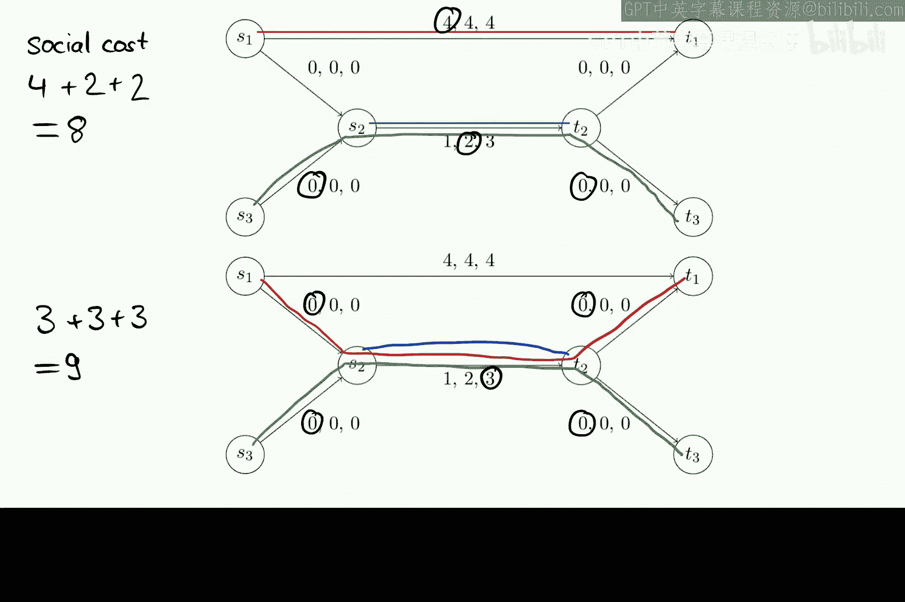
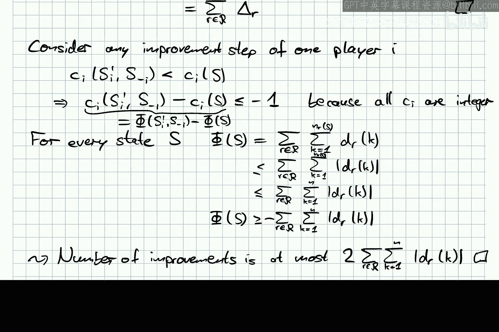

# 002：拥堵博弈入门

在本节课中，我们将学习如何用数学模型来描述和分析策略性行为。我们将从一个简单的交通拥堵例子开始，逐步引出“拥堵博弈”的正式定义，并探讨其核心概念——纯纳什均衡。最后，我们将证明一个关键结论：**每一个拥堵博弈都至少存在一个纯纳什均衡**。

## 策略性行为建模

上一节我们介绍了课程目标，本节中我们来看看如何用数学来刻画策略性行为。让我们从一个简化的道路交通模型开始。

在这个交通场景中，我们有一个图，包含三个起点和三个终点。玩家1想从S1到T1，玩家2想从S2到T2，玩家3想从S3到T3。玩家们有哪些选择？

首先考虑玩家2，他实际上没有选择，因为只有一条直接连接S2和T2的边。玩家3也没有真正的选择，因为只有一条路径连接S3到T3，即经由S2和T2。但玩家1有一个有趣的选择：他可以选择直接走S1到T1的边，或者走经由S2和T2的间接路径。

## 成本与延迟函数

现在我们来谈谈边上的数字。这些数字表示通过该边所需的时间，它取决于同时使用该边的玩家数量。

例如，对于S2到T2的边，如果有一个玩家使用，耗时1个单位；两个玩家使用，耗时2个单位；三个玩家使用，耗时3个单位。

那么，在初始状态下（玩家1走直接路径），每个玩家的成本是多少？
*   玩家1：使用边S1-T1，成本为4。
*   玩家2：使用边S2-T2，成本为2。
*   玩家3：使用边S3-S2、S2-T2、T2-T3，成本为2。

我们将每个玩家的成本相加，得到**社会成本**：4 + 2 + 2 = 8。

## 策略性行为的影响

但是，玩家1可以改变选择。他走直接路径的成本是4，而走间接路径的成本会更低。让我们看看会发生什么。

如果玩家1选择间接路径（S1-S2-S2-T2-T2-T1），新的状态如下：
*   玩家1：使用边S1-S2、S2-T2、T2-T1，成本为3。
*   玩家2：使用边S2-T2，成本变为3（因为现在有2个玩家使用）。
*   玩家3：使用边S3-S2、S2-T2、T2-T3，成本变为3（因为S2-T2边有3个玩家使用）。

此时的社会成本是：3 + 3 + 3 = 9。从社会整体角度看，这更糟了。

然而，从玩家1的**个人利益**出发，他的成本从4降到了3。因此，如果玩家只关心自己的成本（这是我们课程的核心假设之一），他就有动机改变策略。这种**策略性行为**导致了比非策略性行为（即玩家1“牺牲”自己走直接路径）更高的社会成本。

## 拥堵博弈的正式定义

我们刚才看到的例子是一种特殊的拥堵博弈，称为**网络拥堵博弈**。现在，我们给出更一般的拥堵博弈的正式定义。

一个拥堵博弈由以下四元组定义：`(N, R, {Σ_i}, {d_r})`
*   `N`: 玩家集合，通常有 `n` 个玩家。
*   `R`: 资源集合，通常有 `m` 个资源。
*   `Σ_i`: 玩家 `i` 的策略空间。每个策略 `σ_i ∈ Σ_i` 是资源集 `R` 的一个子集，表示玩家 `i` 选择使用哪些资源。
*   `d_r`: 资源 `r` 的延迟函数。这是一个从整数 `{1, ..., n}` 到整数的映射，`d_r(k)` 表示当有 `k` 个玩家使用资源 `r` 时产生的延迟。

在我们的交通例子中：
*   `N = {1, 2, 3}`
*   `R` 是所有边的集合：`{S1-T1, S1-S2, S2-T2, ...}`
*   玩家1的策略空间 `Σ_1` 包含两个策略：`{S1-T1}` 和 `{S1-S2, S2-T2, T2-T1}`。
*   玩家2和3的策略空间各只有一个策略。
*   延迟函数如边上所示，例如对于边S2-T2，`d_{S2-T2}(x) = x`。

网络拥堵博弈是拥堵博弈的一个特例，其中有一个有向图，每个玩家 `i` 有一个源点 `s_i` 和一个汇点 `t_i`，其策略空间 `Σ_i` 是所有从 `s_i` 到 `t_i` 的路径集合（每条路径视为其经过的边的集合）。

## 状态、成本与均衡

有了形式定义，我们还需要为其赋予语义。

*   **状态（或策略剖面）** `s`: 为每个玩家分配一个策略，即 `s = (s_1, s_2, ..., s_n)`，其中 `s_i ∈ Σ_i`。
*   **资源使用数** `n_r(s)`: 在状态 `s` 下使用资源 `r` 的玩家数量。公式为：`n_r(s) = |{i ∈ N : r ∈ s_i}|`
*   **资源延迟** `d_r(s)`: 在状态 `s` 下，资源 `r` 的延迟，即 `d_r(n_r(s))`。
*   **玩家成本** `C_i(s)`: 玩家 `i` 在状态 `s` 下的成本，是其使用的所有资源的延迟之和。公式为：`C_i(s) = Σ_{r ∈ s_i} d_r(n_r(s))`

现在我们可以定义核心概念来捕捉策略性行为。

*   **最佳响应**: 对于给定的其他玩家的策略组合 `s_{-i}`，策略 `s_i` 是玩家 `i` 的**最佳响应**，如果对于所有其他可选策略 `s_i‘ ∈ Σ_i`，都有：`C_i(s_i, s_{-i}) ≤ C_i(s_i‘, s_{-i})`。这意味着在其他人策略不变的情况下，玩家 `i` 无法通过单方面改变策略来降低自己的成本。
*   **纯纳什均衡**: 一个状态 `s` 是**纯纳什均衡**，如果对于每一个玩家 `i`，其策略 `s_i` 都是针对其他玩家策略 `s_{-i}` 的最佳响应。等价地说，在纯纳什均衡中，**没有任何一个玩家可以通过单方面改变自己的策略来获得更低的成本**。

在我们的例子中，第一个状态（玩家1走直接路径）**不是**纯纳什均衡，因为玩家1可以通过单方面改变到间接路径来降低成本（从4降到3）。而第二个状态（玩家1走间接路径）**是**纯纳什均衡，因为没有任何玩家能通过单方面改变路径来降低成本。

## 均衡的存在性与Rosenthal势函数

一个关键问题是：是否每个拥堵博弈都存在纯纳什均衡？答案是肯定的。我们将通过证明**每一个拥堵博弈都至少存在一个纯纳什均衡**来结束本讲。

证明思路是构造一个称为 **“改进序列”** 的过程，并证明任何这样的序列都必然是有限的。
*   **改进步骤**: 从一个状态 `s` 到另一个状态 `s‘` 的转变，其中存在一个玩家 `i`，他通过单方面改变策略（从 `s_i` 到 `s_i‘`）降低了自己的成本，即 `C_i(s‘) < C_i(s)`，而其他玩家的策略保持不变。
*   **改进序列**: 一系列状态，其中每对相邻状态都是一个改进步骤。

如果从一个状态开始，反复进行改进步骤，最终会到达一个没有改进步骤可能的状态，根据定义，那就是一个纯纳什均衡。因此，要证明均衡存在，只需证明**任何改进序列都必然是有限的**。

证明的关键是引入 **Rosenthal势函数**。对于任意状态 `s`，定义其势函数 `Φ(s)` 为：
`Φ(s) = Σ_{r ∈ R} Σ_{k=1}^{n_r(s)} d_r(k)`

这个函数看起来复杂，但有一个直观理解：想象我们按顺序逐个添加玩家。势函数的值等于每添加一个玩家时，该玩家在当前（部分）状态下的成本之和。

Rosenthal势函数有一个至关重要的性质（**精确势函数**性质）：
对于任何状态 `s`，玩家 `i`，以及替代策略 `s_i‘`，有：
`Φ(s_i‘, s_{-i}) - Φ(s) = C_i(s_i‘, s_{-i}) - C_i(s)`

**这意味着玩家单方面改变策略导致的成本变化，恰好等于势函数的变化。**

由此，我们可以完成证明：
1.  在一个改进步骤中，某个玩家的成本严格减少。由于延迟函数输出整数，成本减少量至少为1。
2.  根据上述性质，势函数也减少至少1。
3.  势函数 `Φ(s)` 显然有上界（例如，`Σ_{r∈R} Σ_{k=1}^{n} |d_r(k)|`）和下界。
4.  因此，改进步骤的数量不能超过势函数可能减少的总次数，必然是有限的。

这就证明了：从任何初始状态开始，沿着任何改进序列进行，都必然在有限步内停止，并到达一个纯纳什均衡。因此，每个拥堵博弈都至少存在一个纯纳什均衡。

## 总结

本节课中我们一起学习了：
1.  如何用**拥堵博弈**来建模具有策略性交互和资源竞争的场景。
2.  定义了**纯纳什均衡**的概念，即在其中没有玩家愿意单方面改变策略的状态。
3.  通过引入**Rosenthal势函数**并利用其**精确势**的性质，我们证明了**每一个拥堵博弈都至少存在一个纯纳什均衡**。证明方法展示了从任意状态出发，通过有限次“改进步骤”总能找到这样一个均衡。

这个结论是博弈论中一个优美而重要的结果，它为分析许多涉及共享资源和拥堵的系统奠定了基础。在接下来的课程中，我们将探讨均衡的效率、寻找均衡的计算复杂性以及其他类型的博弈模型。