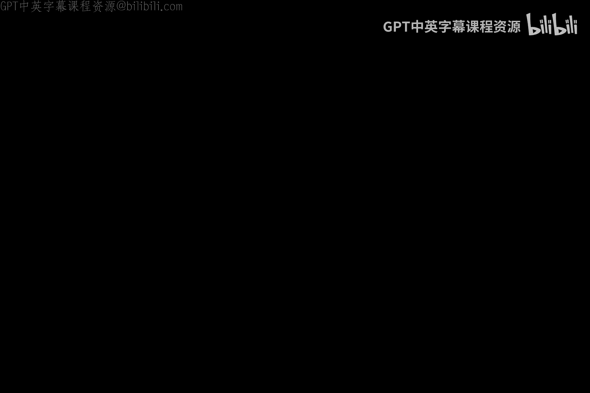
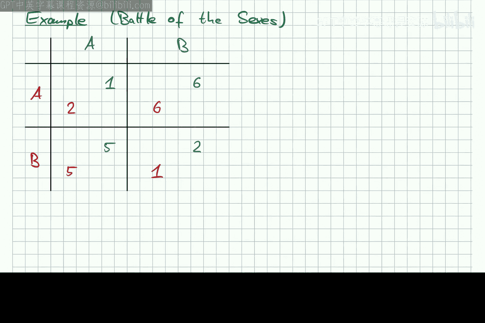
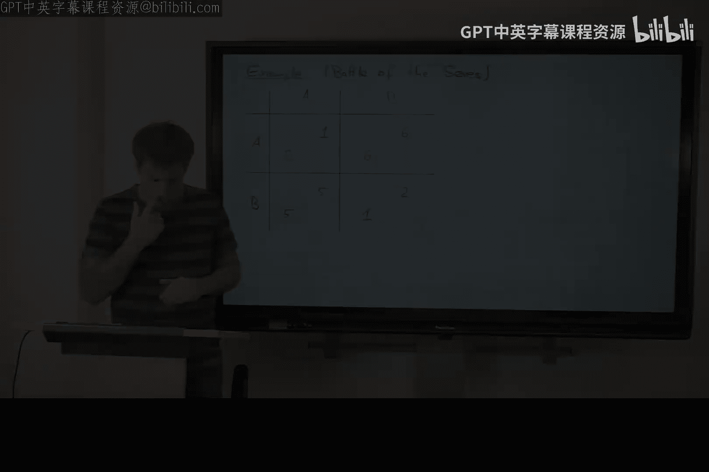
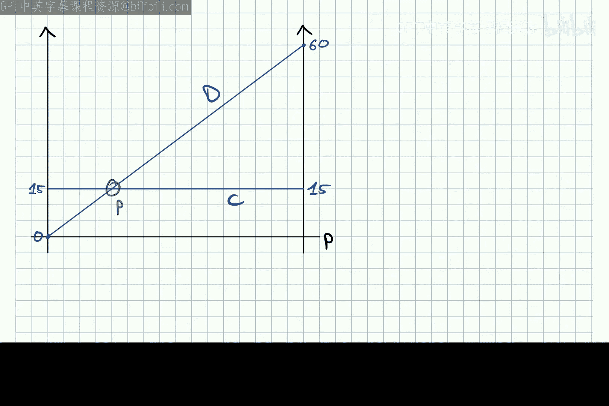

# 004：标准形式博弈与混合纳什均衡

在本节课中，我们将学习更广泛的博弈类别——标准形式博弈，并引入混合纳什均衡的概念。我们将看到，并非所有博弈都存在纯策略纳什均衡，但混合纳什均衡总是存在的。

## 标准形式博弈的定义

上一节我们介绍了拥塞博弈，并证明了每个拥塞博弈都存在纯策略纳什均衡。本节中，我们将把博弈的类别推广到所谓的**标准形式博弈**。

那么，什么是标准形式博弈？我们正式定义如下。

一个**标准形式成本最小化博弈**是一个三元组 **(N, S, C)**。

*   **N** 是玩家的集合。通常玩家数量为 n，玩家集合记为 {1, 2, ..., n}。
*   对于每个玩家 **i**，有一个**纯策略集合** **S_i**。所有玩家纯策略集合的笛卡尔积 **S = S_1 × S_2 × ... × S_n** 称为**状态集**、**纯状态集**或**策略组合集**。
*   对于每个玩家 **i**，有一个**成本函数** **C_i: S → ℝ**。该函数以所有玩家的策略组合为输入，映射到玩家 i 所承担的成本。

这个定义应该有些熟悉。在拥塞博弈中，我们也有玩家集合和每个玩家的策略集。现在的符号略有不同，但本质相同。在标准形式博弈中，成本函数可以是任意函数，而不必像拥塞博弈那样具有特定的资源结构。

## 双矩阵博弈

我们如何定义其他标准形式博弈呢？一个常见的例子是**双矩阵博弈**。

在双矩阵博弈中，总是有两个玩家，即 **n = 2**。成本函数由两个矩阵 **A** 和 **B** 完全描述。

*   玩家 1 是**行玩家**，选择矩阵 A 和 B 中的一行。
*   玩家 2 是**列玩家**，选择矩阵 A 和 B 中的一列。
*   玩家 1 的成本是矩阵 **A** 中对应位置的值：**C_1(s) = A_{s1, s2}**。
*   玩家 2 的成本是矩阵 **B** 中对应位置的值：**C_2(s) = B_{s1, s2}**。

通常，我们会将两个矩阵合并写成一个表格。在每个单元格中，左下角的数字是行玩家的成本，右上角的数字是列玩家的成本。

### 示例：从拥塞博弈到双矩阵博弈

考虑一个只有两个玩家的简单拥塞博弈。两个玩家都想从起点到终点，有上、中、下三条路径，各边有延迟函数。

我们可以将这个博弈表示为双矩阵博弈。两个玩家都有三个纯策略：选择上、中、下路径。通过计算所有策略组合下两个玩家的延迟成本，我们可以填充一个 3x3 的表格，从而得到两个矩阵 A 和 B。

### 示例：性别之战

另一个著名的双矩阵博弈是“性别之战”。在这个博弈中：
*   两个玩家想一起去看电影。
*   行玩家更喜欢电影 B，列玩家更喜欢电影 A。
*   但最重要的是他们能一起行动，分开行动对双方来说成本更高。

这个博弈的收益矩阵反映了这种偏好：当双方选择相同电影时，成本较低；当选择不同电影时，成本较高。这展示了如何用表格捕捉具有策略互动和偏好冲突的情景。

## 纯策略纳什均衡的推广

现在我们需要对策略行为建模。为此，我们将推广纯策略纳什均衡的概念。

**纯策略纳什均衡**是指一个策略组合 **s**，使得对于所有玩家 **i**，其策略 **s_i** 都是针对其他玩家策略 **s_{-i}** 的**最佳应对**。

**最佳应对**的定义是：策略 **s_i** 是玩家 i 针对 **s_{-i}** 的最佳应对，当且仅当玩家 i 采用 **s_i** 时的成本，不高于采用任何其他策略 **s_i'** 时的成本。

这与拥塞博弈中的定义完全相同：一个状态中，没有玩家能通过单方面改变策略来降低自己的成本。

让我们在“性别之战”中寻找纯纳什均衡。

以下是确定最佳应对的方法：
*   如果行玩家选择 A，列玩家的最佳应对是选择 A。
*   如果行玩家选择 B，列玩家的最佳应对是选择 B。
*   如果列玩家选择 A，行玩家的最佳应对是选择 A。
*   如果列玩家选择 B，行玩家的最佳应对是选择 B。

在表格中标记这些最佳应对后，我们发现有两个单元格满足条件：**(A, A)** 和 **(B, B)**。在这两个状态中，双方玩家都在进行最佳应对。因此，这个博弈存在两个纯策略纳什均衡。

然而，并非所有博弈都存在纯策略纳什均衡。

## 不存在纯纳什均衡的博弈：检查博弈

考虑一个“检查博弈”：
*   玩家：列车检查员（行玩家）与乘客（列玩家）。
*   策略：
    *   检查员：偷懒 或 检查。
    *   乘客：购票 或 逃票。
*   收益：
    *   乘客购票成本为15（无论是否检查）。
    *   乘客逃票若未被查，成本为0；若被查，成本为60。
    *   检查员偷懒若无逃票，成本为0；若有逃票，成本为10。
    *   检查员检查若无逃票，成本为1（付出劳动）；若有逃票，成本为6（付出劳动但有所收获）。

分析最佳应对：
*   若检查员偷懒，乘客最佳应对是逃票。
*   若检查员检查，乘客最佳应对是购票。
*   若乘客购票，检查员最佳应对是偷懒。
*   若乘客逃票，检查员最佳应对是检查。

观察表格，没有一个单元格同时是双方的最佳应对。因此，这个博弈**不存在纯策略纳什均衡**。

这就引出了一个问题：现实中会发生什么？实际上，乘客有时购票，有时不购票；检查员有时检查，有时不检查。这种行为上的随机性，正是由**混合纳什均衡**来描述的。

## 混合策略与混合纳什均衡

由于纯纳什均衡并不总是存在，我们需要一个更一般的均衡概念。正如我们将在下节课证明的，**混合纳什均衡总是存在**。

**混合策略** **σ_i** 是玩家 i 在其纯策略集 **S_i** 上的一个**概率分布**。我们可以将其写成一个向量，其中 **σ_i(s_i)** 表示玩家 i 选择纯策略 **s_i** 的概率，且所有概率之和为 1。

一个**混合策略组合** **σ = (σ_1, σ_2, ..., σ_n)** 为每个玩家指定了一个混合策略。

在混合策略组合 **σ** 下，玩家 i 的**预期成本** **C_i(σ)** 是：当每个玩家 j 独立地根据分布 **σ_j** 选择策略时，玩家 i 所获成本的期望值。公式表示为：

**C_i(σ) = Σ_{s∈S} [ (Π_{j=1}^n σ_j(s_j)) * C_i(s) ]**

任何纯策略都可以看作一个特殊的混合策略：以概率 1 选择该纯策略，以概率 0 选择其他策略。

基于混合策略，我们可以定义**混合最佳应对**和**混合纳什均衡**，定义方式与纯策略完全相同：
*   混合策略 **σ_i** 是针对 **σ_{-i}** 的混合最佳应对，如果玩家 i 采用 **σ_i** 时的预期成本，不高于采用任何其他混合策略 **σ_i'** 时的成本。
*   混合策略组合 **σ** 是一个混合纳什均衡，如果对于所有玩家 i，**σ_i** 都是针对 **σ_{-i}** 的最佳应对。

### 关键引理：仅与纯策略比较

一个重要引理简化了混合最佳应对的判定：一个混合策略 **σ_i** 是针对 **σ_{-i}** 的最佳应对，**当且仅当** 对于每一个纯策略 **s_i'**，都有 **C_i(σ_i, σ_{-i}) ≤ C_i(s_i', σ_{-i})**。

这意味着，要判断一个混合策略是否为最佳应对，我们只需要将其与所有可能的**纯策略**进行比较，而无需与其他混合策略比较。如果玩家没有动机偏离到任何一个纯策略，那么他也没有动机偏离到任何混合策略。

**证明思路（充分性）**：假设 **σ_i** 满足上述条件。对于任何其他混合策略 **σ_i'**，其预期成本是它赋予各个纯策略的概率的加权平均。由于每个纯策略的成本都不低于 **C_i(σ_i, σ_{-i})**，因此这个加权平均的成本也必然不低于 **C_i(σ_i, σ_{-i})**。故 **σ_i** 是最佳应对。

这个引理非常重要，因为它意味着一个纯策略纳什均衡（被视为特殊的混合策略组合）自动也是一个混合纳什均衡。

### 关键引理：支持集上的策略均为最佳应对

另一个关键引理描述了混合最佳应对的结构：一个混合策略 **σ_i** 是针对 **σ_{-i}** 的最佳应对，**当且仅当** 在 **σ_i** 的**支持集**（即所有概率为正的纯策略集合）中的每一个纯策略 **s_i**，本身都是针对 **σ_{-i}** 的（纯）最佳应对。

这意味着，在一个混合最佳应对中，玩家只会以正概率选择那些本身就是最佳应对的纯策略。混合策略本质上是这些纯最佳应对的一个概率分布。

**证明思路**：
*   **必要性（仅当）**：如果支持集中存在一个策略不是最佳应对，那么存在另一个纯策略能带来更低的成本。通过将概率从这个“坏”策略转移到那个更好的纯策略上，玩家可以降低其预期成本，因此原混合策略不是最佳应对。
*   **充分性（当）**：如果支持集中的所有策略都是最佳应对，那么它们的成本都相等（且是最低的）。因此，任何这些策略的概率分布都会产生相同的预期成本（即最低成本），从而构成一个最佳应对。

## 求解混合纳什均衡：检查博弈示例

现在，我们利用上述知识为“检查博弈”求解一个混合纳什均衡。

设：
*   检查员（行玩家）以概率 **p** 检查，以概率 **1-p** 偷懒。
*   乘客（列玩家）以概率 **q** 逃票，以概率 **1-q** 购票。

我们需要找到 **p** 和 **q**，使得双方都处于混合最佳应对状态。根据第二个引理，这意味着对于每个玩家，其使用的所有策略（即概率为正的策略）必须都是最佳应对，从而预期成本必须相等。

**对于检查员（行玩家）**：
偷懒的预期成本 = `0*(1-q) + 10*q = 10q`
检查的预期成本 = `1*(1-q) + 6*q = 1 + 5q`
令两者相等：`10q = 1 + 5q` => `5q = 1` => **q = 1/5**

**对于乘客（列玩家）**：
购票的预期成本 = `15*(1-p) + 15*p = 15`
逃票的预期成本 = `0*(1-p) + 60*p = 60p`
令两者相等：`15 = 60p` => **p = 1/4**

因此，混合纳什均衡是：
*   检查员以 **3/4** 的概率偷懒，以 **1/4** 的概率检查。
*   乘客以 **4/5** 的概率购票，以 **1/5** 的概率逃票。

在这个均衡中，由于逃票被罚的成本很高，乘客购票的倾向很高（80%）。尽管检查员大多数时候偷懒（75%），但一定的检查概率（25%）足以维持这种策略分布。

### 图形化解释

我们也可以图形化地找到均衡点：
*   对于检查员，画出其“偷懒”和“检查”的预期成本随乘客逃票概率 **q** 变化的直线。两条直线的交点对应的 **q** 值，就是使检查员无差异的混合策略。
*   对于乘客，画出其“购票”和“逃票”的预期成本随检查员检查概率 **p** 变化的直线。两条直线的交点对应的 **p** 值，就是使乘客无差异的混合策略。
交点坐标即为均衡解 **(p=1/4, q=1/5)**。

## 现实解释与总结

你可能会问，现实中人们真的会抛硬币决定是否购票吗？可能不是。混合纳什均衡可以解释为：在一个大群体中，一部分人总是购票，另一部分人总是不购票；一部分检查员总是偷懒，另一部分总是检查。均衡概率 **q=1/5** 和 **p=1/4** 可以理解为群体中逃票者占20%，严格检查者占25%。当玩家被随机匹配进行博弈时，每个玩家都对自己的固定策略感到满意，因为对手群体的混合策略使得他们的预期成本相等。

本节课中，我们一起学习了：
1.  **标准形式博弈**的正式定义。
2.  **双矩阵博弈**作为标准形式博弈的例子。
3.  将**纯策略纳什均衡**的概念推广到标准形式博弈。
4.  认识到纯纳什均衡可能不存在（如检查博弈）。
5.  引入了**混合策略**和**混合纳什均衡**的概念。
6.  学习了两个关键引理，它们简化了混合最佳应对的分析和混合均衡的求解。
7.  通过**检查博弈**的示例，完整地求解了一个混合纳什均衡。

下节课，我们将探讨混合纳什均衡的存在性问题，并证明一个重要的定理：在有限玩家和有限策略的博弈中，**混合纳什均衡总是存在**。