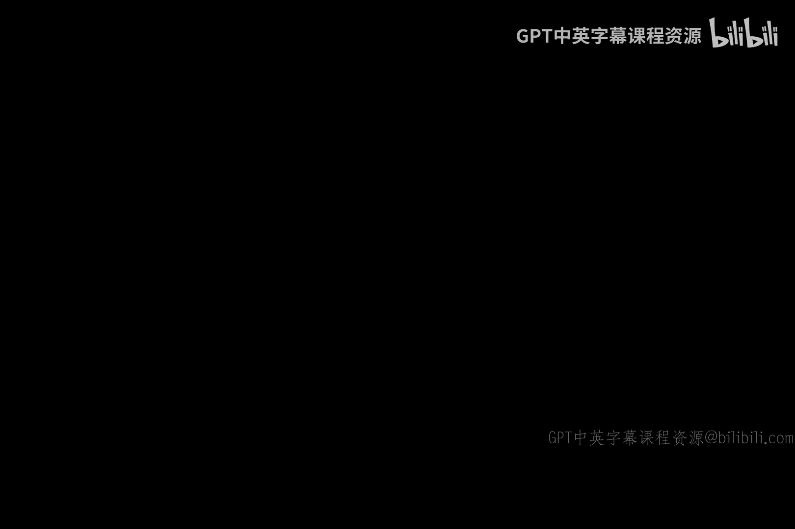
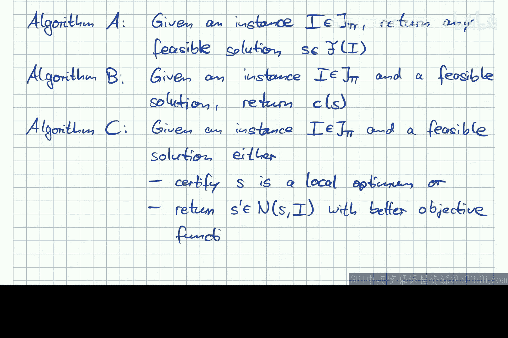
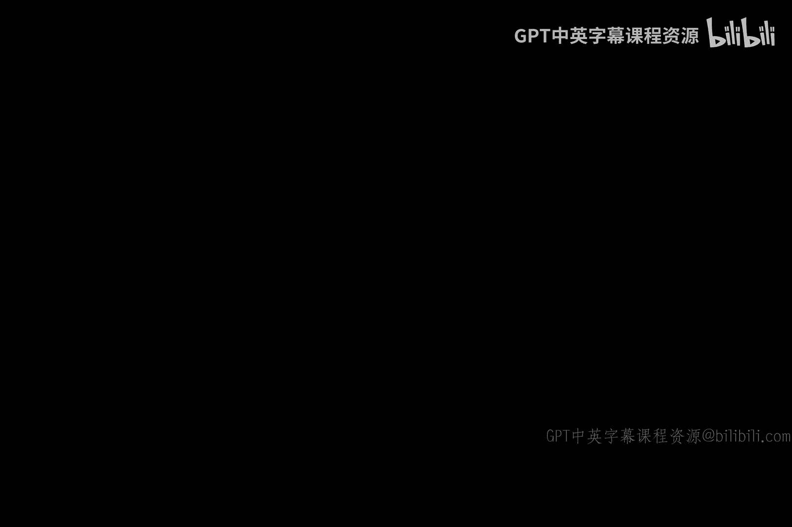
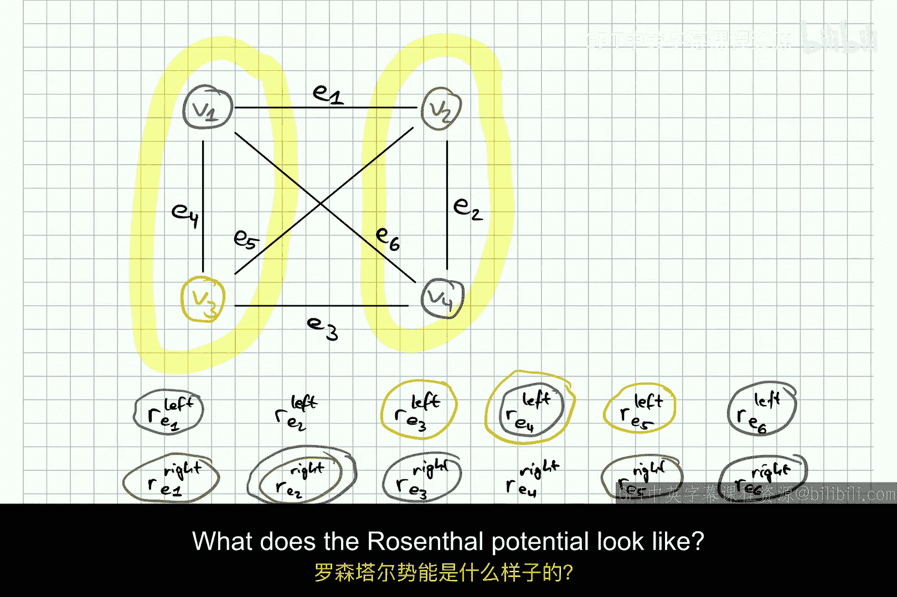

# 006：拥塞博弈中纯纳什均衡的计算复杂度

在本节课中，我们将要学习如何从计算复杂度的角度，理解在拥塞博弈中寻找纯纳什均衡的难度。我们将介绍一个用于搜索问题的复杂度类——多项式局部搜索（PLS），并证明寻找拥塞博弈的纯纳什均衡是一个PLS完全问题。

## 从均衡存在性到计算复杂性

上一节我们介绍了拥塞博弈和一般标准形式博弈，并证明了它们分别总是存在纯纳什均衡和混合纳什均衡。

然而，我们目前还没有一个多项式时间算法来计算这些均衡。这背后有充分的理由：计算这样的均衡通常是困难的。

但“困难”具体指什么？这是否意味着它们是NP问题？并非如此。因为NP是一个关于决策问题的复杂度类，其答案总是“是”或“否”。而“这个拥塞博弈中是否存在纯纳什均衡？”这个问题的答案总是“是”。因此，这是一个搜索问题，与我们通常在复杂度理论中处理的决策问题有根本不同。

那么，复杂度理论能为这类搜索问题提供什么？搜索问题有哪些可能的复杂度类？

## 搜索问题的复杂度类

搜索问题通常给定一个输入，然后需要在输入中找到一个问题的解，或者确定不存在这样的解。

以下是相关的复杂度类：
*   **FP**：代表“函数多项式”。这类似于决策问题中的P类，意味着你总能在多项式时间内找到一个解。
*   **FNP**：这类似于决策问题中的NP类。它意味着找到一个解可能很困难，但验证一个给定解是否正确（是否可行）可以在多项式时间内完成，相对容易。

我们可能希望找到均衡（如在标准形式博弈中找混合纳什均衡，或在拥塞博弈中找纯纳什均衡）是FNP难问题。这并不完全准确，但它确实是FNP子类的难问题。这些子类包括**PPAD**和**PLS**。

PPAD包含寻找标准形式博弈的混合纳什均衡问题，并且该问题是PPAD完全的。而寻找拥塞博弈的纯纳什均衡是一个PLS完全问题。今天我们将重点讨论PLS。

## 输入编码的重要性

在讨论复杂度之前，有一个重要问题：如何编码输入？这在P与NP问题中也很重要。例如，伪多项式时间的概念意味着，如果用一元编码表示数字，背包问题就变成了多项式时间可解的。这里也有类似效应。

对于拥塞博弈，一个重要特点是它们可以被非常简洁地描述。对于一个一般的标准形式博弈（如双矩阵博弈），你通常需要写下整个收益表。但要编码一个拥塞博弈，你只需要指定延迟函数，这在输入中占用的空间要小得多。

这就是为什么遍历双矩阵博弈的整个表来判断哪个是纯纳什均衡相对容易，但在拥塞博弈中，事情要复杂得多，仅仅因为输入本身小得多，却可能代表巨大的状态空间。我们已经在改进序列的长度中看到了这一点：即使只有一个玩家和M个资源，也可能有多达2^M个不同的状态，其中任何一个都可能是纯纳什均衡。

始终要记住，如何编码输入至关重要。

## 定义复杂度类 PLS

我们如何为搜索问题定义一个复杂度类？这显然取决于我们想要建模哪种搜索问题。对于PLS，我们建模的是局部搜索问题。你可能还记得，纯纳什均衡正是Rosenthal势函数的局部最小值。所以，这一切就是关于寻找这些局部最小值。

我们如何一般性地建模一个局部搜索问题？一个局部搜索问题Π由以下部分组成：
*   **实例集合**：记为 I_Π。
*   **可行解集合**：对于每个实例 I ∈ I_Π，有一个有限的可行解集合 F(I)。
*   **目标函数**：记为 C，它将任何可行解映射到一个整数值。
*   **邻域关系**：对于每个可行解 s ∈ F(I)，有一个邻域 N(s, I)，它是可行解集合的一个子集。

我们称一个解 s 为**局部最优解**，如果在其邻域 N(s, I) 中，没有比 s 更好的解（根据目标函数 C）。这里“更好”取决于问题是最大化还是最小化目标函数。

纯纳什均衡可以被视为这样一个局部搜索问题：实例是拥塞博弈；可行解是所有可能的状态（策略组合）；目标函数是Rosenthal势函数；邻域定义为仅允许一个玩家单方面偏离所能到达的状态。

## PLS 问题的定义

现在我们说一个局部搜索问题 Π 属于 **PLS类**（多项式局部搜索），如果存在以下三个多项式时间算法：
*   **算法A**：给定一个实例 I，返回任意一个可行解 s ∈ F(I)。
*   **算法B**：给定一个实例 I 和一个可行解 s，返回目标函数值 C(s)。
*   **算法C**：给定一个实例 I 和一个可行解 s，要么判定 s 是局部最优解，要么返回一个邻域中的更好解 s‘ ∈ N(s, I)。

拥有这三个算法如何帮助我们？有一个非常直接的算法来寻找局部最优解：使用算法A从一个任意解开始，然后重复使用算法C：检查当前解是否是局部最优，如果不是，则移动到算法C提供的更好解。

由于目标函数值在每次迭代中都会改善（对于最小化问题是减少，对于最大化问题是增加），并且可行解数量有限，该算法在有限步内一定会终止并找到一个局部最优解。这个算法的每次迭代只需要多项式时间，因为我们只运行算法A、B和C。

然而，不清楚的是**总迭代次数**在一般情况下是否也是多项式的。在许多情况下，它确实不是多项式的。

## 一个例子：最大割问题

现在我们知道了PLS类，但还没有看到一个例子。我们已经看到拥塞博弈的纯纳什均衡与之相似，但稍后再详细讨论。首先看一个与博弈论看似无关的问题例子：**最大割问题**。这被证明是一个PLS问题，而且是一个PLS完全问题。

我们还需要定义“PLS完全”意味着什么。但让我们先介绍最大割问题。

我们将最大割定义为一个局部搜索问题：
*   **实例**：一个带权无向图 G = (V, E)，边权 w(e) ≥ 0。
*   **可行解**：一个割 (L, R)，即将顶点集 V 划分成两个子集 L 和 R。
*   **目标函数**：割的权值，即所有一个端点在 L、另一个端点在 R 的边的权值之和。
*   **邻域**：两个割是邻居，如果可以通过将**一个顶点**从 L 移到 R 或从 R 移到 L 而相互得到。

假设我们有一个图，以及一个特定的割。很容易验证这个割是否是局部最优的，或者通过移动单个顶点是否能得到一个更好的割。这意味着最大割是一个PLS问题。要证明这一点，我们需要展示上述三个算法（A, B, C）都存在，这确实是简单的。

然而，最大割不仅是PLS问题，它还是**PLS完全的**。

## PLS 完全性与归约

“PLS完全”是什么意思？我们需要定义PLS意义上的归约，这类似于NP的归约，但有些不同，因为你不仅需要转换实例，还需要将解转换回来。

给定两个PLS问题 Π1 和 Π2，如果存在两个多项式时间算法 F 和 G，满足以下条件，则称存在一个 **PLS归约**，记作 Π1 ≤_PLS Π2（意为Π1在PLS意义上不比Π2难）：
*   算法 F 将 Π1 的每个实例 I 映射到 Π2 的一个实例 F(I)。
*   算法 G 将对于实例 F(I) 的每个局部最优解 s，映射回对于原始实例 I 的一个局部最优解 G(s)。

为什么这有意义？因为如果我们已经有了一个解决 Π2 的算法，我们可以通过以下方式为 Π1 构造一个算法：计算 F(I)，在 F(I) 上运行算法得到一个局部最优解 s，然后用 G 将其转换回 I 的局部最优解 G(s)。如果 Π2 有多项式时间算法，并且存在从 Π1 到 Π2 的归约，那么 Π1 也将有多项式时间算法。

类似于NP完全性，我们说一个问题 Π* 是 **PLS完全的**，如果对于PLS类中的每一个问题 Π，都有 Π ≤_PLS Π*。这意味着每个PLS问题都不比Π*难。因此，如果我们有一个解决Π*的多项式时间算法，我们就有了解决所有PLS问题的多项式时间算法。

关于最大割的一个重要事实是：**最大割是PLS完全的**。我们不会在课程中证明这一点，但这对我们非常重要。因为要证明任何其他问题是PLS完全的，我们不需要展示从所有PLS问题到该问题的归约，而只需要展示从最大割到该问题的归约即可，然后利用归约的传递性。

## 拥塞博弈中寻找纯纳什均衡是PLS完全的

我们接下来想要证明，寻找拥塞博弈的纯纳什均衡问题，在PLS意义下，至少和最大割问题一样难。首先，我们必须再次说明这是一个PLS问题。然后我们展示一个从最大割到该问题的归约。这就证明了在PLS ≠ FP的假设下（即存在不是多项式时间可解的PLS问题），寻找纯纳什均衡是困难的。

在讨论归约之前，我们当然要再次观察为什么这是一个PLS问题。如前所述，纯纳什均衡是Rosenthal势函数的局部最小值。我们可以将其写成一个PLS问题：实例是拥塞博弈（资源和延迟函数）；可行解是状态（策略组合）；邻域是单个玩家单方面改变策略所能到达的状态；目标函数是Rosenthal势函数（我们寻求局部最小值）。

需要注意的是，在最大割中我们寻求的是**局部最大值**，而在这里我们寻求的是**局部最小值**。将最小化问题转化为最大化问题（或反之）有时会让人困惑，这也是我们即将看到的证明中最令人困惑的部分之一。

我们现在声称：**最大割 ≤_PLS 寻找拥塞博弈的纯纳什均衡**。

为了证明这一点，给定一个最大割实例（图G和边权），我们必须将其构造为一个拥塞博弈，使得该拥塞博弈的纯纳什均衡对应于原最大割问题的局部最优解。

构造如下：
*   **玩家**：图中的每个顶点对应一个玩家。
*   **资源**：对于图中的每条边 e，我们引入两个资源：`r_e^left` 和 `r_e^right`。
*   **延迟函数**：对于这两个资源，延迟函数定义为：如果只有1个玩家使用该资源，延迟为0；如果有至少2个玩家使用该资源，延迟为 w(e)。
*   **玩家策略**：每个玩家（顶点）有两种策略：
    *   **“左”策略**：选择所有关联于该顶点的边的 `r_e^left` 资源。
    *   **“右”策略**：选择所有关联于该顶点的边的 `r_e^right` 资源。

在这个构造中，博弈的一个状态（策略组合）直接对应一个割：选择“左”策略的玩家对应割的L集，选择“右”策略的玩家对应R集。

现在，我们需要说明如何从博弈的任何一个局部最优解（纯纳什均衡）回到最大割的解。这很直接：只需查看每个玩家的策略，就得到了对应的割。

关键点在于目标函数值的对应关系。可以证明，一个状态（割）的Rosenthal势函数值等于**所有未被割边切割的边的权值之和**。因为对于一条边e，只有当它的两个端点都在同一边（即割没有切割这条边）时，对应的两个玩家才会使用同一个资源（`r_e^left` 或 `r_e^right`），此时该资源恰好被2个玩家使用，对势函数的贡献恰好是 w(e)。如果边被切割，两个玩家使用不同的资源，每个资源只有1个玩家使用，贡献为0。

因此，Rosenthal势函数值 = 所有边权总和 - 割的权值。这意味着，**最大化割的权值等价于最小化Rosenthal势函数值**。由于状态与割一一对应，且邻域关系也一致（单个玩家改变策略对应移动单个顶点），因此最大割的局部最大值正好对应拥塞博弈的纯纳什均衡（即Rosenthal势函数的局部最小值）。

这就完成了归约的证明。

## 关于网络拥塞博弈的说明

需要指出的是，上述构造产生的拥塞博弈**不是网络拥塞博弈**。我们之前的许多拥塞博弈例子是对称网络拥塞博弈（玩家在网络上从同源点到同汇点选择路径）。

你可能会问：计算网络拥塞博弈的均衡是否也困难？一般来说，是的。因为可以通过某种方式将上述构造也转化为在具有源点和汇点的图中工作。但这不会是对称网络拥塞博弈，而且有充分的理由：我们已经有一个多项式时间算法来计算对称网络拥塞博弈的纯纳什均衡。因此，这个问题不太可能是PLS难的（否则将意味着PLS = FP，这与我们的认知相悖）。

## 总结与展望

本节课我们一起学习了计算复杂度的一个方面，特别是**多项式局部搜索（PLS）**类。我们了解到，寻找拥塞博弈的纯纳什均衡是一个PLS完全问题，这意味着在通常的复杂度假设下，没有多项式时间算法能解决所有此类问题。

我们还提到了一个类似的复杂度类**PPAD**，用于刻画在标准形式博弈中寻找混合纳什均衡的难度。其定义虽然更繁琐，但精神是相似的。

这个结果可能有些令人失望：如果均衡如此难以计算，玩家们怎么可能找到并依此行动呢？幸运的是，存在其他更容易计算的均衡概念。我们将在下次课介绍它们。之后我们将要学习的内容，实际上适用于所有这些均衡概念——包括纳什均衡以及这些更易计算的、推广了纳什均衡的概念。这就是我们下节课的内容。