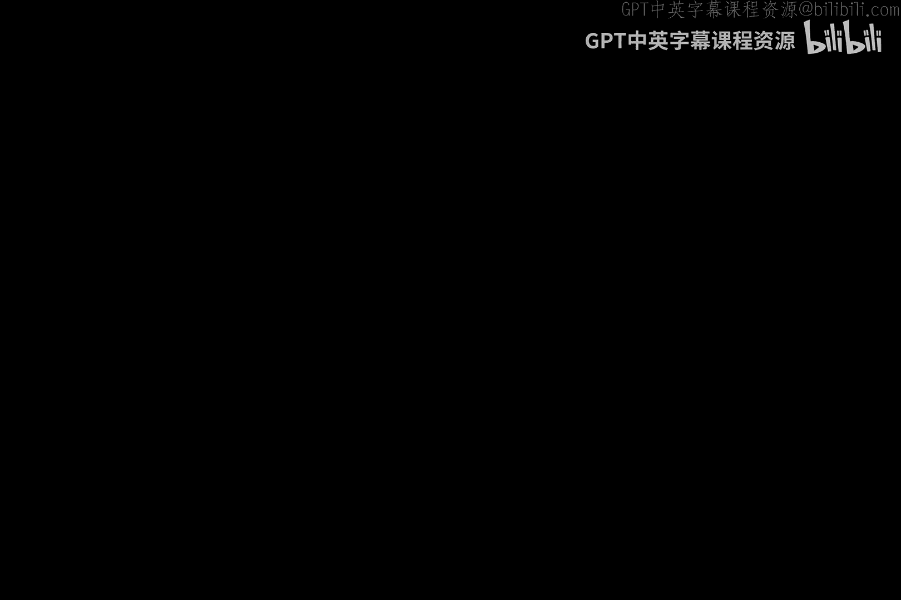
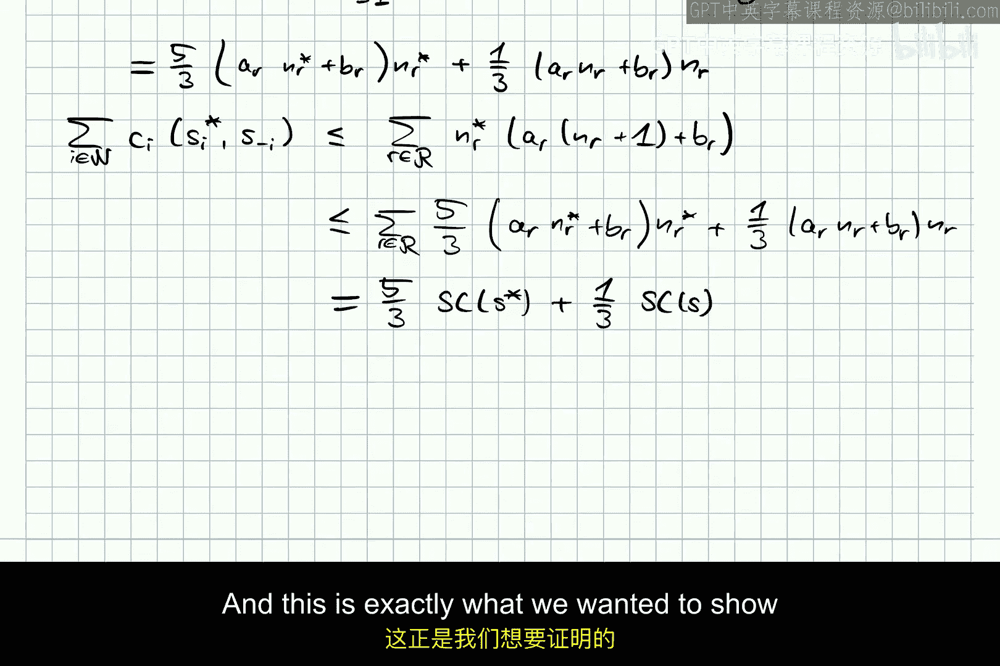
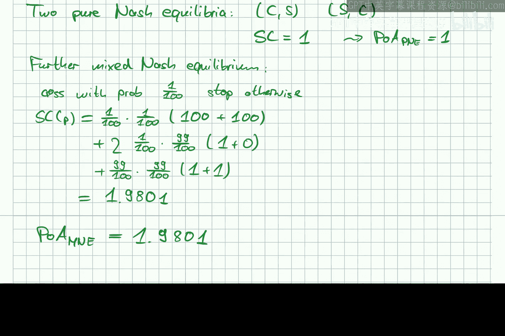
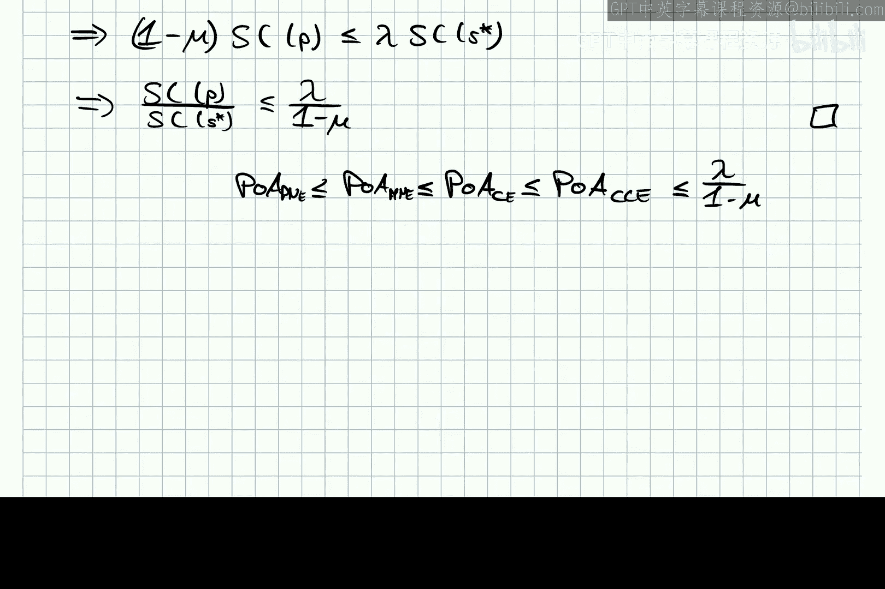

# 009：无政府状态代价

在本节课中，我们将学习如何量化自私行为对社会造成的负面影响。我们将引入“无政府状态代价”这一核心概念，并学习如何为特定类型的博弈计算其上限。

## 概述

到目前为止，我们已经学习了多种建模策略行为的方法，更具体地说，是学习了均衡概念。这些概念反映了策略行为可能导致的状态。然而，在这些讨论中隐含的一个假设是，策略行为对社会而言在某种程度上是有害的。今天我们将讨论这一点，并尝试使用所谓的“无政府状态代价”来量化这种影响。

我们将讨论均衡的社会成本。什么是社会成本？定义社会成本有多种方式。我们今天将使用的概念如下：状态 **S** 的社会成本，我们简单地写作所有玩家所承担成本的总和。你也可以选择取所有玩家成本的最大值，这实际上取决于你认为哪种方式最能反映当前情况下的社会成本概念。但在今天，我们只采用最小化所有玩家成本总和这一视角。

正如我们目前所见，均衡状态下的社会成本可能并非最小。让我们通过一个非常具体的例子再次看看这一点。

## 对称网络拥塞博弈示例

我们来看一个对称网络拥塞博弈。其中只有两条从 **S** 到 **T** 的路径：上边和下边。上边的延迟函数是递增的：如果只有一个玩家使用该资源，延迟为1；两个玩家使用，延迟为2，依此类推。而下边的延迟始终是4，无论有多少玩家使用这条边。

那么这里会发生什么？一般来说，有五种可能的状态：所有玩家都使用上边；一个玩家使用下边，其余三个使用上边，等等。当然，对个人而言，你是哪个玩家很重要，但对于我们的考量，这实际上并不重要。

现在，我们可以为这五种不同类型的状态写下它们的社会成本。

以下是所有可能的状态及其社会成本：

*   **所有4个玩家使用上边**：每个玩家延迟为4，社会成本为 4 * 4 = 16。
*   **3个玩家使用上边，1个玩家使用下边**：上边玩家延迟为3，下边玩家延迟为4，社会成本为 (3 * 3) + 4 = 13。
*   **2个玩家使用上边，2个玩家使用下边**：上边玩家延迟为2，下边玩家延迟为4，社会成本为 (2 * 2) + (2 * 4) = 12。
*   **1个玩家使用上边，3个玩家使用下边**：上边玩家延迟为1，下边玩家延迟为4，社会成本为 1 + (3 * 4) = 13。
*   **所有4个玩家使用下边**：每个玩家延迟为4，社会成本为 4 * 4 = 16。

现在的问题是，哪些状态是纯纳什均衡？如果所有玩家都使用上边，这实际上是一个纯纳什均衡。同样，如果三个玩家使用上边，一个玩家使用下边，这也是一个纯纳什均衡。同时，我们看到对社会最有利的情况（即社会成本仅为12）是当两个玩家使用上边，两个玩家使用下边时。

这意味着，由于策略行为，我们承担了比最优分配更高的社会成本。

## 无政府状态代价的定义

更正式或更量化的表述是：社会最优成本是12，而均衡状态下的社会成本可能高达16。这就是我们所说的“无政府状态代价”，即16与12的比率，因为它衡量了由于策略行为导致成本增加的倍数。

你也可以考虑13除以12的比率，这实际上是“稳定代价”，我们可能下次会讨论，它比较的是最优均衡与最优社会成本。

但正如我所说，今天我们感兴趣的是无政府状态代价，它是均衡社会成本与最优社会成本之间的最差比率。

给定一个成本最小化博弈，我们令 **PNE** 为所有纯纳什均衡状态的集合。纯纳什均衡的无政府状态代价定义如下：

**POA_PNE = max_{S ∈ PNE} (社会成本(S)) / (min_{S*} 社会成本(S*))**

换句话说，它等于任何纯纳什均衡的最大社会成本除以任何状态的最佳社会成本。

## 对特定博弈类别的无政府状态代价进行界定

现在我们已经定义了无政府状态代价的概念，接下来让我们为特定类别的博弈界定这个代价的上限。这是一个特殊的拥塞博弈类别，即我们将延迟函数限制为仿射函数。然后，我们将能够推导出无政府状态代价的紧确界。这意味着，一方面，我们将为任何可能的博弈给出无政府状态代价的上界；同时，我们将通过给出一个无政府状态代价实际达到该上界的博弈实例，来提供一个匹配的下界。

首先定义这类博弈：我们假设延迟函数是非递减的仿射函数。这意味着延迟函数的形式为：

**d_r(k) = a_r * k + b_r**

其中 **a_r** 和 **b_r** 都是非负整数。特别地，我们之前介绍的例子就属于这种形式：我们有常数函数（这绝对是仿射函数，因为我们可以将 **a_r** 设为0），或者我们可以有线性增长函数（通过将 **b_r** 设为0，并将 **a_r** 设为1，就像我们例子中那样）。

我们将为这类拥塞博弈界定无政府状态代价。

我们将证明以下定理：在每个具有仿射延迟函数的拥塞博弈中，纯纳什均衡的无政府状态代价至多为 **5/2**（即2.5）。

## 定理证明

我们如何证明这样的定理？现在，我们必须考虑任何具有仿射延迟函数的拥塞博弈，并在其中考虑任何纯纳什均衡，然后将其与社会最优解进行比较。

这个社会最优解也是一个状态。关于纯纳什均衡，我们知道什么？没有玩家可以通过单方面偏离到其他策略而获益。因此，特别是，单方面偏离到该玩家在社会最优解中所做的策略（无论是什么）是无益的。

让我们具体来看。令 **S** 为一个纯纳什均衡。令 **S*** 为最小化社会成本的状态。

我们现在知道 **S** 是一个纯纳什均衡。这意味着什么？我们需要证明：**社会成本(S) ≤ (5/2) * 社会成本(S*)**。

现在，利用 **S** 是纯纳什均衡这一性质。这意味着对于所有玩家 **i**，有：

**C_i(S) ≤ C_i(S_i*, S_{-i})**

当然，这个玩家单方面偏离到任何策略都无益，因此特别是单方面偏离到 **S_i*** 也无益。

这给我们什么启示？社会成本 **S** 的定义只是所有玩家成本的总和。这个总和不会大于每个项 **C_i(S_i*, S_{-i})** 的总和，因为我们可以用 **C_i(S_i*, S_{-i})** 来界定每个 **C_i(S)**。

我们现在要证明的是：**∑_i C_i(S_i*, S_{-i}) ≤ (5/3) * 社会成本(S*) + (1/3) * 社会成本(S)**。

这立即给出我们想要的界。为什么？这实际上只是简单的计算：从这个不等式的两边减去 **(1/3) * 社会成本(S)**，你得到 **(2/3) * 社会成本(S) ≤ (5/3) * 社会成本(S*)**，这正好意味着我们从这个式子得到了我们想要的界。

所以，我们只需要证明这个界成立。我们如何证明它？

让我们回顾一下 **C_i(S_i*, S_{-i})** 是如何定义的。我们有：

**C_i(S_i*, S_{-i}) = ∑_{r ∈ S_i*} d_r(在状态 (S_i*, S_{-i}) 中使用资源 r 的玩家数量)**

我们如何将其与社会成本 **S*** 和社会成本 **S** 联系起来？首先，我们可以界定这个数量。它肯定不大于 **d_r(n_r(S) + 1)**。为什么？因为在状态 **(S_i*, S_{-i})** 中，使用资源 **r** 的玩家数量最多不会超过在状态 **S** 中使用该资源的玩家数量加1，因为只有玩家 **i** 改变了他或她的策略。

这意味着我们现在可以写出这些项的总和，其界为：取所有玩家的总和，取他们在 **S*** 中分别使用的所有资源的总和，然后取延迟函数在（状态 **S** 中使用该资源的玩家数量 +1）处的值。

现在我们要做的是交换这里的两个求和。这是如何工作的？我们可以等价地取所有资源的总和，然后取在 **S*** 中使用该资源的所有玩家的总和。这个 **d_r** 项实际上与 **i** 无关。所以，我们可以将其写为所有资源的总和，然后乘以 **n_r(S*) * d_r(n_r(S) + 1)**。

现在，我们至少向前迈进了一步，即现在一切都只依赖于在 **S*** 中使用资源的玩家数量和在状态 **S** 中使用该资源的玩家数量。

现在，如果我们稍微简化一下符号，令 **n_r*** 代替 **n_r(S*)**，令 **n_r** 代替 **n_r(S)**。然后，如果我们使用 **d_r(k) = a_r * k + b_r** 这一事实，并结合所有这些，那么我们得到：

**∑_i C_i(S_i*, S_{-i}) ≤ ∑_r n_r* * (a_r * (n_r + 1) + b_r)**

这实际上已经让我们非常接近目标了，因为现在我们要做的就是将其用社会成本 **S*** 和社会成本 **S** 来表示，这两者都可以用类似的方式写出。但要达到这一点，我们需要一个引理来帮助我们界定这些量。

在我们这样做之前，让我先说明一下，我们将比较这个量与社会成本 **S***，社会成本 **S*** 也不过是取所有资源的总和，取使用该资源的玩家数量，然后乘以该资源的延迟。我意识到这并不十分直接，但我们在这里再次使用了之前使用的交换求和的技巧。

让我为社会成本 **S** 更明确地写出来。我们取所有玩家的总和，然后取该玩家使用的所有资源的总和，然后我们根据使用该资源的玩家数量求和延迟。现在，我们求和 **d_r** 值的次数是多少？对于每个资源，我们恰好取 **n_r** 乘以 **d_r(n_r)** 的值。然后我们代入 **d_r** 的定义，得到我们想要的结果。

## 关键引理

我们幸运地有以下引理来帮助我们。这个引理来自关于无政府状态代价的早期论文。对于任何非负整数 **y** 和 **z**，我们有：

**y * (z + 1) ≤ (5/3) * y^2 + (1/3) * z^2**

让我们证明这个引理。正如我所说，它并不复杂，但只是一种不太美观的情况区分。

首先考虑 **y = 0** 的情况。那么左边是0，右边是非负数，所以这确实是一个平凡的情况。

现在转向 **y = 1** 的情况。左边是 **z + 1**，右边是 **5/3 + (1/3) * z^2**。我们使用以下简单界：由于 **z** 是整数，我们有 **(z - 1) * (z - 2) ≥ 0**。为什么？对于介于0和1之间的 **z**，这将是负数，但幸运的是0和1之间没有整数。所以这对任何可能的整数 **z** 总是非负的。这意味着 **z^2 - 3z + 2 ≥ 0**。我们可以将 **3z** 移到另一边，然后得到 **z ≤ (2/3) + (1/3) * z^2**。这意味着 **y * (z + 1) = z + 1 ≤ (2/3) + 1 + (1/3) * z^2 = (5/3) * y^2 + (1/3) * z^2**。

现在，我们的最后一种情况是 **y ≥ 2**。我们做一个类似的论证：**√(3/4) * y - √(1/3) * z** 的平方永远不会是负数。这等于 **(3/4) * y^2 + (1/3) * z^2 - yz**。此外，我们有 **y ≤ (1/2) * y^2**。这是因为我们使用了 **y** 严格大于1的条件，所以这对 **y = 1** 不成立，但在其他情况下确实成立。所以我们得到 **y * (z + 1) = yz + y ≤ (3/4) * y^2 + (1/3) * z^2 + (1/2) * y^2 = (5/4) * y^2 + (1/3) * z^2**。但这不大于 **(5/3) * y^2 + (1/3) * z^2**。这就完成了我们引理的证明。

## 完成证明

这个引理给我们什么启示？它给出：

**n_r* * (a_r * (n_r + 1) + b_r) = a_r * n_r* * (n_r + 1) + b_r * n_r* ≤ a_r * [(5/3) * (n_r*)^2 + (1/3) * (n_r)^2] + b_r * n_r***

现在，我们将其上界为：**(5/3) * a_r * (n_r*)^2 + (5/3) * b_r * n_r* + (1/3) * a_r * (n_r)^2 + (1/3) * a_r * n_r**。我们在这里做了什么？这里的 **b_r * n_r*** 肯定至少是 **b_r * 1**？实际上，更准确地说，我们利用了 **n_r* ≥ 1** 时 **b_r * n_r* ≤ (5/3) * b_r * n_r*** 的事实，并且增加了 **(1/3) * a_r * n_r** 项（它是非负的），这肯定给出了一个上界。

现在我们得到：**(5/3) * (a_r * n_r* + b_r) * n_r* + (1/3) * (a_r * n_r + b_r) * n_r**。

这对我们有什么帮助？让我们回到我们想要证明的内容。我们想要用这两个量来界定这个量。现在我们已经对每个 **r** 单独做了这个。所以我们现在唯一要做的就是取所有 **r** 的总和。

我们现在有，这些项的总和最多为取所有资源的总和，然后加上我们刚刚展示的上界。现在我们可以认识到，这实际上等于 **(5/3) * 社会成本(S*) + (1/3) * 社会成本(S)**。这正是我们想要证明的。

因为现在，再次回顾这个论证是如何进行的：我们已经看到社会成本 **S** 最多是这个量。然后我们看到，这个有趣的纠缠和的上界是 **(5/3) * 社会成本(S*) + (1/3) * 社会成本(S)**。如果你现在进行计算，你会得到社会成本 **S** 最多为 **(5/2) * 社会成本(S*)**。这正是我们所声称的。

## 下界示例

好的，现在我们知道对于每个具有仿射延迟函数的拥塞博弈，无政府状态代价不大于 **5/2**。但是，这实际上是我们能做到的最好的保证吗？是的，它是。存在一个拥塞博弈的例子，其无政府状态代价实际上就是这么高。

我们将展示一个定理：存在具有仿射延迟函数的拥塞博弈，其纯纳什均衡的无政府状态代价为 **5/2**。我们实际上在这一点上只进行证明草图，不会遍历所有证明细节，因为再次说明，这有变得复杂的倾向。例如，因为我们实际上必须验证我们在这里处于纯纳什均衡。

它是如何工作的？我们将有以下非对称网络拥塞博弈。这里，符号 **x** 表示 **d(x) = x**。这意味着 **d_r(x) = x**。而另一个符号表示 **d_r(x) = 0**，这对所有 **x** 都成立。

我们将有四个玩家。这些玩家希望从不同的源点到达不同的汇点。玩家1想从 **U** 到 **V**。玩家2想从 **U** 到 **W**。玩家3想从 **V** 到 **W**。玩家4想从 **W** 到 **V**。

最优策略是什么？最优策略总是直接前往你的汇点。因为总是有一条直接的边带你到你的汇点，并且这总是成本为1，因为没有其他人使用这条边。

再次说明，玩家1想从 **U** 到 **V**，在最优情况下，他将独自使用这条边。玩家2想从 **U** 到 **W**，他也走直接边。玩家3和4也想从 **V** 到 **W** 或反之，他们也可以走直接边，所以没有两个玩家使用同一条边。

但现在有一个糟糕的纯纳什均衡。在这个纯纳什均衡中，没有玩家使用直接边，他们都通过路径上的中间节点走。因为也总是有另一种绕行的选择。

玩家1不直接通过这条边从 **U** 到 **V**，而是通过 **W** 走。玩家2不直接从 **U** 到 **W**，而是通过 **V** 到 **W**。如果我们现在进行计算，那么我们将看到成本分别为3、3、2和2。如果我们现在把所有加起来，那么我们在这里得到4，那里得到10。所以比率是10除以4，正好是 **5/2**。当然，我们现在必须验证这确实是一个纳什均衡，但这是你可以自己完成的。

## 扩展到其他均衡概念

现在我们已经讨论了纯纳什均衡的无政府状态代价，但其他均衡概念呢？让我们首先将无政府状态代价的概念推广到其他均衡概念，然后也为这些均衡概念类别界定无政府状态代价。

为了更一般地定义无政府状态代价的概念，我们必须以某种方式一般性地谈论均衡概念。事实证明，这里最简单的方法是谈论状态上的概率分布，因为实际上，相关均衡或粗相关均衡，以及混合纳什均衡，都不过是博弈中状态上的概率分布。这些均衡概念唯一的不同在于它们对这些均衡内容施加的限制。

为了现在一般地定义无政府状态代价，我们现在说：给定一个成本最小化博弈，我们令 **EQ** 为状态 **S** 上的一组概率分布。对于任何概率分布 **P**，我们现在也将社会成本推广为期望社会成本：取所有状态的总和，取该状态被播放的概率，然后乘以你在该状态下会得到的社会成本。

现在，均衡概念 **EQ** 的无政府状态代价定义为：**POA_EQ = max_{P ∈ EQ} (期望社会成本(P)) / (min_{S*} 社会成本(S*))**。取这些概率分布中最差的一个，即最差的期望社会成本，并将其与最佳状态的社会成本进行比较。

在这一点上你可能会问，在分母中也取状态的概率分布是否有意义？你可以，但最终如果你想最小化这个比率，你也可以直接取具有最小社会成本的状态，而不是取任何概率分布，因为任何概率分布的社会成本不可能比你在这里找到的任何状态的最佳社会成本更小。

如果我们所有最喜欢的均衡概念都存在，我们也可以写出：纯纳什均衡的无政府状态代价总是至少为1，但至多是混合纳什均衡的无政府状态代价。因为任何纯纳什均衡也是一个混合纳什均衡。这意味着，对于混合纳什均衡，你看到的最差社会福利只能比纯纳什均衡的最差社会福利更差，因为你只在更大的集合上取最大值。

类似地，因为每个混合纳什均衡也是一个相关均衡，而每个相关均衡也是一个粗相关均衡，所以这可能变得越来越差。但这真的发生了吗？混合纳什均衡的无政府状态代价比纯纳什均衡的更差吗？是的，这确实可能发生。让我给你一个快速的例子来说明这是如何发生的。

我希望你记得这个博弈：我们选择是停车还是通过十字路口。如果两个玩家都选择通过十字路口，那么他们将有一个极高的成本。但如果他们都停车，那也没问题。但如果另一个玩家停车，那么你实际上宁愿通过十字路口。所以这个博弈看起来像这样，这是一个对称博弈。

现在，这里的纯纳什均衡是什么？有两个纯纳什均衡：一个玩家停车，另一个玩家通过十字路口。所以那将是“通过和停车”以及“停车和通过”。这些的社会成本是多少？社会成本将是1。但还有一个混合纳什均衡。顺便说一下，在两个纯纳什均衡中社会成本都是1。这立即意味着纯纳什均衡的无政府状态代价也是1，因为那些实际上是社会最优。

但还有一个进一步的混合纳什均衡：以 **1/100** 的概率通过，否则停车。这个的社会福利是多少？以 **(1/100) * (1/100)** 的概率，两个玩家实际上都通过，那么我们将有一个 **100 + 100** 的社会成本。这是事故情况。然后，以 **2 * (1/100) * (99/100)** 的概率，一个玩家停车，另一个通过。然后，以 **(99/100) * (99/100)** 的概率，两个玩家都停车，社会成本为1。所以如果你在这里进行计算，那么你会看到这总和为1.9801。这意味着混合纳什均衡的无政府状态代价实际上是1.9801。因为这是最差的混合纳什均衡，因为正如我们所看到的，没有进一步的混合纳什均衡存在，原因很简单，我们现在已经枚举了这个博弈中所有可能的混合纳什均衡支持。所以这些是这个博弈中存在的所有三个混合纳什均衡，这个必须是最差的。

好的，所以这意味着，在这个博弈中，纯纳什均衡的无政府状态代价实际上是1，而混合纳什均衡的无政府状态代价几乎是2。

## 平滑博弈与一般界定

但是我们如何一般性地界定比纯纳什均衡更一般的均衡概念的无政府状态代价？事实上，我们之前用来界定纯纳什均衡在具有仿射延迟函数的拥塞博弈中的无政府状态代价的技术可以推广，这就是我们接下来要做的。

现在，我们希望将我们用来界定具有仿射延迟函数的拥塞博弈中纯纳什均衡的无政府状态代价的技术推广到更一般的均衡概念。事实上，这种方式推广得非常巧妙。我们在证明中已经展示了这一点，尽管我们当时没有这样称呼它，即这是一个平滑博弈。

平滑博弈的定义是什么？一个博弈被称为 **(λ, μ)-平滑**（对于 **λ > 0** 且 **μ < 1**），如果对于每一对状态 **S** 和 **S***，我们有：

**∑_i C_i(S_i*, S_{-i}) ≤ λ * 社会成本(S*) + μ * 社会成本(S)**

我希望这看起来很熟悉，因为这正是我们在证明中用来界定纯纳什均衡在具有仿射延迟函数的拥塞博弈中的无政府状态代价的式子。但这更一般，因为在我们之前的证明中，我们假设 **S** 是一个纯纳什均衡，**S*** 是一个社会最优解，这些都没有出现在这个定义中。这里 **S** 和 **S*** 只是任意状态，所以这对任何任意状态对 **S** 和 **S*** 都必须成立。如果这是真的，那么这个博弈就被称为平滑的。

但让我们快速验证一下，我们实际上已经证明了这一点。我声称我们已经证明了：每个具有仿射延迟函数的拥塞博弈是 **(5/3, 1/3)-平滑** 的。让我们快速回到我们如何证明这一点的证明。我们取 **S** 为纯纳什均衡，**S*** 为最小化社会成本的状态。然后我们说，因为 **S** 是纯纳什均衡，当然，这对任意状态对并不普遍成立。但从这一点开始，我们只展示了这些 **C_i(S_i*, S_{-i})** 的总和以 **(5/3) * 社会成本(S*) + (1/3) * 社会成本(S)** 为界。如果你现在仔细检查证明，你会看到很多计算发生，但你永远不会看到我们论证说，这是因为这是一个社会最优解或因为这是一个纯纳什均衡，这没有出现在任何地方。所以我们已经展示了这个引理。

所以我现在声称的定理是：每个具有仿射延迟函数的拥塞博弈是 **(5/3, 1/3)-平滑** 的。

另一件事是：这种平滑性已经暗示了纯纳什均衡的无政府状态代价的界。让我们快速回顾一下为什么这是真的。我们取 **S** 为纯纳什均衡，取 **S*** 为社会最优解。然后我们看到，社会成本 **S** 可以被界定，因为没有玩家愿意单方面偏离到无论他或她在 **S*** 中做什么。然后我们可以应用平滑性。现在，两边减去 **μ * 社会成本(S)**，这给出 **(1 - μ) * 社会成本(S) ≤ λ * 社会成本(S*)**。这意味着社会成本 **S** 除以社会成本 **S*** 不大于 **λ / (1 - μ)**。

但好处是，我们可以立即推广这个证明。我们可以证明：在一个 **(λ, μ)-平滑** 博弈中，粗相关均衡的无政府状态代价至多为 **λ / (1 - μ)**。顺便说一下，这正是我们之前展示的那种保证，但之前我们只针对纯纳什均衡展示这个，所以现在这必须稍微困难一点，因为这是一个更一般的证明。但它实际上以完全相同的方式工作。

所以我们现在令 **P** 为一个粗相关均衡。**S*** 仍然是一个社会最优解。现在 **P** 的社会成本是多少？正如我所说，我们实际上取期望：从 **P** 中抽取一个状态，现在考虑社会成本，以及你得到的期望社会成本。那是多少？状态的社会成本是各个玩家成本的总和。现在，我们可以做的是，我们可以将这个对所有玩家的总和移到期望外面，根据期望的线性性质。现在对于每个玩家，我们利用这个玩家对粗相关均衡推荐的任何策略都满意这一性质。这意味着这个仍然以某个量为界。粗相关均衡仍然可能推荐一些东西，但我单方面移动到总是玩 **S_i***。所以我们仍然有这些期望的总和，我希望现在看起来非常熟悉。

现在，我们可以做的是，我们可以再次将总和移到期望内部，再次利用期望的线性性质。现在我们可以应用平滑性。无论这里期望内部发生什么，它与我们的均衡概念无关。那只是，有一些 **S**，有一些 **S***。实际上，**S** 现在是一个随机变量。但我们关心什么？我们总是可以说，哦，这至多是 **λ * 社会成本(S*) + μ * 社会成本(S)**。因为这对每个 **S** 都逐点成立，无论 **S** 是什么。尽管它是一个随机变量，我们可以在期望内部替换它。

现在我们再次使用期望的线性性质。例如，社会成本 **S*** 不依赖于 **S**，所以在期望意义上它是一个常数。同样，**μ** 是一个常数。而这个，再次，不过是均衡的社会成本。所以我们现在在哪里？均衡的社会成本以 **λ * 最优社会成本 + μ * 均衡的社会成本** 为界。

所以这意味着 **(1 - μ) * 均衡的社会成本 ≤ λ * 社会成本(S*)**。或者换句话说，均衡的社会成本除以最优社会成本至多为 **λ / (1 - μ)**。好的。所以，这意味着现在粗相关均衡的无政府状态代价至多为 **λ / (1 - μ)**。正如我们之前所见，这也将给出相关均衡或混合纳什均衡或纯纳什均衡的无政府状态代价界。

事实上，我们已经看到了一个例子，其中所有这些都相等，因为我们展示了对于具有仿射延迟函数的拥塞博弈类，这个 **λ / (1 - μ)** 正好是 **5/2**，但我们也给出了一个例子，说明在某些博弈中这可以高达 **5/2**。所以对于所有这些均衡概念，这通常是答案。对于具有仿射延迟函数的一般拥塞博弈，你可以展示的所有这些均衡概念的最佳无政府状态代价是 **5/2**。

## 总结

好的，这就完成了我们对无政府状态代价的讨论，尽管无政府状态代价实际上将在本课程后面再次出现，也在不同的背景下，平滑性的概念也会再次出现。但在此之前，例如，我们仍然会问这个问题：如果我们对均衡不那么悲观呢？如果我们考虑我们能希望的最佳均衡是什么的问题呢？因为，嗯，这至少是我们由于策略行为而必须损失的量。这被称为所谓的“稳定代价”，为此人们实际上应用了不同的技术，我们将在后面看到。

非常感谢你今天的时间，如果你有任何问题，请告诉我。