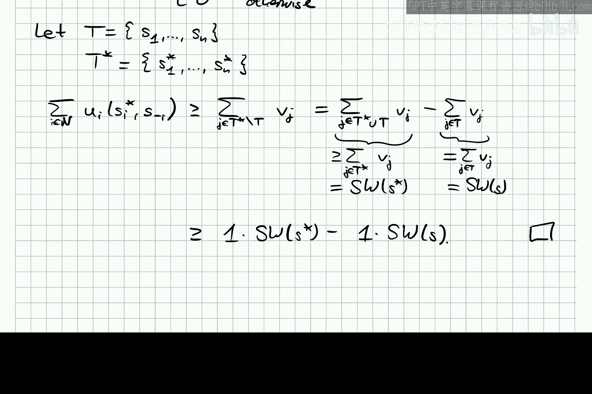

# 010：成本与市场共享博弈中的低效性

欢迎回到算法博弈论课程。今天我们将继续并完成关于策略行为导致低效性的讨论。

## 概述

在本节课中，我们将学习两种衡量博弈均衡结果与社会最优结果之间差距的方法。首先，我们将介绍一个比“无政府价格”更乐观的指标——“稳定价格”。然后，我们将视角从成本最小化博弈转向收益最大化博弈，并探讨如何将之前的分析技术应用于市场共享博弈。

## 第一部分：成本共享博弈与稳定价格

上一节我们介绍了“无政府价格”，这是一种衡量策略行为造成损失的方法。它采取了一种较为悲观的视角，即比较最差均衡与社会最优之间的差距。

本节中，我们将采取更乐观的视角，考虑所谓的“稳定价格”。它比较的不是最差的均衡，而是**最好的均衡**与社会最优之间的差距。

### 成本共享博弈的定义

成本共享博弈是拥塞博弈的一种特例，其延迟函数具有特定形式。

一个**成本共享博弈**是一个拥塞博弈，其中所有延迟函数具有以下形式：
`d_r(x) = c_r / x`
其中 `c_r` 是资源 `r` 的常数成本。

这意味着资源 `r` 有一个总成本 `c_r`，而使用该资源的玩家将**平均分摊**这个成本。

在这种设定下，一个状态 `S` 的社会成本是所有玩家成本的总和。在拥塞博弈中，玩家 `i` 的成本是其使用的所有资源的延迟值之和。经过重新排列，社会成本可以简化为所有被至少一个玩家使用的资源的总成本 `c_r` 之和。

### 无政府价格的局限性

不幸的是，在成本共享博弈中，无政府价格可能非常糟糕。让我们看一个简单的例子。

考虑一个网络，有一个源点和一个汇点。上边成本为 `1 + ε`，下边成本为 `n`。这里有 `n` 个玩家。

一个纯纳什均衡是所有玩家都走上边，这也是社会最优解，社会成本为 `1 + ε`。
然而，还存在另一个纯纳什均衡：所有玩家都走下边。此时社会成本为 `n`。为什么这也是纳什均衡？因为如果任何一个玩家单方面偏离到下边，他将独自承担 `1 + ε` 的成本，高于他留在下边时分摊到的成本 `1`。

这个例子类似于技术锁定：虽然存在更好的技术（上边），但由于协调问题，社会可能被困在更差的技术（下边）均衡中。

因此，无政府价格只给出了非常有限的视角，它告诉我们最坏的情况确实可能发生。但在这个设定中，并非必然如此，因为也存在好的均衡（社会最优本身就是一个均衡）。这就是我们今天要问的问题：考虑到策略行为，我们**最少**要损失多少效率？

### 稳定价格的定义

对于一种均衡概念 `EQ`，我们定义**稳定价格**如下：
`PoS_EQ = (min_{β ∈ EQ} SC(β)) / (min_{S} SC(S))`
其中 `SC` 表示社会成本。

上次我们看到，对于粗相关均衡，稳定价格可能高于相关均衡，以此类推。但这里的故事有些不同，因为我们总是考虑**最好的**均衡。因此，粗相关均衡的稳定价格**至多**等于相关均衡的稳定价格，以此类推。最终有：
`PoS_CCE ≤ PoS_CE ≤ PoS_MNE ≤ PoS_PNE ≤ PoA_PNE`
因为最好的纯纳什均衡当然比最差的纯纳什均衡好，并且这个最好的纯纳什均衡本身也是一个（混合/相关/粗相关）均衡。

与无政府价格不同，界定稳定价格通常意味着必须证明均衡的存在，因此有时更具挑战性。

### 对称成本共享博弈的稳定价格

我们首先从对称成本共享博弈开始。我们将证明，在对称成本共享博弈中（所有玩家具有相同的策略集），纯纳什均衡的稳定价格为 **1**。

这意味着总是存在一个同时也是社会最优的纯纳什均衡（或者说，总有一个社会最优状态也是纯纳什均衡）。

**证明**：我们显式地构造这个纯纳什均衡。
令玩家1的策略 `s_1` 是使其单独承担的成本总和最小的策略（即最小化 `Σ c_r`，其中 `r ∈ s_1`）。
然后让所有其他玩家采用与玩家1完全相同的策略 `s_1`。

为什么这是社会最优？因为即使只有玩家1，他也不能做得更便宜，而其他玩家也无法使这个成本更低。
为什么这是纯纳什均衡？考虑任何一个玩家 `i` 单方面偏离到另一个策略 `s_i‘`。偏离后的成本至少是 `(1/n) * Σ_{r ∈ s_i’} c_r`。由于 `s_1` 是使 `Σ c_r` 最小的策略，所以 `Σ_{r ∈ s_i‘} c_r ≥ Σ_{r ∈ s_1} c_r`。因此，偏离后的成本至少是 `(1/n) * Σ_{r ∈ s_1} c_r`，而这正是玩家 `i` 在均衡状态下的成本。所以没有玩家愿意偏离。

我们非常明确地使用了博弈的对称性，因为我们让所有玩家采用相同的策略。

### 非对称成本共享博弈的稳定价格

如果玩家具有不同的策略集（非对称博弈），那么稳定价格大于1。首先看一个例子。

有 `n` 个玩家，每个玩家有不同的源点，共享同一个汇点。
玩家 `i` 有一条直达边，成本为 `1/i`。
所有玩家还可以选择先到一个中间节点 `v`，然后通过一条成本为 `1 + ε` 的边到达汇点。

社会最优解是所有玩家都走 `v -> 汇点` 路径，总社会成本为 `1 + ε`。
但这是均衡吗？不是。考虑玩家 `n`，他在社会最优下的成本是 `(1+ε)/n`。如果他单方面偏离到自己的直达边，成本为 `1/n`，这对他更优。实际上，唯一的纯纳什均衡是所有玩家都使用自己的直达边。此时社会成本是调和数 `H_n = 1 + 1/2 + ... + 1/n`，其增长与 `ln n` 成正比。

因此，纯纳什均衡的稳定价格至少为 `H_n / (1+ε)`。

幸运的是，我们也可以证明这是稳定价格的一个上界。

**定理**：对于有 `n` 个玩家的成本共享博弈，纯纳什均衡的稳定价格至多为第 `n` 个调和数 `H_n`。

**证明**：我们利用**罗森塔尔势函数**。在拥塞博弈中，纯纳什均衡正是罗森塔尔势函数的局部最小值。
对于成本共享博弈，状态 `S` 的罗森塔尔势函数 `Φ(S)` 为：
`Φ(S) = Σ_{r} Σ_{k=1}^{n_r(S)} (c_r / k)`
其中 `n_r(S)` 是使用资源 `r` 的玩家数量。

社会成本 `SC(S)` 为：
`SC(S) = Σ_{r: n_r(S)≥1} c_r`

现在比较两者：
*   `Φ(S) ≥ SC(S)` （因为只取每个资源求和的第一项 `k=1` 时，就等于 `SC(S)`）。
*   `Φ(S) ≤ Σ_{r: n_r(S)≥1} c_r * H_{n_r(S)} ≤ H_n * SC(S)` （因为 `H_{n_r(S)} ≤ H_n`）。

现在，令 `S` 是罗森塔尔势函数的全局最小值。我们知道 `S` 是一个纯纳什均衡。
令 `S*` 是一个社会最优状态。
根据势函数最小值的定义：`Φ(S) ≤ Φ(S*)`。
结合上面的不等式：
`SC(S) ≤ Φ(S) ≤ Φ(S*) ≤ H_n * SC(S*)`
因此，`SC(S) / SC(S*) ≤ H_n`。

证毕。我们不仅找到了一个纯纳什均衡（势函数最小点），还通过势函数作为桥梁，比较了社会成本。

我们也看到 `H_n` 是紧的，因为之前的例子表明最好的均衡确实不比 `H_n` 倍的社会最优更好。

---

## 第二部分：市场共享博弈与无政府价格

现在我们已经很好地理解了成本共享博弈的无政府价格和稳定价格。接下来我们将转向**市场共享博弈**。它几乎与成本共享博弈相同，只是玩家的目标从最小化成本变为最大化市场份额，即这是一个**收益最大化博弈**，而非成本最小化博弈。

对于均衡存在性等基本问题，这没有区别。但对于稳定价格和无政府价格，区别很大，因为现在大数值比小数值更好。

### 市场共享博弈的定义

在一个市场共享博弈中，我们有 `n` 家公司（玩家）和 `m` 个市场。
每个公司可以决定投资于一个市场。我们用 `s_i ⊆ [m]` 表示玩家 `i` 的策略（注意：这里 `s_i` 是单个市场，策略集是所有市场的子集）。

每个市场 `j` 有一个需求 `v_j`。
如果多家公司投资于同一个市场，则市场需求被平均分享。

因此，在状态 `S = (s_1, ..., s_n)` 下，玩家 `i` 的效用为：
`u_i(S) = v_{s_i} / n_{s_i}(S)`
其中 `n_j(S)` 是投资于市场 `j` 的玩家数量。

社会福祉 `SW(S)` 是所有玩家效用的总和。可以证明，这等于所有被至少一个玩家投资的市场的需求 `v_j` 之和（每个市场只计一次）。

### 一个例子

考虑 `n` 个市场。每个玩家可以投资任何市场。
第一个市场的需求为 `n + ε`，其他所有市场的需求均为 `1`。

社会最优解是每个玩家投资于不同的市场。此时社会福祉为 `(n + ε) + (n-1)*1 = 2n - 1 + ε`。
然而，唯一的纯纳什均衡是所有玩家都投资于第一个市场。因为即使所有人都投资第一个市场，每个玩家仍能获得 `(n+ε)/n > 1` 的效用，而投资任何其他市场只能获得 `1`。此时社会福祉仅为 `n + ε`。

我们看到，由于玩家的策略行为，我们再次损失了社会福利。现在的问题是，无政府价格有多大？

### 均衡存在性与无政府价格定义

首先，市场共享博弈总是存在纯纳什均衡。因为我们可以将其重写为一个拥塞博弈，其中延迟为负值（即 `-v_j / x`）。因此，拥塞博弈的均衡存在性结论在此同样适用。

现在，如何在效用最大化博弈中定义无政府价格？形式与成本最小化博弈类似，只是最大和最小互换了。

对于一个效用最大化博弈和一种均衡概念 `EQ`，我们定义无政府价格为：
`PoA_EQ = (max_{S} SW(S)) / (min_{β ∈ EQ} E[SW(β)])`
这里，我们将最优社会福祉放在分子，最差均衡的社会福祉期望放在分母。这样，无政府价格总是**大于等于1**，且数值越小越好。

### 收益最大化博弈的平滑性

类似于成本最小化博弈，我们可以定义收益最大化博弈的平滑性。

一个效用最大化博弈被称为 `(λ, μ)`-**平滑**的，如果对于任意两个状态 `S` 和 `S*`，满足：
`Σ_i u_i(s_i*, S_{-i}) ≥ λ * SW(S*) - μ * SW(S)`
其中 `λ > 0`，`μ ≥ 0`。

与成本最小化版本的关键区别在于：不等式方向变为“至少”，并且我们减去 `μ * SW(S)` 项。

通过类似的证明（我们以纯纳什均衡为例），可以证明平滑性意味着对无政府价格的界：

**定理**：在一个 `(λ, μ)`-平滑的效用最大化博弈中，粗相关均衡的无政府价格至多为 `(1+μ)/λ`。

**证明**：设 `S` 是一个纯纳什均衡，`S*` 是社会最优状态。
因为 `S` 是均衡，所以对于每个玩家 `i`，有 `u_i(S) ≥ u_i(s_i*, S_{-i})`。
对所有 `i` 求和：`SW(S) ≥ Σ_i u_i(s_i*, S_{-i})`。
应用平滑性条件：`SW(S) ≥ λ * SW(S*) - μ * SW(S)`。
整理得：`(1+μ) * SW(S) ≥ λ * SW(S*)`。
因此，`SW(S*) / SW(S) ≤ (1+μ)/λ`。

证毕。证明思路与成本最小化版本完全类似。

### 市场共享博弈的平滑性

现在，要理解市场共享博弈的无政府价格，我们只需要证明其平滑性。

**定理**：每一个市场共享博弈都是 `(1,1)`-平滑的。

**证明**：我们需要证明对于任意状态 `S` 和 `S*`，有：
`Σ_i u_i(s_i*, S_{-i}) ≥ 1 * SW(S*) - 1 * SW(S)`。

考虑玩家 `i` 单方面偏离到 `s_i*` 时的效用 `u_i(s_i*, S_{-i})`。这等于市场 `s_i*` 的需求除以在状态 `(s_i*, S_{-i})` 下投资于该市场的玩家数量。这个值最多为 `v_{s_i*}`（当没有其他玩家投资该市场时），并且总是非负的。

令 `T` 为在状态 `S` 中被投资的市场集合，`T*` 为在状态 `S*` 中被投资的市场集合。
那么，和式 `Σ_i u_i(s_i*, S_{-i})` 的一个下界是：所有在 `T*` 中但**不在** `T` 中的市场 `j` 的需求 `v_j` 之和。因为每个这样的“新”市场至少会被第一个选择它的玩家贡献一次 `v_j`，而后续选择同一市场的玩家不会增加这个和（因为效用是分摊的，但我们的下界只取第一次出现）。
这个下界等于 `Σ_{j ∈ T*} v_j - Σ_{j ∈ T ∩ T*} v_j`。
注意到 `Σ_{j ∈ T*} v_j = SW(S*)`，并且 `Σ_{j ∈ T ∩ T*} v_j ≤ Σ_{j ∈ T} v_j = SW(S)`。
因此，`Σ_i u_i(s_i*, S_{-i}) ≥ SW(S*) - SW(S)`。
这正是 `λ=1, μ=1` 的平滑性条件。

证毕。

由此，市场共享博弈的无政府价格（即使是对于粗相关均衡）至多为 `(1+μ)/λ = (1+1)/1 = 2`。

有趣的是，在成本最小化世界（成本共享博弈）中，我们无法界定无政府价格（它可以是任意大），而在效用最大化世界（市场共享博弈）中，尽管例子类似，我们却能将无政府价格界定为一个常数（2）。

---

## 总结

本节课我们一起学习了两种博弈中的低效性衡量方法。

首先，在成本共享博弈中，我们探讨了**稳定价格**，它衡量了最好均衡与社会最优的差距。我们利用罗森塔尔势函数，证明了在非对称博弈中，纯纳什均衡的稳定价格以调和数 `H_n` 为上界，且该界是紧的。

接着，我们将视角转向**市场共享博弈**这类收益最大化博弈。我们给出了收益最大化博弈中无政府价格和平滑性的定义，并证明了市场共享博弈是 `(1,1)`-平滑的，因此其无政府价格至多为 **2**。

这结束了我们从经典博弈论角度对低效性的讨论。下节课我们将开始一个非常不同的主题——机制设计。我们的目标将转变为主动**设定游戏规则**，而不仅仅是观察会发生什么。这将是本学期剩余内容的核心。敬请关注。