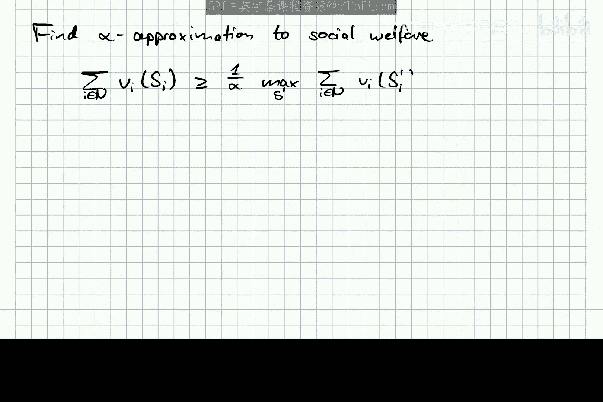
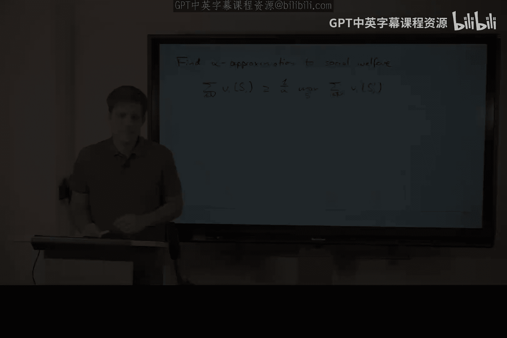
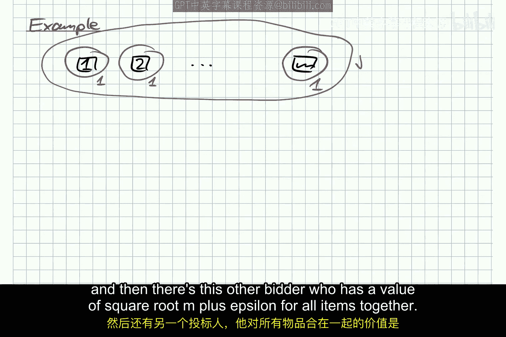
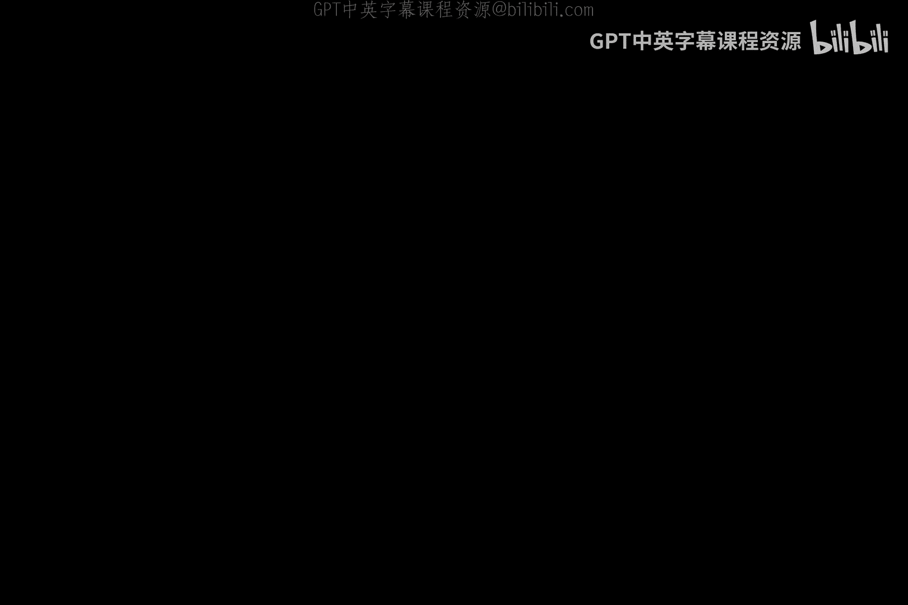

# 013：组合拍卖的贪心机制


在本节课中，我们将学习如何为组合拍卖设计真实的机制。我们将聚焦于一个特殊的子类——单物品组合拍卖，并利用迈尔森引理，通过设计单调的分配算法来构建真实的机制。我们将介绍两种贪心算法，并分析它们的近似保证。

## 组合拍卖定义回顾

上一节我们介绍了机制设计的基本概念。本节中，我们来看看组合拍卖的具体设定。

在组合拍卖中，我们有：
*   **N** 个投标人（或玩家），集合记为 **N**。
*   **M** 件物品，集合记为 **M**。

一个可行的分配是一个集合向量，其中每个集合是物品集合的幂集的一个元素，并且每件物品最多被分配一次。每个投标人 **i** 有一个估值函数 **v_i**，为其感兴趣的每个物品子集赋予一个非负价值，这是私有信息。

我们假设：
*   **自由处置权**：如果 **T ⊆ S**，则 **v_i(S) ≥ v_i(T)**。更多物品不会损害投标人的收益。
*   **估值归一化**：**v_i(∅) = 0**。

我们的目标是最大化社会福利，即所有获胜投标人对其所获物品束的估值之和。

## 单物品投标人

一般来说，组合拍卖不是单参数设定，因为估值函数无法仅用一个参数表示。但今天我们考虑一个特殊情形，可以将其解释为单参数设定。

我们假设投标人是**单物品的**。这意味着对于每个投标人 **i**，存在一个特定的物品束 **S_i*** 和一个非负实数 **v_i**，使得：
*   如果投标人 **i** 获得的物品束 **T** 是 **S_i*** 的超集，则其估值为 **v_i**。
*   否则，其估值为 **0**。

换句话说，投标人只关心是否获得其想要的特定物品束，获得更多物品不会带来额外价值，获得部分物品则毫无价值。

## 计算复杂性与近似目标





首先，我们需要认识到，即使在单物品投标人的设定下，精确求解最大化社会福利的分配问题也是NP难的。因此，在多项式时间内，我们无法获得最优解。

我们的目标转变为设计一个多项式时间的算法，以近似最大化社会福利。具体来说，我们希望找到一个 **α** 近似算法，使得算法获得的社会福利至少是最优社会福利的 **1/α** 倍。

## 贪心按价值算法

以下是第一种简单的贪心算法。

### 算法描述

我们首先根据投标人的出价 **b_i**（我们假设他们报告的是其估值 **v_i**）进行降序排序。然后，我们按此顺序遍历投标人。对于每个投标人 **i**，如果其想要的物品束 **S_i*** 与当前已获胜投标人集合中的任何物品束都不冲突（即无交集），则将其加入获胜者集合 **W**。

用伪代码描述如下：
```
1. 将投标人按 b_i 降序排序。
2. 初始化获胜者集合 W = ∅。
3. 按排序顺序遍历每个投标人 i：
   a. 如果 S_i* ∩ (∪_{j∈W} S_j*) = ∅：
       将 i 加入 W。
4. 返回获胜者集合 W。
```

### 单调性与真实支付

该算法是**单调的**。如果一个投标人在出价 **b_i** 时获胜，那么当其出价更高时，其在排序中的位置会提前，其物品束与已分配物品冲突的可能性更小，因此仍然会获胜。

根据迈尔森引理，对于一个单调的分配算法，存在一个支付规则可以使其构成一个真实的机制。具体支付规则是：每个获胜者 **i** 支付其**临界出价** **τ_i(b_{-i})**，即在其对手出价 **b_{-i}** 固定的情况下，使其恰好能够获胜的最小出价。失败者无需支付。

因此，**贪心按价值算法** 结合 **临界出价支付** 构成了一个真实的机制。

### 近似保证分析

我们可以证明，贪心按价值算法是 **D** 近似的，其中 **D** 是所有投标人想要的物品束 **S_i*** 的最大基数。

证明思路如下：
1.  设 **W** 是算法选出的获胜者集合，**OPT** 是最优解选出的获胜者集合。
2.  对于算法中的每个获胜者 **i**，定义 **OPT_i** 为 **OPT** 中那些在排序中位于 **i** 之后，且其物品束与 **S_i*** 有交集的投标人集合。这些是因为算法选择了 **i** 而无法被最优解选择的投标人。
3.  可以论证，**OPT** 中的每个投标人 **j** 都至少包含在某个 **OPT_i** 中（其中 **i ∈ W**）。
4.  因此，最优社会福利 **Σ_{j∈OPT} b_j** 可以上界为 **Σ_{i∈W} Σ_{j∈OPT_i} b_j**。
5.  由于排序，对于 **j ∈ OPT_i**，有 **b_j ≤ b_i**。
6.  此外，**|OPT_i| ≤ |S_i*| ≤ D**，因为每个与 **S_i*** 冲突的 **OPT** 中的投标人消耗 **S_i*** 中至少一件不同的物品。
7.  结合以上两点，**Σ_{j∈OPT_i} b_j ≤ D * b_i**。
8.  最终得到 **Σ_{j∈OPT} b_j ≤ D * Σ_{i∈W} b_i**，即算法是 **D** 近似的。

当每个投标人想要的物品束较小时（例如 **D=2,3,4**），这是一个不错的近似比。但当 **D** 很大时，近似比会变差。

## 贪心按价值密度平方根算法

当投标人想要的物品束较大时，我们可以使用一种改进的算法来获得更好的近似比。

### 算法描述

该算法与贪心按价值算法类似，但排序依据不再是原始出价 **b_i**，而是**归一化出价** **b_i / √(|S_i*|)**，即出价除以其物品束大小的平方根。然后，同样按此归一化出价的降序进行贪心分配。

用伪代码描述如下：
```
1. 对每个投标人 i，计算归一化出价 b_i' = b_i / √(|S_i*|)。
2. 将投标人按 b_i' 降序排序。
3. 初始化获胜者集合 W = ∅。
4. 按排序顺序遍历每个投标人 i：
   a. 如果 S_i* ∩ (∪_{j∈W} S_j*) = ∅：
       将 i 加入 W。
5. 返回获胜者集合 W。
```

### 单调性与真实支付

由于物品束 **S_i*** 是公开信息，投标人无法影响其归一化因子。因此，如果投标人提高出价 **b_i**，其归一化出价 **b_i'** 也会提高，在排序中的位置会提前，从而更容易获胜。所以该算法同样是**单调的**。结合临界出价支付，可以构成一个真实的机制。

### 近似保证分析

我们可以证明，贪心按价值密度平方根算法是 **√M** 近似的，其中 **M** 是物品总数。

证明思路与之前类似，但关键不等式不同：
1.  同样定义 **W** 和 **OPT**，以及对于 **i ∈ W** 的 **OPT_i**。
2.  对于 **j ∈ OPT_i**，根据排序有 **b_j / √(|S_j*|) ≤ b_i / √(|S_i*|)**，因此 **b_j ≤ b_i * √(|S_j*|) / √(|S_i*|)**。
3.  我们需要上界 **Σ_{j∈OPT_i} b_j**。
4.  利用柯西-施瓦茨不等式（或詹森不等式），有 **Σ_{j∈OPT_i} √(|S_j*|) ≤ √(|OPT_i| * Σ_{j∈OPT_i} |S_j*|)**。
5.  与之前类似，**|OPT_i| ≤ |S_i*|**，且 **Σ_{j∈OPT_i} |S_j*| ≤ M**（因为 **OPT** 中的物品束互不相交）。
6.  因此，**Σ_{j∈OPT_i} √(|S_j*|) ≤ √(|S_i*| * M)**。
7.  代入步骤2的不等式，得到 **Σ_{j∈OPT_i} b_j ≤ (b_i / √(|S_i*|)) * √(|S_i*| * M) = b_i * √M**。
8.  最终得到 **Σ_{j∈OPT} b_j ≤ √M * Σ_{i∈W} b_i**，即算法是 **√M** 近似的。

当最大物品束大小 **D** 接近物品总数 **M** 时，**√M** 近似优于 **D** 近似。



## 总结

本节课中，我们一起学习了如何为单物品组合拍卖设计真实的贪心机制。

我们首先回顾了组合拍卖和单物品投标人的定义。接着，我们认识到精确求解是NP难的，因此转向设计近似算法。

我们介绍了两种贪心算法：
1.  **贪心按价值算法**：按出价降序贪心分配。它是单调的，结合临界出价支付可构成真实机制，并能提供 **D** 近似保证（**D** 为最大物品束大小）。
2.  **贪心按价值密度平方根算法**：按出价除以物品束大小平方根后的值降序贪心分配。它同样是单调的，可构成真实机制，并能提供 **√M** 近似保证（**M** 为物品总数）。



这两种算法在多项式时间内运行，并且由于迈尔森引理，其单调性使得真实的支付规则可以轻松导出。对于单参数设定，机制设计可以简化为设计一个单调的分配算法。然而，对于更一般的、非单参数的组合拍卖设定，情况会复杂得多，这将是我们后续课程的内容。