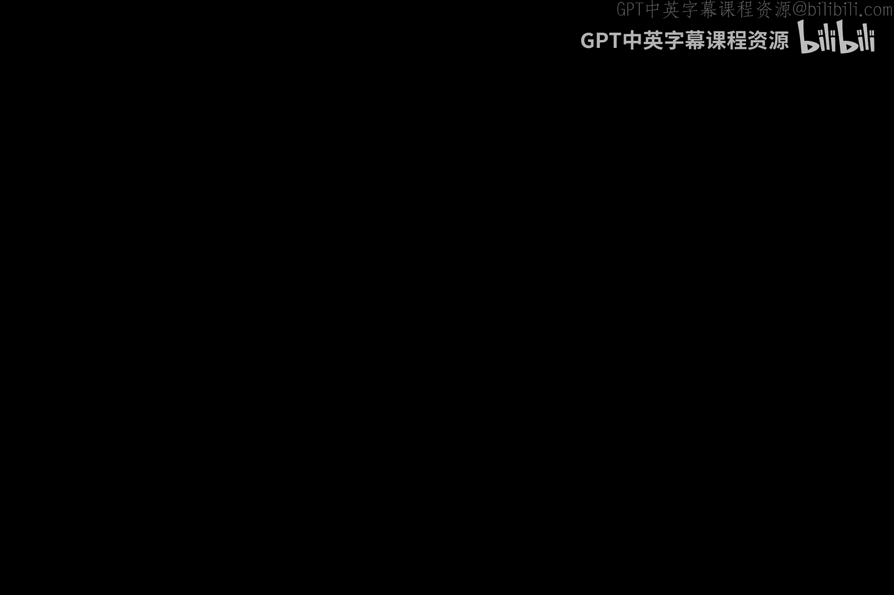
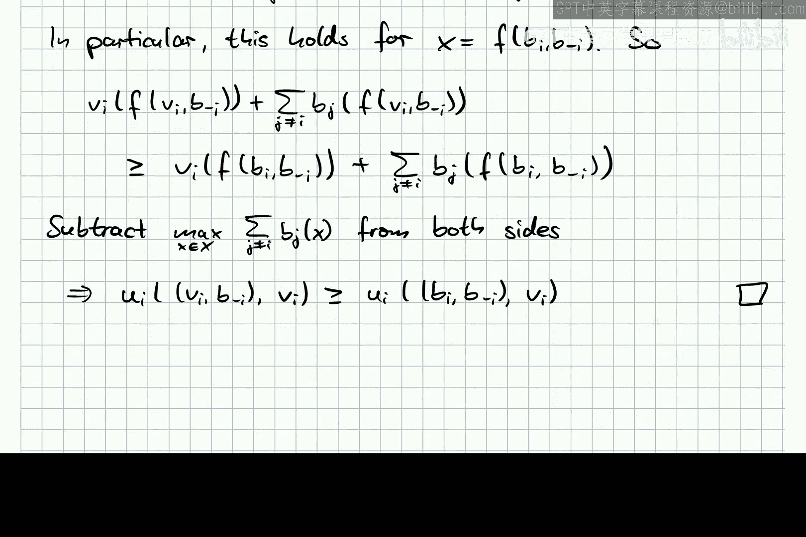
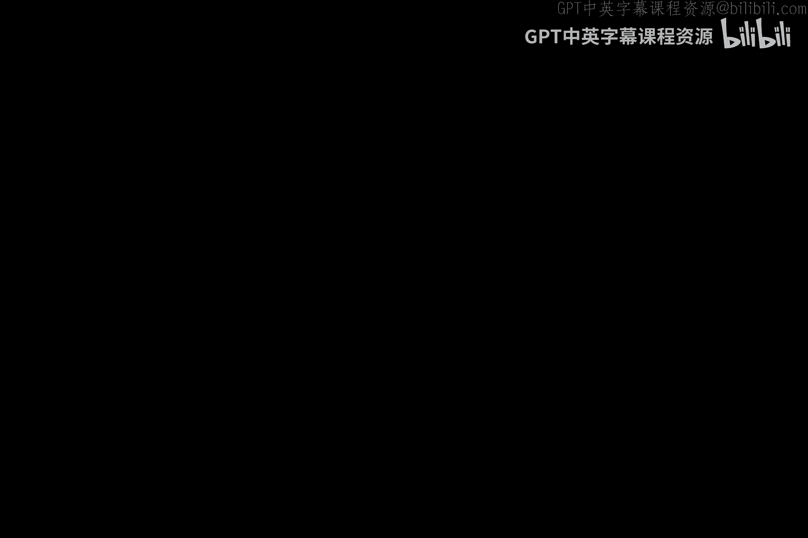
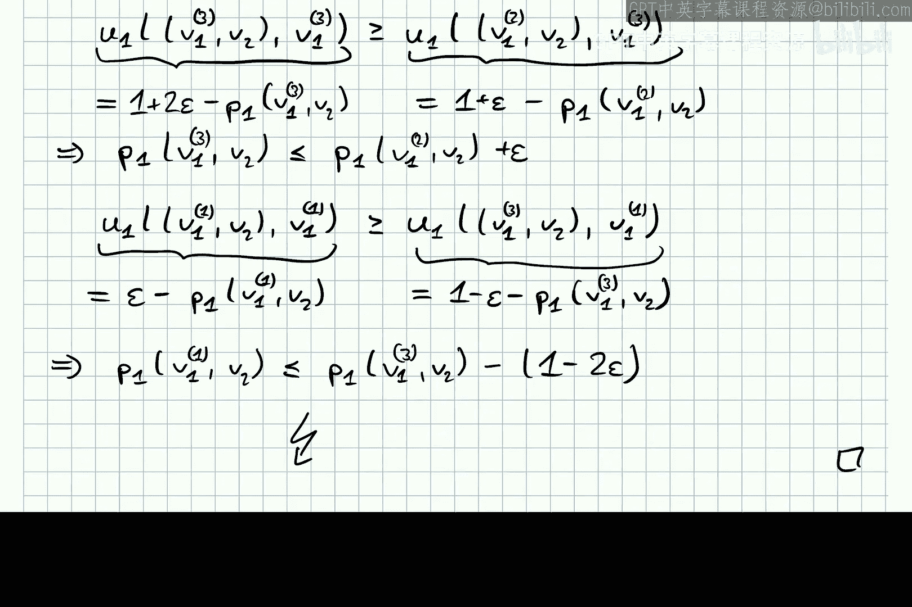

# 014：VCG机制

在本节课中，我们将要学习如何超越单参数问题，为更一般的机制设计问题构建诚实的机制。我们将介绍著名的VCG机制，探讨其工作原理、性质以及在实际应用中的局限性。

## 机制设计框架回顾

上一节我们介绍了单参数问题的机制设计框架，本节中我们来看看更一般化的设定。

我们仍然有：
*   **N**：一组玩家（或投标人、代理人）。
*   **X**：结果空间，可以是任意集合。
*   **v_i**：每个玩家 i 的私有估值函数，它将结果映射到一个实数，即 **v_i: X → R**。
*   **V_i**：玩家 i 所有可能估值的集合。
*   **V**：所有估值组合的集合。

一个直接机制 **M** 由两部分组成：
*   **结果规则 f**：它接收所有投标人声称的估值组合 **b**，并输出一个结果 **f(b) ∈ X**。
*   **支付规则 p**：它接收同样的声称估值组合 **b**，并为每个投标人 i 计算一个支付额 **p_i(b) ∈ R**。

我们讨论的仍然是拟线性效用，即玩家 i 在机制 M 下的效用为：
**u_i(b; v_i) = v_i(f(b)) - p_i(b)**

一个直接机制是占优策略激励相容的（或称诚实的），当且仅当对于任何玩家 i、任何真实估值 v_i 和任何声称估值 b_i，无论其他玩家如何出价，说真话（即 b_i = v_i）总能带来不低于任何其他出价的效用。

## 超越单参数：组合拍卖示例

单参数设定是上述框架的一个特例。一个非单参数的例子是**组合拍卖**。

在组合拍卖中：
*   我们有 **N** 个投标人和 **M** 件物品。
*   每个投标人 i 有一个估值函数 **v_i**，它为物品的每个子集 **S ⊆ M** 分配一个非负实数值。
*   结果空间 **X** 是所有将物品分配给投标人的分配方案（即物品的一个划分）。

例如，有两个投标人和两件物品 A 和 B。投标人1的估值可能是：
*   v1({A}) = 5
*   v1({B}) = 9
*   v1({A, B}) = 9 （这是一个单位需求函数，只关心最有价值的物品）

投标人2的估值可能是：
*   v2({A}) = 5
*   v2({B}) = 0
*   v2({A, B}) = 5

这种设定无法用单一数字描述，因此不是单参数问题。

## VCG机制的定义

现在，我们介绍**VCG机制**（Vickrey-Clarke-Groves机制），它能为这类一般问题构建诚实的机制。我们讨论的是带有**Clarke枢轴规则**的特定版本。

VCG机制 **M = (f, p)** 定义如下：

1.  **结果规则 f**：选择能最大化**声称社会福利**的结果。即：
    **f(b) ∈ argmax_{x ∈ X} Σ_{j ∈ N} b_j(x)**
    其中 b_j 是投标人 j 声称的估值函数。

2.  **支付规则 p**：对于每个投标人 i，其支付额为：
    **p_i(b) = [ max_{x ∈ X} Σ_{j ≠ i} b_j(x) ] - Σ_{j ≠ i} b_j(f(b))**

这个支付规则的含义是：投标人 i 的支付等于“当 i 不存在时，其他人能获得的最大声称社会福利”减去“当 i 存在时，其他人在最终分配中实际获得的声称社会福利”。这个差值被称为投标人 i 造成的**外部性**。

## VCG机制为何是诚实的？

VCG机制是占优策略激励相容的。证明思路是写出投标人 i 说真话时的效用，并证明它总是优于说假话时的效用。

投标人 i 在出价 b_i、真实估值为 v_i 时的效用为：
**u_i(b_i, b_{-i}; v_i) = v_i(f(b_i, b_{-i})) - p_i(b_i, b_{-i})**

将支付公式代入并整理后，我们可以发现，最大化这个效用等价于最大化 **v_i(x) + Σ_{j ≠ i} b_j(x)**。而机制的结果规则 f 正是基于所有投标人的声称估值来最大化 **b_i(x) + Σ_{j ≠ i} b_j(x)**。因此，当投标人 i 说真话（即 b_i = v_i）时，机制的目标就与 i 的个人目标完全一致，从而激励其诚实投标。详细的代数推导证实了这一点。

## VCG机制实例分析

让我们通过几个例子来理解VCG机制。

**1. 单物品拍卖**
在单物品拍卖中，VCG机制简化为**第二价格密封拍卖**。结果规则将物品分配给最高出价者。最高出价者的支付等于第二高出价（即其他人能获得的最大福利），其他出价者的支付为0。

**2. 赞助搜索拍卖**
在赞助搜索拍卖中，有 K 个广告位，点击率 α_1 > α_2 > ... > α_K。每个广告主 i 对每次点击有一个估值 v_i。VCG机制会将广告位分配给出价最高的 K 个广告主（按出价降序分配点击率最高的位次）。每个获胜广告主 i 的支付公式，经过计算，与之前通过迈尔森引理推导出的支付公式一致。

**3. 单位需求组合拍卖**
回到我们最初的例子。最大化声称社会福利等价于在二分图（一边是投标人，一边是物品）上寻找最大权匹配，边的权重是投标人对物品的声称估值。VCG机制会实施这个最优匹配。一个投标人的支付等于：如果没有他，其他人能获得的最大匹配权重和，减去在当前最优匹配中其他人实际获得的权重和。这通常意味着该投标人需要为他“挤占”掉的、本可能属于其他人的价值付费。

## VCG机制的优良性质

除了诚实性，VCG机制（带Clarke枢轴规则）还有两个重要性质：

*   **个体理性**：如果所有结果对每个投标人的真实估值都是非负的（即 v_i(x) ≥ 0），那么当投标人说真话时，其效用也总是非负的。这意味着自愿参与是有保障的。
*   **无正向转移**：支付总是非负的（p_i(b) ≥ 0）。这意味着机制只会从投标人那里收钱，而不会付钱给他们。在销售场景中，这是一个理想性质。

## VCG机制的局限性：计算复杂性与近似算法

VCG机制并非完美无缺。一个主要问题是**计算复杂性**。要运行VCG机制，必须**精确求解**社会福利最大化问题（即结果规则 f）。对于许多组合问题（如一般的组合拍卖），这个问题是NP难的，没有已知的多项式时间精确算法。

一个自然的想法是：能否使用一个快速的**近似算法**来代替精确优化，并仍然搭配VCG支付规则来获得一个诚实机制？答案是否定的。

考虑单位需求组合拍卖的贪心近似算法（按边权降序贪婪添加不冲突的边）。该算法是2-近似的，并且其分配规则甚至是单调的（提高对某物品的出价不会导致你失去它）。然而，可以构造反例证明：

**不存在**任何支付规则能与这个贪心分配规则结合，形成一个诚实的机制。

证明思路是构造一组特定的估值场景，并利用诚实性要求所必须满足的一系列效用不等式。这些不等式最终会导致矛盾，从而证明这样的支付规则不可能存在。

这个例子表明，在多参数设定中，将近似算法与支付规则结合以获得诚实机制，远比单参数设定中只需关注单调性要复杂和困难得多。设计能在多项式时间内运行且具有良好近似保证的诚实组合拍卖机制，至今仍是算法博弈论中一个活跃且富有挑战性的研究领域。

## 总结

本节课我们一起学习了VCG机制。我们首先回顾了超越单参数的广义机制设计框架，并通过组合拍卖的例子加以说明。接着，我们定义了VCG机制的结果规则（最大化声称社会福利）和支付规则（让投标人支付其造成的外部性），并证明了其诚实性。我们分析了多个应用实例，并指出了VCG机制具有个体理性和无正向转移的优点。最后，我们探讨了VCG机制的主要局限：它对精确优化计算的依赖，以及无法与近似算法简单结合以保持诚实性。这揭示了在多参数环境下设计高效诚实机制的内在挑战。