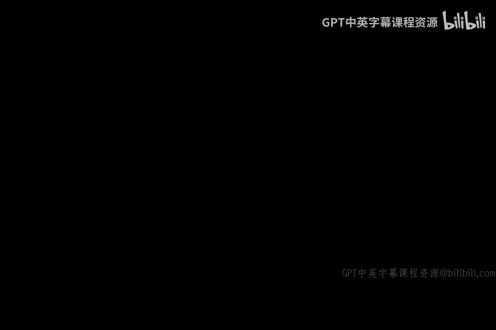
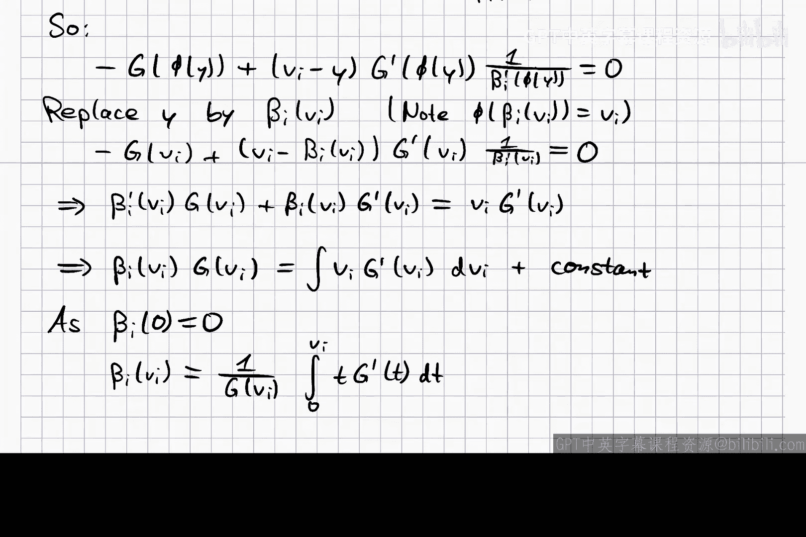
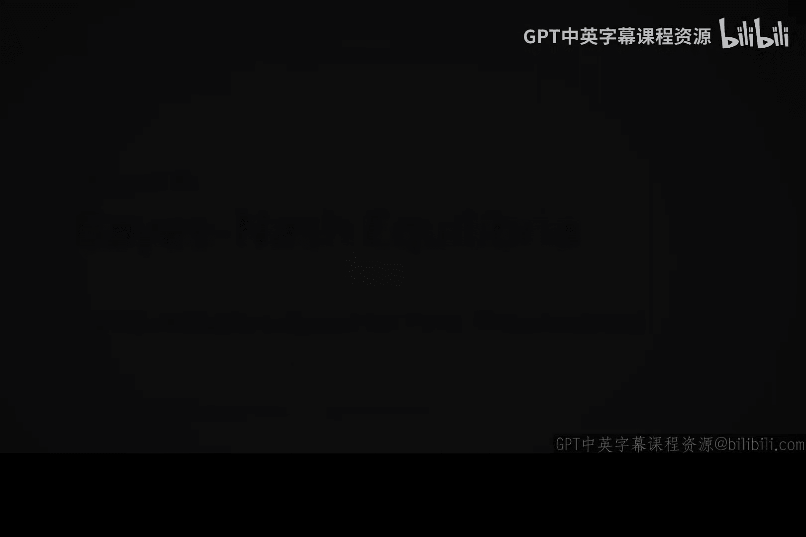
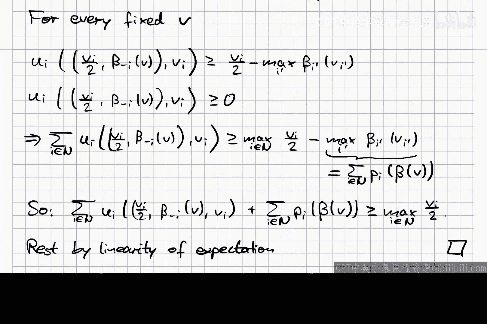

# 015：贝叶斯纳什均衡



在本节课中，我们将学习一个重要的均衡概念——贝叶斯纳什均衡。它用于分析在不完全信息博弈中，即当玩家不知道其他玩家的确切估值，但对其分布有共同信念时，玩家会如何策略性地行动。

## 不完全信息下的均衡

在之前的课程中，我们学习了占优策略激励相容机制。在这种机制下，无论其他玩家如何行动，报告真实估值总是每个玩家的最优（占优）策略。然而，有时我们无法设计出简单的真实机制。那么，我们该如何分析非真实的机制呢？我们仍然需要考虑玩家的策略行为。如果报告真实估值不符合他们的最佳利益，他们可能会撒谎。

一种方法是考虑博弈的纯策略或混合策略纳什均衡。但这种方法有一个很大的弱点：在纯策略或混合策略纳什均衡中，我们总是假设所有玩家都知道彼此的估值。因为要找到均衡，所有玩家都必须知道其他玩家的效用函数，而效用函数依赖于这些私人估值。这在现实中往往不成立。例如，在一价拍卖中，玩家如何能达成一个纯策略纳什均衡？他们选择的策略依赖于其他玩家的估值，而这恰恰是私人信息。

因此，今天我们将认识一个适用于不完全信息场景的均衡概念。玩家不知道其他玩家的真实估值，但他们对此有一个信念。这被称为贝叶斯纳什均衡。

## 贝叶斯纳什均衡的定义

我们假设：
*   竞拍者 `i` 的估值 `v_i` 从集合 `V_i` 中抽取。
*   估值独立地服从某个分布 `D_i`。
*   这些分布对所有竞拍者都是已知的。

现在，每个玩家（竞拍者）选择一个出价 `b_i`。当然，该玩家知道自己的估值 `v_i`，但不知道其他玩家的估值 `v_{-i}`，只知道它们是从分布 `D_{-i}` 中抽取的。

我们可以这样描述：每个竞拍者 `i` 选择一个出价函数 `β_i`，该函数将可能的估值映射到出价上。当估值为 `v_i` 时，竞拍者 `i` 出价 `β_i(v_i)`。例如，真实出价函数就是 `β_i(v) = v`。

我们说，这样一组为每个玩家选择的出价函数构成一个贝叶斯纳什均衡，如果没有玩家可以通过单方面选择不同的出价函数而获益。换句话说，我们可以将其理解为选择出价函数的博弈。策略就是出价函数，我们感兴趣的是这个“出价函数博弈”的一个纯策略纳什均衡。

更正式地，一个纯策略贝叶斯纳什均衡（简称 BNE）是一个出价函数组合 `β_i`（对每个玩家 `i`），其中 `β_i` 将玩家 `i` 的可能估值映射到其可能的出价上。均衡条件要求：对于所有玩家 `i`、所有可能的估值 `v_i` 和所有可能的偏离出价 `b_i‘`，以下不等式成立：

```
E_{v_{-i} ~ D_{-i}} [ u_i( β(v), v_i ) ] >= E_{v_{-i} ~ D_{-i}} [ u_i( (b_i‘, β_{-i}(v_{-i})), v_i ) ]
```

这里，`β(v)` 表示向量 `(β_1(v_1), ..., β_n(v_n))`。

让我们消化一下这个定义。贝叶斯纳什均衡是每个玩家选择的一个出价函数组合。它具有这样的性质：没有玩家愿意单方面偏离这个出价函数。我们可以用两种方式理解：玩家不想选择与当前不同的出价函数；或者更直观地说，对于玩家 `i`，给定他自己的某个具体估值 `v_i`，他问自己：我应该出价 `β_i(v_i)` 还是其他价格 `b_i‘`？关于其他玩家，他不知道他们的估值，因此也不知道他们的出价，但他知道他们的估值是从哪些分布中抽取的。因此，他考虑的是自己的期望效用。不等式左边是当所有其他玩家都根据 `β` 函数出价时，玩家 `i` 的期望效用。右边是当玩家 `i` 偏离出价 `b_i‘`，而其他玩家仍根据 `β` 函数出价时，他的期望效用。如果对于所有 `v_i` 和 `b_i‘`，左边都不小于右边，那么这就是一个均衡。

## 真实机制中的 BNE

在一个真实（即占优策略激励相容）的机制中，真实出价总是一个纯策略贝叶斯纳什均衡。它不一定是唯一的 BNE，但总是一个 BNE。为什么？因为在真实机制中，无论其他玩家做什么，对于玩家 `i` 来说，报告真实估值 `v_i` 总是能最大化其效用（即占优策略）。这正是上述不等式成立的原因：即使我们考虑其他玩家都真实出价的期望，做其他事情也不会更好。

## 一价拍卖中的 BNE

但也许上面的例子不够有启发性，让我们考虑一个非真实机制——一价拍卖，我们也可以为其推导出一个 BNE。

考虑一个有两名玩家的一价拍卖。假设两个玩家的估值 `D_i` 都服从区间 `[0, 1]` 上的均匀分布。我们现在要证明，出价函数组合 `β_i`，其中 `β_i(v) = v_i / 2`，是一个贝叶斯纳什均衡。

换句话说，我们声称在一价拍卖中，假设估值从已知分布中抽取（这里是 `[0,1]` 上的均匀分布），并且所有人都同意这个先验信念，那么总是出价为你估值的一半将构成一个 BNE。出价你的真实估值通常不是一个均衡（因为这会带来零效用），但出价一半似乎是一个合理的选择。

由于对称性，我们只需考虑玩家 1。固定玩家 1 的任意估值 `v_1`。现在，当玩家 1 出价某个 `b_1‘`，而玩家 2 按照我们声称的 BNE（即 `β_2(v_2) = v_2/2`）出价时，玩家 1 的期望效用是多少？

```
E_{v_2 ~ U[0,1]} [ u_1( (b_1‘, β_2(v_2)), v_1 ) ]
```

我们可以将其写为积分，因为服从均匀分布：

```
∫_{0}^{1} u_1( (b_1‘, v_2/2), v_1 ) dv_2
```

效用 `u_1` 取决于出价：如果 `b_1‘ > v_2/2`，则玩家 1 赢得物品，效用为 `v_1 - b_1‘`；否则，效用为 0。因此，当 `v_2 < 2*b_1‘` 时（假设 `b_1‘ <= 0.5`），玩家 1 赢得拍卖。所以期望效用为：

```
∫_{0}^{2*b_1‘} (v_1 - b_1‘) dv_2 = (v_1 - b_1‘) * (2*b_1‘) = 2*v_1*b_1‘ - 2*(b_1‘)^2
```

我们需要找到最大化这个表达式的 `b_1‘`。对 `b_1‘` 求导并令其为零：

```
2*v_1 - 4*b_1‘ = 0  =>  b_1‘ = v_1 / 2
```

因此，当 `b_1‘ = v_1 / 2` 时，期望效用最大化。这意味着对于任意固定的 `v_1`，按照 `β_1(v_1) = v_1/2` 出价是最优反应。这正好满足贝叶斯纳什均衡的条件。对于玩家 2，由于对称性，计算完全相同。因此，`β_i(v) = v/2` 确实是一个 BNE。

## 如何求解 BNE？

现在我们知道了贝叶斯纳什均衡的定义，并且已经看到了两个例子。在这些例子中，我只是告诉你们这是 BNE，然后你们可以验证。那么，如何自己找出一个 BNE 呢？让我们针对一价拍卖来做这件事，但仅限于估值分布相同的情况，并且我们假设均衡是对称的。



我们将推导一系列必要条件，最终得到一个公式。然后可以验证这确实是一个 BNE（验证过程类似于我们刚才做的）。我们假设：
*   对于所有玩家 `i` 和所有 `x >= 0`，估值 `v_i <= x` 的概率为 `F(x)`。`F` 是相同的分布函数。
*   我们假设这是一个连续分布，即存在密度函数 `f(t)`，使得 `F(x) = ∫_{0}^{x} f(t) dt`。
*   我们假设存在一个对称的 BNE，即所有出价函数 `β_i` 都相同，且是可逆的。

此外，我们记 `G(x) = F(x)^{n-1}` 作为简写。

为了使函数 `β_i` 成为 BNE，必须满足均衡性质：没有竞拍者愿意偏离出价函数指定的行为。对于任意玩家 `i`、估值 `v_i` 和可能的出价 `y`，当其他人都按照 `β` 出价时，玩家 `i` 出价 `y` 的期望效用为：

```
(v_i - y) * Prob(对于所有 j ≠ i, β_j(v_j) < y)
```



由于估值独立且出价函数相同，这个概率等于每个玩家 `j` 的估值 `v_j` 小于 `β^{-1}(y)` 的概率的乘积，即 `F(β^{-1}(y))^{n-1} = G(β^{-1}(y))`。记 `φ = β^{-1}` 为反函数。所以期望效用为 `(v_i - y) * G(φ(y))`。

现在，`β_i(v_i)` 必须最大化这个表达式（当 `y = β_i(v_i)` 时）。假设 `β` 可微，那么在最大值点，关于 `y` 的导数应为零。计算导数并利用反函数定理处理 `φ‘(y)`，然后代入 `y = β_i(v)` 和 `φ(y) = v`，经过一系列代数运算（具体步骤见讲义），我们得到：

```
β_i(v) * G(v) = ∫_{0}^{v} t * G‘(t) dt
```

由于 `β_i(0)` 应为 0，积分常数为 0。因此，我们得到 BNE 出价函数的表达式：

```
β_i(v) = (1 / G(v)) * ∫_{0}^{v} t * G‘(t) dt
```

然后，你可以验证这确实是一个 BNE。这个推导过程在数学上可能不够严谨，但它指明了寻找 BNE 的方向。最终得到这个方程后，你可以通过验证（即假设所有人都按此函数出价，检查单方面偏离是否无利可图）来确认它是一个 BNE。当然，这并不证明没有其他 BNE，但至少给出了一个对称、可微 BNE 的形式。

## BNE 下的社会福利

到目前为止，我们问的是一价拍卖的 BNE 中竞拍者如何出价。但实际上，我们可能更感兴趣的问题是：他们的行为带来的社会福利如何？拥有最高估值的玩家是否总能获得物品？或者，是否可能由于这种策略行为，有时估值较低的人反而获得了物品？这正是我们现在要回答的问题。

我们想讨论，在一价拍卖的贝叶斯纳什均衡中，期望社会福利是多少？对于对称情况（分布相同，出价函数也相同），我们已经推导出了确切的均衡形式。仔细观察，这些出价函数是递增函数。这意味着谁将赢得拍卖？出价最高者。但由于他们使用相同的递增出价函数，出价最高者也拥有最高估值。因此，在对称 BNE 中，社会福利是最优的：物品总是分配给估值最高的玩家。

然而，一般来说，情况并非总是如此。如果分布不同，出价函数也会不同，并且可能不是所有情况下都是递增的，或者即使各自递增，但函数形式不同，也可能导致出价最高者并非估值最高者。因此，社会福利可能不是最优的。

尽管如此，我们仍然可以为任何一价拍卖的贝叶斯纳什均衡（无论估值分布如何）推导出一个保证。定理陈述如下：

**在任何一价拍卖的贝叶斯纳什均衡 `β_i` 中，期望社会福利至少是期望最优社会福利的一半。**

更正式地：

```
E_{v ~ D} [ v_{winner}( β(v) ) ] >= (1/2) * E_{v ~ D} [ max_i v_i ]
```

这个定理告诉我们，当我们从分布中抽取估值剖面，所有玩家按照某个 BNE 行动时，所看到的期望社会福利至少是期望最大社会福利（即期望最高估值）的一半。这类似于无政府状态价格的表述：均衡下的社会福利可能不是社会最优的，但我们能够界定其比率。

## 证明思路（平滑机制模板）

如何证明这样的陈述？你可能会试图找出确切的均衡形式，但这通常非常复杂。相反，我们将依赖于 BNE 的性质进行分析，就像我们在分析无政府状态价格（包括相关均衡）时所做的那样。

让我们从纯策略纳什均衡（即完全信息）这个特例开始。在这种情况下，分布 `D_i` 是确定性的（点质量）。那么贝叶斯纳什均衡就退化为一个纯策略纳什均衡。估值向量和出价向量是固定的。

证明的关键思路是使用“偏离到一半估值”的论证。考虑估值最高的玩家 `i*`，其估值为 `v*`。如果该玩家偏离，出价 `v*/2`，会发生什么？他的效用将至少是 `v*/2 - 其他玩家的最高出价`（如果这个差为正，则他赢得物品并获得此效用；否则，他未赢得物品，效用为 0，但此时 `v*/2 <= 最高出价`，所以 `v*/2 - 最高出价 <= 0`，综合起来效用至少为 `v*/2 - 最高出价`）。由于我们处于均衡中，该玩家不会从这种偏离中获益，因此他在均衡中的效用至少等于这个偏离带来的效用。对于其他玩家，他们的效用至少为 0。将所有玩家的效用下界相加，我们得到总效用之和至少为 `v*/2 - 最高出价`。社会福利是总效用加上总支付。在一价拍卖中，总支付就是最高出价。因此，社会福利至少为 `(v*/2 - 最高出价) + 最高出价 = v*/2`。这正好是最优社会福利 `v*` 的一半。

对于贝叶斯纳什均衡，我们可以做完全类似的事情，只不过现在需要对估值分布取期望。证明步骤如下：
1.  在 BNE 中，对于每个玩家 `i` 和每个可能的估值 `v_i`，单方面偏离到出价 `v_i/2` 不会带来更高的期望效用。
2.  对所有这些不等式（针对所有玩家和所有 `v_i`）取期望（利用期望的线性性质），我们得到均衡下的期望总效用之和，至少等于每个玩家都单方面偏离到 `v_i/2` 时的期望总效用之和。
3.  对于每个估值剖面 `v`，当每个玩家 `i` 出价 `v_i/2` 时，他的效用至少为 `max(0, v_i/2 - 其他玩家的最高出价)`。将所有玩家的这个下界相加，可以得到一个总效用下界，它至少为 `(最高估值 / 2) - 最高出价`。
4.  再次取期望，并将均衡下的期望总支付（即期望最高出价）加回去，我们就得到均衡下的期望社会福利至少为 `E[最高估值] / 2`。

这个论证模板非常强大，我们将在下次课中通过引入“平滑机制”的概念将其形式化。



## 总结

本节课我们一起学习了贝叶斯纳什均衡。我们首先了解了为什么需要这个概念来分析不完全信息下的策略行为。然后，我们给出了 BNE 的正式定义，并探讨了在真实机制和一价拍卖中的例子。接着，我们学习了如何推导对称一价拍卖的 BNE 出价函数。最后，我们分析了一价拍卖在任意 BNE 下的社会福利，并证明其期望值至少是最优期望社会福利的一半，这为分析非真实机制的性能提供了有力工具。下次课，我们将以此为基础，深入探讨平滑机制的概念。