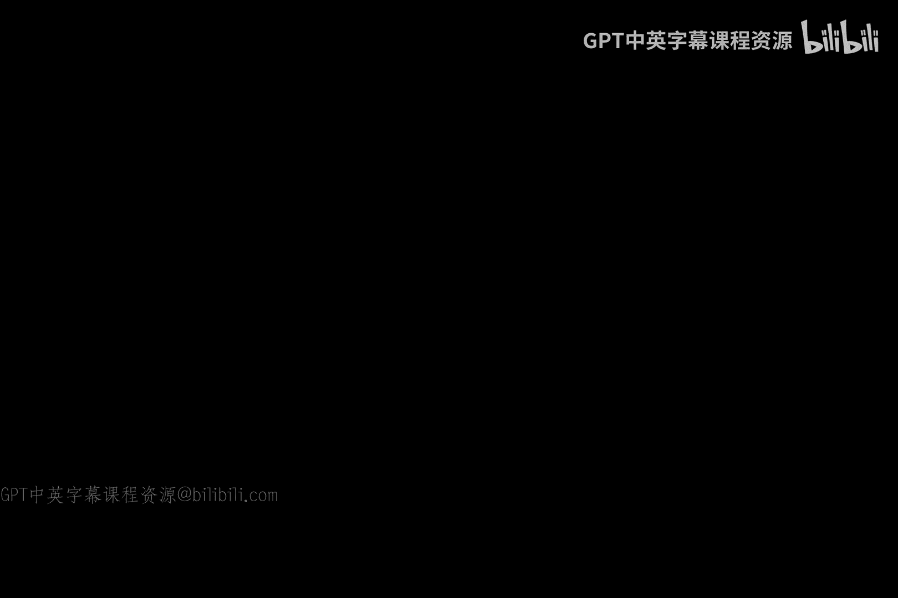
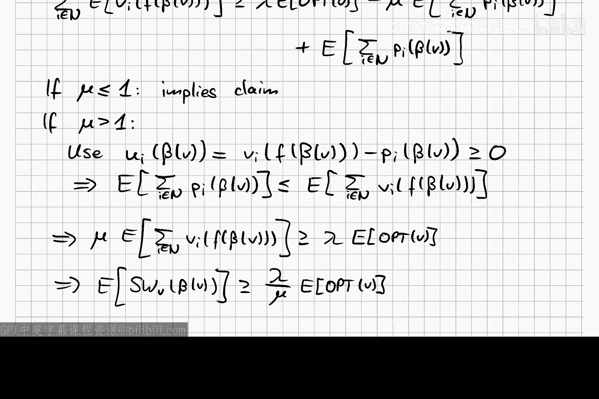

# 016：平滑机制

在本节课中，我们将学习一个用于分析非真实机制（如第一价格拍卖）性能的强大框架——平滑机制。我们将看到，如果一个机制是“平滑”的，那么它在贝叶斯纳什均衡下的社会福利损失是有界的。

## 机制设计基础回顾

上一讲我们开始讨论非真实机制，并引入了贝叶斯纳什均衡的概念。本节中，我们首先快速回顾机制设计的基本定义，为后续内容打下基础。

我们设定有 `n` 个参与者（投标人/代理人）。存在一个结果集合 `X`。每个参与者 `i` 拥有一个私有的估值函数 `v_i: X -> R`，我们假设估值是非负的。

参与者报告出价 `b_i`，它属于一个可能的出价集合 `B_i`。所有出价组合的集合是 `B = B_1 × ... × B_n`。一个机制 `M = (f, p)` 包含：
*   一个结果规则 `f: B -> X`，将出价组合映射到一个结果。
*   一个支付规则 `p: B -> R^n`，将出价组合映射到支付向量（同样非负）。

参与者的效用是拟线性的：
`u_i(b; v_i) = v_i(f(b)) - p_i(b)`

今天我们讨论的不是占优策略激励相容，而是由这类机制诱导出的博弈。我们考虑在给定估值组合 `v` 下的纳什均衡。一个出价组合 `b` 是（纯）纳什均衡，如果对于每个参与者 `i` 和所有可能的偏离出价 `b_i'`，都有：
`u_i(b_i, b_{-i}; v_i) >= u_i(b_i', b_{-i}; v_i)`

社会福利定义为所有参与者估值之和：
`SW_v(x) = Σ_i v_i(x)`
最优社会福利为 `OPT(v) = max_{x in X} SW_v(x)`。机制在出价组合 `b` 下实现的社会福利为：
`SW_v(M(b)) = Σ_i v_i(f(b)) = Σ_i u_i(b; v_i) + Σ_i p_i(b)`

无政府价格（Price of Anarchy, PoA）衡量均衡下的社会福利与最优社会福利的比值。对于均衡概念 `EQ`，其PoA定义为：
`PoA(EQ) = max_v max_{b in EQ(v)} (OPT(v) / SW_v(M(b)))`

## 贝叶斯纳什均衡与无政府价格

上一节我们回顾了完全信息下的均衡。现在，我们转向更现实的**不完全信息**设定，并定义贝叶斯纳什均衡下的无政府价格。

在不完全信息设定中，每个参与者的估值 `v_i` 从一个公开已知的分布 `D_i` 中独立抽取，但 `v_i` 的值是参与者的私人信息。一个纯贝叶斯纳什均衡是一组出价函数 `β = (β_1, ..., β_n)`，其中 `β_i: v_i -> b_i`。对于每个参与者 `i`，其真实估值 `v_i`，以及所有可能的偏离出价 `b_i'`，需满足：
`E_{v_{-i} ~ D_{-i}} [u_i(β_i(v_i), β_{-i}(v_{-i}); v_i)] >= E_{v_{-i} ~ D_{-i}} [u_i(b_i', β_{-i}(v_{-i}); v_i)]`

对于贝叶斯纳什均衡，其无政府价格定义为：
`PoA(BNE) = max_D max_{β in BNE(D)} ( E_{v ~ D}[OPT(v)] / E_{v ~ D}[SW_v(M(β(v)))] )`
即，在最坏的估值分布和最坏的均衡下，期望最优社会福利与期望均衡社会福利之比。

## 平滑机制的定义

在深入分析之前，我们先介绍核心工具——平滑机制。我们将看到，第一价格拍卖的分析可以抽象成一个通用模式。

回顾一下，我们是如何证明第一价格拍卖的PoA上界为2的？我们证明了对于任意出价组合 `b` 和估值组合 `v`，如果每个参与者 `i` 单方面偏离到出价 `v_i/2`，那么所有参与者偏离后的效用之和满足：
`Σ_i u_i(v_i/2, b_{-i}; v_i) >= (1/2) * OPT(v) - Σ_i p_i(b)`
并且，出价 `v_i/2` 总能保证非负效用。

**平滑机制**正是将这种不等式模式一般化。一个机制 `M` 被称为 `(λ, μ)`-平滑的，如果对于**每一个**估值组合 `v` 和**每一个**参与者 `i`，都存在一个“安全”偏离出价 `b_i^*(v)`（可能依赖于所有人的估值），使得对于**所有**可能的出价组合 `b`，以下不等式成立：
`Σ_i u_i(b_i^*(v), b_{-i}; v_i) >= λ * OPT(v) - μ * Σ_i p_i(b)`

根据这个定义，**单物品第一价格拍卖是 (1/2, 1)-平滑的**，其中安全偏离出价为 `b_i^*(v) = v_i / 2`。

## 另一个例子：全支付拍卖

为了加深理解，我们来看另一个机制的例子。在全支付拍卖中，**所有**参与者都需要支付自己的出价，而只有出价最高者赢得物品。这显然不是一个真实机制。

我们可以证明，**单物品全支付拍卖是 (1/2, 2)-平滑的**。

以下是证明思路：
1.  设 `j` 是估值最高的参与者，即 `v_j = max_i v_i`。
2.  定义安全偏离出价如下：对于参与者 `j`，令 `b_j^*(v) = v_j / 2`；对于所有其他参与者 `i ≠ j`，令 `b_i^*(v) = 0`。
3.  考虑任意出价组合 `b`。我们需要评估参与者 `j` 偏离到 `v_j/2` 后的效用。
    *   如果 `j` 赢得物品，其效用为 `v_j - v_j/2 = v_j/2`。
    *   如果 `j` 没有赢得物品，则必有其他人的出价 `max_{i≠j} b_i >= v_j/2`。此时 `j` 的效用为 `-v_j/2`（支付了但没赢）。
    *   综合两种情况，总有 `u_j(b_j^*, b_{-j}; v_j) >= v_j/2 - 2 * max_{i≠j} b_i`。
4.  对于其他参与者 `i ≠ j`，偏离到 `0` 的效用总是非负的（可能赢且不付钱，或不赢不付钱）。
5.  因此，所有参与者偏离后的效用之和满足：
    `Σ_i u_i(b_i^*, b_{-i}; v_i) >= v_j/2 - 2 * max_{i} b_i`
6.  注意到 `OPT(v) = v_j`，且在全支付拍卖中，支付总和 `Σ_i p_i(b) = Σ_i b_i >= max_i b_i`。
7.  于是我们得到：
    `Σ_i u_i(b_i^*, b_{-i}; v_i) >= (1/2) * OPT(v) - 2 * Σ_i p_i(b)`
    这正好符合 `λ = 1/2`, `μ = 2` 的平滑定义。

## 平滑性如何推导无政府价格界（完全信息）

理解了平滑机制的定义后，我们来看它如何帮助我们推导均衡下的性能保证。首先考虑较简单的完全信息下的纯纳什均衡。

**定理**：如果一个机制 `M` 是 `(λ, μ)`-平滑的，并且参与者可以选择不参与（即出价0保证零效用），那么该机制在纯纳什均衡下的无政府价格上界为 `max(μ, 1) / λ`。

**证明概要**：
1.  设 `b` 是一个纯纳什均衡，`v` 是估值组合。
2.  在均衡中，任何参与者 `i` 单方面偏离到其安全出价 `b_i^*(v)` 不会获得更高效用：
    `u_i(b; v_i) >= u_i(b_i^*(v), b_{-i}; v_i)`
3.  对不等式两边对所有 `i` 求和：
    `Σ_i u_i(b; v_i) >= Σ_i u_i(b_i^*(v), b_{-i}; v_i)`
4.  利用机制的平滑性，右边至少为 `λ * OPT(v) - μ * Σ_i p_i(b)`。
5.  因此：
    `Σ_i u_i(b; v_i) >= λ * OPT(v) - μ * Σ_i p_i(b)`
6.  均衡下的社会福利为：
    `SW_v(M(b)) = Σ_i u_i(b; v_i) + Σ_i p_i(b) >= λ * OPT(v) + (1 - μ) * Σ_i p_i(b)`
7.  现在分两种情况：
    *   **情况1 (`μ <= 1`)**: 由于支付非负，`(1 - μ) * Σ_i p_i(b) >= 0`，所以 `SW_v(M(b)) >= λ * OPT(v)`。因此 `PoA <= 1/λ`。
    *   **情况2 (`μ > 1`)**: 由于参与者可以选择不参与，在均衡中效用非负，即 `u_i(b; v_i) >= 0`，这意味着 `p_i(b) <= v_i(f(b))`。因此 `Σ_i p_i(b) <= Σ_i v_i(f(b)) = SW_v(M(b))`。
        代入第6步的不等式：
        `SW_v(M(b)) >= λ * OPT(v) + (1 - μ) * SW_v(M(b))`
        整理得：
        `μ * SW_v(M(b)) >= λ * OPT(v)`
        所以 `SW_v(M(b)) >= (λ/μ) * OPT(v)`，即 `PoA <= μ/λ`。
8.  综合两种情况，`PoA <= max(μ, 1) / λ`。

对于第一价格拍卖 `(λ=1/2, μ=1)`，得到 `PoA <= max(1,1)/(1/2) = 2`。对于全支付拍卖 `(λ=1/2, μ=2)`，得到 `PoA <= max(2,1)/(1/2) = 4`。

## 平滑性如何推导无政府价格界（不完全信息）

上一节我们看到了平滑性在完全信息下的威力。现在，我们处理更复杂也更有趣的**不完全信息**情况，即贝叶斯纳什均衡。这里的证明包含一个巧妙的“概率交换”思想。

**定理**：如果一个机制 `M` 是 `(λ, μ)`-平滑的，并且参与者可以选择不参与，那么该机制在贝叶斯纳什均衡下的无政府价格上界同样为 `max(μ, 1) / λ`。

**证明的核心思路**：
1.  设 `β` 是一个贝叶斯纳什均衡，估值分布为 `D`。
2.  固定一个参与者 `i` 及其真实估值 `v_i`。根据均衡定义，他偏离到任意出价 `b_i'`（包括安全出价 `b_i^*(v_i, v_{-i})`）的期望效用不会更高。但问题在于，安全出价依赖于所有人的估值 `v`，而 `i` 只知道自己的 `v_i`。
3.  这里运用一个技巧：引入一个独立于 `v`、与 `v` 同分布（`D`）的“虚拟估值”向量 `~v`。考虑参与者 `i` 的一个思想实验：假设其他人的估值是 `~v_{-i}`，他偏离到出价 `b_i^*(v_i, ~v_{-i})`。由于 `~v_{-i}` 与 `v_{-i}` 同分布，且 `i` 不知道 `v_{-i}`，这个思想实验中的期望效用与均衡期望效用可以做比较。
4.  通过对不等式取期望（对 `v` 和 `~v`），并利用 `v` 和 `~v` 的独立同分布性质，我们可以交换某些期望项。最终，经过一系列推导，可以得到一个与完全信息情况**类似**的关键不等式（在期望意义下）：
    `E_v[ Σ_i u_i(β(v); v_i) ] >= λ * E_v[OPT(v)] - μ * E_v[ Σ_i p_i(β(v)) ]`
5.  得到这个期望不等式后，剩余的推导步骤与完全信息情况几乎完全相同：
    *   均衡下的期望社会福利为：
        `E[SW] = E[ Σ_i u_i(β(v); v_i) ] + E[ Σ_i p_i(β(v)) ]`
        `>= λ * E[OPT(v)] + (1 - μ) * E[ Σ_i p_i(β(v)) ]`
    *   同样分 `μ <= 1` 和 `μ > 1` 两种情况讨论，利用参与者可退出保证期望效用非负（即 `E[p_i] <= E[v_i(f(β(v)))]`），最终得到：
        `E[SW] >= (λ / max(μ, 1)) * E[OPT(v)]`
        因此，贝叶斯无政府价格上界为 `max(μ, 1) / λ`。

这个证明的“魔法”在于通过引入虚拟估值并交换期望，绕过了参与者不知道他人估值就无法计算安全出价的问题，最终将平滑性的局部性质提升到了全局的期望性能保证。

## 总结

本节课中，我们一起学习了**平滑机制**的理论框架。

1.  我们首先回顾了机制设计和贝叶斯纳什均衡的基本概念，明确了无政府价格的分析目标。
2.  接着，我们定义了**`(λ, μ)`-平滑机制**：存在一组安全偏离出价，使得对于任何出价组合，参与者单方面偏离到这些安全出价后的总效用，不低于 `λ` 倍最优社会福利减去 `μ` 倍当前总支付。
3.  我们验证了**第一价格拍卖是 (1/2, 1)-平滑的**，**全支付拍卖是 (1/2, 2)-平滑的**。
4.  核心结论是，如果一个机制是平滑的，那么它在**纯纳什均衡**和**贝叶斯纳什均衡**下的无政府价格都有上界 `max(μ, 1) / λ`。
5.  对于贝叶斯均衡的证明，我们学习了一个关键的**概率交换技巧**，通过引入虚拟估值来处理不完全信息。

平滑性框架的强大之处在于，它将复杂的均衡分析分解为两个相对独立的步骤：首先证明机制本身具有某种“好”的数学性质（平滑性），然后通过一个通用定理即可得到各种均衡概念下的性能保证。这为分析众多非真实机制的性能提供了系统化的工具。