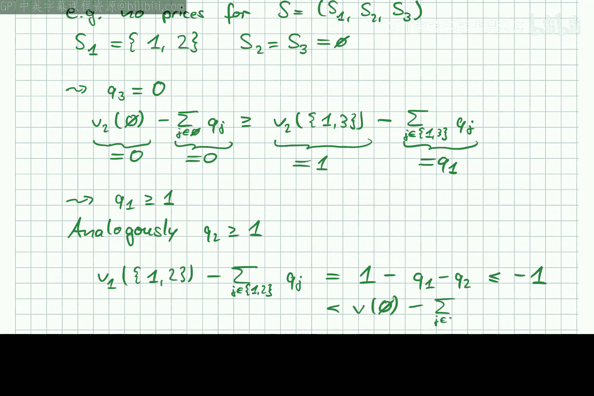
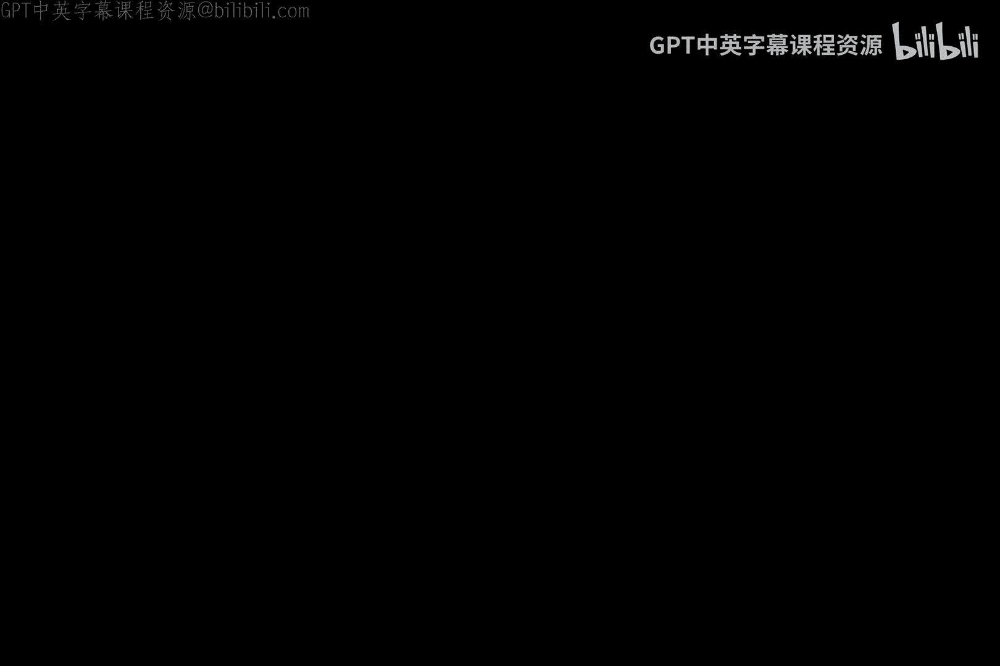
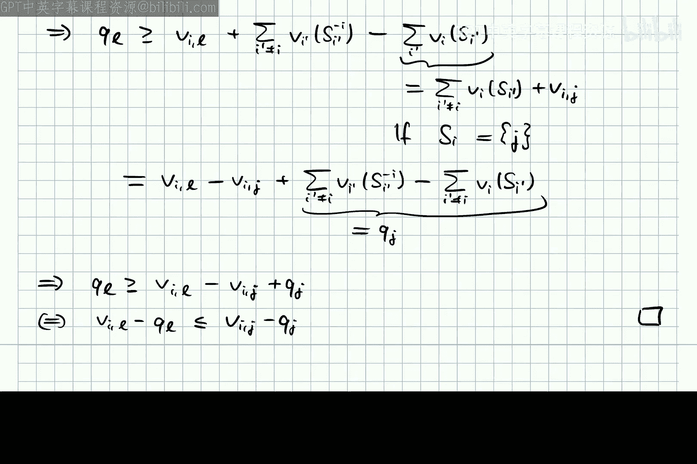
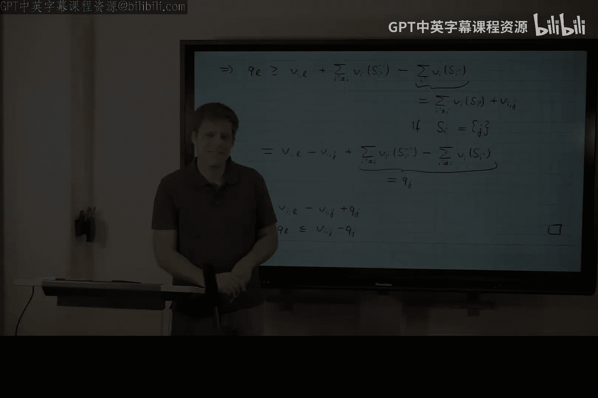

# 018：瓦尔拉斯均衡

在本节课中，我们将学习一种不同于拍卖的资源配置机制：标价市场。我们将探讨一种经典的经济学概念——瓦尔拉斯均衡，它描述了在公开价格下，市场如何达到一种稳定且高效的状态。我们将了解其定义、性质，并通过实例分析其存在性。

---

## 瓦尔拉斯均衡的定义

在之前的课程中，我们学习了机制设计，特别是组合拍卖。那种机制总是要求每个参与者提交出价，然后根据出价进行分配。然而，日常购物体验并非如此。通常，你走进商店，看到商品的标价，然后决定是否购买。

如何用数学来刻画这种场景？这种方式是否高效？能否带来良好的社会福利？这正是我们今天要借助经典经济理论探讨的问题。

瓦尔拉斯均衡以经济学家莱昂·瓦尔拉斯命名。其定义如下：

我们再次面对一个组合拍卖的标准设定。有 **n** 个参与者（或买家），以及 **m** 件物品的集合 **M**。每个参与者 **i** 有一个估值函数 **vᵢ**，它从物品集的幂集映射到非负实数。与之前不同，我们现在考虑完全信息，即所有估值函数 **vᵢ** 都是公开已知的。

我们关心的问题是：是否存在一组“好”的价格？这由瓦尔拉斯均衡的概念来形式化。

一个 **瓦尔拉斯均衡** 是一个二元组 **(p, S)**，其中：
*   **p** 是一个价格向量。
*   **S** 是一个分配方案 **(S₁, …, Sₙ)**，其中每个 **Sᵢ** 是 **M** 的子集，且这些子集互不相交（即每件物品最多分配给一个参与者）。

它必须满足以下两个条件：

1.  **个体理性**：对于每个参与者 **i** 和任何其他物品子集 **Sᵢ‘**，有：
    **vᵢ(Sᵢ) - Σ_{j∈Sᵢ} pⱼ ≥ vᵢ(Sᵢ‘) - Σ_{j∈Sᵢ‘} pⱼ**
2.  **市场出清**：如果一件物品 **j** 没有被分配给任何参与者（即不在任何 **Sᵢ** 的并集中），那么其价格必须为零：**pⱼ = 0**。

让我们仔细看看这些条件。第一个条件意味着，在给定的价格下，每个参与者对他们所获得的物品束 **Sᵢ** 感到满意。他们的拟线性效用（价值减去支付）不低于选择任何其他物品束所能获得的效用。第二个条件更具技术性，它确保未分配的物品价格为零，这结合第一个条件意味着没有人能通过免费获得未分配物品而变得更开心。

---

## 简单示例

为了更好地理解，我们来看几个例子。

### 单物品示例

假设只有一件物品，两个参与者。参与者1对物品的估值 **v₁** 高于参与者2的估值 **v₂**。

一个瓦尔拉斯均衡如下：将价格 **p** 设定在 **v₂** 和 **v₁** 之间，并将物品分配给参与者1。

**验证**：
*   对于参与者1：效用为 **v₁ - p ≥ 0**。不获得物品的效用为 **0 - 0 = 0**。因此条件1满足。
*   对于参与者2：不获得物品的效用为 **0**。如果获得物品，效用为 **v₂ - p ≤ 0**。因此条件1也满足。
*   物品已被分配，条件2自动满足。

可以验证，这是唯一的均衡形式。

### 单位需求估值示例

现在考虑一个更复杂的例子，涉及多个物品和具有“单位需求”估值的参与者。这意味着每个参与者最多只想获得一件物品，获得多件物品不会带来额外价值。形式上，**vᵢ(S) = max_{j∈S} vᵢⱼ**，其中 **vᵢⱼ** 是参与者 **i** 对物品 **j** 的估值。

假设有三个买家和三件物品，估值矩阵如下（连线表示非零估值）：
*   买家1：仅对物品A估值10。
*   买家2：对物品A估值5，对物品B估值3。
*   买家3：对物品B估值2，对物品C估值1。

我们可以找到一个瓦尔拉斯均衡：将物品A分配给买家1，物品B分配给买家2，物品C分配给买家3。价格设定为：**p_A = 3**, **p_B = 2**, **p_C = 0**。

**验证**：可以检查每个买家在当前分配下的效用都高于选择任何其他物品束的效用。值得注意的是，这个分配和支付恰好是VCG机制的结果（买家1支付其造成的外部性3）。然而，瓦尔拉斯均衡并不唯一。例如，价格 **p_A = 10**, **p_B = 3**, **p_C = 1** 与相同的分配也构成一个均衡（尽管此时所有买家的效用都为0）。

---

## 瓦尔拉斯均衡何时不存在？

并非所有估值函数都存在瓦尔拉斯均衡。请看以下反例：

有三个参与者和三件物品。估值函数如下：
*   参与者1：仅当获得物品 {A, B}（或其超集）时，价值为1，否则为0。
*   参与者2：仅当获得物品 {A, C} 时，价值为1，否则为0。
*   参与者3：仅当获得物品 {B, C} 时，价值为1，否则为0。

可以证明，**不存在**任何价格向量能支持一个可行的分配成为瓦尔拉斯均衡。

**简要论证**：假设尝试将 {A, B} 分配给参与者1。根据条件2，未分配的物品C价格必须为0。为了使参与者2对空集满意（不获得物品），必须满足：**0 ≥ v₂({A, C}) - (p_A + p_C) = 1 - p_A**，即 **p_A ≥ 1**。同理，为了使参与者3满意，可得 **p_B ≥ 1**。但这样一来，参与者1获得 {A, B} 的效用为 **1 - (p_A + p_B) ≤ -1**，这低于获得空集的效用0，违反了条件1。尝试其他分配也会导致类似的矛盾。

---

## 第一福利定理：均衡的社会最优性

一个关键的理论结果是**第一福利定理**。它指出：**任何瓦尔拉斯均衡下的分配，都实现了社会总福利的最大化**。

**证明**：
设 **(p, S)** 是一个瓦尔拉斯均衡。设 **S*** 是最大化社会总福利的分配（即 **Σᵢ vᵢ(Sᵢ*)** 最大）。

根据瓦尔拉斯均衡的条件1（个体理性），对于每个参与者 **i**，有：
**vᵢ(Sᵢ) - Σ_{j∈Sᵢ} pⱼ ≥ vᵢ(Sᵢ*) - Σ_{j∈Sᵢ*} pⱼ**

将所有这些不等式对 **i** 求和：
**Σᵢ vᵢ(Sᵢ) - Σᵢ Σ_{j∈Sᵢ} pⱼ ≥ Σᵢ vᵢ(Sᵢ*) - Σᵢ Σ_{j∈Sᵢ*} pⱼ**

现在分析求和项：
*   **Σᵢ Σ_{j∈Sᵢ} pⱼ**：这是所有被分配物品的价格总和。由于分配 **S** 是可行的，每件被分配物品只出现一次。根据条件2，未分配物品价格为0，所以此项等于所有物品的总价格 **Σⱼ pⱼ**。
*   **Σᵢ Σ_{j∈Sᵢ*} pⱼ**：这是假设按 **S*** 分配时，所有被分配物品的价格总和。由于 **S*** 也是可行分配，每件物品最多出现一次，所以此项 **≤ Σⱼ pⱼ**。

将这两个关系代入不等式，我们得到：
**Σᵢ vᵢ(Sᵢ) - Σⱼ pⱼ ≥ Σᵢ vᵢ(Sᵢ*) - Σⱼ pⱼ**
化简后即得：**Σᵢ vᵢ(Sᵢ) ≥ Σᵢ vᵢ(Sᵢ*)**

这意味着均衡分配 **S** 的社会总福利至少与最优分配 **S*** 一样高，因此 **S** 本身就是社会最优的。证毕。

这一定理常被概括为“市场是有效的”。但请注意，它**并不保证**均衡一定存在，只说明如果存在，其结果就是高效的。

---

## 单位需求估值下的均衡存在性

我们已经看到，对于单位需求估值，瓦尔拉斯均衡可能存在。事实上，有一个更强的结论：**对于单位需求估值，VCG机制的结果总对应一个瓦尔拉斯均衡**。

**构造与证明思路**：
1.  **分配**：设 **S** 是社会福利最大化的分配（即VCG的物品分配结果）。在单位需求下，这等价于一个最大权匹配。
2.  **定价**：对于物品 **j**，如果它在 **S** 中未分配，设 **pⱼ = 0**。如果它被分配给参与者 **i**，则设 **pⱼ** 等于VCG机制中参与者 **i** 的支付。
3.  **证明 (p, S) 是瓦尔拉斯均衡**：
    *   市场出清条件（条件2）由构造满足。
    *   证明个体理性条件（条件1）的核心在于利用单位需求估值和匹配问题的性质。可以证明，此时物品 **j** 的VCG支付价格 **pⱼ** 有一个等价定义：**pⱼ = SW(S^{+j}) - SW(S)**，其中 **S^{+j}** 是在原问题中增加一件物品 **j** 的副本后，新的社会福利最大化分配所对应的总福利。利用这个等价形式和匹配的交替路径性质，可以推导出对于获得物品 **j** 的参与者 **i**，以及任何其他物品 **l**，都有：**vᵢⱼ - pⱼ ≥ vᵢₗ - pₗ**。这意味着参与者 **i** 在现有分配下获得的效用（**vᵢⱼ - pⱼ**）不低于获得任何其他单件物品的效用，进而也不低于获得任何物品束的效用（因为单位需求下，多件物品的价值等于其中价值最高者）。这就验证了条件1。

因此，对于单位需求估值，我们总能通过VCG结果构造出一个瓦尔拉斯均衡，从而证明了其存在性。

---

## 总结

本节课我们一起学习了瓦尔拉斯均衡这一经典市场概念。

*   我们首先定义了瓦尔拉斯均衡，它由一组价格和一个分配方案组成，要求每个参与者在给定价格下对自己的所得满意，且未分配物品价格为零。
*   我们通过单物品和单位需求的例子，具体理解了均衡的形态，并看到了一个均衡不存在的反例。
*   我们证明了重要的**第一福利定理**：任何瓦尔拉斯均衡的分配都是社会最优的，即最大化总福利。
*   最后，我们证明了对于**单位需求估值**，瓦尔拉斯均衡总是存在，并且可以通过VCG机制的结果来构造。

瓦尔拉斯均衡提供了一个在完全信息下，通过标价实现高效资源配置的理想模型。然而，其存在性依赖于估值函数的性质（如单位需求或其推广——总替代性）。在下一讲中，我们将转向不完全信息设定，探讨如何在不知道参与者估值的情况下设定价格，并寻求近似高效的保证。