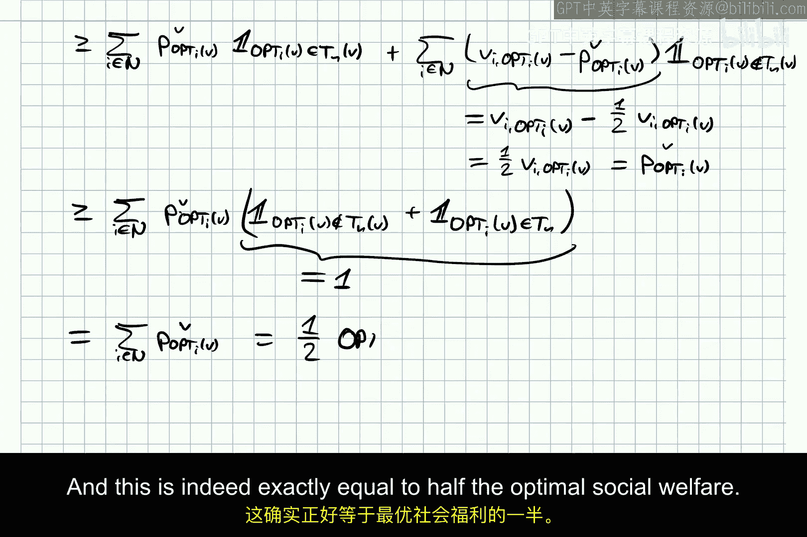
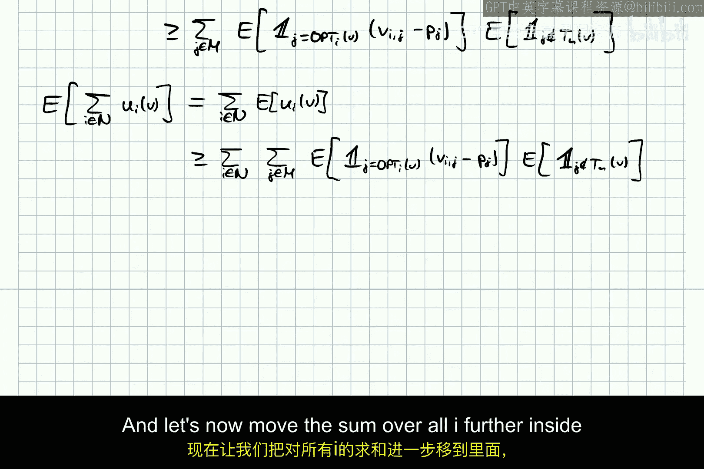
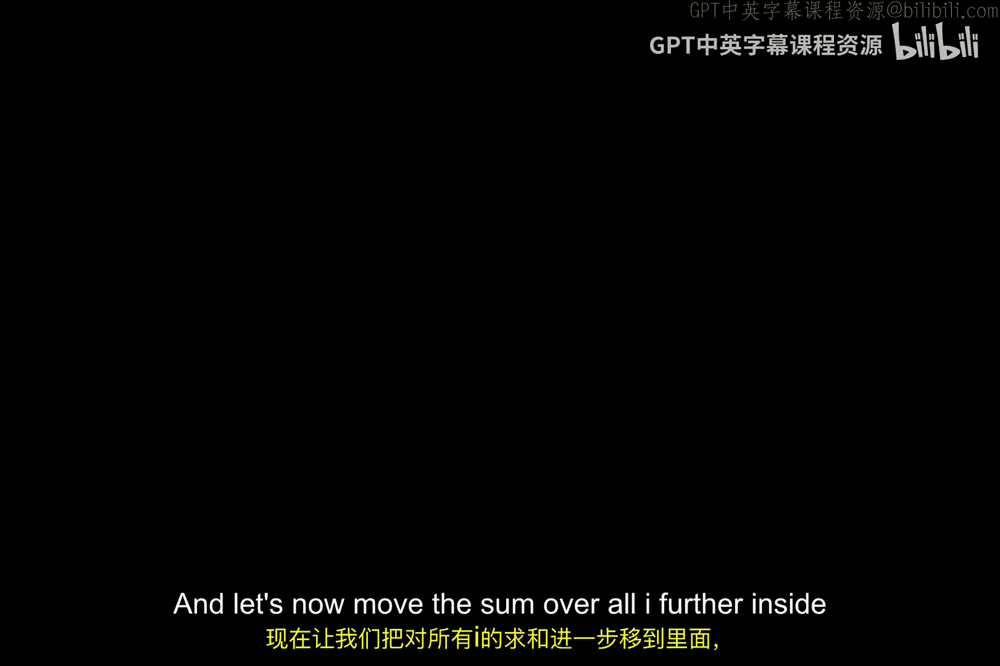
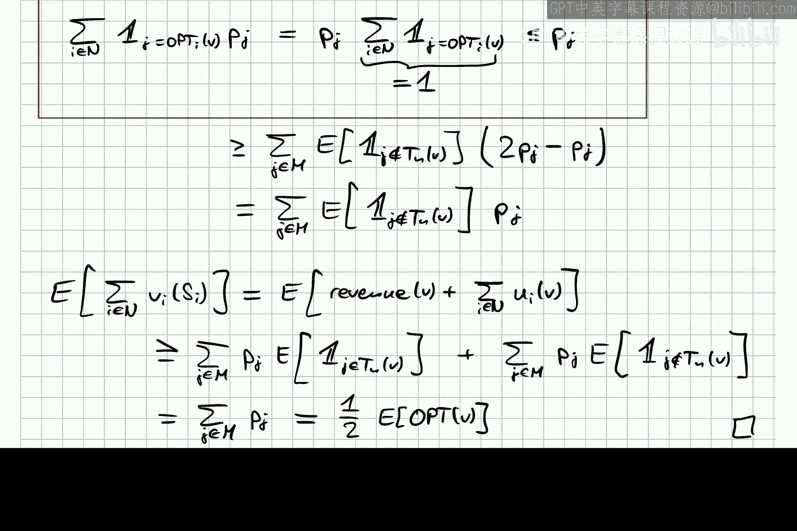

# 019：不完全信息下的定价机制

在本节课中，我们将学习一种在不完全信息环境下，通过公布价格来协调市场的机制。我们将看到，即使卖家不知道买家的具体估值，仅凭估值分布的知识，也能设计出价格，使得最终的社会福利至少达到最优社会福利的一半。

上一节我们介绍了完全信息下的瓦尔拉斯均衡，本节中我们来看看当信息不完全时，如何设计一个简单、真实且能保证近似社会福利的定价机制。

## 模型设定

我们考虑一个组合拍卖场景：
*   有 `n` 个买家，集合记为 `N = {1, 2, ..., n}`。
*   有 `m` 件物品。
*   每个买家 `i ∈ N` 拥有一个私有的估值函数 `v_i`。该函数为每个物品集合 `S` 分配一个非负实数值。
*   我们假设估值函数是**单位需求**的。这意味着对于任意集合 `S`，买家 `i` 从 `S` 中获得的估值等于他对 `S` 中单个物品的最高估值。形式化表示为：
    `v_i(S) = max_{j ∈ S} v_{i,j}`
    其中 `v_{i,j} ≥ 0` 是买家 `i` 对物品 `j` 的估值。
*   每个买家 `i` 的估值函数 `v_i` 从一个已知的分布 `D_i` 中独立抽取。分布 `D_1, ..., D_n` 对机制设计者是已知的，但具体的估值 `v_i` 是买家的私有信息。

## 定价机制流程

我们将研究以下简单的定价机制：
1.  **定价阶段**：机制设计者基于已知的分布 `D_1, ..., D_n`，为每一件物品 `j` 计算并公布一个**固定价格** `p_j`。
2.  **顺序购买阶段**：买家按照一个固定的顺序（例如 `1, 2, ..., n`）依次到来。
    *   当买家 `i` 到来时，他观察所有**尚未售出**的物品及其价格。
    *   买家 `i` 选择购买一个能最大化其净效用（估值减去价格）的物品集合 `S_i`。由于是单位需求估值，他实际上只会购买至多一件物品。
    *   买家 `i` 支付其购买集合中物品的价格总和。

这个机制非常直观：卖家贴上价签，买家按顺序来，挑自己最喜欢的（且尚未被买走的）东西买。

## 机制的性质

以下是该机制的一个关键观察：

**该机制对于任意设定的价格都是真实的。**

原因在于，买家的策略仅仅是“在可选的物品中选择使自己效用最大化的”。如果撒谎（即选择一个非最优的物品）不会带来更高的效用，因此买家没有动机不按照真实偏好行事。真实性在这里是“天然”获得的，但代价是机制需要预先知道估值分布并设定固定价格。

## 完全信息下的价格设计

为了理解不完全信息下的设计思路，我们先看一个完全信息（即所有 `v_i` 已知）下的简单价格设计方法。设 `OPT(v)` 是在估值组合 `v` 下能实现最大社会福利的分配方案。

我们为每件物品 `j` 定义价格 `p_j^v`：
*   如果物品 `j` 在 `OPT(v)` 中没有被分配给任何买家，则 `p_j^v = 0`。
*   如果物品 `j` 在 `OPT(v)` 中被分配给了买家 `i`，则 `p_j^v = (1/2) * v_{i,j}`。

换句话说，价格是物品对最优社会福利贡献值的一半。

令 `opt_i(v)` 表示买家 `i` 在 `OPT(v)` 中获得的物品（若未获得则记为 `null`）。可以证明，使用上述价格，当买家按顺序到来时，最终实现的社会福利至少是最优社会福利 `OPT(v)` 的一半。

**证明思路如下：**
令 `T_i` 为前 `i` 个买家购买走的物品集合。机制的总收入是售出物品价格的总和。每个买家 `i` 的效用至少为 0（因为他可以选择不买）。此外，买家 `i` 还有另一个选择：购买物品 `opt_i(v)`（如果它在前 `i-1` 个买家之后仍未售出）。因此，买家 `i` 的效用有一个下界：
`u_i ≥ [v_i(opt_i(v)) - p_{opt_i(v)}^v] * 1{opt_i(v) ∉ T_{i-1}}`
这个下界至少是 `[v_i(opt_i(v)) - p_{opt_i(v)}^v] * 1{opt_i(v) ∉ T_n}`，即物品最终是否被售出。

将总社会福利表示为总收入与买家总效用之和，并将下界代入，经过推导可以发现，总收入与效用下界之和正好等于所有价格 `p_j^v` 的总和。而根据定义，所有 `p_j^v` 的总和等于 `(1/2) * OPT(v)`。因此，社会福利至少为 `(1/2) * OPT(v)`。

## 不完全信息下的价格设计

现在，我们回到不完全信息设定。我们只知道估值分布 `D_i`，而不知道具体的 `v`。我们如何设定价格 `p_j` 呢？

思路是采用上述完全信息价格定义的**期望值**。具体步骤如下：
1.  从分布 `D_1, ..., D_n` 中独立抽取一个“虚拟”的估值组合 `w`。
2.  计算在这个虚拟场景 `w` 下的完全信息价格 `p_j^w`（即最优分配中物品贡献值的一半）。
3.  将我们的实际价格 `p_j` 设定为虚拟价格 `p_j^w` 的期望值。即：
    `p_j = E_{w ~ D}[p_j^w]`

这里，`w` 是一个与真实估值 `v` 独立同分布的随机变量。我们基于这个“采样的”或“想象的”估值场景来设定期望价格。

## 主要定理与证明概要

**定理 (Chawla, Gravin, Liane, 2015):** 对于单位需求估值，使用上述期望价格设定的顺序定价机制，其期望社会福利至少为期望最优社会福利的一半。即：
`E[SW(Mechanism)] ≥ (1/2) * E[OPT(v)]`

以下是证明的核心步骤概要：

1.  **收入下界**：机制的期望收入是每个物品的价格乘以它被售出的概率之和。
    `E[Revenue] = Σ_j p_j * Pr[物品 j 被售出]`

2.  **效用下界（关键步骤）**：为买家 `i` 的期望效用寻找一个下界。我们使用一个在贝叶斯纳什均衡分析中也用过的“幻觉”技巧。
    *   考虑买家 `i`，其真实估值为 `v_i`。
    *   假设买家 `i` “幻想”其他买家的估值是从分布中重新独立抽取的一组新值 `w_{-i}`。
    *   在真实估值 `v_i` 和幻想估值 `w_{-i}` 下，存在一个最优分配。设 `j` 是买家 `i` 在该最优分配中获得的物品。
    *   买家 `i` 的一个可能策略是：如果物品 `j` 在他到来时仍未售出，则购买它。否则不购买。
    *   由于买家实际是选择最大化其真实效用的物品，其真实效用不会低于这个“幻想策略”带来的效用。因此：
        `u_i ≥ (v_{i,j} - p_j) * 1{物品 j 未被前 i-1 个买家购买}`
    *   对上式取期望，并利用 `v_i`、`w_{-i}` 以及决定物品 `j` 是否可售的随机变量（取决于前 `i-1` 个买家的行为）之间的独立性，经过交换期望和变量（类似于贝叶斯价格无关性证明中的操作），我们可以得到：
        `E[u_i] ≥ Σ_j E[1{j = opt_i(v_i, w_{-i})} * (v_{i,j} - p_j)] * Pr[物品 j 未被任何人购买]`
        其中 `opt_i(v_i, w_{-i})` 表示在估值 `(v_i, w_{-i})` 下买家 `i` 在最优分配中获得的物品。

3.  **加总效用并化简**：对所有买家 `i` 的期望效用下界求和。
    *   将求和移至内部，并利用价格 `p_j` 的定义 `p_j = (1/2) * E_w[Σ_i 1{j = opt_i(w)} * v_{i,j}]`。
    *   经过一系列期望的线性操作和合并，可以推导出：
        `Σ_i E[u_i] ≥ Σ_j p_j * Pr[物品 j 未被购买]`

4.  **总社会福利下界**：总期望社会福利等于期望收入加期望总效用。
    `E[SW] = E[Revenue] + Σ_i E[u_i]`
    将第1步和第3步的下界代入：
    `E[SW] ≥ Σ_j p_j * Pr[物品 j 被购买] + Σ_j p_j * Pr[物品 j 未被购买] = Σ_j p_j`
    而根据价格 `p_j` 的定义，`Σ_j p_j = (1/2) * E[OPT(v)]`。
    因此，`E[SW] ≥ (1/2) * E[OPT(v)]`，定理得证。

## 结论与总结

本节课中，我们一起学习了一种适用于不完全信息环境的简单市场协调机制——顺序定价机制。

*   **机制**：卖家基于已知的估值分布，为物品设定固定价格。买家按顺序到来，购买使其效用最大化的可用物品。
*   **优点**：机制简单、天然真实（无需复杂报价），买家决策容易。
*   **性能保证**：通过将价格设定为“虚拟最优分配贡献值一半”的期望，该机制可以保证获得至少一半的期望最优社会福利。因子 `1/2` 对于此类定价机制是紧的。
*   **核心思想**：证明利用了“幻觉”技巧和期望的线性性质，将不完全信息问题与完全信息下的分析联系起来。其本质是，每件物品带来的福利要么体现在获得它的买家的效用中，要么体现在其他买家购买它而产生的收入中，从而总能捕获其部分价值。

这个结果展示了即使在不完全信息和简单顺序决策的约束下，价格仍然能够有效地协调市场，实现良好的社会福利近似。该研究是现代算法博弈论中关于简单、稳健机制设计的一个前沿范例。