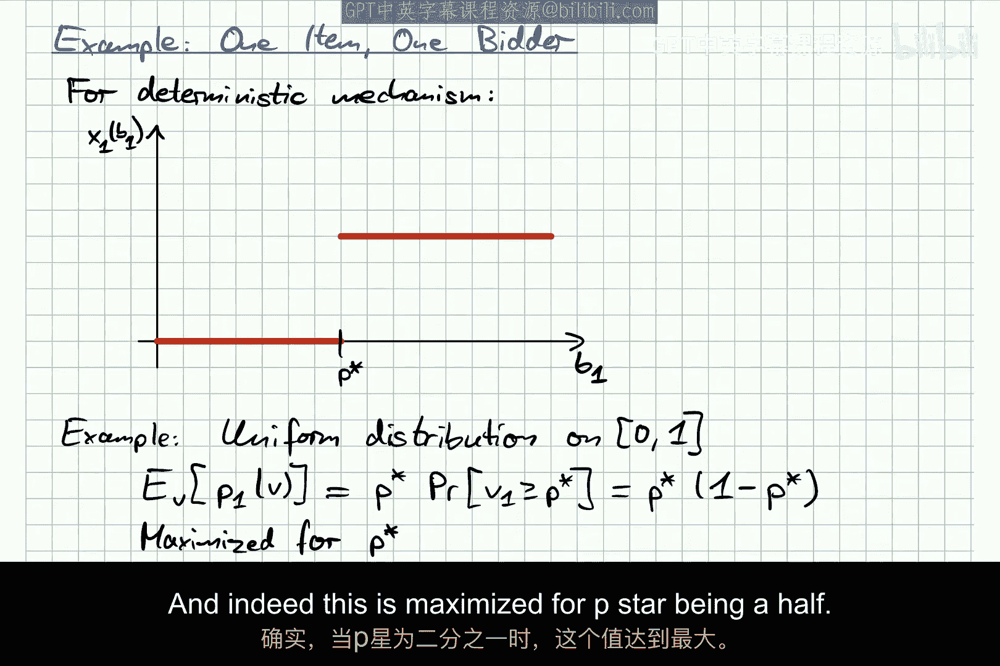
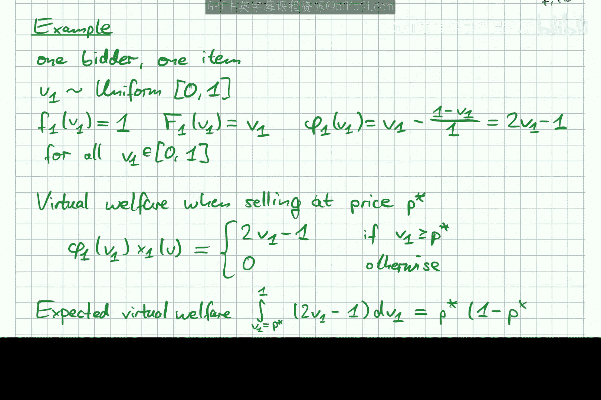
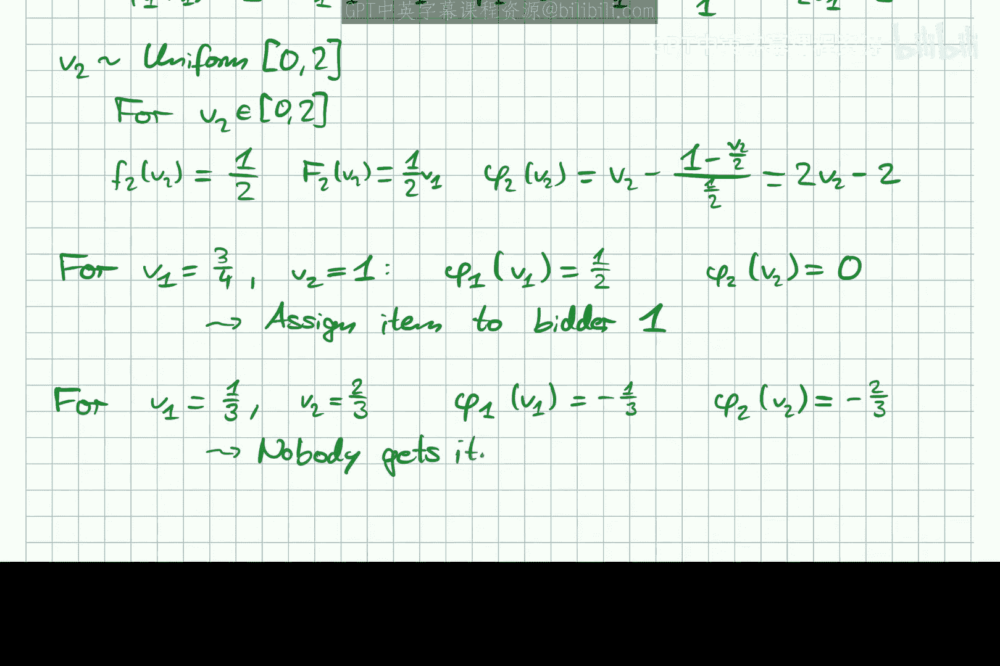

# 020：收益最大化

欢迎回到我们的算法博弈论课程。在之前的几讲中，我们已经对机制设计，特别是以最大化社会福利为目标的情况，有了相当深入的理解。这意味着我们可能有一个或多个物品，我们希望将这些物品分配给买家，以最大化他们估值的总和。

今天，我们将转向一个不同的目标，即我们想要最大化**收益**。这意味着我们希望最大化支付款项的总和。并且，我们将回到只有一个物品的情况。

## 模型设定

首先，让我们写下我们的模型。

*   我们将有 **N** 个竞标者。
*   所有竞标者的集合再次用大写 **N** 表示。
*   只有**一个物品**。
*   每个竞标者 **i** 对该物品有一个**私有估值** **v_i**，并会报告一个**出价** **b_i**。
*   我们假设 **v_i** 是从分布 **D_i** 中**独立**抽取的。**D_i** 是公开已知的。
*   估值的**支撑集**是从 0 到某个最大值 **v_max** 的区间。因此，买家可能拥有的估值有一个上限 **v_max**。
*   此外，我们假设这些分布是**连续**的。其概率密度函数记为 **f_i**，累积分布函数记为 **F_i**。这意味着我们可以将 **v_i ≤ t** 的概率写为 **F_i(t)**，或写为从 0 到 t 对 **f_i(x)** 的积分。

我们的目标是设计一个机制。一个机制仍然由一个结果规则和一个支付规则组成。由于我们现在将密度函数称为 **f**，我们将结果规则（分配规则）称为 **x**，而不是 **f**，除此之外，它与之前相同。

因此，目标是设计一个机制，它是一个结果规则和支付规则的对。这个结果规则将出价向量映射到 [0, 1] 之间的数字向量，其中这些条目的总和**至多为 1**。如何解释这一点？有一种非常自然的理解方式：如果其中一个条目确实是 1，而其他条目是 0，那么这位买家就获得了物品。否则，我们也可以将其解释为一个概率分布。例如，这位买家以 1/2 的概率获得物品，另一位以 1/3 的概率获得，等等。这些概率甚至不必总和为 1，如果我们决定保留物品，总和也可以小于 1。一个可能的分配结果就是没有人获得物品，即返回全零向量。

我们的目标是使机制是**真实**的，并且我们希望最大化买家真实报告时的支付总和。因此，我们再次希望设计一个真实机制。每个真实机制都附带一个支付规则。我们限制自己考虑不将物品分配超过一次且是真实的机制。在所有这样的真实机制中，我们希望选择那个在竞标者真实报告时能最大化**期望支付总和**的机制。

你可能会问，为什么我们坚持要真实的机制？实际上，这并非绝对必要，对此有更一般的陈述，但我们暂时不讨论这一点。关键在于，因为机制是真实的，我们可以预期买家会真实报告他们的估值，只有这样，最大化这个目标才有意义。如果这不是一个真实机制，那么竞标者可能会撒谎，这就不一定与我们实际获得的金钱相关了。

## 单一买家的情况

首先，我们来讨论只有一个买家的情况，因为这时事情实际上非常简单。

我们不仅只有一个物品，也只有一个竞标者。我们的真实机制会是什么样子？让我们限制在**确定性机制**。那么，结果规则将非常简单。我们可以画出像讨论迈尔森引理时那样的图：横轴是竞标者的出价，纵轴是该竞标者的分配结果。分配曲线必须是单调的，因此它看起来会像这样：从 0 开始，然后在某个点 **p*** 处，我们开始分配物品。我们可以将其理解为物品的**价格**：如果竞标者的出价低于 **p***，则他们得不到物品；如果出价高于 **p***，则他们得到物品。这显然独立于 b1，因为这就是图所展示的。

例如，如果我们有一个均匀分布，我们如何最大化收益？我们可以写下买家 1 的**期望支付**。这总是 **p*** 乘以 **v_i ≥ p*** 的概率。在 [0, 1] 区间上的均匀分布情况下，这个概率恰好是 **1 - p***。因此，我们的期望收益是 **p* × (1 - p*)**。现在我们可以问，如何在所有可能的 **p*** 中最大化这个值？只需对 **p*** 求导，找出最大值点。实际上，当 **p* = 1/2** 时，收益最大化。

你也可以对其他分布进行类似的论证。当然，那时 **1 - p*** 会变成其他形式，你也会得到其他最大化收益的 **p***。

但我们现在要了解的是一个更通用的方法来解决这个问题。我们将理解多个竞标者的情况，当然，这不会像单一买家那样简单，因为现在从“不获得物品”到“获得物品”的切换点将取决于其他竞标者的出价。

我们如何设计机制以最大化期望支付总和？这感觉非常复杂，但令人惊讶的是，由于我们有迈尔森引理和对支付的精确描述，这并不难。这就是我们接下来要做的。

## 迈尔森引理与虚拟估值

现在，我们进入更一般的问题：有多个竞标者，但只有一个物品（实际上，我们是否只有一个物品并不重要，这对于我们考虑的任何单参数问题都成立）。

我们将应用**迈尔森引理**。顺便说一下，这就是为什么它被称为迈尔森引理，因为迈尔森最初就是想用它来做这件事。这是迈尔森关于最大化收益的著名成果。

迈尔森引理为我们提供了支付的精确公式。让我们回顾一下，如果竞标者 i 真实出价，而其他人任意出价，其支付为：

**p_i(v_i, b_{-i}) = v_i * x_i(v_i, b_{-i}) - ∫_0^{v_i} x_i(t, b_{-i}) dt**

如果我们假设 **x_i** 是可微的，我们可以通过分部积分以另一种方式解释这个公式：

**p_i(v_i, b_{-i}) = ∫_0^{v_i} t * x_i'(t, b_{-i}) dt**

这成立的条件是 **x** 是可微的。我们在这里做的是分部积分。

现在，我们想要最大化这些支付的总和。让我们首先重写竞标者 i 在真实出价时的期望支付。利用密度函数 **f_i**，我们可以将其写为积分形式。然后，我们用迈尔森引理中的支付公式替换 **p_i** 项，并交换积分顺序（假设一切条件良好）。经过一系列推导（包括再次使用分部积分），我们最终得到：

**E[p_i] = ∫_0^{v_max} f_i(t) * φ_i(t) * x_i(t, b_{-i}) dt**

其中，我们定义了一个新函数 **φ_i(t)**，称为**虚拟估值函数**：

**φ_i(t) = t - (1 - F_i(t)) / f_i(t)**

这个积分可以理解为对 **φ_i(v_i) * x_i(v_i, b_{-i})** 在 **v_i** 上的期望。然后，我们对所有竞标者做同样的处理，并假设每个人都真实出价。通过期望的线性性质，我们得到：

**期望总支付 = E[ Σ_i φ_i(v_i) * x_i(v) ]**

这个表达式看起来很像**社会福利**。如果我们没有 **φ** 函数，而是有 **v_i**，那么这就是社会福利。现在，**φ** 函数作用在估值上，因此这被称为**虚拟福利**。

**φ_i(v_i)** 被称为**虚拟估值**。

因此，为了设计一个最大化期望收益的真实机制，我们也可以设计一个最大化期望虚拟福利的真实机制。这是我们的第一个关键观察，也是帮助我们后续最大化收益的关键引理。

**观察结果**：对于任何真实的单参数机制，其**期望收益**等于其**期望虚拟福利**。其中，虚拟估值函数定义为 **φ_i(t) = t - (1 - F_i(t)) / f_i(t)**。

当然，需要注意的是，这并不是说在任何特定的估值配置下，收益都等于虚拟福利，而是在**期望**上它们相等。这意味着，如果我们想最大化期望虚拟福利，只需在**每个**估值配置下最大化虚拟福利即可。因为如果我们对每个估值配置都最大化虚拟福利，那么我们也最大化了期望虚拟福利，从而最大化了期望收益。

在我们更一般地讨论之前，让我们先回到我们的例子。

## 回顾单一买家例子

我们再次有一个竞标者和一个物品。**v_1** 在 [0,1] 上均匀分布。其密度函数 **f_1(v_1) = 1**，累积分布函数 **F_1(v_1) = v_1**。那么虚拟估值函数为：

**φ_1(v_1) = v_1 - (1 - v_1)/1 = 2v_1 - 1**

一个以价格 **p*** 出售物品的机制的虚拟福利是 **φ_1(v_1) * x_1(v)**。如果我们分配物品（即当 **v_1 ≥ p*** 时），它就是 **2v_1 - 1**；否则为 0。因此，期望虚拟福利是：

**∫_{p*}^1 (2v_1 - 1) dv_1 = p* * (1 - p*)**

这正是我们之前计算出的期望收益。所以这确实是我们的引理的一个特例。虚拟福利本身可能看起来有点奇怪，因为它有时会是负值（例如当 **v_1 < 0.5** 时）。这告诉我们，收益和虚拟福利并不是在每个点上相等，而只是在期望上相等。

现在，我们如何最大化期望收益？我们知道必须最大化期望虚拟福利。但具体怎么做呢？如果我们对分布做一个进一步的假设，那么结果机制将非常简单。

## 正则分布与收益最大化机制

我们现在处于什么位置？我们已经证明，一个真实机制的期望收益等于其期望虚拟福利。因此，与其设计一个最大化期望收益的真实机制，我们也可以设计一个最大化期望虚拟福利的真实机制。

我们将引入一个进一步的假设来简化问题。即，我们假设我们的分布是“好的”。这被称为**正则性**，但你可以将其理解为大多数你听说过的分布都是正则的，例如均匀分布、正态分布或指数分布。当然，也不难构造非正则分布的例子。

正则性是如何定义的？我们说分布 **D_i** 是**正则**的，如果其关联的虚拟估值函数 **φ_i** 是**严格递增**的。例如，对于均匀分布，我们有 **φ_i(t) = 2t - 1**，这是一个严格递增函数。

为什么我们喜欢这个性质？因为如果虚拟估值函数是严格递增的，那么我们可以使用一个直接最大化虚拟福利的机制来最大化收益。

让我们正式地写下来。**虚拟福利最大化机制**定义如下：
*   **分配规则 x***：在输入出价 **b** 时，最大化**声明的虚拟福利**，即 **Σ_i φ_i(b_i) * x_i(b)**。
*   **支付规则**：根据迈尔森引理确定。

这个机制是如何工作的？它接受竞标者的出价作为输入，通过应用各自的虚拟估值函数计算每个出价的虚拟值，然后找到能最大化总虚拟福利的分配方案。

现在，如果分布是正则的，那么这个机制是真实的。否则，如果分布不是正则的，它可能不是真实的（这将是你的一个练习）。

我们声称：**如果所有竞标者的估值分布都是正则的，那么虚拟福利最大化机制是真实的。此外，它在所有真实机制中最大化期望收益。**

为什么这是真实的？因为如果 **φ_i** 是严格递增的，那么出价越高意味着你的虚拟出价也越高。由于目标是最大化总虚拟福利，这会导致一个单调的分配规则。结合迈尔森引理的支付规则，就构成了一个真实机制。

为什么它最大化收益？任何其他真实机制 **M** 的期望收益等于其期望虚拟福利。而我们的机制 **x*** 在**每个**估值配置下都最大化虚拟福利，因此其虚拟福利（从而期望收益）至少与任何其他机制一样高。

## 单物品拍卖中的收益最大化机制

我们有了一个机制来最大化声明的虚拟福利。如果分布是正则的，那么这将是一个真实机制，并且也能最大化期望收益。但这听起来仍然很复杂：找到最大化虚拟福利的分配。具体怎么做呢？

答案出人意料地简单。在**单物品拍卖**中，虚拟福利是通过以下方式最大化的：
1.  将物品分配给**报告虚拟估值最高**的竞标者。
2.  **前提**是该虚拟估值是**正**的。
3.  否则，物品**不予分配**。

让我们证明这确实能最大化虚拟福利。考虑任何估值向量 **v** 和任何分配 **x(b)**。有两种情况：
*   **情况1**：最大虚拟估值是非负的。由于物品最多分配给一个人，且分配概率总和 ≤ 1，任何分配获得的虚拟福利最多就是这些虚拟估值中的最大值。而上述规则将物品分配给虚拟估值最高的竞标者，获得的虚拟福利恰好等于这个最大值。因此，它是最优的。
*   **情况2**：最大虚拟估值是非正的（即所有虚拟估值 ≤ 0）。那么，任何分配获得的虚拟福利都不可能为正。上述规则不分配物品，获得虚拟福利 0，这也是最优的。

因此，如果有一个物品，我们通过将物品分配给虚拟估值最高且为正的竞标者来最大化虚拟福利，否则保留物品。

现在，如果分布是正则的，这也会是一个真实机制。

让我们更具体地看看这意味着什么。

## 示例

假设有两个竞标者：
*   **竞标者1**：估值 **v_1** 在 [0, 1] 上均匀分布。
    *   密度函数：**f_1(v_1) = 1**
    *   累积分布函数：**F_1(v_1) = v_1**
    *   虚拟估值函数：**φ_1(v_1) = 2v_1 - 1**
*   **竞标者2**：估值 **v_2** 在 [0, 2] 上均匀分布。
    *   密度函数：**f_2(v_2) = 1/2**
    *   累积分布函数：**F_2(v_2) = v_2/2**
    *   虚拟估值函数：**φ_2(v_2) = v_2 - (1 - v_2/2) / (1/2) = 2v_2 - 2**

现在，考虑一些例子：
*   **例子1**：**v_1 = 0.75**, **v_2 = 1**
    *   谁的估值更高？竞标者2（1 > 0.75）。
    *   计算虚拟估值：
        *   **φ_1(0.75) = 2*0.75 - 1 = 0.5**
        *   **φ_2(1) = 2*1 - 2 = 0**
    *   谁的虚拟估值更高？竞标者1（0.5 > 0）。
    *   **结果**：物品分配给**竞标者1**，尽管他的估值更低。
*   **例子2**：**v_1 = 1/3**, **v_2 = 2/3**
    *   计算虚拟估值：
        *   **φ_1(1/3) = 2*(1/3) - 1 = -1/3**
        *   **φ_2(2/3) = 2*(2/3) - 2 = -2/3**
    *   两个虚拟估值都是负的。
    *   **结果**：物品**不分配给任何人**。

第一次看到这可能有点令人困惑：为什么我们把物品给了估值更低的人？为什么我们有时根本不分配物品？如果我们把物品送出去，难道不能至少得到一些钱吗，而不是一分钱都得不到？这难道不奇怪吗？

是，也不是。如果我们回到最初的单一买家例子，在那里，我们不分配物品其实并不奇怪，因为关键在于，我们要确保每当我们分配物品时，都能获得一定金额的支付。如果我们在估值很低时也分配物品，那么竞标者可以撒谎说：“你反正都会把物品给我，所以我确保不为此支付任何费用。”这种情况也出现在这些例子中。

我们之所以把物品给竞标者1，是因为竞标者2在这种情况下实际上估值“相对较低”（因为其分布在 [0,2] 上，所以一半的时间竞标者2会有更高的估值）。为了提取足够的收益，我们只在他们估值高得多的时候才给他们物品。

同样，在第二个例子中，两个竞标者的估值都相对较低，所以我们实际上不想把物品给他们。我们宁愿保留物品，以确保当他们确实有高估值时，我们能提取更多收益。

## 总结与展望

如你所见，最大化收益介于简单和超级复杂之间。如果分布是正则的，那么规则非常简单；但同时，这又有些奇怪，例如你并不总是把物品给估值最高的人。

如果你有多个物品，情况会变得更加复杂，但这不在我们今天讨论的范围内。

你现在可能会问的问题是：对于更简单的机制，我们还能说些什么？例如，如果我运行一个**二价拍卖**，这会给我带来良好的收益吗？答案是：某种程度上是的，尽管收益不会是最优的，因为根据设计，你总是把物品送出去。这是我们下一讲将要证明的结果之一。或者，如果我设计一个非常简单的机制，只是给我的物品贴上一个价格标签，我能获得多少收益？这将是我们下次讨论的问题。

本节课中，我们一起学习了：
1.  收益最大化问题的模型设定，涉及单个物品和已知的独立估值分布。
2.  通过迈尔森引理，我们将最大化期望收益的问题转化为最大化期望**虚拟福利**的问题。
3.  引入了**虚拟估值函数** **φ_i(v_i) = v_i - (1 - F_i(v_i))/f_i(v_i)**。
4.  在分布满足**正则性**（虚拟估值函数严格递增）的假设下，**虚拟福利最大化机制**（将物品分配给虚拟估值最高且为正的竞标者）是真实的，并且能在所有真实机制中最大化期望收益。
5.  通过具体示例，我们看到了收益最大化机制可能做出与单纯最大化社会福利（如二价拍卖）不同的决策，例如将物品分配给估值较低但虚拟估值较高的竞标者，或者在某些情况下保留物品不分配。

下次课我们将探讨简单机制（如定价机制和二价拍卖）的收益表现。