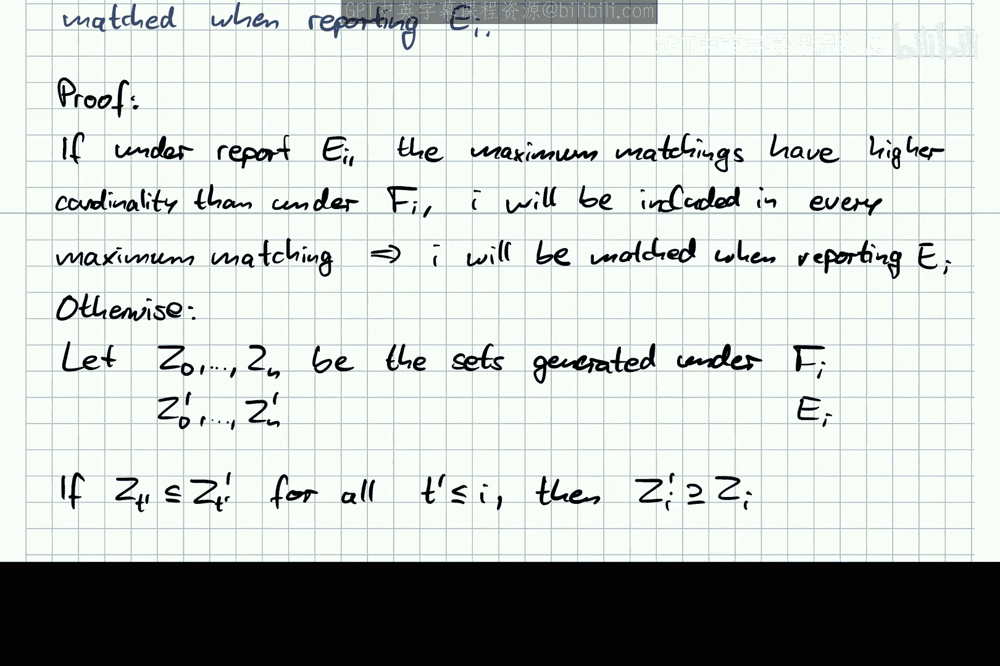
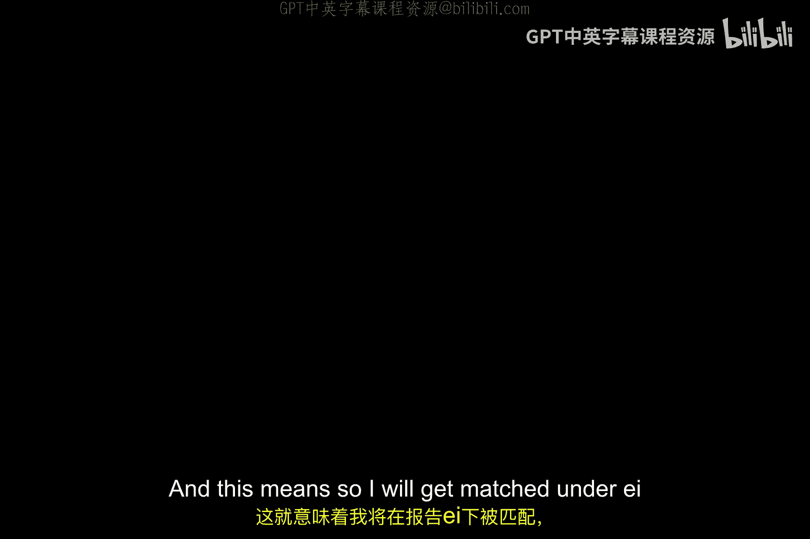
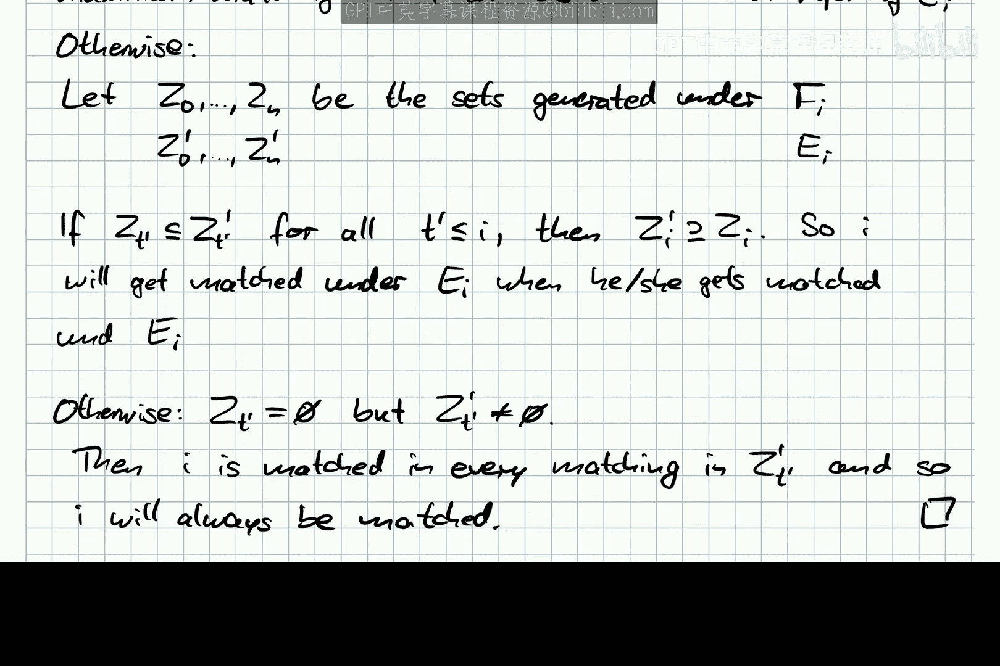

# 022：无货币分配机制 🏠

在本节课中，我们将学习机制设计的一个新领域：**无货币分配**。我们将探讨当无法或不应使用金钱来引导参与者行为时，如何设计机制来分配物品。课程将首先介绍一个经典的“房屋交换”问题，并学习寻找稳定分配的算法。随后，我们将探讨一个重要的现实应用——肾脏交换，并分析如何设计激励参与者如实报告信息的机制。

---

## 无货币机制设计概述 🤔

在之前的课程中，我们学习了大量关于**使用货币的机制设计**的知识。但如果我们不想用金钱来引导人们走向正确的方向，从而获得期望的结果，该怎么办？

不使用货币的原因可能多种多样：或许是因为收取金钱不可行，或许是由于某些伦理原因。那么，我们还能做什么呢？在接下来的讲座中，我们将了解一些关于**无货币机制设计**的内容。

遗憾的是，情况通常比使用货币时复杂得多。一个很重要的原因是：到目前为止，我们所做的一切都是以货币单位来衡量的。这不仅指支付款项，也包括我们对物品的估值。例如，我们说“我估价这件物品值5，那件值3”，如果某人估值更高，他就应该得到该物品，因为这能最大化社会福利。

然而，如果没有货币，我们该如何比较什么对谁更有价值？我们将不得不更仔细地思考，所谓“获得一个理想的结果”究竟意味着什么。

---

## 房屋交换问题 🏘️

我们现在要考虑的第一个问题是一个非常简单的场景：每个参与者都带一件物品（我们称之为“房屋”）到市场，他们希望通过交换这些房屋，使得交换后每个人都尽可能开心。

当然，你也可以用金钱来做这件事，比如每个人都卖掉自己的房子，然后再买房子。但这可能是一种可行的机制。然而，我们现在希望**完全不用金钱**来完成交换。

### 问题模型

我们有一组参与者，集合记为 **N**。最初，每个参与者 **i** 拥有一件物品（房屋）。我们的目标是**重新分配**这些房屋，让参与者更开心。这意味着我们需要找到一个**一一对应**的映射 **π**，它将参与者映射到房屋。交换后，参与者 **i** 将获得房屋 **π(i)**。

由于我们不使用货币，我们无法用货币单位来表达“让参与者更开心”。因此，我们不说“我估价这所房子值多少”，而是说“这是我的房屋偏好列表：我更喜欢这所房子胜过那所房子”。每个参与者 **i** 对所有房屋都有一个**完整的、无并列的偏好列表**。

### 示例与稳定性概念

考虑一个简单例子：参与者 A、B、C 分别拥有房屋 a、b、c。
*   参与者 A 的偏好：b > c > a
*   参与者 B 的偏好：c > a > b
*   参与者 C 的偏好：a > c > b

在这种情况下，分配非常简单：给 A 房屋 b，给 B 房屋 c，给 C 房屋 a。这样每个人都得到了自己最喜爱的房子。

但通常情况不会这么顺利。可能存在一所每个人都想要的豪宅，我们无法让每个人都得到自己最想要的。例如：
*   参与者 A 的偏好：b > c > a
*   参与者 B 的偏好：a > c > b
*   参与者 C 的偏好：a > c > b

如果我们进行同样的交换（A 得 b，B 得 c，C 得 a），参与者 B 只得到了他的第二选择。参与者 B 可以找 A 商量：“你得到了我的房子（b）。如果我们俩私下交换房子（A 把 b 给 B，B 把 a 给 A），你仍然得到我的房子（这对你没变），但我会得到你的房子（a），这比我现在的分配（c）更让我开心。” 因此，我们称这种分配是**不稳定**的。

### 稳定分配的定义

我们需要形式化定义分配的稳定性。

*   对于一个分配 **π**，如果存在一个参与者的子集 **A** 和另一个只涉及 **A** 中参与者的分配 **σ**，使得：
    1.  对于 **A** 中的每个参与者 **i**，都不更偏好 **π(i)** 胜过 **σ(i)**。
    2.  至少存在一个 **A** 中的参与者 **i**，他更偏好 **σ(i)** 胜过 **π(i)**。
*   那么，我们称子集 **A** 是分配 **π** 的一个**阻碍联盟**。
*   如果一个分配**没有**任何阻碍联盟，则称其为**稳定分配**。

我们的目标就是找到这样的稳定分配。因为这确保了在我们的分配是稳定的情况下，参与者们实际上愿意参与我们的大交换，而不会决定退出并自行其事。

---

## 顶级交易圈算法 🔄

一个关键问题是：是否总是存在稳定分配？如果存在，是否难以找到？答案是：不仅总是存在稳定分配，而且可以用一个相对简单的算法轻松找到。

我们将设计一个算法，即所谓的**顶级交易圈算法**。这是一个非常直观的算法：我们首先给予每个参与者他最想要的房子（在剩余房子中）。如果我们以此方式发现了一个循环交换（例如，你的首选房子是我的，我的首选房子是你的），我们就从这些循环开始，然后逐步消除这些交易圈。

以下是算法的形式化描述：

1.  初始化 **N‘ = N**（所有参与者的集合）。
2.  **当** **N‘** 非空时，**执行**：
    a. 在 **N‘** 上构造一个有向图。图中每个顶点（代表一个参与者）有一条**出边**，指向**他/她在当前剩余房屋（即 **N‘** 中参与者所拥有的房屋）中最喜欢的房屋的所有者**。
    b. 注意：一个参与者最喜欢的剩余房屋可能是他自己的房子。在这种情况下，他的出边将指向自己（形成一个自环）。这也算作一个循环。
    c. 在这个有向图中找到任意一个**有向环**。
    d. 对于环中的每个参与者 **i**，**分配**他/她获得其**在环中的后继者所拥有的房屋**。
    e. 从 **N‘** 中**移除**环上的所有参与者。
3.  算法终止。

### 算法正确性分析

这个算法是良定义的，因为它总会终止。为什么图中总是存在有向环？因为每个顶点都恰好有一条出边（指向其最喜爱房屋的所有者）。在一个每个顶点都有出边的有限有向图中，沿着出边行走，最终必然会访问到一个之前访问过的顶点，从而形成一个环。

现在，我们证明该算法产生的分配 **π** 是稳定的。

**证明思路（反证法）**：
1.  假设算法产生的分配 **π** 不稳定。那么存在一个阻碍联盟 **A** 和一个只涉及 **A** 中参与者的分配 **σ**，使得 **A** 中所有参与者都不更偏好 **π** 胜过 **σ**，且至少一人更偏好 **σ**。
2.  令 **A≠** 为那些在 **σ** 和 **π** 中获得不同房屋的参与者集合。根据定义，**A≠** 非空，且其中每个参与者 **i** 都更偏好 **σ(i)** 胜过 **π(i)**。
3.  考虑算法运行中，**第一次**有 **A≠** 中的参与者被从 **N‘** 中移除的时刻。设此时刻前的 **N‘** 为 **N***。
4.  设被移除的参与者为 **i**。根据算法，**π(i)** 是 **i** 在 **N*** 中最喜欢的房屋。
5.  可以论证，**σ(i)** 也必须在 **N*** 中（否则会导致矛盾）。
6.  既然 **σ(i)** 在 **N*** 中，而 **π(i)** 是 **i** 在 **N*** 中最喜欢的房屋，那么 **i** 不可能更偏好 **σ(i)** 胜过 **π(i)**。这与第2点矛盾。
7.  因此，假设不成立，分配 **π** 是稳定的。

---

## 稳定分配的唯一性与真实性 📈

上一节我们介绍了顶级交易圈算法，并证明了它能产生一个稳定分配。本节中，我们来看看这个稳定分配的两个进一步性质：**唯一性**和**真实性**。

### 唯一性定理

由顶级交易圈算法计算出的分配 **π**，是**唯一的**稳定分配。

**证明思路（归纳法）**：
1.  设 **π‘** 是任意另一个稳定分配。
2.  令 **N_t** 表示算法在第 **t** 轮迭代中分配房屋的参与者集合。
3.  我们对 **t** 进行归纳，证明对于所有 **t** 和所有 **i ∈ N_t**，都有 **π(i) = π’(i)**。
4.  **基础情况 (t=1)**：根据算法，**N_1** 中的参与者都得到了他们最喜爱的房屋。如果 **π‘** 给其中某个参与者 **i** 的不是他最喜爱的房屋，那么由 **N_1** 中参与者组成的集合，按照 **π** 进行交换，就会成为 **π‘** 的一个阻碍联盟。这与 **π‘** 的稳定性矛盾。因此，对于所有 **i ∈ N_1**，**π(i) = π’(i)**。
5.  **归纳步骤**：假设对于所有前 **t-1** 轮的参与者，**π** 和 **π‘** 的分配一致。那么对于剩余参与者 **N‘** 和剩余房屋，问题就等价于一个全新的、规模更小的原始问题。根据与基础情况相同的推理，在第 **t** 轮被分配的参与者（即 **N_t**）在 **π‘** 中也必须得到他们在剩余房屋中最喜欢的那一个，也就是算法分配给他们的 **π(i)**。因此，**π(i) = π’(i)** 对所有 **i ∈ N_t** 成立。
6.  由归纳法，对所有参与者，**π** 和 **π‘** 的分配都相同。故稳定分配唯一。

### 真实性（策略证明性）

在无货币机制设计中，我们同样关心参与者是否有动机谎报偏好。有趣的是，在这个房屋交换问题中，**谎报偏好不会让任何参与者受益**。

**证明思路**：
1.  固定一个参与者 **i** 和其他所有参与者的偏好报告。
2.  令 **t*** 是当参与者 **i** 真实报告时，他在算法中被分配房屋的轮次。
3.  参与者 **i** 通过谎报，最多只能让自己在比 **t*** 更早的轮次被分配。
4.  但是，他**不可能**得到在 **t*** 轮之前（即第1轮到第 **t*-1** 轮）被分配出去的房屋。因为这些房屋的分配依赖于其他参与者对其房屋的喜爱（即指向他的入边），而这是参与者 **i** 无法通过谎报自己的偏好来影响的。
5.  因此，无论参与者 **i** 如何报告，他最终获得的房屋都来自第 **t*** 轮及之后可用的房屋集合。
6.  而当他真实报告时，他在第 **t*** 轮获得的房屋，正是这个集合中他最喜欢的那个。
7.  所以，真实报告是他的（弱）占优策略。

这证明了顶级交易圈算法是**策略证明**的，类似于有货币机制设计中的真实性。

---

## 应用：肾脏交换 🩺

现在，让我们讨论另一个需要机制设计但出于伦理原因不应涉及金钱的场景：**肾脏交换**。

肾脏交换的背景是：患者需要肾脏移植，其亲属愿意捐献，但可能由于组织不兼容而无法直接捐献。如果另一对患者-捐献者也有同样的问题，那么双方可以**交换**肾脏：A的捐献者捐给B的患者，B的捐献者捐给A的患者。

这自然引向了使用类似顶级交易圈算法的想法：将每对患者-捐献者视为一个“参与者”，其偏好基于与其他捐献者肾脏的兼容可能性，然后寻找一个交换圈。然而，这里存在一个实际缺陷：如果交换圈很长（例如涉及10对），就需要同时进行20台手术，这在物流上几乎不可行，因为必须防止有人先得到肾脏却不履行捐献义务。

因此，实践中常采用一种更简单的方法：只考虑**两两交换**。我们可以用一个图模型来表示：

*   每个顶点 **v** 代表一个患者-捐献者对。
*   如果一对中的捐献者肾脏与另一对中的患者兼容，则在两个顶点间连一条无向边。
*   我们的目标是找到图中的一个**最大基数匹配**，以便让尽可能多的患者得到移植。

### 机制设计挑战与解决方案

在这个模型中，边（兼容性）是参与者的**私人信息**。每个参与者 **i** 报告一个邻居子集 **F_i ⊆ E_i**。我们的目标是设计一个匹配算法，使得参与者有动机**如实报告**所有兼容边（即报告 **F_i = E_i**），而不是隐瞒。

如果算法设计不当，参与者可能会隐瞒边，试图让自己被优先匹配，或者匹配到更理想的对方。

以下是一个能激励真实报告的算法（简化描述）：

1.  收集每个参与者 **i** 的报告 **F_i**，形成报告图 **G**。
2.  令 **M_0** 为报告图 **G** 上所有**最大基数匹配**的集合。
3.  以一个**独立于参与者报告**的固定顺序（例如随机顺序、ID顺序）处理参与者。
4.  对于顺序中的第 **i** 个参与者：
    a. 令 **Z_i** 为 **M_{i-1}** 中所有**匹配了参与者 i** 的匹配的集合。
    b. 如果 **Z_i** 非空，则令 **M_i = Z_i**（只保留匹配了 i 的匹配）。
    c. 如果 **Z_i** 为空，则令 **M_i = M_{i-1}**（i 无法被任何最大匹配包含，忽略他）。
5.  处理完所有参与者后，从最终的匹配集合 **M_n** 中任意返回一个匹配。

### 真实性定理

对于上述算法，给定其他参与者的报告，如果参与者 **i** 在报告某个子集 **F_i ⊆ E_i** 时能被匹配，那么当他报告真实边集 **E_i** 时，他也一定能被匹配。

**证明思路**：
1.  当参与者 **i** 从报告 **F_i** 改为报告更大的真实集 **E_i** 时，报告图 **G** 的边数增加。
2.  这可能导致最大匹配的基数增加或不变。
    *   **如果基数增加**：那么任何新的最大匹配都必须利用新增加的边。由于参与者 **i** 是唯一改变报告的人，新边都与他相关。因此，在新的最大匹配中，参与者 **i** 必然被匹配（否则，去掉他，可以得到一个与原图大小相同的匹配，矛盾）。
    *   **如果基数不变**：那么算法运行中产生的集合序列 **M_0, M_1, ...** 在报告 **E_i** 时，是报告 **F_i** 时对应集合的**超集**。这意味着在报告 **E_i** 时，算法有更多（或至少一样多）的匹配选择包含了参与者 **i**。因此，当轮到处理参与者 **i** 时，**Z_i** 更不可能为空，所以他被匹配的可能性不会降低，反而可能增加。
3.  因此，如实报告 **E_i** 不会比隐瞒信息（报告 **F_i**）的结果更差，而且可能更好。

这个证明的关键在于处理参与者的顺序必须**独立于他们的报告**。如果顺序依赖于报告（例如按度数排序），参与者就可能通过谎报来改变自己的处理顺序，从而获利。

---

## 总结 🎯

本节课中，我们一起学习了**无货币机制设计**的基础。

1.  我们首先探讨了**房屋交换问题**，定义了**稳定分配**的概念，即不存在任何参与者子集愿意脱离大市场而自行交换。
2.  我们介绍了**顶级交易圈算法**，这是一个总能找到稳定分配的简单算法，并且我们证明了该算法产生的稳定分配是**唯一的**。
3.  重要的是，我们证明了在这个机制下，参与者**没有动机谎报偏好**，即该机制是**策略证明**的。
4.  最后，我们将理论应用于现实世界的**肾脏交换**问题。由于同时进行多台手术的复杂性，实践中常采用基于图的**两两交换**模型。我们介绍了一个能激励参与者如实报告所有兼容性信息的匹配算法，并概述了其真实性的证明思路。

无货币机制设计与有货币机制设计在核心问题上是一致的：我们仍然关心参与者是否想谎报信息，以及如何设计机制来防止这一点。不同之处在于，表达偏好变得更加复杂，因为我们失去了货币这个统一的度量衡。尽管如此，对于许多特定场景，我们仍然可以找到非常精巧且有效的解决方案。