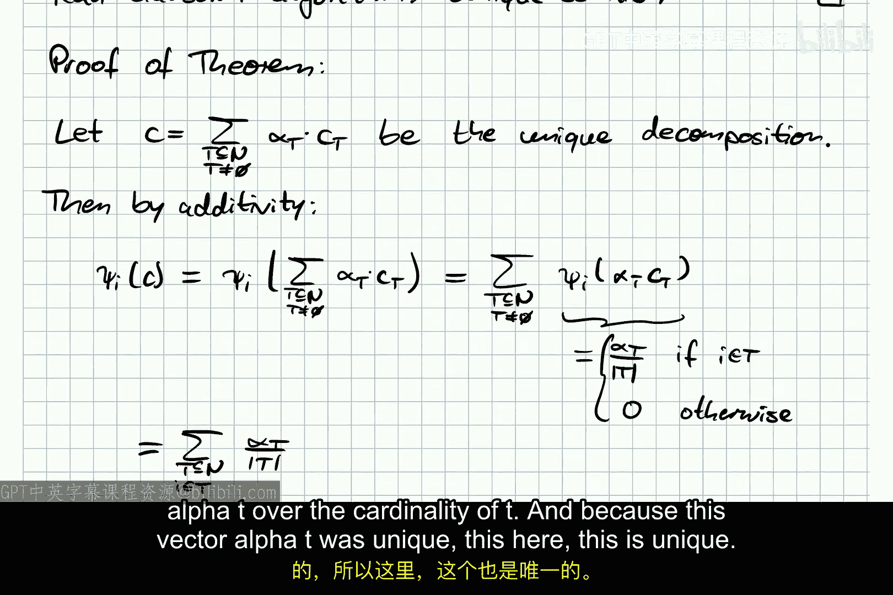

# 026：成本分摊

在本节课中，我们将学习成本分摊问题。当一群人需要共同承担某项费用时，如何公平地分配成本？我们将探讨两种不同的分摊方法：核心解和沙普利值，并分析它们各自的性质。

## 模型定义

我们首先定义一个模型。假设有 `N` 个参与者，记作 `N`。我们有一个成本函数 `C`，它将参与者集合的任意子集 `S` 映射到一个实数 `C(S)`。`C(S)` 表示子集 `S` 中的参与者自行承担项目所需的总成本。我们假设空集的成本为零，即 `C(∅) = 0`，但其他集合的成本可以是任意实数。

我们的目标是，将整个参与者集合 `N` 的总成本 `C(N)` 分摊给每一个参与者 `i`。也就是说，我们需要找到一个成本分摊向量 `(s_i(C))`，使得所有参与者的分摊额之和恰好等于总成本。

## 核心解

第一种分摊方法是寻找核心解。一个成本分摊向量被称为在核心中，需要满足两个条件：效率和稳定性。

以下是核心解的定义：
*   **效率**：所有参与者的分摊额之和必须等于总成本，即 `∑_{i∈N} s_i(C) = C(N)`。
*   **稳定性**：对于参与者的任意子集 `S`，该子集中成员的分摊额之和不应超过他们自行承担项目的成本，即 `∑_{i∈S} s_i(C) ≤ C(S)`。

稳定性条件意味着，任何一组参与者都不会觉得“单干”比按此方案分摊更划算，从而没有动机脱离大集体。

然而，核心解并不总是存在。有时，满足上述所有不等式的成本分摊向量可能一个都找不到，我们称此时核心为空。

## 沙普利值

上一节我们介绍了核心解，但它可能不存在。本节中我们来看看另一种总能给出唯一分摊方案的方法：沙普利值。沙普利值通过满足一组直观的公理来定义公平分摊。

以下是沙普利值满足的四条公理：
*   **对称性**：如果两个参与者对所有可能的加入顺序贡献的成本增量都相同，那么他们应分摊相同的成本。
*   **虚拟参与者**：如果某个参与者加入任何集体都不会改变总成本，那么他应分摊零成本。
*   **效率**：所有参与者的分摊额之和必须等于总成本。
*   **可加性**：如果总成本可以分解为两个独立项目的成本之和，那么每个参与者的总分摊额也应是他在两个项目上分摊额的和。

沙普利值的具体计算方法是：考虑参与者所有可能的加入顺序（排列）。对于某个特定顺序，每个参与者分摊的成本等于他加入时带来的边际成本增量。然后，对所有可能顺序下的边际成本增量取平均值。

用公式表示，参与者 `i` 的沙普利值 `s_i(C)` 为：
`s_i(C) = (1 / |N|!) * ∑_{π} [C({j: π(j) ≤ π(i)}) - C({j: π(j) < π(i)})]`
其中，求和遍历所有排列 `π`。

可以证明，沙普利值是**唯一**满足对称性、虚拟参与者、效率和可加性这四条公理的成本分摊方案。

## 沙普利值的唯一性证明

我们如何证明沙普利值是满足那四条公理的唯一解呢？证明思路分为两步。

首先，我们考虑一类特殊的成本函数 `C_T`，其中 `T` 是参与者的一个非空子集。这类函数的定义是：当且仅当集合 `S` 包含整个 `T` 时，`C_T(S) = 1`，否则 `C_T(S) = 0`。对于这类函数（及其常数倍 `α * C_T`），我们可以直接利用四条公理推导出唯一的分摊方案：`T` 中的每个成员平分成本 `α`，`T` 之外的成员分摊零成本。

其次，我们证明任何成本函数 `C` 都可以唯一地表示为许多个 `α_T * C_T` 这类函数的线性组合。结合可加性公理，整个函数 `C` 的分摊方案，就必须等于其各个分量 `α_T * C_T` 的唯一分摊方案之和。因此，总的分摊方案也是唯一确定的。既然沙普利值已被验证满足所有公理，那么它就是这个唯一的解。

## 总结与比较

本节课中我们一起学习了两种成本分摊的方法。

核心解的概念非常直观，它要求分摊方案稳定，防止任何子集体脱离。但它的缺点是可能不存在（核心为空），或者存在多个解。

沙普利值则通过一组合理的公理（对称、虚拟、效率、可加）来定义公平性。它的优点是总是存在且唯一。然而，计算沙普利值需要遍历所有参与者的排列或所有子集，在参与者数量较多时计算量较大。

一个开放的问题是：在什么条件下核心非空？以及在什么条件下沙普利值本身就是一个核心解？这些都是有趣的研究方向。成本分摊问题可以看作是具有可转移效用的合作博弈，而我们在课程中讨论的其他问题（如住房分配、稳定匹配）则可以视为具有不可转移效用的合作博弈。