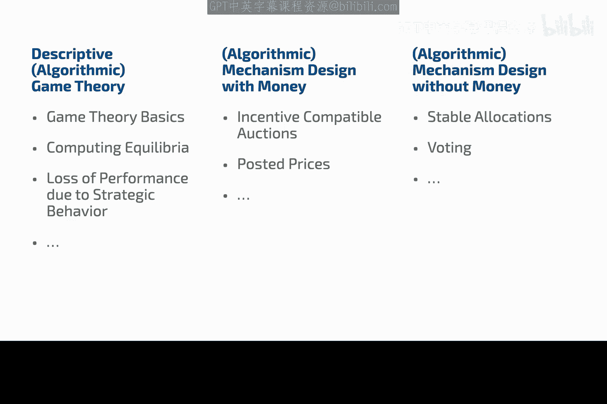

# 波恩大学《算法博弈论｜Algorithmic Game Theory, Winter 2020-21》中英字幕（claude-3.7-s p01 AGT, WS20_21_ Welcome.zh_en -BV1m9ZyYoENg_p1-

Yeah。Hello， my name is Thomas Keselheim， I'm a professor of theoretical computer science at University of Bon。

This semester， everything is different， and in particular， our teaching is remote。

This means that for my class on algorithmic game theory， I'm producing lecture videos。

And I thought it would be fun to also just make these videos available to the public。So。

Even if you're not from Bn， please feel free to enjoy these lecture videos。

Now you might be wondering what is algorithmmic game theory？Aroic game theory。

 this is a research area that was established about 20 years ago。

 and at that point suddenly people realized that the traditional way of thinking about algorithms wasn't suitable anymore。

Up to that point， an algorithm would just take an input， do some calculations。

 and then produce an output。But now， suddenly everything is connected。

And let me explain this to you with a very simple example。

We might consider it as a very traditional problem， the shortest path problem。

So you might just want to go from A to B， you want to find your shortest path。

 you want to get home as possible。But nowadays， it's not only that you want to go home as fast as possible。

 and it's not only you who's using a shortest path algorithm， but everybody's doing the same。

Everybody is now running a shortest path algorithm to find their shortest， fastest way home。

And these sort paths are。Connected in the following way that if this person here on the right hand side now wants to find the fastest way to get home。

 then they won't choose the the usually shortest path。

 but they will use the one that is less congested due to the current traffic by now but by now using this faster way to get home。

 they are then again causing congestion for others。

So we'll have an interplay of all these different agents。

 none of these agents actually takes into consideration that for others it takes longer to get home。

 but their sole goal is to get home as fast as possible。

And this is something that we can model by strategic behavior。Strategic behavior or selfish behavior。

 this somehow sounds really bad。But as a matter of fact。It is not necessarily a bad thing。

 The point is just， it is the outcome of。Agents not having the overall goal in mind。

 but rather their own utilities。 So， for example， they just want to get home as fast as possible。

We also see similar problems and effects in other settings， like for example。

 when you make a search query， then apart from the actual search results， you presented many ads。

 this is the main source of revenue for these search engines。And。

Who decides which of the ads are shown when。Well， whenever you make your search query。

 an add option is performed in which these ad slots are sold。

And they are sold for real money in tiny auctions。For example。

 here you can see what this looks like for Google searches， onbedding on computer science。

 algorithmic game theory and algorithmic mechanism design。

And then I can specify how much money I'm willing to spend。

So also here we have the situation that agents actually behave strategically， again。

 they only have their own utility in mind so they want to get the most out of these auctions。

They don't have in mind the general goal of making the world as happy as possible or something like this。

Then we might ask the question， how should we design such an auction so that actually we are happy with the outcome。

Or there is another example namely Cloud computing。

So what you can see here is that you can actually choose in this case from Microsoft Azure。

 you can choose。What kind of virtual machine you want to configure。

 And depending on how you configure it， you will。In every case， get。

A price that you will have to pay in order to rent this virtual machine。Now。

 where do these prices come from， how would you set these prices again？

We might think of them being somehow determined by supply and demand。

 But how would you know if you were to design such a。

Cloud computing interface which sells these resources。

 how would you do that and what could your goals be。

 would you want to make the world as happy as possible。

 would you want to most efficiently use these computing resources。

 would you want to make as much money as possible， how would you even model these kinds of things。

All these are questions that we will cover in this class。So our goals can be summarized as follows。

First of all， we want to ask the question， how can we model strategic behavior mathematically？

And then also， we want to ask the question。What effects does strategic behavior have？

So what's the consequence of each agent only having in mind to？

Optimize their own utility rather than keeping track of the big picture that everybody gets as happy as possible。

And a third question is then， if we are to design systems。How do we do that？

So how to design systems that can cope with strategic behavior， how would we do that？

We will get to know certain rules how to do this， well we first of all have to design mathematically what is our goal and then we will also see techniques of how to achieve this goal。

Algorithic game theory brings together aspects of algorithmic theory and game theory， so for example。

 we'll talk about worst case analysis， complexity or morely guarantees like we would do in algorithmic theory。

 but then we bring this together with the notions that are prevalent game theories such as selfish agents。

 equilibria and strategies。The target audience that I have in mind is people who know the basics of algorithmic theory。

 so you'll have to have done a worst case analysis before。

Or you should know what MP completete means。But you do not need particular knowledge of any specific algorithms。

What we'll not rely on。Has any prior knowledge on game theory， this is all covered in this class。

How do you model selfish agents， what do equilibriumria mean， what are strategies。

 all these things those will be covered in this class。Use some quick overview over the contents。

Of this class， the first part is about what I would call descriptive game theory or descriptive algorithmic game theory。

 namely， first of all， game theory basics and then just describing what we see。Are there equiria。

 how can we compute them， because this is then what computer science brings to the table？

Is it actually likely that such an equilibrium is played？

Or is it maybe hard to compute and therefore very unlikely to be played？

And also we'll discuss questions such as how much is lost due to this strategic behavior。

Then afterwards， we'll move on to the question。I have how to design systems and these questions are called mechanism design。

And we'll first talk about mechanism design with money。Which means we'll， for example。

 design incentive compatible auctions or post pricess with a goal to either maximize revenue or to maximize social welfare。

And then in the third part， we'll talk about mechanism design without money。

This might be stable allocations or stable matchings or voting。

The format of these lectures is very similar to a traditional Blackboard lecture。

 although it is using。Marern technology from the 21st century， however。

 this means I'm writing everything by hand because I feel that this gives the lecturers the right pace Additionally to each lecture you'll find lecture notes in which also everything is written down sometimes a little more formally。

😊，Additionally， if you're interested in further。Information further topics about game theory or algorithmic game theory。

 you'll also find a selection of books on the courseur webpage。

 which are all available online for free。If you have any questions， please do get back to me。

And I hope you enjoy all these videos， you enjoy the lecture notes， you enjoy the books。

 and you get interested in algorithmic game theory。

Have a great time and let me know if there's anything I can help you with。By。

