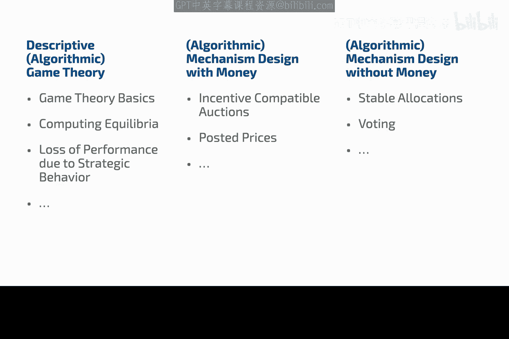

# 算法博弈论：1：欢迎与课程概述

大家好，我是托马斯·凯塞尔海姆，波恩大学理论计算机科学教授。

本学期，一切都不同了，特别是我们的教学转为远程进行。

这意味着，我将为我的算法博弈论课程制作讲座视频。

我认为将这些视频公开分享会很有趣。

因此，即使您不是波恩大学的学生，也请随意观看这些讲座视频。

现在您可能想知道，什么是算法博弈论？

算法博弈论是一个大约20年前建立的研究领域。

当时人们突然意识到，传统的算法思维方式已不再适用。

在那之前，算法只是接收输入，进行计算，然后产生输出。

但现在，一切都相互关联。

让我用一个非常简单的例子向您解释这一点。

我们可以将其视为一个非常传统的问题：最短路径问题。

您可能只想从A点到达B点，找到最短路径，尽快回家。

但如今，不仅您想尽快回家，也不仅您在使用最短路径算法，每个人都在做同样的事。

现在每个人都在运行最短路径算法，以找到他们最快回家的路。

这些路径以下列方式相互关联：如果右边这个人想找到最快回家的路，他们不会选择通常的最短路径，而是会选择一条由于当前交通状况不那么拥堵的路径。但通过使用这条更快的路回家，他们又为其他人造成了拥堵。

因此，我们将看到所有这些不同参与者之间的相互作用。

这些参与者中没有一个会考虑到其他人回家需要更长时间，他们唯一的目标是尽快回家。

这可以通过策略行为来建模。

策略行为或自私行为，这听起来很糟糕。但事实上，它不一定是坏事。

关键在于，这是参与者不考虑整体目标，而只考虑自身效用的结果。

例如，他们只想尽快回家。

我们在其他场景中也看到类似的问题和效应，比如当您进行搜索查询时，除了实际的搜索结果，您还会看到许多广告，这是这些搜索引擎的主要收入来源。

那么，由谁决定显示哪些广告呢？每当您进行搜索查询时，都会进行一次广告拍卖，这些广告位被出售。

它们通过小型拍卖以真实货币出售。

例如，您可以看到谷歌搜索“计算机科学算法博弈论和算法机制设计”时的样子。

然后我可以指定我愿意花多少钱。

因此，这里也存在参与者行为具有策略性的情况，他们同样只考虑自身效用，希望从这些拍卖中获得最大收益。

他们不考虑让世界尽可能幸福这样的总体目标。

那么我们可能会问，我们应该如何设计这样的拍卖，以便我们对结果感到满意？

还有另一个例子，即云计算。

您可以看到，在这种情况下，您可以从微软Azure选择想要配置的虚拟机类型。

根据您的配置方式，您将获得租用此虚拟机所需支付的价格。

那么，这些价格从何而来，您又将如何设定这些价格？

我们可以认为它们是由供需关系决定的。

但如果您要设计一个销售这些资源的云计算界面，您会怎么做？您的目标可能是什么？

您想让世界尽可能幸福吗？您想最高效地使用这些计算资源吗？您想赚尽可能多的钱吗？您甚至如何为这类事物建模？

所有这些问题我们都将在本课程中涵盖。

因此，我们的目标可以总结如下。

首先，我们想问，如何用数学方法对策略行为进行建模？

其次，我们也想问，策略行为会产生什么影响？

那么，每个参与者只考虑优化自身效用，而不考虑让每个人都尽可能幸福的全局图景，其后果是什么？

第三个问题是，如果我们要设计系统，我们该怎么做？

那么，如何设计能够应对策略行为的系统？我们将如何做到这一点？

我们将学习某些规则来实现这一点，首先我们必须用数学方法设计我们的目标，然后我们还将看到实现这一目标的技术。

算法博弈论结合了算法理论和博弈论的各个方面。

例如，我们将讨论最坏情况分析、复杂性或近似保证，就像我们在算法理论中做的那样。

然后我们将其与博弈论中普遍存在的概念结合起来，例如自私的参与者、均衡和策略。

我心目中的目标受众是了解算法理论基础的人。

因此，您之前必须进行过最坏情况分析，或者您应该知道NP完全是什么意思。

但我们不依赖任何特定算法的先验知识。

我们也不依赖任何博弈论的先验知识，所有这些都将在本课程中涵盖。

如何对自私的参与者建模，均衡意味着什么，什么是策略，所有这些都将在本课程中涵盖。

以下是本课程内容的简要概述。

第一部分是关于我称之为描述性博弈论或描述性算法博弈论的内容。

即，首先是博弈论基础，然后只是描述我们所观察到的现象。

是否存在均衡？我们如何计算它们？因为这是计算机科学带来的问题。

实际上是否可能达到这样的均衡？或者它可能难以计算，因此不太可能被实现？

我们还将讨论诸如由于这种策略行为损失了多少等问题。

之后，我们将转向如何设计系统的问题，这些问题被称为机制设计。

我们将首先讨论带货币的机制设计。

这意味着，例如，我们将设计激励相容的拍卖或定价机制，目标是最大化收入或最大化社会福利。

然后在第三部分，我们将讨论不带货币的机制设计。

这可能是稳定的分配、稳定的匹配或投票。

这些讲座的形式与传统黑板讲座非常相似，尽管它使用了21世纪的现代技术。

然而，这意味着我手写所有内容，因为我觉得这能给讲座带来合适的节奏。

除了每次讲座，您还会找到讲义，其中所有内容有时会以更正式的方式写下来。

此外，如果您对博弈论或算法博弈论的更多信息和主题感兴趣，您也可以在课程网页上找到一系列书籍，这些书籍都可以免费在线阅读。

如果您有任何问题，请随时联系我。

我希望您喜欢所有这些视频，喜欢讲义，喜欢这些书籍，并对算法博弈论产生兴趣。

祝您度过愉快的时光，如果有任何我可以帮助的地方，请告诉我。

再见。