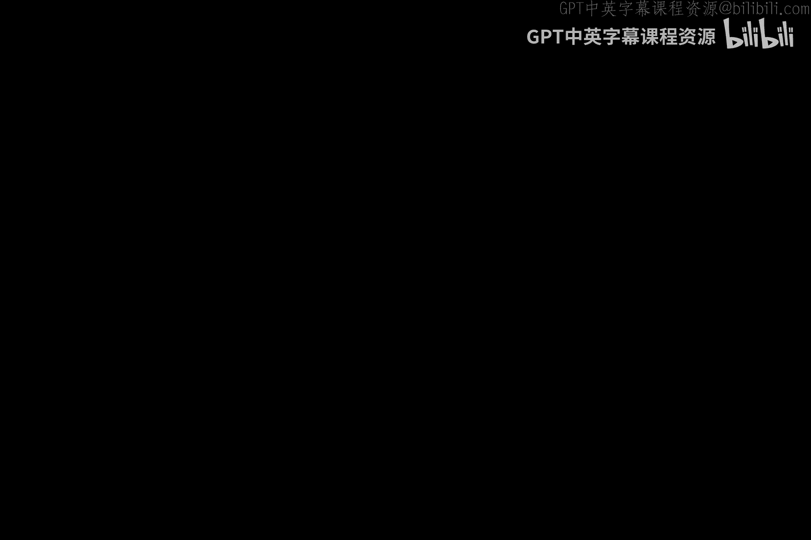
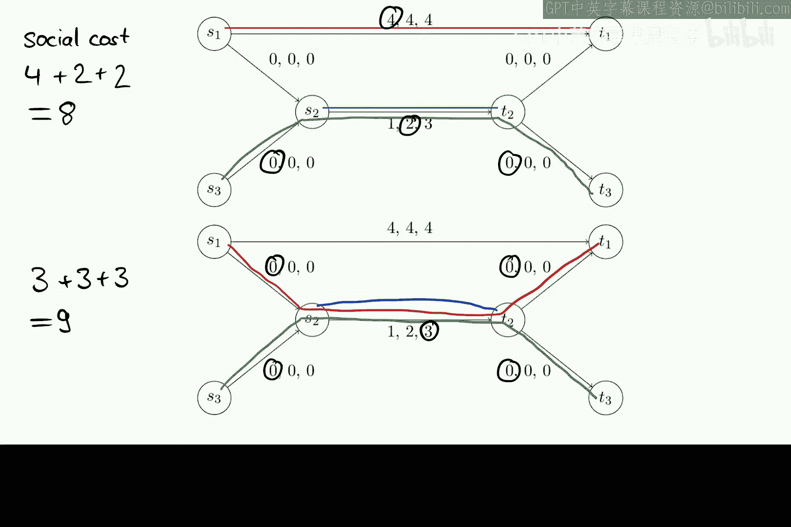
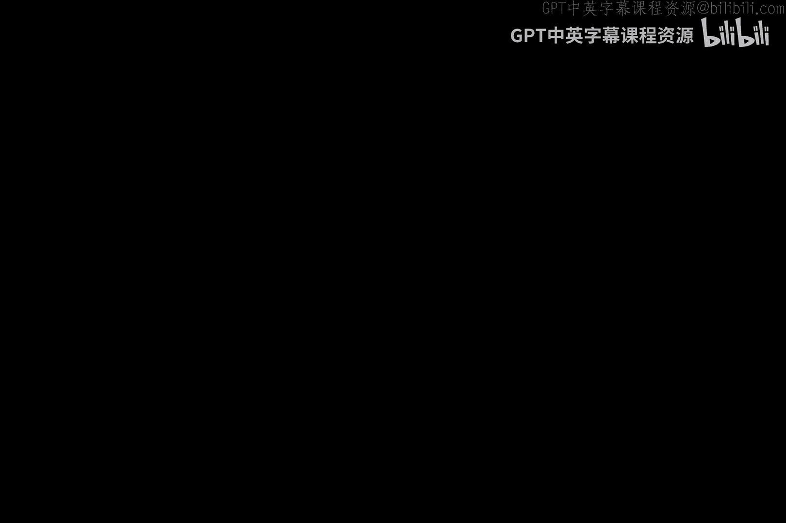
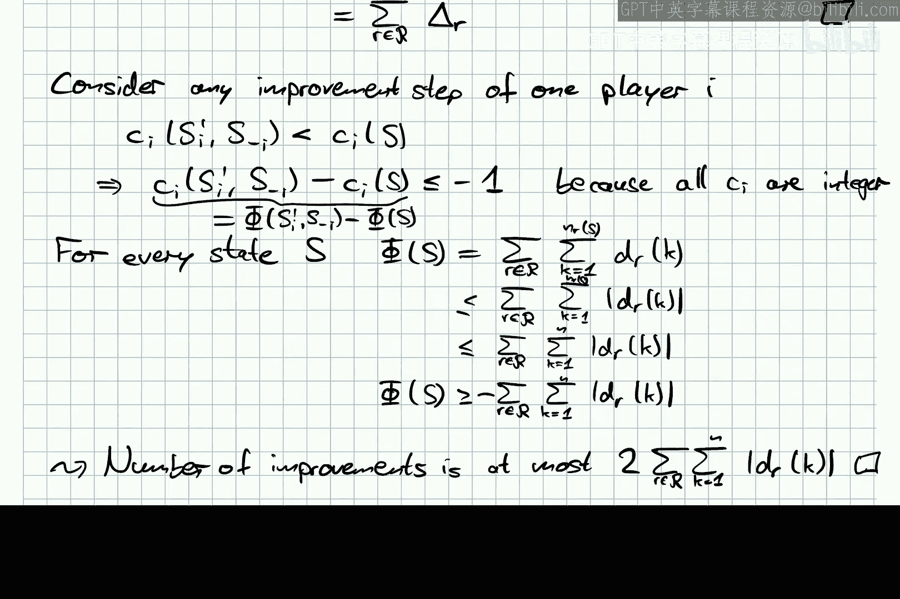

# 波恩大学《算法博弈论｜Algorithmic Game Theory, Winter 2020-21》中英字幕（claude-3.7-s p02 AGT, WS20_21_ Lecture 1 (Introduction to Congestion Games).zh_en -BV1m9ZyYoENg_p2-

嗯。Hello and welcome to our class on algorithmic game theory。

 this is the very first lecture and today we'll discuss the question of how to model strategic behavior。

Later in this class we'll also talk about the effects of strategic behavior and what we can do about strategic behavior so maybe that players don't behave strategically at all。

But let's first start with a question of how to actually capture all this mathematically。

And as a general introduction， I'd like to consider the following example。

 which is a very simplified model of road traffic and congestion in this。In such a traffic situation。

I'll have a graph， and with。Well， three source and three sync notes。

 so player 1 wants to get from S1 to T1， player 2 wants to get from S2 to T2。

 and player 3 wants to get from S3 to T3。What choices do the players now have？

Maybe let's first consider a player2， while player2 doesn't actually have a choice because there's only this direct ad which takes him or her from S to T2。

Player 3 doesn't have a real choice either because there's only one path connecting S3 to T3 and namely it is go from S2 S3 via S2。

V T22 T3。But then there's also the choice for player one。

 and that is actually an interesting choice because player one can either take the direct edge。

Taking him or her directly from S1 to T1， or。They can go the indirect path via S 2 and T 2。

 Let's first consider the。And directly。Now let's talk about these strange numbers what do these numbers mean？

These numbers indicate how long it will take to cross such an edge。

 And this depends on how many players are using this edge at the same time。 So for this edge。

 for example， if there's one player using this edge， it will take one unit of time。

 if there's two players， it will take two units of time and if there's three players take it will take three units of time。

Good， so how long does it take for each of the players。

 There's only one player on this top edge here。there is only one player on this edge and only one player on this edge。

 and there's two players on this edge。So how long does it take for player one。

 it takes four units of time。For player two， it takes two units of time。And also for play a 3。

 it takes。Two units of time。 This is what we will call the social cost。If we add this up。

So this is each individual player's cost and if we sum this up。

 then we get the so called social cost， which will be8 to you。Okay。😊，But。

Can any player change anything here， Well， yes。Player 1 does have a choice。 Namely。

 Why should play 1 actually take this edge here， This has a cost of4。

 whereas going this way here via S 2 and T 2， this will actually be cheaper。Because。

Even then the cost will only be three， let's see this， what I mean by this。Let's。

Copy this entire thing here。And what can happen well。Player one might use。This path。

And the other play two players。Maade you still do the same thing。Now， what？

Will be the cost of each of the players。We'll have one player now on this edge。

 one player on this edge， three players on this edge， one player on this edge。

 and one player on this edge。So player ones cost will be three。Player two's cost will be three。

And also player threes cost will be three。 So this sends up to 9。

Okay， this is certainly worse in terms of social cost。But。Here。

 if we once again consider what player that if we once again consider player one。

 player one has a cost of four here and only a cost of three down here。

And it is only player one's choice。Which path he or she is using。

 So why should play  one actually choose this。And this direct bench。

 if this has a higher cost for him or her。嗯。This means that by strategic behavior。

 well have a higher cost than if we did not have strategic behavior。

 if we assume that all that players care about is actually their individual cost。This， of course。

 you might doubt that maybe in reality， players will actually be not that selfish。

 but this will be one of the core assumptions for everything that we do。嗯。

So what do we want to do today， Well， let's first try to model this kind of games more generally。

 And then let's try to model more specifically。What we can assume or how we can capture the strategic behavior and what the strategic behavior will lead to。

 namely in the case。We will introduce a notion of an equilibrium。

We will now introduce a formal definition which generalizes these strategic effects we saw in this initial example of strategic behavior and traffic and this class of games。

Is called。Congestion leaves。How do we model this？Well， we have this definition。As I was saying。

 this is a congestion game。And this is not， actually。A very recent notion。

But it dates back to way before there were there was。The notion even of algorithmic game3。

 then well even dates back before there was real computer science， maybe not real computer science。

 but this wasn't actually thought of as a computer science problem or model。

What is a congestion game。A congestion game。Is a two pole。Youll have N。R。我 would have。

A vector of sigma eyes。And will had。The v of D Rs。And what are these？And。Is the set of all players。

Well have R。As a set of resources。The number of players we usually call n and the number of resources。

We usually call it M。And usually we'll just number the players one through end。

 whereas the resources that might actually differ how we call them。Good。

And then we have these sigma I。Each of these sigma I is a subset of the power set of the resources。

Which is the strategy space。For player I。And then， we'll have。迪R。Which is a function mapping from。

All integers from on to N。To the integers。And this is the delay function。Of resource。2。So as you see。

 there is actually nothing about a graph in this formal definition so far， but the。

So called network congestion games are a special case which are captured by a graph and the example that we saw earlier。

 this is indeed a network congestion game， how would we now capture this network congestion game formally inside this definition。

Well， let's make me recall what the example looks like。First of all。

 let's recall that we have three players here。In this example， So in this example， we would have。

And as。1，2， and three。And what are the resources， the resources？Are in this case。

 exactly the edges that we have。 So there's a resource S 1， T 1。There's a resource。S1。As2。

There's a resource。S 2。T2。And so on， so for each of these edges， we have a resource。

Now there are different strategies for the different players。 Player1 has， for example。

 two strategies， and as I was saying， the strategy space is a of the power set。

 so this will a subset of the power set of the resources。So one strategy is to take the direct edge。

 so this will use only the resource S1 T1。And there is another。Strategy， namely the other path。

 which is S1， S2。As to teacher。T2 T1。And those are the two strategies。 So two sets of resources that。

AndPlay in one made twos。For players two and three， we also have a strategy space。

 but they are much easier in this case because there's only one path for each of these players。

And then we have the delay functions。And the delay functions。Hges。What is drawn here on the edges。

 So this might be， for example， for the edge or resource S to T 2 will have。Just that the delay。

 if there are X players， is exactly X。For all X。More generally。Willll have be。

Example of a network congestion game。In which there is a graph。We'll have the resources。

Will be simply the。嗯。Instead of edges， I should mention that this is a directed graph。Usually。

Although this might also make sense for a an undirected graph。

 but we usually think of this as a directed graph。And then。We have for each。Player eye。

There is a source。Which we call S and a sink。Which we call T。And。Sigma I， this is exactly the set。

Of all paths。From S I。To起爱。So now we have this formal definition of a congestion game。

 but what we still have to add to this is actually semantics。

 we'll have to still define what does this even mean。

We had this intuitive understanding that players seek to minimize their travel time from their sauce to their sing。

 which means they seek to minimize the sum of their delays， which we call the players' cost。

How do we formally state this？We are talking about states。Or strategy profiles。Which。

Just assigns a strategy to each of the players， so。

Well take an element of the Cartesian product of all these strategy spaces。

This is what we call the state。And then， we let。An R of S for such a state S。

Be the number of players using Re R。So formally， we write this as the cardinality of the following set。

嗯。Take the set of all players for which R is in S I。This is the number of players。Using resource R。

Then we'll have the delay。诶。R。In S。This is nothing but the delay function evaluated on the number of players using this resource。

And now， player eyes costs。Is defined to be。CFS。This is the following just take the sum of all the resources that this player is using。

And then take the delay of this resource， which is， as I was saying。

 the delay function evaluated on the number of players using this resource in this state。有。

In our earlier example， there were actually two different states。

These are the only states that there are， and we could now write these also formally by writing down which of the players is using which of these strategies。

And we can also say。How many players are using which of the resources？So， for example， here。

 we would have that。In this first aid。We would have that。嗯。The number of players。

Using the edge from S2 to T2 or the resource。In this state， let's call this state a。This will be2。

Whereas in this state B。The number of players using this resource will be three。

How would we compute a player's cost？And play oneands cost in this state a。This would be， exactly。

And the delay function of S 1， T 1。Evaluated at。The number of players using S1 to1。In this state， a。

Because that's the only resource that this player is using now。This is， exactly。Df。S 1， T 1。Of one。

And this will be。4。Whereas in the second example， as we've seen。

 the cost of the player would be three。Cool， so。We've now defined what a congestion game is。

 what states are， what strategies are， strategy states or strategy profiles are nothing but vectors of strategy so that we assign one strategy to each of the players。

And now we can actually get to the main definition。To capture the strategic behavior。Namely， we call。

A state or a strategy profile， a pureash equilibrium if no player can benefit benefit from unilateral deviation。

 and this is exactly happening here， this is not an equilibrium because player one can actually benefit from just changing her own strategy whereas down here。

 this is not possible， no player actually has a choice of decreasing his or her cost by unilateral changes。

Let's formalize this。We'll do this in actually two steps。We'll say that a。Strategy。Cital S I。

Is a best response。For player eye。Hegand。A profile of strategies。

S minus I and what do I mean by this？I mean that we now take a strategy for each of the players except for what player I is using。

If。C i。F S I comma S minus I is at most C I， F S I prime comm S minus I for all。S I prime in sigma。

This is maybe a notation that you first have to be that you first have to get familiar with。Namely。

We know what we will often do now is we will say， okay。

 we have this vector of strategies now one of the players actually changes what they are doing。

And for this， we use a brief notation， which is not super well defined。

 but it is just enough for us always， Naly in our right， for example， S I prime comea S minus I。

 where S minus I is just what everybody else， except for player I is doing and S I prime is what player I is doing。

 and now player I has the choice between S I prime and S I。

 and we say that S I is the best response against S minus I。 if there is no S I prime， which。

And it has smaller cost than S I keeping what the other players do fixed。So that is really important。

 This is a unilateral change。 It is only player eye changing his or her strategies。

 it is not the other players changing anything。 So the other players just keep our fixed and we now as player I。

 we change our strategy maybe from S to S prime and the point is we call this a best response if this is not beneficial for us as the player I。

😊，And we now have a pure natural equilibrium if actually all players are playing a best。So。

 we say that。A state。Yes。😊，Which is still an element of this Cartesian product。Of all strategies。

 spaces。And we say that this is a pure National equilibrium。If。S， I。He is a vestuous paws。Against。

As mine I。For all players。So equivalently， we could also write。That。S is Pnaal equilibrium。

If we now just plug in the definition from before。If。C， I of S。

Which is nothing but C of S comma S minus I is at most C of S I prime comma S minus I。For all。

S I prime in sigma I。And all。Players， so no player。

Can benefit from unilaterally deviating to another strategy。

So each player is happy with what one is currently playing。Maybe。

The players would benefit if they well formed the coalition， and then all of them deviated。

 That's not what we're caring about here。 We only care about unilateral deviation。

 So only one player changes the strategies， and this is not beneficial for any of the players。嗯。

One more thing， this is only。And this doesn't have to be a strict inequality。

 which means that there may also be other strategies which give you the same cost。 That is fine。

 There just may not be any strategy which give you a strictly smaller cost。Also。

It may happen that actually there are multiple equiria， there's nothing speaking against this。

 and usually in a typical game， there will be just be multiple equilibriumria。

So that is usually not just the one equilibrium as we saw this in our introductory example but。

There can be many， it can even happen that every state is an equilibrium。

 even that could be possible。😡，But。The question that we're asking。

 is there always such an equilibrium？The point is yes， there is。

 and this is exactly what we're proving in the remainder of this lecture。

Every congestion game always has a pure natural equilibriumogram。

This is what we want to show in the remainder of this lecture。How can we show this。

 How will we show this。We will show that all improvement sequences are finite。This means that。

If if you just start from any state， then this will usually not be a binnacle。

 which means that one player can actually one player is now playing a best response。

 so one player can decrease the cost by your unilateral deviation。This is then an improvement step。

And then we might be in a purenat equilibrium or。There might still be a player who can decrease his or her cost by unilateral deviation。

 And then we doing another improvement step。And， eventually。

We are following this sequence of improvement steps， and this sequence will have to be finite。

This is exactly what we are claiming and what we will be proving。

 but let's first formally write down what we call an new improvement step。

We say that an improvement step。Is a pair of states。S comma S prime。Where。There is one player。哎。

Such that。The cost of this player。In S is bigger than in S prime。And the other players。Do not change。

Their strategies。So if S is a purenaal equilibrium， then there is no improvements there。

 because then if there were a player。Who could decrease his or her cost by unilateral deviation？

Then this would be Pacetro equilibrium。But this is exactly what we would need for improvements set。

At the same time， if it is not a purenatal equilibrium， well， then there is an improvement。

Now what we can do is we can consider a sequence of improvement steps and let's see this in an example。

This is an example of。In total。1。Two， three improvement steps。

Here we start in this network congestion game。There's two players。

 each of them wants to get from S to T。What's the cost here？For say， the first player。

The cost for the first player， for the rat player will be one。0。3， so one plus 0 plus3， this is4。

And for the second player for the blue player， this will be 6 plus  one， which will be 7。

But now it turns out that actually the red player can decrease。Her cost namely via going this pair。

So what will the cost be then， It will be  one plus 0 plus 0 plus 0 plus 1。 Sorry， plus this one。

 it is。And this is only2。For the。Red before the blue player， actually nothing has changed。

 the cost will still be7。But there's also another improvement tab， namely。

 the blue player can still change the strategy to this other path。 and then the cost will be one。

Plus。王。Plus 3 plus 1。 This will be 6。And what's the cost for the red player at this point。

 this will be one plus 0 plus。0 plus 3 plus 1。And as it turns out， there is yet an improvement。

 namely， it is vi this top path， and then will have a cost of 1 plus 0 plus 3。嗯。It's this one here。

And then we have a cost of。1 plus 1 plus 0 plus one for the blue plate。And。At this point。

 you can verify that we're actually done。There is no way one of the two players can actually deviate。

And choose a different path to actually decrease his or her cost。And this is。To in general。

 that if we do these kinds of improvement steps。Regardless of whether these players use some smart improvements or whether they just do some kind of improvement。

 that actually doesn't matter。Regardless of how these improvements work。

 these improvement sequences will always be finite。

This is the theorem that we will show in the remainder of this selection。Ted is also by Rosenthal。

From the。1970s。And it says that in every congestion game。Every。Sequence of improvement steps。

Is finite。And this immediately means that we get the phone corrollary。Every congestion game。

Has at least one pure national。Okay。Why this corollary？Well。

How can we get to this p Nationalal equilibrium， We can even state this in a somewhat constructive way。

 take any state。And then。Well there is actually a minor caveat that I now realize every player needs to have at least one strategy so that there is a state。

But start from any state。And now， just。Do an improvement step and do another improvement step and do another improvement step。

And this way， you're developing an improvement sequence。And the point is now， because of the theorem。

 this will have to stop at some point。It cannot be that you're doing this forever。At some point。

 you will be done。And at this point。You have reached the purenatal equilibrium because。

If there is no more improvement step， then you're in a purena equilibrium and vice versa if you're in a purena equilibrium。

 there is no more improvement step。So all we have to do is prove this theory。嗯。

The proof of this theorem。It is actually pretty smart because it uses a potential function argument。

For any state S。Yeah。We know that。Ft of S。Capital fee。Be the following。

Take the sum of our resources and now sum up。From k。From one to N R of S。D RFFK。

This is this so called rosental potential。So what are we doing here？We are in a state。

And in this state。For each of the resources， some number of players is using this。嗯。

These resources now take the sum of our resources and then add up the delayed functions evaluated at first at one。

 then at two， then at three， and so on until the number of players that are using this particular resource。

This。Does not have a meaning immediately， but as we will see。In every improvement step。

 the erosental potential decreases。And because。These。The own of our potential will be bounded。

 This then implies the theorem that there can only be this many improvement steps。More formally。

 we will show the following lemma。We will show that this Rosent potential is actually what one also calls an exact potential。

Let S。Be any state。And let。As I prime。Be an alternative strategy。For player eye。Then。We have。Lad。

The difference。As the roaddent top potential between the state where player I is now using SI prime。

 the other players keep doing what they are doing in S。And they rose into top potential of S。

This is exactly the difference of the costs。The cost of and namely the cost of player I。

So take the cost of player I。After this deviation， so when you're considering this S I prime as minus I and compare this to。

The cost of player I in state S。So it is player I， who changes his or her strategy and the change of the cost。

 so for example， the decrease and cost， this is exactly mirrored。

In the change of the rosent potential。 So if the cost， for example， decreases。

 then the rosental potential decreases by exactly the same amount。 But also， if the cost increases。

 the rosentile potential will also increase by the same amount。 Or if the cost doesn't change。

 the rosental potential doesn't change。嗯。We'll prove this lemma in two different ways。

 because I realized that。Depending on your preference。

 you might either want to see the more intuitive way of proving this。

 or you might also want to do this just in a more formal kind of a brute force way。Let's do this。

In a somewhat intuitive way first， because this also gives us。

At least some understanding of what this rosentop potential means。

How could we calculate this rosen top potential。So there's this weird thing that we add up these D functions。

Evaluated at a different number of players。But how can we understand this？

One way to understand this is we add the players one after the other each of each time。We then。

Add the player's cost at the point where it is added， so。We start with no player。

 and then we take only player one， for example。And player one has a certain cost if there's no other player using any of the resources。

 then what we will get here is exactly the delay values of one for the resources that player1 is using。

Then we'll add player 2。And。Then what we will be getting。Is。

How does the de rosental potential increase。Well， it increases by exactly player2's cost at this current time。

 So when there's only player 1 and player 2 and not the other players yet。Good。

 so this is how you can think about this roseal potential。And if you want to not do。

This argument here。All you have to do is add player I as the last player。

Then before you add player I。The two are exactly the same。

 It doesn't actually matter whether player I will be using S I Prime or S I。

But then you're adding this last player， this player I。

And then either you get that the rosentile potential increases by C I of S I prime comma S minus I。

Or it increases by CFS。And the difference between the two is exactly the difference of the two Rosenthal potentials。

嗯。So at the point where you're understanding this wasn't have potential。

 I guess this makes a lot of sense to to think about it this way， but maybe。

Being so early in the process of understanding it， maybe let's also just do a super formalal。

And well， very brute force argument。 and that gives us。Exactly， also， the sp。

So to formally prove thelemma。Let's just see what we have here on the left hand side。

Will have phi F S I prime comm S minus I。Minus p of S。

Let's now remember what the rosear potential is like。And let's do this slowly。

 Take the sum over all resources。 Take the sum over all K from one to the number of players that are using this resource。

 And then there's the one state S I prime come S minus I。And then。There is the other state。 Well get。

Exactly the same thing here。 But we are taking the sun。Up to N， R of S。

And we're also adding up all DR of K。So what we see here is that we get a term for every resource。

Namely。We will get。This sum that goes up to N R of S I prime comma S minus I。

 and will have to subtract the sum that goes to N R of S。Let's call this difference here。嗯。Delta R。嗯。

And let's understand what Delta R is。Well， we'll only have to distinguish four cases。 namely。

 When does player I use resource R， does player I use resource R in S I prime or not。

 And does player I use resource R in S I or not。啱。Let's see what these four cases are。Case1。

Is that R is in S， I and。R is an S I prime。Then the number of players using resource R in the state S I prime comma S minus I and in the state S are just the same。

 This means that Delta R will be 0 just because we have exactly the same sum here。

Let's consider case 2。That。S， R isn't in S I。And R isn't in S I prime， either。In this case。

 we get the exact same thing。 Naly， those two sums are exactly the same。

 So also this delelta R has to be 0。There's not the third case。That R is in S I prime。Take away S I。

 So player I is using resource R only in strategy S I prime。But not in S I。In this case。Well have。

That N， R。F S I prime come S minus I。Is exactly equal to N R of S plus1。Because。

Player I isn't using Re R in the state S。But in state in S I prime come S mind side。

 So here player I is using this resource here。嗯。Player eyes， not using this resource。

And all other players do exactly the same thing， so this is why the number of players has to be differ by exactly one。

嗯。So what do we get regarding。This， the difference of these two sums。Okay。Here we have one more term。

 namely， we'll have the final term。Which is the。Where the one where K is equal to N R of S prime comma S minus I。

So。DR will be exactly equal。 Delta R will be exactly equal to D R F N， R， F S I prime comma S minus。

And we'll have a fourth case。Which is。Annalogous that R is an S I take away S I prime。In this case。

Will have that N R F S I prime comma S minus I is equal to N， RF， F， S -1。

Or what we can also say is that Delta R is nothing but D R of N R of S。Sorry， it is minus this much。

Because。Now， suddenly here we have one more term than here。Okay， cool。

So let's compare this to the difference of the two costs。Of player one player I。C i。

F S I prime come at S minus I minus C I of S。What？😮。

Cost of player I in state S prime comma S minus I。Recall the definition。

 Take the sum of our resources。That this player is using and now consider the delay。

And the same thing for C of S。Again， take the sum of our resources that this player is using。

And now add up the delay function evaluated at N R of。Now， there are。

Multiple there might be strategies， that might be resources which are both used in SI Prime and in SI。

And for these， NR doesn't actually differ。There might also be strategies which are resources which are neither used in SI nor in SI Prime。

 those don't appear on either of the two sides。Bert。What is interesting here is that there are。

Strategies。Or there might be strategies which are there might be resources which are in SI prime takeaway SI。

For which well get。N， R， F， S， I prime comma S minus I。

Or there might be resources that are in S I takeaway as I prime。And for those。

We'll get the R of N R of S。And as you can see。These are。

 if you just compare all the cases that we were doing。

 this is exactly the sum of these delta R values。Because。There are the resources in which。嗯。

Which are used before and after or neither before nor after for this， the delay is the same。

 And then there's the resources which are only used afterwards， but not before。

 or there might be the resources which are used before， but not afterwards。

 and for those we got these respective values。And we find them exactly again down here。

And just by this simple comparison。You will see that this difference is exactly this difference。

 of course。Its exactly the sum of this delta R， which is exactly the change of the potential。So。

How does this help us？Let's record what we wanted to show on where we are right now。

We wanted to show that in every congestion game， every sequence of improvement steps is finite art。

 And what we've shown is that in such an improvement step， the。😊。

And the change of the rows and top potential mirrors exactly the change of the cost。

So if we now continue the proof of the theorem。Then， we will see that。If we now consider。

Any improvement stamp。예。One player， which we call I。Then。We will have。That。嗯。C i。Have S I prime。

Com S minus I。Will be strictly smaller than C I F S。F s。And。

If we now use that all of these delay functions are integer。This means that C， I of S I prime。

Coma S minus I minus C of S。 this will be no larger than -1。And。We will see that。Also。

 for every state as。V of S。How big is this once again。This is the sum of all resources。

And I take the sum over all k from 1 to Nr of S。D R of K。Suddenly， this is no bigger than if we took。

The absolute value， see you。And certainly， this will be。😊，No bigger than。If we took the sum from K。

From1 to N rather than N R of S。Because the maximum number of players using a resource certainly end。

And。Annalogously， we can also see that。P F S will always be， at least。This minus。These sums。

And what does this mean， Well， we now have an upper bound and the number of improvement steps because in an improvement step。

The potential will decrease by one。The potential has an upper and a lower bound。

So this means that we'll have a the number of improvement steps。

So one thing we should have noticed here。That this is exactly equal to phi of S I prime。

Coma S minus I minus phi of S。So， overall。Number。Of improvements。In a sequence。Is at most。

Two times the sum of our resources。Take the sum from one through n。

 and then the absolute value of D R。O。And this is it。

So， as we've seen。We even already have some kind of an algorithm to find a pianoational equilibrium namemely。

 start anywhere to follow any improvement sequence after finite time， namely after this much time。

 you will actually be。For sure， in AP national equilibrium。

But this is not a very nice algorithm because these delay values might be very large。

 And this is actually one of the topics we will be talking about in this class， namely。

Are there polynomial time algorithms which do not depend on the size of the numbers。

 and the answer is somewhat yes， somewhat no。The answer is yes， for some kinds of games。

This is what we'll be talking about next time， but for general congestion gains under some complexity theoretic assumptions。

 which we will also introduce later， this is not possible as I was saying this will be。

This will be covered in a later lecture。So I hope you already learned a lot， you enjoyed this today。

 I hope you look forward to the semester and please do let me know if you have any questions regarding the contents of what we cover today。

Thank you very much for your time。 and hope hopefully you will follow the semester， bye。

