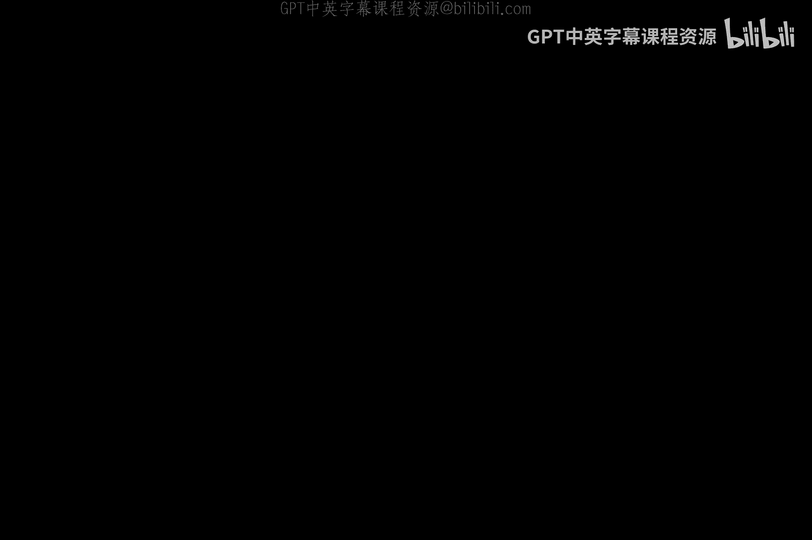
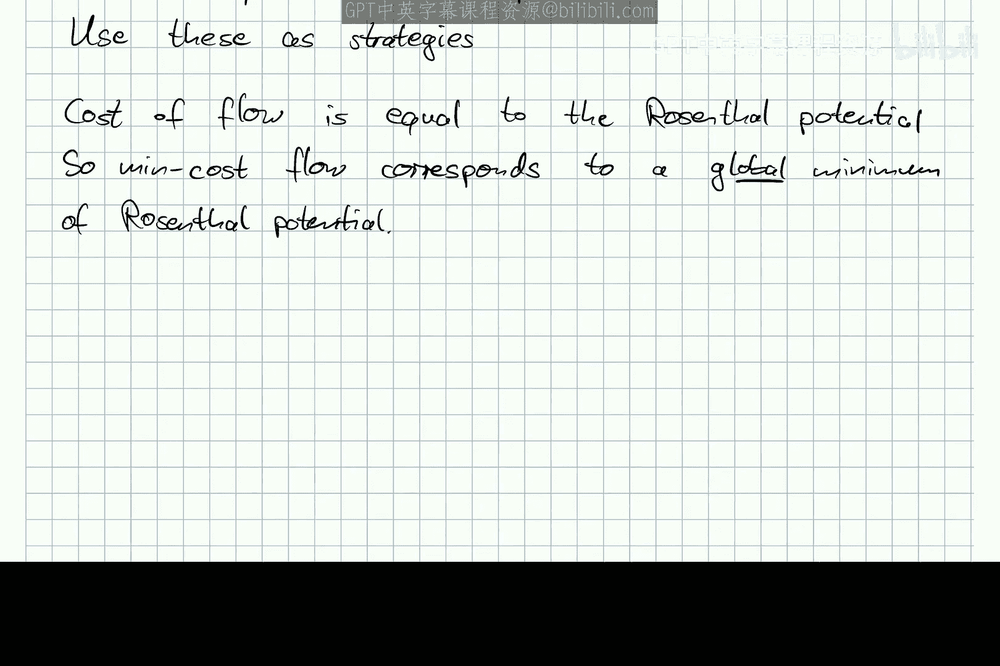

# 波恩大学《算法博弈论｜Algorithmic Game Theory, Winter 2020-21》中英字幕（claude-3.7-s p03 AGT, WS20_21_ Lecture 2 (Computing Equilibria in Congestion Games).zh_en -BV1m9ZyYoENg_p3-

Hello and welcome back to our class on Aic game theory In the last lecture we introduced congestion games and we also showed that every congestion game always has a pure natural equilibrium。

Today we will start discussing the question whether。

It is easy or hard to compute such an equilibrium。This is actually an important question because。

 well。If an equilibrium is easy to compute， then well it is likely that players actually do play this equilibrium。

 whereas， well， if it is hard to compute in equilibrium， then。Well。

 this is a rather strong assumption。And as a matter of fact， in general。

 as we will show later in this class， it is hard to compute an equilibrium。

 but for some special cases， there are polynomial time algorithms。

 and this is what we will show today for two very interesting but easy special cases。

But before we start with this， let's first。I recap what we learned about congestion games last time。

 so first of all what is a congestion game？A congestion game consists of these four elements。

 namely a set of players N， which we usually call one through n， a set of resources。

We always say these are M resources。 These might be edges in a graph， for example， but。

This might also be something else。And then every player has a strategy set。

What is that the strategies are subsets of the resources。

 meaning that the strategy space is a subset of the power set of the resources。

And every resource has a delay function which maps the number of players using this particular resource to an integer。

And this lets us define the cost of player I in a state。 What is a state。

 the state is just a choice of a strategy for every player。 So this is。

A vector of N strategies coming from the Cartesian product of all strategy spaces。

And what is now the cost of a player in such a in such a state， Well， it is。With defined as follows。

 take the sum of all resources that this player is using in this particular strategy in the state。

 and now add up the delay functions evaluated on the number of players that use this particular resource。

 So this is what we write by N R of S。 That is the number of players that use resource R。

 And we now take D R of N R of S。 This is the delay。

A resource R when NR of S players use this resource。And then we defined a Pionac equilibrium。

 a state meaning such a vector of strategies is a Pionna equilibrium if no player can unilaterally improve his or her cost。

What does this mean， Well， the cost that player I incurs in state S。

Is at most what he or she incurs when switching unilaterally to a strategy S I prime。

 while the other players still use strategy S minus I。

 And this holds for all players and all deviations。

 all alternative strategies that this player might be deviating to。😊。

And we showed that there is always such a state， which is a pureac equilibrium。How did we do that。

 Well， we used this roses and top potential。This rosenthal potential is defined as follows we take the sum over our resources。

 then we take this sum from one up to the number of players using this resource in the current state。

 and then we add up the value of the delay function for this particular number。

And why was this important， Well， this was because of this following lemma。

 We showed that whenever only one player changes his or her strategy。

 then the change of the potential is exactly the change in the cost of this one player。

And this helped us show that any improvement sequence has to be finited because whenever one player improves his or her strategy。

 well， his or her cost goes down， but this also means that the rose top potential goes down by exactly the same amount。

And this means that。Whenever we follow such an improvement sequence。

 the rosenhal potential goes down and down and eventually we have to reach a state at which it cannot go down any further。

Yeah。So let's now talk about potential algorithms to compute such a Pion equilibrium Actually one of these algorithms is already implicit in our existence。

Namely。We show that any improvement sequence is finite， So this means that。Well。

 we could just find an equilibrium as follows， start from any possible state。

 and then just follow an improvement sequence up to the point where you cannot improve any further and we know that this is a purena equilibrium。

Is this a polynomial time algorithm or isn't it？Well， as we will see。

 it depends on what game we are talking about here， but this depends on the structure of the game。嗯。

Yeah。So， what。Whatoo is now important。 Well the the important question is， of course。

How long will these sequences be？And we've already seen an upper bound on the length of the sequences name exactly in our proof。

So let's write this down。De bound that we showed last time was。Two times。The number。

 the sum of all resources。The sum of all numbers from1 to n。

 and then the absolute value of the delay of resource are evaluated at K。Or alternatively。

 we could say， O， this is two times the number of resources times the number of players times the maximum value。

Or R and K。OfD， the absolute value of D R of K。 So this means we are talking about。

The highest absolute value that any delay function ever takes。Is this a polynomial bound， No。

 it isn't。 It is only pseudoponomial in the language of computer science， Why that。

 because this depends on the size of the numbers， so it is easy to represent a number such as2 to the 1 by only 10 bits。

So a guarantee that depends on two to the 1 would be polynomial。

 but it would only be 10 that would count you。Because we are talking only about the number of bits we need to represent this。

So this is not what we're looking for here。嗯。Although this will be helpful in a bit。

There is another upper bound that we can use。 namely。 What do we know。Well。

We know that any improvement sequence is finite。 and what's an upper bound on the length of an improvement sequence。

 Well it cannot see any state twice， So the number of states is also an upper bound and and how could we write this。

The number of states that's just the cardinality of the Cartesian product of all strategy spaces。

 so this is upper bounded by 2 to the M times n。So clearly this is finite。

 but it is not a polynomial bound in M and N。So are there actually。Imrovement sequences this long。

 or is this just a bad pro bound。No， there are actually improvement sequences this long。

 let's see this in an example。We take only one player。So this means that n is equal to one。

 and we now consider the following graph。Yeah source。And then。We have a sequence of parallel edges。

Namely， these are。K plus one。Hello。Pyairers of parallel edges。So how many resources are there here？

For every edge， every edge corresponds to a resource。

 so we'll have M equals 2 to the K plus1 resources here。

But there are two to the K plus1 many strategies。Why that？

Because this one player somehow once again from the source to the sink。

And how can he or she choose to get there， well， for every of these parallel edges。

 the player might choose to either use the top or the bottom edge。

And this gives us two to the K plus one strategy， I total。And now there is a， well admittedly。

 the contrived example of a long improvement sequence， namely what can happen， Well initially。

 the player might use all the top edges。What's the cost at this point？ Well。

 it is 1 plus 2 plus4 plus up to 2 to the K。 So it's 2 to the K plus 1 minus1。

But then it is actually an improvement to only switch to the bottom edge。

For the very first pair of parallel edges。This increases the cost admittedly。

 it decreases the cost only by one。And then from that state onward。

 it is an improvement step to switch again to the top edge。

 but switch to the bottom edge and for the second pair of parallel edges。😊，Also。

 this in decreases the cost by one because well on the first pair， we now have an increase by one。

 but on the second pair， we have a decrease by2。 So in sum， the cost decreases by by one。

So this is clearly not a best response in the sense that this is the best thing that we can do because eventually we could or we could actually immediately switch to the all bottom path but the only point I want to make right now is that that can be long improvement sequences and this is an improvement sequence because we are improving in every single step。

 So how could we write this。We could write this as。Kind of a bit counter。

We start from the all one vector， where we mean now by one。That we use the。Top edge。And by zero。

 we mean we use the bottom edge。And now what we can do is we can just only switch in the first component。

And then。As I was saying， we can switch back to the top edge in the first in the first pair in the first component。

While we still switch to the bottom edge in the second component。

Then we again switch in the first component。And then we switch in the third component。

 So we switch now from the four down to the0。 but at the same time。

And we switch back to one plus two in the first two edges。So also this is again， an improvement。

 birth improvement is still only by one。So how long will the sequence be？The initial cost。Is。

 as I was saying，2 to the k plus 1 minus1， we have an improvement。Of one in every step。

And the final cost。Will be0， so。The length of the sequence。Will be2 to the k plus 1。-1。 And this is。

About。The number of。And this is nothing close to the number of strategies。

 which was only two times k plus 1， so that's only linear and K。

 where it's rather exponential in the number of strategies。We because it's exponential in Kate。

So the point here is。We cannot actually found the length of the improvement sequences in only in terms of the number of players and number of strategies。

Or a number of resources。To be precise。 So this doesn't rule out that there is an abandoned number of strategies。

 but。To make a charge， there is none。 So this is only a toy example to show you what can happen。

There are more complicated examples which actually show that， well。

 it is generally hopeless in just bad， there are bad things that can happen so that improvement sequences will actually be long and not only one。

 there will not only be one long improvement sequence。

 but eventually all improvement sequences will be long。是。So。Still。

 it is an interesting question whether we can bound the length of improvement sequences if we have further assumptions and indeed this is possible。

 and this will be our first positive result namely we will consider a special class of congestion gains for which we will actually give an upper bound length on the length of any improvement sequence。

 which is polynomial in the number of。Resources and in the number of players。

So we now want to bound the number of。Imrovement steps。

And in a certain class of games and this class of games that we will be considering is the class of single congestion games。

 what is a single congestion game？Let's define that。A congestion game。Is cold singleton。If。4。

Every player。And。Every。Strategy of this player in his or her strategy space。This strategy。

Has cardinality exactly one。 So recall that strategies are exactly。

Or every strategy is a subset of the resources。 And now we say that every strategy takes exactly one resource。

This is nothing like the congestion age that we've seen before because every player had the choice of many resources or meaning that these strategies were larger subsets of resources。

But still， this is an interesting class and let me give you a quick example of such a。

A singleton congestion game， which tells us that also those are meanings。

So in this example of a single congestion game。We have maybe a server farm。

 it is a low balancing key。So we have three servers in this example and we have also three players called one。

2 and。And each of the players can now choose to go to one of these servers。 For example。

 the first player might have the choice between the first and the second server。

 the second player might have the choice between all servers。

And a third player can only choose between the second and the third server。

And these servers now have。Delays， namely， the first server has a delay of 20。 if there's one。

Player on it at 30， If there's two players and 50， if there's。Three players。

 The second server has a delay of。30，70 and 90。Whereas the third server has a delay of 15，16 and 70。

And now this might look as follows。 So the first player might go to the first server。嗯。

The second player and the third player might both go。To the。Third server。

What's the cost that these players incur？ So both players 2 and 3， they both have a cost。

Each of them has a cost。16。And play1 has a cost of 20。And indeed。

 this is a purenaal equilibrium because no player actually can improve by unilaterally switching to a different server。

 Of course， the first player might actually want to switch to the third server。

 but that's not possible for him。The second and third player， they might。

They are actually able to switch to the second server。But this will only increase their cost。

So as you may realize， this is also at least a non trivial example。

So what can we now show for these single congestion gains， Well。

 we can show that all improvement sequences。A length that is bounded in the number of players and number of resources。

And it is not only bounded in that， but it is polynomially bounded。Let's right I that down。

Anyth single open congestion game？Wouldoo and players。And M resources。我。improvementrov sequences。

Ca land。O of n squared times M。是。How do we improve this。Well。

What we do is actually a pretty smart thing， namely we move to a different game in which it is actually easy to bound the length of the improvement sequences。

We do so by modifying the delays。 And then what we could actually do is apply the the bound that we talked about earlier that。

We have the bound of M times n times。嗯。The maximum delay value。

 the maximum absolute value of any delay function。But。How do we define that？What we do is， we define。

First， the set of all delay values that any delay function ever has。Let's write this as V。

This is D of K。For R being an R and K being between1 and at。So what do I mean by this。

Let's see this in our earlier example， what are the delay values up here？Well。😮。

The said V would be here。 The ordered the order that's we we will later order this。

 But let's first see what delay values we have。 We have a value of 2030，50，30，17，90，15，16 and 17。

 So this would be 15，16，17。20。30 we have twice， actually。50。70。And 90。

 So these are all the delay values that we see。So， having that defined。The set of all delay values。

We can observe that。The size of this set is at most the number of players times the number of resources。

 Why is this。Because。嗯。There are。M at most， M different delay functions。 So for every resource。

 we have a delay function and a read。Delay function has exactly n possible values。 So at most。

 there can be n times M。 So number of players times the number of resource。

 possible different values。Now we do what I said earlier， we define new delay functions。

And we write D R bar of K。What is the R bar of K That's the new delay value。

And we now take DR bar of K as the position。have。D，R of K。And。And this sorted list。V， And by this。

 I mean。Increasingly。Soword。Let's go quickly back to our example that we had earlier。

Here we see again the V set， this set of all values that we see。

 and now we do a very simple replacement。How do we do that？Well。Whenever we have a 15。

 that's the smallest value， we now write one instead。 Whenever we have a 16， that's the small。

 the second smallest value， we write 2。17 is the third smallest value。

20 is the fourth smallest value。30， we actually have twice。 that's the fifth smallest value。

 so we replace it by 5。70 is the sixth smallest value。

50 is the seventh smallest value and 90 is the eighth smallest valve。Good。😡。

And what you now see is that these new delays are upper bounded by the size of V。

 which we already talked about is n times M。What we now claim is that every improvement sequence with respect to the old。

 the original delays is also an improvement with respect to the new delays。How do we prove that。

 well。Let's consider。Any improvement step？S comma S prime。And we let player eye。Change the strategy。

We can now write S I， the strategy that player I was using before as just the set that only contains one resource R and S I prime as。

Also a set that contains only one resource or prime。Because well。

 we have this single property that every strategy contains exactly one resource。So， now。

This makes us makes it much easier to deride the cost of a player of this player before and after the change。

 the cost before， this is exactly the delay of resource R when there were。

And R of S placed using this resource。 Well， usually we would have this sum here。

 but we don't need the sum。Because there's only one one term in this sum， anyway。Okay。Annalogously。

 we have the cost。Afterwards。That's the delay of R prime when NR prime players are using this。

And what else do we know， We know that C， I of S is。Bigger than C， I。F。As prime。

 because this was an improvement step for player all。What else do we know？We know that。D， R of N。

 R of S。Therefore for， hast be bigger。Then D R prime of NR prime of S prime。

Because while this is how things define， this is just a simple consequence of what's written。Above。

But this means that。D R of N R of S has to be after。

DR prime of NR prime of S prime in this order sequence。So。We also have exactly the same relation。

With respect to these。New delays。De prime嗯 D bar，s。And what does that mean， Well。

 if we now define new cost functions。Using the new delays。Then we see， okay。

 this is actually also an improvement step。OfThis player with respect to the new delays。So。

This proves this claim that every improvement sequence with respect to the。

Original delays is also an improvement sequence with respect within new delay。Now。

 all we have to do is upper bound the length of improvement sequences with respect to the new delays。

How did we do that？ Well， one thing we could now do is just take the the bound that we had before。

 This would already give us something。 We can be a little smarter you。And how can we do that， well。

 we can just up about the Rosenthal potential。And also a lower band。嗯。We can see that， well。

 on the one hand， the rosentar potential with respect to the new delays is， of course。

 always not negative。And also， we see。That。We can derive an upper bound。How can we do this， Well。

 we know that any of these delay values is at most。The size of V， which is at most。M times n。So。

 we have this upper band。Have。Member of is taking the sum over our resources， then taking this sum。

And then always having M times n。So this doesn't even depend on K。So。W I write it like this。

And how big is this。Well， every player is always using exactly one resource。

 so if we take the sum of the number of players using any resource。

And we take this sum over all possible resources。 then this will be exactly n。

 So this is why we're getting M times n squared。And this is exactly what we claimed。

So one might now ask whether this proof actually generalizes towards something beyond single con congestion games and yes it does。

 it generalizes to a class called matroid congestion games in which the underlying structure of the strategy spaces have to be basis of a mattrioid。

The proof actually works exactly as I presented this but I guess some of you know what a Maot is。

 but many of you also don't know and to then see why this works。

 I would actually spend most of the time defining what a matrixot is and while trying to make you understand what this is。

 but if you're interested in this you find a reference in the lecture nodes。

And to a very cool paper which not only shows how to generalize this proof。

 but it also gives a lower bound showing that， well， if you don't have a matrix structure。

 then this does not work anymore， meaning that there will be long improvement sequences。So。

 we've not discussed。Whether improvement sequences are short or long。

 but this is definitely only one way of computing a purena equilibrium。

 which was called the kind of naive algorithm to start from anywhere and just follow the improvement sequences。

嗯。Indeed， this is not the only way you can do this。

 and we will see a different algorithm to compute an equilibrium in a congestion game。

 while in a different class of congestion games now。And。To this end。

 we will use the fact that pure naacoia can be considered local Minma。What do I mean by that。Well。

 we can understand every pure naturalural equilibrium conge in a congestion game as a local minimum of the rosenthal potential。

Let's formalize that。In a congestion game。A state。S。Is a pure National equilibrium。If and only if。

There is no state。S prime。Such that。S I equals to S prime 4。哦。But one I。And。

The rose top potential of S prime is smaller than that of S。No。

So let's first talk about what thislemma means。 I claim this is something we can understand as a local minimum。

You state S is a pnaal equilibrium， if and only if it is a local minimum of the roses and top potential。

And what does the local minimum mean？Well， there is no better state as prime within some neighborhood of S。

 And we define a neighborhood now as the set of all states as prime， which are the same。

 except for what one player does。 So this is what we wrote down here。

The state S is a pnaal equilibrium if and only if there is no state S prime such that well all players。

 except for one player， do exactly the same and the rows and top potential decreases。You see that。

A global minimum of the rosenttile potential definitely fulfills this a state that minimizes the rosentile potential for this。

 there cannot be a difference state which has a smaller rosenttile potential and therefore this is immediately fulfilled。

 but there are also other states which might be local mini but not global minimum。

So let's prove this lemma。How do we prove this？ Well， we show that。S。Is not a Pion equilibrium。

If and only is。There is a state。嗯。Said that。S I is equal to S prime for all but one I。And。

The potential。Is smaller。So let's prove this。We'll have to show two directions。

 We'll start with the direction that if this condition is fulfilled。

 then we don't have a pure gl and that's。Rather straightforward， actually。

 both directions are rather straightforward if you know what we're doing。

 if you understood what we did last night。嗯。Let's recall。

What we know about the rows and our potential， we know that if。嗯。

If this states S and S prime differ in only one component， and then this exactly。

Corresponds to the cost difference of this。Of the one player changing the strategy。

 this is what we improved in the first lecture。So， rows and tos。Sierem。Implies。B。

Pf S prime minus p of S。As equal to C of S prime minus C of S。Because all players。

 except for player I， do exactly the same。Now， what do we know about this left hand side， Well。

 this left hand side， this has to be negative。And this means that C of S prime is definitely smaller than C of S。

This means。That。S， I cannot be。At bastartrous poems。Against。S minus啥。Okay。😊。

And this means that S is not a peer national code。The other direction。

If S is not a purena equilibrium。There has to be a player who's not playing a vestrous paw。啊。

This means there have to be。A player。And a strategy。Such that。The cost of this player。

When unilaterally changing to this。New strategy is strictly smaller than before。What does this mean。

 well。Let's call this statue here S prime。Then， we know that。C， I of S prime is smaller than C。

 I of S。 And this also means that the rosenile potential。Of S prime is smaller。

Then the roll potential of airs， just because。The difference is exactly the same。

The difference of the rosentar potential。Exactly matches the difference of the cost。

And this is exactly what we claim that there is this state as prime for which all players。

 except for one， do exactly the same。And this state S prime has a smaller rosent top potential。

This is possible if there is no if the state as we were starting from， is not a pure code。

So we've now shown this。Lemma， once again， a state S is a pure natural equilibrium。

 if and only if it is a local minimum and the erosentile potential。 So one way。

To compute a periodnaal equilibrium is now pretty straightforward， namely。

Just minimize the rosentile potential。 Find a state that minimizes the rosentile potential function。

 This is not always easy， but we will now see one case in which this is actually possible。

And these are so called symmetric network congestion beams。So what is a symmetric network congestion？

We assume that There is。A directed graph。A source and a sync note。And。Sigma eye。

Sorry the set of resources。Its equal to the set of directed edges and sigma I。

 this is exactly all ST paths。And of course， we have， as usual， we have delay functions。

Now for every edge， because we once again had。Adges in our graph as our resources。

And we also assume that this is a monotone。Function。

This is different from our assumptions before because so far we just didn't care whether this function was monotone or not。

 but now we want to be monotone and to be precise， we want it to be non decreasing。

So we've seen symmetric congestion games before， namely。

 and we've seen this initial example in which we only had one player wanting to get from S to T。

And also there， we saw that there were long improvement sequences that there were many states。嗯。

Yet still， as we will show now， in such games， it is still easy or kind of easy to compute a。

Pion National equilibrium。And how can we do this？ Well。

 all we do is we minimize the rows and top potential。

And we find a global minimum to the rose heart potential。😊，So we show that insymmetric network。

Congestion games。With non decreasing。Delay functions。There is a poll real time， Adon。That minimizes。

The rose andile potential of this stage。How do we do that？Serve。Once again。

 I hope here it is clear that minimizing the horizontal potential。

 globally minimizing the horizontal potential， is sufficient to finding a Pionnaric equilibrium。

 not every pionnaric equilibrium corresponds to the global minimum or a global minimum of the Rose potential but definitely the other way around。

Any global minimum corresponds to the。To a pure naquier， how do we do that？Well， what we do is。

We now replace the。The graph of the network congestion game。

 in a way that we then find a min cost flow that we then want to want to find a min cost flow。

 And with this min cost flow， then。We immediately minimize the rosenttile potential。And the set。

E prime， the new edges。 those are now n parallel。Coopies。As each。

Directed edge we have in our original。Each edge。Has a capacity of one。So by that， I mean。

 each new edge。And。嗯。Sending one unit flow。Along the。I。Copy。Of an original edge。Costs。

The delay of this edge when there are eye players using this。So。What does this now look like？

Let's see this in an example。啊。We have。Some。Nice grass。start from？In our symmetricsymmetric。

Network congestion game and there's a delay function on each of the edge。

And we now translate this into。The following graph。This was a game of three players that we had here。

 so we now have three copies of every edge。And now we just write down all the numbers that we had here。

No。So what we not do in this graph is pretty easy。If you know the correct algorithm to do this。

 we now find a Mincast flow to route and units of flow from S to T。こol。嗯。

This can be done in polynomial time。I wonon't be talking about algorithms for this。

 This is what you will learn about in in other classes where you learn about flow algorithms。

 you will learn how to do this in polynomial time。 Le for today。

 just assume that we can do this in polynomial time。And。

Then what is also known is that this will be an integral flow。This means in this graph。

Because every edge capacity is exactly one， every edge is either used or is not used。

And what will this minimum flow now do。In this graph。

 it will definitely prefer the cheaper edges over the more expensive edges among the parallel edges。

So it might， for example， take here this one and two edge here， it may take the four edge。

And then maybe one unit of flow goes right here， so we have also one unit of flow along this one edge and then one unit of flow along the one edge。

 one unit of flow along the two edge， and one more unit of flow along the seven edge。

What we cannot now do is we can decompose this flow into n paths from S to T。

And these are exactly the strategies that our players will be using。The interesting thing is now。

That the cost。Of the flow。Is equal。To the。Rose and tall potential at beginning。Why is this Because。

 well？The path definitely prefers the cheaper edges over the more expensive ones。And。😊，Come。

This means that we first， if there is the unit of， let me go back to the example。

 maybe it's easy to takes place。If there is， like。Two players going from S to this intermediate vertex。

 Then we have one。One unit of flow going by this four edge and another unit of flow going by this five edge。

 And this means the cost that contributes to the cost of the flow is exactly 4 plus 5。

 But this is also exactly what this。What the original edge contributes to the rose and top potential in our congestion game if two players are using this edge。

By the way， here it is important that the delay functions are non decreasing。

And because now the cost of the flow is equal to the Rosental potential。

Minimizing the cost of the flow。Correspondence。To a global minimum。O the row and top potential。

So this concludes our class for today， we've seen。Two different ways of actually computing pnaal co in polynomial time for special classes of congestion games。

 the first one were singleton congestion games for which we could just follow improvement sequences because all improvement sequences are polynomally bounded in the length。

 and then we saw another algorithm for computing pureionnaal co in symmetric network congestion games。

And these improvement sequences may be actually long。

 at least there might be some improvement sequences that are long。

 but still there is an algorithm that just computes a global minimum of the rosental potential and because computing a global minimum of the rosental potential means in particular also computing a local minimum of the Rosental potential。

 we definitely also computed a purena equilibrium this way。As I was saying in general。

 computing pure natural is。Difficult。And this is something that we will cover later in this class。

Because then we first have to define， what does it even mean to be difficult here。

 we'll have to define new complexity classes which are probably unknown to to you because it's not the usual notion of NP because this would make any sense here。

 NP is always about a yes or no question， there is no reasonable yes or no question when it comes to computing an equilibrium。

 because there is always one。But this is something that we will cover later in this class。

I hope you learned a lot today。 Thank you very much for your time。

