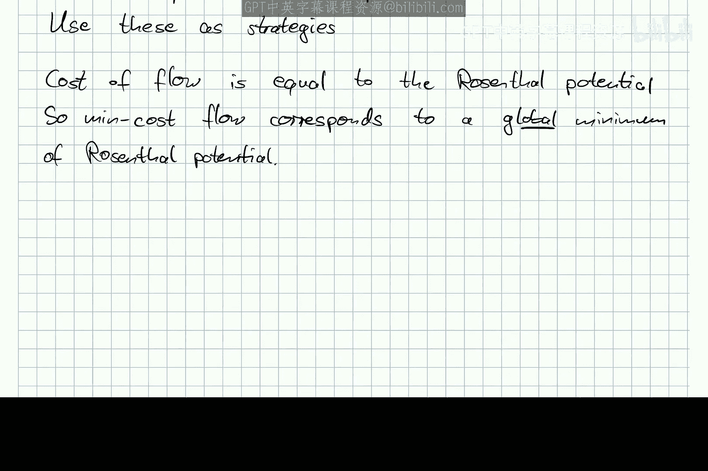

# 算法博弈论：第2讲：计算拥塞博弈中的均衡

在本节课中，我们将要学习如何计算拥塞博弈中的纯纳什均衡。上一讲我们介绍了拥塞博弈，并证明了每个拥塞博弈都存在纯纳什均衡。本节中我们来看看，计算这样的均衡是容易还是困难的。

## 课程回顾

首先，让我们简要回顾上一讲关于拥塞博弈的核心内容。

拥塞博弈由四个要素构成：
*   **玩家集合 N**：通常标记为 1 到 n。
*   **资源集合 M**：包含 m 个资源，例如图中的边。
*   **策略集合**：每位玩家 i 的策略集 Σ_i 是资源集合的幂集的子集，即每个策略是资源的一个子集。
*   **延迟函数**：每个资源 r 有一个延迟函数 d_r，它将使用该资源的玩家数量映射到一个整数。

在给定状态 S（即每位玩家策略选择的一个向量）下，玩家 i 的成本定义为：
`c_i(S) = Σ_{r ∈ S_i} d_r(n_r(S))`
其中，`n_r(S)` 表示在状态 S 中使用资源 r 的玩家数量。

一个状态 S 是纯纳什均衡，当且仅当没有玩家可以通过单方面改变策略来降低自己的成本。即，对于所有玩家 i 和所有可能的替代策略 s_i‘，都有：
`c_i(S) ≤ c_i(s_i‘, S_{-i})`

我们通过定义罗森塔尔势能函数证明了纯纳什均衡的存在性：
`Φ(S) = Σ_{r ∈ M} Σ_{k=1}^{n_r(S)} d_r(k)`
关键引理是：当且仅当一位玩家单方面改变策略时，势能函数的变化量等于该玩家成本的变化量。因此，任何改进序列（玩家不断单方面降低自身成本）都会导致势能严格下降。由于势能函数有下界，任何改进序列都必然在有限步内终止于一个纯纳什均衡。

## 通过改进序列计算均衡

上一节我们介绍了均衡的存在性证明，本节中我们来看看一种自然的计算方法。

一种计算纯纳什均衡的朴素算法隐含在存在性证明中：从任意初始状态开始，不断让玩家进行单方面改进，直到无人可以改进为止。我们已知这个过程必然终止于一个均衡。

然而，一个重要的问题是：这个改进序列的长度（步数）是多少？它是否能在多项式时间内完成？

我们已知两个上界：
1.  基于势能函数值的伪多项式上界：`O(2 * Σ_{r∈M} Σ_{k=1}^{n} |d_r(k)|)`，这等价于 `O(m * n * max_{r,k} |d_r(k)|)`。这个界依赖于延迟函数的具体数值，而非其编码长度，因此不是多项式界。
2.  基于状态总数的指数上界：状态总数最多为 `Π_{i=1}^{n} |Σ_i|`，这可以高达 `2^{m*n}`。

更糟糕的是，存在构造性例子表明，改进序列的长度确实可以达到指数级。例如，在一个只有1位玩家、`m=2^{k+1}` 条资源的简单拥塞博弈中，可以构造出一个长度为 `2^{k+1}-1` 的改进序列，这关于资源数量 m 是指数级的。

因此，在一般情况下，简单地跟随改进序列并非多项式时间算法。

## 单例拥塞博弈中的多项式改进序列

尽管一般情况不乐观，但对于某些特殊类别的拥塞博弈，我们可以证明改进序列的长度是多项式有界的。我们的第一个正面结果针对**单例拥塞博弈**。

以下是单例拥塞博弈的定义：
一个拥塞博弈被称为**单例**的，如果对于每位玩家 i 及其策略集 Σ_i 中的每个策略，该策略恰好只包含**一个**资源。即，每位玩家每次只能选择使用一个资源。

一个典型的例子是服务器负载均衡：玩家（任务）选择服务器（资源），每个服务器的延迟取决于其上运行的任务数量。

对于单例拥塞博弈，我们可以证明以下定理：
**在任何具有 n 位玩家和 m 个资源的单例拥塞博弈中，任何改进序列的长度为 `O(n² * m)`。**

**证明思路如下：**
1.  定义所有延迟函数在所有可能负载下取值的集合 V = { d_r(k) | r∈M, 1≤k≤n }。显然，|V| ≤ m * n。
2.  构造新的延迟函数 `d̄_r(k)`，其值为原延迟值 `d_r(k)` 在集合 V 的排序列表中的**秩**（即第几小的值）。例如，若 V 中最小值为15，则所有 `d_r(k)=15` 的边在新函数中值变为1。
3.  关键观察：在原延迟函数下的任何改进步骤，在新延迟函数下同样是一个改进步骤。这是因为改进意味着玩家从一个高延迟资源换到一个低延迟资源，而“高”和“低”的关系在替换为秩之后保持不变。
4.  现在，我们只需分析在新延迟函数下的改进序列长度。新延迟函数的值被限制在 1 到 |V| ≤ m*n 之间。
5.  计算新延迟函数下的罗森塔尔势能 Φ̄(S)。其值非负，且上界为 `Φ̄(S) ≤ Σ_{r∈M} Σ_{k=1}^{n_r(S)} (m*n) = (m*n) * Σ_{r∈M} n_r(S)`。
6.  在单例博弈中，所有玩家使用的资源总数恰好为 n，即 `Σ_{r∈M} n_r(S) = n`。因此，`Φ̄(S) ≤ m * n²`。
7.  由于每一步改进都使 Φ̄(S) 至少减少 1（因为新延迟值为整数），所以任何改进序列的长度不超过 `m * n²`。

**证毕。**

这个证明可以推广到更广泛的**拟阵拥塞博弈**，其中玩家的策略集必须是一个拟阵的基。感兴趣的读者可以参考课程笔记和相关论文。

## 通过势能最小化计算均衡

上一节我们讨论了通过跟随改进序列来寻找均衡，本节中我们来看看另一种方法：直接寻找罗森塔尔势能函数的**全局最小值**。

我们首先建立以下引理：
在拥塞博弈中，一个状态 S 是纯纳什均衡，**当且仅当**它是罗森塔尔势能 Φ 的一个**局部最小值**。这里“局部”定义为：不存在另一个状态 S‘，使得 S’ 与 S 仅有一位玩家的策略不同，且 `Φ(S‘) < Φ(S)`。

**证明概要：**
*   **（⇒）** 如果 S 是均衡，则没有玩家能通过单方面改变策略来降低成本。根据势能函数的性质，单方面改变策略导致的势能变化等于该玩家的成本变化。因此，不存在单方面改变能降低势能，故 S 是局部最小。
*   **（⇐）** 如果 S 不是均衡，则存在某玩家 i 可以通过单方面改变到策略 s_i‘ 来降低成本。令 S’ 为该新状态。同样根据势能性质，这次改变也会降低势能 (`Φ(S‘) < Φ(S)`)，且 S‘ 与 S 仅在第 i 个分量上不同。因此，S 不是局部最小。

这个引理告诉我们，寻找纯纳什均衡等价于寻找势能函数的局部最小值。而一个更强的条件是寻找**全局最小值**。虽然并非所有均衡都是全局最小，但任何一个全局最小状态必然是一个（局部最小的）均衡。因此，如果我们能高效地找到势能全局最小，也就找到了一个均衡。

## 对称网络拥塞博弈中的多项式时间算法

现在，我们来看一类可以高效计算势能全局最小值的博弈：**对称网络拥塞博弈**。

此类博弈定义如下：
*   存在一个带源点 s 和汇点 t 的有向图。
*   资源集合 M 就是图中的有向边集合。
*   所有玩家具有**完全相同**的策略集：所有从 s 到 t 的路径。
*   每条边 e 有一个**非递减**的延迟函数 d_e。

我们的目标是：在多项式时间内找到一个最小化罗森塔尔势能的状态（即一个全局最小势能，从而是一个纯纳什均衡）。

**算法如下：**
1.  **构建流网络**：为原图中的每条边 e 创建 n 条平行的副本边 e^1, e^2, ..., e^n。
2.  **设置容量和成本**：每条副本边 e^k 的容量设为 1。发送一单位流经过 e^k 的成本（费用）设为原延迟函数在负载为 k 时的值，即 `d_e(k)`。
3.  **求解最小成本流**：在这个新的流网络中，计算从 s 到 t 的**最小成本、大小为 n 的整数流**。这是一个经典的网络流问题，存在多项式时间算法（例如，使用连续最短路算法）。
4.  **流分解为路径**：由于每条边容量为1，所得的最小成本流必然是整数流。将这个流分解为 n 条从 s 到 t 的路径（每条路径承载1单位流）。
5.  **路径映射为策略**：这 n 条路径就构成了 n 位玩家的策略选择，即我们想要的状态 S。

**算法正确性解释：**
*   在这个构造中，发送一单位流经过边 e 的第 k 条副本的成本正好是 `d_e(k)`。
*   因此，整个大小为 n 的流的总成本恰好等于在原拥塞博弈中，当玩家按照对应路径选择策略时，所计算出的罗森塔尔势能 `Φ(S)`。
*   寻找最小成本流，就是在所有可能的、大小为 n 的整数流（对应所有可能的玩家路径选择组合）中，寻找总成本最小的那个，也就是寻找罗森塔尔势能 `Φ(S)` 的全局最小值。
*   由于延迟函数非递减，这个构造是合理的，并且保证了找到的全局最小势能状态对应一个纯纳什均衡。

因此，我们得到了一个在对称网络拥塞博弈中计算纯纳什均衡的多项式时间算法。

## 总结

本节课中我们一起学习了计算拥塞博弈中纯纳什均衡的两种方法及其适用场景：

1.  **跟随改进序列**：这种方法在一般情况下可能需要指数时间。但对于**单例拥塞博弈**，我们证明了任何改进序列的长度都以 `O(n² * m)` 为上界，因此可以在多项式时间内收敛到一个均衡。
2.  **最小化罗森塔尔势能**：我们将均衡等价于势能函数的局部最小。通过直接寻找势能全局最小，我们为**对称网络拥塞博弈**（具有非递减延迟函数）设计了一个多项式时间算法。该算法通过巧妙构造一个等价的网络流问题并求解其最小成本流来实现。

总的来说，对于某些结构特殊的拥塞博弈，存在计算纯纳什均衡的多项式时间算法。然而，在一般情况下，计算均衡是困难的（这是一个复杂性问题，我们将在后续课程中深入探讨）。