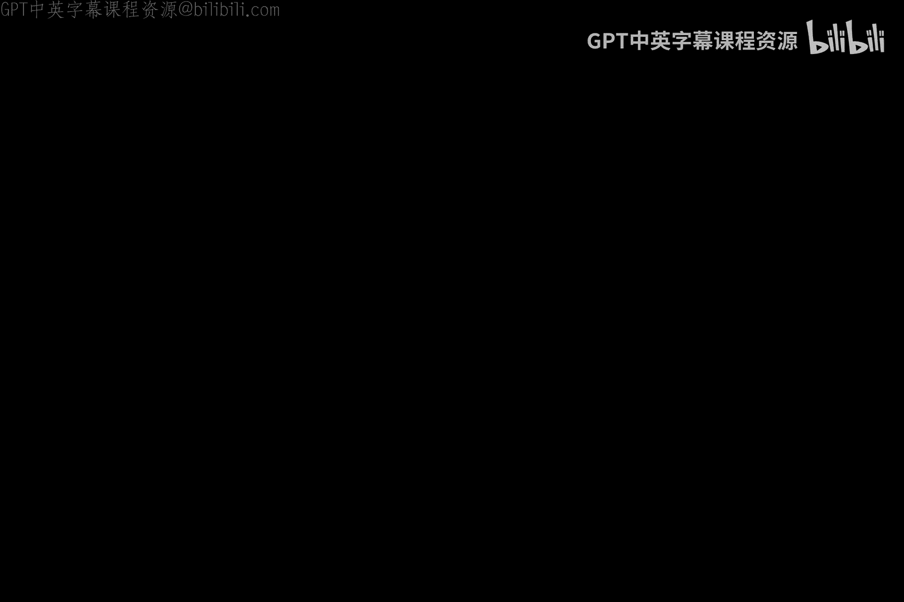
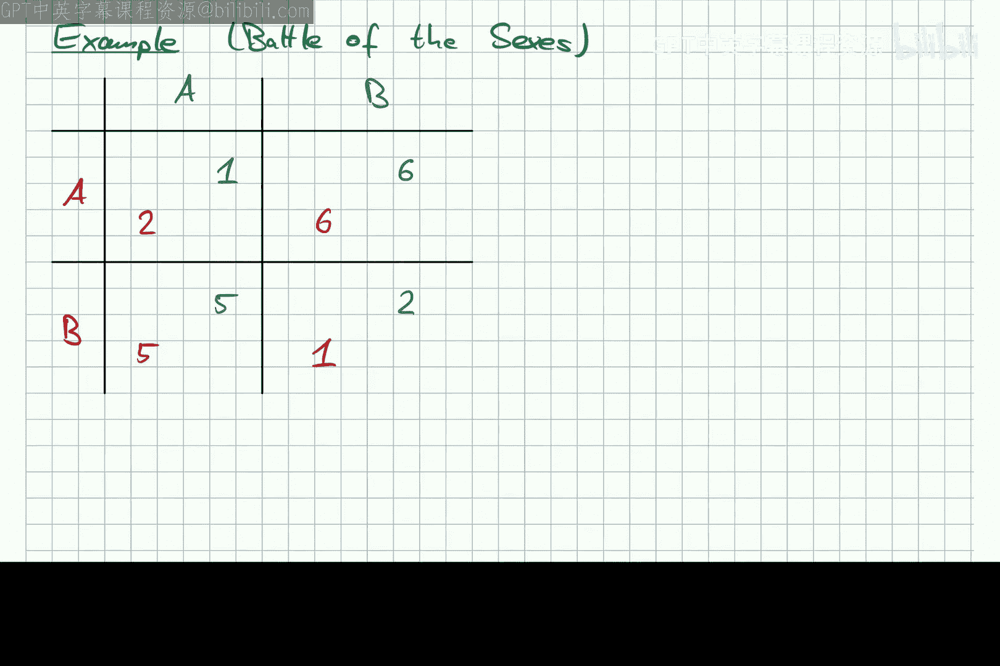
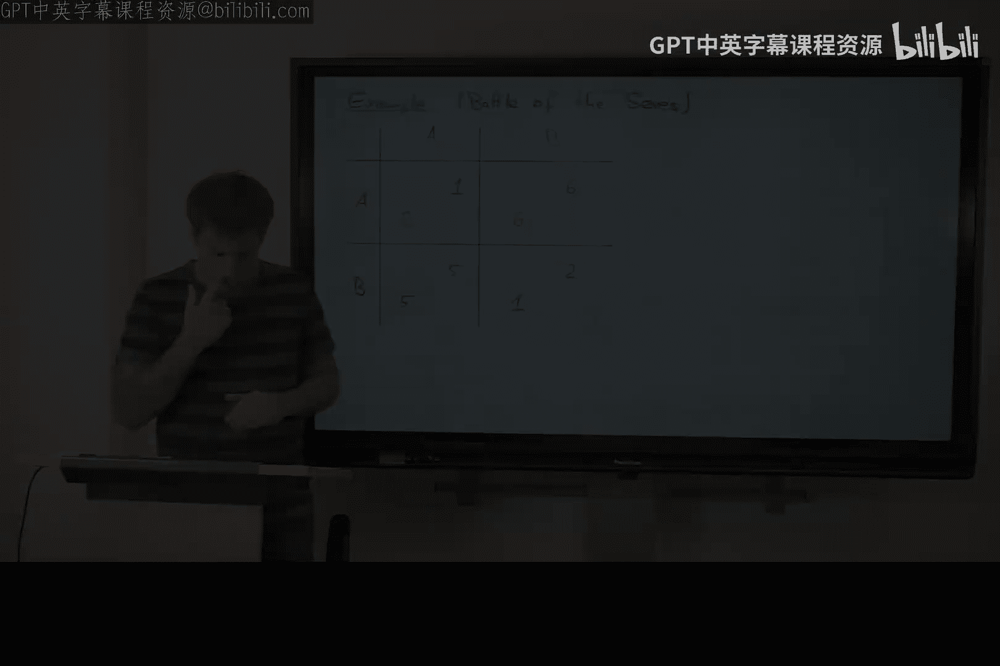
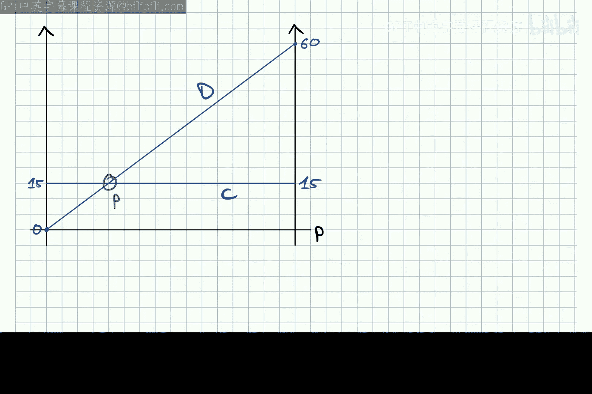

# 波恩大学《算法博弈论｜Algorithmic Game Theory, Winter 2020-21》中英字幕（claude-3.7-s p04 AGT, WS20_21_ Lecture 3 (Normal-Form Games and Mixed Nash Equlibria).zh_en -BV1m9ZyYoENg_p4-

Welcome back to Rothic Gameme theory and great that you're still here。

What did we do so far while we introduced congestion games and we showed that there is always a pure natural equilibriumino in every congestion game。

Today we will generalize the class of games that we consider towards what is called normal form games。

 and well also generalize the notion of a Pionac equilibrium。But then as we will see。

 not always a Pash equilibrium exists。But what we'll show next time is that always a mixed na equilibriumlib exists。

But before we get to that， let's first introduce the more general notion of a game。

 a so called normal form game。So what is a normal form gate？Let's define this， formally。We say that。

 A normal form。Cost minimization。gaame。Is a triple。Which consists of N。S， I。And C。What are these。

Well。We'll have n as the set of players。不要。😔，Usually called the number of players N。

And often just drive as the players。They said。Of one through n。And。For each player。We now have。

set S I。Which is the set of pure strategies of that player。And we'll call。第一。Cartesian product。

Of all these。The set of states or pure states or strategy profiles or pure strategy profiles。So。This。

Should feel somewhat familiar N as a set of players we also have in the context of congestion games。

 and we also had a set of strategies for each player。 The notation is a little different now。

 and I'm just sticking to standard notation here， which may be a little unfortunate from time to time because now capital S I is the set of all strategies。

 whereas in the congestion games， we call。This set of pure strategies， sigma and。

Capital SI was an element of this set of pure strategies so this will be consistently inconsistent throughout this class and I apologize for this in advance。

 this is the standarddent that we will use for these normal form games or often we might just call them games。

And then we again have this Cartesian product of all strategy spaces。Which is the set of states。

 or as we also want to call them just strategy profiles or pure strategy profiles。

 So these are all called pure strategies。To distinguish them from mixed strategies。

 which we will see later in this class。Good， now all of the players。Choose。One of these strategies。

And this means that players incur certain costs。And。嗯。We write this as follows， so for each player。

We'll have now。CI as a function mapping from S。To the reals。This is the cost function。Of player eye。

So we take as the input a cost sorry a strategy profile， a profile of pure strategies。

 and then this maps to a cost that this player is incurring。Alternatively。

 you could also define this as a payoff or a utility that the player wants to maximize that's actually sometimes more convenient and we'll switch between the two throughout this class。

 but for today we'll only talk about cost minimization。Good。嗯。

So we can actually capture congestion games in here。How can we do that， well， as I was saying。

 SI will be again the strategies。which were in the context of congestion games。

 were just subsets of the resources。And the cost functions， well。

 those had a particular structure in the context of congestion games。

But now those may be just arbitrary functions。So they are not these underlying resources and delay functions。

 which were exactly the ones that induced this structure in the cost functions of congestion names。

How can we define。Other。Such。Normal form games， well， what we can do， for example。

 is a by matrix game。In the biometric scheme。We'll have always two players。

So this means nothing but that n is equal to 2。And now， this。

The strategy sets are just something we don't actually care。

And the cost functions are now described in terms of matrices。We'll now have two matrices。A。And B。

Which fully describe the cost function。Here now you have to be a little careful because there is now small ss which are strategy and there's capital ss。

 which are these strategy sets， but usually it's just clear from the context。

 which means which that this should be a small S because it is contained in the capital S。

In the capital SI。Good。😡，哎。Now we have these two matrices and how does this now induce again Well。

 one player， player one chooses a row of these matrices。诶。

Player two chooses a column in these matrices。And then the cost is defined as the entry at which we end up。

So more formally。Player 1 is the row player。And playerer two is the column player。And will have that。

C 1。Of S is equal to a1 a Subscript S1 commit S2 and C2 of S。Is equal to B。S1， S2。

Let's see this in action。Let's consider a。Typical congestion game with only two players。So国的海岸。

Maybe a source here。😔，I have two intermediate vertices and they sync。And there are delay functions。

This is how we will drive this as a congestion game。

But we can also write this as a normal form game and more precisely we can also write this as such a by matrixtri game by now writing down two matrices。

The usual notation。Is not to write two separate matrices。

 but rather to write all of this in one large table。

What are the possible strategies of the two players， Well， both players actually have。

3 possible strategies。In this。景呢位。Play a one can， for example， use the。Top pan。Or。They can use。

The z exact pan。Or。They can use the bottom path。And the same is true for player 2。 Player 2。

 because this is a symmetric game。 Both players want to get from the sorerus to the same sing。

 They both have the same。Choice， the strategies。So my second player will now be blue。And。

I'm also writing down just the same strategies here。Okay。

Now what do I write in these cells in this table？In this。In these cells of the table。

 I always write two numbers， one on the bottom left and one on the top right。In the top right。

 you'll see this is the cost that the column player will incur and the bottom left。

 this is the cost that the row player will incur。So if， for example。

 the row player chooses to choose the top path and the column player chooses to choose the top path。

 then。What's the delay， The delay will be 2 plus 8。For each of them。

 so both of them will incur a cost of 10。Great。Let's see how we fill the rest of the table。What if。

 for example， the row player uses this zigzag path？And the column player uses the top pass。

Then there will be two players。On this edge。And one player on this edge。

One player on this edge and one player on this edge， so what will the cost be？For the zigzag path。

 the cost will be 2 plus 5 plus9。So will you get。2 plus 5 plus 9，16。And for the column player。Well。

 that's now two plus7， so that's nine。And let's do one more example。

 Let's see what we have to fill in here， well。We used these two bottom address here。So。

This will be3 plus9。Because the other player isn't using these。嗯。This is 12，3 plus 9。

And then there's also the choice of the column player。 This will be cost of1 plus 7。

 so this will be 8。And now this way， you can just fill out the entire table。You'll get。16een。

And9 appear。You get 18。And。8 here。You get 16。And 13 here。You get 12。eight。3。16。And14。嗯。14。

And once again。Now there is one player who chooses a row， one other player who chooses the column。

 and then will have the two entries which indicators what their costs will be。Mathematically。

 these are actually two matrices。One for the row player。

 which we call A and one for the column player， which we call B。And。嗯。So the red numbers。

 those are matrix A， the blue numbers are column are matrix B。

But this is not the only way you can construct a biometrictrix game。

 so this does not necessarily have to be a congestion game， you can also take other games in here。

And let's see another example。

This game here is called Battle of the Sexus。There is a traditional， very sexist。

Explanation of what is happening here。 But let's just be a little more 21st century。

 And let's just assume there's person A who wants to go to the movies and person B。

 who wants to go to the movies， and they actually want to go together。

 Both of them have a favorite movie， but unfortunately， it's not the same。

 But it's more important for them to go to the movies together than apart。

 How does this look in this matrix。Well。Do we see。Generally。The row player has the smallest cost。

 If both players choose strategy B。So the role player would actually prefer that both players go to Mo B。

But both players going to movie A， that's a little worse than。

 but it's definitely better than one of them going to A and the other one going to B。

For the column player， we have something very similar。

 The column player prefers that both of them go to movie A。

Both of them going to movie B is also fine， well one of them going to A。

 the other one going to B that has a higher cost。So you see that many situations in which you have strategic behaviors and somehow mismatch preferences you can indeed capture in such a table。

But what we now have to do is we'll have to actually model a strategic behavior and for this。

 we'll generalize the notion of Pionastro equilibriumlib and see。Does hope。

 does there exist a pure natural equilibrium in this game or not？

So let's first generalize the notion of a Pionac cali。If you natural equilibrium。

 I hope you remember from the congestion games is a state or a choice of pure strategies for all players such that no player wants to unilaterally deviate。

Which means that no player can decrease his or her cost by unilateral deviation。

How do we now generalize this to these normal form games， well。

 we actually just have to copy the exact definition。We say that a strategy。S I。His cold。

A best response poems。For player。I。Against the collection。Of strategies。As minus I。If。The cost。

That this strategy is at most。The cost。Of any other strategy。

So only the notation is a little different， the meaning is just the same。 We'll have strategy SI。

 which we call which we call the best response against what the other players are doing if well。

 no other strategy is actually better for this plan。And now a purenatal equilibrium。Is a。

State or strategy profile。Such that。4。All players。S， I is a best response。Againgan。S minus off。

So exactly the same thing as in the context of congestion games will have a state or a choice of pure strategies for all players such that no player will benefit from unilateral deviation。

 which means no player can decrease his or her cost by moving to another strategy。

Let's see this in our example of Battle of the sexexus。Are there pure natural color right here？没必。

Let's first， talk about。Basest responses。What are best responses here？Well。

 this is exactly what I was trying to say before。Now one player is doing something and the other player is reacting to this。

What is the best response or well there might even be multiple best responses， not in this game。

 but generally there might be。If the row player is choosing A。

What does the columnplay want to do Well， the columnplayer also wants to do。A。

So let's mark this in here。If the row player is choosing B， then。

The car player alls the ones to choose B， because well，2 is smaller than5， but here。

 one is smaller than 6。So these are best responses。

Now let's do the same thing for for the row player fixing the column player。

 if the column player is playing a， then the row player also wants to play A。

And if the column player is playing B， then also the column player and the row player wants to play B。

So I've now marked the best responses in this table and what we see is。

There are these two sel in which both players are playing at best response。

 And this means those are pureionna。That's nice， but。What about other games？

Do we always have the structure that。There is a pure National equilibrium， well unfortunately not。

And it's maybe not a surprise how， because if we had， for example， a seven here。

 then this wouldn't be a best response anymore for the column player because then the column player would want to move to B。

And then we will change the the two here， for example，26。

 then also the column player would want to have a different choice there。

 so it's kind of easy to destroy this example。And let's see another example of a by matrixtri s。

In which。There is actually no。Pure pure pure national。This game is called Intion Game。Again。

 we have two players and both players have two strategies。What are the two players， well。

 one of them is a train traveler and the other one is a ticket inspector。The role player is。

The inspector and the column player is。第二。嗯。Is the traveler。我。Choices。Do these players have？Well。

 the column player， the train traveller， can either buy a ticket or not。And。

This we now say means comply， comply means buying a ticket， defect means not buying a ticket。

And the ticket inspector can choose to be other lazy。Or may choose to actually inspect the ticket。

The pilot is now。Well。If you know that the train。Well， if the if。Ohh。

And how we did not fill this table？Okay， if I buy a ticket， then I buy the ticket。

 I just have the cost of buying the ticket， So let's say this is 15 euros。

And I pay this regardless of whether my ticket gets inspected or not。But if I don't buy a ticket。

Then， well， if nobody checks whether I have a ticket。Then my cost will be zero。But。

If somebody does inspect and I don't have a ticket， then my cost will be 60。嗯。O。

This is the choice that the train traveler has。And let's now try to capture what choice the inspector has。

Well。They can either decide to be lazy or to inspect。 And let's say， okay， if I。

If the the traveller does have a ticket hat， then， of course， being lazy doesn't have any cost。

Whereas inspecting the ticket， okay， this has a small cost of me because it takes just some effort to inspect the ticket。

Whereas if the。A traveler does not have a ticket， and。I inspect the ticket。Then if I'm lazy。

 then I'm losing money。As opposed to if I inspect a ticket， well it still takes some work for me。

 but it's at least worth it。Because。Im。Getting some reward of this。

 maybe I'm compensated for the company that I worked that I found somebody who didn't have a ticket and I actually found this out。

What are our best responses here？Well this is maybe not a surprise for you if you've ever taken a train。

 than if you knew。What the inspector would do， you would definitely well do the respective thing。

 if you know。That your track ticket will be inspected， then you'll certainly buy a ticket。

 if you know that your ticket will certainly not be inspected， then you wouldn't buy a ticket。

Well maybe not you very honest audience， but if we just considered a very strategic agent。

 why would you buy a ticket if you know that never anybody actually cared？And let's see this here。

 also in this table。If we know that the inspector is lazy， then defecting is the best response。

Whereas if we know that the inspector isn't need inspecting。

 then complying so buying the ticket is a best's response。Now。

Let's think about the perspective of the inspector， what would we do well， if everybody has a ticket。

 there's really no point in inspecting。Let's be lazy。But if the player certainly。

Doesn't have a ticket。 Then we should certainly inspect。What do we see here， well。

None of these cells correspond to pure natural equilibrium may be not a real surprise at this point。

Because there is no state in which both players are playing a best response。

So this brings us to the question what will happen instead？

And if you realize what happens in reality is that Paul， sometimes people do quite buy tickets。

 sometimes they don't， sometimes tickets get inspected， sometimes they don't。So， there is some。

Inherent maybe randomization of what will actually happen。

 And this is indeed captured by what is called a mixed nationalsh equilibrium。

 which we'll introduce next。As we've seen in our inspection game， a。

Pure natural equilibrium room doesn't always exist， but。As it will turn out。

As we will show next time， a mixed natural equilibrium always exists。What is this？

In a mixed natural equilibrium。Players don't just choose one strategy。

 but they choose a probability distribution of our strategies。 This is what we call a mixed strategy。

So， a mixed strategy。Which we will call small sigma I。For player I。Is a probability distribution。

Over。SI， this set of pure strategies。Actually， we'll only consider this in the context of fily many pure strategies and finallyly many players in which case while。

暗B。Notion of probability distributions are much easier than in the much more general case。

 if you had like infinitely managed strategies。😊，So we can now write down a mixed strategy as。

As a vector， sigma comma S。 So these are the entries of this vector。

And the entries in this vector sum up to one。So Sigma I comma SI。

 this is the probability that player I plays strategy S I。And now， we'll have a。

Mixed strategy profile， so we'll take a mixed strategy for each of the players and will now associate also a cost to such a mixed strategy profile。

Like we did this for pure strategies， we may not call this。Sigma， without any subscript。

 this is the vector of all Sigma I， where we now give a mixed strategy to each of the players。

And the costs。Of player I。In sigma。How do we get this？ Well。

 this is exactly what we would have as the expected cost if。

Player 1 draws a strategy from sigma 1 up to player N， drawing a strategy from sigma N。

 and then will' consider the cost that player I would incur。

 So all of a players draw independently a strategy。

And now well evaluate the cost of the pure strategy profile that we are reaching this way and let's now consider the expectation of this。

So alternatively， we can also write this。If we write out this expectation， take the sum。

Over all strategies for all players。And now， what is the probability that player 1 plays S 1。

Up to the probe times。And so on， has the probability that player N place S N。

 and then we will multiply this with a cost。That player I incurs in state S。Good。So。

What we can also do is we can。Represent every pure strategy as such a mixed strategy。

So any pure strategy can be represented as a mixed strategy。How that。Well， very easily。You said。

 sigma， I。Coma S， I to 1。For1 S I and sigma I comm a S prime equal to 0。For all SI prime。

 which are not SI。What does this mean， well， effectively now we have a larger strategy space。

Beyond the。Pure strategies， we now also have mixed strategies。 And for these mixed strategies。

 we can now just。Consider the exact same notions of best responses and of。Eria and the equilibrium。

 or if all players are playing such a best response。

 this is what we call a strategy mixed naturallyly。Let's write this down。A mixed strategy。Sigma eye。

Is a。Mixed。Best responds。And let's say， against。Sigma minus I。If。

The costs that I in if I apply this strategy。It is no larger than if I played any other mix strategy。

And a mixed strategy profile。Is called a mixed Nsh equilibrium。If。Sigma I is a best response。Tgan。

Sigma minus I。For all players。对。So nothing has changed up to this point， because。

We just broaden the set of strategies， and now we say， okay。

 rather than only have been allowing year to choose a pure strategy。

 well allow well allow everybody to choose a mixed strategy。 and on these we again。

 define best responses the exact same way。And also equiria。

 these are called mixed Nash equiria because all the strategies are a mixed strategy。

The interesting thing is。That actually， it is now enough to consider deviations to only pure strategies。

 So we notified this year in a way that we said， okay。

 you should want to play any other mixed strategy in instead。

But the foreign lemma tells us that we actually only have to compare this mixed strategy to any pure strategy。

And the Lama says that a mixed strategy。Is a batri's ponds。Against some sigma minus I。Okay。

 we want to call this Sigma either strategy。If and only if。We have that。The cost。Of plane。

Sigma I against sigma minus I is at most the cost of playing S I prime against sigma minus I for all pure strategies。

S。I prime。あ。So compare this to the definition of a best response that we said。

 okay this we have to compare this to any possible mixed strategy Now we are saying。

 okay we don't actually care too much about all mixed strategies All we have to care about is。

Or possible pure strategies。 So the player only deviates to a pure strategy。 And we ask。

 how much are we。Are we gaining anything by moving to such a pure strategy？Let's prove this。

And the only if part here， this is very trivial， indeed。Is the only if part tells us that， well。

We only have a mixed strategy we only have a best response if we wouldn't want to deviate to any pure strategy to any other pure strategy。

 but this was already included in the definition because every possible SI prime is also a possible sigma I prime。

The if part。This is more interesting。We want to now show that if this is fulfilled。

 then actually we have， if this condition is fulfilled， then we have a best response。

And by proving this， we see okay。ButBy proving this。

 we see actually a proof technique that we will repeatedly now use。你每 well。If we have this， then。

So all that remains now to show is this if part， which means that if this condition here is fulfilled。

 then we have a。A best response also in the sense that as we refine this before。

 that you wouldn't want to use any mixed strategy。And this is very crucial to understand this that actually mixed strategies cannot be any better than the pure strategies they are composed of。

嗯。Let's write this down。We let Sigma minus eye。Any。Mix strategy profile for the other players。あ。And。

We let。s my eye。Be a strategy。Such that。CI。Sigma I comma S minus I is at most C of S prime comma Sigma minus I for all。

S I prime in SO。Now let's consider any other mixed strategy。Which I want to call sigma prime。

What's now the expected cost down。We get if we play sigma I and the other a is keep playing sigma minus I。

This is now。We can now this expectation as follows。We can write this as the probability that we play。

And。SI prime for every possible SI prime。And then multiply this with the expected cost。Of SI prime。

While the other players are still randomly drawn from sigma minus ox。Here， for this step。

 it is actually crucial that the other players are doing something independent of what we are doing。

😊，We are we now being player our eye。Because this means we can actually totally separate this。

 We can just say， okay， we know。To let the other players just do their anization。

 we draw something from our distribution and only then we combine this。

So this is the expanded cost if we are definitely playing SI prime。

 so let's first just draw SI prime and only then the other players draw something where we are definitely doing this SI prime。

嗯哼。😊，Now， what is this here， at least， Well this is at least the minimum of all these S I prime。

Because。Any probability distribution over any numbers。嗯。

In expectation cannot give you something that is smaller than the minimum that you will ever see。

Or in other words， this is somehow a weighted average。

And the weighted average of any numbers cannot be any larger than the minimum cannot be any smaller than the minimum。

And what do we know about this minimum， well。This minimum。Is， by our assumption。At least。C。

 I F sigma I comm sigma minus I。Because this was exactly what were assuming here that this holds for any SI prime。

 so in particular this also holds for the minimum。And this means now that the cost。

 when we deviate to sigma prime， this will be at least the cost if we deviate to sigma。

Having now another look at this lemma， let's once again understand what we're proving here。

This means that that。To for a strategy to be a mixed best response。

 it is enough to see whether and no other pure strategy gives us something better。

And this is actually important， because。It doesn't actually matter whether we talk about mixed best responses or pure best responses。

 Those are exactly the same thing。 A strategy is generally a best response。

 if there is no pure strategy that will give you something better。And why is this important， Well。

 this means that if we understand a pnaure equilibrium also as， well， a choice of mixed strategies。

 then。Because of this lemma， it is also a mixed strategy， a mixed nash。Because， well。

A pure pure national delivery certainly fulfills this property and。Or this now means that。

It is also a mixed natural equilibrium in the way we defined this just a moment ago。

But there are more tools to actually understand these mixed national colia。

 one out of which well prove next。How can we find a mixed naa equilibrium？

This isn't entirely trivial， because。We have to have this。Mix strategies which are best responses。

But now we will characterize what it actually means for a mixed strategy to be a best responses。

 and this will then be extremely helpful when we actually find a mixed nashul。And。

What is this property， Well， it is that any mixed best response is actually a probability distribution of a pure best response。

Formalized。In this fallenlemma。A mixed strategy。Sigma eye。Is at Batri's ponds。Against sigma minus。

 are right？If and only。4。Every strategy in the support of S。Which means。Every。SJ。In S I。

That gets a non negative probability mass， So a non zero probability。

If every such strategy in the support is。A best response。Against sigma minus I。嗯哼。😊。

Let's digest this。A mixed strategy， we now ask， well。

 is this now a best response And what thislemma claims is that all we have to see is whether every strategy that we are now playing with a positive probability。

 So with a non zero probability， this also has to be a best response at this point in time。

 So this limits our choice of。嗯。AndOf。Distributions drastically。

 because all we can actually do is we can see at some point well there are multiple best responses。

And we now take just a probability distribution over all these pure best responses。嗯哼。😊。

The proof of this is actually pretty similar to the Lamma that we proved before。So this is again。

 an if and only F。Let's first assume that we have a probability distribution over pure best responses。

And we want to show that this is that this fulfills the property of altar being a batris palms itself。

So this means that this is the if part。So， we consider。Any distribution。

Sigma eye over best responses。Then。We have that。Take any other pure strategy。How big is now。

The cost that we incur if we place Sigma I well。We can once again write this as take the sum over all strategies。

 the probability that we play this strategy times the cost that we incur。

 if we definitely play S I and the others play sigma minus I。Now， what we assumed was。

And that everything that has a positive probability mass is actually a baous palms。

So this means that this can be no larger。Then， if， instead。Of playing S I。We would play as I pride。

Because。Well， either SI is a best response response。In which case， this here。Is at most this muchch？

Or this thing here is zero in which case， well， we don't care about how large this C term is。Then。

Now， the important thing is， while these things here， these sigma I comma S I， they sum up to1。

 The C I is now independent of S I。 So this is exactly C， I F S I prime comma sigma minus I。

And this means we'll have a best response here。Because whatever other peer strategy we're considering。

 we cannot gain anything， this is exactly what we proved in the previous lemma to be enough for a mixed strategy to be a best paw。

Good。Now there's the other half。Let's now assume that we。Do not have。

A distribution of our best responses， then we want to show， well。

 this strategy like we're currently playing， this isn't a best response either。

So this is actually for the only if part。We can know the following。

 We can say consider any distribution。Sigma I， which is not a distribution over。Best responses。

This means that we'll have。One strategy， which gets a positive probability， but which is not。

A best response。So that is。嗯。There are。S I and S S I and S I prime。Such that。C。

 I F S I comm Sigma minus I is bigger。Then C， I of S I prime comma sigma minus I。

But at the same time， SI gets a positive probability。So once again。

 we don't have a probability distribution which is only over best responses。

 this means that there has to be one strategy which we call here SI， which is not a best response。

 which we still gets positive probability， but there is another strategy SI prime or pure strategies here。

 which would have a strictly smaller cost。How could we know？Improve our。And our response， well。

We can just shift all probability mass from SI to S prime， and this will certainly decrease our cost。

So now construct Sigma I prime。From。Sigma eye。By decreasing。Sigma I comm S I。And increasing。

Sigma I comm S I prime。And more precisely， the new sigma I comm Si should be0。

Or it doesn't actually matter， but we can move this as much as we' like。

Even actually any change is already enough。And then we'll have that C F sigma I prime commma sigma minus I is smaller than C F sigma I commma sigma minus I。

Why that， because whenever we were playing SI before we are now playing SI Prime。

 SI Prime has a smaller cost。And everything else didn't change。

 so the overall cost must have reduced。This means。That sigma I cannot be a best response。Yeah。

Now let's combine this， these insides to actually find a mixed na equilibrium for this inspection game because we now have an understanding of what it means to。

A bestuous paw of what it means for a mixed strategy to be a best paws。

How do we do this in more detail。Will now assign probabilities to blaian inspect。

 as well as comply in in defect。So that actually， both players don't actually care what strategies they are playing。

 Why that， Because here in this two by two game， actually a。

Pure strategy pure batri's response is something pretty easy that you don't want to actually move to the other strategy。

And it is actually important at this point to realize， well， if one of the player。

 one of the two players play something deterministically。

 so if they put only a probability mass of one on one of the strategies and zero on the others。

 this will never be a mixed natural equilibrium。Why that。

 because well if you know that your ticket doesn't get inspected。

 then most certainly you won't buy a ticket if you're strategic and selfish。Good， let's see this now。

 we will have a probability of1 minus P on being lazy and P on inspecting。

 and we have a probability of 1 minus Q on complying and a probability of Q on defecting。

And well have that P And Q are both。In the open interval between 0 and 1， Because， as I was saying。

 if they are taking the extremes， then the other party knows exactly what they are doing and。

This will never make them happy。This， however， that this P and Q are neither a001 means that both players are putting probability on both of their strategies。

And this means that both strategies have to be best responses。This means nothing， but。For。

Two strategies to do both best responses。They both have to have the same cost。

Let's see this for the row player what this means。Well the for the row play will have Naha that the。

Cast of。Being lazy against this。1 minus Q comm a Q strategy。 This has to be exactly the same。

As the cost of of inspecting against this Q1 minus Q come a Q strategy。And how do we know？

Calculate these。Well， this is very straightforward， because。The expected cost， if you're lazy。This。

B be。1 minus Q times 0。Plus。10。Times Q。Right， because the column player is complying with probability 1 minus Q and is defecting with probability Q。

Let's do the same thing for the other side。Will not have that。The。Expected cost of inspecting is。One。

 if the other player is complaining and it is。6ix， if the other player is defecting。

And those have to be the same。 So we now have that 10 times Q is equal to 1 minus Q plus 6 times  Q。

 So what we get from this。This is that Q is equal to a fifth。Once again， where was this coming from。

 this was coming from the fact that for the。And that the inspector。Doesn't or for the inspector。

 both being lazy and inspecting have to be both best responses。

And this is why we had this equality here。 So this is what we are then deriving for the probability Q。

 which is interestingly enough the probability mix for the column player， for the traveler。

We can do the same thing for the。Column player。WhatWhat's the expected cost of complying？

This will be have to be the same as the expected cost of defecting。あ。

What's this year on the left hand side， what's the expected cost of complying？

The expected cost of complying。Is。嗯。15， regardless of。What the other player is doing。

 So it's 15 times 1 minus p plus 15 times p。And for defecting。what's the cost there， Well。

 if we don't buy a ticket and we don't get inspected， this hats with probably 1 minus P。

We'll have to pay zero。And if we do a， if we do get inspected and don't have a ticket。

 then our cost will be 60。So what we're getting from this here is that P has to be a quarter。

So we added the same argument also for the。Traveler。

Theer for the traveler in our mixed N equilibrium boom。

 both of these strategies have to be best responses。And this means。嗯。

That the row player has to be choosing this probability P so that actually the player doesn't care so that the expected cost of complying and defecting will be the same。

And this is now what we got from this。We now found that for Q being a fifth and P being a quarter。

 both these inequalities are true。This means that we would now set a probability of 3/ quarters。

On complying。Sorry， we would set a probability of four/ fifths on complying and one/ fifth on defecting and probability of three quarters on being lazy and probability of one quarter on inspecting。

And what these。What is now actually interesting here， at least from my point of view。

 is that because the cost that if your card and you don't have a ticket is pretty high。

 you actually always want to buy a ticket or kind of always want to buy a ticket。

 so although the inspector。I。Lazy most of the time。

There's also another more visual way to interpret what is happening here。

Because we can also draw the cost of the role player depending on what strategy they choose。

What will be the cost of the row player？While the cost of the row player。

NowThis now depends on the probability。Q that the。And that the column player is putting on the。嗯。

On the entrance。Now， what can happen？Well， the probability can be0。

Maybe let's quickly go back so Q can be 0。 What does this mean if Q is 0， then we always comply。

This means for the row player that there is a cost of zero for one strategy and cost of one for the other strategy。

So this。We see here。If Q is 0， then we'll have a cost of。0。

For one strategy and a cost of one for the other strategy。Whereas if Q is 1。

This means that the traveller definitely does not have a ticket。

 Then what we see in our table is a cost of 6。And a cost of 10 respectively。

And we can now connect these lines。So the top line is the cost of being lazy。

 the bottom line is the cost of inspecting。And here now。There is a point at which the two intersect。

And this is exactly the point Q。At which。I'm indifferent between being lazy and inspecting so if。

The row player is not if the column player is not defecting with the probability exactly equal to this much。

Then suddenly I'm indifferent between being lazy and inspecting。

And we can do something very similar for the column player。Here now， we draw。Theretive P。

And the column player had the choice of。Buying a ticket， if we buy a ticket。

 then our cost is 15 regardless of whether we are inspected or not。

And there is the cost of not buying a ticket。Which will be 60。Or0。And again， we have this point。

P at which the two lines intersect。And so also visually。

 we found the equilibrium by only drawing these lines。

 which is exactly the kind of equations that we were solving。Once again。

 this was the comply and this was the defect strategy。

So you may not ask， is this really what people are doing in reality。

 I this really that they are coming to the train station flipping a coin and deciding well today I buy a ticket today I don't buy a ticket maybe it is not and probably it's also not that the inspectors are truly lazy or they are even flipping a coin whether they are lazy today or not。

 but maybe it's more like， well， 80% of the people buy tickets and 20% of the people don't and on well。

 75% on the of the trains， there is no inspector and only on 25% of the trains there is an inspector。

And in this case。You are just happy with your choice。

Regardless of whether you belong to the group of people who will buy tickets or who don't。

 because it turns out either of the two options or give you the same expected cost。

So you can rather think of a mixed natural equilibrium as a large population of players for every player in our sense。

 and then they are just randomly matched。And just because you don't know who you will be playing with。

In advance， you are just happy with your choice。And you always play the same thing， actually。

Cool so this completes our introduction of mixed natural equilibrium next time we'll talk about the question do they always exist and yes。

 the nice answer is they do always exist。Unless there are infinitely many players or a player has infinitely many strategies。

 in which case they might not exist， but for the examples， as we were considering them today。

 there is always a mixed na equilibrium。 And this is what will prove next time。

 Thank you very much for your time for today。 If you have any questions， feel free to let me know。

And have a nice day， by。