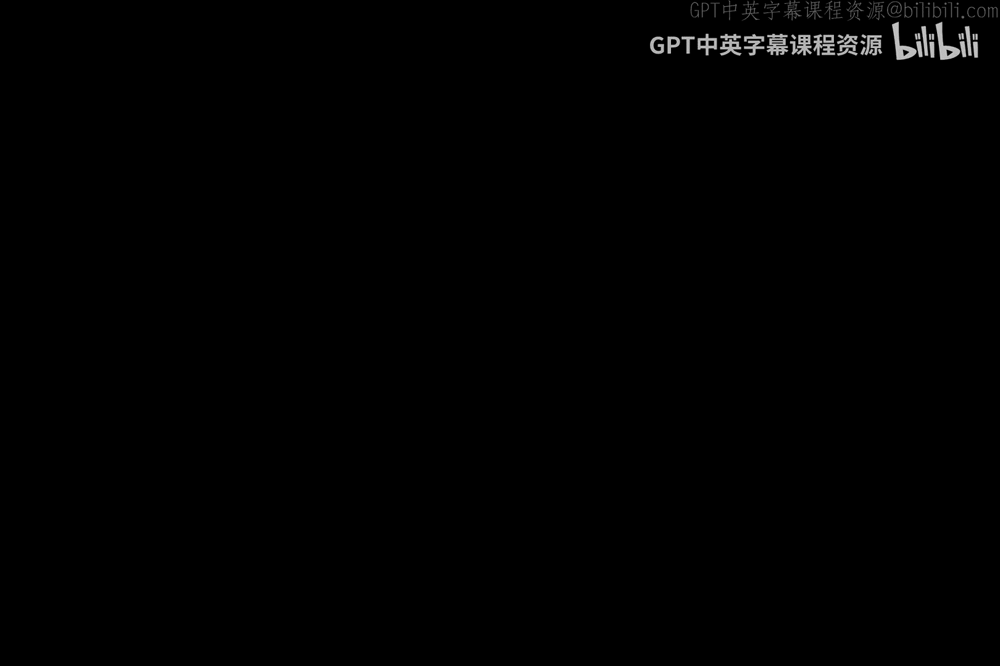
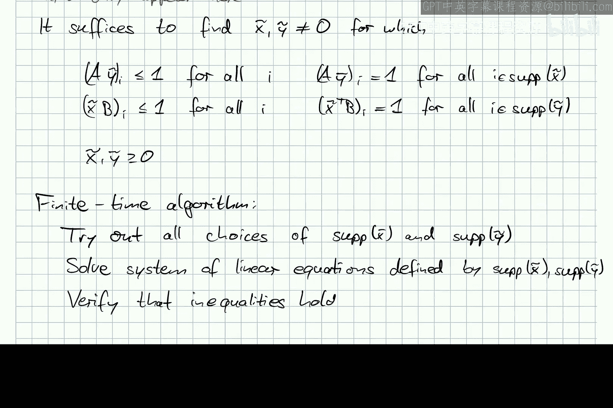
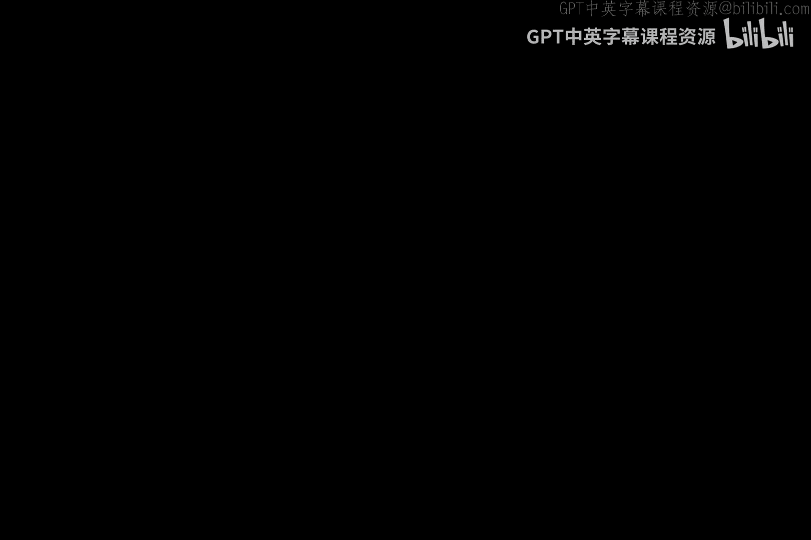

# 波恩大学《算法博弈论｜Algorithmic Game Theory, Winter 2020-21》中英字幕（claude-3.7-s p05 AGT, WS20_21_ Lecture 4 (Existence of Mixed Nash Equilibria).zh_en -BV1m9ZyYoENg_p5-

Hello and welcome back。I hope you remember that in the last lecture we introduced Norform games and we also introduced the notion of mixed naash color。

Today， we will continue talking about mixed na col Lib， and we will show that they always exist。

 Well， not， not always always， but。Actually。Hello and welcome back。

 I hope you remember that last time we introduced。Mix na Columbia in normal form games。

 and today we will show that they always exist in finite games。We'll come to this in a bit。

 but let's first recap what a normal form game is。So far。

 all games that we were considering in this class were actually cost minimization games。

 but you might as well consider payoff maximization games。 And as it turns out。

 this will be easier today to talk about these。Payoff maximization games。

 So what will this look like？Here， this is the definition of a normal form pay of maximization game。

So again， we have N players and each of the players has a set of pure strategies。

But instead of a cost function， the player now has a payer function。

 which we usually write as UI and now in a state S。

 so where each of the players chooses one of their strategies，This player eye has。PF U IFS。

So far we introduced this with cost CI and as a matter of fact。

 this is entirely equivalent because these payoffs may be arbitrary numbers as well as the costs maybe so if we just set CFS to minus U IFS。

 then we're getting exactly a cost minimization game so here the goal would be to maxim your payoff and this would be exactly the same as minimizing minus your payoff。

And this way， the notion of a mixed natural equilibrium and also of a pure natural equilibrium just generalizes in a pretty straightforward way。

But as it turns out for today， it is a little more natural to talk about payoff maximization that you actually want to get out of the game as much as possible rather than minimizing your own cost。

😊，What will also be useful today is this lemma that we proved last time showing that a mixed strategy Sigma I is a best response against some choices of the other player Sigma minus I。

 if and only if the pay of that this player is getting under Sigma I is no less than what this player could be getting。

If he or she switched to any。嗯。Any pure strategy S I prime。

So this means we always to show that a a mixed strategy is a best response。

 We actually only have to compare to。Possible deviations to pure strategies rather than comparing to all possible mixed strategies。

So what do we want to prove today Today will we will prove Nsh theorem which。

Tells us that mixed nationalcoia always exists。But this has a small caveat。

 namely they only exist if there are finitely many players and finite many strategies。

 finally many pure strategies per player。But if we have such a finite normal form game。

 then there is always a mixednaashcher equilibriumlib。Let's write this down。Every finite。

 normal form。Game。Has a mixed national equilibrium。And what do we mean by a finite normal form game。

 this means that we have finitely many players。And finite， many。Pure strategies per plant。

How do we prove such a theorem。Well， this now works in a very different way compared to proving the existence of pure naturallib and congestion caps。

Because what we apply now is a fixed point theorem， so we actually only do an existence proof。

 our proof will actually not be constructive in a way that we show， okay。

 this is the way you can find this aholder。More precisely， we will apply B's fixed font theorem。

What does that state？Every continuous function。F。😊，From D to D。Mapping。A compact。And convex。

Non empty。Subset。D， which is a subset of R to the M to itself。Has a fixed point。X star。

And wood has to hold for that。It has to hold that f of x star is equal to x star。So。

What does all of this mean。Maybe let's first just digest this theorem and let's understand what all of these things mean。

I guess you have an understanding of what continues mean。

 I hope you also know what compact and compacts mean， but nonetheless let's。

Go through all of these things slowly so that we actually see you。

What they mean and why this statement isn't actually extremely surprising。

So let's start with convexity。So we say that a set D。Which is a subset of R to the M。Is convex。If。

For all X and Y， which lie in D。And。哦， lambda。In the interval， from 0 to1。We have。

That lambda times xx。Plus，1 minus lambda。T y is in that set。So I hope you know what this means。

But let's see this in a in the typical example， this is a convex set， whereas this。Is not Why that。

Well。We could， for example， choose this as the point X or this as the point X。And here。

 this might be the point why， and this might be the point why or。

Any other two points would my choose？And now what happens？Well。Here on the left hand side。

 regardless of how we choose these two points。The line connecting these two points is always also in the set。

 So any point on the line connecting these two points is always。And in， in the head as well。

 whereas here。Well， for some points， this might be true， but for the two points that I chose。

 this is not true。If I connect the two， then there's， for example。

 this point here right in the middle， which is。Not contained in the set。O。This is convexity。

Now we also wanted to have that the set D is compact。So this is convexity。

 but now we also wanted that the setee is compact， what is that？D。Is compact。If it is。Closed。

And bound it。What。Does that mean well， we may have。

Two further things we have to explain namely close and bounded。 So what does clothes mean。嗯D is。And。

Is closed。If。8。If it。Contains。All its。Limit。What does that mean？Well。We consider。Any sequence。Points。

In that set。And this sequence should be converging。嗯。Which means nothing but that the limit exists。嗯。

Then， this limit。Is also contained in the setique。Good， this is closed。And what does bounded mean？

Well， that's something pretty straightforward， namely that it is bounded。

 so that there is an upper bound on the norm of every point in that set。Okay， what。

What norm are we talking about so it actually doesn't matter， so this might be any norm。For example。

 you might think of the Euclidean norm because that's often very natural to think about。

 although it might be easier to think of， for example。

 about the maximum norm so that every component has an upper bound。

 there is a component there is an upper bound so that no component ever exceeds any of these values。

Good。So let's consider a few examples in R to the one because that's。

Usually the easiest to think about。嗯。Which。Seets are compact there。 So which of them are close。

 Which of them are。Are bounded。Well。If we， for example， take the closed interval from zero to1。

 this is both closed。And bound it。Why is it bounded because no none of the points will have an absolute value bigger than one？

If we now take the。An interval that is open on one side or on both sides， then this is not closed。

Bird。In this case， it is still bound。So we now just excluded the zero， so it's still bounded。But。

It is not closed any more。 Why that， Because you could take the sequence of one over n。

 This converges to 0。All of the numbers one over n are contained in our set， but the limit。

 which is 0， is not contained in a set。 So that's why this is not closed。嗯。Alternatively。

 we might have the interval from 0 to infinity。This， again， is closed。If the0 is contained。Bd。

 it is not bounded。Of course。Because there is no upper bound。On the。

And the values that we see in that set。At the same time。

 all of these three examples are actually convex because on the reals。

 this just means that theres any to we have a connected interval。

If you have two disconnected intervals， then you won't be convex or if you just have。

 if any point in between is missing two points of the set， then you are not convex。

So the other thing that is important for the theorem is continuity of the function。What is that？

I hope。You still have the intuition of what continuity means。But let's write it down formally。

It is continuous at a point x， if for all apsilon greater than 0。There exists。A。Dubtta。

 greater than 0。Such that。For all。喂。The falling hos。If the norm of x minus y is smaller than delta。

Then。Also。The norm of F of x minus F of y is smaller than epsilon。

And a function is called continuous。If it is continuous。Okay it's the main。Okay。

 so now we have a function that is。Continues， and it's the main is compact and convex。

And what Brow picks fixed point Ethereum tells us is that there is always a fixed point。And。

On the reels， this is actually pretty easy to see because there， as I was already saying。

 the notions of。Convexity and。Compactness are very easy to understand， Let's see that。

Let's draw such a。Fction。In on the res。 So we'll have a compact set， which is nothing but a。

Close interval。A compact and convex set is nothing but a closed interval。And so， let's。Try to。

Visualize this here。 So we're mapping some somehow from this set。To itself。

So we'll also have the point。A here。And the point here be here as well。And what's another point。

 well。We now have a function that maps from。The close interval A to B to the close interval A to B。

 and it also continues。So what does this mean？Well。Somehow this function has to get from here。

 the graph of this function somehow has to get from here to here。And how will it get there， Well。

 it has to be continues。Somehow。We may have to draw this， just。Without any gaps。

 so what might this look like？We just start from here。And somewhere we get。To the right。嗯。

What is it that now happens， well。This function at some point。

 has to actually intersect the diagonal。Because it is continuous。

 so there has to be some interaction with a diagonal at any point。And what does this now mean， Well。

 for example， we have this intersection with the diagonal。 In my example。

 there are now actually two more intersections， but these are fixed points because here。

The function maps exactly to the same value。 So this is a point X at which F of x is equal to x。

So now we want to prove this theorem。That every finite normal form game has a mixed naa equilibrium。

 and we will use B fixed point theorem， which I hope we have now an understanding of。

So what will now be the crucial thing to do？ Well， we have to find this function F。

With a property that。The existence of a fixed point of this function means that there is a mixed nash at equilibrium in a respective game。

 So more precisely， we take any normal form game， and we somehow build from this this function F。

And then we know。That this function F has a fixed point。

 and we now have to construct this function F in a smart way so that this fixed point actually corresponds to a mixed naa equilibrium bit。

So let's do that。So we consider any。Norma form game。And without。

So we consider any finite normal form game。And without loss。Of generality。We assume。That。

Well on the one hand， it is a payoff maximization game。And。On the other hand， we assume that。

This set of players is numbered from one through n。And each of this sets S I。

Is numbered from one through M。So why do we do this， Well。

 now the set of mixed strategies can actually be understood as a subset of R to the M。

Where M is the sum of all these MI。好。So why do we do this？

We do this because now this set of mixed strategies of a player can be considered and the set of MI dimensional vectors or this set of all mixed states。

 so having a mixed strategy for all players， this can be understood as a subset of r to the M where M is now the sum of numbers of pure strategies that all players have。

Once again。The set。X。Of mixed states。Can be understood。As a。Subid。R to the M。For。

And being the sum of all players。Summing up their number of pure strategies。

So what does this mean well？I hope you remember that。 We understand。Mix strategies， just as。

M I dimensional vectors。 So a mixed strategy for player I is nothing but an M dimensional vectors。

 And let's now stitch these altogether together。 And then we have an M dimensional vector where M is the sum of these M I。

And now we have to construct this function F。Which maps these mixed states， Two mixed states。

 said that any。Fix point of this function corresponds to a mixed nash code。By the way。

 what we will do today is showing that this set X is actually compact and convex。

That's an easy exercise and that's something you might want to do yourself to actually figure out why is this not convex。

 Why is this set of mixed strategies actually a convex set。

 Why do I get if I take one mixed strategy and another mixed strategy and if I draw the line between these so do this mixing with the lambda that we had before。

 why is this again a mixed strategy， this is something that you might want to prove yourself。嗯。

So how do we define this function F？To define this， we now first define some auxiliary functions。嗯。

Let's first write down the definition。嗯。Let's take such a mixed state。A player。And an alternative。

Strategy and alternative pure strategy for this player。And we know it。Fee。Subscript iconma J of x B。

The maximum。Of0 and U I of J comma x minus I minus U I of x。What does this mean？Well。

 we are now playing。Suppose we are playing this。Mix state X。

And now consider one of the players eye and one alternative pure strategy for this player。

Then this player might unilaterally move to this pure strategy。

 and then his new utility or payoff will be the payoff。That they get。If that T gets。

 if he chooses J and the other still use x minus I。嗯。

And let's now compare this to the payoff that this player was getting before， this is U I of X。And。

Let's take the the maximum of this difference and0。 So this means。

If it is worse for player I to switch to the pure strategy J， then this is zero。

 otherwise it is how much this player actually gains from switching to this pure strategy。嗯。

I'm now claim that this is actually a continuous function。Why is that？Well。

 each of these functions Ui is actually continuous。

And that this makes this feehi also continuous because while this is then a continuous function。

 this is a continuous function， taking the max of two continuous functions still gives us a continuous function and why is the utility a continuous function？

😊，This is because。We can write UF X。As。A very long sum。

 so we would take the sum of all strategies of player one。And the sum of all strategies for。Player 2。

 and so on， up to player N。And then。We would multiply the probability that player1 is using the strategy up to player N is using this respective strategy。

 and then we have a pure state and then we just take the UIFS。

This is pretty obviously a continuous function in x。And therefore。

 also this fee functions are continuous。Okay， with the help of these fee functions。

 we can now define our F function that we were looking for。So now define。F of x equal to x prime。

So this will now be， of course， another mixed。Strateity factor。Having a mixed strategy。

For every of these players。And how much probability should player I put。On。Pure strategy， J， well。

This should be。How much he's putting on this before？Plus， the value of the phi function。

All of this divided by one plus。The same。F these。P functions。Okay。

 first thing to observe is that this x prime will again be a feasible mixed state。Why is this。

 How would you prove this？ Well， the thing that you should do is， first of all。

 see that all of these are non negative。Okay， that's kind of easy to see because everything that we're involving here will be non negative。

 so why should anything be negative？And then what you also have to show is that if you。

 for any fixed eye， you take the sum of all J。The same do you take the sum over all J of the x prime Ij。

 then this will sum up to1。And this is indeed， also true。And just because these XIj。

 they sum up to one， and then you get the sum of these fees， and this is exactly your denominator。

So this is why。We can observe。That x prime is， again， a feasible mixed state。

So this means that x prime is again， a feasible fixed mixed state。

And this means our function F is actually well defined。So F mapping from X to X is well defined。

Furthermore， this function F is continuous， Why is this because all of these phi functions are continuous。

 that's what we proved before。So， also。This。This sum and this ratio， this will also be continuous。So。

 this means。There is some X star。Such that。F of x star。Equals an x star。

This comes exactly from the fixed bond theoryorem。Great。Now。

 all we have to do is we have to show that this fixed paw actually corresponds pointss to a mixed na code。

How do we show that this is a mixed match quality？Well， let's use our P functions。

 What did these P functions mean， These few functions meant that。嗯。

The the value of the fee function means how much can I gain from。

Deviating to this respective pure strategy。 And if we show， well。

 you cannot gain anything from moving there， then we are in a mixed na。So once again， formally。

 we have to show that being a fixed point implies that the。

Subscript Icomma J of x star is equal to 0。 So this means that you cannot gain anything。

 player I cannot gain anything from moving to strategy J。

It might even be that this player is losing something， but we said， okay。

 this feehi value is never negative。If this player would be losing something。

 then we just set this value to zero。So。Let's do this。

Let's consider some fixed player and consider this。Player J prime。And this player's strategy， J。

 Prime， such that。U I F J prime command X minus I star。Is smallest。Among all J prime。But。To have。

A positive probability。So once again， we are now considering this fixed point。

And in this fixed point， we are now。Considering one of the players。

 and we want to show that this player cannot actually improve his or her payoff by switching to a different strategy。

 And as we know， we only have to compare this to pure strategies。

And we do this now by just considering all these fee functions。

And what we now do is pretty simple we now consider。

This this player has to put probability mass on some of these strategies and among all the strategies that this player is putting probability mass on。

 let's consider the one where he or she gets the smallest payoff。

If now this player moved to only playing always this strategy， J Priry。Now， there's。A smart move。

Namely， we can write the utility that this player I or the payoff that this player I is getting in state X star。

 this is equal。2。The following take the sum of all strategies， all his or her strategies。And now。

 take the probability。嗯。This strategy。And now consider only the probability in the payoff that you would get if you were always playing。

This strategy。This is true because the choices of the different players are independent。

And this allows us to actually now just move out the randomness of player I。

 so this is all the randomness of player I and all other randomness is still hidden inside this UI of J comm x minus I。

嗯。So。We can now write U IF X star like this。And what we can now do is we can now blow bound all of these things by what we're getting if we replacing Ui of j comma x minus I star if we replace J by J prime there。

Good。😊，Why is this true， well。What's。It's not entirely trivial to see this。

 but it's actually not complicated either， so take this quantity here。Well。

 if this x I comm a J star is greater than 0。Then we know that this UR term can only be bigger than the respective UR term if we replace J by J prime。

 or alternatively this x star icon comma J， this is0。

 and then it doesn't actually matter how big this is， so then we might as well replace it。So。嗯。

If we do all this。Then， we can write。This is U I of J comma X minus I star。

 Here we use that just these。X I star they sum up X I comma J star。 they sum up to exactly one。Good。

😡，What does this man mean。Let's now consider the Phi function。4 J prime。At the point X star。

 How is this defined， Well， this was the maximum。0 and。Youi。Of J prime come x minus I star。Minus。

U I F X。How big is this。 Well， this you。If we just use what we've just observed。

 we see that this is definitely at most zero， so all of this will be zero。Good。Okay。

 so far we haven't actually used that our point X star is a fixed point。

 and this is what we will use now。So far we only know that there is this one strategy J prime for which this P function is zero。

 and this is what we will exploit in just a minute。So now let's use that this is a fixed point。

We now have that。If we actually consider a component J。 prime。Then。Well， it is also also。

 this component doesn't change。Under if。The function， F。Okay。What do we know about this。

 Well we know that this phi I comma J of x prime that this is0。So we might as well drop this。Good。

And what else do we know？We know that this。X star of I comma J prime。 This is positive。

 This was one of our assumptions earlier because we were only considering the J prime for which this is positive。

 okay。So this is something that we might also apply。So we might。Just divide both sides by this value。

 And then we have that one is equal to one over。1 plus。The sum of these。Fee functions。

And if you know do the math。Then you see that this means that these Phi functions。

They all add up to 0。And this has to mean。That they are。 all of those are0， because otherwise。

 while we know that none of them is negative。 So how would this work in any possible way。

 Because for all of them。Are non negative so and if the sum is zero。

 this means that they all have to be zero。And this actually completes our proof。

Because now we've shown that all of these values。All of these phi function values are exactly zero。

Player I cannot gain anything from moving to any of his or her。Pure strategies once again。

 how did this work， Maybe let's quickly go over this again。

 because I find this a bit confusing always， so。Let's start from the top we find。

This function F in a smart way via this phi functions。 we find these phi functions to mean that。

The how much you gain from switching to this strategy， and then we observed， okay。

 we can construct a function F。And this function F kind of shifts probability mass so that if you can gain something。

 then gain then you move to this point， this is somehow my intuitive understanding。

 although this is certainly we are not saying that F is mapping X to a best response or so why aren't we doing this。

 by the way， because this wouldn't be continuous。We construct this in a smart way so that this still is continuous。

And we only slightly shift any mixed state towards a mixed state which is better unless the state we were starting from was a mixed national equilibrium anyway。

And then we identified one strategy which we used。This strategy was was the worst one among the ones that the player is actually using in a fixed point。

And among these。And。And we see， okay， the payoff of this player in the mixed strategy cannot actually be better or can only be better than the payoff of this worst mixed strategy。

A worse pure strategy。And then we use this。Because this means that for this。Strategy。

 the phi function has to be 0。 but as we are in a fixed point， still， somehow。

 the probability mass also on this strategy doesn't go down if we bulb put this entire hire state again through the function F。

 And this is exactly the point。 Why this has to be a。

Makeix natural equilibrium because even this strategy won't go down。

 So this means that actually one has to be happy with this point。 Apparently。

 even this strategy you wouldn't want to reduce your probability。 So this means that eventually。

 even the worst that you're playing， you're happy with。

 this means that you're actually happy with all of your strategies。Okay， so now we know that。

Mixed national always exists， but unfortunately， our proof doesn't come at all with any algorithm。

So we don't have any idea how to compute these。Makeix snash at Boivia and this is。Particularly。

Annoying now because there's even not a trivial strategy。

 a trivial algorithm that gives us something in finite time。For。Congestion games。

 even if you didn't know anything about congestion games。

 one thing that you could do to find a pure national equilibrium is just try out all possible states and then you might just find one。

 find a pure national equilibrium。But now， there are actually infinitely many。Mix states。

 So what can you do in finite time。Well， there are smart algorithms for this。

The only thing I want to explain to you now is what you can actually do in finiter time to still find a mixed natural code。

How do we do that， Well what we do is we consider a by matrixtrix utility maximization game。

Or payoff maximization gain。We have for a role player。 We have。A pay of matrix。お。

And also for the column player， we have。He。Pay of matrix。We now call X。The row players mix strategy。

And why the column players mixed strategy？The nice thing about all of this notation is that it is now pretty easy to write the。

The payoff that a player gets under this under these mixed strategies。

 So what we now have is that the payoff of the row player。

It is exactly equal to x transpose times a times y。And。The payer for the column player is equal。

Two x transpose times B times y。And to keep things simple， we also without loss of generality。

We assume that all entries。In A and B。Are positive。If they aren't。

 we just add the same value to all of them and then nothing actually changes。嗯。No。

We need some additional。Dfinition， namely the so called support。The support。

Of a mixed strategy is exactly。This set few strategies that this player is putting a positive probability on。

That the pure strategies that get a non zero probability。Good。😡，By the way。

 this is something that we also used in the proof of N there and there we also took one strategy in the support of the current。

A mixed strategyity。Good this now， with all of this notation。

 we can now rewrite our initial lamma that a best response is a， well。

 a mixed strategy is a best response， if and only if。😊，There is no better pure strategy。

That is better for unilateral deviation。We can once again write this down， No with。

Slide change in notation。So what we now have is that。X is the best response。To why。Give and only it。

4。哦。I， in the support of acts。If we take。The I component in the vector a times y this equal to the maximum。

Of all these entries， recall that time， any strategy that we're playing on。

And we playing has to be a bests paw。 So everything in the support has to be a bests paw。

 And this now means that。If we not take。This year， this is how much we would be getting if we were playing strategy I against。

Strategy Y。 So pure strategy I against mixed strategy Y。And this has to be。

No smaller than the best choice that we have here。Angoously。

 we may as well write the same thing for player Y。Or for the row player， sorry for column player。ok。

So this is a dilemma that we've seen before。Now， we can actually。Rer。

The problem of finding a mixed na equilibriumlo as。

Where by not just driving down some conditions that have to be fulfilled， and those are the falling。

So x comm a y。Wch is the pair。As。Mix strategies。Its a mixed na equilibrium。If I don there。There。R。

You and the。Which are positive， such that。Well， on the。First of all。Both players。

Put probability mass in total， which sums up to one。Then what we need。Is that。嗯。There the。

The payoff that you're getting from any strategy is no small than U for the row player or no smaller than V for the column player。

 and also that。The ones that are in the support， those give us exactly you， respectively。Exactly。V。

And also， those have to be non negative factors。So all we want to do now is we want to kind of rewrite this problem of finding these vectors x and y so that actually we eliminate U and V。

In all of this。Because how should we know UNvy？U。So。Write x till for x divided by v。Why Tiildy。

For why divided by you。And now all we have to find is the following。We will have to find。

Factors such that all the external is。S up to one over V。The white。

Components send up to one over a u。Every component of eight timesn y Tilde is atmost one。

Every component。Of x silly times B is atmost one。And。Every component。For which。

I is in the support of。Y til d， sorry， X tilD the this component has of a times x tillility has to be exactly one and analogously。

We have the same thing for y till times be。Gt。😡，So where are we now？Well。Effectively。

 if we are able to solve this down here， if we have a solution to this down here。

 then we can immediately get a solution to this up here。This is really straightforward because， well。

 just see what the external components sum up to then。

Divide by this or multiply I'm not sure and then you immediately get back here Okay。

 that's actually and the same thing with the with a Y tele。

 So if you have a solution to this down here， hum have a solution to this appear and then we're actually perfectly fine because if we have a solution to this appear。

 then we have a mixed nash code。We饭。Good。😡，So。How do we find a solution？Do this。Well， let's see。

 What do we actually have to do。We have to find a vector extility。And vector whiteilde such that。

Well。嗯。These things。Have to be true。What's written here on the right hand side。

 And then there have to be U and V such that this is true。But this year。

This is actually very easy to fulfill。Because this is the only point where U andV show up。So。

 only here。You andV show up。嗯。And whenever we have a vector x tli and vector y till for which these these things on the right hand side hold。

 then and furthermore， these are non negative vectors and all of the components and。And。

One of the components is strictly positive， then there have to be this UNV。So。

 it sufficeice as defined。X t the and Y T the， which should both be non0。For which。Well。

 these conditions that we had。Here， these conditions that we had on the right hand side。

 those still have to hold， so let's copy them。嗯。So here we are。And once again。

 we have a similar argument as before。When we have a solution to this down here。

 we immediately get a solution to this up there。And we know that if we have a solution to this。

To this here， then we have also a solution to what we had before。

 so we made from that actually also to derive a mixed an a pull。By the way。

I somehow forgot to mention that these should be non negative。

So we now already have a pretty simple algorithm to at least compute this in finite time。

We would try out。All choices。For that support。Of accidentally。And why to。

And then we just solve the system of linear equations。We usually would get a unique solution to that。

And then we have to verify whether also the inequalities still hold。

So this gives us at least a finite time algorithm to compute a mixed na code。

 namely try every choice for the support of external。

 every every choice for the support of Y totally and will then just do all this stuff this at least works in finite time because there's only finitely many choices for these supports。

 unfortunately of course though there are exponentially many，Which makes this an exponential timeout。

However。嗯。Results from complexity theory actually tell us that it is very unlikely for there to be a polynomials high algorithm。

For this problem， nonetheless， this is still not extremely smart if you just try out everything。

 you know， even if you have an exponential time algorithm it is often better to not try out everything blindly but follow some structured rule。

 for example， there is the so-called Lamca housing algorithm which actually builds up this support by moving one。

A strategy into the support one after the other and actually figuring out which gives the best improvement。

 and this is kind of similar to the simplex algorithm that you use to solve linear programs where you also have these basic solutions and you move one variable in or one variable out at a time。

But we won't cover this in class because。The thing that is actually most important to understand to understand the Lambcaha algorithm is the simplex algorithm and we won't cover the simplex algorithm in this class。

So this completes our discussion of the。Of mixed na equilibrium today we've shown that they always exist in finite normal form games and we've also shown at least an approach to compute those in polynomial time。

 nonetheless， sorry not in polynomial time in finite time。And as it turns out。

 there are other equilibrium concepts which are much easier to compute。

And maybe it's more reasonable to assume that。They are that players actually play these weaker notion。

 only these weaker notions of equilibria， because well they are actually computable and polynomial time and so on。

 this is something that we'll cover later in this class。

Thank you very much for your time for today and I hope you enjoyed this and you learned a lot。

