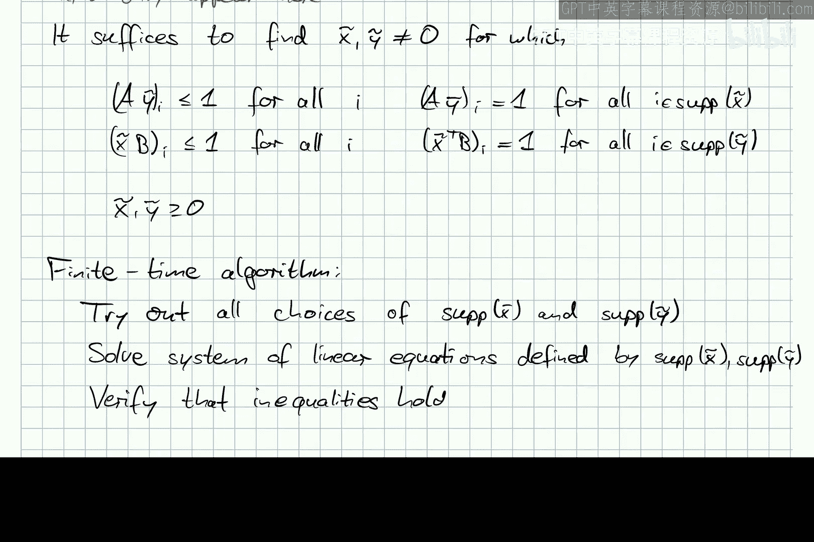

# 算法博弈论：4：混合纳什均衡的存在性

在本节课中，我们将学习混合纳什均衡。我们将证明，在有限策略集的博弈中，混合纳什均衡总是存在的。为此，我们将借助布劳威尔不动点定理。课程最后，我们还将简要探讨如何计算混合纳什均衡。

## 回顾：标准形式博弈与混合纳什均衡

上一节我们介绍了标准形式博弈和混合纳什均衡的概念。本节中，我们将继续讨论混合纳什均衡，并证明其存在性。

首先，我们回顾标准形式博弈的定义。一个标准形式的**收益最大化博弈**包含以下要素：
*   **玩家集合**：N 个玩家。
*   **策略集合**：每个玩家 i 有一个纯策略集合 S_i。
*   **收益函数**：每个玩家 i 有一个收益函数 u_i(s)，其中 s 是一个策略组合（每个玩家选择一个纯策略）。

这与成本最小化博弈是等价的，只需令成本 c_i(s) = -u_i(s)。玩家的目标是最大化其收益。

我们还需要回顾一个关于最佳响应的引理：一个混合策略 σ_i 是针对其他玩家策略 σ_{-i} 的最佳响应，当且仅当玩家 i 采用 σ_i 的收益，不低于他/她切换到**任何纯策略** s_i‘ 所能获得的收益。这意味着，要证明一个混合策略是最佳响应，我们只需将其与所有可能的纯策略偏差进行比较，而无需考虑所有混合策略。

## 纳什定理：混合均衡的存在性 🎯

本节我们将证明纳什定理，该定理指出混合纳什均衡在有限博弈中总是存在。

**纳什定理**：每一个有限的、标准形式的博弈都存在一个混合纳什均衡。
*   “有限”是指玩家数量有限，且每个玩家的纯策略数量也有限。

这个定理的证明与证明拥堵博弈中纯纳什均衡存在性的方法截然不同。这里我们将应用一个不动点定理，这是一个非构造性的存在性证明。

具体来说，我们将使用**布劳威尔不动点定理**。

**布劳威尔不动点定理**：每一个连续函数 **f: D → D**，如果其定义域 **D** 是 **R^m** 中的一个**非空、紧致、凸**的子集，那么该函数在 **D** 中存在一个**不动点 x***，即满足 **f(x*) = x***。

为了理解这个定理，我们需要明确几个数学概念：
*   **凸集**：集合 D 是凸的，如果对于 D 中的任意两点 x 和 y，以及任意 λ ∈ [0, 1]，点 λx + (1-λ)y 仍然在 D 中。直观上，连接集合内任意两点的线段都完全落在集合内。
*   **紧致集**：在 **R^m** 中，紧致集等价于**闭**且**有界**的集合。
    *   **闭集**：包含其所有极限点的集合。
    *   **有界集**：集合中所有点的范数都有一个上界。
*   **连续函数**：函数 f 在点 x 连续，意味着当输入接近 x 时，输出也接近 f(x)。形式化定义涉及 ε-δ 语言。

在实数轴 **R** 上，这个定理非常直观：一个从闭区间 [a, b] 到自身的连续函数，其图像必然与对角线 y = x 相交，交点即为不动点。

## 证明思路：构造不动点函数

我们的目标是利用布劳威尔不动点定理来证明纳什定理。关键在于构造一个合适的连续函数 **F**，使得 **F** 的任何一个不动点都对应原博弈的一个混合纳什均衡。

考虑一个有限的、标准形式的收益最大化博弈。不失一般性，我们假设玩家集合为 {1, ..., n}，玩家 i 的纯策略集合为 {1, ..., m_i}。所有玩家的混合策略组合的集合 **X**，可以看作是 **R^M** 的一个子集，其中 M = Σ_i m_i 是所有玩家纯策略数量的总和。可以证明，**X** 是一个非空、紧致、凸的集合。

接下来，我们分两步来构造函数 **F**。

**第一步：定义辅助函数 φ**
对于给定的混合策略组合 **x**、玩家 i 及其一个纯策略 j，我们定义：
**φ_{i,j}(x) = max{ 0, u_i(j, x_{-i}) - u_i(x) }**
这个函数衡量了玩家 i 从当前混合策略 **x_i** 单方面偏离到纯策略 j 所能获得的**额外收益**。如果偏离没有收益或为负，则函数值为 0。可以证明，每个 **φ** 函数都是连续的，因为收益函数 **u_i** 是连续的。

**第二步：定义函数 F**
现在，我们定义函数 **F: X → X**。对于输入 **x**，**F(x) = x'**，其中 **x'** 的分量定义如下：
对于玩家 i 和其纯策略 j，
**x'_{i,j} = [ x_{i,j} + φ_{i,j}(x) ] / [ 1 + Σ_{k} φ_{i,k}(x) ]**
这个构造确保了 **x'** 仍然是一个合法的混合策略（所有概率非负且和为1）。由于 **φ** 函数连续，**F** 也是一个连续函数。

根据布劳威尔不动点定理，连续函数 **F** 在紧致凸集 **X** 上存在一个不动点 **x***，即 **F(x*) = x***。

## 证明核心：不动点即纳什均衡

最后，我们需要证明，不动点 **x*** 确实对应一个混合纳什均衡。根据之前的引理，只需证明在 **x*** 处，对于任何玩家 i 和任何纯策略 j，都有 **φ_{i,j}(x*) = 0**。这意味着没有玩家能通过单方面偏离到任何纯策略来获得正收益。

证明的关键步骤如下：
1.  在不动点 **x*** 中，考虑任意一个玩家 i。在其**支持集**（即概率为正的策略）中，选取一个能带来**最小收益**的纯策略 j‘。即，对于所有满足 x*_{i,j} > 0 的 j，有 u_i(j‘, x*_{-i}) ≤ u_i(j, x*_{-i})。
2.  玩家 i 在 **x*** 中的期望收益 u_i(x*) 可以写成其支持集中各策略收益的加权平均。因此，u_i(x*) **不小于** u_i(j‘, x*_{-i})。
3.  根据 **φ** 的定义，这意味着 **φ_{i,j‘}(x*) = max{0, u_i(j‘, x*_{-i}) - u_i(x*)} = 0**。
4.  现在利用 **x*** 是不动点这一事实。对于策略 j‘，有：
    x*_{i,j‘} = [ x*_{i,j‘} + φ_{i,j‘}(x*) ] / [ 1 + Σ_{k} φ_{i,k}(x*) ] = x*_{i,j‘} / [ 1 + Σ_{k} φ_{i,k}(x*) ]
    由于 x*_{i,j‘} > 0，我们可以两边同时除以它，得到：
    1 = 1 / [ 1 + Σ_{k} φ_{i,k}(x*) ]
    这迫使 **Σ_{k} φ_{i,k}(x*) = 0**。
5.  因为每个 **φ_{i,k}(x*)** 都非负，它们的和为零意味着每一个都必须为零，即对所有 k，**φ_{i,k}(x*) = 0**。

由此我们证明了，在不动点 **x***，任何玩家 i 都无法通过切换到任何纯策略来获得正收益。根据引理，这意味着每个玩家的混合策略 **x*_i** 都是针对其他人策略的最佳响应。因此，**x*** 是一个混合纳什均衡。

## 计算混合纳什均衡 🧮

虽然我们证明了混合纳什均衡的存在性，但上述证明并未给出寻找它的具体算法。混合策略空间是连续的，无法像有限纯策略那样暴力枚举。

本节我们以双人矩阵博弈为例，探讨如何计算混合纳什均衡。设行玩家收益矩阵为 **A**，列玩家收益矩阵为 **B**。行玩家的混合策略为向量 **x**，列玩家的为向量 **y**。收益分别为 **x^T A y** 和 **x^T B y**。

利用最佳响应引理，我们可以将寻找混合纳什均衡 (x, y) 的问题，转化为求解一组方程和不等式。思路是引入变量 u 和 v 分别表示行玩家和列玩家在均衡中的收益，并利用支持集的性质。

通过变量替换（令 x̃ = x/v, ỹ = y/u），我们可以将问题转化为寻找非负向量 **x̃** 和 **ỹ**，使得：
*   **A ỹ** 的每个分量 ≤ 1，且对于 **x̃** 支持集中的 i，**(A ỹ)_i = 1**。
*   **x̃^T B** 的每个分量 ≤ 1，且对于 **ỹ** 支持集中的 j，**(x̃^T B)_j = 1**。

这为我们提供了一个**有限时间**的算法框架：
1.  枚举行玩家策略支持集所有可能的选择。
2.  枚举列玩家策略支持集所有可能的选择。
3.  对于每一对支持集，求解对应的线性方程组（等式部分）。
4.  检查求得的解是否满足所有不等式条件，并且是非负的。
5.  如果满足，则通过逆变换得到原博弈的混合纳什均衡 (x, y)。

然而，这个算法是指数时间的，因为支持集的选择有指数多种。计算复杂性理论表明，很可能不存在多项式时间的通用算法来求解混合纳什均衡。尽管如此，仍有更高效的算法（如Lemke-Howson算法，类似于线性规划中的单纯形法）可以在实践中求解，但这超出了本课程的范围。

## 总结

本节课中，我们一起学习了混合纳什均衡的核心存在性定理及其证明。
*   我们首先回顾了标准形式博弈和混合纳什均衡的定义。
*   接着，我们介绍了**布劳威尔不动点定理**，并利用它证明了**纳什定理**：任何有限策略集的博弈都至少存在一个混合纳什均衡。证明的关键是构造一个从混合策略空间到自身的连续函数，并证明其不动点就是纳什均衡。
*   最后，我们讨论了计算混合纳什均衡的挑战，并以双人矩阵博弈为例，展示了一个基于支持集枚举的有限时间算法框架，同时指出了该问题的计算复杂性。

这个存在性定理是博弈论的基石之一。然而，由于计算上的困难，在实践中，我们有时会考虑其他更容易计算的均衡概念，这将是后续课程的内容。