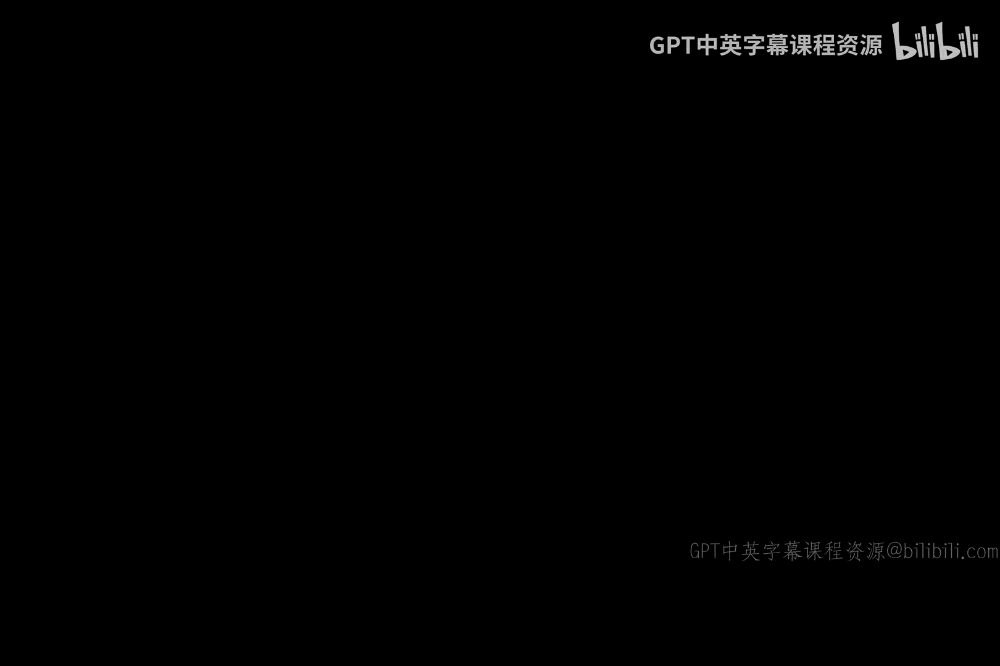
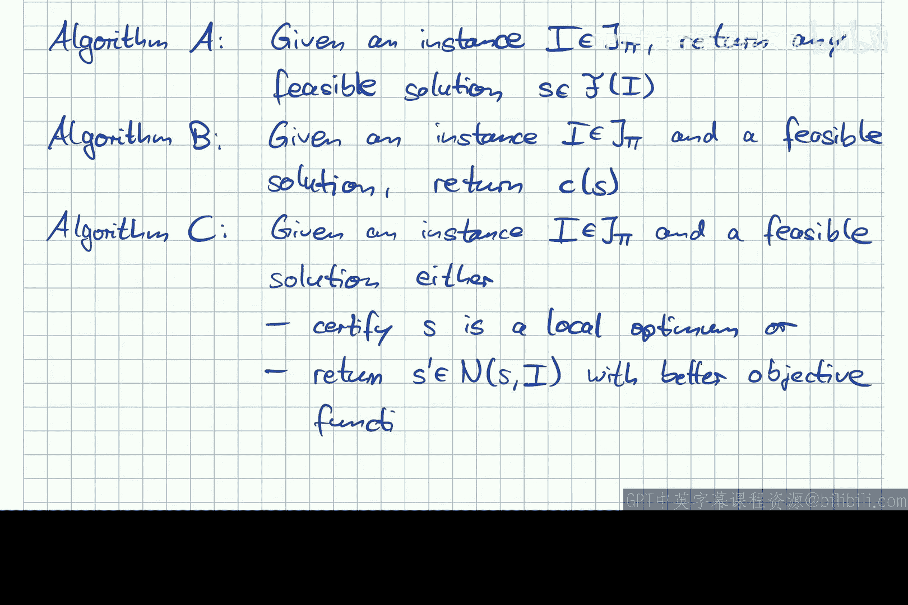
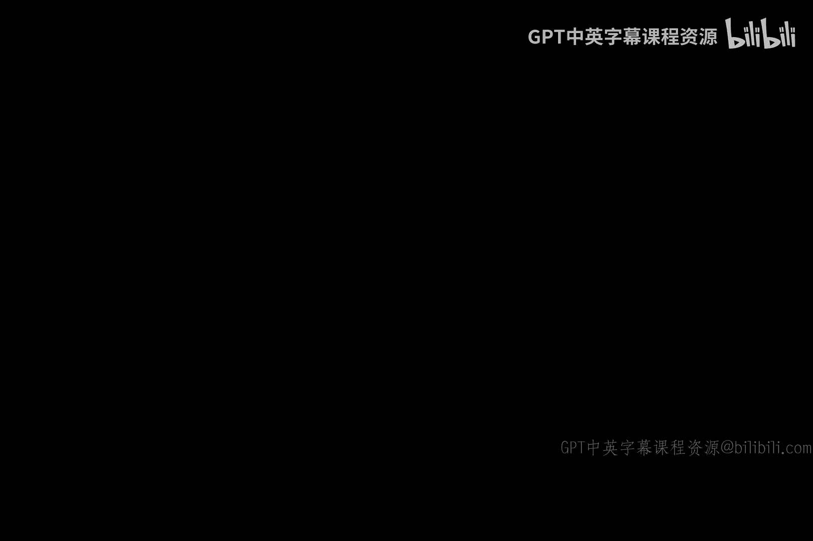
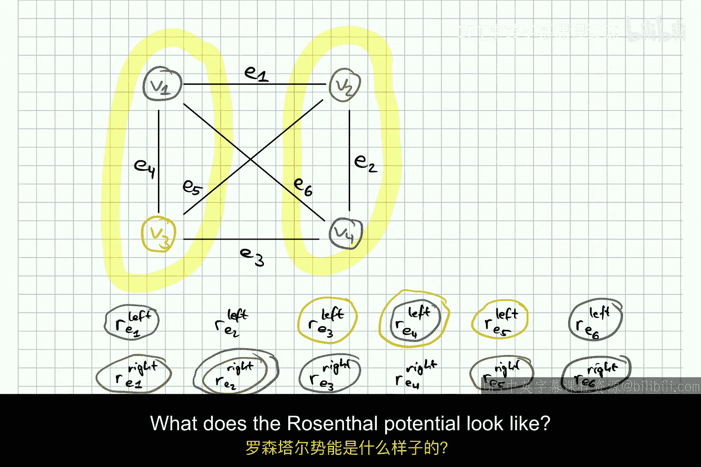

# 波恩大学《算法博弈论｜Algorithmic Game Theory, Winter 2020-21》中英字幕（claude-3.7-s p06 AGT, WS20_21_ Lecture 5 (Complexity of Pure Nash Equilibria in Congestion Games) -BV1m9ZyYoENg_p6-

Welcome back to AthmicInfield。Where are we so far， well。

 we've introduced congestion games and we've shown that there is always a pure natural equilibrium in congestion games。

Then we've introduced more general normal form games and we have shown that there is always a mixed national equilibrium in such a normal form game if the number of players and the number of strategies per player is finite。

But what we don't have so far is a polynoial time algorithm that lets us compute one of these equilibriumria。

And indeed， that's for a good reason， because it is generally hard to compute such an equilibrium。嗯。

But what does this mean to be heart。Does this mean these are NPR problems？Well， no。

 because NP what kind of a complexity class is this？

A NP is a complexity class about decision problems， so the answer will always be yes or no。

 but what kind of a question would this be because well the question is there a pure natural equilibrium in this congestion game。

 the answer will always be yes。So instead this is a search problem。

 which is something well fundamentally different than the decision problems that we usually deal with in the context of complexity theory。

 so let's see what complexity theory can offer us for such search problems。

 what are possible complexity classes for search problems。你好。So what are the problems like well。

 we're always given some kind of an input and then we'll have to search a solution to the problem in our input or。

In general， the answer might also be， well there is no such solution。嗯。And there is the。

Complexity class， F P。Which。Stands for。嗯。Function polynomial。

So this is what you know as SPP for decision problems。

Meaning that you can actually always find a solution within polynomial type。

Then there's also to the class。Of。F and P。Ho this different。 Well， this is now。

Capturing what you actually know as NP in the context of decision problems here now well。

It might be difficult to find a solution， but verifying that you have a feasible solution that is somewhat easy。

 So the bolts finding it is difficult， verifying that it is correct that is can be done in polynomial time。

 so kind of easy。嗯。B。So what he could now hope。Is that finding an equilibrium？So， finding it。

Mix na equilibrium in a normal form game or finding a pure natural equilibrium in a congestion game that this would be F andP hard。

 well， this is not quite true， but it is indeed hard for sub classes of F andP。Which are。

 on the one hand， P P D。And on the other hand， we have PS。So PPD。

 is this is a subclass of the problems which contains in particular finding a mixed natural equilibrium in a normal form game。

 and it turns out that。This problem of finding an equilibrium is actually a PPA complete problem。

 whereas finding a pureash equilibrium in a congestion game， this is a PS complete problem。

Today we'll focus on the discussion about P L S， but I hope that then you see that while P D is a little more complicated to define。

 but eventually， it is very similar to what P L S looks like。 And I hope you get an idea of。

How your one can actually model such complexity classes。No。There's one important thing， namely。

 how do you encode the input？And this is something that turns out to be important even in the P versus MP question。

 so in the decision problem because as you know， there's a notion like pseudopolynomial time。

 meaning that if you encode numbers， inary encoding， then suddenly。

 well the NApsack problem becomes poly polynomial time solvable。And there's a similar effect here。

 namely， how do we encode our problem？And what do we even consider polynomia at time？

And there's one important thing about congestion games， namely that you can actually。

Describe them very succinctly that while a for a general Nor reform game。

 you would for a by matrixtrix game， you would usually just write down the entire table。

But to encode a congestion game， you only have to specify the delay functions。

And this takes far less space in the input。 And this is why you will actually see。Well。

 going through the entire table of a pmetrictri game。

 figuring out if any of these is a pinaal equilibrium and which of these are， that's kind of easy。

 But in a congestion game， things are much more complicated just because。嗯。

The input itself is much smaller to represent this entirety。

And we've already seen this in the context of the length of the improvement sequences。

 that we had only one player， we had only M resources。

 but still there were two to the M different states， all of which could of course， might of course。

 be a Pna equilibrium。嗯。This is very important to keep in mind that it always matters how you encode the input。

So， let's now come to the。Definition of the complexity class PLS。

So how do we define a complexity class for a search problem。

 well this clearly depends on what kind of search problems we want to model and for PS we model problems which are local search problems and I hope this rings a bell because you might remember。

And that。Pionnaricallibbra are exactly local minima of the rosen top potential。

So all this is about is finding these local minima of the rosentar potential。

How do we generally model such a local search problem？A local such problem。嗯。Pie， capital pie。

Is given by a set of instances。Which we call。I。Subscript pie。And now， every。Instance。嗯。I。

In our script I sub。嗯。Has。Well， on the one hand， we have a finite set of feasible solutions。

Which we call f of I。Then we have an objective function。Which we call C。

Which maps any feasible solution。To an integer。And for every feasible solution。So， for。Every。嗯。Yes。

In the set F of I。We have a。Neighborhood。Which we call n of S comma I， which is。A subset。

Of the feasible solutions。And now we call such a solution， a local optimum。If， well。

 there is no better solution in its neighbourhood。啊。So a solution S。Is a local optimum。If。嗯。No。

 S prime。In the neighbourhood。His。Ftter than， as with。Respect。To see。The objective function。

So this might be a little。Informal at this point， why am I informal because I'm not actually specifying whether I want to maximize or minimize the objective function？

So that's why I'm just simply writing better than S。

 so if we want to maximize our objective function， then better means that to have a bigger value。

 if we have a minimization problem then our objective is of course or this here means that the objective function value should be smaller than this。

Or should not be smaller。So I hope you already realized that。These pnaricicalria， which we。

 which we well proved to be local minima of the rosenthal potential。

 those we can actually also consider。And to be this entire problem we can actually also consider to be such a local search problem。

 have that well。Well have as the instances the possible sorry S as the feasible solutions we have the possible states。

 the objective function will be the rose' top potential and the neighborhood will be the states that we read if only one player deviates because this is how we defined locality in the context of pinaally。

 but we can also define locality in an。Arbitrarily different white。

 And this is actually will be our first example， which will be a very different problem。

 But before we come to this。Let's first define what it means for such a local set problem to belong to the class PS。

Because PS requires something about the problem to be solvable in polynomial time， What is this？

So we now say that a local search problem。Hi。Belongs。To the class Ps。Which， by the way。

 stands for polynomial local search。If the following three algorithms exist。嗯。Well。

 we'll have algorithm a。Which is the falling。Given an instance。As a problem。

Just return any feasible solution。Then we'll have a B。Given an instance。And a feasible solution。ま。

We return CfS so the objective function value。And there is algorithm C。Which is。

The most complicated one。Given an instance。And a feasible solution。Either。2。Either we not say that。

S is a local optimum。4。We now return。As prime from the neighbour。

With a better objective function value。

Okay。So。How does it help us？To have these three algorithms。Well。

 there is a pretty straightforward algorithm now to。Find a local minimum。Use algorithm8。

To start from anywhere。And then， use algorithm C。To see， well。

 do I already have a local optimum or do I find something better in the neighborhood？

And because the objective function value always improves while I'm doing this。After finite time。

 because there are only finitely many feasible solutions。 After finite time， I'm reaching a。

A local optimum。So this is a truly simple algorithm and what you see is that actually every iteration of this algorithm takes only polynoial time because well we only run algorithms A B and C。

😊，But。What is not clear is how many iterations you'll have in general。

And this is exactly the thing that might not be polynomial and will not be polynomial。In many cases。

So now we know the complexity class PLs and what we have not seen is an example。

 well we've already seen that this looks pretty similar to these pureat calib and congestion games。

 but we'll come to this in more detail later on， but let's first see。

And an example of a problem which is completely unrelated to game theory or seemingly unrelated to game theory。

 which is max cut。 This is turns out to be a P S problem。 and not only that。

 it will also be a P S complete problem。And this is what well still have to define。

 What does it even mean for a problem to be appear S complete。But let's first introduce max cut。

So the problem max cut is defined as。So we define this as a local search problem。い。And。

We define it by it。Well， first of all， the instances we have to define。This is a graph。With aates。

Then we'll have feasible solutions。This is any feasible solution is a cut。And what is a cut。

 A cut always partitions。The vertices of the graph。Into two sets， namely the set that we call left。

And the set that we call right。Then we'll have the objective function value。

The objective function value。诶。A cut is。The sun。系。Etuates。With one end point。

In left and the other one in right。And will'll have the neighborhood。

And we say that two cuts are neighboring。If one can be obtaineded from the other。

By moving only one verex。그 주 인。Last and right。Okay。So。Let's see what this may look like。

Our instances are graphs。So let's see one example of a graph。我系 a。Verdex v1。We have a verdict 3，2。

We have a vertex V3。And we'll have a vertex b。And。Now we have some edges between them。

So we'll have now six edges and let's say that the weight。The edge I is equal to I。

So we do not have different cuts in this graph。What is a cut a cut is anything that splits these four vertices into two sets。

So we might， for example， put all of these vertices on the left hand side。

Or only one of them on the left hand side， the others on the right hand side。

Or we might even do something like this。we might take， for example。

 really this year on the left hand side and this here on the right hand side。

 we are free to do whatever we want to。What's the weight of this cut？ Well。

 which of the edges do we cut。We cut E1。We cut E5， We cut E6， and we cut E 3。

So what's the weight of this cut？This will be。1。Plus5 plus 6 plus3， so this will be 15。Good。

Is this a local optimum well？What are neighboring cuts？What could we do， we could， for example。

 move V3 from left to right or V1， we could move from left to right。

Or the four we could move from right to left or V2， we could move from right to left。

And if you're going to do this here， you will see， okay。

 this is actually a local optimum because if you now move V1， then you gain one plus 4， but you lose。

Sorry， you do not gain this one， but instead， how much do you gain， Well， you gain now this four。

But at the same time you lose one and six， so this is not a good idea。

Or you could move V3 then how much do you gain well again you gain four but you lose5 plus3 so that's also a bad idea or you could move4 then you gain two but you lose three and6 that's also a bad idea or you could move V2。

 then you gain two but you lose one at5 so none of these is actually a good idea。

This is why this is a local option。Bely， indeed。It is not a global opt。Because if we did， if we。

Did the cut like this。Then， suddenly。U we have a weight of four plus five plus6 plus two crossing the cut。

 which if I'm not mistaken， is 17 so this。Is better in terms of the objective function。As a cut bird。

It is not a neighboring cut to the one we considered before。

So that's why also the first one that we were considering is a local optimum。

 although it is not a global optimum。O。And now it turns out， well。I hope you're almost convinced。

 because。You may have seen。that it is kind of easy to verify that a cut is a local optimum or to make changes so that it becomes better。

In the by just one change， and this means that max cut is a PLS problem。So to prove this。

 we would of course have to once again show that all these three algorithms exist。Well。

 we will have we will need to have an algorithm that gives us any feasible solution， okay。

 that's easy。Just put all vers to the set left， for example。

You need to be able to compute the objective function value。 while that is also easy。

 You just have to， to sum the values up。 and then you have to verify that。

A solution is a local optimum or that you have to devise a local improvement。

 well then you actually only have to consider every single vertex and ask what happens if I move it to the other side？

Exactly as I did this in our example just a second ago， and this can also be done in polynomial time。

 and this is why this is a PLS probe。😊，However， it is not only a PLs problem。It is PLS complete。

What do we mean by PS completeness， well this is something we still have to prove to define because there is also a notion of a reduction in the PLS sense。

 which is kind of similar to the reductions that you know for NP。

 but things are a little different here because you do not only have to transform instances。

 but you also have to transform solutions back。Let's see how this works。So。

If we're given two PLs problems。Which we will call pi 1 and pi 2。There is a P L S。Reduction。Which we。

Right then。Pi1。Is。Rducible to pi 2， or you might also read this as P pi1 is not harder than P pi 2 in the PLS sense。

If there are。wo polynomial time algorithms。Yeah。And G。With the following properties。Arithm F。

Maps every。Instance。2。In instance to every instance of pi1 to an instance of pi2。Good。

And algorithm G。Maps。Every local optimum。S。诶。F of I。2。The local optimum。Gs。F I。Good。

Let's digest this for a bit。嗯。And let's also keep in mind how this works for NP。

 because there we kind of use a similar notion of reduction。

 which also transforms instances from one problem into instances of another problem。

But as I was saying， things are a bit different here。Because。U。How are things different？Well。

We have now two Ps problems and now we turn an instance of the first problem into an instance of the second problem。

And then。We have another algorithm that turns a local optimum of the second problem into a local optimum of the first problem。

This is kind of implicit in the polynomial reduction as we use it for to define NP because there we have the constraint that the way we map instances。

Yes， instances have to say yes instances， no instances have to say no instances。

Well here of course this all doesn't make any sense。

 so that's why we asked for this second algorithm to exist that somehow whenever we have a local optimum for the second problem。

 then we can turn this back into a local optimum of the first problem。

Why is this meaningful because one way of constructing an algorithm for pi 1？

If we have already algorithm 4 pi 2 is as follows。Compute F of I。

 then run an algorithm on that well salts F of I gives us a solution local optimum for F of I and then turn it back into a local optimum of I。

And of course， you see if。We have a polynomial time algorithm for pi2。

 and we have a reduction of pi12 pi 2， then we'll also have a polynomial time algorithm for pi 1。And。

Like in NP completeness。We now say that。A problem is called Ps complete if there is a reduction from every Ps problem。

To it。So we say that a prowl of pi star。NPS。Is called Pre， S complete。If。For every problem， pie。嗯。

N P。It holds that。Pi is P， S reducable to pi star。Once again。

 this time you can always read as is no harder than。嗯。

So this means every problem in PLS is no harder than in the PLS sense is no harder than pi star。

Which also means that， well， as I was sketching this。

 if we had a polynomial time algorithm to solve a local minimum for pi star。

 then we could actually we would have a polynomial time algorithm to find a local optimum for any problem pi in PLS。

Another thing is。About max cut。That max cut。Is PR S。Complete。So unfortunately。

 we won't prove this the in my class， but we will。See that this is actually very important for us because why this important now to show PLS completeness of any other problem。

 we don't actually have to show this kind of a master reduction from any problem to whatever we want to show PLS completeness of。

 but we'll only have to show we'll only have to show that max cut。

Ruces to whatever other problem we have here。Because then we can just use transitivity of the reduction rate。

So this is what we want to do next。We want to see that actually finding a P National equilibrium in a congestion game can be reduced to PLs。

Well first of all， we have to once again say that this is a PLS problem and then we show a reduction and this then proves that it is actually hard to find such a PLS problem that it's to find such a Pna equilibrium under the assumption that PLS isn't equal to FP that there are problems in PLS which are not polynomial time solver。

So let's now talk about Ps completeness of finding peer natural cagra in general congestion games and before we do。

Before we discuss the reduction， we of course， have to once again observe why this is a PS problem。

I mentioned this before。But once again， let's write this down。It is a P L S problem。嗯。To find。

A pure as equilibrium。In a congestion。Why is this once again。

 this is because purenalib are a local minimum of the rosen top potential。

So how do we write this as a P problem？What are our instances？Well。

 that every instance is a congestion game。Including。Resources。Delay functions。

What are feasible solutions feasible solutions are simply states。

 so every player chooses one strategy。What are。What are the neighboring solutions？Well。

 one player moves unilaterally from his or her strategy to a different strategy。

And what's the objective function， the objective function is the rosenthal potential。

And it is important now that we are now talking about local minima， whereas in the case of max cut。

 we are actually were interested in。We were actually interested in local maxima。

And that's something I should have mentioned also earlier that finding a local minimum。

For a cut solution that is actually somewhat this is actually not a PRS hard problem。

 it is even a polynomial time problem because you may know algorithms to compute a min cut。

 so only computing a max cut。Is difficult。Whereas now our goal is actually to minimize their own top potentials。

So this， I think is。Sometimes a little difficult to see here and at least to me this is also what makes these proofs that or the one proof that we will go through now。

 most confusing that we actually have to turn a minimization problem into a maximization problem and vicece versa。

So what me now claim？Is that。Max cut。Is no harder in the P S sense。Then。

The problem of finding pure natural equilibrium in congestion beam。Good。

What do we have to do to prove this， Well， we are not given an instance of a cut max cut。

 and well have to turn this into congestion game。So that it pure natural equilibrium of this congestion game。

Cars coupons to a local minimum of the max cut problem。Good， let's do this。Fortunately for us。

 max cut is rather easy to describe because we have only the graph and the edge weights。

We are given this graph。And the edge weights。We said that these edge weights are not negative。嗯。

And now we define the congestion game。Ephals。Well， what are the players？The players corresponded。

To the vertices， the graph。For。Each edge。We introduce。Two resources。One resource that is called left。

And one resource that is called right。And it's delay function。Here's as follows。For both the left。

And the right resource。We say that the delay is0。If only one player is using it， but it is W E if。

At least two players are using this。And now。Every player。嗯。Which means。A verdex from our graph。

As now two strategies。nameamely。They can play the left strategy。

Which means they take all the resources。All the left resources。Of the edges。

 whose endpoints they are。Or they can take all the right。Resources。Of edge the edges。

 whose end points they are。Good。Now。This means that a。

State or strategy profile of our game corresponds immediately to cut by that because every player has the choice between two strategies。

And the strategy means exactly what it comes to mean namely， it means either left or it means right。

Good， so。Now， what still needs to be done is actually to say， well， how do we get from any。嗯。

From any local optimum of this game。Back to a max cut solution。And well。

 it is pretty obvious how we should do this， namely， well。

 take any see what the respective players are doing and turn this into the respective cut。

But what does this mean regarding the objective function value。

 this is what we still have to discuss。嗯。So the cuts are， first of all， in。

In one to one correspondence。系。With the statess or the strategy profiles。But。What does this now。

 is it how is the weight of a cut mapped to the rosesn top potential and vice versa？So。

If we consider。A cut。Let wage。Don't you。The roads and potential。Of the associated state。Is how much。

 well， how do we get the rose top potential？We have some players using or some vertices being on the left hand side。

 some of them being on the right hand side， so some being using the left strategy。

 some using the right strategy。Now it turns out。Don't forget what the delay functions look like。

That the rosentha potential is exactly。Well， what would we do， We will take the sum of our resources。

And then take the sum of all players up to the number of players using this resource and then add up the respective delay values。

How big are these delay values。Well。For every resource， every resource is an edge in our graph。

 so only two players。Only up to two players may use this resource。Good。😡，Now。

 if only one of these players uses this resource， the delay is zero。

So this means that this term here。This is。Exactly。W E。If。Both end points。Are on the same side。And0。

 otherwise。And this means that this rosentar potential is nothing bad。The sum of all edge weights。

Of the edges that are not cut。And this means this is nothing but the sum of all edge weights overall minus the sum of the edge weights of the edges that are cut。

Once again， where is this coming from？The important thing is this part here。That actually。

The contribution of one edge to the。The and top potential is exactly W E。

If both endpoints are on the same side， because then we have we we'll always have here only zeros up to the point where k equals 2。

 k equals 3 will never happen because only two players may use a resource anyway。

So it only matters whether we have k equals2 or not in the sumu。

And this is it means exactly we have k equals two exactly if both end pointss are on the same side。

So。Due to this one to one correspondence， we therefore immediately have that local maxa of max cut correspond to local minima of the Rosenthal potential。

Good。And this already concludes our proof。So once again。

 maybe let's see what this visually looks like。This is the example that we had earlier。

 How would we now construct a congestion game， Well， we would now have in total。

12 resources because we have six edges。So we'll have the resource。A left。以王。And are right。以往。

We'll have R left。E2， I will have R right。以。We'll have R left。He three。And are right。以子。R。left。

E4 and R right。Before。We have R left。E5 and are right。E5。Are left。These6。And are left。It sorry are。

Right。E6。Get。😡，No。What does a cut look like？ So once again， let's consider。This cut。

What strategies are the players using？Well， the blue player， the V1 player， is on the left。

So he's using the left resource of E1， E4 and E6。Then we'll have the red player。Who's on the right？

So。They are using he won。Right。E 5， right。And E2， right。There's the orange player。

The orange player is again。The orange player is again on the left。So。Is using E4。E5。And E3。

And as the green player。The green player is on the right。So they are using the right resource of E2。

E6。And E 3。And where are we now， well， now。Each of these pairs of resources。

Is used by exactly two players and all that matters is how do the two players split up between the two sides？

So what we see here。Is that。If an edge is not cut， then the two players are using the same resource。

 if it is cut， then they are using different resources。

What does the rosenha potential look like well。We'll have。Oing。

One player on each of the resources corresponding to E1。

 so those won't contribute anything to the roads have potential because the delay is zero。

Here for E2， this is different because there are both players on this resource。

 so we'll have a contribution of0 for the first player and then of two for the second player。

 so this gives us already a roses into our potential of2。For three， five， and six。

 it is just what we know。And that while only one of the players is using every of these resources。

 so those won't contribute anything， whereas for E4， this is again different。

 both players are using this left resource。So we'll get a contribution of four to the Rosental potential。

 So if we take the sum， then we'll get overall。A rose into top potential of6。

And where is this coming from， well， this is exactly nothing but the sum of the edge weights of the edges that are not cut。

And the edges that are cut。 those have one plus 5 plus 6 plus 3。 This was。I hope you remember 15。

 and overall， the sum of all of our edge weights， this is。21。So by the way。

 what you see here is that this is， well， it is a congestion game。

 but it is not a network congestion game。many of our examples of congestion games were actually network congestion games。

 so we had a source and a sink in a network and players wanted to get from the source to the sink。

Maybe they have different sources and things， or they are all the same then this is a symmetric network contion。

You might not ask， well， is it also hard to compute an equilibrium in a network congestion game？Well。

 generally， yes， it is。Because you can somehow transform all of this also into a construction that works in a graph with sources and sinks。

But this will not be a symmetric network congestion game。

 and this is for a good reason because we already have a polynomial time algorithm to compute a pt equilibrium in a network congestion game。

And that's why it is very unlikely for this problem。To be also PLS heart， PLs complete。

 because this would mean that。PRS is equal to F。Good。

So this completes our study of the hurricanes of E。

We've got to know a complexity class Ps and as I was saying。

 there's a similar complexity class PD to capture the hardness of mixed national equilibrium in normal form games。

 This is all a little。More annoying， I want to say to define。

 but eventually it is not a lot different。So I hope that you get the spirit。Of course。

This is actually somewhat disappointing that we now see okay。

 computing equilibrium is hard because this means， well。

 why should the players even play such an equilibrium if it is hard to find how。

 how should these players have the。Amazing ability to find this in。Well， fortunately for us。

 there are other equilibrium concepts which are easier to compute。

 these we'll introduce next time and then eventually everything that we will do afterwards。

Holds for actually all of these equilibrium concepts。

These easy ones as well as the ones that are easier to compute。

 which generalize na equilibrium So this is what we will do next time。 hope to see you then。

Or hope that you're still watching then and。If there are any questions in the meantime。

 please do let me know and have a nice day， bye。