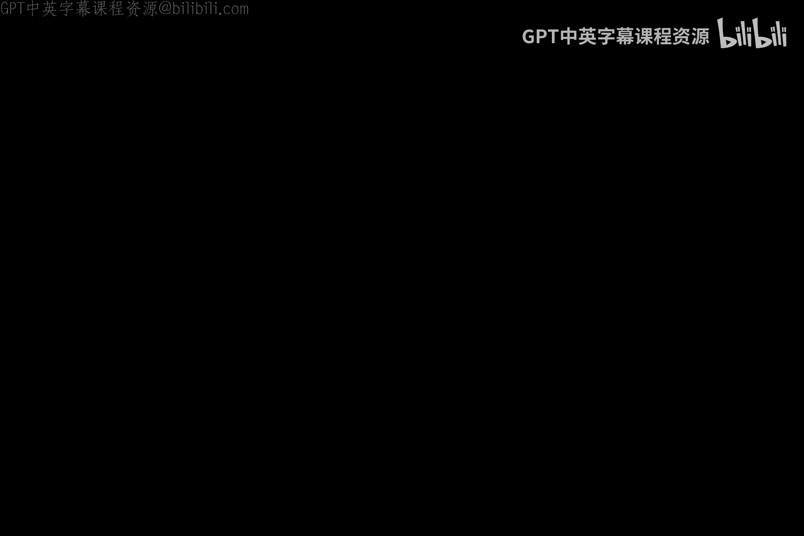
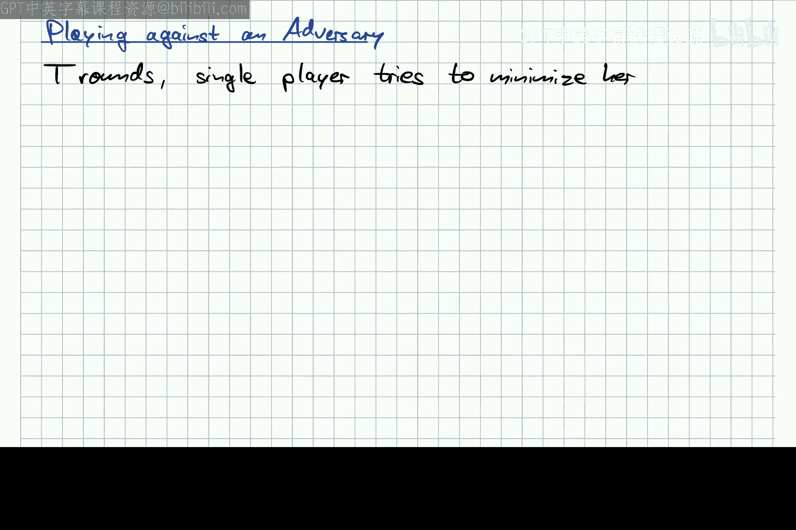
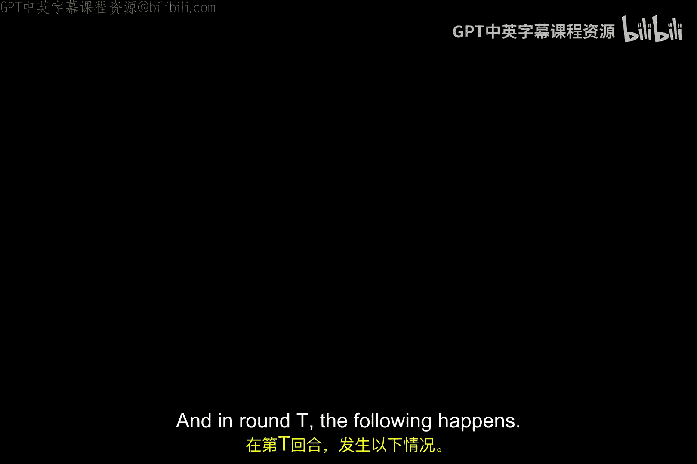
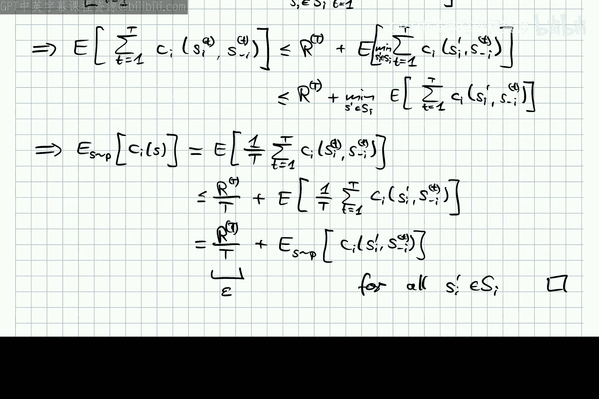

# 波恩大学《算法博弈论｜Algorithmic Game Theory, Winter 2020-21》中英字幕（claude-3.7-s p07 AGT, WS20_21_ Lecture 6 (Correlated Equilibria).zh_en -BV1m9ZyYoENg_p7-

Welcome back to algorithmgth making theory。So far we've seen purena equilibriumria and we've shown that they always exist in congestion games。

 we've seen mixed na equilibriumria， which always exist in finite games。

But then we've also seen that equi are generally hard to compute。

 we've seen this in the example of pure na equilibrium and congestion games， but as I was saying。

 similar hardness results also hold for mixed na equilibrium。

Today we'll get to know another class of equiria namely correlated equiria。

 and we will show that they are actually easy to compute。

Let's just start with a simple example of such a correlated equilibriumli。Namely， I want to consider。

第一。Biometrictri game， chicken。Here we have again two players。And these players， both of them。

 have both the same strategies， namely they can。Cross。Or they can stop。

And what's the story behind this game？There are two car drivers approaching an intersection。

And what can they do Well， they can decide to cross or to stop and if they cross。

If they both decide to cross， then there will be an accident。

This comes with a pretty high cost for both of them。Namely， let's just say 1004 a d for this example。

Or they can decide to stop。Well， if I'm the one who stops， then I have a cost of one。

 So still a cost， but much less than in the case of。An accident。

but the other one who crosses doesn't have any cost because， well， he or she can go right ahead。

So of course， if we are the one two。Cross， whereas the other player stops， then。

The other player has a cost of one because he or she needs to wait， but we don't have to wait。

 so we'll have a cost of zero。Or there's also the unlucky then that both of us stop。 Well， then。

We both have a waiting cost of what。So what are purenalib in this scheme？Well。

 there are actually two pureion ash equilibriumary。Namely。

 it is too that one of the two players crosses and the other stops。Okay。

 and there's also another mixed naash equilibrium。And。Of course。

 the two purena col are also mixed na co。And in these， well have the probability to。Stop is。嗯。

99 of 100 for both players。And， of course。Crossing has a probability of one of the hundred。So。

Is this what we will typically see in a traffic situation？Well。

 maybe we see one of these two pinaal col namely if there's a way of right if well one of the streets actually has the privilege to go first okay。

 thats that's an easy thing， I guess we will hopefully never see the situation where well both players just toss a coin before approaching the intersection and then decide。

 okay， I now stop or I don't stop。But what will often happen Well often there will be traffic lights。

 and these traffic lights just tell us what to do。 And it is actually a good idea to follow these traffic lights。

😊，Because。If we don't， then there will be an accident。

And this is exactly what a correlated equilibrium can be thought of or also a coarse correlated equilibrium。

 these are actually identical in this kind of a game here， but we've come to the difference in a bit。

So what is a correlated equilibrium， a correlated equilibrium is now a probability distribution over the states。

So far， we had。Mix natural colorgra， which were probability distributions over， oht know， which are。

And vectors。Or profiles of probability distributions of strategies。

So this means that actually also a mixed natural equilibrium assigns a probability to each state。

 but the probability is computed in a pretty clear way。

 namely we take the product of the respective probabilities that all of these strategies are played。

So let's see this in the example here， we have a probability of。99。Over 100 times 99， over 100。

That the bottom right square is played， and then。For the top left。

 we have a probability of one over 100 times one over 100。And then， we have。For the other two。

We have a probability of 99 over 100。Times one over1 hundred。Good。

 so this is also a way we can think about a mixed natural equilibrium。

Namely that theses assign probability distributions to each of the states and also a pure National equilibrium does this。

 but it does this in a pretty trivial way， namely it just puts a probability of one to one of the states and zero everywhere else。

Good。😡，Now， correlated equilibrium does exactly the same except for not being a product distribution。

So how can this look well？Let's change this example here。We might not say， okay。

With no probability at all， both players cross or both players stop。

 And now say with probabilityable D a third， the row player stops， and the column player crosses。

 and with probability  two thirds， the row player crosses。And the column pla stops。

This I claim is a correlated equilibrium or this is an equilibrium and what we will later see。

 we will call this a correlated equilibrium， why is this because well you always want to follow this recommendation。

If the traffic lights tell you to stop。Then you actually want to stop。

 If the traffic lights tell you to cross， then you want to stop because， well。

 there's something smart in the traffic lights that prevents。

That both players cross or both players stop at the same time。There's of course， the question， well。

 in some other game， where do these traffic lightss come from， we come to this。

 but let's first define the notion of a correlated equilibrium more formally。

So let's not define a correlated equilibrium formally。

This will result in a hierarchy of equilibrium concepts because we've already seen two equilibrium concepts。

 including pure na equilibrium and mixed na equilibrium。

 every pure na equilibrium is also a mixed naash equilibrium and then we will see actually the way we define that every mixed na equilibrium is also a correlated equilibrium and every correlated equilibrium is also a coar correlated equilibrium。

But what is a？Correlatedated equilibrium。A correlated equilibrium。Of a cost minimization game？

By the way， we can also define this for cost maximization gain for。Pay of maximization gains。

This just works exactly the same way as we've seen this before。This is a probability distribution。P。

On this set of strategy profiles。一い。嗯。Or states， as we also call them。So， this is the。

Cartesian product。Of all。Dragy sets。Such that。For洱。Every player。And every strategy。

And every deviation。We have。The expected。Cost of player eye。When playing， according to。P。

You're conditioned。On player I playing S I。This is， at the most。The expect cost。

Where player I now plays S prime instead。So let's digest this a bit。

As we've seen in our example before， we have a probability distribution over strategy profiles or states。

 So this means to every。Grid cell and our by matrix game we associate a probability。

And what does this now have to have as a property？ Well， for every player。

And every strategy we have to have that for every deviation that we might consider。

The expected cost that this player incurs。嗯。Whenever he's playing strategy S I is at most。

The expected cost that he's incurring whenever he's playing SI prime instead of SI。So。

 that's something。Actually。A little hard to digest at the first time， so what does this even mean？

Well， we now have this probability distribution of our states。

And let's now consider what happens when this probability distribution is telling player I to play strategy ESO。

In that case。Whenever the probability distribution。I's telling him this。 Then this is the expected。

Cost。And what this player could now do is， well， this player could now say， well。

 instead of taking strategy， I now always take strategy S I prime。

So this is just swapping one strategy by another one。We can also write this in a different way。

 maybe that is sometimes easier to follow。Namely， we can also write these conditional expectations。

As take the sun over all。Strategy。Of the other players and now consider the probability。

If S I comma S minus I， take the cost of player I。And then。We would divide this。

By the probability that。S I is played at all， which is exactly the the sum of all probabilities of。

Any profile of the form S I come a S minus I prime where we just take any possible S minus I。

 So this is exactly this conditional expectation of the left hand side。And on the right hand side。

 we would have。Kind the same。We would again take the sum over all choices for the other players。

 we would now consider SI prime。As minus sign。And then the cost of S I prime。And E。啊。H， once again。

We divide this。By the irrespective probabilities。Oh， I made it。Big mistake you。

So I wrote it this way。And this is incorrect。Why is this incorrect？Well。

This would mean the probability that S I prime comm S minus size plate。

That this is not what we mean here。We mean。The probability that S come as minus size plate。

And then the only thing that we do is when such a thing happens。

 when the probability distribution actually tells us。To play S I， then we play S I prime instead。

 and we get this。According cost。一。Good。Now there's another very similar definition of a coursear correlated a Holybu。

A coursear correlated equilibrium。Of a cost。minimization game。This is also。

A probability distribution。P。On the set of strategy profiles。Such that。For every player。

And every deviation。We have。在地。Expect it。Cause。When you play according to what the probability distribution tells you to do。

 this is at most the cost that you have。If you。Always play as I prime instead。

So I think this is a little easier actually， to understand。😊。

Because now we have the probability distribution。On the set of states。

And this now tells us to do something。And。What might we do alternatively， Well。

 we might also just say， well， totally ignore what the probability distribution is telling us to do。

 We just always play， as I prime instead。 So regardless of what this probability distribution is telling us to do。

In the correlated co room， this is a little different。Because let me go back。There。We consider。

 well the probability distribution tells us to do something and we actually have a look at this and then we see。

 okay， this now tells us to do SI and let's now do SI prime instead。

And what you observe here is that every correlated equilibrium is also a coarse correlated equilibrium because here you might as well。

 okay it's not entirely trivial to see at this point if you're not familiar with this。

 but here you're actually having a closer look at what the probability distribution tells you。

 and you are more flexible because you can say whenever the probability distribution tells me to do a。

 I do B instead。In the coursearse correlated with the equilibrium the。

The way you think about this is it only。Regardless of what the probability distribution tells me to do。

 I always do be instead。And because of this。There is now a hierarchy of equilibrium concepts。靓女。

We have Pionana colria。Then we have mixed na equilibrium。

 every purena equilibrium is also a mixed na equilibrium。Then we'll have correlated equilibrium。

 every mixed na equilibrium is also a correlated equilibrium。

 and then we'll have coarse correlated equilibrium every correlated equilibrium is also a coarse correlated equilibrium。

We've seen many examples that not every purena equilibrium and not every mixed natural equilibrium is also purena equilibrium but the same thing also holds for correating equilibrium and mixed na equilibrium。

 for example。😊，If you go back to the example of chicken there we've already seen one further correlated equilibrium。

Wwhich was not a mixed na equilibrium because it was not a probability distribution sorry it was not a product distribution。

 what we would always have for a mixed na equilibrium。

So let's now go over a bigger bigger example of。A bymetrictrix game in which we can see different purena equilibrium makes na col correlated equilibrium and coarse correlated equilibriumlib。

So we'll have three strategies， both the row player and the column player， it's a。比。And see。

So what's the general structure of this game well there are actually two kind of disjoint parts？

What you never want to do is if one of the two if the other player you're playing with play C。

 then you always definitely want to play C because otherwise you have infinite costs。Or if。

The other player plays A or B。 Then you want to play B or A， so。This is what you see here。

 if the row play plays， for example， A， then u as the column player want to play B。Or if they play B。

 then you want to play A。嗯。So what are Pu and N Columbia here？Well。Let's see。 We just have。

In general， nine options for a pure naturalal equilibrium。

 and we can just mark again the best responses。And。What happens if the row player plays a。

What is the best response for the column player？It is a。嗯。Good。If the role player plays B。

 what is the best response for the column player？Well， it is B。If the row player plays C。

 then the best response for the column player is C。Now， if the column player plays a。

 then the best response for the row player is。I B。If the column player plays B。

 then the best response for the row player is a。And if the column player plays C。

 then the best response for the role player is to also play C。Good。

 so there is only one pure National equilibrium， namely both players play seat。Good。

There is another mixed natural equilibrium here。In which both players play A and B with probability a half。

막。Good。What does this mean in terms of probability distributions of states， well。

 this means that while the p equilibrium， that's just a probability of one down here。

The mixed na equilibriumlib means that we have a probability of a quarter year， year， year and here。

First。And there are many more correlated and coarse correlated equilibrium equilibrium。For example。

What we might do is we might play。Each of these was probably only in eighth。

And played this down here with probabilitybil a half。This is a。Crerelated the equilibrium。So。

This would be play A comma A。Hey， can we be。B佢嘛 a。Be can be。With probability。One over eight。Each。

And we also play。C come C with probability a half。Why isn't this a mixed national equilibrium well。

Because this is not a product distribution， there is no way of setting probabilities to A B and C such that you end up with this probability distribution over the cells in your table。

 because whenever you would do this， you would also have some probability mass。

Here or here or here or here。Indeed， there is also a correlated equilibrium here。

 a coarse correlated equilibrium， which is not a correlated equilibrium。

I'm not sure if I mentioned this explicitly enough this is just one more correlated equilibrium。

 there are many more here， which you can actually construct in a very similar way。

 but there is also one more correlated coarse correlated equilibrium。

 which is not a correlated equilibrium。And that would be play a commma a。And see can see。

With probability。诶系。Each。Now， what's the difference between these two equilibrium notions？Well。

 let's see this in this example。We have this correlated equilibrium， which just。

This assigns probabilities to each of the states。But what then would be a possible deviation is that this correlated equilibrium tells us to sometimes play。

 for example， this it tells the row player。 Okay， now play B。

This might be because we're playing now one of these two。And then this player could say， okay。

Probability distribution may tell me right now to play B， but I want to play A instead。

 or I want to play C instead。But this deviation doesn't affect what happens when the probability distribution tells them into play A or C。

Now there's this equilibrium here， which only tells us sometimes to play AA and sometimes tells us to play C。

What's happening there？Well， the only thing that the player may not do is let's consider。

 for example， the row player， the row player might now say no， actually， I don't want to do this。

 I want to play B instead， but then you're always playing B。

And this means sometimes you're actually you're moving to this cell because sometimes the probability distribution tells you to play CC。

 so the other player will be playing C， and this means you will be moving to this cell。

So your deviation is restricted in the sense that you can now only choose to always deviate to this strategy。

 whereas in a correlated equilibrium， you may choose depending on what the probability distribution is telling you currently what to do。

Of course， still， you don't know what the probability distribution is currently telling the other players。

So here you cannot say， okay， the probability distribution is now telling us to do a comm a B。

 so I will do a instead， that's not what you can do the only way you can deviate is the probability distribution is now telling me to play A but I want to do B instead。

 but still I don't know what the other player is doing。

 I just know the probability distribution over what this player is doing。So you may not think。

How on earth should anything happen like this that there is a probability distribution that tells us what to do？

Well， I。Unfortunately， I have to ask you to wait for another bit。

 but later today we'll actually see that。AndBy very natural dynamics。

 we will converge to such coarse correlated equilibrium， or in a slightly modified way。

 one can also converge to correlated equilibrium。 So this is not as artificial as it may seem at the first sight。

But before they wedo this， let's first discuss how we can actually compute these equiria。

 these correlated equiria very easily in polynomial time。😊，对。

The nice thing about correlated equiria is that they can be computed in polynomial time。

 and we can do this via linear programming。 So let's see how this works。

And let's first write down our theorem。There is an algorithm。嗯。To compute。

A correlated equilibrium equilibrium。ho was running time。Is polynomial？And the number。

Have strategy profiles。Get。And as I was saying， we will now use linear programming。嗯。What did the。LP。

 sorry， what does the equilibrium require us to have。嗯。Let's recall the equilibrium condition。

We we now require that。For all。S嗯。S I。For all let's first start with all players， I。

And all S I and S I prime。We have that。You cannot gain。From unilaterally deviating。From what deeps。

Probability distribution is telling you to do。And I'm writing now this。With x。

 because x is supposed to be my variables。So far we're using P at this point， now we're using X。

Because once again， as I was saying， these will be the variables of our LP。Good。😡，We use the X as。

Has variables in a linear program。Yes。Now these are not linear constraints because we still divide by something。

 but fortunately， the denominator is the same on both sides。So， we might as well。

Multiply this by the denominator and then we get linear constraints。U。

So what will be our constraints？We winna have that。The numerator。On the left hand side。Heres at most。

The numerator。On the right hand side。And this has to hold for all。I and N。S， I and S。Capital S I。

 and also S I prime。In capital S。Good。Now， these are the equilibrium constraints。

What else do we want， Well， we want this to be a probability distribution。

And what does this mean to be a probability distribution well？This means that。第一。

Probabilities actually have to sum up to exactly one。Now。嗯。Let's just say。Theyace them up to。

At most one。 And also， they have to be none negative。And。How do we complete this， Well。

 the smart thing now that we can do is we can just turn this into actually an optimization problem by saying。

 okay， maximize。The sum of all probabilities。Subject to these equilibrium constraints and that the probability is no more than the overall probability is no more than one。

Does this？Lar program always have a solution。Well， it does。Of course。

 because you could set everything to 0。 So that's pretty straightforward。 There is always a solution。

 but there is also always a solution which gives us objective function value  One， namely。

 we know that there is a mixed latter code。 So take。😊，And mixed natural equilibrium。

 this will correspond to a solution of objective function value 1。This means if we now solve this LP。

 we will find a solution with objective function value1。

And this then corresponds to a correlated equilibrium。Of course， at this point， you may ask， well。

 how long does this take？Well， at this point， it is enough for us to see。

 well this is we have only polynomally many constraints and variables in the number of strategy profiles that we have。

And this makes us happy for the time being to compute this。this correlated equilibrium。

 there are smarter ways to do this where you actually get some bounds that only depend on the number of strategies。

 but let's not bother about this for today， I hope you see that here you can do something that you cannot do for mixed national equilibrium。

 because even there in bio matrixtrix games，You cannot compute a。

Mixed na equilibrium in polynomial time unless our assumptions about from complexity theory aren't actually true。

Yeah， why doesn't this actually work in the context of mixed na equilibrium？Well， the thing is。

A mixed natural equilibrium work require you that these acts as those are actually correspond to a product distribution。

And this ist possible to encode in linear constraints。So what you might do is you might either say。

 okay， we have a probability for each strategy for every player。 But then you would have like here。

 you would have products of probabilities， or you want。Need a smallerer constraint that this。X， S。

And codes actually a product distribution and not just any probability distribution over your strategy profiles。

So this is why you can actually compute。Correrelatedated equilibrium much more easily than makes na equilibrium。

So now we've seen that， indeed。Correrelated equiria can be filed this linear programming approach can actually be computed in polynomial time in the number of strategy profiles。

But。As I was saying， at least I'm not quite happy with this because well who should be the one solving this linear program and why should the different players now know what to do。

 Who is this？Well， these traffic lights， who is controlling this probability distribution to tell each of the players what to do？

This isn't actually quite clear。😊，But fortunately， there is a much more compelling argument for。嗯。

cororrelatedated and coar correlated equiria， namely that very natural dynamics actually converge to such equilibrium。

 and we will see these now， those are called no regret dynamics。So what does this mean？

And to have such a。Dynamic approach。We will be considering a sequence of strategy profiles。S 1。水。

As capital T。Those are all defining a strategy for each of the players。And now。

Let's assume that we have the following property。If we now assume that for any player， I。

And any deviating strategy， S I prime， we have the following。At the sum of the costs。

Over the different time steps。We're going now to have capital T time steps。

And the sum of the cost that this player incurs。In this entire sequence is at most。

The cost that display would incur。If he or she deviated to always playing S。I prime。Plus。

 some epsilon empty teeth term。Then。The probability distribution。That chooses one of the。

The strategy profiles that we've seen in our sequence。This defines。

An approximate course correlated equilibrium。So what do I mean by this？I mean， that。

Expect costs that if you follow this。And the recommendation by。Whatever thee。

And the probability distribution is recommending us。Is no worse than if we always chose SI Prime。

Plus， some epsilon。So that's not exactly a correlated equilibrium。

 but what we call an epsilon approximate coarse correlated equilibrium。😊，Okay。So。If。

 by any magical way， we found a sequence such that this condition is fulfilled。😊，Then actually。

 on average， we are playing something that is an aon approximate coarse correlated equilibrium。😊。

So in fact， all we have to do is we have to devise away。

And this should be something that feels natural for each of the players to。

Find this sequence such that this condition holds because then， well， as I was saying。

 all that is happening is actually that we are playing a coursear correlated equilibrium。

 but over time。 So the this correlation device， those traffic lights。

 This is nothing but the time that is passing。😊，Because。Today we're doing this。

 tomorrow we're doing this， next day we're doing that。

 all this is actually just already fixed in terms of this sequence。So all that matters now。Is。Well。

 how big will this epsilon be， Because for epsilon being one or。嗯。Now for Epsilon being huge。

 we later come consider only the case that epsilon should be one that epsilon equals one is trivial。

 but a large app for a large epsilon， this is completely trivial to achieve。

So all that matters is of course， how big does this Abpsilon have to be？

And this is what we now call the regret。We will not be talking about。Take the maximum。Over all。

 possible deviations。What's the cost incurred in that sequence， minus。What is the cost。

That you would incur if instead of following the sequence， you were always playing S I prime。

IfThe others don't change anything。 This is what we call the external。Regret。A player。啊。

So if we are able to show that。In a sequence that we generate。The regret is bounded by Epson Time C。

 then。Well。This sequence will correspond to a coarse correlated equilibrium。By the way。

 you can do something very similar for correlated equilibrium， but SeF might realize first of all。

 defining correlated equilibrium is a little more involved than coursear correlated equilibrium and also。

And these the algorithms that then generate these sequences that then imply these dynamics to get these according sequences。

 those are more involved， so that's why we will only be talking about coarse correlated equilibrium here。

 although actually everything also holds for correlated equilibrium。So。To devise all of this。

 we will be playing。Against we will first consider the setting that we're playing against an adversary。

So this sounds a little weird， maybe at the beginning。

 but it is actually something that we often do actually in computer science that instead of saying okay。

嗯。We now see we now model everything that is happening。

 we just take kind of a worst case approach and we just say， okay。

 there is just some adversary playing against us。And。We now just say， okay。

 we are now just one single player playing against an adversary。And later on。

 this adversary will actually， because the adversary can do anything。

 we will capture what the other players do by exactly this adversary。So how does this？

Playing against one adversary use。We have T rounds。And。对。Single player。Tries to minimize her cost。

And in round tea。

The following happens。First， the player。Coses a probability distribution。脾气。Over her。And strategies。

So she now has1 different strategies， capital n different strategies。

 so this shouldn't be mistaken with small and the number of players that we have we now have only like two players involved here。

 the player and the aversary。And we have capital N。

 which is the number of strategies that the player has。Then， the adversary。Picks a cost vector。

Which we call。LT。Which defines a cost for every of the player strategies。And then。Hun strategy。

Is drawn。According to。P7。The player。Incurs cost。C T subscript  A0。And gets to know CT。Sorry。

We call them， we still call them LT， we called we will call them， we come back to C in a bit。

 but for the time being。Let's just be in this setting where we just have some L。

 which is defined by an a。This will， later on。Somehow connect to the sea vector。

to the cause in the game， but not now， not yet。Get。😡，Now， what do we want？

We want a bound on the player's external regret。So this would be the expectation。Minus。

At the cost that we have minus。The cost of the best single。Action that there is。For strategy。So。

What does this now mean？Well， this is how much what cost the player in。

Its taking the same overall steps。And we compare this to the best。

The cost of the best single strategy one month pick。

If one picked the same strategy throughout the sequence。

I hope you realize that this does already relate to what we do in this correlated equilibrium。So。

The thing is， this is the best single action in hindsight。

It is not choosing the best single action in every step。 So you don't change your， your。

 your action throughout the the sequences throughout the sequence。 But in hindsight， you see， okay。

 this is how the game evolve。 This is how the。Adversary reacted to what I did。

 And what if what would happen if I could now choose。A different strategy。

 Which of the strategies would I choose now。This is what we're comparing here。And we will show。That。

There is an algorithm that gives us。A subline growing regret。So， we will show。That。There is。And 그렇。

That guarantees。어。Did you regret。Is at most。O R square root T times。Loob and。Would does this help us？

Well， let's quickly go back。To where we were starting from。If now， the regret only grows。

And the order of square root t， then this epsilon will be like one over square root t。

So this means the longer and longer we run this。The small of this epsilon will become， and the。

More approximate， this course correlated equilibrium will be。嗯。So this is why actually。

A regret in that growths subullineli in T is actually helpful for us。Well。

 we now have the setting of。Two players namely the player and the adversary， and as I was saying。

 the adversary we now use to actually model the other players。How do we do that well？

Any pretty straightforward way。Although it is a little annoying to， to do this， so。We use。

The adversary。To model the other players。And how do we do this well？We set。L， JT。To the cost。

That player， I encourages。If he or she use a strategy， J， while the other players。Are using。

Strategies S minus I superscript T。嗯。So what does this precisely mean。嗯。Well。

 we are now in our sequence and at every point in time。

The player actually has the choice between multiple strategies。

And the cost that the player will incur depends， of course， on what the other players do。

And this is what we capture here by saying， okay， take the cost that you would get if you chose now strategy J and the other players chose strategy S minus I superscript T。

The difference is。Or the difficulty is， of course， when you're using and when you're deciding the strategy J。

 then you don't actually know what the other players are doing。

But that's okay because our in our game against an adversary。

 the way we defined this was that the adversary actually chooses the cost vector only after we have already defined our probability distribution so that's okay because at a time where we are choosing our probability distribution for the current step。

We don't actually need to know what the other players are doing in this particular current step。Yeah。

And the nice thing about the no regret algorithm and no regret property is now that while although this adversary is so extremely strong。

 we still have the no regret property。We can still bound the regret。This is。

Something we still have to prove， but accepting this for the time being。

 let's just see how we now get to the coarse correlated equilibrium as I was claiming this multiple times already。

So， we will。Claim the following theorem。We let。S1。Through。S T。Be a random sequence。Genrated。喂。

Each player。Uing。A， no regret algorithm。What。Regret。病啊。are。T so。

We now assume that each of the players uses some algorithm for this playing against the adversary and。

These players use the adversary to actually model the other players as we wrote this down here。

 and we assume that this is done in such a way that this algorithm guarantees a regret band of RT。

Then。The uniform distribution。Over。S1 through S T。Hiss and。RRT。Over tea。Approximate。Course。

Crerelated equilibrium。Good。Why is this too， well， we actually only have to assemble all the bounds that we obtained。

More precisely， it is only。One b。Because。4。Every player， I。The you regret B gives us。

That the expectation。Of the sum。Consider the cost when you always play S I and the other players always play S Min I in step。

And now compare this to what would happen。Have you alternatively deviated to always playing。

As I prime instead。The other players continue。支腿。The same thing。

Then well we now assume that this is atmost RT Why is this because well this is exactly what is captured by our adversary by our adversary we capture the other player' behavior。

The cause of and。A strategy is exactly the cost of a strategy in T is exactly the cost that we have。

Given using this strategy against what the other players are doing in this particular step。Okay。

 we can now use linearity of expectation。And。This gives us。Then at the expected cost。

That we are incurring。Following the strategy that is generated。This is at most R。

Has to be capitalty here。In both cases。pl。第。Expected cost。After deviating。Anyway。

And we may now move the minimum outside the expectation， because this can only。

Give us something that is bigger。And what does this now mean？Well。The probability distribution。

Therefore now gives us the probability distribution take one of these steps uniformly at random。

 What's the expected cost。That player I incurs there。Well， this is exactly。嗯，王 overT。

Times the sum of the cost for the individual steps。This is at most。R71。Divided by T plus。啲。

Expect at cost， if we move to。Any other strategy always the same。Some S prime。

As I prime may not be an arbitrary strategy。And this year， this is exactly R T。

Divided by T plus the expected cost。If everybody follows。The distribution P， but we now choose。

Touce S prime instead。And this holds for all。As I prime。In S time。

And this is exactly the definition of a coarse correlated equilibrium where this here is our epsilom。

So as I was saying， there is a similar result for correlated equilibrium you can actually do kind of the same thing。

 you only have to use a different notion of regret which well be not covering in this class。

But what we still have to discuss， and this is what we will do next time。

How does such an algorithm work， How do we actually get this guarantee against an adversary？

And this takes quite some time。 So this is what we will be doing next time。 but then interestingly。

 we don't give what we've done today。 we only have to do everything gets an adversary。

 We don't actually have to care about other players doing something simultaneously。

 So this the smart way of model modeling things by an adversary because it avoids that we now have to analyze these complicated dynamics。

 but there is rather something somebody who wants to harm us。Okay。

 this is what we will be doing next time I hope you enjoy today's lecture and if you have any questions。

 please feel free to get back to me and have a nice day bye。

