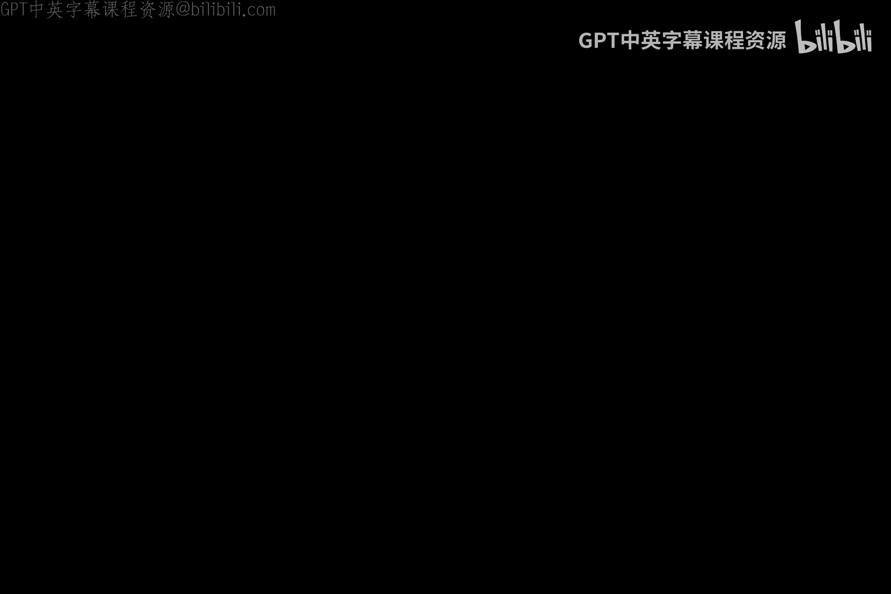
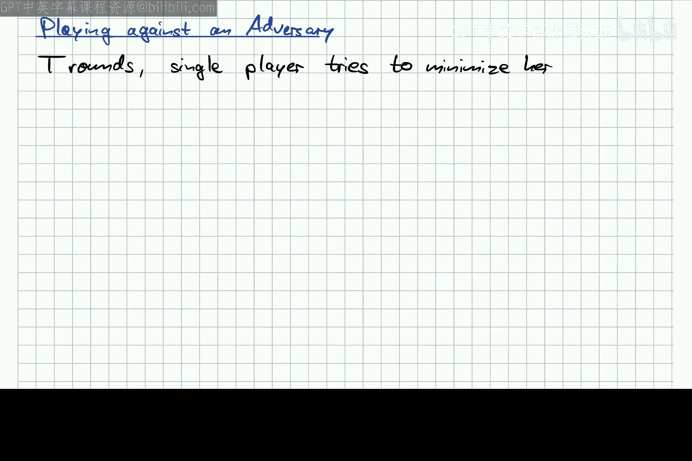
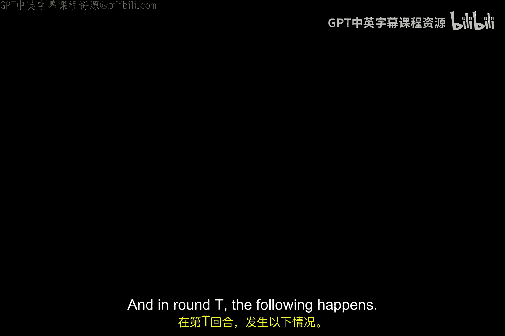
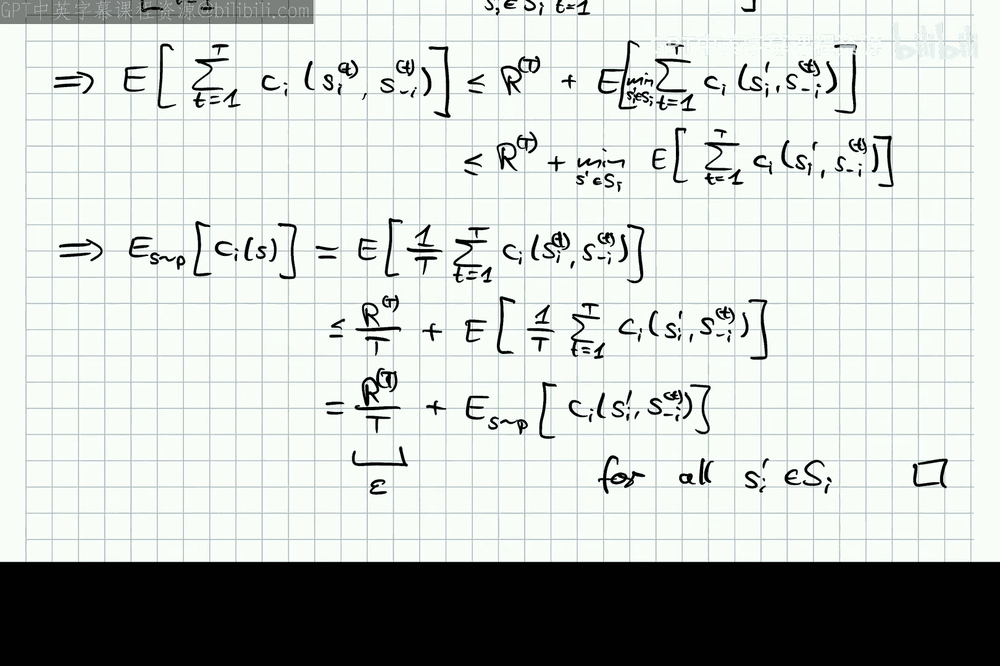

# 算法博弈论：第6讲：相关均衡

在本节课中，我们将学习一种新的均衡概念——相关均衡。我们将看到，与纳什均衡相比，相关均衡更容易计算，并且可以通过自然的学习动态过程来达成。

## 均衡概念的回顾

到目前为止，我们已经学习了纯策略纳什均衡和混合策略纳什均衡。纯策略纳什均衡在拥堵博弈中总是存在，而混合策略纳什均衡在有限博弈中也总是存在。然而，计算这些均衡通常是困难的。今天，我们将认识另一类均衡，即相关均衡，并展示它们实际上易于计算。

## 相关均衡的引入：一个例子

让我们从一个简单的相关均衡例子开始，即“懦夫博弈”（Chicken Game）。在这个博弈中，两名玩家（司机）在十字路口相遇，他们可以选择“通过”或“停车”。

*   如果双方都选择“通过”，则会发生事故，双方都承担高额成本（例如100）。
*   如果一方“停车”，另一方“通过”，则停车方承担较小的等待成本（例如1），通过方成本为0。
*   如果双方都“停车”，则双方都承担等待成本（例如1）。

这个博弈有两个纯策略纳什均衡：一方通过，另一方停车。同时，也存在一个混合策略纳什均衡，即每位玩家以99/100的概率停车，以1/100的概率通过。

然而，在现实中，我们通常不会看到玩家抛硬币决定。相反，交通灯会指示我们该怎么做。遵循交通灯的指示是一个好主意，因为如果不遵守，可能会导致事故。这种由外部信号（如交通灯）协调玩家行为的机制，正是相关均衡的思想。

## 相关均衡与粗相关均衡的定义

上一节我们通过例子直观感受了相关均衡。本节中，我们来正式定义相关均衡和粗相关均衡。

### 相关均衡

对于一个成本最小化博弈，一个**相关均衡**是一个定义在策略组合（或状态）集合上的**概率分布** `P`，它满足以下条件：对于每一位玩家 `i`，以及该玩家的任意策略 `s_i` 和任意可能的偏离策略 `s_i‘`，都有：

**公式：**
`E[ cost_i | 被建议玩 s_i ] ≤ E[ cost_i | 被建议玩 s_i 但偏离为 s_i‘ ]`

这意味着，当概率分布（或协调者）建议玩家 `i` 采用策略 `s_i` 时，玩家 `i` 没有动机单方面偏离到另一个策略 `s_i‘`，因为偏离的期望成本不会更低。

### 粗相关均衡

对于一个成本最小化博弈，一个**粗相关均衡**同样是一个定义在策略组合集合上的**概率分布** `P`，但它满足一个更弱（更“粗”）的条件：对于每一位玩家 `i` 和任意可能的偏离策略 `s_i‘`，都有：

**公式：**
`E[ cost_i ] ≤ E[ cost_i (总是玩 s_i‘) ]`

这意味着，玩家 `i` 比较的是：遵循概率分布建议的期望成本，与**完全无视建议、始终**采用固定策略 `s_i‘` 的期望成本。在粗相关均衡中，玩家不能根据当前的具体建议来“选择性”偏离，而只能选择“永远”偏离到某个固定策略。

### 均衡概念的层次结构

由此，我们得到了一个均衡概念的层次结构：
1.  **纯策略纳什均衡**
2.  **混合策略纳什均衡**（每个纯策略纳什均衡也是混合策略纳什均衡）
3.  **相关均衡**（每个混合策略纳什均衡也是相关均衡）
4.  **粗相关均衡**（每个相关均衡也是粗相关均衡）

这个关系是包含关系，即更上层的均衡概念是更下层概念的特例。反之则不成立，例如，我们之前交通灯的例子是一个相关均衡，但它不是一个（乘积形式的）混合策略纳什均衡。

## 相关均衡的计算

我们已经定义了相关均衡，那么如何找到它呢？本节中我们来看看，与计算纳什均衡的困难不同，相关均衡可以通过线性规划在多项式时间内轻松计算。

**定理：** 存在一种算法，可以在关于策略组合数量呈多项式的时间内计算出一个相关均衡。

**方法：** 使用线性规划。
*   **变量：** 为每一个策略组合 `s` 定义一个变量 `x_s`，表示该组合被选中的概率。
*   **约束条件：**
    1.  **均衡约束：** 对于所有玩家 `i`、所有策略 `s_i` 和所有偏离策略 `s_i‘`，将相关均衡的条件不等式两边乘以相同的分母后，得到线性不等式约束。
    2.  **概率分布约束：** 所有 `x_s` 之和等于1，且每个 `x_s` 非负。
*   **目标函数：** 我们可以构造一个简单的线性规划，例如最大化所有 `x_s` 之和（这等价于要求其和为1）。由于我们知道至少存在一个混合策略纳什均衡（它也是一个相关均衡），该线性规划必然存在目标函数值为1的最优解，这个解就对应一个相关均衡。

这个线性规划的变量和约束数量都是策略组合数量的多项式，因此可以在多项式时间内求解。

**为什么这对混合策略纳什均衡不适用？** 因为混合策略纳什均衡要求概率分布 `P` 必须是每个玩家独立策略分布的乘积。这个“乘积分布”的条件无法用线性约束来表达（它涉及概率的乘法），因此无法简单地用线性规划求解。

## 通过无遗憾动态达成均衡

上一节我们展示了如何集中式计算相关均衡。但一个自然的问题是：这个协调概率分布的“交通灯”从何而来？本节将介绍一个更具说服力的观点：通过一种称为“无遗憾学习”的自然分散式动态过程，玩家们可以随着时间的推移，共同达成一个（近似的）粗相关均衡。

考虑一个博弈重复进行 `T` 轮，产生一个策略组合序列 `(s^1, s^2, ..., s^T)`。我们关注以下性质：如果对于任何玩家 `i` 和任何可能的固定偏离策略 `s_i‘`，都有：

**公式：**
`(玩家 i 在序列中实际发生的总成本) ≤ (玩家 i 始终采用 s_i‘ 所会发生的总成本) + ε * T`

那么，从这个序列中**均匀随机**选取一轮的策略组合所构成的概率分布，就是一个 **ε-近似粗相关均衡**。这里的 `ε` 衡量了均衡的近似程度。

**“遗憾”的定义：** 玩家 `i` 的**外部遗憾**定义为：
`遗憾 = max_{s_i‘} [ (实际总成本) - (始终采用 s_i‘ 的总成本) ]`
如果遗憾的增长速度低于线性（即 `o(T)`），那么 `ε` 就会随着 `T` 增大而趋近于0，序列对应的分布就趋近于一个精确的粗相关均衡。

### 对抗性框架下的无遗憾算法

为了分析这种动态，我们首先考虑一个简化设定：单个玩家对抗一个强大的“对手”（或环境）。
*   共进行 `T` 轮。
*   每轮 `t`：
    1.  玩家选择一个策略概率分布 `p_t`。
    2.  对手（看到 `p_t` 后）选择一个成本向量 `l_t`，为玩家的每个策略赋予一个成本值。
    3.  玩家根据 `p_t` 随机选择一个策略，并承担相应成本 `l_t[选择的策略]`。
    4.  玩家得知本轮完整的成本向量 `l_t`。

玩家的目标是使自己的**外部遗憾**尽可能小。可以证明，存在算法（例如乘性权重更新算法）能够保证遗憾的上界为 `O(√(T log N))`，其中 `N` 是玩家策略的数量。这意味着遗憾是次线性增长的。

### 从无遗憾算法到粗相关均衡

现在，我们将这个对抗性框架应用到多人博弈中。对于博弈中的每个玩家 `i`：
*   将**其他所有玩家的行为**视为**对手**。
*   在每一轮 `t`，玩家 `i` 根据其无遗憾算法选择策略分布 `p_t^i`。
*   玩家 `i` 执行策略后，观察到其他玩家的行动 `s_{-i}^t`，并可以计算出：如果自己当时选择了其他策略 `j`，本应承担的成本 `cost_i(j, s_{-i}^t)`。这个成本向量就构成了本轮对抗性框架中的 `l_t`。

**定理：** 如果博弈中的每个玩家都使用一个遗憾上界为 `R(T)` 的无遗憾算法来独立更新自己的策略，那么由此产生的 `T` 轮策略序列的均匀分布，构成一个 `(R(T)/T)`-近似粗相关均衡。

**证明思路：** 根据每个玩家无遗憾算法的保证，将其遗憾不等式写出来。利用期望的线性性质，将时间平均的期望成本与固定偏差策略的期望成本进行比较，即可得到粗相关均衡的近似定义。

因此，通过这种分散式的、基于学习的动态过程，玩家们不需要一个中央协调者（交通灯），仅通过重复互动和基于个人成本反馈的调整，就能自然地趋近于一个粗相关均衡。对于相关均衡，也有类似的结果，但需要使用一种更复杂的“内部遗憾”概念和算法。

## 总结

本节课中，我们一起学习了：
1.  **相关均衡**和**粗相关均衡**的概念，它们通过一个外部的共享随机信号（或历史序列的分布）来协调玩家行为，构成了比纳什均衡更广泛的均衡类别。
2.  相关均衡可以通过**线性规划**在多项式时间内轻松计算，这是相对于计算困难的纳什均衡的一个显著优点。
3.  通过**无遗憾学习动态**，玩家在重复博弈中可以通过分散式的方式，使历史行为的经验分布收敛到一个（近似的）粗相关均衡。这为这类均衡的“自然产生”提供了有力的解释。

下节课，我们将深入探讨保证次线性遗憾的具体无遗憾算法是如何工作的。