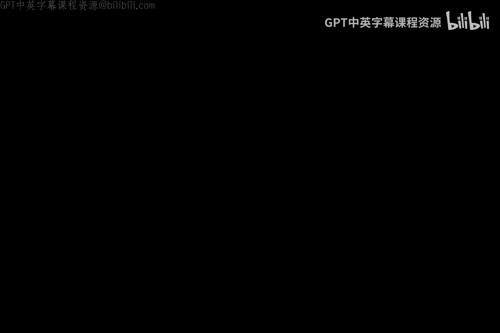
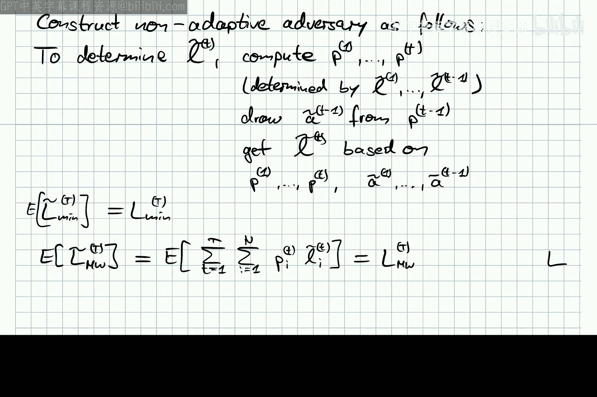

# 波恩大学《算法博弈论｜Algorithmic Game Theory, Winter 2020-21》中英字幕（claude-3.7-s p08 AGT, WS20_21_ Lecture 7 (Minimizing External Regret).zh_en -BV1m9ZyYoENg_p8-

Hello， welcome back。 This is still algorithmic game theory。 and as a matter of fact。

 what we will be discussing today will be quite algorithmic。😊。

So where are we last time we introduced correlated and coarse correlated equilibriumria？

And then we also got to know these no regret dynamics。But for these dynamics。

 the one missing piece was the algorithm that each player uses individually to choose which。

Strategy to play next。 and we then saw that this algorithm would have to fulfill a no regret guarantee so that overall what the players are playing turns out to be a coarse correlated the equilibrium。

And the only missing piece， as I was saying， is now， how do these algorithms work？

Let's once again recap what the problem statement is for such an algorithm which we kind of introduced already last time。

As we've seen， we will play this in capital T rounds。And in one of these rounds。

The following happens。We have one player。And this player。Picks a probability distribution。嗯。

Which we call。P T， which is a vector。P1 through P capital n。Over her strategies。

And what is our capital N， Well， that's just the number of strategies。

And then after the player has picked this probability distribution， the adversary。

Takes a cost vector。Which we call LTE。This science。A cost value。

To each of the strategies and these costs we now assume to be。Between 0 and 1。And then。A strategy。A次。

Is drawn。From P。So according to the probability distribution PT， we now draw one of these strategies。

うん。The player。Incur。Cost。L。Superscript T subscript。8。And gets to know。All of LT。So。

This is very different from all the games that we were considering so far in this class because now we actually just have a player and an adversary。

The player always chooses a probability distribution over her strategies。

 and then the adversary chooses a cost for each of these strategies。And then。

Only then a strategy is drawn from the probability distribution。

 and this is then the cost that the player will incur。

So it's really important to understand the order in which things are happening here。

That the player has already committed to the probability distribution when the adversary is choosing the cost vector。

 but what the player has not yet committed to is the particular strategy this is drawn from the probability distribution that the player committed to only afterwards。

What is a good benchmark for such a setting？Well。第。Nict thing for a benchmark would be the best。

Action sequence in hindsight。And what would th benchmark ye like Well， take the sum over all。And。

Time steps。And then always in every time step， consider the action that had the minimal cost。

This is what we would call the best。Action sequence in hindsight。But。

This would be far too strong as a benchmark， because what could happen here。For this。

Example to see what can but go wrong here。We just have。Two strategies and an adversary。

That chooses L T to be have a cost of one for the first action or0 for the other action。If。

P1 T is at least a half。And。Otherwise。It will be。The0，1 vector。Why that？

Because the answers the player will always put a probability mass on earth at least a half on one of the the。

Two strategies， and the adversary already notes the probability mass that the player is putting on each of the strategies so they can actually adapt to whatever we as the player chose there。

 so this might be one possible choice。And then。What would be the cost of the algorithm。

 the cost of the algorithm。Would be always。So we would now sum up the expectation of all these LT。

And in each of the steps， we would now incur a cost。An expectation of at least a half。

So this would mean we would have an expected cost。Of a half times tea for the algorithm。

 But at the same time。This。Best action sequence in hindsight。

This has a cost of zero because in every step， there is an action of。And costst 0。Therefore。

 we'll do something that is slightly different。Which we will use as our benchmark。This will be。

What we call the best fix action in hindsight。So we swap the minimum and the sum so that。

You for each。Strategy or action， you first ask， what's this entire sum of costs throughout the entire sequence。

 and only then you take the minimum of the two。So this is not the best action sequence， but the best。

Single action in hindsight。And will now write。Lmin tea。Yes。The expectation of。

Why is this still random， Well， Because it depends on the random choices by the algorithm。

 It may depend on the random choices by the algorithm。And will compare。Our algorithms。Expected costs。

 which we would get by。Suming up。These。L T A T values and taking the expectation。To this element tea。

The difference of the two， we call external regret。This is， I hope。

 a definition that you remember from last time。 and we've actually seen that it is enough for。

To to get to a course correlated equilibrium if actually this。

External regret grows sublineally in time。And this is what we call a no regret algorithm。

An algorithm is called。no。Regret or no external regret。If for any adversary。And all team。

The growth of this regret。Is bounded su in all in tea。So this might， for example。

 mean that this R of T is bounded by some factors times square t。

And what the point is now is that if you just let this run long enough over time。Then。Well。

 you morally get closer and closer to the best single action with the cost that you incur。

And this means that in these no regret dynamics， we get closer and closer to a coarse correlated equilibrium if if all of the involved players play such a no regret strategy。

By the way， it's not important how they do this。All we care about。In terms of the last lecture is。

 well， we get this， no regret guarantee some way。But they might even use different algorithms。

Today we will be using， we will be getting to know one specific algorithm。

 although there there are many other algorithms which also give you this no regret guarantee。

The algorithm。That we're getting to know today is called the multiplicative weights algorithm。

 or you may also find this under the name hedge or randomized weighted majority。

This is all more or less the same algorithm with maybe some tiny differences。

We will certainly only scratch the surface when discussing these no regret algorithms if you're interested in further details。

About all these no regret algorithms， you'll have to take my class on algorithms and uncertainty where we cover these in much more detail。

How does this multiplicative weights algorithm now look like？

The algorithm now maintains a weight for each strategy。Which we call W I T。W I T， this is the weight。

For strategy， I。Instead。And the probability that the algorithm uses。This depends on the weight。

And let's just write down the algorithm。 We'll have。Some learning rate eitherda。

 which we'll set later。So far， this may be just some arbitrary real number。

 which is strictly greater than 0， but at most half。And now， the algorithm does the following。

Initially， we set。All weights to one。And then。In every step， T。What we do is the following。

We compute the sun of the weights。And let's call this。Doubled you。T。Then will。2 strategy I。

With a probability。P I T。Which we now defined to be。Small WIT divided by capital WT。

And then we'll update the weights。Namely， we do a multiplicative weights update。

This is where the name comes from。Namely， we take the weight we had so far。

And we multiply it with 1 minus eda to the power of L IT。Let's build some intuition。

Of what this algorithm does。But do these weights mean， well， the weights are just。

Proportal to the probability that we use for a。For a strategy in a stamp， or in other words。

 we always。Take PIT as what proportion the weight WIT has in the overall sum of the weights。嗯哼。😊。

And then。We always update the weights。How do these weight updates work？

They use this weird formula here。Where is this formula coming from？What would we have to do？

If a strategy turned out to be bad。We would have to reduce the probability。

 and this is done by reducing the weight。If a strategy turned out to be good。

Then we shouldn't reduce the weight。Indeed， we never increase weight。😊，Here， but we only if。

 if a strategy turns out to be good， we just do not decrease its weight。

And because the other strategies might be bad， at the same time。

 their other weights will be decreased。How do they get decreased？

Just suppose that LIT is equal to one， which is the worst that can happen for a strategy。

 that it has cost one。In this case， the weight is multiplied by 1-8。If a strategy has。A costs 0。

 which is the best that can happen。 Then we'll multiply by 1 minus8 to the power of0。

 so we'll multiply it by one， which means we won't change it。

And this1 minus eta to the power of LIT just gives us something well continues in between。

You might also update this in a different way and indeed there are equivalent ways to write this algorithm or also。

 well， similar ways， find different you will find these in the literature。And。

The important thing to understand here is。For if the cost turn out to be 0， do not change the weight。

 If the cost turn out to be 1， then change the weight by a factor of 18da and in between。

 do some continuous change。And what role does this Ada have？Mh。😊。

What could we now choose for this Ada， This Ada might be， well。A half， for example。

 or think of the think of even a more extreme， think of Ata B1。Then1 minus-8 I would be 0。

 So as soon as any。Strategy had any cost， any non zero cost。

 then immediately this term would be zero so it would lose all its weight。

A smaller value of Eda isn't that extreme， so if you had ADda only being half， then for example。

 and a strategy whose cost is one， you would decrease the weight still by factor of a half。

If now you turn down your eda to zero， then suddenly you wouldn't actually change any weights。

This 1-8 I would always be 1。So this is why this does not work for Eda equals zero。

The difficult choice that you have here is actually making this ADA large enough so that you're aggressive enough in while decreasing the probabilities of strategies that turn out to be bad and at the same time you don't want it to be too large because it might turn out that a strategies is only bad。

 for example， at the very beginning and you don't want it to lose it already this early in the sequence。

For this algorithm， we can show the following guarantee。The multiplicative weight algorithm。

For any choices。By the adversary。Of course， lectures。From 0，1。Guarantees。ItsNow right， L Sub。

MW for multiplicative weights。And superscript T because we're considering T rounds。

 So this is the expected cost of this algorithm。 This is at most。1 minus e times。你。

Expect cost of the best。Single action in the sequence。Plus， L N N over Eda。

And what we now see is that this guarantee depends on eitherda。

And this is actually true for any choice of Ada。Between0 and a half。

 So one choice we might actually do。As we might set Ada to square root Ellen and over tea。And then。

Well， just plug this in up here。We'll get。el明。Plus。8 at times L min T。Plus。Helen and。Over Ada。

 how big is this Elminee at most。Well， it's at most T because no action ever has a cost of more than one in any step。

 So some taking a sum of our T steps will never give us more than T， so。If we now do the math。

 well see， O， this is El Min。Plus， Eda times T plus L and N over Eda。And n times T， this is actually。

Squareled。L and N。And then we multiply this by。Capital T divided bus world， capital T。

And what's the other term that we're getting here， this is L and N。

Times square root of T over L And N。And。😔，Let's not see what this。Gives us。Well。

We actually get twice the same term， namely。Squaquireed。Of T times L N。Which means？

We have in no regret， Albert。Because what's the regret that we're getting here。😔。

This will be at most two times。Square t times L and N。 And this clearly grows sulaneia。

For a fixed number of strategies。So。If we are able to show this guarantee。

 then we definitely have a no regret algorithm。Which means all we have to do。

Is proving this bound here。And this is exactly what we'll do next in two different steps。

Because what makes this a little annoying is that we have this adaptive adversary。

So we'll first consider only an adversary， which fixes everything in advance and only then afterwards。

 with this cus of。Why anything should happen。Be due to this adaptive adversary or ball。

 More precisely， well say why nothing happens。Due to the adaptivity of this algorithm。

 Fair of this adversary。As I was saying the。Enti setting of this no regret learning becomes difficult。

 at least for me because。There is this adversary， you can actually base their decision on what our algorithm chose as the probability distributions。

As it turns out， this doesn't actually matter。 but I think it's much harder to think about such a dynamic process where。

 well， we， as the algorithm make a choice， than the adversary reacts to this。

 and then we again make a choice， the adversary reacts to this。 And in between。

 there are also random。Qui flips。So let's ignore this for the time being and let's just assume well there is this adversary who fixes everything in advance。

 so first the adversary fixes everything and then we run our algorithm。

 which means the adversary doesn't actually know what we are doing。

This makes it much easier to argue about the regret of the algorithm， because， as I was saying。

 nothing changes dynamically by our random choices。 Everything is actually predetermined。

 Everything that the atmospheredvers does is predetermined when we start。And we will now show。

The following proposition。Will show that for every。Fixed。Non adaptive sequence。

Which are call L1ity through。L T chidy。Of cost， vectors。From 0，1。Multipplicationicative weights。

Guarants。That。The expected sum， of costs， will be at most1 minus8da。Times。L I T。Plus。L N N over8。

And I forgot the Tes here。 So this is now to distinguish this from our adaptive setting。

 I'm in in all that we're doing now， I'm writing L Tly。

 so I'm writing small L Tly for what the adversary fix in advance for a particular step and capital L Tly。

Let's write that down。Willll have capital L Tilde。Subscript I superscript T。This is the sum of the。

Costs。Of。The teeth。Strategy。And willll have。The cost。Of multiplicative weights。Which we remember。Was。

This。Some of the al Subscript A superscript T。But now this is much easier to write。Because。第。

The probabilities， those don't actually change。嗯。No， those aren't actually random variables。

This might be a little。Mysterious， if you hear this for the first time。But。

Remember how the algorithm works。The algorithm what the adversary does is fixed。Then。

Let's go back to the algorithm。If the choices of the adversary are fixed。

 then also these weight updates are fixed。 They have nothing to do with these， with this。

Random choice that happens in the second step here。This is predetermined by what the adversary does。

 and we're now assuming that the adversary isn't adaptive。So。This means。That also these。PrRT。

 those aren't random variables themselves by what the adversary determines。This P T。

Are already determined。These 8， those are still random variables。

But the nice thing is we can just write it like this。Because in advance， before anything has started。

 we already know。Because the adversary determined and the cost vectors in advance。

 we already know the probability that one of these actions will actually be played later on。

So let's now prove this proposition。To prove it， we analyze how some of the weights decreases over time。

We have。The sum of the weights after four step T plus one， So after step T。This is， well。

Nothing surprising here， it is the sum of the weights。But how do we get to this sum of the weights？

Okay， this is simply。By the multiplicative weights formula。Next。

 we want to understand this1 minus Eda to the L I T term and。I brought a。Pot of this。

Kind of a function。This is what it will look like。嗯。So this is for the example of Ada being a half。

 but for other values of Edas it will just look the same。

 So this is this red line is connecting the point。One work1 minus eta。

And the orange line is actually the function that we're considering here。And indeed。

 this is a convex function。In terms of。です。L Ttli。Which means？And then what we can see here。😊，And。

This year。This will always be at most，1。L It。Tilde times 8da。嗯哼。😊。

So we'll get now that the sum of the weights is at most。the sum of all w i t times one minus。

L I utilityilde。잘一。And this， we can rewrite。As the sum of the W I T minus。Her。Times。😔，The sum。

Of the W I T times L I T tilly。嗯。😊，What is this first thing？This is just the sum of the weights。

And this second thing。Let's just write this once。Once again， but we'll see。

 let's just replace WIT by PIT times WT。This means we now get W T。Times。1 minus- Eda。

Times take the sum over all strategies， P， I T。LIT。Til the。What's this。What's this Sam here。

We take the sum over all strategies， and now the probability that we play this strategy times its cost。

 this is。第。Expected cost of the algorithm in the step T。So， let's write this。With L subscript。

MW superscript T。Tillly。How does this now help us， Well， we now know。From the sum of the weights。

 the sum of the weights afterceptee is at most the sum of the weights。Before step T times something。

And we can now just repeatedly apply this about。If we repeatedly apply this bound。Then we'll get。

 dad。The sum of the weights。After the last step， which is。Capital W， superscript， capital T plus 1。

This will be。This， the initial sum of the weights times。The following product tank。

The product from1 to capital T。1 minus8da times this。LMW T， till。

What's the initial sum of the weights。It is capital N， because we have N strategies。

Each of which has an initial weight。That's one。嗯哼。😊，This is one half。Of the proof。

 because we now see。The final sum of the weights has something to do with the per step cost of the algorithm。

And then。We'll do another bound。Which is that。Capital W T plus1。We'll get a lower bound for this。

This is the final sum of the weights。 No weight will ever be negative。So， this is。At least。

The maximum of these weights。And。For any fixed N， for any fixed I， how do I get。

The weight after step  T。What I can simply do is。I can just take the initial weight and then multiply this with all the weight updates。

These weight updates are just happening。And I know how the weights will be updated because they depend on these LTilD factors。

Let's simplify this a bit， what's the initial weight， the initial weight is one。

 so I can simply ignore this。And。I can allright that this is at least 1-8。To the power of the sum。

Of the L IT。Childy。😔，So， this is nothing but。1 minus8da。1-8 is smaller than one。

 so I can write down the minimum here in the exponent。Of the sum of the。L， I T， Tiildy。

Or I might also write this as one month aidda to the power of。L明 t。Tilly。What do I now have？

Have an upper bound on the final sum of the weights that depends on the cost that the algorithm occurs。

 and I can compare this to。And brought via a lower bound to the cause of the best。Strategy。

If I now combine the two。What do I get。I get that。N times。对。Product。Of1 minus8 times。有。M w。

T till there。But， this is。At least。18da。Times， Elmin。te离T。Now。

 I can take the logarithm on both sides。What I guess is that L and N。Plus。The sun。그 어。T。

 L N of 1 Eda。Times， Aline。And w of。T。Is at least。后面。C。Times Ln1 minus8。

Now there's one more thing that we'll have to understand here。

 namely how do we now get rid of these logarithms？But， fortunately。We can use the following。😔。

Bouance for the laate。We can see。Then this logarithm that we have here on the left hand side。

We can up bound。By one month8da。Ts。LMW T Tilby。And this。Loarithm here on the right hand side。

We can up bound by 1 minus eda times 1 minus Eda squared。And if we now combine this。

 we'll get that L and N。Plus。Take the sum over all tea。Minus Eda times L and M W T Tilde。

This will be， at least。Hell mean。词。To leave。Times。One minus eta minus Eda squared。

Now divide by 1 minus8da。And。We'll get to the sum。Of all this El。T MW。This will be， at most。

1 minus Eda。嗯。1 plus Eda times L min T。Plus， L N N。Over8。

And this is exactly the bound that we were claiming。And this is exactly the bound that we claimed。

So I agree that when you see this for the first time， this might look a little mysterious。And。

I can only say it gets little， less mysterious over time。Over time you'll realize， well。

 this also doesn't feel so strange why this works， but at the same time。

 why these calculations actually give you what you want。

 this is maybe still surprising even when you're very experienced with these algorithms。

But what was the general structure， that's at least what you should remember at this point。

AndWe were asking， how does the sum of the weights change。And we got a bound in terms of the。Best。

Strategy in terms of the cost of the best strategy。

 and we also got a bound in terms of the cost of the algorithm。Not exactly the cost of the algorithm。

 but rather this thing here so this is and then we de at exactly this bound because here in between there was the sum of the weights。

And then you just do some calculus， some smart calculus， but then fortunately for us。

 we get to exactly the point where we want to get。But what we still haven't done so far is talking about the adaptivity of the adversary。

And this is exactly what we will be doing next。So far。

 we analyze the algorithm only for the for a non adaptive adversary。

 which means that the the order is actually different than。What we actually wanted it to be。

 So our the order that we considered so far in our analysis was。The adversary fixes all the。

The cost vectors and then our algorithm place on these。But。嗯。What we were actually asking was that。

The the， the player chooses a。Factor of probabilities， then the adversary chooses one cost vector。

 then we draw one of the actions at random， then we choose another probability vector。

 the adversary may now， depending on what came out of in the in the coin tos that determine the random strategy in the first step。

 they may now choose another cost vector， and then again there is some coin flipping to once again determine random strategy。

How do we do this？ Well， fortunately for us， our guarantee that we have so far is just strong enough to also。

Apply to this adaptive setting。Why is this true。Well。

 the general point is that the algorithm is somewhat deterministic。And you may not say。

 but there is this randomization that we always choose a random strategy。 Yes， I agree。 this is。

 but this is not what I mean。 What I mean is that the probabilities。

 those don't depend on these random choices， the probabilities， those aren't random variables。嗯。

If you could alter picture a heading in which you adapt your probabilities depending on some random choices。

But this is not what is happening here， so the adversary actually knows in advance how these probabilities will develop anyways。

But let's try to formalize this。Our proposition is now。爹地。Multipplicationicative weights algorithm。

For any。Possibly adaptive。Choices by the adversary。Of costst vectors。From01。Guarants。That。

Its expected cost。Is at most 11 plus Eta。Times。B cost of the expected。Cast of the best single action。

 plus。Ellen and。I for a站。I proved no。Works as follows。

 we will now design an adaptive adversary that simulates sorry we will design a non adaptive adversary that simulates the adaptive adversary。

By indeed， anticipating what the algorithm will do anyway。嗯。So we'll design。A nonadive adversary。

That simulates the adaptive episode。How does it do that？We generate。Herranom， but non adaptive。

Sequence。That we will now， once again， call。With L1 Tilli through L capital T Tli。

Which has the property than the expected cost of our algorithm。With respect to this random。

 but non adaptive sequence is equal。To the expected cost。Of the。An algorithm。In the adaptive setting。

 and also。At the expected。Best cost is equal to。The expected best。Let's not understand these things。

 So if we are， if we， if we get to this point， then we are done because then we know， okay。

 for for these， we for these， we actually have the relation that we want。

 we already know that the regret is bounded with respect to a nonadapive adversary。 and because。

This non adaptive adversary does everything that the adaptive adversary does。

Or at least causes the same cost。Then we also have the bound for the adaptive a。So how do we do this？

Let's first。Simplified this。嗯。The expected cost that the。Adaptive adversary。

Causes our algorithm to have。This the expectation of all these。LT。A。

And we can I use linearity of expectation。To say， okay， this is actually。

Instead of taking the sum at these random variables。And then taking the expectation。

 we might also take the expectation of each of these random variables individually。And。

Then we take the sum。Why this now。Or what is it that makes everything difficult， Well， it's these。

Strange random variables。 These strange random variables。

 they depend on what the algorithm did up to this point。

And also what the algorithm is doing right now。Why are they depending on what the algorithm did so far because the adversary is adaptive？

Because the adversary may choose the cost of the actions。Depending on what we chose before。However。

If we keep everything fixed that we've done so far。

Then there's only one more piece of randomization in here。

 namely it is the grand draw that happens after the adversary action chose the respective cost factor。

This means。We can write this in a somewhat complicated way。So fix all the cost vectors。Before step T。

And also fix all the actions before step T。This definitely fixes。Or earn the probabilities。

And now we just let the adversary react to this。This is true for any way will we fix what happened so far。

 So we might as well take at the unconditional expectation at this point。

By taking the expectation on both sides of this inequality， that of this equality。And this means。

That we can write the expected cost of our algorithm。Simply also。Ass take the sum over all steps。Now。

 some of these expectations。And now， let's do。Let's use linearity of expectation again。And。

See that we could also have this sum。Overall， time steps inside the expectation。

And this is not interesting。For which reason。Because。Here。There's no AT even anymore。

All we're talking about is the probability vector。But those probability vectors。

We already know what the algorithm， what these will look like。

 because this is what I've been saying all along that。These probability vectors， those aren't random。

 those don't depend on the random choices of the algorithm， but only by what the adversary is doing。

What does this now mean， How do we construct our。Adversary， which is non adaptive。

We construct our non adaptive adversary as follows。

So suppose there is this adaptive adversary that we may now ask， well。

 what would you be doing in this situation？And we just。Give it some。嗯。

We just let it play this entire thing that is happening here。Every we just。

Compute some other actions， some other realizations of these AT。

 which are not the true AT but other AT。嗯。More precisely。We do this， as follows。

We now want to determine。Does nonadive L T till me。

Let's compute at this point because we've already suppose we have already determined all the other L the vectors。

We compute。All the probabilities。Those are determined。By L 1。Tilde through L -1。Till you。嗯。And then。

Weraw。Some utilityity tea。From。嗯。辟琪。So， we draw an8-1。From P minus1。And now。We asked the。嗯。

The adaptive adversary， what would you do？We then get。L T Tly。Based on。Well， on the one hand。

 this P1 through P T。 and on the other hand，81 tillil the。する？A T -1。Tildy。

Which are not the actual actions， that we。Whatever the advers is。

 whatever the algorithm is really doing by this fake sequence。The important thing is now。

That will have。嗯。That。The best action best actions cost。In expectation。Is。衣服。To。

The best cost because and to do the expectation of the best cost was this。

 because it doesn't actually matter whether this is a tillil the or the real a。

 what the algorithm does， what the adversary does。Does't actually change。The more difficult thing is。

What about。第。Expected costs that our algorithm has on this nonadive sequence。嗯哼。😊。

There we will use that we can actually rewrite this。In a way。That doesn't even depend。

On the A vectors。The PIT， those are always will always be the same。嗯。And therefore， we will get。That。

 also。These will be exactly the。MWt。

And so we derived at the kind of a guarantee that we wanted。

 namely we devised a way to construct a sequence which is random but nonadapive。

 which while the idea is simply to anticipate everything that the adversary will do and eventually because there is only one thing that the adversary doesn't know namely what action the algorithm will choose in this exact step。

 this is all that matters for the cost in this step。

And the rest can be get rid of bi linearity of expectation。

So I have to say at this point that I'm not super happy with this proof and I'm still looking for a more intuitive argument why this works。

Once again， let me repeat my earlier point that。In this algorithm。

 I do not consider a fully randomized algorithm， but this P vectors， those are deterministic。

 And so if we understand the algorithm as being deterministic in terms of the P vectors and only seeing the randomization taking place after the P vectors have already been determined。

 then somehow you， I hope you see。That all this。This adaptivity doesn't make a big difference because what can what does adaptivity help in adversary anyways。

 This only helps if the if the algorithm is not deterministic。

 So only if the algorithm is randomized in some way， it have the the。

The adversary can do better if it is randomized sorry if it is。Adap it。

So this concludes our discussion of correlated course correlated Eria and no regret learning。

I hope you have now an understanding what these correlated and co correlated equilibrium look like and why it is actually quite reasonable to assume that players do play these because I consider such a multiplicative weights algorithm to be something very natural that players might actually use to。

Update their strategies。At the same time， there are many more no regret learning algorithms if you're interested in these without the game theore context。

 feel free to take my class on algorithms and uncertainty at a later point。

What we will continue with in this class is the question how much we actually lose due to the strategic behavior。

So now we've got to know multiple equilibrium concepts and it was somehow always implicit that due to the strategic behavior。

 well， society loses something。The world would be a betterladder place as if nobody acted strategically。

And this is exactly what we will be bounding in the next two lectures and which we will then formalize in terms of the price of anarchy and the price of stability。

Hope to see you then。