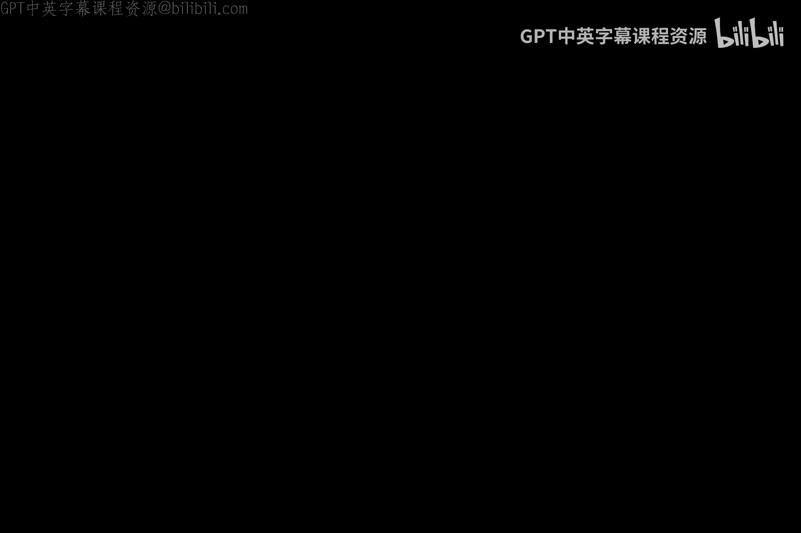
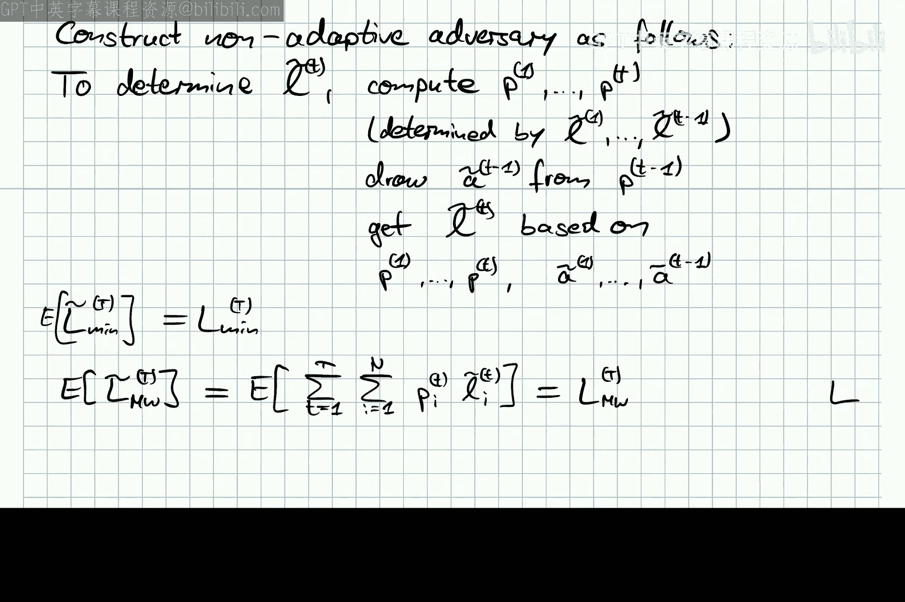

# 算法博弈论：7：最小化外部遗憾




在本节课中，我们将学习一种具体的算法，它能让玩家在重复博弈中实现“无遗憾”学习。我们将深入探讨“乘性权重算法”的工作原理，并证明它如何保证玩家的外部遗憾随时间呈次线性增长，从而最终达到粗相关均衡。

---

## 概述

上一节我们介绍了相关均衡和粗相关均衡，以及实现这些均衡的“无遗憾动态”。其中缺失的关键环节是每个玩家用来选择下一步策略的个体算法。我们了解到，这种算法必须满足“无遗憾”保证，才能确保所有玩家的整体行为收敛到一个粗相关均衡。

本节课，我们将填补这个缺失的环节，学习一个具体的无遗憾算法——乘性权重算法。我们将详细解释其工作原理，并证明其有效性。

---

## 问题设定

我们考虑一个玩家在 **T** 轮中进行决策。在每一轮 **t** 中，发生以下事件：
1.  玩家选择一个概率分布 **p^t**（一个向量，包含对每个策略 i 的概率 p_i^t）。
2.  对手（或环境）观察到此分布后，选择一个成本向量 **l^t**，为每个策略 i 分配一个介于 0 和 1 之间的成本值 l_i^t。
3.  根据分布 **p^t** 随机抽取一个策略 **a^t**。
4.  玩家承担成本 **l_{a^t}^t**，并得知整个成本向量 **l^t**。

**关键点**：玩家在对手选择成本向量 **之前** 就确定了概率分布，但具体的策略是在对手选择成本 **之后** 才随机抽取的。

---

## 基准与外部遗憾

一个自然的比较基准是“事后看来最优的**单一固定**行动”。其成本定义为：
```
L_min^T = min_i ( Σ_{t=1}^T l_i^t )
```
我们将玩家算法的**期望总成本**与这个基准进行比较。两者之间的差值称为**外部遗憾**：
```
R^T = E[ Σ_{t=1}^T l_{a^t}^t ] - L_min^T
```
一个算法被称为**无外部遗憾算法**，如果对于任何对手和所有时间 T，其外部遗憾 R^T 的增长速度是 T 的次线性函数（例如，O(√T)）。如果所有玩家都使用这样的算法，那么在无遗憾动态中，他们的行为将收敛到一个粗相关均衡。

---

## 乘性权重算法

现在，我们介绍乘性权重算法（也称为Hedge或随机加权多数算法）。该算法为每个策略 i 维护一个权重 w_i^t。

以下是算法的步骤：
1.  **初始化**：设置学习率 η（0 < η ≤ 1/2）。对所有策略 i，设置初始权重 w_i^1 = 1。
2.  **循环（每一轮 t）**：
    *   **计算总权重**：W^t = Σ_i w_i^t
    *   **选择策略**：以概率 p_i^t = w_i^t / W^t 选择策略 i。
    *   **接收成本**：观察到成本向量 l^t。
    *   **更新权重**：对于每个策略 i，更新其权重：
        ```
        w_i^{t+1} = w_i^t * (1 - η)^{l_i^t}
        ```

**算法直观理解**：
*   权重反映了策略的“好坏”。权重越高，被选中的概率越大。
*   权重更新是“乘性”的：如果一个策略的成本 l_i^t 为 0（很好），其权重乘以 (1-η)^0 = 1，即保持不变。如果成本为 1（很糟），其权重乘以 (1-η)，即减少。成本在 0 和 1 之间时，权重按比例减少。
*   学习率 η 控制更新的激进程度：η 越大，对坏策略的惩罚越严厉；η 越小，更新越保守。

---

## 算法性能保证

乘性权重算法提供以下性能保证：
对于任何对手选择的成本向量（在 0 到 1 之间），算法的期望总成本满足：
```
E[ L_MW^T ] ≤ (1+η) * L_min^T + (ln N) / η
```
其中，L_MW^T 是算法的总成本，L_min^T 是最佳单一固定行动的总成本，N 是策略总数。

**如何选择 η**：
如果我们知道总轮数 T，可以设置 η = √( (ln N) / T )。将这个 η 代入上面的不等式，经过推导，可以得到外部遗憾的上界：
```
R^T ≤ 2 * √( T * ln N )
```
这显然是一个次线性增长（对于固定的 N），因此该算法是一个无遗憾算法。

---

## 证明概要（针对非自适应对手）

为了证明上述保证，我们首先考虑一个简化场景：**非自适应对手**。即对手在游戏开始前就固定了所有轮次的成本向量序列 {l^t}。这简化了分析，因为算法的概率分布 p^t 在游戏开始前也就确定了（不再是随机变量）。

证明的核心思路是分析权重总和 W^t 的变化。

**第一步：权重总和的上界**
考虑权重从第 t 轮到第 t+1 轮的变化。利用不等式 (1-η)^x ≤ 1 - ηx（对于 x ∈ [0,1]），我们可以得到：
```
W^{t+1} ≤ W^t * (1 - η * (Σ_i p_i^t * l_i^t))
```
其中 Σ_i p_i^t * l_i^t 正是算法在第 t 轮的期望成本，记为 l_MW^t。
将这个不等式从 t=1 应用到 t=T，我们得到权重总和最终值的上界：
```
W^{T+1} ≤ N * Π_{t=1}^T (1 - η * l_MW^t)
```

**第二步：权重总和的下界**
最终权重总和 W^{T+1} 至少等于其中最大的那个权重。对于任意一个固定策略 i，其最终权重为：
```
w_i^{T+1} = Π_{t=1}^T (1 - η)^{l_i^t} = (1-η)^{ Σ_{t=1}^T l_i^t }
```
因此，W^{T+1} ≥ max_i [ (1-η)^{ Σ_t l_i^t } ] ≥ (1-η)^{ L_min^T }，其中 L_min^T = min_i (Σ_t l_i^t)。

**第三步：结合上下界并推导**
将上下界结合起来：
```
(1-η)^{ L_min^T } ≤ W^{T+1} ≤ N * Π_{t=1}^T (1 - η * l_MW^t)
```
两边取对数，并利用近似关系 ln(1-η) ≈ -η - η^2/2... 和 ln(1-η*z) ≥ -η*z（对于 z ∈ [0,1]），进行一系列代数推导和放缩，最终可以得到：
```
Σ_{t=1}^T l_MW^t ≤ (1+η) * L_min^T + (ln N) / η
```
这正是我们想要证明的保证。

---

## 处理自适应对手

上一节我们证明了算法对**非自适应**对手的有效性。但在原始设定中，对手是**自适应**的，即它可以根据玩家之前选择的概率分布和结果来调整当前的成本向量。

我们需要证明，乘性权重算法的保证同样适用于自适应对手。

**证明思路**：构造一个**随机但非自适应**的对手序列，使得算法在面对这个构造的序列时的期望表现，与面对原始自适应对手时的期望表现完全相同。

具体做法是“模拟”自适应对手的行为：
1.  假设我们有一个自适应的对手。
2.  为了构造第 t 轮的非自适应成本向量 l̃^t，我们这样做：
    *   根据之前已经构造好的成本向量 l̃^1, ..., l̃^{t-1}，计算出算法当前的概率分布 p^t（这是确定的）。
    *   **随机**抽取一个“虚拟行动” â^{t-1}（根据分布 p^{t-1}），这个行动并不是算法真实历史的一部分，只是用于模拟。
    *   将这个概率分布 p^t 和虚拟历史行动 â^1, ..., â^{t-1} 提供给自适应对手，询问：“在这种情况下，你会选择什么成本向量？”
    *   对手给出的答案，就是我们构造的 l̃^t。

通过这种构造，我们得到了一个随机序列 {l̃^t}。关键在于，可以证明：
*   算法面对这个随机非自适应序列 {l̃^t} 的期望总成本，等于它面对原始自适应对手的期望总成本。
*   这个随机序列 {l̃^t} 下的最佳固定行动期望成本，也等于原始场景下的对应值。

既然我们已经证明了算法对任何（包括随机的）非自适应序列都满足 regret 上界，那么这个上界自然也适用于原始的自适应场景。

**直观理解**：乘性权重算法的概率分布 p^t 仅依赖于之前的成本向量，而不依赖于算法自己之前的随机抽取结果 a^t。因此，从对手的视角看，p^t 是确定性的（尽管 a^t 是随机的）。对手的适应性只能针对随机的 a^t 做出反应，但无法影响确定性的 p^t 的演变路径。这就削弱了适应性带来的优势，使得非自适应的分析可以延伸到自适应场景。

---

## 总结



本节课我们一起学习了如何通过“乘性权重算法”来实现无遗憾学习。

1.  我们首先明确了无遗憾学习的问题设定：玩家在每一轮根据概率分布选择行动，对手随后给出成本，玩家目标是最小化相对于最佳固定行动的外部遗憾。
2.  接着，我们详细介绍了**乘性权重算法**：它通过维护和更新每个行动的权重，以权重比例为概率进行选择，并使用乘性规则根据成本更新权重。
3.  我们证明了该算法的性能保证：对于非自适应对手，其期望成本不超过 `(1+η) * L_min^T + (ln N)/η`。通过设置 η = √(ln N / T)，可得到遗憾上界 O(√(T ln N))，满足无遗憾条件。
4.  最后，我们通过构造一个等价的随机非自适应序列，将算法保证推广到了**自适应对手**的场景。

至此，我们完成了对相关均衡、粗相关均衡以及实现它们的无遗憾学习动态的讨论。玩家使用如乘性权重这样的无遗憾算法是一种自然且合理的假设，这为均衡概念提供了扎实的行为基础。

在接下来的课程中，我们将转向一个新的主题：量化由于参与者的策略行为而给社会整体带来的效率损失，即“无政府状态价格”和“稳定价格”。