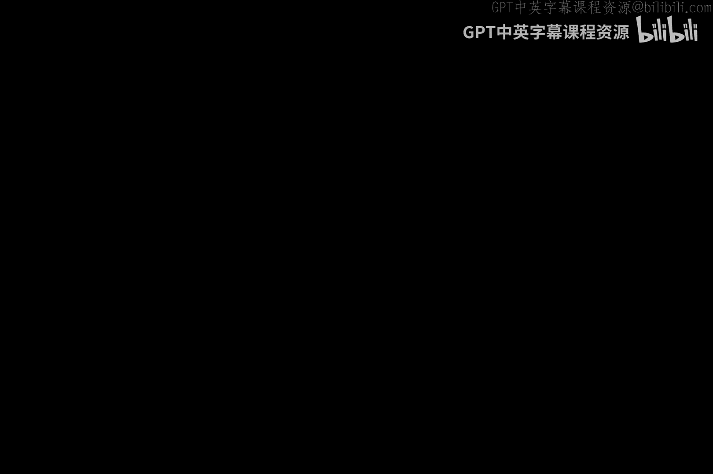
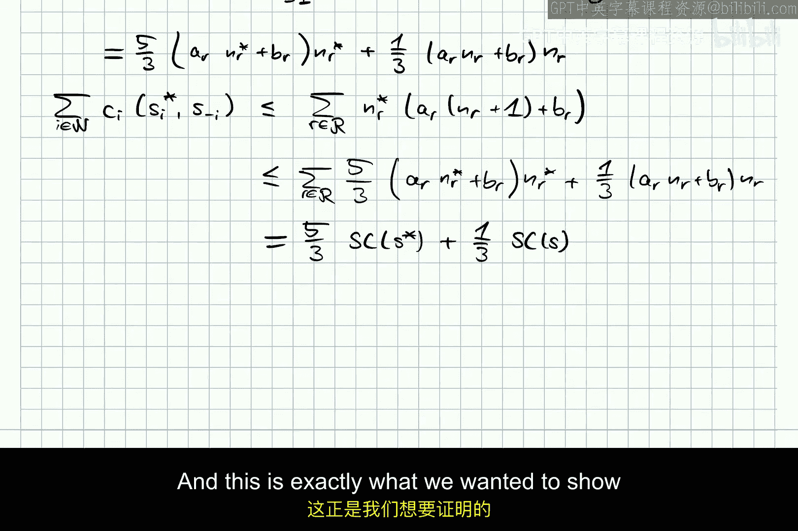
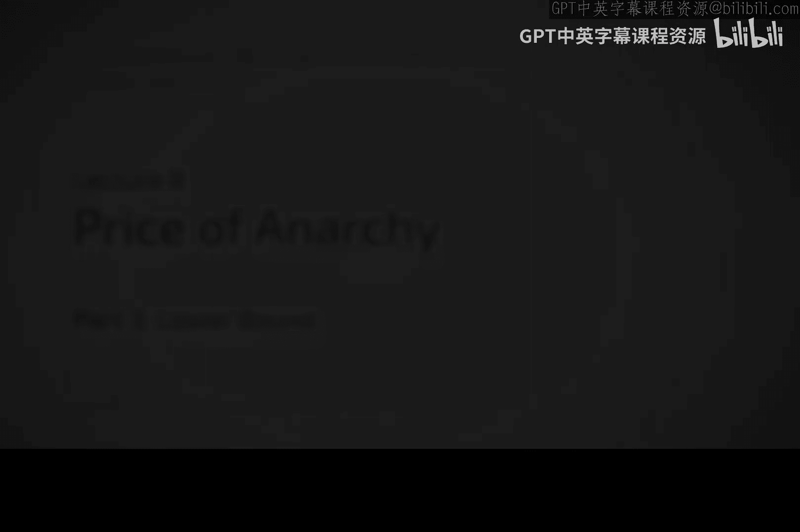
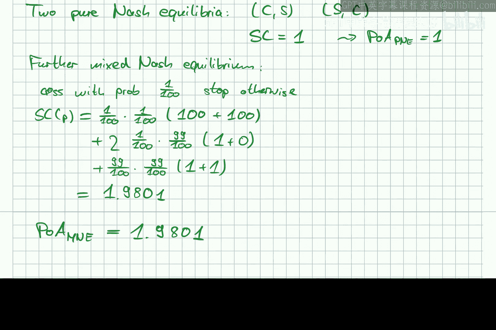
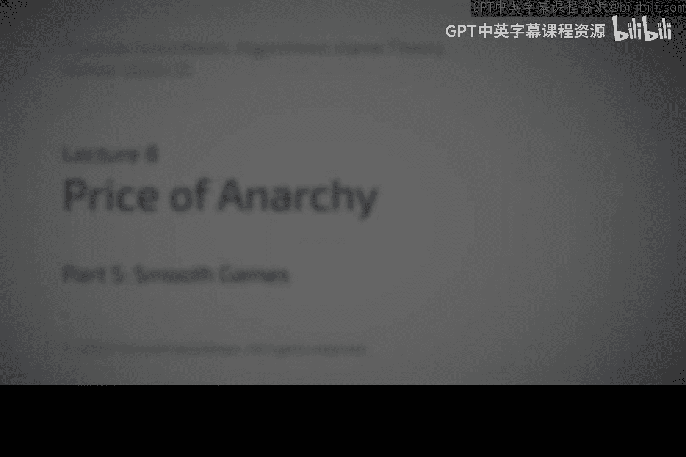
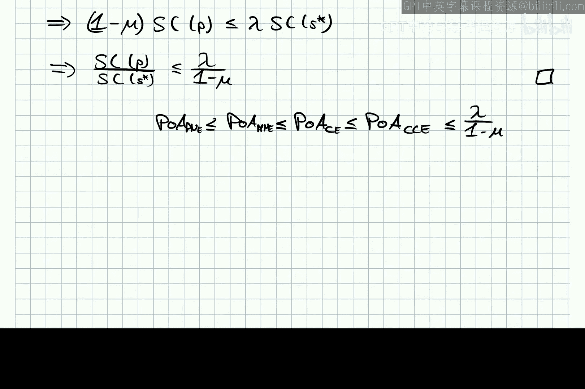

# 波恩大学《算法博弈论｜Algorithmic Game Theory, Winter 2020-21》中英字幕（claude-3.7-s p09 AGT, WS20_21_ Lecture 8 (Price of Anarchy).zh_en -BV1m9ZyYoENg_p9-

Yeah。Hello and welcome back to our class on algorithmic game theory。

So far we've seen a number of ways to model strategic behavior。

 or more precisely we've seen equilibrium concepts。Wwhich then reflect， well。

 what states might strategic behavior lead to， but what was implicit in these considerations so far was that strategic behavior is somehow bad for society and this is something that we will talk about today and which we actually try to quantify using the so-called price of vany。

So we will be talking about the social cost of equilibrium。What is this， the social cost？Well。

 there are multiple ways to define social cost。The notion that we will be using today。

It's the following？The social cost of a state S， we'd simply write as。The same。

Of costs incurred by all players。Maybe you might also want to take the maximum of all costs incurred by players that well that's actually up to you and what you actually think what reflects best the。

The notion of。Social cost for your current situation。 But for today， let's just take the。

Perspective that all we care about is minimizing the sum of the costs of all players。Now。

 as we've seen so far， the。The social cost might not be minimal in in equilibrium。

 and let's see this once again in a very concrete example。

So we'll take a symmetric network congestion game。Where thats only。Two ways to get from S to T。

 namely the top edge and the bottom edge and the delay function on the top edge。诶。Is increasing。

 it is one if there's only one player using this resource。

 two if two players are using this resource and so on， and by the bottom edge。

The delay is always for regardless of how many players use this edge。So what can happen here Well。

 generally there are five kinds of states， namely all players might use the top edge or one player uses the bottom edge and the remaining three players use the top edge and so on。

Of course， matters。Well for you personally， it matters which of the place you are。

 but for our consideration， it doesn't actually matter。

 so we might now write down for all of these five different kinds of states what social cost we have there。

So we might have via the top edge。We might have four， three， two， one， or zero players。

And fire the bottom edge respectively。We might have。

No player or one player or two players or three players or all four players using these auto edge。

What is the social cost of such a state？Well。Remember that we are now just summing up all the players cost。

What's the player's cost if all of them use the top edge？Well。

 if all of the four plays use the top edge， then each of them has a delay of four。

 so this means we have four times 14， which is 6。Or。If only three players use the top edge。

 then their delay is three times 3， and we have one more player using the bottom edge so we get another four。

So this will be three。Times3 plus4。This is9 plus4， this is 30。

Or we'll have two players using the top edge， this means we'll have two timesn 2 plus two times 4。

And that is 12。Or only one plane using the top edge。

 which gives a social cost of one plus three times4 because the other three players use the bottom edge。

 so we'll have。1 plus three times4， this is again 13 or for players using in the bottom edge。

 this is again four times 4， this is 6。Get。Now the question is。

Which of these are actually Pionna coop。Well。If all players use the top edge。

 it is actually a Pionnaa equilibrium， also if three players use the top edge and one player uses the bottom edge。

 this is also a Pionnaa equilibrium。At the same time， we see， well， actually。

 what's best for society， namely we have only a social cost of 12。

 is if two players use a top bad and two players use the bottom edge。So， this means。Actually。

 due to the strategic behavior， we incur a higher social cost than if we were assigning the players to strategies。

So what does this mean in a more formal way？Or in a more quantitative way。

The social optimum would be 12， whereas the social cost and in equilibrium may be as high as 60。嗯。

So this is what we call the price of anarchy， this is the ratio of 16 and 12 because this is the factor of how much the cost increases because we have strategic behavior。

One might also define this ratio of 13 divided by 12， one might also consider this。

 this is actually the price of stability which we will be considering probably next time。

 which is then considering the best of these equilibriumria compared to the optimal social cost。

But as I was saying。Today we are interested in the price of anarchy and。

This is the worst ratio between the social cost at equilibrium and the optimal social cost。

So given the cost minimization gain， we now let P and E。Be the set of all states。

Let our N equivalent you。The price of anarchy。For Pionasqua Libya。Is defined as。

Then we write P and E， sorry。You're right。P， O A with a subscript， P and E。And this is exactly equal。

Today。Maximum social cost of any Pionace equilibrium。This is divided。By。The best social cost。

Of any state。Now we've defined the notion of the price of anarchy and let's now bound this price of anarchy for a certain class of games。

 which is a special class of congestion games namely we now restrict the delay functions to be f。

And then we will be able to derive a tight bound on the price of anarchy。

 which means on the one hand， we give an upper bound for any possible game we will bound the price of anarch key。

 and at the same time， we'll give a matching lower bound。

By giving one particular example of a game in which the price of anarchy is actually this high。

But let's first define this notion of games， we will be assuming to have non increasing Fine delay functions。

This means that the。Delay functions are of the forum。D R of k is equal to a R of。AR times K plus B R。

We're both AR and B R。Are non negative integers。So in particular this introductory example that we had this was of this form。

 there we had constant functions which are definitely f fine because we could just set this AR to0 or we can just have like a linear growing function by setting this BR to0 and this AR for example to one as we had in this example。

Now we will bounce the price of anarchy for these kinds。呃。Congestion games。

We will show the following theorem。In every congestion game。With F find delay functions。

The price of anarchy。Pre Columbiaia。It is at most。5 divided by2。Or 2。5。

So how do we prove such a theorem Well， we will now have to consider any congestion game with FI delay functions and in that we will be considering any pina equilibrium and we will be comparing it to the social option。

This social optimum is also a state and what do we know about preionnatal Well。

 no player can benefit from unilaterally deviating anywhere。

 so in particular it is not beneficial to deviate to the social optimum to whatever this player is doing in the social optimum。

 unilaterally to what this player is doing in the social optimum。Let's see this happening。So we。

 we let。S be a Pnaal equilibrium。And we let S star。You state that minimizes the social costs。

What do we now know Well， first of all， we now know that S is a pi Nationalal colia。

 what does this mean？嗯。Well。We now have。Or。So what do we now have to show， we will have to show。

That the social cost of S is at most the social cost5 over2。Times the social cost。Of S star。Okay。

 now let's use the property that。S is a peerna equilibrium。

 what does it mean to be a peerna equilibrium room， Well you've seen this a couple of times now？

So because S。Is a Pionnaia equilibriumum。We now have that。C， I， F S。Is at most。C。

 I F S I star command S minus I。This holds for。哦。Players eye。So of course， this player。

 its not beneficial to deviate to any strategy， so in particular it's not beneficial to deviate to SI star。

What does this give us？Well。And this gives us that the social cost of S。Will be no larger。

Or let's first。Recall how it is defined。 That's just the sum。第。Cost。The players cost。

And this cannot be larger because individually， we can bound each of these terms by C， F， S I star。

 comma S minus。So what we will now show。Is that。This term here， this is at most。5 over three。

Times the social cost of S star。Plus。One of a three times the social cause of S。

This then immediately gives us the desired bound， why is this？Well。

That's actually just plain calculus， you just subtract a third times the social cost of S from both sides of this inequality。

 and then what you get is that two thirds times the social cost of S is at most five3s times the social cost of S star。

 which means exactly that we're getting this bound from this。

So all we have to show is that this bound here holds。S how do we show that？Well。

Let's recall how this C of S star come as minus I defined。We have that C of S I star come as minus I。

This is equal to。Take the sum of our resources。That you're using in as I star。And now， add up the。之类。

Function applied on the number of players。Using this resource。In。嗯。In this state。

 S I star comma S minus I。Okay。Well。How can we now relate this to the social cost of S star and the social cost of S？

Well。First of all。We can bound this here。😔，Certainly。By D R of N， R of S plus。One， why is this？Well。

 how many players can be using resource R at most in state？As I star come as minus。Well。

 this can be no more than however many players are using this resource in state S plus1。

 because only player I actually changes his or her strategy。Good。So this means we can now write the。

This same。Of these terms。We can bound by take the sum over all players。

Take the sum of our resources that they're using in a star respectively and now take the delay。

Evaluated at how many players are using this resource in state S plus1。

Now what we will do is we will swap the two sums here。How does that work？

While this works in the pretty obvious way， we might as well take the sum of all resources。And now。

We take the same over all players。That use this resource in S star。Well。

This DR term that is actually independent of I。So。We may， as well。

Toscribe this as the sum of our resources。And now。Take N R of S star。Times D R of N R of S。Plus one。

Okay， now we've at least made a step forward， namely now everything only depends on。

A number of players using resource in S star and number of players using this resource in this state。

S。So。If we now simplify our notation a bit， let's just write。Nr star， instead of N R of S star。

 and let's write NR instead of N R of S。Then。If we now use that。DR。

F K is equal to A R times K plus B R。If we combine all of this。Then。What we're getting here。え。

And some of these。C IF SI star。Com S minus I。 This can be no more than。Take the sum of our resources。

And now multiply N R star。Bye。AR times N R plus1 plus B R。Okay。This is now。Actually。

 already taking us pretty close to where we have to go。

 because now all we have to do is kind of write this in terms of the social cost of。

Of S star and the social cost of S， which can be both written in a similar way。But。To get there。

 we will need a lemma。嗯。Which helps us bound these quantities。But before I do this。

 let me first make my point， we will be interested in comparing this to the social cost of S star。

 which is also nothing but take the sum of all resources。嗯。

Take the number of players using this resource。And then multiply this by the delay of this resource。

I realized this this is not extremely straightforward， but。We are here again， using the same。

Kind of swapping the sums as we were using it before。

 so let me write this down for the social cost of S in a little more explicit way。

How would we do that well we would take the sum over players and then sum up over all resources that this player is using。

 and then we would sum up the delay depending on the number of players that use this resource。Now。

 how often。Are we summing up the the value of。D R here。 Well， this is exactly。

For every resource we take exactly NR。Tms the value of DR of N R here。

And then we plug in the definition of D R。To get exactly where we wanted。All we want to get。

Excellent。So。How do we relate this quantity to。These two quantities。Well。

We fortunately have a following lemma to our rescue。This is。Coming from。Wanna be。Very early papers。

In on the。Prise of anarchy。Although I think I've never actually seen the proof of thislemma written up anywhere。

 so I'm not presenting just my own proof for this。诶。

It's not because this is a very complicated thing。嗯。But。

It is rather just some ugly calculations and some case distinctions。

So for any integers Y and Z we have。That。Oh， sorry。 non negative integers。

 We have that y times z plus1 is at most5 third times y squared plus a third。Times z squared。Okay。

 let's prove this and as I was saying， it's not complicated。

 but it is just kind of an ugly case distinction。So let's first consider it。

The case that y is equal to 0。 Well， what do we have then， Well， on the left hand side。

 we have 0 and on the right hand side， we have something non negative， so。This is indeed。

 a trivial case。Now let's turn to the case。That y is equal to one。Well。

 what do we have on the left hand side then on the left hand side we have。Z plus one。

 And on the right hand side， we have five thirds plus a third times。Z squared。So。嗯。

How do we get there。We use the falling simple bound。As。Z is an integer。We'll have that。Z plus one。

That z minus1 times z minus2 is non negative。 Why is this， Well， for z being between 0 and 1。

 this would be negative， but fortunately there is no integer between0 and1。

 So this is always non negative。For any possible Z， that is an integer。What does this now mean？Well。

We can。Also arrived at z squared minus3 times z plus 2。Which is nothing bird C-1。Times z-2。

This is non named。And。What can we now do from here？ Well。

 we can move three times Z to the other side。 and then we can actually get that Z is at most two thirds plus a third。

Times z squared。And what does this mean？Well。Y times z plus1。This is。At equal to z plus one。

 of course。And this is， therefore， at most， two thirds。Plus1。Plus， a third。Times z squared。

And this is nothing but five thirds times y squared plus a third。Times z squared。Good。Now。

 our final case is that。Y is actually greater than what？What will we have now。Well。

 we do a similar kind of an argument。That。Square root of。3， fourth。

Times y minus squared of one third。Time Z。This squared。Is never non negative。So。

 it is always a negative。This is never negative。嗯。And this is equal to three fourths。Timems。

Y squared plus a third。Times z squared minus yz。And furthermore。

 we have that y is at most y squared of virtue。This is because this is the part where we're using that y is strictly greater than one。

 so this wouldn't hold for y being equal to one， but for all otherwise， this actually does hold。So。

What we're getting there is that y times z plus1。Which is nothing but。Y times z plus y。This is。

And let's now use the band that we've just arrived three quarters。Tumps y squared， plus a third。

Times z squared plus a half。Times y squared。Just to be clear where this is coming from。This year。

And we use to。Get this term here where。嗯。This year。We using。To get this here。And let's know。

See what we have on the right hand side。Well， we have there。5ive over four。Sorry。😔。

Do we really have five of four？No， it is actually7 over four times y squared plus the third。

Times z squared。But this is no larger than five thirds times y squared， plus a third。Times z squared。

And this concludes our proof of this lemma。So what does thislemma give us？This lamina gives us that。

And star。F AR。Times Nr plus 1。Plus， BR。Well， this is nothing but AR。Times N star times NR plus 1。

Plus BR times N R star。And。Here now we use that this lemma。Have as about this quantity。

Let's again recall thelemma。The Lamma was saying， okay。

 y times z plus 1 is at most5 third times y squared plus a third times z squared。

 So this here is at most。嗯。5 thirds。Times N star。Squareed。Plus， a third ton N R。Squared。Good。So。

Where are we getting from here？Well。So over all this thing here is no more than。

5ive of a three times A R times N star squared。Plus。A third。AR times Nr squared。Plus。

 B R times and R star。Now。We just。Upper bound is by5/ third times AR times Nr star squared。pl。

5 third。Times B R times N R star。Plus，1 third。Times A R times N R squared plus one third。

Times A R times N R。So what did we do here， Well， this here is certainly at least one。

 So this is why this was a feasible upper bound。And also this here， this is non negative。

 so that's why we actually increase two things and this certainly gives us an upper bound。

And now we getting into five thirds。Times。AR of NR star。Plus， BR。All of this times in our star。Plus。

The third。Times A R times N R。Plus BR and all of this times Nr。Good。And。What does this all help us？

Let's go back to what we actually wanted to show。We wanted to found。

This quantity here in terms of these two quantities。

And now what we've already done is just do this for every R individually。

And so the only thing that we now have to do is take the sum over all R。So。Where are we。

We now have that the。嗯。The sun。Of these。Weird。Terms。We knew， we knew that this was at most。

takingaking the sum over our resources。m at these and now let me go back to what we have just shown。

ve now we now actually do have an upper bound for this。Thing on the right hand side。Maaminly。

 we now know that we can here just take the sum of our resources。And we can add up。

5 thirds times8 R of N R star。Pouse BR。All this multiplied by N star plus a third。Times A R times N。

 R plus B， R。And this again， by multiply by R。And。😊。

Now we can just recognize that this is actually equal to five3 times the social cost。

F S star plus1 third。Times the social cost of S。And this is exactly what we wanted to show。

Because now。Once again， recall how this argument was working。

 we were already seeing that the social cost of S is at most this much。

And then from we see that this match here， this。This interesting entangled sum。

 This is upper bounded again by5/3 times the social cost of S star plus a third times the social cost of S。

 And if you now do the math， you will get exactly at the social cost of。S is at most，5， third5。

Over two times the social cost of S。Which is exactly what we were claiming。

Okay， now we know that for every congestion game with F I delay functions。

 the price of anarchy is no larger than5 over2。Bad。

Is this actually the best thing that we can do the best guarantee that we can show here， Well， yes。

 it is。 There is an example of a congestion game for which the price of an anarchy is actually this high and let's see。

We will show the theorem。Which states that。There are。Congestion games。With A find delay functions。

Who's Pra of anarchy for Pionaceia Calia？Is。5 over2。

We'll actually only go through a proof sketch at this point and we'll not go through all of the proof details because。

Once again， this has a tendency。To get ugly。For example， because we。

Would actually have to verify that we are in a purenaal equilibrium here。So how does this。Work。Well。

We will have the following。Asymmetric network congestion game。And here， this notation， X means。

That D of x is equal to x。This means nothing that dr of x is equal to x。Whereas。

This other notation means that D RF F x is equal to 0， and this is always for all x。

Now we will have four players。And these players。Want to get from different sources to different things。

Yeah。Player one。Who wants to get from you。To v。Then we'll have player two who wants to get from U to double U。

Then well also have player  three who wants to get from V to W。

And we'll have playerer4 who wants to get from W to V。O cool。So what's the opt strategy？Well。

 the op strategy is always。Directly go to your sink。Because。There is always in。

Immediate direct edge taking you to your sink。And this always comes at a cost of one because there is nobody else using this。

So once again， to see this happening here， we have play one who wants to get from U to V。

And in the optimum。He would be the only one taking this edge。

Or we have player2 who wants to go from U to W。 and he also takes the。It takes the direct edge。

 or we have place three and four who will also want to go。From V to W or vice versa。

 and so they can also take the direct edges so no two players use the same match。

But now there's the thing there is also a bad pure Nationalal colum。

And in this Pionaceia equilibriumum。No player uses the direct edge。

 but they all go via the intermediate node on the path。Because there's also always。

The alternative to go the other way around。And。Let's see this。

Instead of going from U to V directly via this edge， you might also go via W。

 This is what player1 does in the pina equilibrium。Or the same is true for player2。

 instead of going directly from U to double U， he or she now goes via V2W。And if we now do the math。

 then we will see。That the costs。Will be three， three， and two， and two。

And if we now add all of this up。Then what we're getting here is a four here。And 10 here。

So what's the ratio， It's 10。Look4。Which is exactly5 over2。Of course。

 we now would have to verify that this is indeed a Pash equilibrium。嗯。

But that's something that you can do on your own。So now we've talked a bit about the price of anarchy for purena equilibrium。

 but what about other equilibrium concepts， Well， let's now first generalize the notion of the price of anarchy to other equilibrium concepts and then。

Let's also bound the price of anarchy for these classes of equilibrium content。

To define the notion of the price of anarchy more generally。

 we have to somehow generally speak of an equilibrium concept and as it turns out。

 the easiest way to do this here，Is to talk about probability distributions over states。

 because effectively a。Crelatedated or coarse correlated equilibrium or also a mixed Nash equilibrium is nothing but a probability distribution over the states in the game。

And the only way these equilibrium concepts matter differ is。

What restrictions they put on these equilibrium content。So to now generally define the。

The price of anarchy， we now say that。Given a cost minimization gain。We let。Eq。

Be a set of probability distributions over the states S。And for any probability distribution。P。

We now also generalize these social costs。To be。The sun。To be the expected social cost。

 so take the probability take the sum overall states， take the probability that this state is played。

 and then multiply this with a social cost that you would get in this state。

And now the prize of anarchy。For the equilibrium concept， EQ。え。Ass defined。Yes。PO A， Subscript EQ。

Take the worst of these probability distributions。 So nothing but the worst of these。嗯。At is E。

Take its social cost and compare it to。The social cost。Of the best state。You might at this point ask。

 well， would it make sense to also take a probability distribution of states here in the denominator and well you could。

 but eventually if you want to minimize this，You might as well also take immediately the state of smallest social cost instead of taking any probability distribution because this cannot have a smaller social cost than the best social cost of any state that you will find here。

So， if。All of your， all of our favourite。Equiilium concepts exist。 We can also write that both the。嗯。

Price of anarchy。For pure National Libya。This is always at least one， of course， but it is。At most。

 the price of anarchy pure for mixed na Libria。Because also any ponnatro equilibrium is a mixed na equilibrium。

So this means the worst social welfare that you will see for a mixed naa equilibrium can only be worse than the worst social welfare for purena equilibrium because every purena equilibrium is also mixed naa equilibrium。

 you're taking the maximum only over a larger set。😊，And similarly。

Because every mixed na equilibrium is also correlated to equilibrium。

And every correlated equilibrium is also a coarse correlated equilibrium。

 this might be get worse and worse。But does has actually happened？

That the price of anarchy is worse for， say， a mixed na equilibrium than for a purena equilibrium。

 Well， yes， this can actually happen。And let me give you a quick example of how this can happen。

I hope you remember this gameChen。Where we had。The choice of either stopping or crossing the intersection。

Well， if both players choose to cross the intersection， then they will have an extremely high cost。

But。AndIf they both stop。It's okay。But if。The other player stops。

 then you would actually rather cross the intersection。So this game will look like this。

 this is the pmetrictri game。Now。What are the Pionnaal equilibrium here， well。

 there are two piionnaal equilibrium namely one of the player stops。

 the other player crosses the intersection。So that will be cross and stop and stop and cross。

What's the social cost of these well？The social cost will be one。

But there is also a mixed naher cologram。By the way， that the cost is one。

 that the social cost is one in both Pionnaia equilibrium。

 This immediately means that the price of anarchy for Pionnaia equilibrium is also one because。

And those are actually social opta。But there is a further mixed na equilibrium。Which is。

Cross with probability。One of100 and stop otherwise。What's the social welfare of this？Well。

 with probably one of 1 hundred。Times one over our00。Both players actually cross。

And then we'll have a social cost of 100 plus 100。Okay， that's actually the accident situation。Then。

With probability。Two times 10。Times 99 of our100。One of the players stops， the other crosses。

And then。With the probability of 99 over 100。Times 99， over 100。

Both players actually stop and will have a social cost of one。So if you do the math year。

 then you will see that this sums up to 1。9801。And this means that the price of anarch key pure for mixed na coli is actually 1。

9801。

Because this is。The worst makesnaash a cooled room because as we've seen。

And there are no further mixednash equilibrium。For the simpler reason that we've now enumerated the entire possible support for mixed natural coliv。

So these are all three mixed na equilibriumlib that exists in this game。

 and this one has to be the worst。Good， so this means， well， in this game。

 the price of anarchy for purena equilibriumlibar is actually one。

 whereas the price of anarchy for mixed na equilibriumar is almost two。But how can we in general。

 bound the price of anarchke for other equilibrium concepts more general than pure andna equilibrium？

As a matter of fact， the technique that we used before to mount the price of anarchy for Pionnaricria generalizes。

 and this is what we will do next。

So now we want to generalize the technique that we use to bounce the price of anarchy for pure natural equilibrium in congestion aims with air find delay functions to more general equilibrium concepts。

And as a matter of fact， this generalizes in a very nice way。We've shown in our proof。

 although we didn't call it this way back then， that this was a smooth game。

What's the definition of a smooth game？Again。Is called。Lada come in you， smooth。

4 lambda greater than zero。And new being smaller than one。If。For every pair。Of states。S and S star。

We have。TheSo。Have the C I， have S S star。Coma S minusson is at most lambda times the social cost of S star plus u times the social cost of S。

I hope this looks familiar。Because this is exactly what we were bounding in our。嗯。

In our proof for bounding the price of anarchy for P andash equilibrium。

And these congestion is that I find in life functions。

But this is a little more general because back then in our proof。

 we were assuming that as was a pure Nationalal equilibriumgraph， as star was a social optimum。

 this all doesn't show up in this definition we were on these。States and as S and S star。

 those just have to be arbitrary states， so this has to hold for any in arbitrary pair of states and S and S star。

 and if this is true， then the game is called smooth。嗯。But。Let's quickly see that we actually。

 let's quickly verify that we actually proved this thing。Because I claim。That we already proved。That。

Every congestion game。With Aine。Delay functions。嗯。Is。5 thirds come up， one third。是。

Let's quickly go back to our proof of how we showed this。Well。We took。

And so were saying S to be a purenat equilibrium S star to be a state that minimizes social cost。

And then we said， okay， because acid is a pure naturalural equilibrium。嗯。This， of course。

 does not hold in general for any pair of states。Birs。Then。From this point onward。

We only showed that this sum here。Of these。CI of S I star can the S minus I is bound by 53 times the social cost of S star plus 13 times the social cost of S。

And if you know go through the proof， well， you will see。The lo。Of calculations happening。

what you will never see is that we argue， well， this is happening because， well。

 either this is a social optimum or because this is a Pna equilibrium。

 this doesn't appear anywhere in you。So we've actually already shown this。

Sorem that I was claiming now。That every congestion game with FI delay functions is five third comm a1 third smooth。

Another thing is。This smoothness already implies a bound on the price of an heat for pure and natural col。

And let's quickly recap why this is true。We took S。To be a page equilibrium。

And we took S star to be the social optimum or aoc optimum。And then we saw， well， the social cost of。

And social cost。S。This can be bounded。Bly， well。No player wants to unilaterally deviate to whatever he or she does in a star。

 And then we can apply smoothness。Now， subtracting on both sides。This mute times the social cost。S。

This gives us that1 minus mu times the social cost。Of S。

Is no larger than lambda times the social cost。Of S star。

And this means nothing but that the social cost。F S divided by the social cost。

Of S star is no more than lambda of a1 minus mutant。But the nice thing is。

We can immediately generalize this proof。一。We cannot assure show that。In a Lada come a me。

 smooth game。The prizer of anarchy for coarse correlated equilibrium is at most lambda over 1 minus mu。

And this， by the way， was exactly the kind of a guarantee that we were also showing before。

But before we were only showing this for pure na equilibrium。

 so this has to be a tiny bit more difficult now because this is a more general proof。Bird。

It actually works exactly the same way。So we now let。P。Be a coarse correlated equilibrium。And S star。

Still be a social option。What's now the social cost？Of P。Well， as I was saying。

 we're taking actually the expectation， draw a state from P and now consider the social cost。

And the expected social cost that you're getting。So。How much is that。Well。😮。

What is the social cost of the state。嗯。It is the sum of the individual players cost。Now。

 what we can do is we can move。This sum over all players alter outside。This expectation。

Bol linearity of expectation。And now for every player。

 we use the property that this player is happy with whatever the coar correlated equilibrium recommends。

This means that this here。Is。Still bounded by a cave。

TheCse correlated equilibrium still may re something。

 but I'm unilaterally moving to always playing as I star。So。We have still。

The sum of these expectations， which I hope now look a lot。Famililia。Now。

 what we can do is we can actually move again the。Some inside the expectation。

 once again using linearity of expectation。And now。We can apply smoothness。

Ca what's ever happening here inside the expectation。

 it doesn't have to do anything with our equilibrium concept。 That's just， well， there is some S。

 There is some S star。 Well， actually， S is now a random variable。 But what do we care。

 We can always say， O， this is at littlemost lambda times the social cost of S star。Plus。

 mu times the social cause of S。So。Because this holds point wise， regardless of what S is。

Although it is a random variable， we can replace this inside the expectation。

And now we use linearity of expectation once again。ThisThe social cost of S star， for example。

 doesn't depend on S。 so that's not a random variable。

 that's just a constant in terms of the expectation。Also， this mu is a constant。And this， once again。

Is nothing but the social cause。All right called a good。So where are we now， Well。

 the social cause of the equilibrium。Is bounded by Lava times the optimal social cost plus mu times the social cost of the equilibrium。

So。This means that1 minus mu。As the social cost。The equilibrium is no more than lambda times the social cost of S star。

Or， in other words。第一。So cost。Of the equilibrium。Divided by the optimal social cost。Here's at most。

 lambda of a 1 minus mue。Good。So， this means now。That the price of anarchy。Of course。

 correlated E Calria is at most。Lambda over1 minus u。And as we've seen before。

 this also will give us a price of anarchy bound for correlated E or for mixed nash Eria。

Or for periodally。

And as a matter of fact， we've seen an example where。

All of these are equalities because we showed that for our class of congestion games with F I delay functions。

 the。😊，this。We showed this upper bound via smoothness。

 We actually showed that this lambda over 1 minus mu， this is exactly5 over2。

 but we also gave an example that there are games in which this can be as large as5 over2。

 So this is generally the answer for all these equilibrium concepts。😊。

For general congestion games with F find delay functions。

 the best price of anarchy for all these equilibrium concepts that you can show is5 over2。Good。

 so this completes our discussion of the price of anarchy。

 although the price of anarchy will actually come back later in this class。

 also in a different context and also the notion of smoothness will come back。But before that。

 we will， for example， still ask the question， what if we are less pessimistic about theibria？

What if we consider the question of what is the best equilibrium that we can hope for？

That that there is。 So because， well， that's at least how much we definitely have to lose due to strategic behavior。

This is then called so called the price of stability for which one actually applies different techniques which we will see later Thank you very much for your time today and please do let me know if you have any questions。

