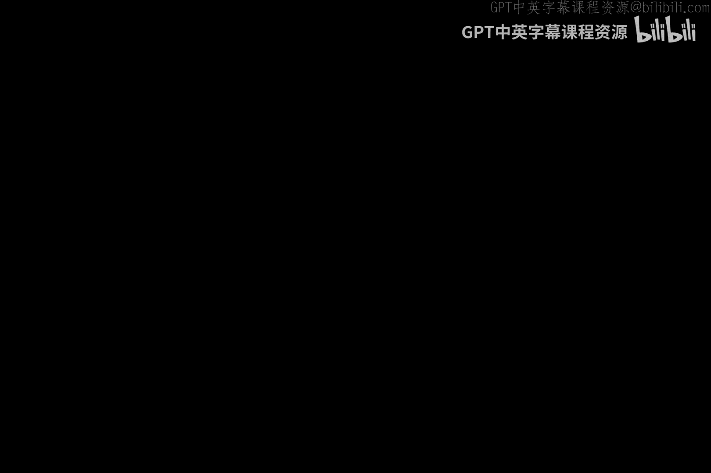
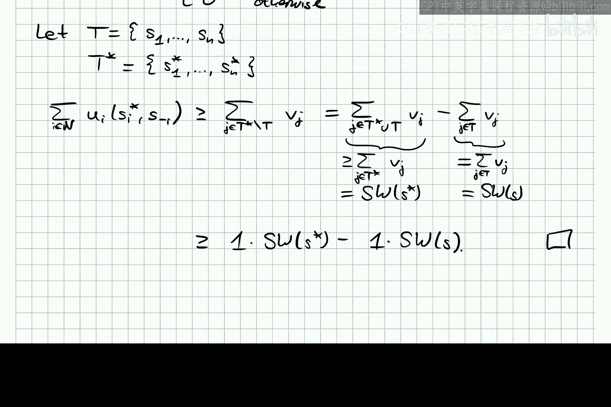

# 波恩大学《算法博弈论｜Algorithmic Game Theory, Winter 2020-21》中英字幕（claude-3.7-s p10 AGT, WS20_21_ Lecture 9 (Inefficiencies in Cost and Market Sharing Games).zh_en -BV1m9ZyYoENg_p10-

Hello and welcome back to Agro McCain's theory。Today we'll continue and complete our discussion of inefficiency due to strategic behavior。

I hope you remember that last time we introduced the price of anarchy。

 which was one way to bound a loss due to strategic behavior。

This is taking a somewhat pessimistic view as we say， well。

 how much worse is the worst equilibrium compared to the social optimum？

Today in the first part we'll take a more optimistic view by considering the so-called price of stability。

 which compares not the worst equilibrium but the best equilibrium to the social optimum and then in the second part we'll again come back to the price of anarchy。

 but then we'll consider a payoff maximization game rather than a cost minimization game。

 and we'll see to what extent well techniques are similar or different thing。

But let's first start with a discussion of the price of stability and we'll do this in the context of cost sharing games。

 which are a special case of congestion games， so let's formally define these。

So what is a cost sharing game？A cost sharing game is nothing but a congestion game in which delays have a certain。

Have a certain form。Namely。It cost sharing game。嗯。Is a congestion game。是。Where're all。

Delay functions。是。At the form。是。D R of x is equal to C R divided by x。For。Constance。CR。

What does this mean well？This means that there is this one cost CR for resource R。

 and the players that use this resource split up the costs of this resource evenly。嗯。So。

How do we then。Get to the social cost。Of a state in this setting， well。Just as usual。

Or as also last lecture， we'd say that the social cost is the sum of all players costs。Now。

 in this congestion game， we see。that。Well a playerlis cost。

 as in any congestion gain is the sum of the delay values。But。If we now rearrange this sum。

Then we see， okay。Maybe let's first stay， but take a step in between and let's see， O。

 D R of N R of S。 This is certainly CR R divided by N R of S。And how often do we get this term， Well。

 we get it exactly NR times。So。An alternative way of writing this is to say， O。

 take the sum over our resources that are used。By at least one player。And just sum up the CR values。

Good。So what we want to do is we want to bound the social cost of a pure natural equilibrium in such a cost sharingring。

Well， unfortunately。The price of anarchy is really， really bad。 Let's see this in a simple example。

Namely the following。We have one source。One sink。And then， we now have。

1 plus epsilon as the cost for the top edge。And will have a cost of n for the bottom edge。So。

These things that I'm drawing here。This is the CR value。Good。

What is a Ponna equilibrium in this setting， Well one pionna equilibrium。

Would be we'll have M players， so one p natural equilibrium would be that all players take the top edge。

And this is also the social optimal。啊。What would be the social cost then？This would be1 plus epsilon。

O。But there is another Pionnaia equilibrium。Namely that old players take the bottom edge。

And what's the social cost done。Well， it is certainly just N。Why is this also a Pna equilibrium well？

If one player are unilaterally deviated， what would his or her cost change to。

 So right now all n players are using this bottom match， they are sharing the cost of n。

 which means each of them will have a cost of one。Willll have a delay of one。Now。

 if I moved to the top edge， if I were the only player to move to the top edge and all other players are still on the bottom edge。

 Well， then I have a cost of one plus Eilon。 I have nobody to to share this with。

So my cost will be one plus epsilon。 whereas down here， my cost was only one。So for me individually。

 this feels to be better to now stay year in this， okay。

 admittedly really bad equilibrium because for society， this is now cost of n。

 Where using if we were all using the top edge。 this would even be an equilibrium。

 Then we would society would only have cost of one plus epsilon。 And for each of us individually。

 this would also be better， because only the cost of every individual would be one plus epsilon over n。

UmNonetheless， I think you may know many situations in which actually kind of society is playing this bad E room because。

 well， you don't want to be the only one who does something different because your individual cost which would be much higher。

 then if you just do whatever everybody else does。嗯。Yeah。For example。

 the way you can think about this is those are two kinds of technology and now there is the much better technology and the worst technology。

But somehow， for some reason， maybe because they earlier in the market。

 Everybody uses the worse technology And then suddenly， well。

 you cannot just individually use the better technology because it might be incompatible。 Maybe you。

Wouldn't want to use other power plugs， although they might be a lot better than what everybody else is using。

 And eventually， everybody would be happier if we all use different power plugs or USB plugs or whatsoever。

 But this is not how it works， because we are kind of stuck in this bottom in this equilibrium here at the bottom。

😊，是。So nonetheless， we see。That the price of ourarchy only gives us only a very limited perspective。

 namely it tells us well， the worst thing that can happen is actually happening。嗯。

What we'll ask today is， well， here in this setting。It is not necessary。 So there might also be。

 there is also good equilibrium。 Naly， this is the social optimum， and it is an equilibrium。

 And that's the question that we will ask today。 how much efficiency do we have to lose by considering strategic behavior So what is the best。

Of our Eria， what is the social cost of the best of these E。

 And this is called the prize of stability。SoTo define the price of stability。

 we do this exactly the same way as for the price of any。For an equilibrium concept。哦。二き。うう。Define。对。

Price of stability。Bye。This is a P U Subscript EQ。Take the minimum cost。The minimum social cost。

Have any ho b。And compare this。To。The minimum。Social cause of any state in your game。So。

Last time we saw that the press stability for coarse correlated equilibrium might be higher than for correlated equilibrium。

 and this might again be higher than for for mixed na equilibrium and vice and and。And so on。

Here now the story is a little different because we are always considering the best of these E。

So the process stability for course correlated equilibrium can only be smaller than the one for correlated equilibrium and so on。

 So if we were write this down， then we see， okay the。This is always， of course， at least one。

But then the price of stability for coar correlated equilibrium is at most the price of stability for correlated equilibrium。

Is at most the prize of stability for mixed Naivia。

Is at most the process of stability for pure National equilibriumria？

And this then is again at most the price of anarchy for purenaric ca and so on。Because， well。

 the best。Pionnaal equilibrium is still can only be better than the worst pnaal equilibrium。

 but the best pnaal equilibrium is also a correlated equilibrium or a coar correlated equilibrium。

 and so on。 So there can only be better equilibrium in the sense。嗯。What is， of course。

 a little different here than if we talk about the pro of anarchy is that here it might happen that equilibrium do not exist while this can also happen for the pro of anarchy。

 but then kind of we don't care。Whereas here bounding the price of stability implicitly also means that you have to show that an equilibrium exists。

Because well， somehow you have to say， okay， there is an equilibrium， first of all。

 and this equilibrium has to have only cost isn't this high。

So that's why oftentimes it's actually more difficult to bound the price of stability than the price of anarchy。

 but still we can do this now for these cost sharing games。😊，And， let's first start。

With symmetric cost sharing games。We will show that， in a。Cymsymmetric。Cost sharing game。

So all players have the same set of strategies。The price of stability。For Pion as equilibriumlibria。

Is one。So this means there is。Always。A Pna equilibrium， which is at the same time a social optimum。

 or you can also say this there is always a social optimum， which is also a Pionna equilibrium。嗯。

We've seen in our example before， let me go back to this example。

Here we've seen that there were Ashley2 Ash Colria。And one of these was a social optimum。 and indeed。

 this is a symmetric。Cost sharing game。 So this is actually a special case of our theorem。

 we claim that。Whenever all players have the same strategies， then the。There is。

A pure Nationalal equilibrium， which is also socially optimal or one of the social opta is also a pure Nationalal equilibrium。

So how do we prove that？Well。We just now explicitly construct this piionnaal calib。

It is even a symmetric equilibrium， which means that all players use the same strategy。嗯。

How do we do that well？Sat。F1。So the strategy for player one。To the strategy。From Sigma 1。

That minimizes。The sum of the costs。So if were only if there were no other players except for player1。

 then what would player a1 do。This is and then we let just every player， also the other players。

We let。And do exactly the same thing。A。Now， why is this。Socially optimal。

 and why is this a pure National equilibrium？Well。Let's just see the social cost sorry an individual player's cost after deviating。

So how would we get this？ Well， we would now take the sun。

Over all resources that this player is using now。And。嗯。So we would now be taking。

And the cost after deviating would be the following。We would have year as the first part。

 we would have the costs。Of the delays of the resources that the player was using before and afterwards。

 and of course all players are using this resource， so the cost will be divided by n。

Ca they equally share the cost。 And then there might be some other resources that the player is now deviating to。

 but he's the only one using these resources。 That's why。 Well。

 he cannot share the cost with anybody else。嗯。But this now means。

That this will be at least one over n。Times the cost that this player。Incur。嗯。

Or one over n times the sum of the costs of the resources that this player is now using。Okay。

 I hope that's kind of clear。This， of course。Is at least the cost。

The sum of the costs of S I rather than S I prime， Why this。

 Because we set S I to be the strategy that minimizes。The sum of the CR。

And this is exactly one over N。 Thompson cost that the player had when only using strategy。诶。S， I。

So this is certainly a ptric equilibrium。And why is it a social optimum， well。

This is a social optimum， because even。Player 1 couldn't have done something else。

 couldn't have couldn't have a smaller cost if there were only player 1 and the other players cannot make this any cheaper。

So what we saw is that there is always。A social optimum， which is also a pureasure equilibrium。

 with a little bit of more work you could even show that every social optimum is always a purenaure equilibrium。

嗯。But。We very explicitly used。The symmetry of the game， where did we use it well exactly here。

 because we just set all strategies of all players to the same。What now if we cannot do this。

 So if players have different strategies， well， then。The price of stability is greater than one。

Let's see this first in an example。We will now have N players。

And each of the players have has a different source。And they all have the same sink。

Player one can go there via a direct edge that has a cost of one。

Play a2 by a cost that hath by an an that has cost。A have。Player 3。F an edge that has costs a third。

And player n by an edge that has costs one over n。ok。What's now the alternative？

The alternative is an。Indirect way of getting there。Well， they can all take an indirect way。For free。

 they can actually get to thiss no V。And from this node V。There is an edge。

Taking them to the top at cost one plus a。First of all， what's the social optimum here， Well。

 the social optimum is pretty obvious。Recall that the the social cost is the sum of the cost of the resources that。

Somebody is using。And here now we can do with0 plus1 plus epsilon because all players can first go down to V and then use the one plus epsilon edge to get to T。

So this means each of them will have an individual cost of one plus epsilon over n and all of them。

And together， have a cost of one plus epsilon。But is this an equilibrium？No， it isn't。Because。

 unfortunately。There is this player N who says， okay。

 I have a cost of one plus epsilon over n by this。If I do this。Thing that everybody does。

 But if I now individually alleviate。Then I'll have only a cost of one over n。Okay。

So is that done in equilibrium？If only player N uses his or her private edge。

 and the others still use this public edge。No， it isn't because then the shared cost is only one plus epsilon over n -1。

 So then player n -1 will say， okay， why would I use this， why wouldn't I use my private edge？

So what you can actually see here is that there is only one pureionnaal equilibrium。

 namely everybody。Users。Here's her private edge。一。So the only pure natural equilibrium is to use these direct edges。

And what's the social cost？This is。Well。Wang。Plus a half。Plus， a third。pl。U to。One over n。

This is the n harmonic number。Which grows。Proportal to。Loin。嗯。Whereas the social optimum。Would be。

The cost of one。Sorry， one plus Epsilil。So this means that they price stability for Pionnacolibia。

Will be， at least。The n harmonic number divided by one plus epsil。But， fortunately。

We can also derive this as an a bound on the price of stability。Let's see this。

The price of stability。一。For Pionnaia Coloia。嗯。Fair cost sharing games。Is。At most。

The end harmonic number。If we have N players。So how do we prove such a theorem？Well。

 I hope you remember that。Pioninaal caliba are exactly in a congestion game。

 the local minima of the rosental potential。And what we'll do now is well compare the rosedental potential to this social cost。

Don't forget that these are two different things。 The Rosenthal potential had no particular meaning in terms of the sum of the player costs。

 It was only like a tool that we used to show that pionnatal calibbra exists， for example。

 And this was the thing that reduced use with every improvement step。Whereas the social cost。

 that's something different。 This is the sum of the player's cost that we're trying to bound now。

 Let's see these differences。So the rows and top potential。Of a state S。Is how big。

This is what we write by PfS。And what we do is we take the sum over all resources。And then。

 we add up。The from。One， to the number of players using this resource。And then we take the cost。

We generally take the delayed function evaluated at I。

 which in this case is the cost of the resource divided by I。And。

What we'll want to compare this to is the social cost of S。For this。

 we derive to you that we would take the sum over resources， which at least some player uses。

 and we just add up。The cost of this resource。How can we get from one to the other？Well。

Let's see the。There rose in top potential we can。Very。Clearly。Bound as follows。

 Take the sum over all resources that at least some player。Is using well。

Because we don't care about the other resources， they don't have any terms contributing to the sum。

And then， we'll have。1 plus a half plus a third。And so on， up to one over。N R of S。And this year。

This is clearly utmost。Take the sum of our resources。That some player is using。

CR turns the n harmonic number。And so this would be the n harmonic number times the social cost。

Ofess。So the rosental potential is at most the mthharonic number times the social cost of the state。

Yeah。How does this help us？Well。What else can we see， We can also see that the rosentar potential。I。

At least。The social cost of the state。Because， well， just leave out every term。

 except for the first one。 So this will be at least the sum。

The cost of the resources that at least some player is using。This will be the social cost。

So this means that for any state S。The Rosenal potential is at least the social cost of this state。

 but at most。HM times the social cost of this state。Now， take。A。And。

And take a state that minimizes the rosenttal potential。

 take a global minimum of the rosenttal potential。What do we know about this？Let's call this S then。

Clearly， we know。That S is a pnaric equilibrium。Because well。

 every local optimum of the rosental potential is a pnaal equilibrium。

 so also a global opt minimum of the rosental potential is a pnatal equilibrium。Now。

 consider a social optimum。S star。What do we know。Well we know that the Rosentar potential of S will be at most。

 the Rosentar potential of S star。But what else do we know？Then the rosentile potential of S。

Will be at least the social cost。And also， the rosentha potential of S star。This will be， at most。

HN times the social cost of S star， because these were the two things that we've just shown。Now。

 if we plug all of this together。Then we see。At the social cost of S。Is at most H， N。

Times the social cost。Of。A star or。In other words， that the social cost of S divided by the social cost of S star is at most the end harmonic number。

So。We found our Pion National equilibrium。Not this explicitly， as we did this before， but well， also。

In a pretty easy way that we've seen before， namely。

 take a global minimum of the rosen top potential we know。That this is a purenaal equilibrium。

And then we just do this comparison of the social cost via the rosental potential。 Once again。

 these are two different things。 and these are not the same。 but we can for for these games here。

 we can use one as an upper band for the other for other congestion games。

 This will generally not work This will give you much， much。

Worse guarantees which are actually useless。And what we've also seen is that we cannot actually do better HN。

 the enharmonic number， this actually the best that we can prove here because。We had。嗯。

Because we had this equilibrium。 We had this game in which we saw that the。Best equilibrium。

Is no better than HN times the social optimum。So now we've understood pretty well the price of anarchy and price of stability of these cost sharing games and now we'll turn to market sharing games。

 which are well almost the same except for now you're not trying to minimize your cost which you're trying to well。

 maximize your market share， which means that this will be a payoff maximization game as opposed to a cost minimization game。

For the very basic things like existence of equilibriumria and so on this doesn't make any difference。

 but for the price of stability and price of anarchy。

 this makes a big difference because suddenly we are now relating or suddenly now。

Large numbers are better than small numbers。But let's first define these market sharing games。

In such a market share game， we have n firms。Or players。And we have M markets。M。And each firm。

Can decide。To invest。In one of the markets。Will you say this by。Writing S I is a subset of。And。Where。

For any member for any player。Ae。嗯。So I realized that notation is now a little different because suddenly capital SI is the strategy space for player I。

啊。Whereas before capital SI was the strategy choice of player I。

 now small SI will be the strategy of player I。This always depends on whether you what notation you choose always depends on what you actually want to express and semi it turns out that whenever you use congestion gains。

 it is more convenient to use these capital letters because you explicitly want to say that these are sets whereas here those aret sets。

Here your strategy is just one market that you invest in。

 and the set of possible markets is a subset of all markets。Get。Right。Now every market。Has a demand。

一。And。第。If multiple firms now invest in the same market。Then the market demand is shared equally。

So what is the payoff or the utility of a player in a state？

We write this S U I of S is equal to V V Subscript S I divided by N subscript S I S。Where。NJF S。

That still， the number of players。Using。A resource in this case， investing in market J。So once again。

 what does this mean well。If you are player I， you are now choosing one market S I。

And then there is the totally man V of SI in that market。

And we now divide this by the number of players who are investing in this market。

 This is N subscript S I， Why that， Because you are investing in market S I F S。And NJ F S。

 that's just the number of players investing in market， Jane。

Now we don't want to ban the social cost， but the social welfare。The social welfare。

have some state ss。This is nothing bad。The sum of all players。Pay us or utilities in this state。

And just as we saw this in the case of our cost sharing games。

We want to take just the sum of all markets that。Somebody is investing in and then we take the demand of that market。

Or。Now， given the notation here， we could also write this in a different way。Take the set。

Of markets that is invested in and take a sum over all these。

What is a little hidden in this notation here is that there might be repetitions in this set。

 ever then。He had actually taking the sum， having this in the sum only once。

 So if everybody is investing， for example， in market1， then all of S1 through S N。

 those are all equal to1。 And then the sum would be only V1。

This is may more explicit in this term here。Let's see this happening in an example。

Let's have end markets。Each player can invest in every market。And what are our。

Demands for the first market。 that actually is very promising because we have a demand of n plus one。

 whereas all other markets only have a demand of one。What is the。Social optimum。

 how do we maximize the social welfare？Well， we would maximize the social welfare if each player invested in a different market。

That's always the best thing that he can do here that players just。Invest in different markets， so。

The social optimum。Would be。All players in different markets。And will have a social welfare。Of。

N plus epsilon。Plus， n times1。So， this will be。2 n minus minus1 plus epsilon。

But what's the only pionnatal equilibrium here， well the only pionnatal equilibrium？啊。

This will be that all players。Invest in the first market。Why that because。嗯。

Even if everybody is investing in the first market。

 then you still get a utility of n plus epsilon over n by going to this market。

Whereas for any other market， you would get only one， which is strictly less。

So you definitely want to go to the first market regardless of what the other play is under。

And what's the social welfare？The social welfare is only n plus epsilom。Good。So as we see。We kind of。

 again， lose welfare， because。Players are strategic because we cannot tell the players which market to invest in。

 but it is up to their choice。And we'll have， again。

 the question of how big will the pro of anarchy be？

Or you could also ask a question about the price of stability that as we see here。

 the price of stability might actually be already somewhat large， at least it will not be one。

 and eventually what we will see is that even the price of anarchy is bounded by two here。

But before we do this， let's first talk about existence of equilibrium。

 Why are there always geo in this game， Well， because we can rewrite them these games to be congestion games where actually the players want to minimize something namely we could set the delays to negative numbers。

 so it would be minus market。Market demand divided by number of players in this market。

 this would be a delay。And then if you do all this。

 then you see okay in this congestion game with negative costs， then your。嗯。Yeah。

In this congestion game with negative costs。So we'll still to we will still have to argue that there are always。

Pion National colibia。And let's just this stand as an observation。Every market sharing game。

Has a P Nationalal clip。Wuhy is this true well。One way you can show this is you can actually see that these market sharing games are also congestion games。

 Well there are even almost cost sharing games except for that now we want to model by these costs。

 we will actually want to model。The players utilities。And we would do this by negative costs。 Sir。

 we would now say， O the delay。OrFirst of all， the resources of the markets and the delays of markets are minus market share divided by number of players in that market。

And then you see， okay， actually， every Pionac equilibrium of this congestion game is exactly also a Pionas equilibrium of this game and vice versa just because we actually model this the same thing。

We model the same preferences， but the one thing is different。

 namely the way we think about this social welfare。

These are now positive numbers and the way we do these comparisons， this is actually a lot different。

Because suddenly we want to maximize things and we kind of take ratios of social welfare。

So that will be something different。 and let's now talk about depressive anarchy in these。

Market sharing leaps。啊。So how do we define the price of anarchy in a utility maximization game？嗯。

Well， we just do it exactly the same way as we define it in cost minimization games。

 except for some details， because now we're swapping mini maximum。So let's write this down formally。

Given a utility maximization gain。F。이q。B， again， a set of probability distributions over the states。

是。And。4。Any such probability distribution。We write social welfare of P as the expected social welfare。

 if you draw a state from this distribution and then take the social welfare of the state that you've just drawn。

Or alternatively， you can again take the sum over all states。

T the probability that you play the state and then the social welfare。Of the statein。

And now we can define the priceifier here。对。For equilibrium concept EQ。

We say that this is POA Subscript EQ。And what was this before。

 well before this was the worst social cost of an equilibrium divided by the best social cost of any state？

Now， well， everything is。Reverse， because we now say， okay， take the。Best。Social welfare。

And compare it。To the worst social welfare of any equilibrium。

Why do we now have the social optimum and the numerator， Well， the idea is simple because we want。

That this ratio is always bigger than one。 And this way。Larger numbers are worse。

 Small numbers are better。 So again， the price of anarchy will be at least one。And the smaller it is。

 the better it is。And let's now talk about smoothness。In the context of。Utility maximization games。

 Well， this is also a little different。I hope you remember the definition of smoothness for a cost for a cost minimization gain。

And then you see that this is a little different。We must say that a utility。Maximization game。

Is called lambmbda smooth。 Lambda come a， smooth。Where lambda is bigger than 0。

And mu is non negative。If。For every pair of states。S and S star。第。三？Of utilities。

This one player deviates to。S star， the others keep playing， according to S。

 at this is at least Lambda times the social welfare of S star。🤢。

Minines mu times the social welfare of S。So again。嗯。We are considering here this。

This entangled sum where， while we always let one player devviator a star， the other player。

 keep the other players， keep playing what they are。

 And then while before we had that this is at most landlor time social cost plus me time social cost。

 now it is a little different because， well， first of all。

 this should be at least because while we are trying to。

 thoughbound the social welfare are not up bound the social cost。And also。

 what is important is that now here is subing the social welfare of S。

 So this only makes it easier to。Make sure that this condition is fulfilled。And。Still。

By exactly the same way。As we did it last time， we can show that smoothness implies abound on the price vany。

 Let's see this once again so that you don't forget how this works。嗯。The。

In a lambda comm smooth game。And by this， I mean a utility maximization game。The prize of anarchy。

Of course。코roll 거ia。Is at most。1 plus mu over lambda。So the。

The term that we're getting is a little different than last time， but everything else is。

Kind of this the same kind of a statement。嗯。So let's see how we can prove this。

Let's only do the prove for Pionna colliia。If you want to do this for coarse correlated equilibriumria。

Have a look at what we did last time。And see that we can actually what we're doing now can be easily combined with the ideas that we did last time。

So， we know that。S be a purena equilibrium。As star be a social optimum。Okay， so。

Just as we had this before。But every pro ofhanarchy proof will something look like this？Now。

 what do we have to bound， We will have to bound the social welfare of us。Well。

 this is nothing but the sum of all players utilities。Now because we are in an equilibrium。

We can say okay。No player can benefit from unilaterally deviating to a star。

And now we use the smoothest bound。 We say， O， this is at least。

L at times the social welfare of a star minus mu times the social welfare of S。

And if we now combine this， then we see that one plus mu。

Times the social welfare of S is at least Lambda times the social welfare of S star。

 or in other words， that the social welfare of。🤢，S star divided by the social welfare of S is at most。

1 plus mu divided by lamb。So I hope this looks familiar because this is exactly the kind of proof that we altered did last time。

 Now， the signs are a bit flipped， but everything else is just the same。

So if we now want to understand the price anarchy of these cost sharing。

 sort of these market sharing gains， then all we have to do is to show smoothness。

So this is what the only thing that remains for now。What we what we claim。There's the following。

We claim that。Every market sharing game。不是道。Is one colour1 smooth。

So what kind of a bound does this give as well。So we'll have lamb that is equal to one and mu is equal to one。

 So what does this mean and this means。That the price of ionarchy for coarse correlated equilibrium。

This is no worse than。1 plus mu divided by lambmbda。 So this will be at most to the proavannic。Okay。

 cool。Let's see how we can prove this。Well。All we have to now understand is。

What these Ui of S I star comma S minus I terms look like。While， this is nothing but。

The market share。As are the demand in market S I divided by how many players use this market。

And S I star come up as minus I。But how big is this？Well。This is。Have they can thus speak。Well。

 this is clearly at most zero because we assume that these Vs are non negative。

But it may also happen that no player was using this particular market before。

 was investing in this particular market before， in which case this is the subscript S I star。

 And this is true if no other player is investing in that market。啊。啊。Good。And indeed， we can say。

 okay， we can easily derive a more coarse lower bound for this。Well， still。

 this will be none negative。But we can say， okay， we only say that this is the subscript S I star。

If S I star， if this market。Was never invested in。By anybody in S， nor。By the ones that have。

 by the players that have a smaller in。In S I star。Well。

 this is true because the second set that we have here， this is just a super set of the previous。O。

So this now helps us as follows。If we now， let。Capital T be the markets。That somebody invests in。

 in S。And T star。If this is the set of markets that somebody is investing in。In S star。

What is now the social welfare or how can？Now， what is this。En tangangled some。

What's a lower bound for this。Well， we can clearly say this is at least the sum of all J and T star takeaway T VJ。

Why is this？Because if we take the sum over all these terms， then。While the ones that are in T。

 the markets that are in T， those never occur。But then there are the ones that are in T star。

And those for those， we get the the V value exactly once， namely。

Consider what player1 is doing in S star well maybe this is something that that was also done in S。

 then we're not getting anything from this。But it might be that this is something new。

And in this case， this actually contributes to this sum here。

But then this precise market won't ever contribute anything。

 but so even if player two is now using that same market。But what we get is that if we take the sun。

Then every market that is in T star， but not in T will appear exactly once in the sun。

This is just a standard telescoping sum argument actually。So what is this？Well， this is nothing but。

Take the sum over all marketsers that are in。T star， orangey。

And add up the V J values and then subtract everything again。 that is。Enチ。Yeah。Okay。嗯。

How big are these things。Well。We see that this second sum year。This year。

 this is at least the sum of all。T star V and T star， Vj， and this is exactly equal to yes。

 I'm writing down exact the exact same thing I realize。And what， what do these things mean， Well。

 the first thing that's the social welfare of S star and the second thing that's the social welfare of S。

So in combination， all of this is at least。One times the social welfare of S star。

-1 times the social welfare。F S。And this is exactly what we required for smoothness。😊。

So this now wraps up today's lecture。 We've now seen these cost minimization games。

 how we could ban the price of anarchy and the price of stability there with the price of anarchy we bounded last time by a smoothness。

Today， we bounded the price of stability。 and for our special class of congestion games。

 which were cost sharing games， we used this technique using the rosenthal potential。

 And then in the second part， we saw how these。😊，Techniques can also be applied to。

Utility maximization games that there is a an analogous definition of smoothness。

 and for this definition of smoothness， well， we could on the one hand， bound the price of anarchy。

 and then on the other hand， we could prove that these market sharing games。

 which are very similar to the。To the cost sharing games that they are smooth in this sense。

 And actually， what is maybe interesting here is that we can in this。

Cost max in the cost minimization world， we had no chance of bounding the price of anarchy。

 whereas in the utility maximization world， although it is kind of the same example。

 we suddenly can indeed bound the price of anarchy by only a constant namely two。

So this concludes our overall discussion of game theory in the classical sense。

Next time we will start discussing。A very different topic， namely mechanism design。

 And then our goal will be to actually set the rules。Of the game。

 rather than only observing what is happening。 and this we will then actually do for the rest of this semester。

 So I hope you stay tuned。And hope to see you next time。Thank you for watching this video today， bye。

