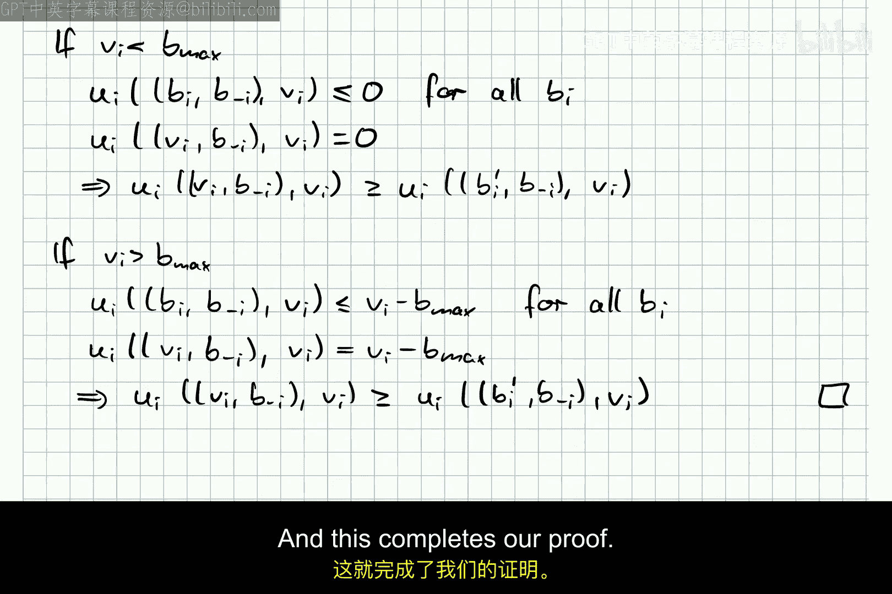
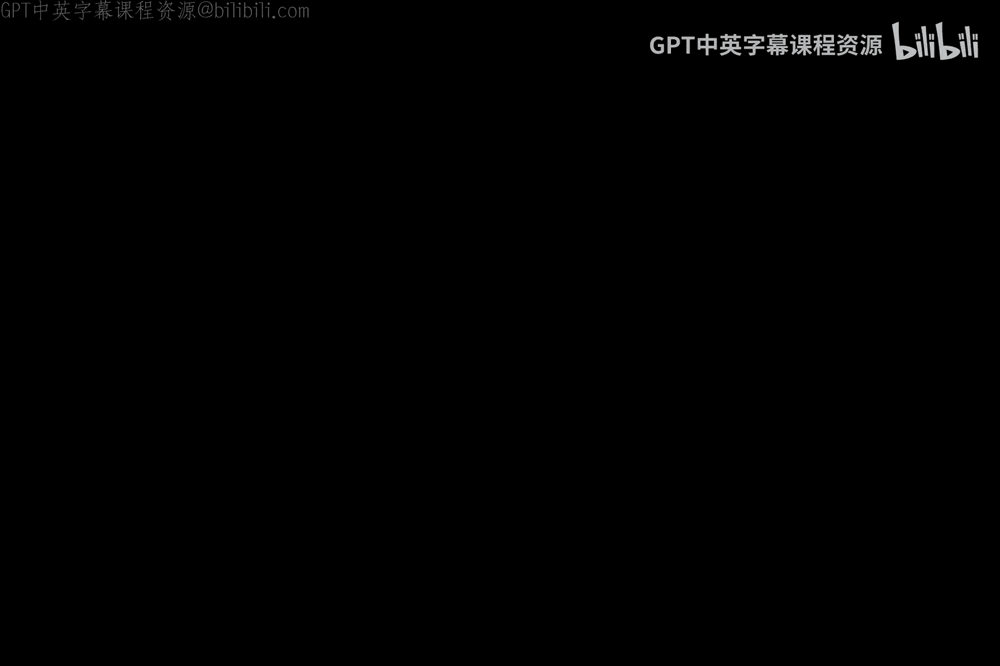
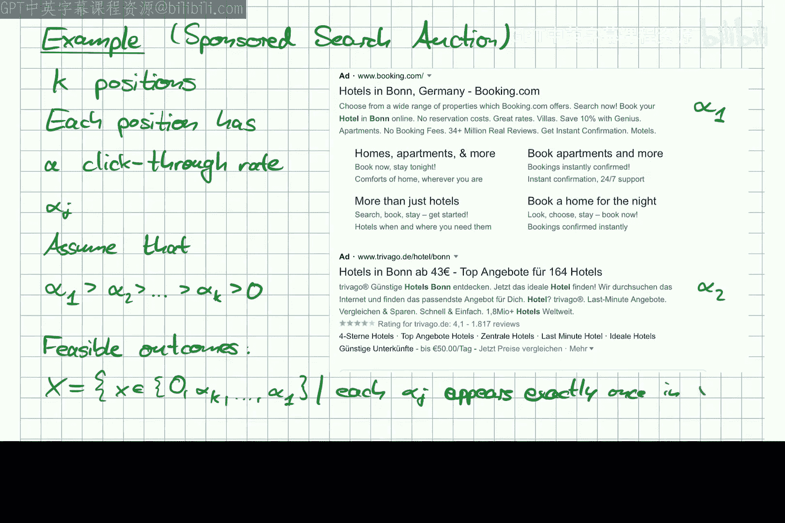
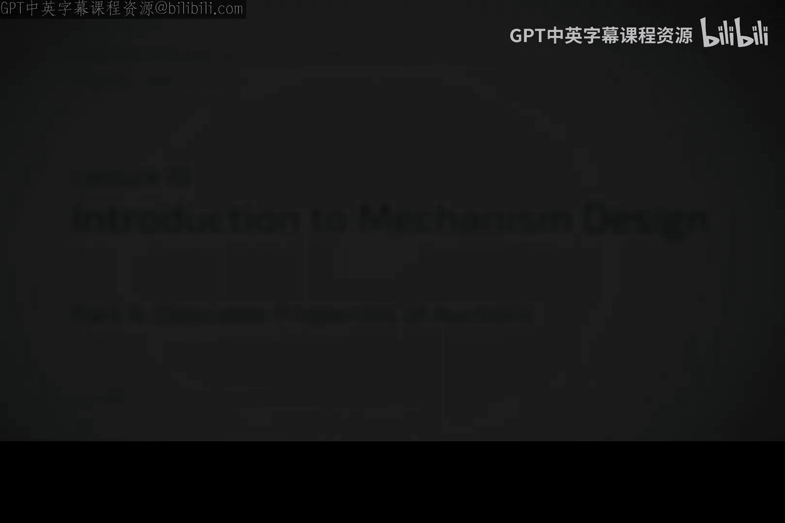
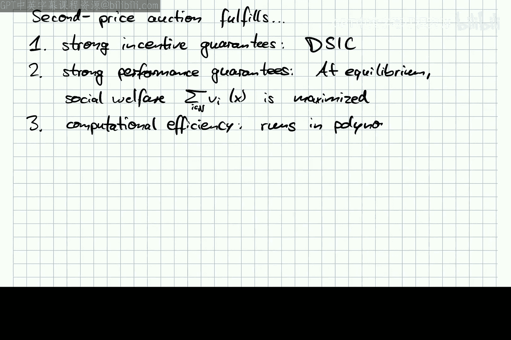

# 波恩大学《算法博弈论｜Algorithmic Game Theory, Winter 2020-21》中英字幕（claude-3.7-s p11 AGT, WS20_21_ Lecture 10 (Introduction to Mechanism Design).zh_en -BV1m9ZyYoENg_p11-

Hello and welcome back to Agrothmic Game theory I'm excited that we're starting a new topic today which is mechanism design。

 more precisely we are first starting with mechanism design with money before later the semester we also come to mechanism design without money。

So far， our goal was just to understand games and strategic behavior happening in games。

Today we're now asking the question， how should we set the rules of the game to achieve some desired outcome and not only today were doing we're asking this question。

 but effectively for the remainder of the semester we are kind of asking this question。

And as an introductory example， I'd like to consider the question of selling a single item today。So。

We might not have one item。That we might want to sell。

Our goal is now to make just the world is as happy as possible。

 So our goal is not to make as much money as possible， but just to。

Make sure that the value that the world is getting out of this item， which is value less for us。

Is the highest possible。What might this look like One thing you might want to do is you might want to run a first price auction。

What could that look like？Well， youre to have a bunch of bids。Each of them writes down their bed。

How much they are willing to pay for this item。And then you figure out who bid most？And in this case。

 the highest bid was 20， so we sell the item for 20 euros。

Is this a good idea to sell an item like this or are there better ways？Well。

 to discuss this question， we first have to derive a Mathematica model。

And we first have to kind of capture the probably strategic behavior happening in here。

What we're seeing here was a circlecalled sealed bed。First price auction。We have again。And players。

Or as we also call them in this context， often bitters。And。Eat as the bitters。Now。Reports one bed。

They all do this at the same time。And then the bitter。With the highest bid。Winds。And pays。His or her。

Bit。Of course， we might want to define a tie breaking rule here because there might be identical bits in which case we might want an essay okay at the bidder with the smallest index。

 for example， widths or。Whatever other tie breaking rule you prefer。

How we do we now capture the agents preferences， So what do these agents， bidders， players。

 whatever you want to call those I just。Identical， those things just mean all the same here。

 how do we express this？Well， what we do is we assume that each of the。

Bitders has a value for winning。And this is a non negative real number。So bitter eye。Has vowed you。

VI for winning。Yeah。V i。Is some non negative real？And。What will then the utility be， of course。

 bitter I， if he or she wins， he or she has to pay。His or herbiid， so the utility。

A bitter eye given beds B will be。V I minus B。If bitter I。Winds。With bids B。

And it will be zero otherwise。So this VI is just in terms of units of money expressing how much do I value the item？

And what we now say is O， my value and my utility is my value minus。

What I'm paying and what I'm paying in this case is just my own bid。If I win， if I lose。

 then my utility will be zero because I'm going home with as much as I came with。Now， if I'm bidding。

 for example， more than my value and I'm winning， then I'll have negative utility。

Because I'm paying more than my actual value for the I。

But hopefully I'm actually bidding no more than actual value and that。Seeing some utility。Is？

This a good game or not？Maybe。Well， it's at least for one advantage is that it's really easy to explain。

But what， what is a disadvantage。Well， we don't actually know。nobody knows these values in advance。

 so we don't know either that's really important， Nobody knows these values in advance。But。

You'd better actually know what the other bidders are bidding to now choose your best response。

And let's see this once again in our example， these are the bids in our example。And now let's ask。

 is this a pure na equilibrium proof？Is it a pure National equilibrium。For these players。

To bid this way。And even if we don't know their values， we see， well。

 this cannot be a na equilibrium， this cannot be a pure naa equilibrium。Because。

How should this bidder bidding 20， how should this ever be a best response？If this bidder bid。

 for example，7，02， then the play would definitely still win， but pay far less。

 And this way also have a higher utility。And the amazing thing is that。嗯。

There are better ways of designing such a mechanism for which there is a not only a na equilibrium。

 but for which bidding is super easy。And this is called a second price auction。

And this is what we will see next。So now we are moving to the second price auction。 Once again。

 what was the first price auction， the seatd， first price auction， each bidder reports a bid。

 and then the bidder with the highest bid wins and he or she。Just paces his or her bed。And we。

 what we were seeing was that usually。Truthful bidding， for example。

 isn't a purena equilibrium because if you're winning by a big margin。

 then you want to decrease your bit。Your true value， this is usually not a best response。啱。

The second price option is a little different because it does only one thing in a different way。

 namely。What does the winner pay。And now the winner doesn't pay his or her bid。

 but the second highest bid。And this has some amazing consequences。So a sealed。Bed。

Second price auction。Works as follows。Again。Each bitter。Reports。A bed。And。The bitter。

With the highest bid。Whenins。And pays。The second highest bit。

So what will the utilities be in this case？Utility of bitter eye when the bits are B will B。VI minus。

The maximum of all J， which are not equal to I。BJ。And this is if bitter eye wins。And otherwise。

 it is still zero。And somehow here。Bidding is much easier， because。By the bit you choose。

 you cannot actually influence。Your own payment。How much you pay doesn't depend on your bed。

So you bid some way， and this makes sure that you win or don't win。

But it doesn't affect your payment。And this way， this and our term unit， this is independent of B， I。

 the only thing that matters。Why VI matters is， do you bid more than anybody else？And， indeed。

As we will now show here it is not only a。Pureanaural equilibrium to bed。A true value。

 but even regardless of what the other bidders are doing， you always want to bid your true value。

Hoso。Let's first。Define a notion。The notion of a dominant strategy。Abed， B， I。It是。Weekly。

Domon and strategy。For player。i。😔，With value。VI。If。4our。哦。B， I prime。And。Or B minus I。The utility。

Earth。Bdding。B I。Is at least， the utility。Earth bidding， B I pride。And as you say。

 we changed notation already a little bit to indicate， okay， my utility now also depends on my value。

 this we will make a little formal in a second。But so here this is bitter eyes。Value。

And we can also say。That。A bid profile。Is a。Dmin and strategy equilibrium。And4。Valuation profile V。

If。For every。Pyer。The beard。B i。Is。A weekly。Dominant。Strategy。And what we now claim is that。

In the second price auction。For each player。It is。A dominant strategy。To bed。Truthfully。对起。

By the way， this is a theorem。And all of this second price option。

Dates back to victory from the 1960s。And you will also find the second prize auction called victoryy auction sometimes。

How。Do we prove such a thing and what does this even mean to prove this？

We will show that in this second prize auction。Let's go back to the definition of a dominant strategy。

对。When you're bidding your true value。You will get at least as much utility as when you get bidding anything else。

And this holds， regardless of what the other players are bidding。

 So they might be bidding truthfully， but they don't have to。We don't really care。

Regardless of what the other players are doing， it is always in our best interest to just bid the true value。

Let's prove this。It is surprisingly simple。Let's fix。Simpplay。I or her value？

And the bids of the other players。Those are cold。B Sub Mins eye。What do we now have to show？

 We'll have to show。That you I。F V， I come a minus I come a V I。Is at least you I of。B。

 I prime comm a B minus I。Come a V I。4。哦。B， I prime。嗯。We now let B max。

Be the maximum of all utilities， of all beds。Except for。The bed of player eye。If。

S be BI is smaller than B maxs， what will happen？Well， then the utility。F。B， I come a B minus I。

Come a VI。Will always be0， because I'm not winning。And then。There is the option that。

B I is greater than Bm。Then。My utility will be my value minus B max。Now， what could my value be like。

My value might either be more than be max or less than be max， what will happen？A VI。

Is less than B max。Then。The utility。F。Every bed。Will be at most 0 for all。Bi。

And willll have that the utility when I bid my true value。Will be exactly equal to 0。

So this means that the utility。When bidding。My true value is， at least。The utility。That I'm getting。

If I'm bedding anything else。え。What I didn't quite mention at this point was that what happens if I ba exactly the secondized value。

 So if I be exactly the maximum of the other bits。That's interesting because we don't actually care in this case。

 regardless of how ties are broken， we might either be also be in this case or we might also be in this case。

Both is fine。And then theres now other case that if my value。Is more。Then， the。Maximum value。

Then what will my utility be。My utility will always be。 Let's once again check。 Okay。

 the maximum of the two is now V I minus B max。 So this is。Than at most， V I minus B max。

This holds for all I。And at the same time。The utility。Spitting my true value。Will be。

Exactly equal to V minus B max。So also in this case。Will have that the utility。

And bedding the true value is， at least。The utility when I'm bidding anything else。

And this completes out proof。

Cool， Sir。This is already our first result。For this second price option。

 we see that it is actually great， it is really easy to participate in such a second price option。

If you know your value， which is our assumption at this point， if you know your value。

 then you just bid your value and that is about it。

Then regardless of what the other pairers are doing， you're always doing fine。And why is this true？

The point is that you yourself cannot actually influence how much you're pain。

All you can are in all you are influencing is。How much。Am I winning or not？And this。

 am I winning or not， this is just determined by what the other bidders are bidding。

 so they are setting a threshold while they they maximum bed and then you know。Effectively， choose。

Am I bidding more than B max or less than B max， B Max is what I will have to pay。

And it now happens that， okay， either。My value is smaller than be max then I don't want to win for sure。

 or my value is larger than be max than I want to win。But。

It doesn't actually matter how much I'm bidding as long as I'm bidding more than B max。

And this is something we'll also understand more deeply in the following lectures。

But before we get to this point， we will now first introduce a more general。

AF for doing such mechanism design， worth money。

Okay， now we've seen the second price auction and also the first price auction already as two examples of mechanisms with money to allocate an item。

Now， we'll get to know a much more general framework of。Mechanisms， and also how。We can， then。Oh。

Okay， so so far we've seen the first price and the second price option and those are two examples of mechanisms。

Now， we'll get to know a much more general framework。

Out of which these single item options are just one special case。

 and well also see other more general cases， such as for example， allocating multiple items。

How does this now work in general？Well， we'll have， again， N players。Or bitters。Or agents。

I'm using thesees。嗯。And these words really interchangeably here。And is the set n。

 which we will usually call one through n。And then we have an outcome space。😊，Which we call X。And。

Each。Player。I and N。系你。Private。Valation function。VI。Mapping from X to the reels。Good。

So there are multiple things we have not yet talked about here。 For example。

 what might this outcome space be like。 Let's see this in the example of a single item auction in just a second。

 and then what does this even mean to have that the valuation function is private。

 This means that the and neither the mechanism nor the other players know this function。

 This was somehow explicit， so far， because in a single item a。

 if you knew the values of of all players， if you were to design the auction， Well。

 if you already knew the values， then you could， without any bidding。

 just give the item to the one who has the highest value。😊。

This is why these are assumed to be private。How would we capture， for example。

Are a single item option。We might not say okay。 X should be the set of all。0ero1 vectors。For which。

There's only one component that is one， which means。X I is equal to one， if and only if player I。

Gets the item。And then we'll say okay VI。F some x will be equal to V。If x is is equal to 1 and0。

 if x i is equal to 0。This is a little strange the first time you might see this。Because。Of course。

 at this point， we might also choose a different outcome space。 So， for example。

 we might also just say， okay， the outcome is one。An integer from one to n。

 So one of the players is getting the item this way of writing things。

It may look a little contrived at this point， but this is how we will think about this next time。

That will have a01 vector。Regardless of how you then define this， well now say， in this case。

 X is equal to1 if player I gets the item and then。The valuation function。Once again。

 it maps from outcomes to reals。 This will be my value for the item。

 which I incidentally also call VI here as well as the function because they kind of expressed the same thing anyway。

 although in terms of syntax， they are actually something different， this is a real number。

 this is a function。And we say， O， the value of the function。

Is my value for the item if I'm getting the item and otherwise it is0。Okay。

 now we'll have to introduce the notion of a mechanism。What does a mechanism do。

 a mechanism solicits beds？And based on the bids， it determines an outcome。So what we'll also have？

As B， I， this is the set。Of possible。Bids。For player I。And B。Well just。

The Cartesian product of all of this。This is then the set of bid profiles。And a mechanism。

Now consists of two things。The first thing that we'll have is the function F。

Which we call outcome rule。Which maps from。The。The set of bid profiles to the set of outcomes。

 So it just takes one of the bid profiles and maps it to an outcome。

And then well also have a payment rule。Which also takes us input a bid profile and maps it to a vector of。

Not necessarily non negative reels， so payments might also be negative in general。Good。So。

You could now， and I'm leaving this as an exercise。Gried very damp explicitly。

 what will the outcome and the payment rule be for a first or a second price auction。

Interestingly enough， the outcome rule will always be the same because you always gave。

 We were always giving the item to the bidder with the highest value。

 They differed only in terms of the payment rule。Generally。How does this now go forward。

 We now say a came。Player eye。As what as his or her utility。This will be。You I。

Maybe superscript M will often drop the superscript。F B comm a V I as V I， F F， F B， minus P， I F B。

What is this？So， we are now taking。F of B， this is the。Outcome。Under。Bit。Profile。V。

And then of course， we are asking what is。Thee， and what is player eyes value for this。

And then what we also have here， this is just the。Payment。A bitter eye。Under。Bed profile。Yeah。B。

And this is exactly what we saw earlier。😊，F， this is who determining who wins the item in the case of a single item。

 and P I of B now says how much does。Player I have to pay。 so far。

 we were saying the losers don't pay anything。 Only the winner pays something。

 But you could also do this in a different way。 if you now， insist everybody could pay something。

That's just up to you to design this。嗯。Importantly， Nev。What the mechanism sees， this is only the B。

 and it is not the V。The V， this is only determining the utility of the player， but it is private。

Only the player knows the V I。This way of defining utilities is called quasiline utilities。Yeah。Now。

What are these beds， actually， so far， they are just something。But in our examples。

 they were not just something arbitrary。They were exactly possible values。 So via the bids。

The players were reporting that they have a certain value。 That's at least how we interpreted them。

And this is also something that you can do much more generally， you can say， okay。

 maybe bids are just possible valuation functions， and these kinds of mechanisms are called direct mechanisms。

So in a direct mechanism。We'll have。BI equal to V。Where V I。Is the set。Of all possible。

Valuation functions。4 player eye。Yeah。And this is exactly what we saw in the case of a single item auction。

In the case of a single item auction。We said the。V I。Equal to B R equal to yes。 And at this point。

 my notation is a little sloppy because I'm saying， okay， those are actually the real numbers。

Why that？ Because let's just identify。These functions。With the values。For the， for the item。

This is something that was already a little implicit in what I was saying so far。嗯。

And now at this point， we can also interpret this a little more generally。What we were doing there。😊。

Both the first and the second prize auction。Okay。Yeah。They both choose。An outcome。So as to maximize。

The sum of the B， I of X。So。What we're saying here is that。

And this is something that you can also do whenever you have a direct mechanism， so the。

Players are reporting some valuation functions。 And now， okay。

 let's just take an outcome that maximizes the declared welfare。

Because what something we could also always do is just maximize the sum of what the players are reporting。

Their value for that outcome will be。This is a kind of mechanism。

It's not yet a mechanism because what is missing to for mechanism。

 we're still missing the payment rule。And we'll define this actually very soon also for exactly this way of choosing the outcome。

But。😔，The general dilemma is now。Okay， we only see。We， as， the mechanism， only see these B I。

 So if we now wanted to maximize the sum of the valuations， for example。

 then all we could do is actually maximize the sum of the declared valuations because we don't know the actual valuations。

But what we hope now to do is by setting the outcome and the payment rule appropriately。

 the bidders will just tell us their true valuations。 And then whenever we are maximising this thing。

 then we're at the same time， maximising the sum of the V I of X because。

They are telling us the truth， anyway。But。That's something we definitely have to talk about。

Before that， let's maybe see some other examples of what we could now fit into this framework。

We might consider， for example， a combinatorial option。Yeah。What is a combinatatorial auction？

We now have a set of items。And。Each尺。What is now a little irritating at this point is that this set of items is also usually called capital M。

 which we also used for the mechanism。So let me still do this here。

 although this is maybe not a super smart notation。And。一植。Bitter eye。As a valuation function。

 which is， of course， still private because they are still private， they are always private。Yeah。一個。

And this function is。Mapping from the power set。Of the set of items to non negative reels。

And the outcomes。Are feasible allocations of the items。Which will write formally as。All partitions。

Such that each S is a subset of M。And as I intersect as I prime will be the empty set。So。

 they are disjoint。Meaning that each item is allocated at most onces or each item may be allocated exactly onces。

 depending on how you want to do this， you might want to insist on each item being allocated only exactly ones or at the at most onces。

Good here。You may now also see， okay， this is， first of all。

 this is a generalization of the single item option because there this M would be just one。

For this setting， we will be considering different kinds of mechanisms。

 There are both direct and indirect mechanisms。 A direct mechanism would now report this entire function。

 whereas。An indirect mechanism might be just selling each item individually。

 This is something we'll come to later。Let's see another example。Which is a sponsored search option。

What is this referring to。I hope you remember this was one of my introductory examples that whenever you make your search query in one of your favorite search engines。

 then you're presented apart from the actual search results。

 you're presented multiple ads and these ads are sold in an auction。And how can one capture this？

We'll have now K positions。So these might be my search results here when I have K positions。

And we'll have。A click through rate for each position。Which we call alpha J。We assume that。

The click through rate at the top position is at least as high as the click through rate as the next position and so on until the case position。

 And also， this is still。At least 0， although I should be more explicit。

 we usually assume that they are even all strictly bigger than each than the next one。

 So we might have here for the first position。 we might have some click through rate for the second position。

 we might have again， some click through rate and so on。😊，And what are our feasible allocations？

Feaible outcomes。Those others had a vectorous X。From the set of0 alpha K up to alpha 1。Where。

Each alpha J。Appears。Exactly。Onces。In X。

So。This is something you could also interpret as a combinator auction because this would be one item。

 this would be another item。 you can allocate each item at most once。Or exactly ones。

 We now do this in a slightly different way， because now。Those are。Not just。These numbers。

 but we take them to the n。 So we have a vector。Of click through raids。

 each of the players is getting a click through rate by getting one of the positions。

And we now do this maybe again a little complicated way。

 but this turns out to be helpful next time because we I say the X I now represents exactly the clickthrough rate。

And this way， we can then say， O my value。For x is equal to V I times X I again， because。

X I will be exactly my click through rate。And this is true， for some。V I， that is not negative。

In the lecture notes， you'll find one further example of such a mechanism design problem。

 which I'll not go through now。 But where you'll see O based on。

All this notation that we have so far， you could also capture a minimization problem rather than a maximization problem。

But what we'll do next is we'll discuss what could be a good property that a mechanism fulfills。

 we've already seen this kind of before in the example of a second price option this just felt perfect as a mechanism and let's now formalize this more generallyly what we mean by a perfect mechanism。

What is a good mechanism。We've seen that we were kind of happy with the second price auction。

Because there， it was。Quite easy to participate in because you just bid your true value and that's always a good idea。

But there are other mechanisms like this， which we wouldn't consider good。 For example。

 if we were always giving the item to。The youngest bidder。That wouldn't quite make us happy。

 Why that。Because。Somehow we wanted to also maximize something which we'll call social welfare in a sector。

So， apart from。Bits。Always wanting to bid that true value。 By the way。

 if we always gave the item to the bidder with these to the youngest bidder this。

And ignored the bits altogether。You would also want to bid your true value。

Because this is certainly no worse than any other bit。U。So。There's more to this story。But。

 let's know。Go through all the properties that we want one by one。

The first property that we want is actually that we want to bid your true value。

 and this is called dominant strategy incentive compatibility。We say that a direct mechanism。

What was a direct mechanism， this is one where you can bid your true value。Again。

 this is a pair of an outcome rule and a payment rule， and we say that this is。Dominant strategy。

Incentive。Compatible。Which we call d s。Or just truthful。I。If。For every eye。Bdding。B I equal to V。

Is a。Weekly。😔，Dominant。Strategy。That is。For all。Players。Any valuation function？

And whatever bids we're facing。Ui。😔，F V， I comm a B minus I comm a V， I。Is at least you， I。诶。B。

 I comma， B minus I comma V， I。Let's once again understand this inequality。You are player I。

Your value is VI。Everybody is bidding something。 So we are。facingac this bid profile B。No。

You are certainly no worse off if you now unilaterally move to VI。

This will give you a utility that is at least as good as what you were bidding before。

This in particular means that truth forbidding is a pureionna equilibrium。Because in particular。

 if everybody is Ls is bidding v minus I， then it is the best response toul VI。But。

This is stronger than this， because even if others are doing something completely crazy。

 you still want to be the true value。And as we've seen。

 the second price option fulfills this property， and there are also many other mechanisms which will fulfill this property。

Why do we like this property？For one particular reason， because then we are as the mechanism。

 we don't know these VI， all that we are observing is actually the piece。But if now。

Players have an incentive to actually be their true value。

We can just assume that they are bidding their true value so we can optimize some objective function。

And。This is something that was already implicit in the second price auction。

 because what is happening in the second price auction。

 Who is actually winning the item if everybody's bidding truthfully。The one with the highest value。

And。Let's now see all of this together。So what are the good properties of our second price auction？

The second price auction。Fuulfis what。Firstly。Strong incentive guarantees。It is。Dominant strategy。

 instead of compatible。But it also  fulfills strong performance guarantees。Add our equilibrium。

The social welfare。Which is the sum of the V I。F x。It's maximized。And thirdly， it is computational。

Computationally efficient。Because it runss in polynomial time。Yeah。Okay。

。This third point might sound trivial right now， because。Okay， there's only one item， so。This is。

Of course， not super complicated and bitter still， said and。

You might now discuss how would you implement this most efficiently。

 probably you can even do this in linear time， so that's fantastic。But for other problems， like。

 for example， for commun auctions， where you have multiple items。 suddenlyly。

 this computational efficiency turns out to be。Not as trivial。And indeed。

 this is somehow the point that。Computer science brought to this entire discussion because。

Back in the。70s，80s， economists were saying， okay， we want to have incentive guarantees。

 and then we want to maximizeim social welfare。 for example， And then they said， okay。

 this is all fulfilled by something， some kind of a mechanism that we'll get to know。 So they said。

 okay， we're， we're all set。But then computer science came along and realized， okay。

 this doesn't even run in polynomial time， and once you insist on polynomial running time。

 things are getting much more complicated。And this is something that we will be seeing throughout。

The following lectures。What can you still do if you also insist on polynomial running time。

 although first of all we'll just talk only about the first two properties and as it turns out this third property will maybe at some point then also play a role and we will realize。

 okay， we actually cannot do this in polynomial time， and if we start approximating things。

 then suddenly these other things fail。So this is what's coming up in the following lectures。

I hope you're excited about this as I am and let's see each other soon again until the they say bye。

