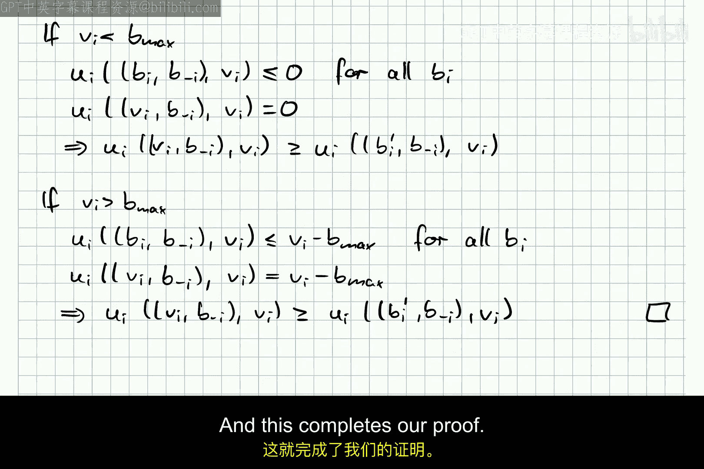
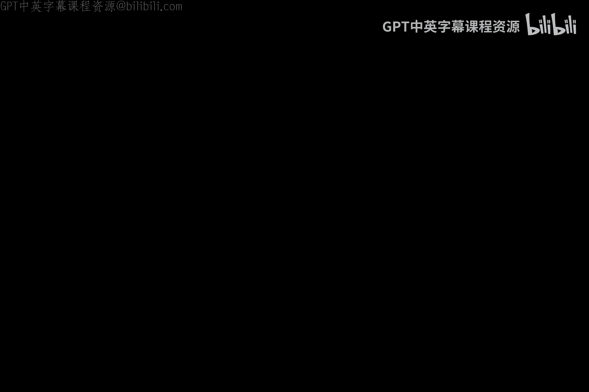
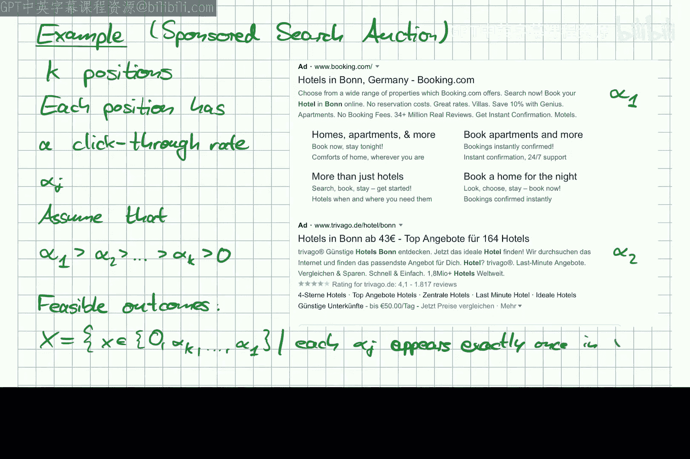
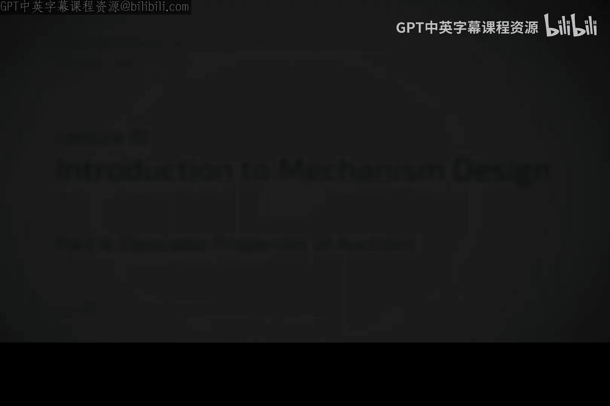
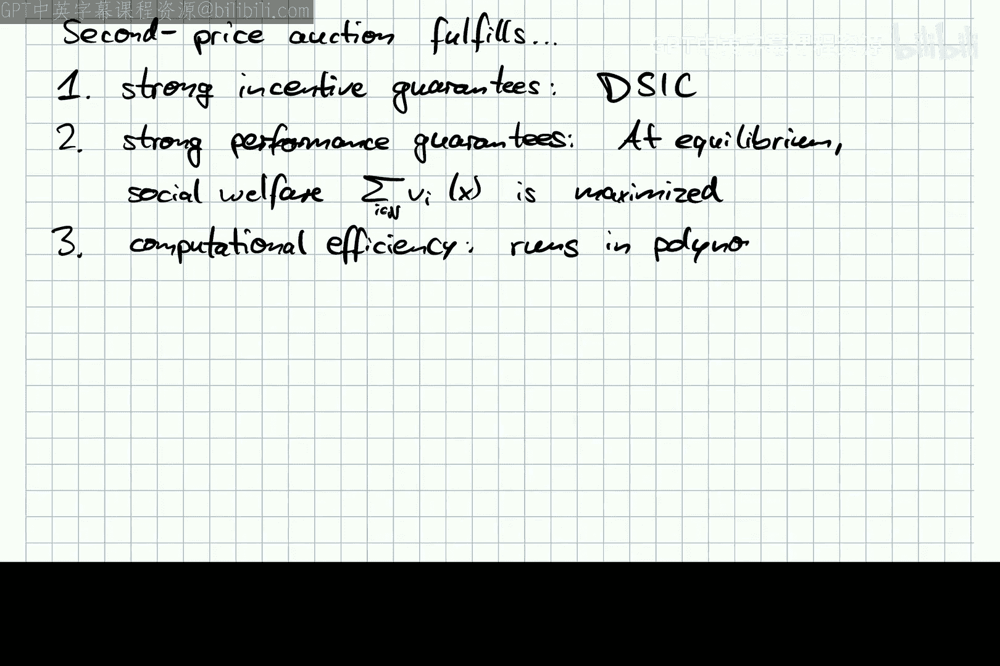

# 算法博弈论：10：机制设计导论


在本节课中，我们将要学习机制设计的基本概念。机制设计是博弈论的一个分支，它研究如何设计游戏的规则，以实现某个期望的结果。我们将从一个简单的例子——单物品拍卖——开始，逐步引入机制设计的通用框架，并探讨什么是“好”的机制。

## 从单物品拍卖开始

上一节我们介绍了机制设计的目标。本节中，我们来看看一个具体的例子：如何出售一件物品。

我们的目标不是最大化自己的收益，而是最大化世界从这个物品中获得的总价值。一种可能的方法是进行**首价密封拍卖**。

以下是首价密封拍卖的流程：
*   每个竞拍者提交一个出价。
*   出价最高的竞拍者赢得物品。
*   赢家支付其出价的金额。

在首价拍卖中，竞拍者 `i` 的效用 `u_i` 可以表示为：
```
如果 i 获胜： u_i = v_i - b_i
如果 i 失败： u_i = 0
```
其中 `v_i` 是竞拍者 `i` 对物品的真实估值，`b_i` 是其出价。

然而，首价拍卖存在一个问题：真实出价通常不是纳什均衡。例如，如果赢家以远高于第二高出价的价格获胜，他可以通过降低出价（但仍高于第二高出价）来获得更高的效用。这意味着存在更好的机制设计。

## 次价拍卖的优势

上一节我们看到首价拍卖的不足。本节中，我们来看看一个更优的机制：**次价密封拍卖**。



次价拍卖与首价拍卖只有一点不同：赢家支付的价格不是自己的出价，而是所有出价中的**第二高**价格。



在次价拍卖中，竞拍者 `i` 的效用 `u_i` 变为：
```
如果 i 获胜： u_i = v_i - max_{j ≠ i} b_j
如果 i 失败： u_i = 0
```

次价拍卖有一个惊人的性质：对于每个竞拍者来说，**真实出价**（即 `b_i = v_i`）都是一个**弱占优策略**。这意味着，无论其他竞拍者如何出价，如实报告自己的估值总能带来不低于其他任何出价的效用。

以下是该定理的证明思路：
1.  固定竞拍者 `i` 的估值 `v_i` 和其他竞拍者的出价 `b_{-i}`。令 `b_max` 为其他出价中的最高值。
2.  如果 `v_i < b_max`，那么出价 `v_i` 会导致失败，效用为0。而出价高于 `b_max` 会导致获胜，但支付 `b_max`，由于 `v_i < b_max`，效用将为负。因此，出价 `v_i` 是最优的。
3.  如果 `v_i > b_max`，那么出价 `v_i` 会导致获胜，效用为 `v_i - b_max`。而出价低于 `b_max` 会导致失败，效用为0。因此，出价 `v_i` 是最优的。
4.  如果 `v_i = b_max`，根据平局处理规则，效用可能为0或 `v_i - b_max`（即0），出价 `v_i` 仍然是最优的。

因此，在次价拍卖中，竞拍者只需简单地报告自己的真实估值即可。这个性质也被称为**占优策略激励相容**。

## 机制设计的通用框架

上一节我们通过拍卖例子了解了机制。本节中，我们将建立一个更通用的机制设计模型，它可以描述更广泛的问题。

一个机制设计问题包含以下要素：
*   **玩家集合** `N = {1, 2, ..., n}`。
*   **结果空间** `X`，包含所有可能的结果。
*   每个玩家 `i` 有一个私有的**估值函数** `v_i: X → ℝ`，表示其对每个结果的估值。

一个**机制** `M = (f, p)` 由两部分组成：
1.  **结果规则** `f: B → X`：根据所有玩家报告的信息（称为“出价”或“报告”），决定最终结果。
2.  **支付规则** `p: B → ℝ^n`：根据报告，决定每个玩家需要支付（或得到）的金额。

玩家的效用采用**拟线性**形式。对于玩家 `i`，在报告组合 `b` 和真实估值 `v_i` 下的效用为：
```
u_i(b, v_i) = v_i( f(b) ) - p_i(b)
```

在**直接机制**中，玩家被要求直接报告其估值函数（即 `B_i` 是估值函数的集合）。单物品拍卖和次价拍卖都是直接机制的例子。

这个框架可以建模许多问题，例如：
*   **组合拍卖**：有多个物品，每个玩家对物品的任意子集有一个估值。
*   **赞助搜索拍卖**：有多个广告位，每个位置有不同的点击率，玩家对每次点击有一个估值。

## 好机制的性质



上一节我们建立了机制设计的通用模型。本节中，我们来探讨什么样的机制可以被认为是“好”的。



一个好的机制应具备以下关键性质：

以下是三个核心性质：
1.  **占优策略激励相容**：对于每个玩家，如实报告自己的估值是一个弱占优策略。这意味着机制能激励玩家说真话，简化了策略分析。
2.  **社会福利最大化**：在均衡时（即玩家都说真话时），机制选择的结果能最大化所有玩家的总估值，即社会福利 `Σ_i v_i(x)`。
3.  **计算高效**：机制的结果规则和支付规则可以在多项式时间内计算。

次价拍卖同时满足了这三个性质：它是激励相容的；当玩家真实出价时，物品会分配给估值最高的人，从而最大化社会福利；并且确定赢家和价格只需线性时间。

然而，对于更复杂的问题（如组合拍卖），同时满足这三个性质可能非常困难，甚至是不可能的。计算复杂性是计算机科学为机制设计领域带来的重要视角。



## 总结

本节课中我们一起学习了机制设计的基础知识。我们从单物品拍卖的例子出发，对比了首价拍卖和次价拍卖，并认识到次价拍卖因其占优策略激励相容性而更具优势。接着，我们引入了机制设计的通用形式化框架，它能够描述拍卖、资源分配等多种场景。最后，我们定义了一个“好”机制应具备的三个核心性质：激励相容、社会福利最大化和计算高效。在接下来的课程中，我们将深入探讨如何设计满足这些性质的机制，并面对其中出现的挑战。