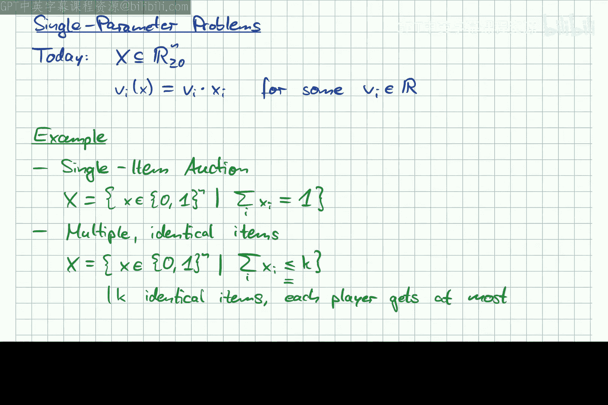
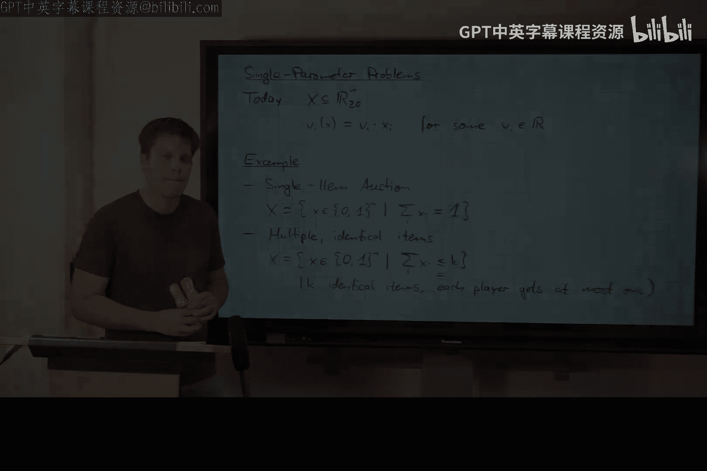
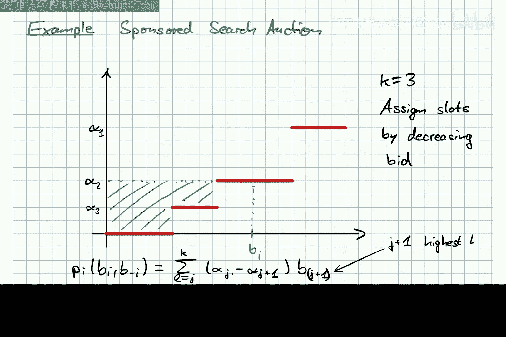

# 波恩大学《算法博弈论｜Algorithmic Game Theory, Winter 2020-21》中英字幕（claude-3.7-s p12 AGT, WS20_21_ Lecture 11 (Single-Parameter Mechanisms).zh_en -BV1m9ZyYoENg_p12-

Welcome back to algorithmthmic Game theory。Last time we introduced the topic of mechanism design with money and we also introduced the definition of a truthful mechanism。

Today， our goal is to better understand what necessary and sufficient properties mechanisms have to fulfill in order to be truthful。

But before we come to this。Let's quickly recap all the definitions。We'll have n players。

 or in this context we often call them bidders， and we number them by one through n。

And we have an outcome space X， this may be in general， an arbitrary set。

Although today we'll make a more restrictive assumption， what kind of an outcome space we have。

 but we'll come to this。Now each player has a private Val function， which maps。

From the set of outcomes to real numbers， which means every player assigns a value to each possible outcome。

 this might also be a negative number， which means that the player associates some cost to this outcome。

Good， now we call capital VI the set of all possible evaluation functions for player I。

And capital V is the Cartesian product of these， so this is the set of all valuation profiles。

Now we defined this last time more generally， but for today it is enough to think about direct mechanisms。

 a direct mechanism now corresponds to an outcome rule and a payment rule in an outcome rule。😊。

The outcome rule determines an outcome and the payment rule determines the payments。

Both of them take as the input， a claimed valuation profile。Because each of the players。Bids。

Something and in a direct mechanism， the bids are what they claim their valuation is like。

And now the outcome rule takes all of these and maps it。2。One of the outcomes from the outcome space。

 and at the same time we have the payment rule， which maps on this to a payment for each of the players。

For example， we were considering these single item options。

Where possible outcomes were who wins the item and then usually we made the winner pay something。

And the losers didn't pay anything。But in general， we are not restricted to this kind of mechanism。

Now， what are the。Players， utilities。The player' utilities are quasiline utilities。

When we're now seeing the bits， so what the bidders or the players claim their valuation is like。

 we now compute an outcome F。And then we evaluate the true valuation VI on that outcome。

And from that， we subtract the payment that the bidder is making。And the difference of this。

 this is a。Players utility once again we have the superscript M here which we often leave out which refers to which mechanism we're applying。

 then we have this depends on B which are the strategies in this game。

 but then this also depends on VI， the private valuation function which we as the mechanism designer don't know。

And therefore， we were interested in what we call dominant strategy incentive。

 compatible or for short truthful mechanisms。A mechanism， a direct mechanism。

 is called dominant strategy incentive compatibleible if this following inequality holds。😊。

What's that？Any。Player。Gets the maximum utility when they bid their true value rather than any other bid。

Regardless of what the other players are doing。G written down here。嗯。For any bid profile， it is。

 it can only increase my utility if I unilaterally deviate to。VI， instead of bidding BI。

 whatever BI might be like。Okay。Today we'll get a deeper understanding of what this actually means。

And we'll do this for a special case of mechanism design problems， namely single parameter problems。

What are these。Our assumption today will be。That。Our outcome space X。Is a subset。Of。

Vectctors of non negative realels， and dimensional vectors。And。Each valuation function。

Is given as V times Xi。For some。VI， which is。A real number。So again， we're overloading notation here。

Like we did this for。Single item options where this VI。

 this would be the function associating a value to each outcome， and we' now say。

 okay this we can actually express by some real number times the Xi that I'm getting。

What might this look like？For example， we might have the single item auction。

Which we would simply represent as。X being all the vectors。In01 to the n。Where。

S of the Xi is equal to1。Now we're getting exactly what we want， namely， okay， first of all。

 this is a subset of r to the n greater than 0。And。Here now we have X I。

Is equal to one if player I gets the item and it is zero otherwise。

But there are also other settings that we could capture to mention just。One simple example。

We might have multiple。Identical items。Which will also define this way。But then we'll have。At most K。

 so we might either have here equal to or at most K， and this means that we have K identical items。

And each player will still only get one。At most one。

So rather than having only a single item now we might not have two identical items。

 but the thing is each of the players will get only one of these at most one of these items。

 we could also easily define this and this would just mean that we will change this year to zero up to K so that a player can actually receive also both items。

 but then we are restricted in what the valuation function is like namely that getting both items means double the value for。

The player compared to getting only a single eye。And there's many more things that you can model this way。

 will come back also to the。Sponsored search options later today。But before we're getting there。😊。

We'll discuss our main result for today， which is a characterization of what makes mechanisms。

 truthful mechanisms in such a single parameter setting。

对。We'll now come to the main result of today， which is a characterization for single parameter problems。

 what makes mechanisms truthful mechanisms？This is called Myerson's Lemma。

 which it is a result by Roger Meerson from the 1980s。

whyhy is it only alemma and why isn't it Ethereum because Roger Morrison was actually interested in something different which would come to later in this class？

For today， we'll only see what makes mechanisms truthful mechanisms more precisely what is our question？

Our question is。4。Which。Outcome functions。So these were functions that。Take evaluation profile。

And map to an outcome。Is there a payment function？So we only have to assign payments to the bidders。

Such that， the combination。So the mechanism， F comma P is truthful。

Such functions we call implementable。So。This is an even more complicated question than just asking。

 if you give me an F and a P， is this a truthful mechanism？But we are even asking。

You now give me this F， and I have to tell you whether there is a chance that you can actually build a truthful mechanism with this。

Can you just give me any P such that this will be a truthful mechanism？And interestingly enough。

 for these single parameter settings， this is very easy to say。

Because it is equivalent to this function F being monotone。

 what do we mean by monotone in this setting here？We now say that。An allocation rule。S。😊，4 a。

Single parameter。Setting。Is monotone。If。for all。Pawyers。And all。Bids for the other players。

The function。That maps。Z 2。F。Subscript I of z commma B minus I。Is。Non decreasing。In the。

So what might this look like， maybe let's see this also happening in an example。

Recall the single item Auction。And let's consider F。As the。Function that。The signs the。Item。

To the bidder with the highest bid。Then what will my？F I of Z comm a B minus I look like。Well。

 it will look something like this。We now keep the B minus I fixed。

And here I'm drawing z and here I'm drawing F of z can be minus I。Then this function will be zero。

For some part， and then it will be one。For some other part。And where is this turnover point。

 This is exactly here as the。Maximum of all other bits。

Because I'm not sting here how exactly what were having exactly at this point because this is just a matter of tie breaking。

 but the function will now look like this。😊，First， I'm not getting anything while I'm keeping the other bits fixed。

And so we're keeping the other bits fixed all the time now I just slowly increase my bit。First。

 I'm not getting anything。 and then there's the point at which I'm becoming the bitterder with the highest bid and suddenly my。

Outcome from getting nothing to getting the item increases from zero to1。This， of course。

 would not be true if we were， for example， considering。

If we're giving the item to the bidder with the second high speed because then。😊，And suddenly。

 I could。If I were going further， then suddenly this would go down again。

And so we're calling an allocation function F monotone if it always looks like this。

 so increasing my bid can only give me more。For example。

 this might not have multiple steps if I were saying okay， here now I'm getting two items。

 for example， this might even be a continuous function if I have divisible items。😊。

So this is far more general than just a single item setting， but for the time being。

 it's okay to think about it。Somewhat like this。What does Myerson's Lamma now state？It now says that。

4。Single parameter settings。First point would be。And。Allocation rule。Is implementable。If and only if。

It is monotone。The second point is that。If F is monotone。There is a。Unique。Pament主。P。Such that。

F comma P is truthful。Assuming。That a zero bit。Implies is zero payment。And it is given by。😮。

PI FB comm a B minus I。Is equal to。B I times F。I F BI can I B minus I？inus。The integral from 0 to B。

F I of T comma b minus I。第几。Good。So what's our claim here that we actually have two claims first thing is an allocation rule is implementable。

 if it is monotone and if it is not monotone， then it isn't implementable。So。

This is not only necessary but also sufficient for a truthful mechanism that we have this monotonicity of the allocation function。

Of course， you can still define payments such that you get。

Such that you don't get a truthful mechanism， but you also can always can find payments such that you。

Get a truthful mechanism if your allocation function is monitored。And then。It doesn't only say， okay。

 they are just。There are just payments， but it also says。There are unique payments。

 there is a unique payment function。Assuming that。A zero bid implies place a zero payment。

And it's not only an existential proof， it is even constructive， it just gives us any。😊。

Exact formula。How to compute these payments。Something。

 some formula that we will understand when we're going through the proof of this。嗯。So。

What do we want to do next， Of course we want to prove this， we first want to see， for example。

 what if an allocation rule is not monotone why can' it be truthful or。If it is monotone。

 why can there be a truthful mechanism？Our goal is now to prove this theorem。

And the first thing that we will observe is that actually for an allocation rule to be implementable。

 it is necessary that it is mono。And while we're doing this。

 you can see how all these arguments work， and effectively this isn't as complicated as it may sound at the very first look。

So how can we now show， for example that？In。Implement allocation rule has to be monitored。

Let's consider。Any allocation function。Once again， what are the utilities？The utility。

 when I bid Z and the others bid b minus I and my value is V。Then this will be。Actually。

 generally it will be V of F of z comm b minus I。Minus P， I of。Z comm B minus I。And in our case now。

Because we're in a single parameter setting， we say this is V times F of z commma B minus I。

Here we are using。That the。Problem we're considering is a single parameter problem。

 so the outcome space actually has the respective。Form that outcomes are vectors of real numbers and VI is a function that is equal to VI times Xile。

Now。If。F comm a P。Is a truthful mechanism？For all。Why。And Z。We have to have。My utility。When bidding。

Why。Against any other bids。And my value is y has to be at least as much。As what I'm getting。

 as my utility when I'm bidding Z。And。My value is why。So。We might now write this down as why。

Times F I， F Y comma B minus I。Minus P。诶。Y comm a B minus I。

 this has to be at least y times F I of z comm a B minus I。Minus P I F Z comma B minus I。

This might already be a little confusing， where do these things now come from？Often mixing these up。

 but I think this time I'm getting it right。This why here？This is this why。So this was our VI。

Our value might be VI and so VI might be equal to y and this is then what we're getting out of this and here what we're getting。

As input to the functions。Would be。Mechanism is working on， this will be the bits。So， this is。

Why here。And this is Z here。Now。The funny thing is if we now swap。Y and Z。

The same inequality still has to hold。Because it might also be that Z is the true value。

So we also have that UI。F Z comma b minus I comma Z is at least U I。Of。Yhy come a b minus I comm a Z？

Or written out Z times F of z comm be minus I minus。PI。A z comm be minus I。

This will be at least z times F Fy comma B minus I。Minus P， FY comm be minus I。

What can we now observe from this， maybe let's give these different colors so that we can distinguish these。

Let's make this one red。And let's make this one。Bue。

And let's now first talk about the red inequality。The rat inequality tells us that。Why。Times。

F I of Z can be minus I。Minus F I， F Y comm B minus I。This is at most。P I of Z comm a B minus I。

Minus P of y comm a B minus I。This is all coming from the red part。

And then we also have the blue part， which we can now again use。To say， okay。

 this now has to be at most z times。F I of Z comm a B minus I。Minus F I of Y comm a B minus I。Good。

 so if we now combine these inequalities， we suddenly get this kind of an inequality。

And this is already interesting。Because the first thing that we can observe is the following。If we。

Ignore this middle part， which says something about the payment， it says something about just F。

And how F changes when we change its input。So this is our first observation。If y is at most Z？Then。F。

 I of Y。Coma b minus I will be at most f of z comm a B minus I， Why that。

Because we might also just subtract this。And then we would have y minus z times F of z comma b minus I minus f of y comma b minus I。

And then this would be。Non positive， so because y minus e is negative or non positive。

 the other part has to be non negative。Cool。And this is already stating that。If。

F comm a P is truthful， then we'll have to have this monotonity。

So all that is remaining now is to say what if it is monotone？

How do we then get a truthful mechanism？And moreover。

Why is there a unique way of setting the payments？And for this， we will still use。This inequality。

Which is also referred to as the payment differences sandwich。

 because here we have the payment differences and we're sandwiches sandwiches sandwiching it from the bottom and from the top by this formula。

So now we'll move on with the proof of Myerserson's lemma。And what we I have to discuss is。

 if we have a。Monoone allocation rule， how do we find A？Truthful mechanism out of this。

How can we accept the payments， why？Why is the formula from the theorem giving us actually truthful payments？

And。To this end， we will simplify our life a bit because。嗯。We will only consider。Peace wise。

 constant functions。So what might this look like？This name might look like this。We'll have。

 just like we saw this in the case of a single item option。

 we might have a function which looks kind of like this。And again， what are we drawing here。

 this is Z， and this is F of z comma B minus。And。What if we don't have such a function？

We can actually do exactly the same things that we will be doing now。嗯。

The only thing that gets different is that you want to approximate your function by such a piecewise constant function。

 You can always do this within any margin of error that you say。 So just take any epsilon and then。

Approximate your function to look like this way。And then go through the entire argument and as you see this has to hold for every epsilon。

Then in the limit for Epsilon going to zero， youll get the exact same statement。

 but I'm not doing this here because I think this takes away the focus from the main part。

 namely understanding why these things are happening。What is now。The thing that we want to show。

Our proposition is。Let's consider any。Truthful。😔，Single parameter mechanism。And。Suppose that。F。I。

Is monotone。And。P wise。Constant。On intervals。Z J Z J plus1。So the first interval starts at zero。

Then the next starts at Z1。And so on。And now what we are showing is that。If。When I'm bidding nothing。

Then I'm paying nothing。Then。We can now infer。我的。😔，Payment for any bid B has to be like。

Because what we'reming and what we're doing here is we're summing them over all ZJs。

 which are the endpoint of the intervals。That are at most B， and then we get Zj times。F I。

Of ZJ can I be minus I。Minus F Zj minus1。Commer B minus I。Okay。

Let's maybe before we start with proof， let's again look at our picture here。

 so what is now our notation， our notation will be this will be z0， this will be01， this will be z2。

 Z3， Z4， and so on。And。What is it that now this function here is adding up？We are now taking。Any。BJ。

So， B。And now we are taking the sum overall Zj， which are no larger than B。

 and then we always multiply the respective Zj。By the increase of F。So we'll have this with。Jb one。

And for JB1， we now multiply Z J by。The increase add Z1。 So this will be exactly。This much。And then。

What we're doing next is we're also taking this for Z2。We'll have。This area also being added up。So。

This formula down here， this corresponds to the area above the curve of the allocation function。Good。

 let's now prove this。The first thing is， let's just consider any BI。

And this BI will be in some of these intervals。Z J2 Zj plus1。What do we now know about the payments？

We know that the payment difference sandwich has to hold。And here， we could not had。A。Why？To B I。

And Z to Zj。And what are we getting from this？What will happen？Let's maybe go back to our picture。

We have。BI。And then we are comparing this to Zj， so in this case Z2。

 how does F change in between F does not change at all in between？

And what does this mean if the F value for both Y and z is the same？

Then the difference of the payments has to be zero because this thing here will be zero and this will be zero。

 so the difference of the payments has to be zero。So because F of。

Z comm a B minus I is equal to F I F y comm a B minus I。

We'll have that also pi of z comm a b minus I is equal to pi of y comm a b minus I。So this means。

That。PI。Is constant。Also， wherever F is constant。And this would be the interval Zj to Zj plus 1。Next。

Let's consider。Any CJ。If epsilon greater than0 is small enough。Then we'll have that F I of。

ZJ minus epsilon comma B I B minus I will be equal to F I of ZJ minus1。Coma be minus I。

What does that mean， let's go back to our picture。We are now taking considering any of these break points and these this function is so that willll fall down for any small epsilon will always fall down to the。

Next smaller interval， this is now stated to you in just a fancy way。And what does this now mean？

This now means that I'm paying。When when I bid Eson less。I'm paying as much as I'm paying。

Y I be minus Zj minus1。AndAlso， what else do we have。

 we could now also compare Zj minus epsilon and Zj and then what the payment differences sandwich will give us is the following。

Said one to be。One of them to be the。J minus epsilon。Then let me just write this out here。

 This is just what comes out of this when you plug in。This into the payment differences sandwich。

So this is now comparing the point Zj and Zj minus epsilon via the payment differences sandwich using that。

Okay。F I of Zj mean minus epsilon is exactly F at Zj minus1 and also P at Zj minus epsilon is x。

Is equal to P at Zj minus1。Good。Now this is what we're getting out of this。😊。

And this has to hold for all epsilon， which are small enough。So if we now take。Apsilon。

The limit of epson to0， this will still hold for every epsilon that is greater than0。

And once we reach the limit， we see a。This here。Will become the same thing as this。

And this means that。This thing in the middle。Of our sandwich。Has to be equal。2。😔。

What we're getting on both sides？This is exactly what I learned as the。

Sandwich theorem a long time ago in my calculus class。And。What does this now mean？

This now means that the difference between the payment when we're bidding Zj and Zj minus1 is exactly this。

And now。Were already there。Because。Here， this is nothing but adding up these differences。

So how could we do this？For any。BI that is somewhere in。Sim。ZI Z plus1。What is it that we're getting？

That's rather call this ZJ。Prime。We will now be getting that P of B can be minus I。This is equal to。

P If。Zj prime。Can we be minus I？And this we can now ride out as。The sum of all these differences。

So we will take sum of all J。From1 to J prime。P I of。CJ。😔，Comma B minus I minus。P I FZj minus-1。

Can I be minus sign？And then there is the last term that were subtracting here will be ZJ。

Zj minus1 for J being 1， so let's add this again。So this will be the term for z0。

But this we assumed is zero。And for these。We just get the exact formula。That we derived there。

And this proves exactly our proposition。So we've now shown this proposition。

 What does this proposition actually say if we have a truthful mechanism and we already know that then this function F will be monotone and then the。

嗯。The payment rule will have to look like this。So what is still missing？

How does this payment rule actually compare to the one that we have in our theorem statement。

 that's the first thing that we will be doing now。And then afterwards， we of course， have to ask。

What if I now go the other way around if I just have a monotone allocation function and if I then take whatever payment rule this theorem tells me to to say will I get a truthful mechanism。

 Yes or no？But before let's understand this payment formula here a bit better。

What will this look like well we now have P of B comm a B minus I？This is equal to。PI。

 F Z K comma B minus sign。If we say。B i。Hes the inter。Between Z K and Z K plus1。So。

This we can now write down as given by our formula。And how can we know？Write this in a different way。

 Well， observe， then each ZJ actually appears twice in here。

 It appears once here in the positive part， and then also in this。Part that is subtract。

So what we might also do is。We might split up these sums。And how can we now recombine these Well。

 we'll get that this is C K times F of CK commma。Be minus sign。And then what else are we getting？

We'll get。And this is maybe now a。Weird way to write this。But it is exactly what were。Up 4。

Because now。These things。Combine in a really nice way。 And we have this is Z K times。F of C， K。

Minus the sum。From1 through k。😔，Zj minus Zj minus1。Times F I， F， C， J minus-1， comma B minus I。

And this。Is equal to the integral statement in the。In the lemma statement。Good。

 so all that is now remaining is。Let's show that a。Mechanism or a。Which is built from a。

Truth from a monotone。Allocation rule combined with the payment rule from the theorem statement that this will always give us a truthful mechanism。

So。Take any。Wannaone。Allocation rule。And。Let。F。And， sorry， like P。

F B I comm a B minus I B equal to what we're stating in the theorem。

 this was B times F I of B comm a B minus I minus the integral from 0 to B。F I， F T。

 I come be minus I D T。And what we now claim。Is that F comm a P is truthful。Why is that？

first thing that we observe is that。UI FB comm a VI。So what will mean my utility if I bid B？

BI the other be b minus I and my value is V， then this will be V times F of B comma B minus I minus P of B comma B minus I。

And now if we combine this， then what we're seeing here is that this is V minus B。Times F。

 F B comm a B minus I。Plus。This integral。And。What can happen now？

Let's first consider this in our example from before。So as you see here。We are。

This area above the curve， this is exactly this。This expression here。

So this is the payment that we're setting。Now， what will be my？Utility。

This now depends on whether I bid truthfully or not。

 let's first say that this VI is equal to this BI。Then。This year will be zero and all。

And my utility will be exactly this integral。So。Let's try to say draw this here。

 so this might be now equal to my。BI， so if I bid truthfully。

 then my utility will be exactly this much。What will now happen if I bad？Less。

If I bid less than my true value。Then。I'm losing a bit。Because then， for example。

 if I bid only this match here。Then。Okay， I'm。Paying less， but I'm also getting less。

Then my utility will only be。And this is not super easy to see here。Then my utility will only be。

This match。Why that？Because we're getting。嗯。The area below the curve up to BI。

And then VI minus B times the height of the curve， but what you see is that we're losing this bit up here。

So this is why you don't want to under bit。Let's now do the same kind of a comparison where we are overbidding。

Now。My utility。Is how much？It is。Actually， first of all， we would say that。This integral here。

 this would be。Like all of this。But then what we are losing again。What this will be like。

 this first term， this will now be negative。And what we're missing out here is exactly this piece because all of this is then this entire rec angle is then subtracted。

So also here， then the overall area。Will be smaller than just this green area。Good。

 this is how you can interpret this visually， we can also do this now just very algebraically。

If we not say if BI is at most VI。Then。U， I F B come a V I。Minus U， I F。VI comm a B minus I。

Come a VI。This will be。And then we just use the formula VI minus B。Times F of B。Plus the integral。

And then we subtract the utility that you're getting when you're bidding truthfully。

 which is just the integral from zero to VI V of。F of t comm B minus I。Dt。And。

What we're now seeing is that here。This is of course， the integral from B to V， FF I， FT。

 comm B minus I Dt。And how much is this？This will be。Sorry， this is。Minus that。

Because here we're integrating for longer than here， and now the point is this here。

 this is more than this。So this will be。Non positive。Same thing for。If。BI is at least VI。

Then U I of B comm a V I minus U I F V I comm a B minus I。ToMy VI。Then， well first。

 same inequ the same equality holds， of course。And now， this much here will be。

The integral from V to B。😔，F， I， F T can B minus sign。But now the thing is， again。

 the same as before。This year。Cannot make up for the value that is lost。Because this will be at most。

If we take the。BI， I mean minus V times the maximum value that we ever see in this interval。

 which is B。And then we'll also get that this is non positive。Great。

 so this way we have now shown myish and dilemma。What did we show。

 we showed that an allocation rule is implementable if and only if it is monitor。

And we also showed that if it is monotone， then there has to be unique payment rules such that it becomes truthful。

Once again， when did we show what， the first thing that we showed was an allocation rule has to be monotone for it to be implementable。

And then we also showed that for the mechanism FP to be truthful， it has to follow。

 the payments have to follow this formula。And then the last thing that we did was if now the allocation rule is monotone。

Then。Combining it with these payments will always give us a truthful mechanism。

What were the main ideas for these necessary conditions？For a mechanism to be truthful。

 we use this payment differences sandwich。Well we said， okay。嗯。My value my actual value could be y。

 and I'm bi z。But bidding y should be better， or my actual value could be Z， but bidding y。

Should not should be better either， but the mechanism cannot actually distinguish between whether my real value is currently Y or Z and has to do the same thing regardless of what my actual value is it can only make a difference on depending on what I'm bidding this is where the payment difference sandwich was coming from and this is usually very helpful if you want to understand in any way what a mechanism。

 what a truthful mechanism。Has to look like so if you want to derive any necessary properties。

And then， okay， showing that this will result in a truthful mechanism that's actually not super complicated because you just have to compare what could I bid instead and whatever I bid instead will give me no larger utility。

Now。Let's once again see what this means in the context of our examples from last time。

Let's now discuss how we can come to truthful mechanisms from allocation rules。While this formula。

 what does this even mean？And let's start with a。Single item auction first。

In the single item optionuction， what will our allocation？Will look like。We could， for example。

 take the allocation rule。Or we should take the allocation rule in which the bidder with the maximum bid wins。

What will the curve look like？We've seen this before。

 This will be one up to some point0 up to some point。 and then it will be1。 by the way， this is B I。

 This is F I of B comma B minus I。 And this point here thats。The maximum of all J。

Of all BJ where J isn't equal to I。 So this is the maximum bit except for I。I sped。Now。

 what will this formula tell us？How much will I have to pay？So this of course。

 depends on how much I'm bidding， say I'm bidding。This much。Then。Okay。

 I'm not getting anything and what will this be like？F of BI will be0 and also this integral。

 this will also be0 because we're just taking the integral for only within here good。

So I'm not paying anything， I'm not getting anything。Cool， now what if I'm bidding this much？

How much will I be paying then？How much is this Now， B I times F I of B I comm B minus I。

 this will be。Quite a bit， namely。This is the。Entire area here。

But from this we subtract something namely the area below the curve。So this much I am subtracting。

So what is remaining will be。This other area。So then。PI F B command be minus I。Will be。

The maximum of a bed。If。I。Winds。With B， I。Against B minus sign。And this， I hope looks familiar。

Because this is exactly the second price auction。And what Myos'slemma tells us is that。

Unless were giving the item somebody else than the bidder who bid most。

This is the only truthful mechanism。You might not discuss how could we give this to anybody else except for and still get a monotone allocation rule。

 well， for example， you could give it always to the youngest bidder or you could sometimes keep it for yourself。

That would be certainly different。Mchanisms which would also be implementable truthfully。

But if you always give the item to the highest bidder。

 then the only truthful mechanism that is possible is the second price optionuction。

Let's see another example。Which is the sponsored search option。So。😔，嗯。Here now。

 things will look a little more complicated because we now have multipleed steps。If you。

What was this like， Well， we have the different。Add slots。And those have different click rates。

 so this might be。De。😔，The best slot will give us a clickthrough rate of alpha 1。

 the second best will give us a clickthrough rate of alpha 2， the third best of alpha 3。

 so we'll have， in this case k equals 3。Now。What I've already drawn here would be a monotone allocation rule。

 namely。We always。Assign。The slots。By decreasing bit。So whoever bid most gets the top position。

 whoever obey second most， gets the second highest position and so on。

And what will then this will again result in a monotone function which then looks like this。And。

What will the payments be like？ Well， it is， again， the area above the curve。So。

Let's see this also here。We would， for example， if I'm bidding。This much year。Then， I'm getting。

The second slot and how much am I paying， I should be paying。This much。

What would be the formula for this？We would now get that PI。Have B come at B minus sign。

It's equal to the following。Take。They s over all slots。Of higher index。And now you ask。What is this？

This year this is the J plus1 highest bid。

And。The point is now where are these points here？This is all defined without taking me into consideration so this is the highest bid except for mine this is the second highest bid except for mine this is the third highest bid except for mine。

😊，And what will now happen？If。I， for example。I'm getting here。And then。How much do I have to pay？

I will have to pay。第一。This area times this point， and this is written down in this formula。

 this I hope you remember came up in our proof as an equivalent way of stating this formula。

There's also a different way to interpret this formula， which we will be seeing sometime later。

 but not so far from now。Good。So also here， there is a truthful mechanism， it is a。

It has a unique payment rule， but interestingly enough， this is not what。Google and all were doing。

Maybe because they。Didn't understand how one designed truthful mechanisms or for some other reasons。

Maybe they wanted to keep things simpler because what they introduced instead said was something that they called generalized second price。

 which feels similar to a second price auction for the setting。

 but where the payment rule is likely different。😊，And then of course。

 this will not be a truthful mechanism because as we've shown。

 the only way we are getting a truthful mechanism is by exactly this payment rule in this setting。

 unless of course we make the assignment in a different way that's still possible。嗯。

And this way you can of course always get also other truthful mechanisms。

 and in many cases this will be actually trivial mechanisms。Good。So。

This is concluding our lecture for today we've seen this characterization of truthfulness for single parameter settings。

 what we'll still have to discuss。How can we define such monotone allocation rules which are good in any way？

And then also what we'll have to discuss is what can we do if we're not in a single parameter setting because then all of nice things all of these nice things don't actually hold and there is no such nice characterization。

Good。So this is what we will continue with next time。

Please reach out to me if you have any questions， stay safe and have a great day， bye。

