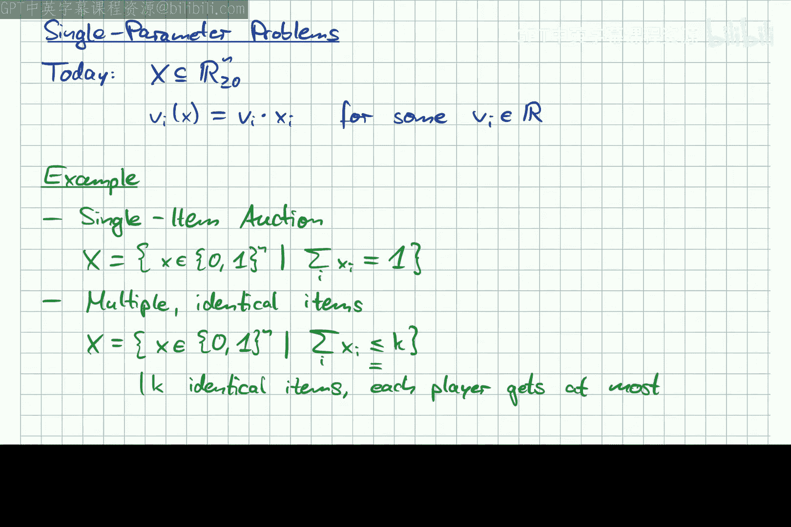
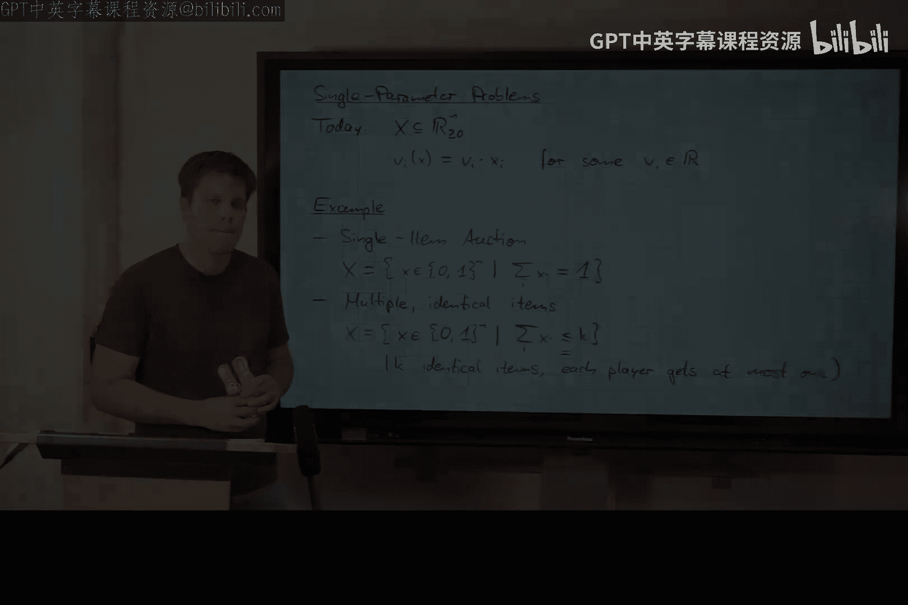
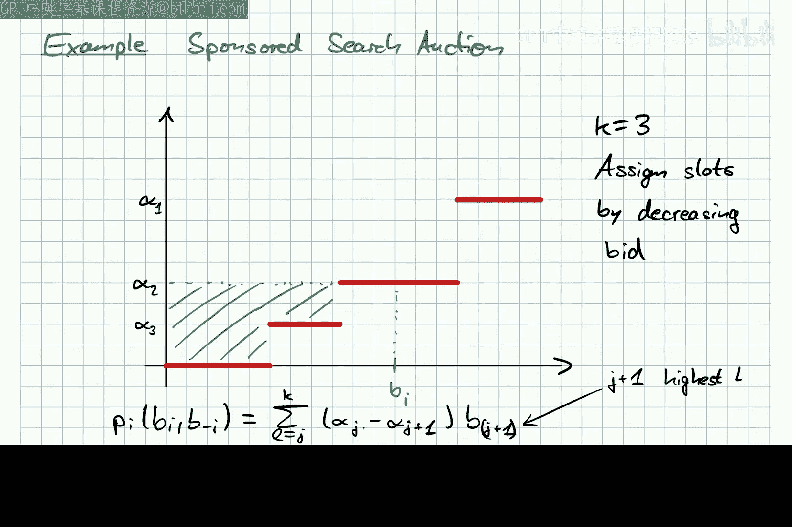

# 算法博弈论：第11讲：单参数机制设计 🎯


在本节课中，我们将学习机制设计中的一个核心概念：单参数机制。我们将探讨如何判断一个分配规则是否能与某个支付规则结合，构成一个真实的（truthful）机制。核心结论是迈尔森引理（Myerson‘s Lemma），它指出在单参数环境下，一个分配规则可实施（implementable）当且仅当它是单调的（monotone），并且存在唯一的支付规则使其成为真实机制。

## 回顾与定义 📚

上一节我们介绍了带金钱的机制设计以及真实机制的定义。本节中，我们来看看真实机制需要满足哪些充要条件。

首先，我们快速回顾一下定义。我们有 `n` 个参与者（通常称为竞标者），编号为 `1` 到 `n`。我们有一个结果空间 `X`，通常是一个任意集合，但今天我们将对其做出更严格的假设。

每个参与者 `i` 有一个私有的估值函数 `v_i`，它将结果空间 `X` 映射到实数 `ℝ`。这意味着每个参与者为每个可能的结果分配一个价值，这个价值也可能是负数，表示参与者认为该结果会带来成本。



我们用 `V_i` 表示参与者 `i` 所有可能的估值函数集合，`V` 是所有这些集合的笛卡尔积，即所有估值组合的集合。



今天，我们主要讨论直接机制（direct mechanism）。一个直接机制由一个结果规则 `f` 和一个支付规则 `p` 组成。结果规则根据参与者报告的估值组合 `b`（即出价）来决定一个结果 `x ∈ X`。支付规则则根据报告的估值组合来决定每个参与者的支付额 `p_i(b)`。

参与者的效用是拟线性的（quasilinear）。当参与者报告出价 `b`，机制计算出结果 `f(b)` 和支付 `p_i(b)` 时，参与者 `i` 的效用为：
```
u_i(b; v_i) = v_i(f(b)) - p_i(b)
```
这里 `v_i` 是参与者 `i` 的真实私有估值函数，机制设计者并不知道。

我们感兴趣的是占优策略激励相容（dominant strategy incentive compatible），简称真实（truthful）机制。一个直接机制是真实的，当且仅当对于任何参与者 `i`、任何其他参与者的出价组合 `b_{-i}`、参与者的真实估值 `v_i` 以及任何可能的出价 `b_i‘`，都有：
```
u_i((v_i, b_{-i}); v_i) ≥ u_i((b_i‘, b_{-i}); v_i)
```
这意味着，无论其他参与者如何出价，每个参与者报告自己的真实估值总能获得最大效用。

## 单参数问题设定 🔢

今天，我们将在一种特殊类型的机制设计问题中深入理解真实性的含义，即单参数（single-parameter）问题。

我们的假设是：结果空间 `X` 是 `n` 维非负实数向量 `ℝ_≥0^n` 的一个子集。并且，每个参与者的估值函数 `v_i` 可以表示为：
```
v_i(x) = v_i * x_i
```
其中，`v_i` 是一个实数（我们在此重载了符号 `v_i`，它既表示函数也表示这个实数标量），`x_i` 是结果向量 `x` 中属于参与者 `i` 的分量。

这看起来像什么？例如，在单物品拍卖中，我们可以将 `X` 表示为所有满足 `∑ x_i = 1` 且 `x_i ∈ {0, 1}` 的向量集合。这里，`x_i = 1` 表示参与者 `i` 赢得物品，`x_i = 0` 表示未赢得。

我们也可以将其扩展到多个相同物品的拍卖。假设有 `K` 个相同物品，我们可以定义 `X` 为所有满足 `∑ x_i ≤ K` 且 `x_i ∈ {0, 1}` 的向量集合。这意味着每个参与者最多获得一个物品。我们甚至可以允许参与者获得多个物品（即 `x_i` 可以大于1），但前提是估值函数满足线性假设，即获得多个物品的价值是单个物品价值的倍数。

赞助搜索拍卖（Sponsored Search Auction）是另一个例子，我们稍后会讨论。

## 迈尔森引理：真实性的特征 🧮

现在，我们来看看今天的主要结果，即单参数问题中真实机制的特征。这被称为迈尔森引理（Myerson‘s Lemma），由 Roger Myerson 在 1980 年代提出。

我们的核心问题是：给定一个结果函数（分配规则）`f`，是否存在一个支付函数 `p`，使得机制 `(f, p)` 是真实的？这样的函数 `f` 被称为可实施的（implementable）。

有趣的是，在单参数设置中，这个问题很容易回答。`f` 可实施当且仅当它是单调的（monotone）。

在单参数设置中，一个分配规则 `f` 是单调的，当且仅当对于所有参与者 `i` 和所有其他参与者的出价组合 `b_{-i}`，函数：
```
g(z) = f_i(z, b_{-i})
```
是 `z` 的非递减函数。这意味着，当参与者 `i` 提高自己的出价时，他分配到的结果 `x_i`（或其价值）不会减少。

让我们以单物品拍卖为例。假设 `f` 是将物品分配给最高出价者的规则。如果我们固定其他参与者的出价 `b_{-i}`，然后观察 `f_i(z, b_{-i})` 如何随 `z` 变化。当 `z` 低于其他出价中的最大值时，`f_i = 0`（未赢得）。一旦 `z` 超过这个最大值，`f_i` 跳变为 `1`（赢得）。这是一个非递减函数。相反，如果我们将物品分配给第二高出价者，那么当 `z` 从很低增加到最高，再继续增加时，`f_i` 可能会从 `1` 变为 `0`，这就不是单调的。

迈尔森引理指出：
1.  一个分配规则 `f` 是可实施的，当且仅当它是单调的。
2.  如果 `f` 是单调的，那么存在唯一的支付规则 `p`，使得 `(f, p)` 是真实的（假设零出价意味着零支付）。这个支付规则由以下公式给出：
    ```
    p_i(b_i, b_{-i}) = b_i * f_i(b_i, b_{-i}) - ∫_0^{b_i} f_i(t, b_{-i}) dt
    ```

这个引理不仅告诉我们单调性是真实性的充要条件，还给出了构造唯一支付规则的具体公式。

## 证明：必要性（单调性）📏

我们首先证明，如果一个分配规则 `f` 是可实施的（即存在 `p` 使 `(f, p)` 真实），那么 `f` 必须是单调的。

假设 `(f, p)` 是一个真实的单参数机制。考虑参与者 `i`，固定其他参与者的出价 `b_{-i}`。令 `y` 和 `z` 是参与者 `i` 的两个可能出价，且 `y ≤ z`。

由于机制是真实的，当参与者的真实估值为 `y` 时，他报告 `y` 的效用应不低于报告 `z` 的效用：
```
u_i((y, b_{-i}); y) ≥ u_i((z, b_{-i}); y)
```
代入拟线性效用公式：
```
y * f_i(y, b_{-i}) - p_i(y, b_{-i}) ≥ y * f_i(z, b_{-i}) - p_i(z, b_{-i})   (1)
```
同样，当参与者的真实估值为 `z` 时，他报告 `z` 的效用应不低于报告 `y` 的效用：
```
z * f_i(z, b_{-i}) - p_i(z, b_{-i}) ≥ z * f_i(y, b_{-i}) - p_i(y, b_{-i})   (2)
```
现在，将不等式 `(1)` 和 `(2)` 重新排列。由 `(1)` 可得：
```
y * [f_i(y, b_{-i}) - f_i(z, b_{-i})] ≤ p_i(y, b_{-i}) - p_i(z, b_{-i})
```
由 `(2)` 可得：
```
p_i(y, b_{-i}) - p_i(z, b_{-i}) ≤ z * [f_i(y, b_{-i}) - f_i(z, b_{-i})]
```
将这两个不等式结合起来，我们得到所谓的“支付差夹逼定理”（payment differences sandwich）：
```
y * [f_i(y, b_{-i}) - f_i(z, b_{-i})] ≤ p_i(y, b_{-i}) - p_i(z, b_{-i}) ≤ z * [f_i(y, b_{-i}) - f_i(z, b_{-i})]
```
从这个不等式我们可以推导出单调性。假设 `y ≤ z`。观察不等式的最左端和最右端。如果 `f_i(y, b_{-i}) > f_i(z, b_{-i})`，那么左边是 `y` 乘以一个正数，右边是 `z` 乘以同一个正数。由于 `y ≤ z`，这要求中间项同时满足 `≤` 和 `≥` 的关系，这只有在 `f_i(y, b_{-i}) - f_i(z, b_{-i}) ≤ 0` 时才可能成立。因此，我们必须有 `f_i(y, b_{-i}) ≤ f_i(z, b_{-i})`。这正是单调性的定义：出价增加，分配量不会减少。

## 证明：充分性与唯一性（支付公式）🧾

接下来，我们证明如果 `f` 是单调的，那么由给定公式定义的支付规则 `p` 能构成一个真实的机制，并且该支付规则在零出价零支付的假设下是唯一的。

为了使论证更清晰，我们首先考虑 `f_i(z, b_{-i})` 是分段常数函数的情况。这意味着存在一系列断点 `0 = z_0 < z_1 < z_2 < ...`，使得在每个区间 `(z_{j-1}, z_j)` 内，`f_i` 是一个常数值。单物品拍卖中的分配函数就是一个例子（从0跳到1）。

我们的目标是证明，对于任何真实的机制 `(f, p)`（其中 `f` 单调且分段常数），并且满足 `p_i(0, b_{-i}) = 0`，其支付必须由以下公式给出：
```
p_i(b_i, b_{-i}) = ∑_{j: z_j ≤ b_i} z_j * [f_i(z_j, b_{-i}) - f_i(z_{j-1}, b_{-i})]
```
这个公式可以直观地理解为：支付额等于分配函数 `f_i` 曲线下方的面积。在单物品拍卖的例子中，这恰好是第二高的出价（即第二价格）。

推导过程基于之前得到的支付差夹逼定理。通过分析在断点 `z_j` 处支付的变化，我们可以证明支付差必须等于 `z_j * [f_i(z_j) - f_i(z_{j-1})]`。然后，对于任意出价 `b_i`，其支付可以通过从0到 `b_i` 累积这些支付差得到，最终得到上述公式。

对于一般的单调函数（不一定是分段常数），我们可以通过用分段常数函数无限逼近它，并取极限，得到相同的支付公式。这个极限形式正好就是积分表达式：
```
p_i(b_i, b_{-i}) = b_i * f_i(b_i, b_{-i}) - ∫_0^{b_i} f_i(t, b_{-i}) dt
```
这个公式可以解释为：参与者支付的价格等于其出价 `b_i` 乘以分配量 `f_i(b_i)`，再减去分配函数从0到 `b_i` 曲线下的面积。几何上看，支付额就是分配函数曲线之上的面积。

最后，我们需要验证，将单调的分配规则 `f` 与这个支付规则 `p` 结合，确实能得到一个真实的机制。我们需要证明，对于任何真实估值 `v_i` 和任何其他出价 `b_i‘`，报告真实估值 `v_i` 的效用不低于报告 `b_i‘` 的效用。

通过计算两种报告下的效用差，并利用单调性，我们可以证明，无论 `b_i‘` 是高于还是低于 `v_i`，这个效用差总是非正的。这意味着真实报告总是最优策略。具体的代数推导利用了支付公式和积分的性质，其核心思想是：虚报（过高或过低）所获得的额外利益（或避免的支付）无法弥补因错误分配而损失的价值。

## 应用示例 🛒

现在，让我们看看迈尔森引理如何应用于我们熟悉的例子。

以下是单物品拍卖中的应用：
*   **分配规则**：将物品分配给最高出价者。这是一个单调规则。
*   **支付规则**：根据迈尔森公式，赢得物品的参与者 `i` 的支付为：
    ```
    p_i = b_i * 1 - ∫_0^{b_i} f_i(t) dt
    ```
    由于 `f_i(t)` 在 `t` 低于其他最高出价 `max_{j≠i} b_j` 时为0，高于时为1，所以积分部分等于 `max_{j≠i} b_j`。因此，支付额为：
    ```
    p_i = b_i - max_{j≠i} b_j
    ```
    但注意，只有当 `b_i > max_{j≠i} b_j` 时，`f_i=1`，此时 `p_i = b_i - max_{j≠i} b_j`。这等价于赢家支付第二高的出价。这正是**第二价格拍卖**。迈尔森引理告诉我们，如果分配规则是“价高者得”，那么唯一与之匹配的真实支付规则就是第二价格支付。

以下是赞助搜索拍卖中的应用：
*   **分配规则**：将广告位按出价从高到低分配给广告主（出价最高者得最好位置，次高者得第二位置，以此类推）。每个位置 `j` 有一个点击率 `α_j`（`α_1 > α_2 > ...`）。对于广告主 `i`，分配量 `x_i` 就是他获得的位置的点击率。这也是一个单调规则：出价越高，获得的点击率可能越高（即分配到更好的位置）。
*   **支付规则**：应用迈尔森公式，可以推导出每个获胜广告主的支付价格。最终公式可以表示为：获得第 `j` 好位置的广告主，需要为每次点击支付的价格，等于使他刚好能保持在这个位置所需的最低出价，这通常与下一位广告主的出价和点击率差值有关。这个机制被称为**VCG机制**在赞助搜索中的具体形式。值得注意的是，谷歌等公司实际使用的“广义第二价格”（GSP）拍卖虽然类似，但支付规则不同，因此不是真实机制。

## 总结与展望 🚀

本节课我们一起学习了单参数机制设计中的核心定理——迈尔森引理。

我们了解到：
*   在单参数环境下，一个分配规则能够与某个支付规则结合形成真实机制，**当且仅当**该分配规则是**单调的**。
*   如果分配规则单调，则存在**唯一的**支付规则（在零出价零支付假设下）使其真实，该支付规则由公式 `p_i(b) = b_i * f_i(b) - ∫_0^{b_i} f_i(t) dt` 给出。
*   我们通过“支付差夹逼定理”证明了单调性的必要性，并通过分析分段常数函数以及一般情况，证明了支付公式的充分性和唯一性。
*   我们将引理应用于单物品拍卖和赞助搜索拍卖，验证了第二价格拍卖和VCG支付是相应单调分配规则下的唯一真实机制。



迈尔森引理为我们设计单参数真实机制提供了清晰的蓝图：首先设计一个单调的分配规则（这通常与我们的优化目标，如社会福利最大化有关），然后套用支付公式即可自动得到保证真实性的支付规则。

然而，仍然存在一些问题：
1.  我们如何设计出既单调又性能良好（例如能最大化收入或社会福利）的分配规则？
2.  当问题超出单参数设置（即参与者的估值不能简单地用一个参数乘以分配量来表示）时，情况会变得复杂得多，没有这样简洁的特征定理。

这些将是我们在后续课程中继续探讨的内容。