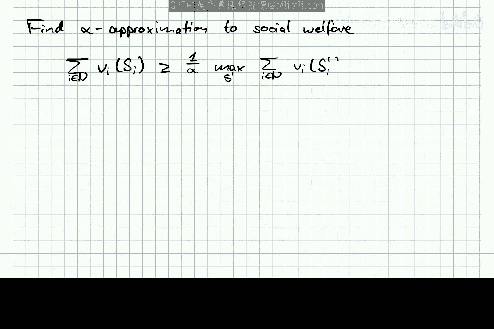
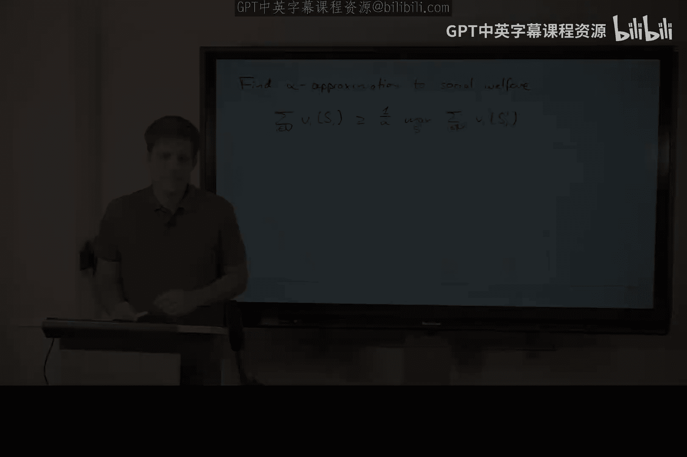
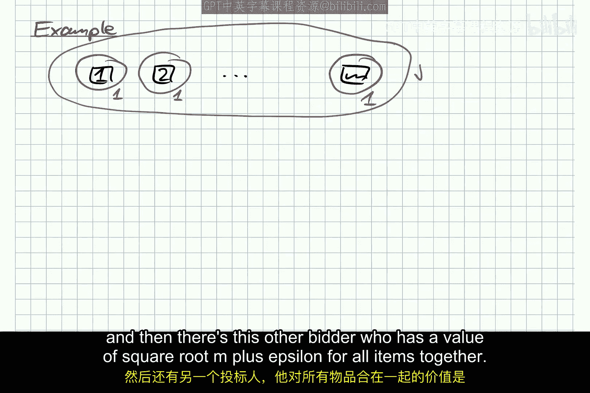
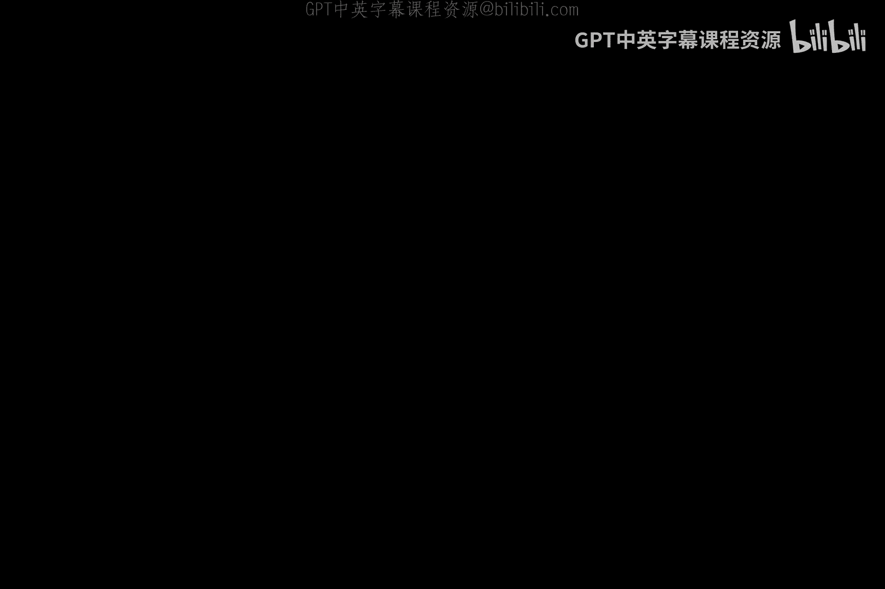

# 波恩大学《算法博弈论｜Algorithmic Game Theory, Winter 2020-21》中英字幕（claude-3.7-s p13 AGT, WS20_21_ Lecture 12 (Greedy Mechanisms for Combinatorial Auctions).zh_en -BV1m9ZyYoENg_p13-

Welcome back Trirothic Game theory in the last lectures we introduced mechanismchan design with Mo。

We got to know the notion of a truthful mechanism and then also by myosinlemma。

 we got a pretty great characterization of what it is that makes a mechanism truthful for single parameter settings。

Today we'll use this characterization to build truthful mechanisms for combinatorial as。

This means that。We'll have to design an outcome rule。

 which is nothing but an algorithm that decides how to allocate items。And then from my dilemma。

 we'll conclude what payment rule we would have to apply so that we get a truthful mechanism in total。

This will work for general combinatural as， but only for a subclass which we can again understand as a single parameter setting because for arbitrary settings。

 which are not single parameter， myosinlemma does not hold。And by the way。

 things are much more complicated。Good， so let's first recap the definitions of combinatorial auction。

In a come in a trial auction。We have。And bidders。Or players， however you want to call them。

And that will be set。Capital N。And usually we call that it bids one through n。

And then we have M items。And we call that set M。Usually， we might。Also call the items1 through M。

 although we might not always do this depending on what feels right at that time。

What are our feasible allocations？Feaible allocations。Are vectors of sets。So each of this。The sets。

Is an element？Of the power set of the set of items。And we also want that。

Each item is allocated at most ones。Which means。And if we consider it would。

Beter is I and I primeganant， those two sets have to be disjoined unless I is equal to I prime。

We'll have validation functions。Those。Define a non negative value。

For every set of the items for each player。And those are private information。

And what will our objective be？Objective。For today， we'll be to maximize social welfare。So。We might。

Add up。The values that the players have for their respective sets of items that they're getting。

We'll assume furthermore。Free disposal。Which is a very fancy way。Of saying that。

If I get a set of items。S。My value is at least the value I would have for the side set T if T is a subset of S in other words。

More items never hurt me。If I get。More than if I get more items。 So if T is a subset of S。

 then the value I have for the set S will be at least as much as my value for the set T。

You could also call this simply monotonicity。And then。We also assume that valuations are normalized。

Which means that the value。the empty set should be0。So if I don't get anything。

 my value is zero if I get more。Then my value will be non negative because。

We're saying that the value for such a set will always be non negative。Good。😡。

Now this is generally not a single parameter setting， why that。Because these functions。

 they cannot be expressed by just a single parameter。

Which is exactly the point of a single parameter setting。

But the special cases of evaluation functions we're considering today。

 those we can indeed interpret as a single parameter setting， namely what will our assumption be。

 our assumption will be that I'm single minded。I'm only interested in one subset of the items。

If I get at least this subset， then I'm happy。 if I don't get it， then。Im。

Just as happy as when I don't get any items。Let's write this down formally。We say that。

Ps are single minded。If。4。Every bitterder。There exists。Simet。As I star of items。And some。

Non negative real VI， such that。bititter eyes value for a set of items will be。VI。If T is a superet。

FS I star and0， otherwise。So。We are again overloading notation here by VI。

We both denote the function as well as the value that it can take。And this， I think。

 should be very familiar by now， because in the case of， for example， a single item optionuction。

 we did exactly the same or also in the case of the。Single parameter settings。 So VI。

And that is my value for the set S I star。If I get。At least this had SI star。

 meaning I might also get more items than my values is always VI。But if I get。

 if I don't get all of S I star。And this might even mean that SI star contains 100 items I'm getting only 99 of them。

AllAlway then my value will be 0。Good， let's see。How we can visually understand this。

In my example here， I now have。Two items。It's called them A and B。And then I have three bidders。

The red bidder has a value of 10 for item A。Forgeting item B。

This bidder does not have any value for getting items A and B together。

 this bidder still has a value of 10。Because you don't care。What you get。

Unless you get all the items that you want。So all that matters is which are you getting all the items that you want？

The blue bidder may look something。Like this， so they have a value of A for item B and also value of a for A and B together and a value of0 for only item A。

And of course， a value of zero for。Getting no item。Now we'll also have this green bidder。

And they now could have， for example， a value of 14 for both items together。

And this now means that if this bidder is getting， for example， only item A， the value will be 0。

 If this bidder is getting only item B， then the value will be 0。

 The value will only be 14 if they're getting both items A and B。Good。😡。

What's the optimal social welfare here， the optimal allocation would be。

To give item A to the red bidder， item B to the blue bidder， this would give us social welfare of 18。

Good， now our goal is to design a。Mechanism for the setting。As you remember， these valuations。

 they are private。Well， we will now make our life easy， although this is strictly not necessary。

We will assume that we already know these sets as I star， that those are actually public knowledge。

And the only thing that is private knowledge is this VI。

So I don't know your value for this this set of items。 So for example。

 in advance we already know that bid A has a value the red bidder has a value of。

Has has a value for item A， but we don't know。What value it is？And what's our goal now？

So our goal will be two。Design a mechanism。And。Consisting。Of。An location rule and a payment rule。

By the way。To just avoid any confusion， I'm now writing this M for the mechanism as such a crylographic M。

 whereas the set of items， which we also call M， this will be a printed M。😊，Net F。

Will be an outcome rule。P will be a payment rule。And they both take as input。Some beds。BI。

And we now assume。Da。This。Vor of。Seets。That the bidders warned， this is actually public knowledge。

And what are our design goals？I hope you remember those。Our goal should be that we'll have you。

Truthful mechanism。So M should be dominant strategy incentive compatible。At equilibrium。

Meaning if everybody tells their true value， the mechanism should obtain high social welfare。And。

Also。The mechanism should run in polynomial time。Or。More precisely。

 we want this mechanism to run as fast as possible。

 and something that we've kind of agreed on in computer science is that polynomial time is fast。

Not polynomial time is slow。You could still ask。Other questions like， if you wanted to。

Allow exponential time， but we are restricting ourselves to polynomial time algorithms here。

 and this will actually be our first insight now that within polynomial time。

 we cannot actually obtain optimal social welfare， regardless of whether we are。

Dominant strategy instead of compatible or not。So all this truthfulness。

 that's actually not our first hurdle that we see， but rather that solving these comminator options exactly that this is an NP hard optimization problem。

The first thing that we should now talk about is can we expect to exactly solve this commin a problem in polynomial time？

Or why not？Because it is NPhar。This is our first claim that we want to show。More precisely。

Even the allocation problem。Among single Min bidders。Is NP P heart。I guess in your life， you've seen。

En math。NP hardness proves so that we won't have to go through this in all details。

 but let me only give you the idea of why this is a hard problem because this is really easy to see。

Namely， if we were able to solve this problem exactly。This allocation problem。

 allocating items among single minded bidders optimally so as to maximize social welfare。

 then we could also solve。Independent set。Howso。So we will show a reduction。From In set。And。

How do we now transform the input？If we are given a graph。What we'll do now is very simple， namely。

 we'll set the set of bidders to all vertices and the set of items to all edges。And。For a bitter。

 now。Set the set S I star to be the following。Will that it be the set of all edges？Whose end points。

Such that I is one of the endpoints。So this means in our graph。And we represent our graph as follows。

So what will this look like？Well， just suppose we might have。This kind of a graph。Then， will'll。

Interpret this。By four items， one for each edge。And for bidders。Namely， for example， we might have。

This bidder， who gets the first， who wants to get the first three items。Then we'll have。For example。

And this bidder， who only wants to get the first item？Well have。This bitter。Who wants。第。Second。

 and the last item。And。We'll have this bitter。Who wants to have these two items。

And something that I forgot to mention earlier。You want to set the value。For winning the items。

 for winning all of the items。2，1。Now， what you can see here is that。

If you find an allocation which maximizes social welfare。

What you maximize is just the number of bidders that you make happy。Who you give。At least。

They sets of items。But for each edge， now it will not happen。That。

Both and points will be selected because， and that's exactly the point of one of the items being。嗯。

The point of the。Adge is being represented by the items。That。For example。

 if we're now considering this edge here。😊，This corresponds to this item。

And then now this means that。Either this purple or the blue。Can be the。

And can get this item so we cannot give the item to both of them。

 and which means that in our independent set， also only one of the two can be contained。Good， so。

Please go ahead and figure out the exact details yourselves。

But I hope that given that you're probably pretty familiar with。

And P Harness proves this is nothing to。Extraordinary for you。So what we'll focus on instead。

Today is how what can we still do？Namely， what we of course want to do is we want to approximate the optimal social welfare。

And we want to find an algorithm which gives us provable approximation。

 and then at the same time there are still all these incentive issues which we haven't even talked about yet。

So more precisely， what our goal will be。Our goal will be to find。An alpha approximation。

To social welfare。To the optimal social welfare。I might want to say， which is。

Means that the sum of the VI of S I should be at least。1 over alpha times。The maximum of all S prime。

Some of all。V I F SI prime。

And， fortunately。As we will see today for single minor bidders getting such an approximation algorithm。

 which gives us a good factor of alpha here is not too difficult because simply greedy algorithms do the trick and not only this。

 we can also combine them via our insights。😊，In myslemma with a payment rule such that we obtain a truthful mechanism。

The first thing I'd like to do now is see a very simple greedy algorithm。

For singlemin communial auctions。And then we'll also see that this algorithm is monoed。

 and this is why we then get truthful payments or payments that make this a truthful mechanism to be more precise。

And。Then we can also just derive very explicitly what the payments will look like。Before that。

 let's introduce one more piece of notation， namely。We now say that。If。Beter eye。Gets a super set。

the desired bundle S I star。Then， we call I。A winner。So our goal is nothing but。2。Determine。

A winner set。G on you。Where。we still have the property that。If I and I prime are in W。And they are。

Distinct。Then。Their desired sets have to be disjoint。Good， now， how can we do this。

 We can do this in a very。Simple way， namely。We can consider the full ingredient by value have。

Well be。Reordering the beds。Such that。We're now say the first bidder has the highest bid。

 the second bidder has the second highest bid and so on and now。We'll initialize。

Instead of winners as the empty set。And。You now， consider the。

Bitders by now increasing index after ordering， and we say that。If。Yi。

Bundle of this bit we are currently considering is disjoin with all bundles that we've seen so far。

And accept it， then this bidder will become a winner。As well。Okay。So what does this mean。

 this actually means something very simple， let's consider our example from before。We initialize。

The bits， the winner said as empty。We order the bids by decreasing size or by。Decreasing value。

 so we'll first consider the green bidder who was bitting 14。

 then we're considering the red bidder and only then we're considering the blue bidder。😊。

We now see okay， this bidder was bidding 14， this is the first bidder we're considering。

 and we see the set of winners was empty so far。So this here is fulfilled。

Which means we'll accept the green bidder first。And then we'll consider the red bidder and we'll see okay。

At least one of the items has already been allocated。

 so we are not making the thread bidder a winner， same will be true for the blue bidder。

So what were observing here is that we are not ending up with the optimal social welfare。

Because this would be 18， but we are getting only 40。Nonetheless， we'll be able to prove。

A reasonably good approximation factor。But before we do that。😮，Let's first talk about truthfulness。

Why can we turn this mechanism into a truthful mechanism？And as you realized。

 I didn't actually distinguish between， whether these are the true beds or the。嗯。

Whether these are the true values or only some arbitrary bits， the point being that。Later。

We actually will just rely on every bitter bidding that true value。

And then this means that if we get good。Welfare with respect to the declared bids， then。

Assuming that these， these bids represent true values， then we actually obtain good social welfare。

But as I was saying， let's first talk about truthfulness。Yeah。And the first thing。

I'd like to define is the following。Let W U of B。With a set of winners。When beds are B。And now。

 we'll define。Tll I of。B minus I as the following Take the infium。

If all B I such that I is in W of B I comm B minus。And this is what we call the threshold bid。

Or the critical bit。For bitter eye。Against。1 minus。So what does this mean？Suppose you are player I。

And， you know， fix the other bidders to bid B minus I， how much would you point a bid？

If you want to become a winner。Well， among all everything that you can bid。

 B and itau I of B minus I， this is the smallest bid that will make you a winner。

Because this might not exist we actually writing the infim here rather than the minimum。

 but just think of this as being the minimum， so this is the smallest bidard that makes you a winner。

😊，This is actually a crucial thing if you， for example。

 think of a first price auction because there you definitely want a bid。

The this threshold bit or the critical bit， because this。Is。嗯。

The bid that lets you pay least and still win the item。Here， of course。

 we won't be using this first price kind of payments because those won't hear the truthful mechanism。

But still， it is very related because。Eventually， this will just be our payments。How does this。Tatna。

 exactly。Greedy by value。Is a monotone algorithm。And charging。Winners， their respectivetive。

 critical bids。Yields a truthful mechanism。Okay。So how do we prove this。

 the first thing I'd like to talk about is monogenicity。

And something we haven't yet talked about is how is this actually a single parameter problem。

 how would we capture this in the notation of myos andlemma。

 and how we could also write this as follows。In the single parameter notation。We could now said。F。

 I of B to B1。Is。I is a winner。And 0， if I is not a winner。To prove monotonicity。

What will we have to show？We'll have to simply observe。咩。If I am a winner now。Then。

I will also be a winner。If I bid more。Howle。Well， to see this。

 we'll have to go back to our algorithm。And see what would now change if you increased your bed？Well。

 suppose you are somewhere here。And now you increase your bit。What will happen？

You will kind of move further to the front。And。What does this mean for。This condition here。

The set of winners that have already been selected。When this while loop is coming。To ask you。

This will only be。Smaller then， which means it is just easier that all of your items are still available。

By the way， there is a star missing in here。Those are just always this。

The bundles that these items that these bidders。Just want by their single parameter property。Good。

 so the point is。If you are a winner and increase your bid， then you only move further to the front。

This is why this is a monotone algorithm。Good。Now， what does this tell us regarding payments？

By myersonlemma。M。Will be truthful。If we said。P I B to the following。B。

 I times F I F B minus the integral from 0 to B I F I F T comma B minus I D G。W。Just。

Because this always helps to understand this pictorially。

The allocation function will look something like this。Now， how big will the payments have to be。

 how big is this？This is exactly the area above the curve。So for example， if you're bidding。

This match here。W， this is B I， and this is。F I。Will be minus I， here will have one。

If you're bidding this much， then how much will you have to pay， you'll have to pay exactly。

This area here。And。What is。How is this point here called， this is exactly Tau I。F b minus I。Good。

If you prefer， you can also now just do this。From the integral equation。

You will get to the exact same point， namely that。The payment will be B times。

F of b minus this integral。How much will this be。This integral here， this will be exactly。

The integral from tau I comm a B minus I up to B I F。Just one。

And this means all this together will be。Tau I FB minus I， and this is of course， only true。

If we have a winner。You are a winner if your bid is right of this tau I of B minus。

And if you're a loser。😊，Then this is zero， this is also zero， then you're not paying anything。

The P of B will be0 if you are not winning。And this already proves the first。Claim namely。That， well。

 as we've convinced ourselves， this is a monotone algorithm and。

We get a truthful mechanism if always the winners pay the respective thresholds bids and the losers don't pay anything。

Good。😡，Now what we'll still have to talk about is what kind of an approximation guarantee are we getting？

And。What we're claiming。It's the following？That greedy by value。Is a D approximation。

Where D denotes the maximum cardinality。Of these desired sets， as I start。Good。

 how do we show such a thing。Well， we showed this。Actually。

 like we show all approximation guarantees， namely。

 we see what does our algorithm do versus what does the optimal allocation。

 the social welfare maximizing allocation do。In more detail。We let W。Be the set of bitterders。

You are selected winners。By the algorithm。And we let。Opt be the set of winners chosen by。

The optimal solution。What is our claim？How claim is that。sum of all I and WBI。

 this will be at least a one over D fraction， the sum of all I in optt。Beyond。At this point。

 I'm actually not quite sure whether I want to write。VI or BI， you can do this。Whatever you like。

 because you could now say， okay， I'm just analyzing what happens when I'm。And doing this。

Worth the true bes， because we can just hope。Because we have a truthful mechanism that we're actually seeing the true valuations。

Or you can say， okay， I'm just doing this on any sort of bids and now I'm just。Saying， okay。

 on these bids， I want to be gave a good approximation。This doesn't actually make any difference。

The point eventually will be combined with truthfulness， we will actually in the equilibrium。

 maximize social welfare approximately within a de factor。HowHow do we show such a thing？

We do now a simple charging argument， namely we now say。That。Every bidder who is an art。Could。

 in principle， get the items？Unless。Some other bidders。Have taken items away before。And。

More precisely， we'll do this as follows。4。Is set for a winner of our algorithm。We let now opt I。

Be this head of all winners that would be chosen by optt。That have a。Larger index。And that。Collide。

With。S I in no way。So。At some time， we are choosing I。As the winner， as a winner。

And this way we are pushing other winners that Op would be choosing out of the solution。

 namely we are the following bidders we cannot select anymore after having chosen I。

 the following from Op we cannot select anymore， those are exactly the ones who want also one of the items that we have just allocated。

By the way。What does it mean if I。Itself is an opt。Then， this set contains exactly。

The ones in art who have a non disjoint intersection with。S I star。But if I is itself enopt。

 then this set will also contain simply I。But in other settings。

 and this is the way you should think about this， these are exactly the ones that we are losing from Op because we are accepting bitter I。

And what we now observe is that。Each day in a。Is contained。In at least。1 said。Opt I。

Where I is a winner。Is a winner for a Ber that shows powerer algorithm。Why is this true。Because。If。J。

It's not an opt eye。For all J， which are and for all I， which are smaller than J。Then。The algorithm。

Can。Except J。When reaching it？And we'll do so， of course。And then。Jy itself will be a winner。And。

JM and opt J。Will be exactly the set。Containing only J。With this insight。We can now rewrite this。

B J of the J in optt as follows。 we can now say O， this will be at most。

 Take the sum over I or I and W。 Take the sum over all J in optt I。BJ。Why that。

 because everything that we have here on the left hand side。

 this is just taking the sum over all J and opt， we now know that all these will also show up in at least。

😊，1 set opt I for an I in W。Good。😡，Yeah。And now。What we can do is。

We can now see how big will these hats opt IB？How many。Day in a。Can some bitter eye exclude from the。

嗯。嗯。By being selected。 Well， we know that。Each of them。Will be。

Willll have a non empty intersection with S I star。And。Those all use different items。

Their items are destroyedin。So this means。That here。Opt I。

The cardinality of up I will be bounded by the cardinality of S I star。

And this immediately means that it is bounded by D。And what does this tell us？This tells us that。

This sum we have here。😔，Some of all J and R to be J。 This will be。

 as we know at most this double sum。But。This will also be at most。D times Bj。An。The I。

Why is this you we using one further thing， namely that？BI is， at least。BJ。For J in optt I。

Because we use this reordering， we reorder the bidders accordingly。

So we're getting D terms the sum of all I and WBI。And interestingly enough。

 I guess this is exactly what we wanted to show。Equivalent to this guarantee。😔，Good。

 so what happened here， We used that。Every bidder。Can only block D bidders from the optimum。

And also the bidders that it is blocking， those have a smaller bed than our own bed。

And this is why we get。This chain of inequalities。Good。Now。

This is nice for the setting where each bidder ones only a small number of items。

 so take say like two or three or4， and then this will be a two or a three or four approximation。嗯。

But could we analyze this algorithm in a smarter way？

Because this might get very large if D becomes large。Unfortunately not。Namely。

 what could happen here is the following。We could have。D items。And we'll have now many blue bidders。

Who each have a value of one for one of the items。But at the same time。

 we'll have a red bidder who would have a value of1 plus epsilon。For all items。

What would happen here？Who would get the items， Well。

 it would be the red bidder because the red bitterder has a value of one plus epsilon for all the items。

 whereas the blue bids only have one value of one。And we don't care how many items they want。

If we now have multiple copies of this， we'll also make have M items in total here。

 those are only D items。But because we are totally neglectacting the fact that one bitter might。

Get one many more items。 So D more items than another bidder。

We are actually not getting any better guarantee than a factor of D。You might not be tempted to say。

 okay， now I divide by the size of the bundle that they want。Then the exact same thing can happen。

 but the other way route。And this is for a good reason。

It is because there is also a hardness of approximation result。

 which shows that more or less you cannot be better than a D approximation in this setting here in polynomial time。

 of course， under certain complexity theoretic assumptions。

But what you can do better is if you have really many items and if your D also gets large。

 then you actually can get a better guarantee， which is then stated in terms of M。

 the overall number of items。And this we will be considering next。

So after having now seen the greedy bi value algorithm。

 we are considering next an algorithm which works better if you have large bundle sizes。

 which means if this D， which was the maximum size of a desired bundle was large。

And how does this algorithm work？It normalizes the beds in a way that it divides them by not the bundled sizes。

 but by the square root of the bundled sizes。 And mysteriously。

 this is somehow a sweet spot that gives a better approximation than if you did not divide the。😊。

Bids by anything or dividing the bids by the bundle sizes， which， as I was claiming earlier。

 will give you a better guarantee。What does this algorithm look like？So， I call this。Greedy boy。

Square root。😔，Value density。And what we do is we。We order the beds again。

Before we were reordering the beds such that they are。In a non。

Increasing sequence now we first divide every of the beds by size by the square root of the size of the respective bundle that this bidder wants。

Then。We began， initializing the。Winning bids to the empty sand。And we also。

round the same four loop that we've had before。Namely。If none of your items has been。

Take me away so far。Then。We'll add you to the set of winners。When it's your turn。And for this。

 we can actually show a better approximation guarantee， namely。

 we can show a better approximation guarantee if these sets。Or if the bigger of these sets。

 as I star is very large。Namely， we can show the following。Greedy by square root。Vald densityine。

Is a square root of M approximation。Moreover， it is monotone。So charging threshold bits。

Makes it a truthful mechanism。Good。Now。嗯。This second part of thethereem， I hope。

 isn't too surprising at all， because we are more or less using the same kind of algorithm that we were using before。

 And we were assuming that this。As I started， those are public knowledge。

 so you cannot even influence what you are divided by， what your bid is divided by。

And then the same thing happens if you， for example。Third。In this order， and then if you bid more。

 then you only move forward。Good， so this second part。

 this works exactly the same way as we saw this in the case of greedy by value。

 All I want to talk now is why we get this improved approximation guarantee。😊。

And what we'll again define is this opt I。This is Gandy。Said of all J in art。Which come after I。

 in the。嗯。In the order， by。嗯。Bid now then by normalized bid， and which we are excluding by。

Including bitter eye。Into our solution。And what's our claim now？Our claim is again that。

Some of I and WBI， this will be at least a one over square root M fraction。Of the I and opt。Beyond。

Again， we can rewrite。This。Set of the J in optt。BJ。

 I'm now calling them J to now be able to do this step。

We could instead take the same over I and W U and then take the set S sum over J in optt I Bj。

This is exactly the same step。That we've done before。So all that remains to show。

Is the following that the sum of all J in optt I。BJ is at most square root M times B。Why is this？

Any helpful？Because if we can show that this here is at most squared m times B， then。You see。

 we get exactly to something that is equivalent to what we want to show。So。Before we were saying。

 okay， now。This set opt I。 this might be small。 and these BJ， they those can only be small than B I。

 and we were done。Now things are a little more complicated and what we will replace this by is exactly this bound you。

Get。Let's see why this is true。What do we know。If J is in opt I。This means that。J is at least I。So。

BJ。Youiv by the。Square root of the size of S J。 This will be。

No larger than B I divided by the square root of the size of S I star。What does this give me？

This gives me。That the sum of all J in optt I。BJ。This will be at most。Beyond。Over。

Size of S I star times the sum of O J in optt I。Square root of the size of S J star。Now， we'll use。

Hes inequality。What does that state？It says that， for any。Y1 through YL， which are non negative。

The average。Of。Square root。And the wise is at most。The square root。And the average。Of the wise。

Because the square root is a concave function。So more generally。

 you would actually state this instead of writing the square root here。

 you would just say for any conca function you have this。Good。

 but now because we have a concave function， this is what we can observe regarding the square root。

And now let's multiply this by L。So， then， we're getting that。

The sum of these square roots of the Y's will be at most。Square root of L。Times。The sum of these ys。

In particular， we can now apply this to this interesting sum here because this is exactly a sum of square roots of non negative numbers。

So。What we're getting from this is。And there's sum of all J and optt I square root of the size of Sj star。

This will be。A most。How many terms are weighting up， this is exactly cardinality of opt I and then。

Will be。Taking the sum overall， J and optt I size of S I star。As J star。Good。😡，Moreover。

The size of S， I of。Opt eye。Will be at most， as I star。Why that？

Because and this is actually an inequality that we used before。

 but let me once again make the argument。In opt eye。

 we have all the bitterders that we are losing because we are accepting bitter eye。

Now to count these， the ones from the optimum that we're losing。To count these。

 we might as well count the items in S I star because。For each item in S I star。

 we're losing at most one of the bidders。From opt to eye， because they have。This joint sets S J star。

Good。So this already helps us here。And what else do we know？We also have that the sum of these。

J in opt I。Carnalality of J and S J star。 This cannot be more than M。

 And this is exactly the same kind of argument because this sets S J star for J being an opt。

 Those have to be disjoined。 So we're summing up their cardinnalities and。This is。

But this will be at most the number of all items together。Good if we combine this。

Then what we're seeing here is that this sum we're trying to bound here。This is at most。

 the square root。And the size of S I star times M。Now， where are we coming from？

We were coming from here。😔，We now have a bound for this。And now， we can just。Combine this。

Where are we getting， We are getting。To the sum of all。J and optt I。BJ， that this is at most。BI。

Over squared of S I star。And then we multiply this。Find this thing here。Size of S I star times M。

 And this is square root M times B。Good。And。This is exactly where we wanted to get。So we are done。

Good， so overall we get a better approximation guarantee if this D。

 the maximum number of items that one bidder wants to have is very large。

The rest just remains the same， so we still have a greedy algorithm and this greedy algorithm。

Canammi turned into a truthful mechanism via these threshold payments。Of course。

 here you can again ask the question， could we analyze this algorithm in a better way？

Is there a better algorithm and the answer for both is no。Why that？

Because the following thing can happen。You will now have。M items。And again， you have blue bitterders。

We always have。Value of one for each of the items， so。

Each one of them has a value of one for their respective item。

 and then there's this other bidder who has a value of square root m plus Epsilon for all items together。

What will the greedy bus square root density algorithm do？It will see O。

 if I now divide by square root size of of the set， then this bread bitterder。

Will seem to give me more value。So I'm taking this red bitterder and not the blue ones。

 and that this is exactly where we're losing。This factor of square root m。But not worse than this。

And。You can also。Not find a better algorithm。Even。AnyAny smarter algorithm than that you might point design will not give you approximation guarantees which will be a lot better than square root M because again。

 there is a heart of approximation result。This is actually inherited by hardness of approximation of independent set。

 We saw these。This reduction from independent set and this also translates more or less hardness of approximation result and so also for this setting you cannot hope to get a much better approximation。

And the interesting thing is it doesn't even matter whether you want truthfulness or not。

 All this truthfulness we didn't even talk about in the second part。

 it's only because we are insisting on polynomial running time。So as you see。

 there are settings in which truthfulness more or less comes for free。

 You just design an algorithm and you want to design the algorithm。

At least keeping monotononicity in mind， but that's about what you need to take into consideration these greedy algorithms。

Those feel so natural that you。Might have just designed them without even ever having heard of monoity。

 threshold bits of truthfulness。For other problems。

 things are not quite as simple there you actually have to put a bit more work into to get a truthful mechanism。

 to get a monoone algorithm because not every algorithm is monitored。

I wanted to show you an example here of a nonmontone algorithm。

 but then it turns out that they are usually so complex that eventually to first of all。

 understand the algorithm and then to understand the example this is usually not too easy to see。

 but trust me at this point， there are these examples of，😊。

Seemingly very natural algorithms which turn out not to be monitored。Good， so all of this。

Is for single parameter settings of some sort。What we'll be talking about next time。Is what。

Tapp if we don't， if we are beyond a single parameter setting。

 because then suddenly all this nice characterization of myos and lemma doesn't work anymore。

And indeed， things become a lot more complicated， although if you don't insist on polynomial running time then。

Then you get still a very nice and clean mechanism。

 which we'll get to know next time to even exactly maximize social welfare。

And which is still truthful。However。As you see， at least for coming natural auctions。

 the allocation problem is usually。Unless you're considering other special cases is usually NP hard and it's not even。

Easy to approximate it in a good way。 So there is still work to do。

 and this is still an open research area to design truthful mechanisms for communator a。

 although this won't be for singlemined communinatorial a there。

 myosinlemma actually gives us everything。 but for the case that now bids born。 Okay。

 give me this or give me this for this first thing I have a value of and for the second thing。

 I have a value of。😊，That gets much more complicated。But as you will see next time。

 there are also very nice results on this。So hope you enjoyed this today。

Please let me know if you have any questions and stay safe。Bye。😡。

