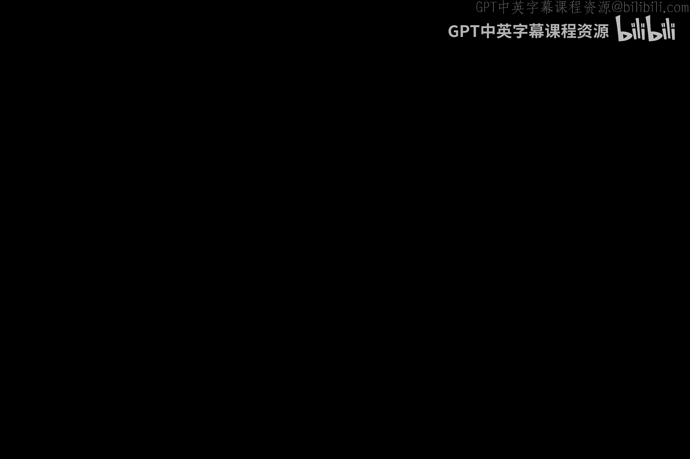
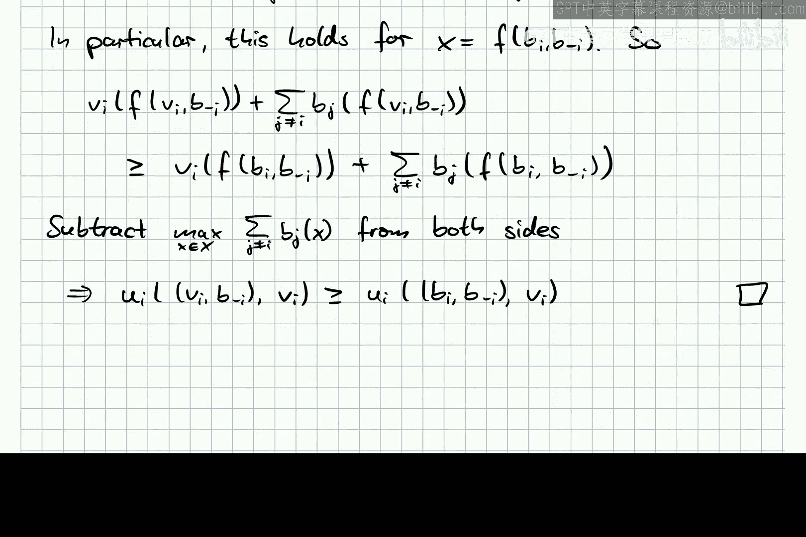
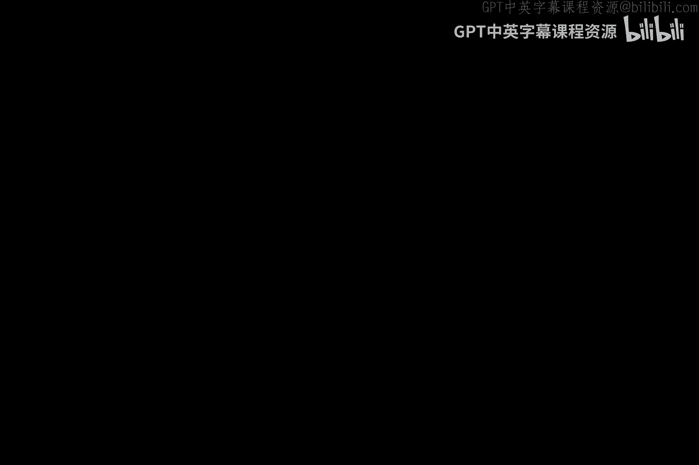
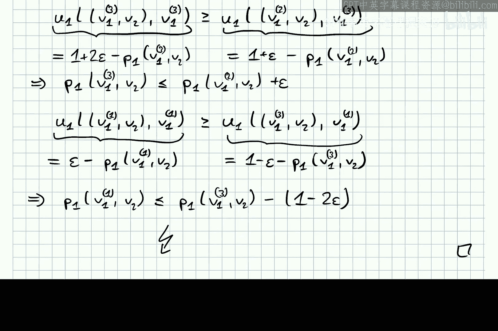

# 波恩大学《算法博弈论｜Algorithmic Game Theory, Winter 2020-21》中英字幕（claude-3.7-s p14 AGT, WS20_21_ Lecture 13 (VCG Mechanisms).zh_en -BV1m9ZyYoENg_p14-

Welcome back to algorithmth McA theory。In the last lectures。

 we introduced the general problems and framework of mechanism design with money。

 and then we also gained a pretty good understanding of single parameter problems。

 We could then figure out what it is that makes a mechanism truthful。

 namely the allocation rule had to be monotone and the payment rule had to follow。

The formula from Myerson dilemma。Today we will go beyond single parameter problems and consider just some arbitrary problems and for these we will again show a technique to build a truthful mechanism。

 although this is not quite as general as it would be for a single parameter problems for which we have an exact characterization of what makes mechanisms truthful。

 there is no such thing for more general settings。What are these more general settings。

 Maybe let's quickly recap our definitions。Still we have a set N N players or bidders or agents。

 however we want to call these， we have an outcome space， which is just seome set。

This had a particular structure in the context of。Single parameter problems。

 today we don't care what this has。And then each player has a private valuation function。

Which maps outcomes comes to real numbers？And then。

We say that capital V I is the set of possible valuations for player I。

 Capital V is the set of all valuation profiles， and then we say that a direct mechanism。

 M consists of the following things。 We have an outcome rule， F。Which maps。

A claimed valuation profile so each of the bidders claims someval function。

 and this is what the outcome rule takes as the input and it maps it to an output。And。

It also has a payment rule which takes the same input。Namely。

 what the bidders claim their values are。And it maps it to a vector of payments。

 which is just a real number for every bidder。嗯。We are still talking about quasiline utilities。

Which means that the utility。Of a bitterder under mechanism M， if his or her valuation is V I is。

The value of the outcome that is computed minus the payment that we are imposing on this bidder。

And we now call a direct mechanism， dominant strategy in hand compatible or simply truthful。

 if for any bidder， any valuation and any bid。Utility of this bidder。

When bidding the true value is at least as much as the utility under any other bit。

 regardless of what the other bidders are bidding。One special case of this was。嗯。

The was every single parameter setting， but there are also settings which are not single parameter settings。

For example， general comminatorial auctions。 What would these look like？ish。In a combinatator oxygen。

 what do we have？We have， of course。N， as a set。Of and bitterders。And M as the set。

As a set of M items。And what we can now do is we can assign。The items。To bidders。And。Each bitter。

Ass a valuation function。Okay。Yeah。VI， which maps subsets of items to non negative real numbers。So。

In our framework。We would therefore set the outcome space X。To all partitions。

Of items among the andbitderters。Where each S I is a subset of M。And as I intersect。As I prime。

Is empty。Unless I is equal to。I prime。This is not precisely。嗯。

Or syntactically this is not the same problem because once again here these functions are something more restrictive because our more general framework also allows us to say okay。

 I now my value now depends on what items my neighbor is getting， this is fine。

 but the important thing is to realize this is something that fits into our framework。

 when we're not so super careful about the syntactical differences。

 whether we assign a value to such a vector or we assign a value just to any single of these sets。

This is actually the same thing that we've also seen in the context of single item options。

 so this is always a little annoying here。That syntically， things do not always quite match up。

 but it is actually no bigger concern。What goodness such a cominget hall auction look like。

We might have。Two bidders。And。wo items。And now we can define the function V arbitrarily。 So。

 for example， we might set。嗯。Will view you one。If bid  one gets item A， then they have a value of 5。

 if they get only item B。Then they have a value of 9。And if they get both items。

Then they also have a value of 9。This is an example of a unit demand function。

 because the only thing is。Do I get an item or。对。The only thing I care about is。

And what is the most valuable of my items。 So in this case， my most valuable item would be item B。

 And I don't when I'm already getting item B， I don't care whether or not I'm getting item A。

We could alternate as a similar function for。Bitter， too。And。Let's， for example， take。This function。

It is also a unity man function。Bitder 2 now has a value of5 for item A， but no value for item B。

 and for both items together， he still has a value of 5。So。

What you see here is that this cannot be described by just a single number。

We have one value for item A and one value for item B。And so this is not acing parameter problem。

What would this be， What could this look like visually。Its often helpful。To also have the。

Interpretation。Of。This as a maximum weight matching。So， in this case。My value for a value 1 for item。

The value of Bi1 for item A would be 5 for item B， would be 9。And forbidder，2。

 the value would be 5 and 0。Okay。How can we get a truthful mechanism for such a setting。

This is exactly the result that we are that we will be showing today。

The mechanism that we're getting to know today is the VCG mechanism。

 which is due to victory Clark and Groes。And to be precise we're getting to know the VCG mechanism with Clark pivot rule because you can also understand the VCG mechanism as a class of mechanisms out of which we just see one particular particularly useful particularly nice instantiation。

 however， if people refer to the VCG mechanism， they always mean this thing。

Unless they specify some other particular。pivotivry。是。What does this mechanism look like。We let F。2。

At Cam rule。Be a function。That maximizes declared welfare。Yeah。That is。F of B。Is in Arc max。诶。

S of the B of X。4。All B and V， or in other words。This function now。Texas input。

 the bids of what the bidders claim their valuation functions are like。And the mechanism。

 the allocation rule now treats this just like these were the true values。

 and under these it maximizes social welfare and this is what we then call declared value。

cle at welfare， because now we just take the sum over all bidders and we now want to maximize。

But they are bidding what theyre claiming their values are for the respective outcome。

 and we just take the outcome that maximizes this quantity here。And now。

 what we still do is we still define。Payments。The VCG mechanism。또。Was Clark pivot rule。Is defined as。

The pair of this allocation rule。And the payment rule。

Where now the only thing that we actually have to define is the payment of。The bidders。

And we now define this as follows。 We take the maximum。Over all X。

 summing over all J other than I B J of x。And from that， we subtract。啲。J， which are not an I。

BJ of F of B。What does this mean。How much will bid I have to pay。

 So the allocation that we're performing is clear。 This is the one。That maximizes declared welfare。

 although there might be ties， so that we just have to specify some tie breaking rule， for example。

 multiple bidders be exactly the same thing。Bird。Other than that。

 so we just take the allocation that maximizes。This， this declared welfare。

 and how much do you now have to pay。We have now this interesting difference。

 what do these two things mean？What's this first thing here？We take the maximum over all X。

And then we take the sum over all J J， other than I B J of X。

This looks a lot like maximizing the declared welfare， except for one thing， namely。

 we are not counting。Better eye。So this is exactly what we would do when were maximizing declared welfare。

 But if bitter I just。Who isn't there at all。And from that， we're subtracting again。

 a sum that does not include bitter eye。Which， again， looks like the declared welfare。

Because we are now summing over all J other than I， BJ of F of B。What's that。F of B。

 that was our allocation that maximized， declared welfare。And now in this allocation。

 we're taking the sum。Over everybody， other than bitter eye。So how much？

Does the how much decad welfare comes from everybody except for bitter I？So once again， this verse。

 how much declared welfare would we get if Bi eye wasn't present at all？This。

Is how much declared welfare are we getting from everybody except forbidder I？

So the difference of these is。By how much is bitter I actually hurting the others？

By how much is bitterai decreasing the declared welfare just because？He or she is taking part。This。

Is also called bitter eyes externality。Let's maybe first see in a very familiar example。

 namely a single item option， what this means。Okay。What were the valuation functions？

Well the case of a single item option， while we were again overloading notation VI was also just the value that the bidder was associating to the item。

And not just only the valuation function， and we were then saying VR of x is equal to V。If。

bititter eye。Receives the item。In X。And it is zero otherwise。

How would I now maximize declared welfare？How would I do this。

 I would assign the item to the bidder who bids most。Yeah。And how much。Will they have to pain。Letna。

 I star。Be the bitter with the highest bid。Yeah。Well， then what will。P， I star of B， be like。

We're maximizing。The social welfare， but not counting。Bitter eye。 And then from that。

 re subtracting the declared welfare when bitter eye is not。Couned。

 but it is present in the optimization。How much is which of the two？

How would I maximize declared welfare。If bitter I。Where I star。

They are called in this case if they are not present。Well。I would give the item。

Exactly to the bitter。喂。Whatever is the highest remaining bit。And then。What is this。

 What is the declared welfare。OfEverybody counting everybody。

 except for the bidder who's getting the item。 while everybody else isn't getting the item。

So all of these terms are zero。Which means that the bidder with the highest bid has to pay exactly。

The maximum bit of any other bidder。I hope this rings a bell because this was exactly how we did this in a second price auction。

What do the other bidders have to pay。If we're now taking some I， which is not equal to eye star。

What do they now have to pay。How。Do I maximize the declared welfare， if everybody。

 except for bitter I。Bitter eye is not the bitter with the highest bid。

 How would Ina maximizeim the declared welfare。🤢，Well。

 I would still give the item to the bidder who's bidding most because he's not I。

 So I could still give the the item to I star。 So this will be B I star。

And what am I doing if also bitter eye is present。I'm getting giving the item to bitter I star。So。

Also here。This is B I star。Because。I'm not counting bitter I。

 but that doesn matter because they are not getting the item anyway。

The one who's getting the item is in both cases， be I star。

 So the difference between these two things is simply 0。Which means。

We now recovered exactly this second price auction。But the amazing thing is。

Also for any other setting， this will now result in a truthful mechanism。And the proof is。

 surprisingly simple。Let's go through this。The VCG mechanism。With clock pivot rule。

Is dominant strategy incentive compatible。How do we prove this？Well。

 the first thing that we want to do is we again want to write down the utility of every bidder when they are participating in this mechanism。

And then what we'll have to show is that this utility is maximized whenever you bid your true value。

So， first of all， what will thee。utility be like？Whatever I'm bidding and whatever the other bidders are bidding。

My utility。1 am bidding V I， the others are bidding B minus I and high valueius V I。

 This is my value。Of the outcome minus my payment。Yeah。So this will be equal to VI。F， F， F， B。

 I be minus I。Minus。The maximum of all Xs and Xs。Take the sum of all J， which are not equal to I B J。

X。Plus。The sum of all J and I J not equal to I B， J， Earth F。F， B， I comm B， minus。

Where did this plus come from， we had a minus term in our definition of the payments and because we have a minus year。

 they together give us this plus。Now what happens on which input？

We are now comparing what happens on the input when we bid our true value。

 so when we set BI equal to VI and we're comparing this to whatever we are getting when we're bidding some other BI。

So。On input。VI。😔，Com I be minus I。F。Returns。X star。Which maximizes。V I of x star plus。Jy。Unequal I。

BJ of X star。Why that。Because。This is now a valuation vector。And。

We said that we maximize the declared welfare。 So F is chosen to maximize exactly this。

 This looks a tiny bit different now because we're now not writing BI， but rather VI。

 but that's the only thing that is different now compared to what we were saying before。So if we bid。

 if bid or I bids the true value， then。This will be the allocation that will be computed。

What does this mean？This means that for any other small x。VI。Of x star plus。The sum of all。J。

 which are not equal to I E J of x star。 This will be at least V I of x plus。Jy。

Unequal at I B R the BJ of x。And。In particular。一。This， of course， holds。For x being。Some。

Outcome that is computed when bitter eye bids something else。So if we now write this out。

We'll see here that V I of。F。Of V I might be minus I。Plus。The sum of all J。

 which are not equal to I B J。F F。A V I command be minus I。This will be， at least。B I of F。Eth。B。

 I come I be minus I。Plus。The sum of all J， which are not equal to I， B， J， F， F， F， B。

 I can be minus。Okay。Let's now go back。 What were。Our。Utilities。Our utilities are of this form。

 It's V I of F of B comm B minus I plus。The sum of all BJ。F of B of be minus I plus something。

And let's see what we've already derived。 We have already arrived that。This first。This。

This plus this term， this is maximized if we said B equal to V。This is what we see down here。Now。

 what we can just do is we can now subtract this term from both sides。

Because it doesn't even depend on B eye。😡，This term doesn't depend on B。

 so we might also subtract this from both sides。い。And what we're getting then is that U I F。

V I comm a B minus I comm a V I is at least。You， I， as。B， I comma B minus I， comma V I。And this。

I's the exact definition of truthfulness。

Cool。So its as I was promising， not really difficult to prove this。

 although you might still think this looks a little magical and I agree the first time you see this。

 you feel what is actually happening here， but the more familiar it gets。

 the more reasonable it seems。Because what is happening here？Somehow。Byheading the payments this way。

The incentives are aligned， so。Eat of the bitters。Has， as their goal to maximize the。Actually。

 their own utility。But。Now， how do they maximize their own utility？

They do this by reporting their true value because。

And now it is crucial that this allocation function tries to maximize the declared welfare。

Because if， for example， all bits are the true values。Then。It is in every。Bitders。

 we are maximizing social welfare。 And so every bidder wants to be a part of this because the objective function is kind of the so in other words。

 the utility， is nothing but the social welfare except for maybe this。🤢。

This term that we're subtracting on both sides。 But this is a term that the bidders cannot influence at all。

Of course， this would still be truthful if we were subtracting something else here。

Meaning that if our payments were different。As long as this is a term that doesn't depend on BI。

This is indeed one of the exercises。To show that the mechanism will still be truthful Also when you replace this by another function。

 although。And this way。With this Clarkqui rule， the mechanism has some very nice desirable properties。

 which we see in a bit。But before we get there。Let's first go through some examples。

Let's now go through some further examples of the VCG mechanism。

 the first one being sponsored such options and then we' also come back to combinatorial options。

In the sponsored search auction。We'll have。K， which is smaller than add and add slots。

And the more likely。The higher is lot。Is displayed on the， on the search results page。

 The more likely it is to be clicked。 So we'll have。Alpha 1 greater than alpha 2。

 greater than answer1 up 2。Alpha K， these are the clickthrough rates。And when the。The sign。

One bitter。To each add slot。And what will my value be， My value will be。The value I have set some。

Some real number times the click through rate of the slot that I'm getting。So this is if Age I。Gets。

Thank。Slot。J in X。Let's not keep things simple。 and let's just assume that。The bitter values are。

Decreasing。And let's now just compute what the outcome of the mechanism will be when they bid not truthfully。

It。Yeah。How big will social welfare be or declared welfare？Which will be the same。Well have。

Just the sum of J。From one to K， Vj times alpha J。What is the。Optimmal。Social welfare。Without。い。

Bittter I。Well。What we would now do is we would assign still the first I minus1。Slos， as they were。

And then。Everybody moves up by one， so。Bitter i+1 now gets slot。I answer so on or more generally。

 Bi J now gets slot J minus1。What will not be thee。The payments of a bidder。They will be。

Okay cap first don't。First， optimize without bitter eye being present。Which is this thing。

But from that。We subtract。😔，The welfare that we're still getting when。Bitter eye is present。

 but we are not counting them。 So all we're doing now is we'll take the allocation。

But we'll just leave out。D ice term。So then of course。

 the allocation will still be that bid J gets slottch J。And if you know do this。Then you see okay。

The payments are。Exactly。Moving each bitter。From。I plus1 through k plus one up by one。

By how much does the clickthrough rate。Increase， so this is the difference in the in the click through rates are moving up by one。

This way， I'm getting this more in terms of click through rate。

 and I multiply this by the respective bidders value。

I hope this sounds familiar because we got exactly the same formula by using Myerserson's Lamma。

 which is not surprising because we Myerserson's Lamma were saying these are the only payments that give us a truthful mechanism and VCG is actually giving us these exact same payments。

So， generally。Whenever you have a single parameter setting， you can use VCG or。If you do this in。

 in any other way。If you just use bias and dilemma， you will actually get the exact same thing。

For a good reason， because My Lammoov is telling us。That it cannot be any different。Unless。

 of course。You optimize something other than declared welfare。

 which is possible with Myerserson'slemma there you're not， this is true。

 even if you are not maximizing declared welfare ECG。

The result is only true where F is an allocation that maximizes declared welfare。Good。

Now let's come to a further example， namely a unit demand comm in a trial auction。

This is an example we've already seen at the beginning of our lecture today。

Let's make this a little more precise。 Naly， what did I say were these unity man functions。

 These unity man functions are functions such that I'm getting a set of items。

 But all that matters for me is the most valuable of these items。 So I can write down。😊。

V I of a set S， just as the maximum。Over， J and S VI comma J。

 so these are called unit demand functions。How would I now maximize my declared welfare？

This is more complicated than before。Cause。I would not have to find an allocation of the items such that everybody。

Gets。嗯。So that the sum of the values will be maximized。How do I do this here？Well， here。

To maximize declared welfare。It is okay to give each bidder at most one item。He。

Because the second item will not count anything。Yeah。嗯。Sir， what will this look like？

We are now seeing this as a。Maximum weight matching problem。Yeah。Our graph will be。N union M。Wherey。

Wight of the edge。Between I and N。And J and M。Is VI becomea J？

So what will this look like visually we might not have？For example， three bidders。Three items。对。

How would I find， in this case， the matching that maximizes the sum of the weights。

While there are effectively two matchings， two inclusion wise maximum matchings， namely。

 I could either take 10 plus 3 plus 1 or I could take 5 plus2。The one that maximizes。

The weight that is， of course， the one with the horizontal edges。

So that would be the one that maximizes。Declared welfare。But how much will I now have to pay。

 How much will this bitter one now have to pay。What they'll have to pay is。5 plus2 minus3 plus1。

Why that。Because。We are taking， we are first counting the。Declared welfare without him。

 But in this red allocation。And then what is remaining is 3 plus one。

And then so this is coming from here。And then we are also just re optimizing without this bitter being present at all。

 And then we wouldn't take the red edges， but we would take these diagonal edges。

And then we would get 5 plus 2。And the difference of these。

 this is exactly what bitter eye has to pay。The nice thing about the VCG mechanism is that it isn't only truthful。

 but it also fulfills some other properties， namely being individually rational and also having no positive transfers。

These are two properties that will now quickly define and also show。

The first one is individual rationality。一。嗯。And what is it that it says。If my true value is。

At least0 for all x。 So if I can never have a negative value。Then， also my utility。

When I'm bi truthfully。Will never be negative。Why that。How can we show this？We actually only have to。

See what this。Valuation function， what this utility will look like。Let's write this out。

 My utility is my value。Have the outcome。Plus， the value that everybody else declared for this outcome。

Plus。Sorry， minus。E maximum。Declared welfare if Bira wasn't present at all。What is this first thing？

What is this here， This is just。Whatever maximizes。V I of x plus the sum of all J。

 which are not equal to I， B， J of x。And from that， were subtracting。This。Other term。And here。I'm那。

Want to say that this is something you should be really careful because I did this now wrong。BJ。

Doesn't take as input。F of x because x F doesn't take as input X， but F takes as an input B。

 So what you should write here is just。BJ of X。Because。BJ always takes this input， E allocation。

 and F always takes this input。 They declared。Valuations。Good。😡，So。This is where we are。And now。

What we wanted to actually show was that this is non negative。 And yes， this is， of course。

 non negative because here。We are optimizing over something that is always at least as much as this。

So， the maximum。Of this will always be at least a maximum of this。So this will be non negative。

 and therefore， as we see that my utility when a bit the true value is always non negative。

This of course wouldn't be true if for example， V of x was always negative。

 then we couldn't just avoid that sometimes bitter I also gets a negative utility。

 but for example in our comminunatatorral options my value is always not negative and so my utility when reading the true value will also be never negative。

Of course， there are bids that give me a negative value。And but。Those are， for example。

 in a second prize option I might for example， over bit。Then I'm getting a negative utility。

But if I bid my true value， I will never get a negative utility。嗯。し？The other property。

Is no positive transfer。Which is that。For all bids。We have。And。PISB。What was this again？

The maximum of all J of the sum of all J than I， B J of x。Minus。Some of all J。

 which are not equal to I， B， J as F as B。This is。Non negative。How so。Well。What do we have here。

 here we are maximizing something。And here。We are not maximizing the same term。

 We're just taking anything。But one possible choice for this X would be exactly this F of B。

 in which case， we would have the same thing here。 So this has to be definitely higher。

 or has to be at least as big as。This thing that we have here on the right hand side。Yeah。

And what does this mean？This means that。The mechanism will not pay anybody。

The mechanism is only collecting money。嗯。But in some settings。

 it might actually be reasonable that the mechanism pays assemity if you are。

Buying a service from people。 So if rather than performing。

And such an auction where you're selling an item， you want to actually purchase an item and you purchase the item from the one who's offering it the cheapest way possible for you。

Then suddenly， this is strange。Then this VCG mechanism with Clark pivot rule。

It's actually pretty strange。Because it still will not pay anybody。

But as long as you're in a setting where you're selling things， this is a very good property because。

You are not， you as the mechanism， are not paying anybody， but you're only collecting money。

So as we've seen VCG is a pretty great template for a mechanism。

 it will be truthful in equilibrium you will be maximising social welfare and also you have these other nice properties such that no bidder when bidding the true value will end up with a negative utility。

😊，However， it is not the perfect mechanism for multiple reasons。There are reasons like。

A lack of group strategy proofness， which means that if now your friend colludes with you。

 then this will actually not be a truthful mechanism。But there is even a more severe problem。

 which is about running time。Computation of complexity。Namely。

 what you'll have to do to run this VCG mechanism is you'll have to。

Exactly solved the problem of maximizing declared welfare and as we've seen， sometimes， for example。

 in the context of a communal auction， this will be an NP heart problem so under our usual assumptions there will not be a polynomial time。

 meaning no efficient algorithm。And then VCG won't be truthful if you just use an approximation algorithm。

And use the VCG payments。 And this is what I'd like to have a closer look now。

 what will go wrong there。Namely， the problem that I'd like to consider is， again。

 unit demand comm auctions。And one algorithm that we could consider for this。Is the following。

We consider。All pes。😔，Have bid and an item。And we do this。In order。Of。Non increasing。

Claed to value for that item。Each bitter I will claim a value BI J fort item J。

 and we now just go through these items these pairs in non decreasing order。

And then non increasing order。And will'll。Assign。Item J to bitter I。Unless。

Item J has already been assigned。Or bitter day is。bititter eye。Already。Has。An item。

So in the language of。Edgeed by apartheid matching， this is the standard greedy algorithm。

Which just can considers edges in order of。Non increasing weight and then edges greedily to the matching unless one of its two end points have already been matched。

 and it's very easy to see that this will be a two approximation。Meaning， in this case now。

We'll have that。The sum of。The B， I of F。Of B。Will be at least a half times。The maximum。

Of all possible。B， I， the sum of the B I of X。Good。So， besides。Actually。

 we've made the argument that greedy algorithms are always nice for truthfulness because they tend to be monotone and also this algorithm fulfills a monotonicity property namely if you're getting item J。

And then you increase your bid for item J， then you're still getting item J。But nonetheless。

 we cannot use this algorithm。But VCG payments to construct a truthful mechanism。

Because recall what we would need for VCG， this factor a have wouldn't be allowed。

We would need that we compute the exact optimal solution。

And things are even worse here because there's no other way you could define payments such that you will get a truthful mechanism。

So let's write this down what I mean by that。There is no payment ruleee。Such that。

The pair of this allocation algorithm or allocation rule and P is a truthful。Mechanism。

Or in the language that we used in the context of My andslemma， F is not implementable。

How do you show such a claim？You argue that。Well， like we did this in the context of Myerson's Lemma。

 you argue that maybe your valuation is this。And then you be bid that or vice versa that。

This what you could be bidding instead because that could also be your true value。And。

What we'll do now is we'll actually follow a cycle in which then eventually will'll come to the conclusion that。

There has to be contradiction to。A this mechanism that we to exist。Be truthful。Somewhere。

Let's see this in more detail。So， bassum。That。There is。Such a P。And now。

 consider the following kind of instance。Will， half again。Two bidders and well have two items。

And their values are as follows。Bittter one。That's something that we will still be talking about has a value of V1 A for item A and a value of V1。

B for item B and bidder 2 always has a value of one for item A and a value of。0 for item B。Bitter。

 too。always。Be truthfully。And bitter one。Can have the following valuations。He。😊，Namely。

We might have that。The value that bitter one has。For item A is 1 minus epsilon， and the value。

For item B。Might be absolutepsil。Or。There's another possible valuation that we're considering namely that the value for item a is1 plus epsilon and the value for item B。

Is one plus 2 Eilon。And。The third case is that。The value for item B is for item A is 1 plus2 epsilon and the value for item B。

It will be one plus absolute。Where epsilon should be small enough。More precisely。

 we want it to be less than a third。Good， what will we do now， We will see。Okay。

Your value might be V1。And then， you should。Not benefit from reporting。V2， for example。

 or if your value is V2， you shouldn。Benefit from reporting V1。

And this way we get to a couple of inequalities。And eventually this will now turn out at these mechanisms which would make the mechanism truthful。

 cannot exist because we get to contradiction。So what would have to hold。

We would not have to have the following。By truthfulness。We would。Need that。Bidding V2。So， forth。

But and by that， I mean， bigger one。Beiating this second valuation here。

If this is the true valuation， this should give a utility of at least the utility it gives。

When they bid。The first valuation。 And， of course， the。Value will still be。

This is the always the true value， and we're always seeing the second。Line here。What happens？

If you bid。This much。Well， let's go back。You。What will happen。

 Which of the two items are you getting， We start by assigning the item for which the value is highest。

 So this in this case would be this one plus 2 epsilon。This means that。Bittered one will get item B。

And what happens if。They bid this first valuation in。 Then first bidder 2 will get item 1。

 and only then。 So item A， and then only then item B is left。 So they also get item 2。

 So in both cases。Bitta 1 will be getting item A。Yeah， sorry， item B。And。This means now。

They get the value for item B， minus whatever they have to pay。And you see， the payments， of course。

 don't know the true value。They only know the bed。And by this inequality， we now see a。When。

Bitter one is bidding。The second valuation。The payment。Is at most。What they have to pay。

And their bidding the first valuation。You could also swapb V1 and V2 here and you would also then see that this although's the other way around。

 but we don't need this for our argument。Now we can do a similar thing for。The case that。

The true value is the third valuation。Yeah。Then。You wouldn't want to bid the second valuation。

Or more precisely， you shouldn't benefit from that。Once again， what， what items are you getting when。

When you build this。Merge then as we saw you're getting item B， and when you're bidding this merge。

 then you're getting item A。Okay， so。Well now I have here there we're getting item A。

 we have a value of one plus two epsilon for that item。And we pay something。Yeah。And here。

We'll get item B for which we have only a value of one plus epsilon。And we'll also pay something。

This gives us。Also it's an inequality， namely that。When you're bidding the third valuation。

Then you're paying at most apsilon more。Thenhan when abidding the second valuation。And now。

We'll do actually this same argument once more， but now for the case that your true valuation is the first valuation。

And also when give true valuation is the first valuation。Then。

You wouldn't benefit from bidding the third valuation， instead。When you're bi the first valuation。

 then as we've seen before， you're getting item。A， what's your value for item A。

So you're getting item B， your value for item B is absolutepsil when you're bi the third valuation。

 then you're getting item A。So。We'll have here that this is Abpsilon minuss what you have to pay when youre bidding the first valuation。

And what we'll have here is the value you have for item B minus what you have to pay when you're bidding the third valuation。

And this tells us that。P1。When you're bidding the first valuation。Is at most。What are you paying。

When you're bidding the third valuation。And then， minus。1-2 epsilon。And now。

Just see all of these together， you see this inequality。

 you see this inequality and you see this inequality。And you can start wherever you like。For example。

 start here。Then you have an upper bound of this， Then you can use this upper bound。

 you can use this upper bound， and eventually you will reach。

At some point you will have to reach a contradiction。So all of this together will be a contradiction。

 So this payment。Rule cannot exist。

So once again， how did this argument work？And had he generally show that。You cannot make。

You won't be getting a truthful mechanism， you can always compare these things that。

Maybe your true value is this much and you' telling the truth or your true value could also be something else。

And always， you compare what could be your true value。

 What happens if you bid that true value and what happens if you bid some other value。

 But this could also be your true value。 And now all these inequalities that you're getting。

 you all combine together。 This is the way we did this for my essence lemour。 There。

 things are pretty straightforward， you can also derive a characterization of truthfulness via this kinds of inequalities。

 namely， if you say， okay， all of these inequalities have to be fulfilled。

This also gives you some kind of a characterization on what。Algorithms or what would。

Outcome rules can actually be implemented truthfully。But the point I wanted to make here is that。

VCG payments。Don't make it truthful and also there is a general problem when you use approximation algorithms。

 at least when you go beyond single parameter settings in case of single parameter settings all you have to care about is is your algorithm monotone here now this will be far more complicated and very natural algorithms fail to fulfill the necessary properties。

And this is also the reason why。Comunatural as in polynomial time designing truthful mechanisms。

 this is still an open problem， there has been quite an enormous progress。

 there are many great mechanisms that do run in polynomial time and that are truthful and still get a reasonable approximation guarantee however it is still in many ways in open problem。

 for example， can you do this via a deterministic mechanisms。

Solving the only the allocation problem in polynomial time approximately that's something easy。

 but then as soon as you want this truthfulness， then things will actually go wrong。Good。

So this concludes our discussion of the VCG mechanism。I hope you understood most of this。

 otherwise please do ask any questions。And see you next time， stay safe， bye。

