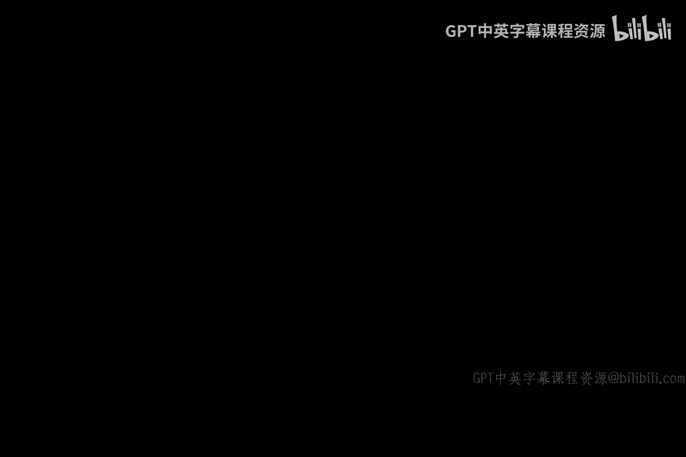
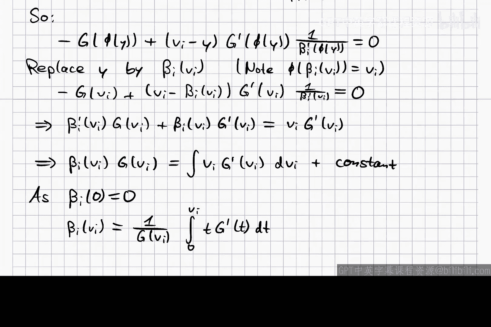
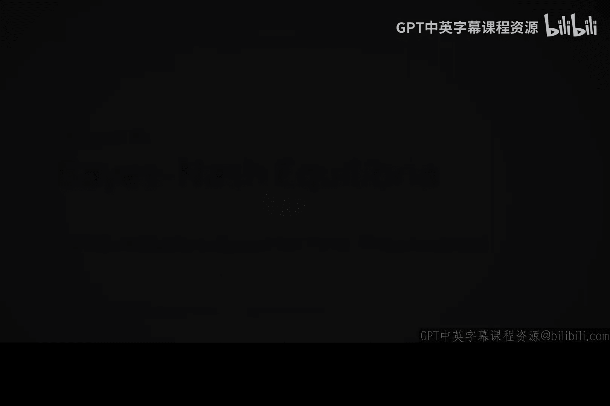
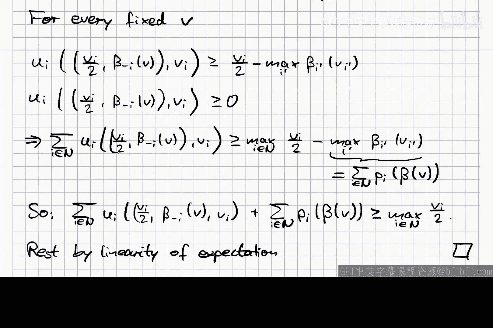

# 波恩大学《算法博弈论｜Algorithmic Game Theory, Winter 2020-21》中英字幕（claude-3.7-s p15 AGT, WS20_21_ Lecture 14 (Bayes-Nash Equilibria).zh_en -BV1m9ZyYoENg_p15-

Welcome back to Agrothic Gameme theory。Over the past lectures， we've got to know truthful mechanisms。

 more precisely dominant strategy instead of compatible mechanisms。These had the property that。

Players more bidders always want to report their true values regardless of what the other players are doing。

 it is a dominant strategy for them to do so。But we've also seen that sometimes this doesn't work。

Sometimes it's not possible to design a simple truthful mechanism。And。

Why is it that we're insisting on this truthfulness anyway， How can we。

Understand nontruthful mechanisms。This is exactly the kind of question that we want to start answering today。

But。How would we analyze such a non truthruthful mechanism。

 Because we still want to take into consideration that。Players will behave strategically。

If it is not in their best interest to report that true value。Then they might lie。

One thing that we might want to do is we might just consider pure or mixed naa equilibriumlibria of the resulting gain。

However， there's one big weakness about this。For a pure or mixed national equilibrium。

What you will always be considering is the case that actually all players know each other's values。

Why that， Because to find this equilibrium， you would then。

All of the players have to know what the other players utilities are like and the utilities depend on these private valuation。

And this makes this a little weak。So we might now argue， for example， for a first price auction that。

If a purenaric equilibrium mixes， it will always be great， but。嗯。

How should the agents ever end up in such a pure National equilibrium？

What they are choosing there as their strategies depends on what the other players have as their values and this is exactly private information。

So today we'll get to know。😊，An equilibrium concept which works with incomplete information。

So ultimately， players don't know the。True values of the other players。

But they do have a belief about this。And this is called a basees Nash equilibrium。

Let's see how this is defined。We'll assume。That。bititter eyes。Value V I。Out of capital VI。Is drawn。

Independently。From some。Distribution。Di。These distributions。Are known to all bids。And now。

Each player or each bidder， however you want to call this here。Each bidder will not choose a bed BI。

Of course。This bidder knows his or her own value。But not。B minus5。

Only the distributions that B minus I is drawn from。How can we capture this？We can say。

 in other words， that each bidder。Choose this a。Bedding function。Which we call beta I， which maps。

From the set of all possible values。2 beds。And we now say that， whenever。The value。Is VI？Bitter eye。

Bits， beta， I， FV， I。For example。Truth forbidding。Will be just the function that。

Beta I of V is equal to V。And now we say that。Such a。

Choice of a bidding function for each player is a base natural equilibrium if no player can benefit from unilaterally choosing a different bidding function。

So。In a way， we can understand this now as a game of choosing the bidding functions。

 The strategies are now the bidding functions。And we are kind of interested in a pure natural equilibrium of this game of bidding functions。

More formally， this looks as follows。eight。Pure。Base Nash。Equiilibrium。Or for short， B， and E。

Is a profile。As bidding functions。Beta I。For every player that we have。The be eye。Is mapping。

From the possible valuation functions of bitter I to。These are her possible bes。

And now we'll have to define the equilibrium condition。4our。All players。All possible values。

And all possible deviation。Bids。The following holes。Take the expectation。Of。You， I。Beta as V。Com门。😔。

VI。And this will be at least。The expectation。F U I， F。Y are prime，Bta minus I。Of V。Com吗 V。

And here we mean。That beta of V is just the vector of beta 1。That' V1。Up2。Beta n。F VN。Okay。

 let's digest this definition。A base natural equilibrium， what is this now。

 this is now one choice of a bidding function for each of the players。

 so each of the players chooses now such a bidding function。

And this now has the property that no player wants to。

Deviate unilaterally from this bidding function。And you can state this in two different ways before I was stating this by saying。

 okay， you don't want to choose a different bidding functions。

 bidding function than the one that you're choosing。

 but you can also say it like this and maybe this is even more intuitive so you are player I。You now。

 consider。嗯。One of your possible values， small VI out of capital VI。And now you ask yourself。

 do I want a bed？The beta I of VI or something else。Something else this is。B， I prime。Now。

 what I really I know about the other players。I don't know their values， so I don't know their bits。

 but I know the distributions their values are drawn from。

So I'm taking into consideration the expectation that I'm getting。If now eat of the。Other bidders。

Is drawing。One of their values。From the distribution。And then they are bidding according to beta。

And what we see here is that everybody's bidding according to beta。So， we'll draw。And。All Vs。

 except for VI from the distribution。And then we are asking， what's my expected utility？

This is what is happening here， VI that is fixed。The others， we draw from the distribution。

Here it is very convenient for us that those are independent。

So the other bidders values are independent of my own value。

 otherwise things would get more complicated。嗯。So this is what we see here and what do we see here on the rubber side？

Here we see。Again， the other players don't change， they still draw their values from the distributions。

And they play according to。The beta I functions， Beta I prime functions。

But we are now bidding BI prime instead。And this is no。Make an improvement for us。

Do we now get a higher value。By bidding BI Prime。Rather than beta I of VI。

What this bidding function would be doing， would be proposing。If so。Then this is not an equilibrium。

 but if not。Ben。It is anequliria。Let's see。One very simple example。In a truthful mechanism。

And by truthful， I mean dominant strategy incentive of compatible to be precise。We have。

Definitely one pure bass natural equilibrium， namely。Truth forbidding。

It is not necessarily the only base natural equilibrium， but it is always a base natural equilibrium。

Why that？Because。This term here。Is。Maximized or rather let's talk about this term here。

For which BI prime is this inside the expectation maximized for the truthful mechanism。

 is always maximized for BR prime。Equal to V。Regardless of what the other players are doing。

Truth forbidding is a dominant strategy。And this is exactly。

then sufficient for this inequality to hold， because even if we。

 if all other players are bidding truthfully and we take the expectation over the other players。

 even then it will not be better to do something else。Good。😡。

But maybe this is not enlightening enough， let's consider a first price auction。

 which is not a truthful mechanism， but for which we can also derive。A base na equilibriumli。

That's considered a first price auction。With two players。

And let DI for both players be the uniform distribution。On the interval，0 to 1。

And what we now want to show。Is that。Reader eye。The vector of beta I， where beta I of V is equal to。

AHa times V I。That this is。a。Bs Nash equilibrium。Okay。Before we go into the details。

 what is it that we're claiming we are now considering a first price option。And。😊。

Now we have two players。And。We are now in a setting where we assume that these variations are drawn from。

Distributions are drawn from known distributions， these distributions are known to everybody。

 so these are prior beliefs on what you assume that these values are。

And everybody agrees on these in this case， we say， okay。

 they are drawn from the uniform distribution on the interval between0 and 1。And we now claim。That。

Always bidding half your value。This will be a base na equilibrium。Bedding your。True value。

 this will usually not be an equilibrium as we've seen， because this gives you always zero utility。

But it seems that be half your value， this is a reasonably good choice。Hows so。

Let's only consider Bi 1。For symmetry reasons， it's really enough to consider only Bi one because for bitter2。

 the situation is exactly the same。嗯。And let's now， fix any。Value for him， him or her。

What will now be。The expected utility。When bidding。Some BI prime。Against。也能背着去。

So the other player is playing according to what we now claim is the base na group。

Let's write this down。一。😊，Expected value wena drawing。V2 from D2。

And now we take the utility of player1。本。Play a oneness bidding。Beta， a B1 prime。

Player 2 is bidding according to beta 2， so they're bidding beta 2 of V2。And。

The value of better1 is V1。Something that we fixed。What will this be like。Well。

 let's take this expectation， let's write this out。And。你。In this case。

 writing down the expectation is pretty easy。Because we just have to take the integral from zero to one。

Because we are considering the uniform distribution here。And now let's plug in the choice。F beta 2。

This is。Equal to e2 over 2。Now how big is this thing that we're integrating over here？

How big is this。This now depends on how much we're bidding。

We can either bid more than V over2 or we can bid less than V over2。If we're bidding more。

 then V2 over two。Then， we're getting。Our value minus our payment， our payment will be B1 prime。

So this happens if B1 prime is bigger than v2 over2。And otherwise。

 we' are not getting the item and we're not paying anything。So， were。Getting0。Good。

So this now lets us rewrite this integral because。We now have to just。

See that from0 to2 times B1 prime。We are getting。V1 minus。Be on prime。

We're still integrating over V2 here。So this was just。

I could mention quickly that this is equivalent too。V，2， being less than。Two times。Be on prior。H us。

Now， for the remainder。We are。Getting 0。And this is。By the way， only true。

If B1 prime is at most a half。So， in this case。We know。Solve this。

 then we're getting v1 squared over 2 minus2 times。B1， prime minus v1。Over two， squared。So。

 for which。B1 prime is this maximizeimized。This doesn't depend on B1 prime。

And then we're subtracting something that is not negative。And if we now set B1 prime to v1 over2。

 then we're subtracting exactly zero for any other B1 prime。

 we're subtracting something that is greater than zero。So， we see that this is。Maximized。4。

B1 prime equal to v1 over 2。And this tells us。That。The expectation of。You won earth。V1 over2。

Beta to a V2。Come of V1。This will always be。At least what we're getting。For。Any other。Possible bed。

B1 prime。This is true for all V1。And for all B1 prime。

And this exactly means that this is a base natural equilibrium。

Because this was exactly the equilibrium condition for player one for player two。

 we get the exact same calculation because this setting is entirely symmetric。So。

For one particular distribution。Over the valuations。We were not able to indeed， derive the。嗯。

Derive a base natural equilibrium or we didn't actually even derive it right now。

 I just told you this is an equilibrium and then we verified that it was。

But how would we in general solve？For an equilibrium。

 how could we in general figure out what an equilibrium would be like。

 This is what we'll be doing next。So now we know the definition of a base natural equilibrium。

 we've already seen two examples， where these examples were。

Just the way that I told them that this is a base na equilibrium。

 and then you were able to verify that it actually is。

How would you figure out a base natural equilibrium yourselves？

Let's do this for first price auctions。But only for the case that the。Distributions are identical。

 So all players are have their values drawn from the same distribution。And also。

 we assume that the equilibrium is symmetric。What we'll do now is。

Well derive a sequence of necessary conditions。So that we then end up with some formula。

And then one can actually verify that this is indeed a base nash equilibrium。

Which we will not do then because this looks exactly the way like what we've just done verifying that。

Some bidding functions are actually a base natural equilibrium for a。First price auction。

What is it that we're assuming now？We'll assume that。For all。Players。I。And all。X。

They are non negative。It。Probability that the value of By is at most x。

This is exactly equal to f of x。 So this was our notation。

But we also assume that this is a continuous distribution， which means that there is。A。

Density function， small F of T so that。The probability that we see value of at most x。

 This is exactly equal to the integral from 0 to x， small F T， small F。FT。机起。Further， we assume。That。

嗯。We are in a base natural equilibrium。So there is a。Base natural equilibrium。Beta I。Where I is an n。

For which。All functions are identical。And inverible。Maybe there's too much to ask for then。

One would probably get a contradiction somewhere， but。As we will see， this does work out。

So we will be able now to derive what this functionss beta I will look like。To this end。

 let's alter write， I forgot this before， we'll alter write G of x。Or f of eggs。

To the power of n minus1， this will be useful just as a shorthand later。What do we now have to have？

In this for these functions， beta I to be a base naa equilibriumliber。

For this to be a base natural equilibrium， we can have to have that D。

Equilibent properties fulfilled， which means that no better。

Wants to deviate from what the bidding function is telling them。4。

And this should be true for no VI that they can have no possible value。Let's write this down。For all。

i。V I and why we now have。阿die。Expectation。And。The utility， when we bet wine。We， I mean。

 now player eye。The others bid， according to。Beta。Our value is VI。And we're taking， of course。

 the expectation over the other players。How big is this？Well。

 we know that this is a first price optionuction。 so we are our utility will be VI minus y。Times。

The probability。That no one。But's more or in other words。That for all J， which are not equal to I。

Beta J of Vj is less than y。By the way。There is always the question of tie breaking when you talk about these auctions。

 but here it really doesn't matter because the probability that anything is equal to y， for example。

 that is zero anyway。So this is something we can totally ignore for today， fortunately。Good。

What is now this probability？This probability。Is we always apply function beta J on Vj。

 and then we ask， is this less than y？What do we know about that？

We know that these VJ are independent。This is something we've already used here。that。

Or this is something that is somewhat implicit that everything is so what the other players' values are。

 this is independent VI， but moreover。Their values are also independent。So。

This probability is equal to。The product of the individual probabilities。And let now。See。第脑的。Inverse。

Of。Beta G or beta I， for that matter， we assume that those are all these bidding functions are identical。

Then。This will be equal to。VI minus y。Ts step。Product of all。Probabilities is that。嗯。Bj。

Is less than phi of y。And。The probability that。V J is less than phi of y。

That's something we can also write down because that's simply F phi of y。And。😊。

We're now having here the product of n minus1 terms， so we have a shorthand notation for this。

 This is simply G of p of y， because we said P G is just F to the power of n minus-1。

And here we're using。A lot that all these distributions are identical and also that these functions are identical because otherwise this wouldn't be true。

And also if they weren't identical， this would be a lot harder。

But that's fortunately something we are not having to deal with today， we are keeping things simple。

Good， where are we now？We've now written down。For any player。

 any value that this player might have and anything that player might bid with this value。

 what will his or her expected utility be like， this will be exactly this thing this will be exactly equal to VI minus y so value minus bit times G of p of y。

And why are we doing this？Because。Now， beta I。A VI。Has to maximize this。

And this now helps us to derive what this beta I will have to look like because also phi is the inverse of beta I。

More precisely。If beta I of V is equal to Yi。It to why。Then。And here。

 this is obviously an assumption that I forgot to mention。

 we also assume that these beta functions are differentiable。嗯。And。

I have to apologize at this point that this all of this looks a little hand wavy。

And people complain to me about this in the past that this looks a little handwavy。 And， yes。

 I agree。 This is somehow more the way economists like to do things， maybe less worrying about。

Are these things even differentiable or not and rather deriving insights from this？

So this is always the。Just like between mathematicians and physicists。

 you always see the conflict either of finding out real things or doing things very formally。Good。

 so my point was this function is maximized。For beta I of V being equal to y。So。😊，For or。

Let me rather state it， it is maximized for y being beta I of VI， which means that。For this。

The derivative by y。Has to be 0。What's this derivative。We'll have minus G F V F y。Pas。

VR minus y times。The derivative of G。Times， the derivative。Have feet。What is now the。

Derivative of this phi。The derivative of feehi。What was Phi， Phi was the inverse of beta。

So we get this the inverse of it via the inverse function theorem。Sell the inverse。

Function theorem tells us。That。F prime of wine。Is equal to。1 over beta I prime。F P， F y。So。

What do we get？We'll get that。 minus G is。F is y。Plus。V I minus y times。G prime。A C， F y。Times1 over。

Beta I prime。A phi of y。This will be 0。Good。😡，Now we replace why， What was why， why was。

The bid that we wanted to have we and us had this holes for the。For the bed。

That we should choose when our value is VI， so let's replace every y by beta I of V。And。

Phi was the inverse。😔，F beta I， so phi of beta I of V is equal to V。

So all of this combined now gives us。That。Minus G F。VI plus。VI minus beta I F V。Times。G prime。FVI。

Times 1 over beta I prime F V。This will be 0。Or。Equivalently， we can say that。Beta， I prime。SVI。

Times。G，SVI。Plus。Beta I of V times g prime of V， this will have to be equal to V times。G prime FVI。

What do we see on the left hand side， on the left hand side？We see the product of the derivative。

Beta I and and G。So。We will have to have。That。Beta I times V I times G of V I。

 This will be the integral of V I times G prime of V I。DVI。Plus， some constant。And。Finally。

As beta i of0 has to be equal to0。We now see that this constant has to be zero。So。Beta， I， F V。

Will be equal to。1 over。G of VI times the integral from0 to V。次。G prime of T。机器。

And now you can verify that this is indeed always a base national equilibrium。

I don't always like these calculations because I think they are a bid。Sloppy， mathematically。

 they feel like some heuristic approach。But eventually， it doesn't matter how you derive down here。

What you see is， okay， you can actually go through all these steps。And they just。

Tell you which way to look for a base natural equilibrium。And then you end up with this。

Equation here and。Then what you can do is you can actually verify that this is a base natural equilibrium。

 how would you verify that this is a base natural equilibrium。

 you would simply do what we were doing。Before for the first price auction。

 but more generally namely plugging in this beta I function。And then asking。

What if everybody behaves like this， do you want to deviate or don't you want to deviate？

And the thing is。For every VI。Following exactly is this beta I function when everybody else is doing as well。

In expectation， this will be a good idea， and this is exactly what makes this a base national equilibrium。

Of course， this does not show that there is no other base natural equilibrium。

 and that's indeed an interesting question。 are there other base natural equilibrium。 Well。

 one thing that's for sure is that there is no other base natural equilibrium。

 which is symmetric and for which the bidding functions are invertebible and differentiable because。

If this is the case， then our calculations lead to the point that。Okay。

The function beta I has to look this way。But at the same time。There might be。Poins which。

Just you will never see at all。And for these， it maybe doesn't matter what you're bidding。

So there are many mathematical subtleties in here， but this is not a point which I want to discuss today。

 I just want you to get an understanding of base na Columbialib and how you can generally derive necessary formulas for base natro colib。

But， fortunately。To derive。Under understanding of what。A base natural equilibrium is like。

 You often don't really have to solve for the。For the exact base natural equilibrium。

 but you rather can argue about properties that the equilibrium is fulfilling。

 and this is exactly what we'll do next。

So far we were asking the question。How do bidders bid in a base natural equilibrium of a first price auction？

Bird。Actually， that's maybe not even the thing that we're interested in。

 but rather we're interested in the question。What's the welfare of what they are doing？

Is the one who's。Who has the highest value， is he or she always getting the item？

Or can it happen that sometimes somebody has a smaller than the highest value is getting the item just due to this overall strategic behavior？

And this is exactly the question that we want to answer now。 So we would now。

Want to discuss the question， what is the welfare， the expected welfare of a first price auction in a base na equilibrium。

For the。Symsymmetric case， so where the distributions are symmetric， or identical。

 and also the the bidding functions are identical， we already have。Derived a formula for the exact。

Equiilibrium， and if we have a closer look， then we see those are increasing functions。

And this means who wins the auction？The one with the highest bid， but who has the highest bid？

Because they are all using the same biing functions and they are increasing the one with the highest bid also has the highest value。

But generally， this is not the case。Let's first write down this observation。In the symmetric。

Base National equilibrium。Beta eye。Of a first price auction。With identical distributions。

For all we we have。That。The sum of the V of F of beta of v。Is a very contrived way。嗯。Writiding。

 what's the value of the one who wins the item。It is exactly equal to the maximum value。

I'm writing this in this complicated way because this is the way we'll also see this later happening in a more general way。

 so once again。What is it that we see， we have any valuation profile V。

Now everybody bids according to the base na equilibrium。Then we ask who wins the auction。

 this is the F function。Again， F， that's the the。Outcome rule of the mechanism。

And then we ask what's the value for this outcome and we see， okay。

 this is exactly equal to the maximum value of that bidder。Of all bids。

But this is not always the case， for example。For example， we might have。

V1 being uniformly distributed。On。The interval0 to four thirds。And V， too。

 being uniformly distributed。On0，2，4，5s。Then。The bidding functions will look like this。

 So here we see。VI。Ploted against。Beta eye。FVI。And。There's now this。Player1。We will have。

Vals between zero and4 thirds， so somewhere in here。

And there's the other player who has values between zero and four over five。And what's another point？

The point is that sometimes it can happen that the bitterder with the smallest value with the smaller of the two values wins。

Namely， this happens。Is。The blue bidder， so bitter2 is inside this interval here。

And the rat bitterder is inside this interval here。Then。As what you're seeing， you beat down。

On this point is higher than。Beta 2 on this point here is higher than beta 1 on that point。

And so this means that not always the bidder with the highest bid will win。This means。

And the social welfare might not be optimal in the sense that okay。

 always the bitterder with the highest value withs the item in every base national equilibrium。

Nonetheless， we are able now to still derive a guarantee。

For any base natural equilibrium of a first price auction， regardless of the valuation distributions。

And so the statement is that。In。Any base natural equilibrium。Be I。As a first price option。

The expected welfare that we see。🤢，So， take the expectation。Dwn over。Valuation profiles V。And now。

 take V R F。F。As beta as V。This will be， at least。Ha。第一。Expected。Maximum。Of the V I。

So what does this theorem tell us？Let's have a。Short， closer look。

 it tells us that the expected welfare。When we're now drawing some。

Valuation profile V from the distributions and all players play according to the base na equilibrium。

 whatever this base na equilibrium is like， we don't actually care it is any base na equilibrium then what's the expected social welfare that we're seeing this will be at least have the expected maximum social welfare。

The maximum social welfare always point wise is the maximum value。

 and we're comparing this now also to the expectation of this。

And I hope you see that this looks a bit similar to these price of anarchy statements。

And where we are also saying。Okay， maybe it's not socially optimal。

 What what's happening in an equilibrium， but we are able to bounce the ratio。 We are able to say。

 okay， the expected social welfare is at least this fraction of the。Expected optimal social welfare。

How do we prove such a statement， One thing that you might be tempted to do is to now try to figure out what the exact equilibrium is like。

And I promise you you'll fail because this is horribly complicated。

What we'll do instead is we'll simply rely on the properties of the base na equilibrium like we also did this in the price of anarchy analysis back。

For not only pure natural equilibrium， but then we also extended this， for example。

 to correlated equilibriumria and in a similar way， we would be doing exactly like this like now。

So maybe let's start with just the case that。We have a。Pure National equilibrium。

Rather than a pacena equilibrium， What would that even mean。

That's just the special case that these distributions。

Just have a point mass that you always have one particular value for sure。

Then a base natural equilibrium corresponds to a pure natural equilibrium。Let's see。

What will happen then。So we also call this in the full information setting。This means that。D I。

Is deterministic， so it is a point mass， however you want to call this。And then。We'll have8。

Base National equilibrium is now a pure National equilibrium。So the bid vector。

And the valuation vector are fixed。And then。This is truly easy。Because how would you do that。

 What's the social welfare。FB I， FF，B。This is。Exactly equal to。The sum of the utilities。Plus。

 the same。Of the payments。And now。Will let。By star。Be better。Of maximum value。

And what wouldn't not happen if this bitter。Was bidding half his value or her value。So。

If I now bid half my value， what will my utility be？The utility of this bidder。Will be。Well， either。

And a windy item， which means my value is V star， my my utility is V star minus。B， I star prime。

This should have a star， too。Or it is zero otherwise。And the amazing thing is， we can say。Okay。

 this will always be。At least。The value。An。This will always be at least have the value。Minus。

The highest of the other bits。Why that？Because。Otherith。A half times via star is or less。

And then the maximum bit， in which case， this is something。Negative。

But then we are in the bottom case here。Or。A half times V star is more than the maximum of the other bits。

Then we're in this first case。And the bitter wins。And then what is important here is that then B star prime。

 this is exactly equal to a half times。B I star。Good。😡，So what does this tell us？We are， again。

 in the。First price auction and we're just figuring out what a bitder of highest value could do a bitder of maximum value could just bid half。

Is it her value。And then that bidder would get at least this utility。Now， the point is。啱。

That we are in an equilibrium， so。You wouldn't benefit from deviating to this choice。Which means now？

The falling。We'll have that UI star of B come of V I star。This will， of course， still be US star。

Of B， I star prime come a B minus I star。Comee VI。Mss。 Star up there。And so we have this inequality。

And。4。😔，Or other bidders， we now have that。The value they are getting should be at least0。

The utility that they're getting is at least0。So。What we're getting。Is that the utility。

Some of all bidders will be。At least a half。Times V I star minus the maximum。Of all。

It's other than I star。And this is。At least a half。Times V star minus the maximum of all beds B I。

And what does this mean for our social welfare？Our social welfare。Will be。

The sum of the utilities plus the sum of the payments。This will be at least a half times VI star。

Minus the maximum bit。And what's the sum of the payments。

 the sum of the payments is exactly the maximum bit。So this will be a half。Times V I star。Cool。So。

This made looks。A little weird when you're doing this for a purena equilibrium because a purena equilibrium for a first press option。

 that's actually you would be able to say much more explicitly what is happening there。

But we are not saying， okay， we don't actually care what the equilibrium looks like。

 we just say a cap。Just if the one who has the highest value bid half their value。

 the others don't bid anything then。Nobody is gaining from these deviations。

Well have that the sum of the utilities is at least something。

 and then in combination we get that this is at least half the optimal welfare。

And now the amazing thing is we can do the exact same thing also for base na equilibrium。

And it will not be any different。So the proof。For base National equilibrium。

We'll now look as follows。What is the。Expected utility。When everybody's bidding， according to。

The base national Columbia。Well， suddenly。It is not。

Beenefficial for me to unilaterally deviate to bidding half my value。This holds。For all， I。

And all V I。So in particular， we can also take the expectation over VI。Because this holds for all VI。

And then we get something that looks almost the same。Except for。

Let we now take the expectation not only over v minus I but over all v。And biity of expectation。

When I get that D。Expected。Some of the utilities。In equilibrium。Will be equal to。

The sum of the expectations。And this will be equal。 this will be at least。

When each player now unilaterally deviates，2。Have the value。

And now we can use linearity of expectation again。So nothing really happening here except for that we may do this inside or outside the expectation。

 this might look familiar because we were doing similar things。AndWhen we were。

Bounding the price of anarchy for。Correrelated equilibrium， and coar correlated equilibrium。Good。Now。

 we already know something namely we have a lower bound for the expected sum of utilities。

In equilibrium。Now we do the exact same things that we were doing before， namely。For every fixed V。第。

Utility。erff。B I over2。Come on。Beta minus I of v。Come to VI。

This will be at least V I over two minus the maximum of the other bits。And also。They will be。

The utility will also be non negative because if I bid half my value。Then in a first price auction。

 I'll never have negative utility。So if we now combine this。

Then we get that the sum of the utilities。Everybody now deviates。Unilaterally， to have that value。

This will be， at least。The maximum。Of all， B I over 2 minus。The maximum of all。

Ber I prime of V I prime。Why that。Because for all。But。One of the players who has the maximum value。

 we can use this bound and for the other， we can use that bound。And now。

The one thing that we still have to observe is that the maximum of these will be equal。

The maximum bit is equal to the sum of the payments under。The same bed profile。

And so what we're getting is that the。Some of the。Utilities。Will be， at least。plus。And by that。

 I mean sum of the utilities after each player unilaterally deviated。Plus。

 the sum of the payments that together will be at least。The maximum of all。V I over2。

And then I claim we are done。Because。We now say， okay， the expected social welfare at equilibrium。

 this is the expected sum of utilities plus payments at equilibrium。The sum of the。

The expected sum of the utilities is at least the expectation of this。

And the expectation of that other term， this is exactly， well。

 as I was saying sum the expected sum of the payment。

The biinity of expectation then the rest follows immediately。

So if this was too fast for you。You're probably not the only one， but don't worry。

 because this is a proof template that we'll see again。

Maybe let's once again go through the idea of the argument。We wanna。We first of all。

 say that the expected social welfare is the of the expected sum of the utilities。

 and for the expected sum of the utilities we can say this is at least the expected some of the utilities after each play unilaterally deviated to something。

And then we say， okay， what is now this sum here， this sum of the utilities if players unilaterally deviate for this we derive a lower bound。

And then we plug everything together because on this。

 can we still have to add the expected sum of the payments。

To get the expected social welfare at equilibrium。And。

This is something that we'll formalize next time by introducing a notion of so called smooth mechanisms。

Until then。See you。 Have a great time and stay safe。

