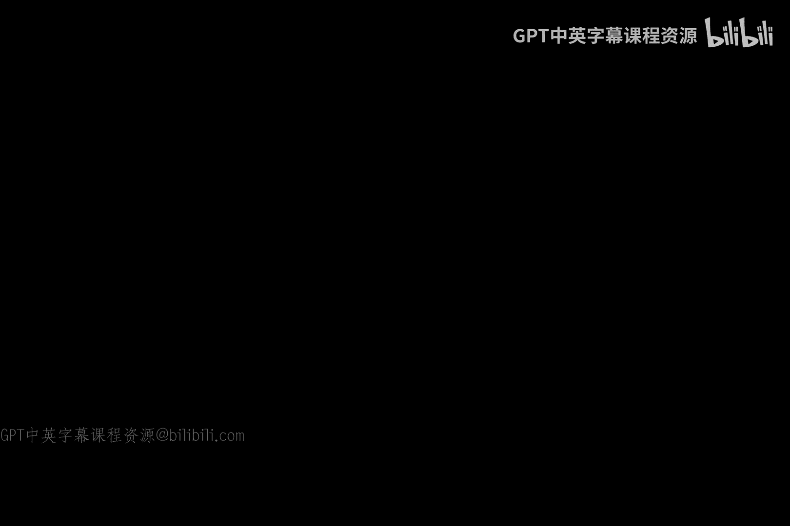
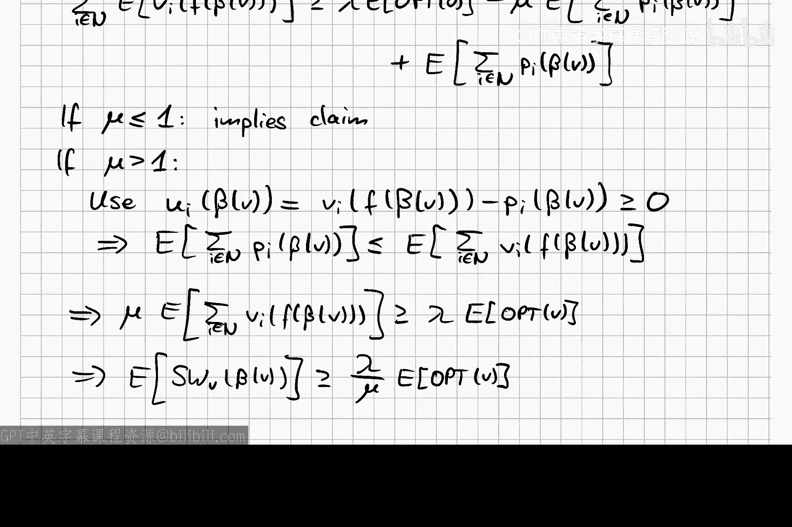

# 波恩大学《算法博弈论｜Algorithmic Game Theory, Winter 2020-21》中英字幕（claude-3.7-s p16 AGT, WS20_21_ Lecture 15 (Smooth Mechanisms).zh_en -BV1m9ZyYoENg_p16-

。Welcome back to algorithmrothic I theoryory。In the last lecture。

 we started discussing nontruful mechanisms like for example， the first price auction。

 we introduced the notion of a base Nsh equilibrium to。

Formerally specify how players might behave in such a setting where they don't know the other players valuations。

Today we'll generalize all of this a bit beyond first price auctions。

 but we'll also come again across the first price auction and kind of see again the entire argument of why the social welfare in a base natural equilibrium of a first price auction is still reasonably good。

Before we get started with this， let's quickly recap again the basic definitions of mechanism design so we'll have again。

 and players， bidders or agents， we have an outcome space and each player。😊。

Has a private valuation function， which maps outcomes to real numbers。嗯。And also。

We'll assume today that these real numbers are non negative。

 just like we were assuming this for for example， the first price auction anyways。Now的。Baders report。

Any sort of beds， we are not necessarily restricting ourselves to direct mechanisms now。

 so this might be just some arbitrary possible bits。W whichch are BI。

 this is the set of possible Bits for player I and B is just the Cartesian product of these。

 so this is the set of all bait profiles。A mechanism takes as input a bit profile maps it to。

An outcome， this is the use so called outcome rule。

 and we also have a payment rule which maps a bid profile to a vector of payments。

Here it is again important that those are non negative today。What we were。

Talking about then always was dominant strategy incentive of compatibility。

 this is something we're not doing today， we'll still have the notion of quasiline utility。

 so the utility of player I under B profile B when his or her evaluation is VI。

Then the utility will be VI of F of B， F of B， this is the outcome computed under Bit profile B。

 and from that we subtract the payment that this bidder has to make。As I was saying。

We're not discussing truthfulness today， we're rather considering the games that are。

Induced by such mechanisms。And then， for example， we might consider a na cali bit。

So what would that look like？Although we've seen this a couple of times now。

Maybe it's good to once again understand what this what a。

Pionatural equilibrium means in this context。So we'll be given。A fixed。Valuation profile。V。

And then a profile。As bids。B。Is it pure natural equilibrium？If。For every player。

 we have that the utility。问。Bidding B。Is at least the utility？When bidding BI prime。

For all possible BI prime。So in a similar way you could also generalize the notion of a mixed sash or equilibrium of a correlated equilibrium。

 or it's not even a generalization， it's just an application to the setting。The point is this is。

A complete information setting in the sense that this valuation。Profile is fixed。

Each player has their fixed valuation profile and now what we're looking at is APionna equilibrium and so this means the strategies may even depend on the exact same valuations of the other players。

Still what you could ask now is what is the price of anarchy。

 how good is such a Pionna equilibrium compared to the social optimum？And we can。

Define this also here。To make this more precise， we'll talk about social welfare。Of some。State sorry。

 not of some state， of some outcome。This will be。Taking the sum of all valuations of the respective players。

And then we can say opt of V， that would be the maximum social welfare。That we could see。And also。

We could write down the social welfare。Of a mechanism M。Under。Itsビ。This we would now write as。

Social welfare。the Subscript V。So I should also say that this depends on the valuation profile。

And then we would now write this down as take the sum over all players and。

See what the mechanism computes underbait profile B and then of course evaluate it regarding the actual valuations V。

You can also write this in a different way because we have the quasiline utilities。

You can also write this down as the sum of the utilities。Plus。This sum of the payments。

And now we can also define the price of anarchy。We'll do this exactly as before。

 so the price of anarchy for an equilibrium concept EQ。Would be。

Take the worst of these valuation profiles。Net take。The worst。😔，Of the Eria。

And compare the optimal welfare。That is possible with this valuation profile to the expected welfare and equilibrium。

And here again。EQ。A V， this is E。Seet。Of。Probability distributions。Of course now it depends on V。

 what is a。A pure natural equilibrium or a mixed natural equilibrium or whatever。

And this ratio will always be of course， at least one because the optimal social welfare。

Is of course， at least as good as whatever the mechanism can do。 it will be。Smaller。

For a purena equilibrium then it is， for example for a mixed natural equilibrium than it is for a correlated equilibrium than it is for a coar correlated equilibrium you can do exactly the same things here。

 one thing that makes this a little more difficult is that you also have always these valuations V floating around。

But for the time being here， we just say okay， they are just fixed。

 everybody knows the valuations and then this is just an induced game and this way it is like everything that we've seen up to this point。

What might be a little different is the definition of social welfare。

 so I might want to spend one more minute talking about this because why aren't we why are we also taking the sum of the payments as social welfare why is this part of our definition of social welfare because we understand that the mechanism designer is also participating or the mechanism is also a participant in this game so the money isn't actually lost it is okay also to if if for example the。

And the mechanism is getting a lot of money。This would all be for the full information setting。嗯。

But we can also do the same things now for incomplete information。For which we now have。

A great equilibrium concept namely the base Nash equilibrium。So for incomplete information。

Well now have that。Each valuation is drawn from a distribution DI。Independently。

These DI are public knowledge。But the VI， those are private。And for that， we now have。

The base na equilibrium， more precisely， it is a pure base na equilibrium。

I guess you might have an idea of what a mixed base natural equilibrium。Yes。

How you might define that。And will not cover this year， so a pure base natural equilibrium this is。A。

Profile。Bdding functions。Beta。Beta I maps from。VI to BI， some maps evaluation to a bed。

And now the property is that。活。哦。I。For all VI。Hello。BI prime。D。

Expected utility when we now draw the other playerss values。From the distributions。😔。

And now everybody's playing according to beta， this will be at least as much as if。We are。

Unilaterally deviating to。Be prime instead。And still this is all for a fixed value VI。

 so VI is fixed， we know our own value， but over the other values， we take the expectation。😊。

Also here we can now define the pre of anarchy。Just as we know that。

So the price of anarchy for base na equilibrium。How would you now define that？You wouldn now say。

 okay， this is the maximum over all distributions。D。The maximum over all beta。

That are base natural equilibrium。And then you take the expected。Social welfare of the optimum。

And you compare it to the expected。Social welfare at equilibrium。How do you do that？

So first let's first talk about this part here for a fixed。

Distribution or we I have a distribution for each of the players。

 we combine this in by writing D we now draw from each of the distribution ones and we take the optimal social welfare and what's the expected optimal social welfare that's the one question and what do we compare this to we compare this to the expected。

Social welfare。In our equilibrium， so draw from the distributions。デ？😊，And now take beta of v。

How big is your what are the players bidding and now you run the。

The mechanism I should also not forget to write here the subscript V because the social welfare。

 of course， is only defined for。Given any valuations because it depends on the valuation。

So this is the ratio of。For this particular equilibrium， how much welfare are we losing？

And compared to the expected optimal welfare， this is only comparing the two expectations。Then。

We take the worst of our equilibriumria by taking the maximum of these ratios。

 this ratio will always be at least one。And also， we take the worst of these distributions。

Which is like what we did for the full information setting where we said， okay。

 take the worst of these evaluation vectors。So once again what makes this complicated is that V is a random variable so optta V is also a random variable and what we are doing here is were comparing just the expectations you could also do something else。

😊，U。You could maybe take the expectation of the ratio， things like these。

 that's also something that you might want to try， but at least the techniques that we're seeing today do not succeed with this。

We've already seen that the price of anarchy for base National equilibrium。

A pm of a first prize auction is at most two。And what we've used is a very general technique。

 which we'll get to know today， namely that the first price option as a mechanism is smooth。

Before we come to the definition of a smooth mechanism。

 let's recap how we showed a price of anarchy bound for the first price auction。How did we do that？

We showed that。The utility。When you bid have your value。

The others are bidding something we don't actually care。Is at least have your value minus。

The maximum bed。Of anybody。And also。When you bid half your value。Then。

You will never get a negative utility because either you get the item。

 but then you're paying only half your value or you're not getting it。So this holds for。

All B and all V。And of course， all players。How does someone show that？

This followed by a simple case distinction because either you know outbidding。The maximum bit。

 then V over two will be at least the maximum bit。嗯。And then your utility will be your value。

 minus half your value， so then it will be this much or。

It might be that you're bidding below the maximum bit， then your utility will be zero。

And this is negative， so this is how you make these arguments。Good。

What does this give us in combination？So in combinationmination。For all B and for all V。And all B。

 we now have the following inequality。Take the sum of the utilities。

When everybody unilaterally deviates to have their value， the other bids remain unchanged。

Then this will be at least。The maximum of these utilities。And because all of them are not negative。

And we'll have half here V over two minus。The maximumim of all BI prime。Good。Now。

 what are these things？This year this is exactly equal to a half times optt a V。And this year。

 this is exactly equal to。The sum of the payments。😔，Under bid profile B。

Because in a first price auction， a first price auction is really simple in terms payments。😊，U。

Because that is just the payment that we're seeing here。The maximum of V over two。

 this is just half the maximum value。So what does this mean？For the press of anarchy。4 a。

Pionation equilibrium。B。Under。Valuations V。We now have that the social welfare。Is equal to。Yes。

 don't forget， it's the sum of the utilities。Plus， the sum of the payments。And this will be at least。

The sum of the utilities after each player is now unilaterally deviating。To have their value。

Plus the sum of the payments。And in combination with our inequality above。

 this shows that this is have。Optimum。Value。Good。😡。

Now this is exactly the kind of proof that we'll generalize now。

We will generalize precisely this inequality。Whenever this kind of an inequality is true。

Then we called the mechanism smooth。What does this look like？This is the smoothness framework。

For mechanisms， we've already seen smoothness of games。Which。Relates to this in a。Pretty clear way。

 although the notion of smooth games doesn't。Quite model what we want to do here because we we kind of have these mixed sign objectives where we because we are also subtracting and again。

 the payments。 So this is why people came up with this。😊。

Thefin which is more tailored to the mechanism setting。Which is now the following。

We'll have lamb and mu， which are now negative。And we now say that a mechanism。And。

Is Lambda coming U smooth？If。For all the。And。4。Or I。

 so for every valuation profile and for every bidder。There。Is。Some BI star。Such that。For all。Bids， B。

The falling homes。Take the sum of the utilities。Where each plane unilaterally deviates to their。

BI star， the other players。Don't do that。😮，And then this will be at least。Lambda times optta v。

Mineus mu。Times the sum of the payments under B。So what does this mean？This now means that。

For any valuation profile， we now have that。We can say。There is a safe bed。

YouI star for every player？With a falling property。Now for every bid B。

some of the utilities after these when each player is now deviating unilaterally。To be a star。

 to there。Safe beard。This is at least lambmbda times the optimal social welfare minus mu times the sum of the payments。

This。Could look。Familiar， because let's go back to the。

Second price to the first prize auction there we showed that。For all V and all B。

 the falling inequality holds VI over2 utility， when everybody deviates to VI over 2。

 this is at least a half times opt minus the sum of the payments。And this VI over two。

 this we can now call BI star。And if we call this B star。

 then this is exactly the kind of inequality that smoothness is asking us for。One important thing。

Also happening here， this V over 2， so this B star， this does not depend on B。

And this is also a little implicit in this definition that star B star may not depend on B。

Because this has to hold for every possible beat。So this is our first observation。A single item。

First price auction。Is。A half。Coma one， smooth。Bd， what about？Other mechanisms。

What about the second price auction， the second price in auction， indeed， is not smooth？

But there's another auction following which we might consider here， namely the all pay auction。

 what's the all pay auction？In the op auction， not only the winner pays his or her bid。

 but everybody does。This sounds spectacularly ugly because not everybody。

 regardless of how much they were bidding， has to pay。

 but it is still a reasonable auction format to understand and to compare to the first and second price auction。

 It is certainly not。🤢，Truthful， because if you know that for sure you won't win。

 then you definitely don't want to bid anything because you will only pay for this。

And what can we show for that？A single item。Or pay auction。Is。A half。Com on too smooth。

How would we show that？😮，What do we now have to show？We'll have to show that for every bidder。

 there is a good bid。And interestingly， ne。These。Dviation beds。Those may depend on。Theals。

And not only my own valuation， but the valuation of everybody。Around。

And this allows us to now define。The deviation bid BI star as follows。We let Jay。Be bitter。

With highest value。V呃VJ。And we now said。B I star to B。Vj。😔，Over two。4。😔，This bitter。

And for all other bidders， they are not bidding anything。And now consider。An arbitrary。

Bit profile be。What's not our claim？Our claim is that。UJ of Bj star going to be minus J。

This will be at least half is or her value minus two times。The maximum of all other bits。Why that？

What what can happen？So I'm not in this all pay auction and in this all pay auction。

I'mdding I'm not the bidder of value Vj， and I'm bidding half of this value。

What can happen either I win the item or I don't win it， regardless of whether I win the item or not。

 I'm always paying。Half my value。So the first case is。Bitter J。When's the item？In。

BJ star comma B minus J。What will then be the utility， then the utility？Will be exactly。

Equal to half。His value。And then。In the other case。What will happen？Well， then。The utility。

Will be equal to。Minus a half times Vj because this is how much。He or she is bidding。

 but they're not winning the art。But。The maximum。Of all other bids has to be at least half。长CVJ。

So this means if we。Combine this。And also then。The utility will be at least a half times Vj minus2 times the maximum。

beded。So this already shows。This bound here on the utility when so I'm the one with the highest value in the all pay auction。

 I'm bidding half my value， then my utility will be after this deviation will be at least this much。

U。Then。What happens for all other players？There we'll have that the utility after deviating to， okay。

 they're deviating to zero。By the way， I forgot to write down here。😔，Everywhere that this is。

 of course， depending on VJ。So。Now let's not make the same mistake again。第。Now bid something else。

 but they always bid zero， so they are getting no utility。We can even make this。

And at least to make sure that maybe they are even winning when they're paying nothing。

 even that could happen if everybody's bidding zero。

Definitely the utility of the ones who are bidding zero will be non negative。So if we combine this。

 then we're getting。That。Some of the utilities after deviating。After unilaterally deviating。

Will be at least a half。Times vj minus2 times。The maximum。Of all bids。And this is。At least。And have。

Times Vj。Minus2 times the sum。Of the payments。Here now in this all pay auction。

 suddenly the sum of the payments isn't equal to the maximum bit。

 but it's rather equal to the sum of the bits， so this is an inequality now。But other than that。

 it is what we've seen before。And so。We are getting。

And that this is equal to a half times optt minus2 times the sum of the payments。

So this concludes our proof。Once again， how did this proof work？We said， okay。

 the one with the highest value should be half this value。The others shouldn't bid anything。

And now we know that the one with the highest value can either will either have a height。

Utility after this deviation。Or we know that the sum of the payments before must have been big。

And for the other players。We don't use anything， they just say， okay， they say we are not bidding。

So usually bidding half your value is a good idea for all these smoothness proofs。

What we'll do next is we'll try to understand how this now implies a bound on the price of anarchy。

And you've already seen this。A bit shining through here。That。What will the argument be like。

 the argument will generally be like other whenever you bid your safe bid。your safe deviation bid。

 it other happens that you win and you have a high utility or before the sum of the payments must have been high。

 but if the sum of the payments must have been high。

This means something because this means that in the equilibrium。

 there has to be a high welfare because the sum of the payments is part of that。

So far we've seen the definition of a smooth mechanism and now we'll show that smoothness of a mechanism implies a bound on the price of anarchy and we'll first consider the case of only full information and more precisely we'll only talk about pure na equilibriumria to keep things really really simple then afterwards we'll talk about the more interesting part namely base na equilibriumria where things aren't quite as straightforward。

But let's start with these。Pureion ash equilibrium。What's the theorem？This， by the way， is。

By Shahans。And。Tardles。From。2013。So much younger than many other things that we've seen so far。If M。

So if a mechanism M is lamb La u smooth。And players have the possibility to withdraw from the mechanism。

Then。The price of anarchy for pure N Eib。Is at most。The maximum of mu and1。Divided。Why lamb。

How will we prove this？We will now just in any price of anarchy proof， we will now say， okay。

 consider a。Pioninaro equilibriumum。Now it is not beneficial for any player to deviate two。

 and then we use the fact that this is a smooth mechanism。

 so it is not beneficial to deviate to your safe deviation bid。

And then we just use the smoothness inequality。More precisely。Let be。Be a PNnaure equilibriumibum。

Then。U I of。BI comma b minus I comma V is at least U I F。BI prime comma B minus I comma VI。For all。I。

And all BI pro。In particular。This holds for。BI prime being equal to BI stars， a safe deviation bed。

Then what we're getting。Is that the sum of the utilities。When they are bidding B。

 the others are bidding B minus I。the value is V， this will be at least。The sum of the utilities。

Is they unilaterally。Deviate。And now for this， we can use the smoothness inequality。

 so this will be at least Lada times up to v minus mu times。This。At the PISB。

So what does this tell us for？第一。😔，Social welfare that we're seeing。

The social welfare will be at least Lada times opt of V。Minus mu。Times the sum of the payments。Plus。

 the sum of the payments。Good， now what happens？Now it can happen that mu is at most one。Then。

What we're seeing here。😔，Is at least lambda times up to v。

And this is exactly what we were looking for。Now there is also the option that muw。

Is greater than one， which was， for example， true for our。All pay auction in this we had mu being2。

Then we'll have to go through one more argument。Namely。

We have that Ui of b is equal to V of F of b minus pi of b。

AndThis will have to be zero because players can withdraw from the mechanism。In the。All pay auction。

 for example， they can withdraw by just bidding zero。So this then means that P of B is less than。

Or is it most？VI of F of B。I'm never paying more。In equilibrium， I'm never paying more than my value。

Or in other words， I always have negative utility。A non negative utility。Good。What does this tell me？

This tells me this gives me a bound on this here。In the。Inequality。So therefore thes sum。

And the VI of F of B， that's what I was having here is at least。Lambda times opt of v。Minus。

Or rather let's say plus 1 minus mu。Times。The sum of the VI F F of me。And this now tells me that。

Some of the VI of F of P。Will be at least lambda over mu times opttahi。And this proves also the。

The claim for this case。Great， so。How does this work， this works？Just as I was stating before。

 players don't want to deviate from what they're doing in the equilibrium， there is this。

Safe deviation bit which they could bid instead。That would't make them happier at the same time if they were bidding that。

We would have a lower bound for the utility。And then we just mess around with the inequalities and get where we want to go this。

 I hope looks very familiar to the smoothness price of anarchy bounds we got for smooth games。

Quite a while back。You could， in principle， also do this for mixed natural equilibriumlib correlated coarse correlated equilibriumliber。

 this would all look exactly the same。B。This won't look exactly the same when we're then moving to Bay National Colyia。

And base National equilibriumliber， this is actually the kind of a equilibriumliber that we want to now talk about because we don't want to assume that all players values。

 all players know all other values， but rather that they only had these p beliefs about them。

After having now seen how we can the price of anarchy for pure natra equilibrium via smoothness of a mechanism。

 we will now do the same thing but for base na equilibrium。

We've already seen one argument to bound the price of anarchy of a base natural equilibrium。

 namely for the first price auction。And for that first price auction， we showed that。

Deviating to half a value is actually never a bad idea and then we just。

Matched at the inequalities and everything worked out quite fine。

Now we'll show that actually everything that we need is smoothness of the mechanism。

Which just means that there is this deviation bed。And then it will be really important that these deviation bits don't depend on the other bits right now。

 but they only depend on the valuations。What makes things a little complicated is that the deviation bits may depend not only your deviation bit may not only depend on your own value。

 but also the other player' values。Don't forget that' something that we use to prove smoothness of the all pay auction。

 only the one with the highest value is deviating。To something non zero。

 so only that guy is bidding something， the others， they are bidding nothing。And。

This seems to be crucial， but this also seems to be weird if we are now talking about a base natural equilibrium。

How the hell am I supposed to do this， how the hell am I supposed to know if I now have the highest value or not？

Because if you now tell me whenever you have the highest value， then bit heavier value。

 whenever somebody else has a higher value than you do that， I cannot do this。

 I cannot do this in a base natural equilibrium。Just because I don't know the other player's values。

However。There is a really smart way around this， and this is what we will see now in the proof of this theorem。

So what's the theorem？If a mechanism M。Is lambmbda come you smooth。

And players have the possibility to withdraw from the mechanism。Then。The price of anarchy。

Baseds in na of Libia。Is umost。Maximum。mu and1。Divided by land。So as I was pointing out。

B star may depend on V。So we'll always write the exact dependence of V as B star of V。

Now the magic happens。Let vetil the。Be any valuation profile。If now。Beta I。

Is it based na equilibrium， then what we have the following？We'll have that the。Expected utility。

Why I not bed？According to。This space natural equilibrium， this will be at least as much。

As my utility。When I bid according to this deviation strategy， so this will be B star。诶。V I。

 I know my own value， but I don't know the other values。

 So let's just use V minuss utilityility instead。And of course， the other players still。Keep playing。

According to。bata。That's something that's a deviation I could make because。Okay， utility。

 that's just something that I've just invented。I couldn't ride at this point。

BI star of V because I don't know V， but I know this utility because that's just some valuation profile I invented。

O。This holds in particular， if I now draw V D。From the known probability distributions。So now。

Draw vitally。From。D1 through D N。Independently。And also。Take the expectation。

Over VI because so far this was true for every VI， so now we'll have the expectation over V and utility。

Of the utility。the base na equilibrium。OfPlayer I。This is at least。The utility if。

Better I deviates to。BI comm B I star of V I comma E minus utility。By the way。

 here I'm not taking the expectation of a utility， although this doesn't depend on utility。

 so I might or might not write the expectation of a utility because it doesn't matter utility doesn't even show up in there。

Good。And now we really come to the magic。Because。What was the thing about utility player I was not just？

Saying， okay， Im。Certainly。Not gaining anything by the falling thought experiment。

 I now draw this utilitytity。And this utility and then I。Take my BI of VI come of utility。Bt。

The way this utility was drawn was exactly from the same distributions that are known。

So what we might also do is we might say。Swap now V and re。These are more precisely swap。

V minus I Tilde with v minus I。Because those are identically distributed random variables。

And this is still mysterious，Let's first write this down because and V minus I and v minus utility are identically distributed。

What are we getting for the right hand side here of this inequality？The utility。W Inaed BI star。

VI come a v minus itity。The others are bidding according to V。And my value is VI。This is。

Exactly the same as。When in a swamp？V minus I and v minus Iil。So I'll get your BI star of。Z。

B minus I of utility， note that。B minus I of V。It does not depend on behind。

Because that's only the other player bids and they don't know our value。And now we are here。

And this is something that actually is interesting because now we are suddenly doing the。

Good bid against these valuation profiles， but are。

The other players are now suddenly stupid because they are bidding according to if their valuations were utility。

 although they are actually V。Okay， but we are not doing the right thing。

 they are doing something weird。But。Now we can combine these and this we can actually apply。

The smoothness inequality。So more precisely， we now have the following。We now have that。

Price smoothness。Some of all U I earth。😔，B I star。😔，V comm a beta minus I of futility。Com a VI？

This will be at least Lambda times optt。V minus mu。Times the sum of the payments。

And this holds also if we take the bid profile。Be of utilityility。if we now combine these things。

 if we now combine this this year。With this， we can use linearity of expectation。

So what we'll be getting is that。Some of all。These expectations。You I。Yeah， a star of Vma。

Beta minus I of futility。Come a VI？This will be。At least lambda times the expectation。Of opt。A V。

Minus new。Timemes。😔，The expectation。诶。The sum of the payments。😔，If bidders bid according to beta。

 but the valuations are vital。Mh。And now。This is something that we've already seen because this is something that we can compare to the expected utility。

Of bitter eye， so this is at least the expected utility of bitter eye in the equilibrium where this was coming from。

😊，Here。This is now。The expected some of the payments a the bidders are bidding according to beta。

 but their true values are vital。But nothing is holding us from reversing back。And swapping again。

 V and utility。Because they are still identically distributed。So this year。

Is nothing but the expected。Some of the payments。When bidders are bleeding according to beta and the true values are V。

So if we now combine all of this。We'll have that。The sun。Of the expected utilities。

When everybody's bidding according to beta。True values R v。

 this is at least lambda times the expected。Optimum of V。Minus mu times the expected。

Some of the payments。😔，And somehow miraculously。All this utilityity vanished again。

Because here utility never actually occurred here utility， we saw， okay， we can again swap2 V。

All that we're getting from here is now the following statement the sum of the expected utilities is at least Lada times the expected optimum minus mu times the expected sum of the payments。

😊，And this is exactly the kind of inequality we had before。In a pure national equilibrium。

 although theyre without these expectations， but there we had the sum of the utilities。

 at least Lambna times optt minus mu times the sum of the payments。In the equilibrium。

There it is really straightforward to get this inequality here。

 it was a lot of work and somehow mysterious， but from this point onward。

 we can work exactly like we did for a。😊，Pionnaia equilibrium。How so。We are getting。That the sum。

The expected。Values that the bidders have when they bid according。To。The equilibrium。

 this will be at least Lada times the expected optimal social welfare。Minus mu times the expected。

Some of the payments。Plus。Again。Expected some of the payments。

We're using linearity of expectation here so often。Sometimes forget to even mention this。

 so this was also again due to linearity of expectation。Good。And where are we now？

If mu is less than one。Or at most one。This implies the claim。And what if mu is？😔，Bigger than one。

Then again， use。That Ui of beta of V。😔，Will be at least。VI F。Sorry， this is equal to。V I F。

 F of beta of V。Minus。PI of beta of V， but we assume that this is not negative。

Because plays can withdraw from the mechanism， so this again means that。第一。

Expected some of the payments。Is。At most。第一。Expected value。That we have。And if we know。

Move all of this together， then we see。Okay， mu。Times the。Expected。Some of the values。

Is at least lambmbda terms the expectation of opt。And this means exactly。

What we were claiming that the expected social welfare。F。B的。

Is at least lambda over mu times the expectation of opt。F me。

And we are done。So。The things you should always keep in mind。

Are actually two main insights the one thing was。How would you do this in this full information setting。

 how would you follow this proof in the full information setting there it's actually quite straightforward because bidders cannot。

Benefit from unilateral deviation to what we said， their safe deviation bits are。

And then there was the magic happening in this proof where somehow the bitter was。

Could hallucinate the other bidder's values and somehow。

By linearity of expectation and because they were identically distributed， we could swap all of this。

This is a magic trick。It does appear frequently and therefore I'm happy to have already shown this right here。

 I guess we'll see this again， later， again this semester。Then the point was after this swap。

 suddenly the situation was。I am the one who's actually bidding the correct way。

 you are somehow hallucinating everything， you don't actually even see your true values。

 you are hallucinating your values and bidding according to these。B。

In this inequality and that maybe。A little confusing at first sight。

 yeah we are not talking about the other bids。Here we are only saying， okay。

 the other bidders might now bid according to their hallucination。

 but when we then apply there for them the utility bound， of course we don't。

Pretend they are hallucinating， but the others， it is always the others who are hallucinating and this is somehow due to a linearity of expectation because we can bound each of these or we can see the equality for each eye separately and also because。

😊，嗯。V minus I was independent of VI and also minus Iilde was independent of both VI and V Tilde。

And this is somehow something that you might have to digest a little more。嗯。

Feel free to go over the proof once or twice again and see how things actually work out。

But eventually the important thing is that we have to do this in one way or another， for example。

 for the all pay auction， so now we also have a price of anarchy bound for the all pay auction of。

What is it actually？Our lambda was a half。 Our mu was2， so。

We'll have a price anarchy bound of four for the all pay auction。

Next time we'll continue with this and fortunately then we don't even have to talk about basena caliber anymore because we have this theorem。

And this theorem is everything that we need。In order to then bound a price of anarchy。

 all we have to do is show smoothness。And all this smoothness。

 that is not talking about these probability distributions。It's not talking about strategic behavior。

 it is just showing some property of the mechanism。

And this is really good because it allows us to actually separate the argument into two very disjoint parts and if you now wanted to show a price of anarchy bound。

 probably you should show smoothness and the same thing。

 by the way also holds for smooth games that you also want to do the same thing。

And then the rest somebody else does for you。This then holds for every possible equilibrium concepts you might imagine。

 or maybe not。Then maybe you'll have to have a closer look at what kind of smoothness you're showing。

But general rule of thumb is to pro a price of anarchy bound。

 the first thing that you should try is you should try to prove smoothness。Once again。

 if you have any questions。Please do reach out to me。And。I'm looking forward to the next time。

 stay safe until then bye。