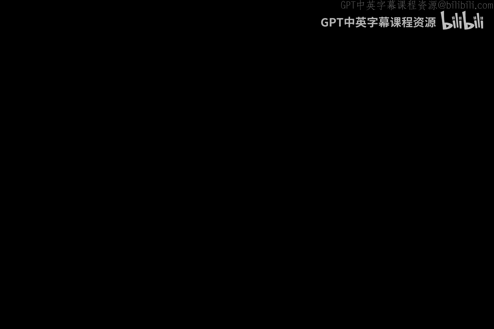
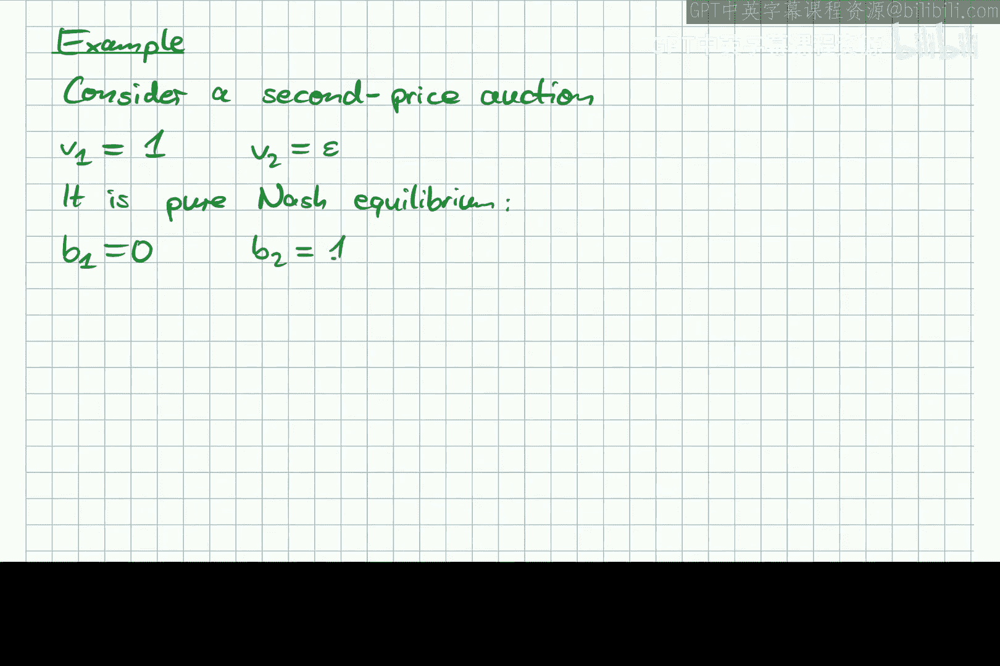

# 波恩大学《算法博弈论｜Algorithmic Game Theory, Winter 2020-21》中英字幕（claude-3.7-s p17 AGT, WS20_21_ Lecture 16 (Simple Combinatorial Auctions).zh_en -BV1m9ZyYoENg_p17-

Welcome back Triormic Game，In the last lectures we've introduced the notion of a base natural equilibrium and also the notion of a smooth mechanism。

 all this was to analyze non truthful mechanisms。Today， we are going。

Welcome back to Arithmic Game theoryory。In the last lectures。

 we introduced some tools to understand non truthful mechanisms。

 namely we introduced base natural equilibrium。We introduced smoothness of mechanisms。

And always was about understanding what happens if a mechanism is not truthful。

 so it's not in the bidder's best interest to just report the true value。

Maybe it's even impossible to report your true value。

What can we then still say about the outcome of such a mechanism？

Today we will be a little more specific about the application namely will consider combinatorial auctions。

And for communal auctions， we see。Two different mechanisms for which we will then。

 in both cases be able to show that they are smooth and by the result from the last lecture。

 this immediately implies a price a bound on the price of anarchy for base natural equilibrium。

 but also for other equilibrium concepts。Before we get there。

 let's first recap all these definitions， so we are considering a combatural auctions。

 which means we have n bidders or players， which we'll call capital N。

 so this they will be numbered1 through n， and we have M items， capital M1 through M。

Each of the bidders now has a private valuation function。

 which maps subsets of the items to non negative reals。I realized that I'm always dropping the。

Our convention that we're following all the time， namely that this is a monotone function。

 getting more items will never hurt you， and also that getting no items you'll have a zero value。

So this is all implicit in whatever were doing regarding income and auctions。

Now we are trying to find a mechanism， which is a pair of an outcome rule and a payment rule。

 both take as their input， a bid profile。And then the outcome rule determines an outcome which means an assignment of the items to the bidders in the case of a comm auction。

 and the payment rule defines how much the bidders will have to pay。And also this time。

 we are still assuming that the bidders will always pay something non negative。But as you see here。

 these mechanisms are not necessarily direct mechanisms because these bid profiles。

 those or the respective bids， those are not necessarily valuation functions and as it turns out our first mechanism today will be an indirect mechanism。

 the second mechanism that we will be studying today will be a direct mechanism。

And then what was it that made a mechanism smooth？We call the mechanism Ladaum use smooth if the following holds。

Take any vector of valuations， so evaluation profile。And take now any player。

Then there has to be a safe deviation bit for this player。Which now fulfills the following。

For any bid profile， B。We have that this inequality is fulfilled， take this sum over all bidders。

 what is this bidder's utility when this bidder is unilaterally now bidding B star。

 whereas the others are bidding B minus I。This should be at least Lambda times the optimal social welfare minus mu times the sum of the payments under B。

And this implies that the price of anarchy。For base natural ca， for cose correlated equilibrium。

 for correlated equilibrium， for mixed natural ca for pure natural ca。

Is always bounded by the maximum of mu and one divided by lambda。

So all we are doing today is just proving smoothness of mechanisms。

And this is then as the immediate consequence that we are also bounding the price of anarchy。

Using the proofs from last time。Good。😡，So the first mechanism I'd like to talk about is Iting。Namely。

 what will we be doing， we will now be selling each item in a commun auction separately。And we asked。

How good is this， So the one way you can think about this is kind of a。Parael eBay auctions。

 maybe you just want to buy one phone， but you cannot actually tell eBay that you only want one phone if you buy all of these auctions。

 if you win all of the auctions， then you're buying suddenly multiple phones。And。

This is why this is a non truthful mechanism because you cannot even reveal your true preferences。

 so this is an indirect mechanism。The， the bids that you're posting。

Those aren't actually your true valuations。Let's see how we could。Design this。

And how we could express this more。foly。So what is item bidding。

We are actually just selling each item in a separate。First， a second price auction。

You we not doing this in first price auction just because it's easier。So what will this look like？

Each bitter eye。Reports。A bid。BIj。For every。😔，Item。And then。Each item。Is allocated。2。The bitter。

With it。Highest。BIJ。And。Or bids。Pay the sum。Of there。Respective。Winning bits。

So if it so happens that you know win 10 items， then you also pay for all these 1 items and you pay your bids。

Good， so this is not a truthful mechanism for many reasons， it is easy， but it is not truthful。

Why that， well， first of all， we have this weird payment rule。

 which even for a single item would be a first price auction， which we know is not truthful。

But other than that， also this way of bidding。This cannot be truthful because you cannot tell the mechanism what you really want。

You do not report your true validation functions， but all you can do is you can bid on a single item。

Or not on a single item， but you can bid on all items， and then you might also win multiple items。

And。The kind of valuation functions we now want to analyze this with are unit demand functions。

 which I hope you remember in which you actually only want one item。So recall how they are defined。

We'll have unit demand valuations。Which are。Which means that VI of S I is the maximum of all J and S I V I comma J。

4。VR J being just non negative numbers。For example。All these VRj might be equal to one。

 then you don't care which item you're getting。You always have a value of one when you get at least one item。

 but even if you get 10 items， your value will still be one。And this feels that。

With this auction format。Doesn't mix quite well because in this auction format。

 you cannot actually express this。And this option format， you say， okay。

If I bid something on this item and on this item and on this item。

 and it might have happened that just I'm winning all of them。And I couldn't just say， okay。

Believe me， I only wanted one of them。Good。😡，But does this still give us a good mechanism， yes。

 it does in a way that this is still a smooth mechanism。

 and this way we get a bound on the price of anarchy。For unit demand Vals。爱陈别丁。

With first price payments。Is。A half。Coma1， smooth。So this means we get a price of anarchy of at most two。

And this holds for based National Collib horse correlatedliba correlated Eibia mixed National Coia and National Coibya。

All at the same time。We don't have to prove this for every single equilibrium concept。

 but we only have to prove smoothness。Good， how do we prove this。

Maybe let's first recall what the smoothness definition wanted from us。Okay， it wants lambda mu。

 we know have lambda mu lambda is a half mu is one in our case。And now for every valuation profile。

 the valuation profile will be fixed， well now have to define for each bit this bid B star。

Which has this property that the sum of the utilities， when this bidder bits B star。

 the other bidders keep bidding。嗯。This is at least lambmbda times the optimal social welfare minus mu times the sum of the payments。

And in our case now this looks as follows。Consider the welfare maximizing allocation。On the。And let。

Zi。Be the item。Assigned。To bitter eyes。Without loss of generality， of course。

 they are getting only a single item。And we let。B J， I， J subscribescript， I。Be 0 if I does not get。

any item。Good。Now， how do we define the deviation bit from this？

Maybe you should recall how we did this for the case of the all pay auction。好 did。Players bid there。

 What was our choice of a safe bed there， we said， okay。

 the one who's supposed to win the item should bid。The constant times。

 their value and the ones who are not supposed to get the item should be bid anything。

 And this is exactly the kind of a rule that we are again。Using namely。We now define。B I J to B。V Ij。

😔，Over two。If J is equal to JI and0， otherwise。Which means？Every bidder is now bidding。

 have their value only on the item that they're getting in the optimal solution and nothing on any other item。

You should observe that this immediately makes sure that you're not getting more than one item。

ItMight not be happy that you're getting no item or that you're getting the item that you're supposed to get in the optimal solution。

And this is exactly why this now works out。What do we now have？We now have that。😔，第一。Utility。

When bitter eye deviates to。BI star， the others keep bi b minus I and the values is V this can be。

Okay， either I get my item。And when will this be， this will be a。啲。Maximum other bit。Is。A smaller。

Then。What I'm bedding。Or。My utility will be0。If I'm not getting this， the item。

And what you can see here is。That regardless of what is happening now。

This will be at least V over two。minus。The maximum。B I Prime comma J I。Good。

Now we can also include in this maximum here。😔，Beittter I that can only increase the maximum。

Now take the sum over all bidders。What is it that we're getting？Well， we are getting。

If I got this subscript I for the J here。😔，We are getting the sum of all these。E I come a J I。

Over 2 minus7。Of all these maximum。Now， how much is this。We are taking the sum overall all bidders。

And then we take the value they have for the item that they're getting in the optimal solution divided by two。

So this will be exactly a half times the optimal social welfare。And what do we know about this party？

Here we are taking the sum over all bidders。And then。

We ask this item that this bidder is getting in the optimal solution， what's the maximum bed on this？

And instead of staying this in this super complicated way， who might as well say。

What's the sum of all maximum bits？So。Technically， this is。Can also be。嗯。

This could also be a little different， because。Not every item needs to be allocated in the optimal solution。

 but it is clearly upper bounded by the maximum。By the sum of the maxa of all。Bs。

And this is nothing but the sum of the payments in our mechanism。So overall。

 this will be at least a half times the optimum。Optimal social welfare minus the payments。

 and this is exactly what smoothness requires from us。Excellent。

 so we already have our first simple mechanism for communatatorial auctions for unit demand communatorial auction。

 we now see that while this first price item bidding。

 you can actually you will have a price of anarchy of at most two。What we'll do next is we'll。

Have another look at these greedy mechanisms， which we saw earlier， which will be truthful。

if we use these。Threshold payments。And in a single parameter setting。

 now we are not considering them in a single parameter setting。

 we are not using these threshold payments either but rather first price payments。

 and then we will again show truth not truthfulness but smoothness。

Now I'd like to turn our attention to a greedy mechanism， which is indeed a direct mechanism。

 so bidders can actually report their true values。Although they won't want to， because。

One reason being that we are using first price payments， so what does this mechanism look like？

It's a bidders report。Functions。BI B。mapping from the power set to the non of all items to the non negative reels。

And our mechanism is now。First thing is to collect the bids。Then。Will sword pairs I come ass。Bye。😔。

Non increasing score。B， I F S， divided by the square root of。This size of S。And then。

Go through this sorted list。And。His sign。S。To I， unless。

The player has already been allocated a bundle。W。one or more of the items have already been allocated。

And finally。We'll let P of B be the bid then。Bitter I had on the set S， where S is。This set of items。

Allocated。To bitter。Aye。So you might remember the greedy by value algorithm mechanism or greedy by square root value density。

 I mean that worked more or less the same way except for the fact that well there bidders were singlemined。

 so we actually only had to order the bidders now well have these pairs of bidders and sets that we might give them and we now order them by this non-increasing score。

 how much are bidding divided by the square root of the size of the set。

And we'll go through this sorted set of。Of pairs。 And will。Turn this into an allocation unless。

The Spter has already received something before or one of the items we have already allocated。

And then， we just。Don't do this in a super smart way this time， we just say that， okay。

 you are just paying whatever you bid on this set that you're winning。We already know that。

This algorithm we couldn't actually implement truthfully because even if we had no。嗯。Unit man。

 then this would be actually the Gy algorithm。That just gives an item to the one who paid most and then continues。

Like this， so while there is still。A bidder who has not received anything and an item that is left。

 take whatever match。Gives you the highest。GreyGreedy increase。

And we know that this could be implemented truthfully， but we're not even trial here。

 We're not doing even doing this even in a very smart way。 we're just saying， okay， just。

B just pay what you're bidding on this set。 So certainly， even if you are only a single item。

 this will not be truthful mechanism because it will just be the first price auction， nonetheless。

We can show that this is actually a smooth mechanism。Namely， this is a half kma。Square root。

2 m smooth。Good。How do we prove such a theorem？What do we have to do again， We again have to say。

 okay， there are。Good deviation beds， what might those be？

How did we do this last time we considered the。Social welfare optimum and then this social welfare optimum led us to a good bid。

And we'll do exactly the same thing here again。So what we'll do is we'll let。X 1 star to X， N star。

Be an allocation。That maximizes。搜索 wfi。In other words。Optt is v。Will be equal。2。

S of the V i F X i star。And what will our。Dviation beds now be。B， I star。

We let it be the following function。B， I star F。S should be。V I。Of Xi star divided by 2。

If S is a superet of X star and0 otherwise。So what we're doing here actually is were defining single minded beds。

We just let this this。Safe deviation bid， we again let be something that okay。

 try to buy what you're getting in the optimal solution。

And now this means this will be actually a single minded bid。

 just bid on the set of items that you're getting in the optimal solution and nothing anywhere else。

And this is expressed by exactly this bit。And to make it monotone。

 we are not exactly bidding only on the item that you're getting in the optimal solution。

 but also on every super set。That。Is actually something that you might be arguing here whether or not you want this。

But once again， the structure is again。Bit on the set of items that you're getting in the optimal solution。

And then we will now have to see。How much will your utility be before this was somehow easy because we could say。

 okay， I'm bidding just on that single item that I'm getting in the optimal solution。

Then either I'm getting it or somebody else is bidding on exactly this item。 Now， here。

 things are more complicated because。It's not that bidders。

 other bidders are bidding than on exactly this set of items， but only more。

 but they might be just bidding on other items and items that are contained in here。

In the set of items that we want， and that's why we are not getting it。But nonetheless。

We can again see what will happen and we can write actually the utility that we're getting in a very similar way that we did this before。

We let。To I。Of S comm a B minus I。Be the smallest bid。Such that。Beter I。Winds。Set s。Against。

B minus I。This we might call the。Critical bit。And then we can now say， okay。If。My value。😔，Is。

More than this critical bit。So my value divided by 2。Then。bititter eye。Winds。Excei star。In。B。

 I star comma， B minus I。And what we'll have is that the utility。With B star。

 the others are bidding B minus I。My value is V i this will be。Equal to。My value for that set。

Divided。My value for that set。Minus。My value for that set divided by two。

 so my value for that set divided by2。Or。If this is not true。Then。We certainly know。

That your utility will still be non negative and。It will still be， at least。Have your value。

For that set X star minus。The critical bit。And that should be the critical bit， of course。

For the set。X。I star。O。So。What we're getting is that if you're going to take the sum over bidders。

Bitter eye is always deviating to be I star， the others keep playing， then this will be at least。

The sum over all bitterders。V are of X I star divided by2 minus the sum of these critical bits。

This first thing here， we again see， okay， this is it。Equal to half the optimal social welfare。

But what we have to still understand is。How big is that。

What do we know about the sum of the critical bits？What we'll do is。😮，We'll bound this some here。Bye。

About this。By two square。2 m times。The sum of the birdss。For the outcome of our mechanism。

And this year， the sum of the bids for the outcome of our mechanism， this is exactly。

The sum of the payments。😔，And if we have shown this。

 then what you see is that this inequality will be exactly smoothness。So all that remains。

Is actually showing this。Inequality here。So let's write this down as a separate lamma。

We'll fix some bids。And we know that。FB。Be the allocation of the greedy mechanism。And we let。X star。

Be another feasible allocation。Actually， X star is our social welfare max allocation。

 but that's something we don't actually too much care about now because。

All we're using that is that this is indeed a feasible allocation。

 then the following holds the sum the critical payments， critical bids。Is at most。

Square root2 m times。the sum of the b i of f i of b，O。Let's understand this。We have here。For every。

别驴。I， we ask， how much would you have to bid on the set Xi star in order to win it when the others are bidding be minus I？

And then we sum this all up。And on the right hand side， we have some factor。And this term here。

 what's this term， this is just something that we can call or have also called before the declared welfare。

 namely how much is valuation B。Or how much are the claim valuations in B telling that the outcome that is computed under B is worth？

What's interesting about this lemma is that the true valuations actually don't appear at all in here。

 this is only about the bits。Recall that originally our B star was the social welfare maximizing allocation under Val profile V。

But that's something we don't care about at all when we're stating thelema。

 x star is just some allocation。And we now want to say， okay， for any allocation。

 the sum of the critical bids。To kind of unilaterally enforce this allocation， always one player。

Enfors the allocation， while the other players are just doing the same that they were doing before。

 the sum of these critical bits is bounded。And here we are now using the property that we actually use a greedy algorithm and not just some arbitrary algorithm。

How do we do this？We let。Apsilon be greater than zero， but it's tiny。And now。For all I。Red。B， a star。

Be the following function。B， I star of S should be。The critical bit。

For the set X I star be minus I minus epsilon。If S is a superet of Xile star and0 otherwise。

What's that。What's this， what does this mean？Well， there is now this critical bid that this is how much you would have to bidt on the set Xi star in order to win it。

Or you would maybe it's the infam because there's these tie breaking things but。嗯。

When you're bidding less than this， then certainly you're not getting the set Xi star。

When you're bidding less。So and by this I mean just some epsilon less then you're certainly not getting this that Xi star。

Good， so when you're bidding this much， you'll end up worth the empty set。And now。Will'll make。

We'll define one more function， namely bi prime of S。This will be the maximum。

F B of S and B I star of S。What is not happening？Here I was arguing you're not getting anything。

You now， you're actually bidding。B IFS。Just as before。And then sometimes he also maybe a bit more。

Bert， you're bidding them this much。But this is never enough。Bidding be， I star。

As I was arguing before， never got you anything。So that's still true here， even here。

And this will be something that will be proving more formally。When you're bidding BI prime。

 then you're still getting the same thing as when you're bidding BI。

 although you're somewhere bidding maybe more on the said Xi star， maybe a bidding more。

But you're not getting more because you're bidding below the critical bit。

So the point is that even if youre bidner you're a prime， nothing actually changes。

So what we have formally。Is that。F of B will be equal to F。As the prime。Why that？😮。

Because of the falling argument。Suppose。F of B is not equal to F。F B prime。Then。There has to be。

App pair。I come an S。Such that。嗯。I can ass。Is allocated。By the greedy algorithm。

On the greedy mechanism。On be prime， but not。On毕。And we consider the first one of these。

Then why could this only happen？This can only be happening because。I'm bidding now， not B of S。

 but B star of S on this item。And by this， I mean the first one of these。

In the ordered list to be very precise。So it has to be。BI prime of S isn't equal to B of S。

 which means that B I prime of S is equal to the critical bid。For set S。Under bid profile B minus i。

But because this is the first one and this is minus epsilon。Because this is the first pair。

The execution so far。Was identical。To the one。关闭。And what do I know about getting set S？In。Bi。

Will I will bitter I get set S when everybody's bidding B with a bit of tau I of S comm a B minus I minus epsilon。

No， because you have to bid at least this taui of S I comm be minus I。

When you're bidding against B to get the set S。So this means that you cannot be getting the set S。

So this leads to a contradiction because everything that was happening so far was actually what was also happening on B。

 but we know that on B with this bid， you're not getting this set。

So this means nothing can actually change。One thing that is important at this point is that we are actually using a greedy algorithm。

A bidder who's getting something will be excluded after this point。Also。

 these debates on certain sets， we don't care about unless we see them for the first time。

And this is a property called loser independence。 So everything that we don't see happening around other than what we're actually currently allocating。

 this doesn't matter。 and this is。Maybe a little implicit in this proof。

And this is using this greedy property that we are now considering the first one in this ordered list and everything that happened so far。

Was the same and also didn't include bitter eye。Bitter eyes beds haven't been。Looked at so far。

And we can easily change them， nothing changes。嗯。And this is why。We get now that here。

F F of b is equal to F of b prime once again this wouldn't be true for more complicated algorithms which are not as simple as this greedy algorithm。

For example， if you maximize social welfare or declare social welfare。

 then you cannot do these tricks。Good， now what do we have？We now constructed this B prime。

Bed profile。With a property that on B prime， actually the same is happening as on B。This was。

This is written here in a very fancy way or not very fancy way， but in。Somewhat fancy way。Now。

 what else do we know？We also know that。If B of S is not equal to B of S prime。Then。bitter eye。

Does not。B I prime of S， then bitter I does not receive。Set。S， this is exactly the statement or a。

The kind of argument that we were doing just before because。If。比亚。Is not equal to B of S prime then。

You're bidding below the critical bed， and so you're not getting the eye。You're not getting this set。

What does this mean？😮，The point is now that the declared welfare。That we're getting with B is。Well。

 we're seeing the same allocation as with B prime and also。This outside function。

 we can also change to be prime because。Also there， this doesn't make a difference。

How does this help us。Maybe let's go back to what we wanted to show。

This was ourlemma that we wanted to show， and we wanted to show that the sum of the critical bids is at most some factor。

At times， the declared welfare on valuation profile。B。

But now we know that this declared welfare on valuation profile B or on B profile B。

 this is just the same。As。What's happening on B prime？

And then what we'll now do is we'll see what does this be prime， what's happening on this B prime。

In more detail。The mechanism。Computes。A square root M approximation。阿的。Optimal。Declared。Welfare。

We've seen this for this mechanism for the special case of。

Sing minor bits there we had even a guarantee of square root M now。

By just the same kind of techniques， you will see that you're getting a square root two times M approximation of the optimal declared welfare here。

What does that mean？This means that。The declared welfare that we're getting。

Will be at least a one over。Square root2 m fraction。阿迪。Declared welfare on any other allocation。

 so in particular， this X star allocation that we wanted to talk about。B I prime of Xi star。Well。

 what was that。That was the maximum of。B， I， F， X， I star。And。The critical bit。4 X star。Mhm， so。

 of course。We can just ignore this maximum and say， okay。

 this will be at least the sum of these critical bits。And so， this sum here。We just。

Move out this minus epsilon， then we get minus n times epsilon。Get。😡，What does this mean in total？

We now have that。This year is actually the right hand side of what we wanted to bound， and this year。

 this turns out to be the left hand side of what we wanted to。Of our inequality。

And so we are actually。Kind of done here， so let's combine all of this。We now have that。

The sum of all these critical bits。Is。At most。This。

Some of these BR prime times of Xi star plus n times absolutepsilon。This sum， as we see， will be。

At most。quaSqua root of two times m。Times。😔，The declared welfare。嗯。Be prime。And this， as we've seen。

 is exactly equal to the declared welfare。😔，关闭。And this holds。For all。Absilon greater than zero。

So in particular。Make Epsilon as small as you like。 you will always see。

That our statement here is true。And。Let's go back。To our lemma this year。This is exactly the。

The inequality that we wanted to show and if we just。If it were not correct。

 then there would be an epsilon for which this inequality does not hold， so this proves our claim。

Now let's come back。Here。😔，We've now shown that this inequality is actually true。

And so we've shown that this was actually why we were doing this。

 we wanted to show that for these deviation bits。some of the utilities when now one player is unilaterally deviating。

 is at most。I at least。Half times the optimal social welfare。Minus， and then we get， okay。

 we had this year as the proxy， the sum of the critical bits， and then we could。

Now we have seen that this is at most this factors where 2M。Times the sum of the payments。Under B。

 So this proves our claim。Good， so。One interesting thing about this is that。

We did not actually use the precise way that this algorithm works。

 but only that it is a greedy algorithm。And indeed。This is a。

 this is the way the original paper states this result that whenever you have a greedy algorithm for。

 well， greedy you have to specify what you actually mean by greedy then then you can always do this argument and what you effectively getting is that always hear you're getting just the approximation factor of the greedy algorithm。

 And so if you take this greedy algorithm， combine it with some。Payment rule。

 which is like first price payments。 So you just pay your bid then。

This will become a smooth mechanism with a price of anarchy。

 which is then bounded by a constant times the approximation factor of the algorithm。

Now the one question that you might not have is why is it that we are considering only first price payments here。

 wouldnn't it be much nicer to do this with？Kind of second price payments。Yes。

 that is indeed something very reasonable and something that people have studied。

And this is true for both this greedy mechanism as well as for our item bidding that we were considering in the first part of this lecture。

But there's one big problem about。A。About second price auctions。 Let's see this。Namely。

Consider a second price auction。Our first bidder might have a value of one。

 the second bidder might have a value of epsilon。Now， it is indeed a。Pionasal equilibrium。I。

The first bitterder bits nothing， and the second bitterder bits。For example， one。

Because why is this a purenatal equilibrium？Here。Why wouldn't you want to deviate。

 Let's first consider the first bidder。 The first bidder wouldn't want to deviate because they would have to bid at least one to win the item。

 but that means no utility The second bidder。It's also happy because they're paying nothing。

Although they're being bidding this match。This is still a pionnatal equilibrium。

 everybody's happy with their choices。So truthful bidding is a pure natural gl。

 but it is certainly not the only one， as we can see here。

And what we also see is that the price of anarchy is huge。

The price of anarchy is like one over Epsilon where Epsilon we can make as small as possible as we like。

Good。So。What's。What can you still do？When you now want to understand， for example。

 item bidding were they first with second price payments。You'll have to avoid situations like these。

 where Simbitder is drastically overbidding。Because why would you want to do that。

 there's actually no point in instead of bidding your true value。

 you bid way more than your true value。This is actually a dominated strategy， it would be。

 it is never worse to bid your true value。And similar effects you should also then exploit in you for example。

 item bidding or such greedy mechanisms with more kind of second price payments that。

There might be really bad strategies for which。In which players are overbidding drastically。

 like in this case。But there's actually no real point of any play any time choosing such a strategy。

And if you then make the assumption that players are not overbidding。

ever this may look in your exact details， so here you just don't it more than your value。

 then suddenly you can again do these very nice price of anarchy arguments。

 but that's the point why we did not consider these second price options today but only the first price variants for which we could still show。

The show good price of anarchy guarantees if you have such an over bidding assumption。

 then you can do the same thing also for second price payments。If you're interested in that。

 please have a look at the references that you'll find in the lecture notes。

Where in all these papers， it is done for both the first and the second price perspective。Good， so。

It's time to conclude this overall discussion of nontruthful mechanisms at this point。

 I hope you've seen that there is a way you can also argue about mechanisms which are non-truthful and the reason why it is important for me to include this in this class is because it maybe makes you more appreciate all this truthfulness。

Because suddenly you realize， okay， truthfulness isn't actually a feature that is nice to have。

 but it makes it much easier to talk about the outcomes of strategic behavior because。😊。

It is just very natural to assume that every player is just reporting their true valuations and。

If we just maximize declared welfare， we are at the same time also maximizing the actual social welfare。

If you have any questions。Please reach out to me。And stay safe。Bye。

