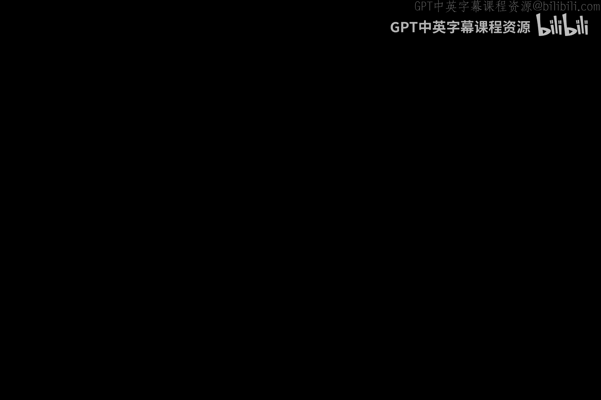
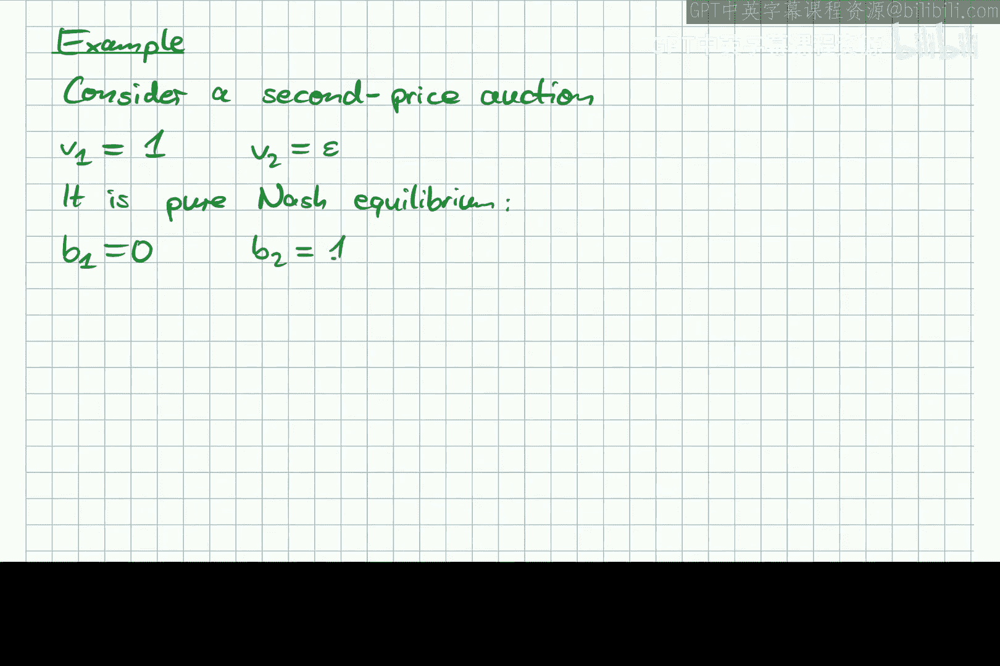

# 算法博弈论：第16讲：简单组合拍卖



在本节课中，我们将学习如何分析非真实机制。我们将聚焦于组合拍卖这一具体应用，并研究两种不同的机制。通过证明这两种机制都是“平滑”的，我们可以立即得出它们在各种均衡概念下的“无政府状态代价”上界。

上一讲我们介绍了贝叶斯纳什均衡和机制的平滑性等概念，用于分析非真实机制。本节中，我们将把这些工具应用于组合拍卖的具体场景。

## 组合拍卖回顾

我们考虑一个组合拍卖。设有 **n** 个投标人（玩家），记作集合 **N**（编号为 1 到 n）。同时有 **M** 件物品，记作集合 **M**（编号为 1 到 m）。

每个投标人 **i** 有一个私有的估值函数 **vᵢ**，该函数将物品子集映射到非负实数。我们遵循惯例，假设估值函数是单调的（获得更多物品不会降低价值），并且 **vᵢ(∅) = 0**。

我们的目标是设计一个机制，它由一个分配规则和一个支付规则组成。两者都以投标向量 **b** 作为输入。分配规则决定物品如何分配给投标人，支付规则决定每个投标人需要支付多少金额。我们始终假设投标人支付非负金额。

## 机制平滑性回顾

我们称一个机制是 **(λ, μ)-平滑** 的，如果满足以下条件：对于任意的估值向量 **v** 和任意投标人 **i**，都存在一个“安全偏离”投标 **bᵢ***，使得对于任意的投标向量 **b**，以下不等式成立：

```
∑ᵢ uᵢ(bᵢ*, b₋ᵢ; vᵢ) ≥ λ * OPT(v) - μ * ∑ᵢ pᵢ(b)
```

其中：
*   **uᵢ(bᵢ*, b₋ᵢ; vᵢ)** 是当投标人 **i** 单方面偏离到 **bᵢ***，而其他投标人保持投标 **b₋ᵢ** 时，投标人 **i** 的效用。
*   **OPT(v)** 是最优社会福利。
*   **pᵢ(b)** 是在投标向量 **b** 下，投标人 **i** 的支付。

如果一个机制是 **(λ, μ)-平滑** 的，那么对于贝叶斯纳什均衡、相关均衡、混合纳什均衡和纯纳什均衡，其无政府状态代价（PoA）都以 **max(μ, 1)/λ** 为上界。

因此，本节课的核心任务就是证明特定机制的平滑性，从而直接得到其 PoA 上界。

## 机制一：物品一级价格投标 🧾

首先，我们来看一个非直接机制：物品一级价格投标。其思路是每件物品独立地通过一级价格拍卖出售。你可以将其想象为并行的 eBay 拍卖。

### 机制描述

*   每个投标人 **i** 为每件物品 **j** 报告一个投标价 **bᵢⱼ**。
*   每件物品 **j** 被分配给对该物品投标价最高的投标人。
*   每个获胜的投标人支付其所有获胜物品的投标价之和。

这个机制不是真实的，原因有二：首先，单件物品的一级价格拍卖本身就不真实；其次，投标人无法完整报告其真实的估值函数（例如，他们可能只想要一件物品，但却可能赢得多件）。

我们将针对**单位需求估值**来分析这个机制。单位需求估值函数定义如下：

```
vᵢ(S) = max_{j ∈ S} vᵢⱼ
```

其中 **vᵢⱼ** 是投标人 **i** 对物品 **j** 的非负估值。这意味着投标人最多只想要一件物品，其价值等于所获物品中估值最高的那个。

### 平滑性证明

**定理**：对于单位需求估值，采用一级价格支付的物品投标机制是 **(1/2, 1)-平滑** 的。这意味着其 PoA 上界为 2。

以下是证明思路：

1.  **定义安全偏离投标**：考虑社会福利最优分配方案。设在该方案中，投标人 **i** 获得的物品为 **jᵢ***（若无则记为无）。我们为每个投标人 **i** 定义安全偏离投标 **bᵢ*** 如下：
    *   对于物品 **jᵢ***，投标 **bᵢⱼ*** = vᵢⱼ / 2。
    *   对于所有其他物品，投标 0。
    即，每个投标人只对其在最优方案中应得的物品投标其估值的一半。

2.  **分析偏离后的效用**：当投标人 **i** 单方面偏离到 **bᵢ***，而其他人保持投标 **b₋ᵢ** 时，其效用至少为：
    ```
    uᵢ ≥ vᵢⱼ / 2 - max_{i' ≠ i} bᵢ'ⱼ
    ```
    这是因为，要赢得物品 **j**，其投标必须高于所有其他投标人对该物品的投标。

3.  **求和并关联支付**：对所有投标人的效用求和：
    ```
    ∑ᵢ uᵢ ≥ (1/2) * ∑ᵢ vᵢⱼ - ∑_j max_i bᵢⱼ
    ```
    第一项 **(1/2) * ∑ᵢ vᵢⱼ** 等于最优社会福利的一半。第二项 **∑_j max_i bᵢⱼ** 恰好是机制在当前投标 **b** 下的总支付额。

4.  **得出结论**：因此，我们得到：
    ```
    ∑ᵢ uᵢ(bᵢ*, b₋ᵢ; vᵢ) ≥ (1/2) * OPT(v) - 1 * ∑ᵢ pᵢ(b)
    ```
    这正好满足 **(λ=1/2, μ=1)** 的平滑性定义。

由此，我们证明了物品一级价格投标机制在单位需求估值下具有良好的均衡效率保证。

## 机制二：贪婪算法与一级价格支付 ⚙️

接下来，我们关注一个直接机制（投标人报告估值函数），但它仍然是非真实的，因为我们使用一级价格支付规则。

### 机制描述

1.  投标人报告函数 **bᵢ**，将物品子集映射到非负实数。
2.  机制计算所有“投标人-子集”对 **(i, S)** 的分数：**bᵢ(S) / √|S|**。
3.  将这些对按分数非递增排序。
4.  按顺序遍历列表，将子集 **S** 分配给投标人 **i**，除非：
    *   投标人 **i** 已经获得了某个物品束，或者
    *   **S** 中的某个物品已经被分配。
5.  每个获胜的投标人 **i** 支付其对自己所获物品束 **S** 的投标价 **bᵢ(S)**。

这个算法本质上是“按价值密度贪婪”算法的一种变体，但支付规则采用一级价格，因此不真实。

### 平滑性证明

**定理**：上述贪婪机制（采用一级价格支付）是 **(1/2, √(2m))-平滑** 的。其中 **m** 是物品总数。

证明的核心步骤与之前类似，但更为复杂，因为投标人竞争的是物品束而非单件物品。

1.  **定义安全偏离投标**：设 **X₁*, ..., Xₙ*** 是最大化社会福利的分配方案。为每个投标人 **i** 定义安全偏离投标 **bᵢ*** 为：
    ```
    bᵢ*(S) = vᵢ(Xᵢ*) / 2，若 S ⊇ Xᵢ*
    bᵢ*(S) = 0，否则
    ```
    即，投标人 **i** 只对包含其最优分配束 **Xᵢ*** 的超集投标一个固定值（其估值的一半），对其他集合投标 0。这本质上是一个“单一需求”投标。

2.  **分析偏离后的效用**：可以证明，当投标人 **i** 单方面偏离到 **bᵢ*** 时，其效用至少为：
    ```
    uᵢ ≥ vᵢ(Xᵢ*) / 2 - τᵢ
    ```
    其中 **τᵢ** 是投标人 **i** 为了在其他人投标为 **b₋ᵢ** 时赢得集合 **Xᵢ*** 所需的最小投标（即“临界投标”）。

3.  **关键引理**：证明以下引理是证明的核心：
    ```
    ∑ᵢ τᵢ ≤ √(2m) * ∑ᵢ bᵢ(Fᵢ(b))
    ```
    其中 **Fᵢ(b)** 是机制在投标 **b** 下分配给投标人 **i** 的物品束。右边项是当前投标下的“声明社会福利”（即赢家对其所获物品束的投标之和），也等于总支付额。
    *   **证明思路**：通过构造一个辅助投标向量 **b'**，其中每个投标人 **i** 在 **Xᵢ*** 上的投标略低于临界值 **τᵢ**。利用贪婪算法的“输家无关性”性质，可以论证分配结果 **F(b')** 与 **F(b)** 相同。然后，利用贪婪算法是 **√(2m)** 近似算法这一事实，可以将 **∑ᵢ τᵢ** 与 **∑ᵢ bᵢ(Fᵢ(b))** 联系起来。

4.  **得出结论**：将步骤2的效用不等式对所有投标人求和，并应用关键引理，我们得到：
    ```
    ∑ᵢ uᵢ(bᵢ*, b₋ᵢ; vᵢ) ≥ (1/2) * OPT(v) - √(2m) * ∑ᵢ pᵢ(b)
    ```
    这满足了 **(λ=1/2, μ=√(2m))** 的平滑性定义。

这个证明的精妙之处在于，它并未过多依赖算法的具体细节，而主要利用了其“贪婪”特性。一般来说，对于贪婪算法搭配一级价格支付，其 PoA 上界将是该算法近似比的常数倍。

## 为何选择一级价格而非二级价格？ 🤔

一个自然的问题是：为什么我们在这里分析一级价格支付，而不是更常见的二级价格支付？理论上，对物品投标或贪婪机制使用二级价格支付也是可能的。

问题在于，二级价格拍卖可能存在非常低效的均衡。考虑一个简单的例子：两个投标人竞争一件物品。投标人1的真实估值是1，投标人2的真实估值是ε（一个极小的正数）。考虑以下投标组合：
*   投标人1投标 **0**。
*   投标人2投标 **1**。

这是一个纯纳什均衡吗？
*   投标人1不会偏离：要赢得物品，他必须投标至少1，这样他的效用为 **1 - 1 = 0**，与现在相同（效用为0）。
*   投标人2也不会偏离：他赢得了物品，支付是第二高的投标价（即0），因此效用为 **ε - 0 = ε > 0**。如果他降低投标，可能会失去物品，效用降为0。

在这个均衡中，社会福利仅为 **ε**，而最优社会福利是 **1**。无政府状态代价 **PoA ≈ 1/ε** 可以任意大。问题在于投标人2进行了严重的“过高投标”。



为了避免这种病态均衡，在分析二级价格支付时，通常需要附加“不过高投标”的假设（例如，投标不超过真实估值）。在这样的合理假设下，也可以为二级价格支付机制建立良好的 PoA 上界。本节课为了简化，我们聚焦于更容易分析的一级价格变体。

## 总结 📝

本节课中，我们一起学习了如何将平滑性分析框架应用于组合拍卖中的非真实机制。

*   我们首先回顾了组合拍卖模型和机制平滑性的定义。
*   接着，我们分析了**物品一级价格投标机制**，并证明对于单位需求估值，它是 **(1/2, 1)-平滑** 的，从而其 PoA ≤ 2。
*   然后，我们研究了一个基于**贪婪分配算法**的直接机制，但采用**一级价格支付**。我们证明了它是 **(1/2, √(2m))-平滑** 的。
*   最后，我们讨论了为何分析一级价格支付比二级价格支付更直接，因为后者可能存在由“过高投标”导致的极端低效均衡。

通过这些例子，我们看到了平滑性作为一个强大工具，能够统一分析多种非真实机制在各种均衡概念下的效率损失。这也从另一个角度凸显了真实机制的价值：它们避免了分析均衡行为的复杂性，直接保证了在真实报告下的良好性能。