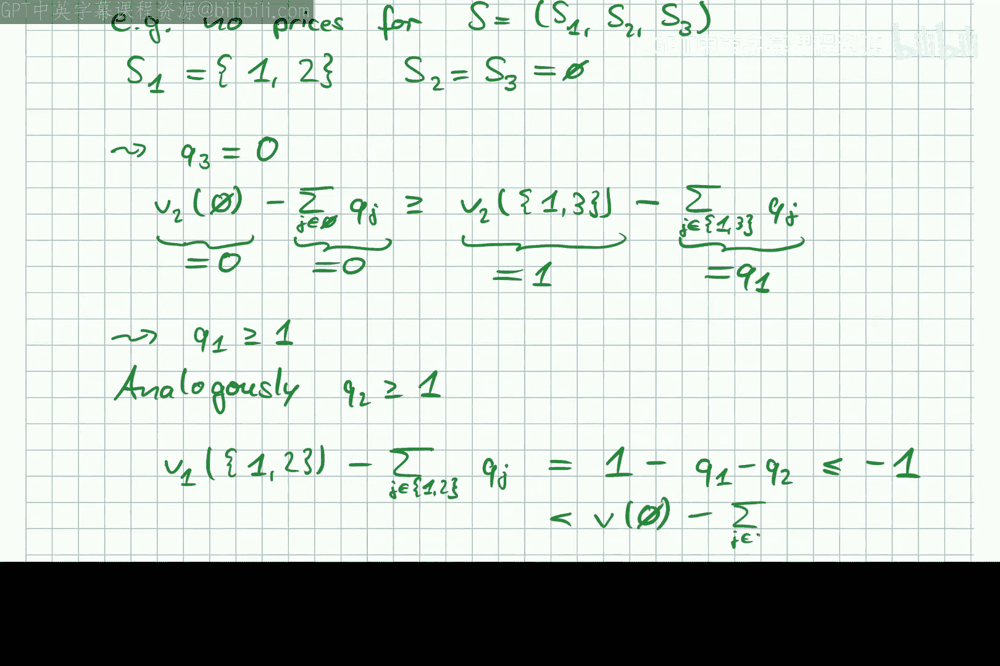
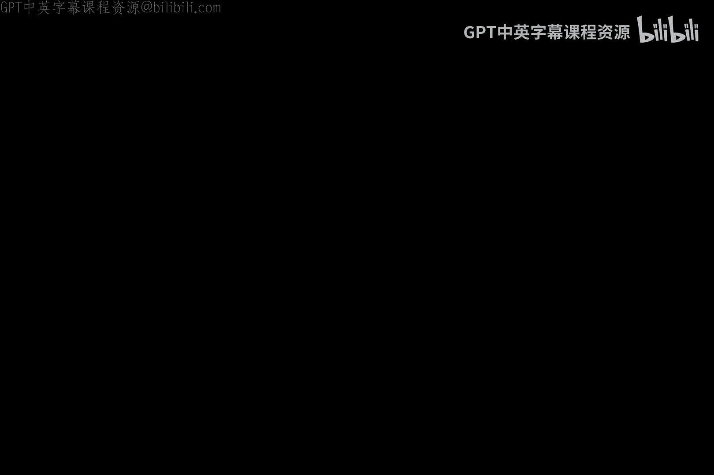
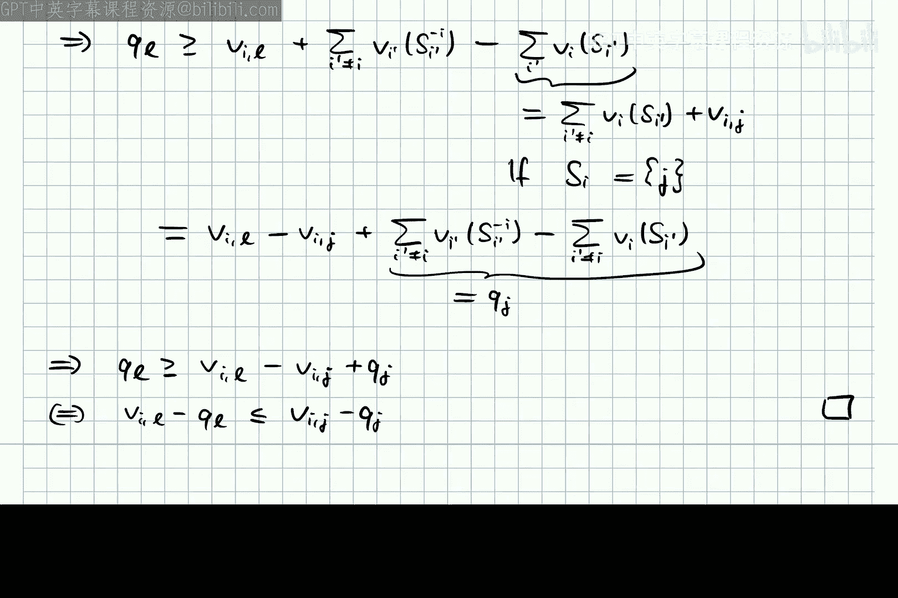
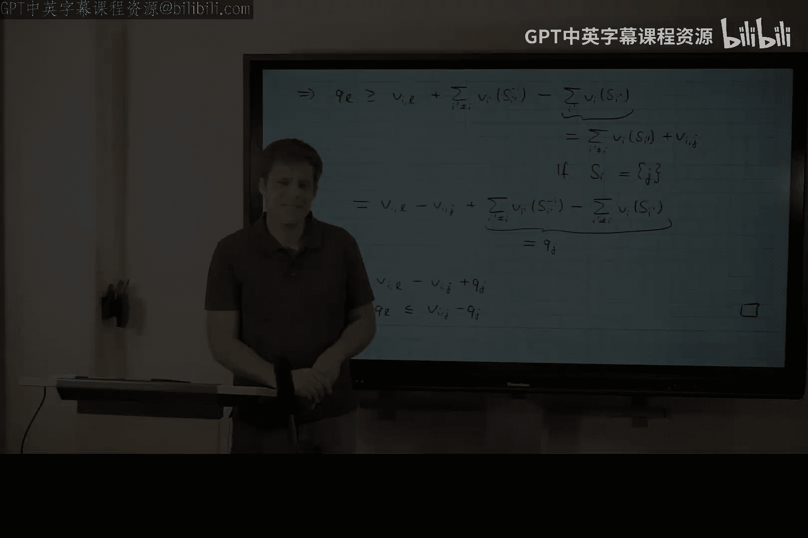

# 波恩大学《算法博弈论｜Algorithmic Game Theory, Winter 2020-21》中英字幕（claude-3.7-s p18 AGT, WS20_21_ Lecture 17 (Walrasian Equilibria).zh_en -BV1m9ZyYoENg_p18-

Welcome back to algorithmrithic Game theory。In the last lectures。

 we've learned a lot about mechanism design and particularly comb oil auctions。

And the kind of mechanisms that we were considering were always。Auctions of some sort。

 meaning that you and every other player as well submit a bid。And then based on what the bids are。

 the mechanism makes the allocation。But unless you're a professional art collector。

 this is not what your daily shopping experience is like。

Usually you just go to a store and then you see a posted price， so you see okay。

 I can now buy this item for this much or I can buy two items for just then double the price。And。

How can one capture these kinds of settings mathematically？And also。儿。Those。

Efficient in the way that do we come to a good outcome？Do we come to good social welfare this way？

This is exactly the question that we will be considering today with some classical economic theory。

 and then also next time when we talk about。😊，A more algorithmic approach to this。

Wwhich is more general but then also loses something， you will see the differences between these。

 but as I was mentioning today we'll only consider classical economic theory。

 namely we'll get to know the concept of a war raising equilibrium。What is this？We have， again， and。

Players。Or agents， you can also call them bidders， although they are not actually bidding。

I often will call them just buyers。Because this is what they are actually doing。

And then we have M items。This this set we call one through small M and which we call capital M。

 And we're now in the standard setting of combinatator auctions， so。Each player， I。

Has a valuation function。VI mapping from the power set。Of the items to the nonne reels。So again。

 each player has a non negative value for every subset of the items。

But what is different now is that we consider full information， so these are public knowledge。

 we know these VI。And also everybody else knows them。

 So our question today is not at all about incentives letting these players reveal their true values。

 This is no。No question today。Rather， we are interested in the question。Do there exist good prices。

And whether or not there exist good prices， this is formalized in the concept of a wall raisingis equilibrium。

It's called a wall raising equilibrium after layon wall Ro a。U。

An economist who introduced this concept。Has this defined？A pair。Of a price vector。C。

And an allocation。S， which is a vector of S1 through S N。Each S I being a subset of M。And。

Satets that are paras disjoined。So each item is allocated to at most one player。And this we are call。

A wall raisedis equilibrium。If two conditions are fulfilled， the first one is that V I， F S I。

Minus the sum。Of all J and S I P J， this is at least。V I of S I prime minus。The same。

Of all J and S prime。Q J。And this should hold for all SI prime， which are subsets of the items。

And then we also have the condition that。If an item。It's not。In the union of O SI。

Then its price has to be 0。Good。Let's have a closer look at this。

We see a wall raising equilibrium is nothing like the kind of equilibrium equilibrium that we've seen so far。

 for example， a natural equilibrium a natural equilibrium was always about。

Each player choosing a strategy and no player wanted to unilaterally deviate from this。

You and our players are actually not used in choosing any strategies。But still。It is。

Kind of formalizing the intuition that every player should be happy with their allocation and the prices。

 And this is。😊，As follows， so a well raising equilibrium now consists on of this price vector and also the allocation of the items with the following properties。

Let's say I'm player I， I'm not getting set SI。And then I'm paying sum of the QJ for the items in SI。

Am I happy with this？Yes， I am happy with this unless there is another set SI prime for which my value mines what I would have to pay for that。

Is higher。 and this is written down here。 So this would be my quasi linear utility if I'm getting set SI and I'm paying the sum of the prices in the set SI。

 And this is now for the set SI prime。 What would be my value， minus what would I have to pay。

And this condition now tells us that every player。Should be happy with what they are getting。

 So I forgot to write this down。 This should， of course。😊，Also， hold for all players。

So no player is unhappy with what they're getting， no player would rather get a different set of items than the one that they are currently being assigned。

 and then there's this other condition which is as follows if an item is not allocated。

 then it should certainly have a price of zero。This is maybe a more technical condition。

Whi will turn out to be useful later， but the point is that if nobody is getting an item。

 then it should have a price of zero so it could be and this then combines with this first constraint。

It should be easy to get。 So if there is an unallocated item， then I shouldn't be made。

Happier by giving me this item on top because。I could， for example， include an SI Prime。

 everything that I'm getting so far and everything that is not allocated。😊。

Then I would still pay the same， and this shouldn make me happier。So this kind of means that。

Items which are not allocated are。Worthless， to some extent。

Let's see a very simple example of such a world raising equilibrium。Namely。

 let's first talk about only a single item。And let's assume that。

The value of player one for this item is bigger than the value of player two for this item and so on。

 so the the players are ordered by。Decreasing value。No。All war raised in equilibrium are as follows。

We'll have a price。Somewhere between。V 2， and V1。For the item and player 1 is getting the item。

Why is this a world raised in equilibrium？And that's verified these inequalities or these conditions。

 this second condition this is certainly fulfilled because the item is allocated good。

 why is this first condition fulfilled？Let's first consider a player one who's getting the item。

Then this year this will be the value of the item for this player。

 so this will be V1 and we subtract the price from it so something between V2 and V1。

And this will always be non negative。Cool。What's the alternative。

 the alternative is not getting the item and not getting the item will give us。0 minus zero。

 so then we'll have zero on the right hand side。Okay， so we have something non negative is at least。

Zero， this is exactly what we're asking for。Now let's consider one of the other players who are not getting the item there。

 of course， this thing here is zero， theyre not getting the item。😊，And how big is this？Well。

 they could get the item， but how much would they have to pay， they would have to pay the price。

 which is somewhere between V2 and V1。The value would be something like V2， V3 or whatever。

But it would be at most V2。 So we'll see V2 minus something that is at least V2， so。

This is something non positive here on the right hand side。

So also this inequality would be fulfilled for these players。

You can now also verify that there are no other wall raiseds in Elibia and indeed we'll do this in a little more general way just。

After the next example， but before that， let's see a more complicated example。

 namely where we have multiple items。So we might also consider unit demand valuations。

We've come across them a number of times now。V I。F S I。

Would be the maximum of all J and S I V I comma J。For VIJ being non negative。

 But does this mean this means I only want at most one item or more items don't make me happier。

We can now think of this as follows。 we have， for example。These。3 buyers。 And we have three items。

And generally， we could not give each of the buyers， maybe we could even give all three items to。

Ber1。But the thing is giving them all three items doesn't make them any happier than getting only one of the items。

So this is why we can think of this as a maximum weight matching problem。Which would look as follows。

So I'm now drawing only the edges。In which。A buyer has a non zero value for the respective items。

And then， for example， by  one might have a value of 10 for the first item。

 no value for the other items。Byer 2 might have a value of 5 for this first item and a value of3 for the second item。

 buyer 3 might have a value of2 for the second item and a value of1，4。The third eye。

Now how do we find a wall raisin equilibrium here， what is a wall raisin equilibrium。

 a wall raisin equilibrium is first of all an allocation of the items。

Which might not be the following？Give。The first item to the first bidder。

 the second item to the second buyer， the third item to the third buyer。

And then we also have to set prices。And we couldn't have the first price to three， the second price。

2，1， and the third price we could set to 0。And then we can again verify that everybody is happy with this。

Buyre one。Pas3。Gets a value of 10， so we'll have a qua linear utility of7。

What would be the alternatives， for example， getting both items B and C， just to mention one example。

 then the value would be0 but the。The sum of the prices would be one。Or， for example， getting item C。

Alone， this would make give a value of 0 and also a。

A price of zero or not getting anything then we get the same。

And now if you go through all three players and。Any possible set of items that they could get。

 you will realize， okay， they won't be any happier than they are now。

And what is interesting about this is that this is exactly the。VCG allocation and the VCG prices。

If we were running VCG， this would be the allocation that would come out and we would then see。Okay。

 how much does this buyer have to pay？Well， what would be the alternative allocation instead of this horizontal one。

 it would be this diagonal address。And then we will see， okay， we would indeed have a VCG price。

 a VCG payment of three。This is a connection that well also see later。

But there's also an alternative war raising in equilibrium， which uses higher prices。

The first price could be 10， the second price could be three， and the third price could be one。Now。

Still everybodys happy， although， for example。Wre2。Ha a value of three and also has to pay three。

 so the quasiline utility would be zero。And this is a need true for all three of them， however。

Whatever others said they could be getting still wouldn't make them happier。Good。

 so we see that usually the war Ra equilibrium won't be unique。

 there seems to be something related to VCG which we'll have to explore。But it seems。That。

Often world reason equilibrium exists。But not always。

 there are valuation functions for which there is no world raising equilibrium。For example。

 the following。V1 has a value of。1。If。The player is getting the first two items。

Or any superet of this。Otherwise， it will be0。Similarly， for the second player will have。

A value of one。If。This player is getting items 1 and3。And no value， otherwise。The third player。

Well have a value of one。If they're getting items 2 and three。And no value。Otherwise。And now。

 you can。Figure out that there is no war raising in equilibrium。Why is that true Well。

 now you have to distinguish what the allocation might be like。And indeed。You might， for example。

 give。Items one and two to the first bidder and no items to the other two。

That would be one alternative。And let's see why this won't lead to any good price factor。

So we have no wall raised in equilibrium。For example。There are no prices。😔，To support the allocation。

In which。S1。Would be the set of items one and two。And S。2 and S 3 would be empty。Why is this？Well。

 let's recall what the prices would have to fulfill。 first of all， item3 isn't allocated。

And because item three is not allocated， it has to have a price of zero。What else do we have to have？

Players two and three have to be happy with what they're getting。

 namely they're not getting anything。But。What would be an alternative for them to what they could get is for the second player。

 we could also give them the set of items one and three。And for the third player。

 we could also give them this items two and three。So what has to hold？嗯。V2 of the empty set。

Minus the sum of the prices。In the empty set。This has to be at least V2。Of items，1 and 3。

Minus the sum of the prices， and1 and3。And what do we have now？This would be one。This would be。0。

This would be zero。And this would be just。The first prize。😮，Because Q3 is0。

 so what we're getting is that。Q1 has to be at least one。And analogously。

Q2 will have to be at least one。But this now means that。Player one will be unhappy？Because。

If we going to give items one and two to this player minus。The sum of the prices？This will be。

The value minus the sum of the prices， which is Q1 plus Q2。This will be。Negative。And this will be。

This way smaller than if we gave them the empty set。

And this is a contradiction。So you see。This certainly will not be a world raising equilibrium and now everything else that you might want to try here。

 you will reach to the exact same problem， there won't be any prices。For whatever allocation you try。

 so there is just no world raising in equilibrium。This is for a good reason。But。

And theres there's a lot of theory around this， which often relates to。Dualality of linear programs。

 but for today we'll only see that there is always a will reason equilibrium for unit demand valuations。

And also that a war raised equilibrium always maximizes social welfare。

The first result that we will be proving now is the first welfare theorem， which states that。

What raising in equilibriumria are always。Socially optimal。

 meaning that they maximize social welfare。Let's write this down。

If cuer S is a wall raised in equilibrium。Then， S。Maximizes。Social。Welfare。

This result is often referred to as markets are efficient。Because it says， there is a way。

it doesn't actually say this you can， if you have a not so close look at this， then it says。

 however you set prices， you will end up in a state that maximizes social welfare。

Although this is not quite true because as we've seen。

 while raising equilibrium not necessarily exist。And。

So this only is meaningful if while raising equilibrium do exist。

 because then it says that there is a way to set prices。

 such that social welfare is maximized and also any other way that you could set prices and everybody' is happy that will also maximize social welfare。

Although it doesn't state why the world should end up in this state。Good。

 regardless of all this major discussion about this theorem， let's prove it。

Let S star be an allocation that maximizes social welfare。Then。In our world raised equilibrium。

Every player is still happy with what they're getting。

 and they wouldn't rather want to get what they're getting in this。In this allocation S star。So。

We can write this like this。VI of S minus the sum of J in SIQJ。

 this will be at least VI of SI star minus the sum of the prices in SI star。Good。

This is just the property。The first property of the World raised in equilibrium that everybody's getting happy with the set of items that they're getting。

Now what we can of course do is we can sum up this inequality overall。Firers。

What will this look like we are now getting。The sum of all V I in S V I of S I。

Minus the sum of all I in N。Some of all J and S I VJ， this will be at least。Some of all I and N。

V I of S I star minus the sum of all I in N， sum of all J in S I star V J Q J。Good。

What do we now know about these sums here？What do we know about this sum。This is a sum。

Over all players and then over the set of items that they're getting summing up all the prices。

Which items are we sum over。We are summing over all items that are allocated and each item that is allocated appears exactly once。

And what about the items that are not allocated？Well， they don't appear here。

 but we know that QJ will be zero for them。Because this is a world raised in equilibrium。

 And this was our。And our property， so we'll see that this is exactly the sum of all item prices。

Now this thing here， this will be at most。The sum of all item prices。Because also here。

Every item is appearing at most once because it is a feasible allocation。Now here this。

 we don't have this as equality because there might be items that are not allocated by S star。

 but which have a non zero price because Q was just。The prices that work well with S。

 not necessarily with S star。If you now combine this， then what you see here is then still。

Some of the V I of S I。Will be at least the sum of the VIFSI style。

And this is exactly what we were claiming， namely that social welfare is maximized。Fantastic。

And it's this easy to prove。If you're familiar with。Dualality of linear programs。

 this might look a little familiar because this is。Indeed， exactly LP duality for one specific LP。

nameamely， the configuration l P。And as a matter of fact。

Everything about war race in Elibia is more or less。LP duality， sometimes it is strong Lp duality。

But if you don't know， LP duality doesn matter for now。All you have to see is that。If there is。

 this will raise an equilibrium consisting of an allocation and prices so that everybody is happy with this allocation。

 giving these prices， then this allocation has to maximize social welfare。

And this is the entire argument。But this， of course。

 doesn't tell us that there always is a w raised in equilibrium。

And as we've seen sometimes there is no world raising equilibrium。

 and this is what we want to do next， we want to show that for unit demand valuations。

 there is always a world raised and equilibrium and we were able to see that this corresponds to the VCG outcome。

In our example of a war raising equilibrium， we saw that this war raising equilibrium corresponded exactly to the VCG outcome。

 one of the two world Ra equilibrium that we saw in this example。

 and indeed this is a very general property namely that，If all valuation functions are unit demand。

 then the VCG outcome indeed corresponds to a wall raisin equilibrium。Before we can prove this。

 maybe we first have to recall what actually VCG does。

And we might also want to change notation a bit here because we're talking about a very specific setting and this will simplify our proof。

So we'll have unit demand valuations。Which means that V of SI will be equal to the maximum。

Of all J and S I， V， I comm J。And how did V C G work。Let's。Call S a welfare maximizing allocation。

The valuations are fixed today so we don't actually have to care about all this what actually mattered for us in the context of VCG namely this is truthful。

 so S will be just a social welfare maximizing allocation and。Si prime。S I superscript minus I。

This is a social welfare maximizing allocation。If。Bre eye。Is excluded。

And then we'll have that the VCG payments are as follows， so everybody bids truthfully。

And we now say okay。Take the social welfare。Did you get in。When you're。嗯。Doing everything without。

Bitter eye， minus。The social welfare that you're getting， if you include bitter eye。

Bird not count them。So once again。Here we are taking this allocation S minus I in which。

Bitter I is excluded， we are not counting them， but just maximize social welfare without them。

Here we include them， and in both cases， we only sum up the values。That all players。

 except for player I have。And the thing is now。Every player will get。Well， technically。

 they are getting， they can be getting multiple items， but。They're getting more or less one item。

 and if we now use these as the prices， then this will correspond to a。Warer is an equilibrium。

More precisely。What we can say is that。We now define item prices。By as follows。If J is not allocated。

In S， then we'll set。The price of item J to 0。If。J。Is allocated。2。😔，Byer I， then we'll set。

Q J equal to whatever buyer I is paying。And this is， again。Given by this vCg formula。

What tends to make this a bit confusing is that here we are assigning payment to the。Birers。

And now we want to assign payments to the items， as I was saying， okay。

 actually every buyer gets at most one item。But we'll even do this in the most straightforward way。

 so even if a buyer gets multiple items， then we assign as the price。

 whatever this buyer is paying in the VCG outcome。And now。We claim something very simple。Namely。

We claim that S comm a Q。Is a war。Equiilibrium。So what this tells us is that。

 apart from the nice fact that this construction is a wall raising equilibrium， it tells us that。

 first of all， there is a wall ra equilibrium because so far we've only seen examples of world raising equilibrium。

 but we've also seen an example wall where no wall raising equilibrium exists。

So what will we have to verify， we'll have to verify that via this construction。

 the properties of the war raisedis and equilibrium are fulfilled。There's this。

Thing that is already great because what did we insist on in the more raising equilibrium that items that are not allocated have a zero price。

 so this is by design。But is every player happy？With what they're getting。We don't know yet。嗯。啲。

Everything that we've shown so far regarding VCG was about truthfulness and truthful reporting。

 but this is not the point today， we assume that we just know the values in this entire construction。

 so today is not about lying， but it is about just making everybody happy。

So is everybody happy or not？How do we prove this？The first thing that we do is we'll understand how these prices are constructed。

How is such a prize QJ actually defined via this construction。

 okay it is defined in some way but we'll now define or we'll see that this is actually there's an equivalent way。

 which just talks about adding and removing items rather than adding and removing bidders。

And this is as follows。We have that for every item。The price can be also written as follows。

 Take this。Over all， buyers。What is the。Value。Of some allocation a superscript plus J。Minus， what is。

The value。That they're getting in allocation S。And what is。S plus G。S plus J。Is a social welfare。

Optimizing。Alloccation。When。There。Are two copies。Of item J。Good。

 so originally we defined the price by saying okay。Who's getting the item？And then。

What's the vC g payment for for this bidder because。Well。This then means。Remove this bitter。

 Let's see。 What social welfare are we getting without this bitterder。 Take the difference between。

How much we're getting with him or without him？So how much does he or she hurt the others？Now。

 this is a different way of stating this Now we state that the price of item J。😊，Is。

weBy how much our social welfare would increase。If we had item J twice rather than once。

So this is again， our social welfare， if we have each item once。

 this is the social welfare where we have。All items once， except for item J， which we have twice。

And the interesting thing is this is an equivalent way of stating the VCG payments。Why is this true。

This proof relies on actually two properties。The first one being。If J。Is not allocated in S。

Neither copy。Is allocated。In S plus J。Is this surprising。Not really。Why that。

 because we now have an allocation S， which has each item only once。Now we're giving this allocation。

Another copy of item J， but before。Item J wasn't even used。Now we'll have another copy of。

Of this item J， so now we have two items J， but why should we now start using them if before we didn't actually care that we had one copy。

And then the other property。Is that。If J。Is allocated。2。😔，bititter eye。In S。bititter eye。

Anser receives。1 copy。In S plus J。Is this second property， is this surprising？

It's maybe a little less intuitive， but it's I don't consider this surprising。

 so we now have this allocation。In which we have each item one and now Bi I is getting item J。

And now we're getting another copy of item J。What will happen now。

 will it happen that suddenly both of these item copies are going to somebody else？

Or will bitter I keep at least one copy and then the other copy is going to somebody else。

Or maybe it's even unallocated。This sounds very reasonable。Because and that's really important each。

Beter willll get。Actually， only one item。In the optimal allocation。How do you prove such things？

Those are actually fundamental properties of bipartheidite matchings， so let's maybe see。

Why this first property is true and how you would formally prove it。

So if item J is not allocated in S， then neither copy is allocated in S plus J。

The first thing that we could see is that。If only one copy。Is allocated。In S plus J。Then we。

Could also。Use。S。Plus， J S， S。And now I realize I forgot to mention something namely。

 we say that S plus J is only different from S if it gives us strictly higher welfare。

So this is always an issue of tie breaking。嗯。But here we now say， okay， we call。In this case， if。

Only one of the two copies is allocated。Then S plus J cannot give higher welfare than S。

Because we could just use whatever S plus J is doing also in s。

 and this means that by a assumption that I forgot to mention earlier。

 S plus J and S have to be equal。And this。Already shows us for this first case。

 if S plus J uses only one of the two copies。then。S could just do the exact same thing。

 so the only interesting case is that actually S plus J is using both copies。

And we will now see a contradiction that S isn't using a。At least one of them。How do we show that？

Welllets。Think of this a little more visually。We'll have。Couple of buyers。

And we'll have a couple of items。Now there's， of course。😔，Item J， which we have twice in J plus 1。

 so this will be item J。Let's now first draw our allocation。S， and once again。

 allocation S does not use item J。So this what might look like this。

They are using these items they're getting。These items。And now。Let's consider。Alloccation。S plus J。

Well， now， suddenly。There are two。We are getting actually item。Jy。

And then the other items are allocated in some other way。Of course， not this way， but rather。

This way。Get。So。Once again， these lines indicate our allocation。When there's only one copy of J。

What would maximize social welfare and we're not using item J at all？

And then suddenly there's another copy of item J and we then have a different allocation and both copies of item J are used。

So both these and this player are not getting item J。

 whereas before they were getting something else in allocation S。Like what does this mean。

 we now have an alternating path。That corresponds to the reallocation of the items。

 this item was first is now allocated to this buyer who before got this item and this item was before allocated to this buyer and so on。

And now this is exactly the alternating path that we're getting here。

 and the same is true for the other item copy。And what we're seeing here is that these are two disjoint alternating paths。

And the point is now。If this increases social welfare。Then。One of the two。

 so either this part or that part。We'll also have to increase social welfare。Which means。

It cannot be a good idea to not allocate item J。At all， in S。

 when suddenly it is allocated twice in S plus J。Good。😡。

Now I won't go into further details on this because I hope also that these two properties that I claim to you those aren't too surprising。

 so you I see the general kind of argument that you can use to prove these properties。

But what was it that we actually wanted to show， we actually wanted to show。

That the prices that we constructed from VCG have exactly this form。

 so we can also write them like this。We can write the price that we're giving to item J。

 exactly like the social welfare of the allocation。The social welfare maximizing allocation。

 when we add a second copy of item J minus the social welfare if we。

Did not add a second copy and still maximize social welfare。Good。😡，Now。But how do we show this？

Let's consider first the case that item J is not allocated in S。 what does this property tell us？

If J is not allocated in S， then neither copy is allocated in s plus J so S and s plus J have to be identical。

And then the price will be 0。Good， so this is exactly what we before set our price to be if it is not allocated in S。

Then。There's now the other question， what happens if item J is allocated？If item G。Is allocated。

To buyer eye。In S， then what will Q J be， Q J will be。Some of all。I prime。

 which are not equal to I via subscript i prime F S I prime minus I once again， this was。

How we define the prices via VCG？And。What do we now know about this。

Maybe let's go back to the properties that we have。If。Item J is allocated to bidder I and S。

 this is the second property then。Bewitter eye also receives one copy in S plus J。

What does this mean that everybody？Except for bitter I is getting just something。In S plus J。

 because bidder I is getting S plus J and the other bidders。

Get whatever is remaining because we now just have exactly one copy of each item left。

And this means that this S plus J is doing the exact same thing because now bitter I。

Is taking this one copy？Of item J， this is doing the exact same thing as if we were leaving out bitter I and then maximize social welfare。

So introducing a second copy of the item that bitter I was getting。Is just exactly the same as。嗯。

Removing this bitter。From our。Alloccation or from our allocation process and then maximizing social welfare。

So。So this now means。That。Not counting。Removing bitter eye and not counting them will get the same social welfare as。

If。We considered the allocation S plus J。嗯。And I was a little impreciised here。

 we have to have the same social welfare。But if we're not counting。bititter eye。

And so this is the precise formula for this。And。What does this now mean？This now means that QJ。

How big was this。This was。Exactly equal to。The social welfare。Andre were getting。

if we are adding one copy of item j，And then we ask。

 what's the social welfare of everybody except for bitter eye minus？The social welfare before。

Counting everybody buts bitter eye。Now this。To to add a bitter eye。We can just add VIj on both sides。

And what we'll see is that what we've now added。I， exactly。What we're getting from。Bitter eye。Cool。

So this proves ourlemma， which was what？This proves our lemma。That。For every item。

 we can rewrite the price that we're getting from VCGS follows， we can write it as。

The social welfare of the allocation， if we。Maximize social welfare with an additional copy of item J minus the social welfare that we're getting。

Just do everything with a copy of each item only once。

And now the only thing that we have to do is well only have to prove our theorem。By thelemma。

 which was stating， okay， but these prices will get to a wall raisingin equilibrium。

How do we do that。4。Every item L， we have the following property that， of course。The item。As a price。

 which is defined as。Social welfare that we're getting if we introduce another copy of it。

Mine is the social welfare that we're getting。Without this or without introducing another copy。

So in particular。We toSo we want to understand this term here。

How big is the social welfare that we're getting if we introduce another copy of item L？For all。

Players， we now have the following。And。We might。Add another copy of item L。

the social welfare we're getting will be at least。Social welfare， if we give item L。2。bitter eye。

Plus。The social welfare。That we're getting from everybody else。But now。

 bitter eye isn't getting anything。And。This way we of course get that QL will be at least。VIL。Plus。

一、搜索 wfi。Every不。😔，Getting from everybody else， if we're optimizing。Without Biderll。

Minus the social welfare that we get at given。Getting over。Now， how much is this。This thing here。

This is。Exactly。The social welfare that we're getting from everybody。Except for a bitter eye， plus。

Their value。 This is true。If。S I prime。Is equal to。said ja。And what else do we know。

What is it that is remaining here。What is remaining here？This is exactly。Falling。VIL minus。椰系仔。Plus。

The difference of these two sums。And how big is this。This is。The exact definition of Q， J。

That we were starting from。If。ABe eye is getting item J。So what we're getting here。😔，Is that Q。

 L will be at least。ZRL。Minus V I J。Plus， Q J。Or equivalently， VL。inus Q， L will be at most。 V， I， J。

 minus Q J。And。We don't Why that。Because this is exactly the property that we wanted to verify that if bitter I is getting item J。

In allocation S， then they don't want anything else better。

Meaning that the value minus what they have to。Pay for the item。 This will be。

No more than the value minus what they pay for the item that they're actually getting。

Cool。So。I'm always a little confused by this proof because。U it。

It handles these inequalities in a strange way。Maybe there is a smarter way of writing this。

So that this feels more straightforward， but at least I haven't found that yet。Nonetheless。

 let's summarize here what we've done， we've shown that the VCG outcome always corresponds to a wall raising equilibrium for unit demand valuations。

For other valuations， this is not necessarily true。One of the reasons being。There might not be。

 even though， a。诶。And while raising equilibrium at all， although VCG always works。

And that's something you might want to verify that also the VCG outcome gives payments， which。

Don't relate to or is an equilibrium why that。Because one of the things being。You。

VCG always assigns a payment to each of the bidders。

 whereas the world raising equilibrium assigns item prices。

And if you now have the setting where each bidder is getting multiple items。

 how would you know set the prices？That's not so clear， and that's why usually it won't work。Good。

But beyond unit demand valuations， there are still。

Sometimes while raising equilibrium namely there is a class of evaluation functions called gross substitutes。

 which generalizes unit demand functions， which always admit a war raising equilibrium。

And there's many more things that you can show， for example。

 you can show that here in this unit demand setting。

 any raising equilibrium will choose prices which are at least as high as the VCG prices。Good。

 but we're out of time for today。 So now we have an understanding of what the。

Classical economic theory。Is like when they talk about existence of prices and they have this。

First welfare theorem， which tells them， okay， there are。Prices and that doesn't tell it them。

 but it tells them that if there are prices in the world raising cents， then。

The market is efficient in the way that it maximizes social welfare。Next time， we'll talk about。

A similar but different setting， because then we'll change some things。

 we will most importantly consider the incomplete information setting where we don't know the valuation functions in advance。

 but we still want to set prices。Then we won't be socially optimal。

 but we will at least be provably close to this。So stay tuned for next time。

 thanks for today and please do let me know if you have any questions， stay safe。

 have a great day bye。

