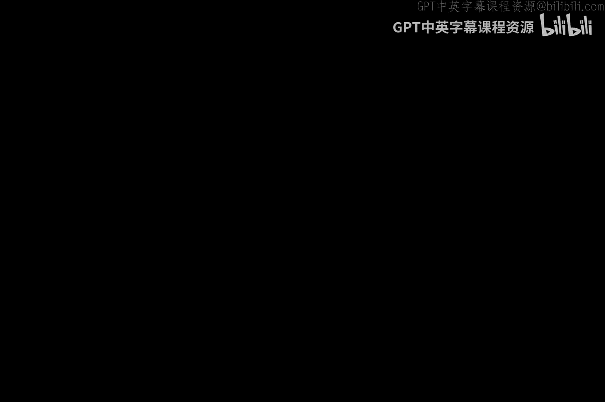
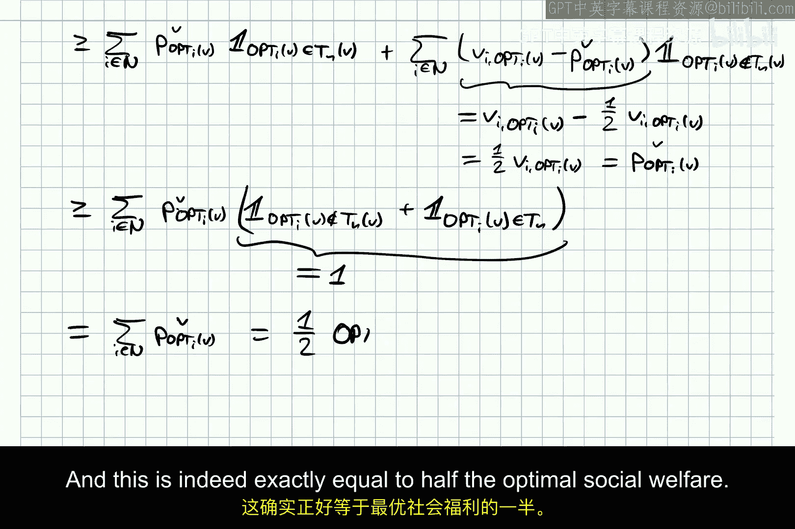
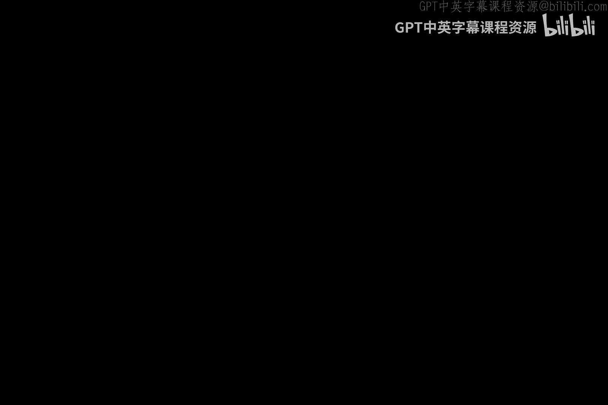
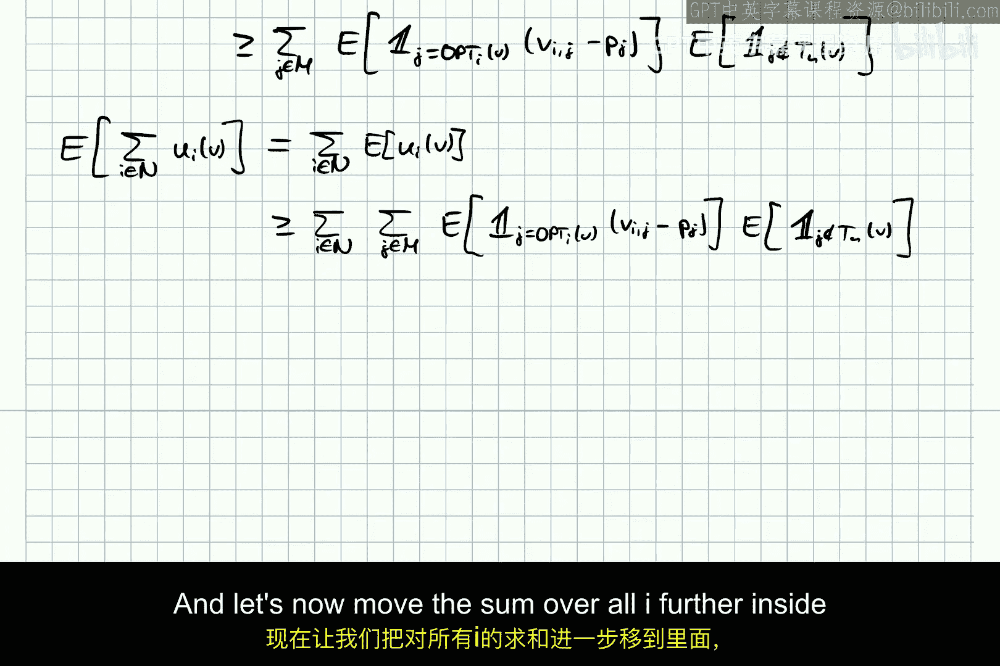
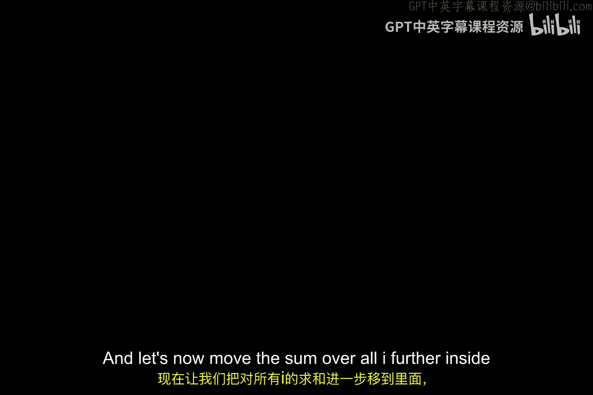
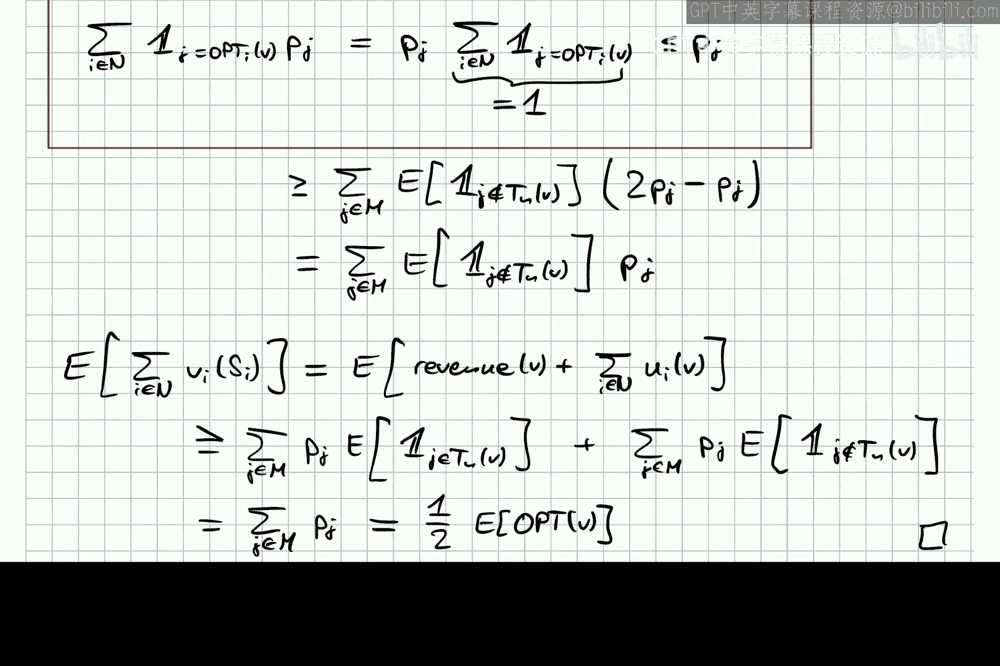
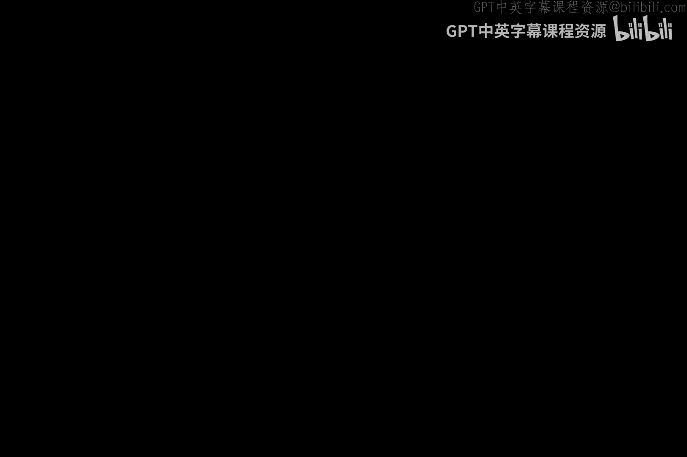

# 波恩大学《算法博弈论｜Algorithmic Game Theory, Winter 2020-21》中英字幕（claude-3.7-s p19 AGT, WS20_21_ Lecture 18 (Posted Prices with Incomplete Information).zh_en -BV1m9ZyYoENg_p19-

Welcome back to algorithmic A theory。Last time we started talking about the question。

How well can prices coordinate markets？This means that rather than running an auction。We now。

 want to， for example， in a combinatorial auction， we would rather want to post prices to the different items。

So that。Buyers get their favorite bundles。And at the same time。

Social welfare is at least approximately maximized。

And what we got to know in this context last time was the concept of a world reason equilibrium。

Which was exactly this choice of prices and an allocation。

Such that every buyer is happy with what they are getting。So no buyer would rather want to get。

A different set。Today we are complementing this with a more modern theoretical approach。

Which again posts prices but。Now the buyers just come one after the other and they take their preferred set。

 and as we see this does make a bit of a difference。Then our welfare guarantee。

well we will still prove a welfare guarantee， but we won't be able to show。

That we get optimal social welfare， but only approximately so。But at the same time。

 we work with less information。So I hope you see that there are many similarities。

 but also differences。What is the precise model that we're talking about？Like any communural auction。

We have n buyers that will be the set capital N。And we will usually call them just one through n。

And we have M items。And。Each buyer。I in N。系水。Private valuation function。The I。Which。

Again assigns a non negative。Real number to every set of items。

And we assume that these are unity man functions。That is。V i。Of S will be the maximum。Of all J and S。

 V， I comma J。4。😔，Non negative。VIJ。In other words。Every buyer。

Can in principle be assigned multiple items？But if they are assigned hand multiple items。

 then what they care about is only their most valuable one。Good， now， as you see。

 there's already something different here compared to what we were talking about last time namely。

 these valuation functions are assumed to be private today。

 they are not public knowledge as in the theory of world Ra and Eria。But。😊。

We again make the assumption that we also made in the context of base na equilibriumlib that in advance we know probability distributions。

 which these valuation functions are drawn from。This means。V I。Is drawn。Independently。

From a distribution， DI？And that will be。And known。Distribution。But other than that。

 we make no further assumption。So once again， these are known。

But the valuation functions are private。And now we'll study the following kind of a mechanism。

We first。Compute。Item prices。So a price Pj。😔，For every item。And we do this based on。The knowledge。

F d1。Through D N。And then。We。Approach the buyers。In order。1，2 n。And。Each buyer。I。Buys， whatever。Set。

S I。Maximizes。VI of SI。Minus the sum of the prices。In S I。And pays。The sum of the prices。Good。

 so what's the mechanism， It's really simple。Once you know how to do this first step。

In this first step， we somehow。And that's something we have to talk about。

We somehow compute these prices， one price for every item， and then we put a price tag on every item。

 we do this based on knowing these distributions。Of course。

 we don't know the valuation functions because those are private knowledge。

And then we approach the order the buyers in order one through n， and then each buyer。

Coooses whatever said SI maximizes。This buy utility。

 So V I of S I minus the sum of the prices in the set S I and。Paace。

The sum of the prices for the set that they chose。This you could also express as an allocation function F。

It's an allocation rule。Or outcome rule， as we call this for a mechanism。

For every fixed D1 through DN， and then you also have a payment rule， the payment rule is also。

Easily described， but that's maybe actually even a bit misleading because the way agents now。

Perform or the way agents behavior is not that they're telling us， okay。

 this is my valuation function， give me something， but they rather choose whatever they prefer among what is left。

The reason why I state it this way is that now it is completely obvious。

That this is a truthful mechanism。How so。Well。Why should I misreport or what are my alternatives。

 I could buy a different set。it's now myron， and I could simply choose a different set。

But would this make me happier， of course not， because I'm just choosing the set whichever maximizes my utility？

So choosing a different set， lying about my valuation， saying that another set makes me happier。

 there's no point in this。At the same time， while truthfulness is easy， now， of course。

 this comes at the。Price that we now have to know these distributions in advance and that we have to fix the prices。

Which， for example， a mechanism like VCG could do without。But let's first write down this。

Observation。And it says that the pro surprises mechanism。Is truthful。For every choice of the prices。

Now what we want to know is。How much welfare are we getting this way？

If we choose the prices appropriately， how much welfare will we be getting？

And we will be getting the full optimal welfare， but we will get close to this。

But how should you choose the prices。Maybe one thing that you might try is。

Take the world raising prices。Start just。Let's just assume that the distributions D are such that we actually know the valuations in advance。

And then we might just choose。They'll choose a wall raisin price vector。

Will this then result in a good allocation or not？Unfortunately not。Why that？Or let me say it。

Not necessarily， this will be a good。Allocation that we end up in。

Well reason prices are not necessarily a good choice。I have now。2 buyers。And I have three items。

And the values are as follows， I have a value， the first buyer has a value of one for the first item and a value of k for the second item。

 the second buyer also has a value of k for the second item and a value of one for the third item。

What could a wall Raan equilibrium look like？We might set。The will raising prices as follows。And。

We would， then。Seet。Consider， for example， that the allocation that the first item goes to buyer1。

 the second item goes to buyer B。This is a world raising in equilibrium。

There's another world raised equilibrium in which。Byer1 gets the second item and buyer 2 gets the third item。

 but the prices will be the same。But what happens now？😮，If the buyers arrive in order。1。And then two。

Well， the first buy arrives。And this buyer has the choice between item A for a price of zero and item B。

For price of k -1。Which one do you prefer？Which one maximizes your utility？Well。I'm indifferent。

Because here I'll have a utility of one and here I'll also have a utility of one。

The same is true for the second buyer。Also， this buyer is indifferent between item B and C。

So one thing that might come out of the posted prices mechanism is that buyer1 takes item A and buyer 2 takes item B。

 item C。This could be an outcome， and then we have a welfare of two as opposed to k plus1。

The first buyer might take item A and the second buyer might take item C。And then we get a welfare。

Of。Two， wheres the optimal welfare？Will be K plus1。So。FK。Is。Much bigger than one。

 then we are very far apart from the optimal welfare。And once again， what was the reason。

 the reason was that the players were indifferent between the the options that they have and this is indeed one of the。

Made principles of a world raising equilibrium that people。Tend to be indifferent。

And so this is not exactly what were looking for here。

Especially when we're then moving to the setting of incomplete information。

Then all these world raising prices won't take you where you want to go。Instead。

 what we'll do is we will state a way to design much more robust prices。

 which don't guarantee us optimal welfare， but at least where we will be within a factor of two of the optimal social welfare。

The first step that we want to do is just understand how we can define much more robust prices for the case of full information。

 so we actually know these validation functions in advance。As we've seen， while raising prices。

 don't do the trick。Because of these issues of tie breaking。

 but there is a different and very easy way of doing this。Meals had a price of。

A half times VI J for item J。If buyer I。Gets。Item。Zi。😔，In。An optimal solution。

On the valuation profile V。And0。If item J。Is unassigned。In an optimal solution。On Val profile V。O。

So once again， what are we doing here， we assume that value we know these valuation functions all in advance and now we define prices and to indicate that we know this valuation profile will write a superscript V now to the prices。

And we say， okay。What's the price of item J， maybe nobody's getting this item in the optimal solution？

the social welfare optimizing solution on Val profile V， then we don't give it any price。Otherwise。

Then let buyer I be the one getting the item in the optimal allocation。

 then the price will be a half times Vj。Where once again， VIJ will byre I value for item J。

And to understand what is happening there， we'll first introduce some kind of weird notation。

That then lets us very easily understand the。The outcome of our mechanism。Namely， we let。Opt。

 Subscript。I of the。Be the item。That buyer eye。Gets in。An optimal solution。On the。Good。

So here we use that these valuation functions are unit demand， so in our optimal。

Solution in our optimal allocation， I might want to say only。Each each buyer gets only one item。

 and let's now write this as up subscript I of V。 and maybe you're not asking what if。

By our eye is not getting any item， then we can just set this， for example， to zero。Now。

 there is a somewhat。Weird way of writing now this prize。PJ， superscript V。Namely。

We can now take a half times the following sum， take the sum over all indicators。Weather opt。

Subscript I of V is equal to J。And then multiply this with VIj。What does this mean？This year。

 this is。1。If optt I V is equal to j。And 0， otherwise。

Why am I writing it this way because this will be helpful later？First of all， you should see okay。

 this is actually expressing exactly the same thing if the item does not get allocated。

 then all of these indicators will be zero。😊，If the item does get allocated。

 then one of these indicators will be one and then we're taking the respective VIJ。Okay。So。

Once again， what are our prices？Buyer I gets item J。

 Then we take half the valuation that buyer I has for this item， and this will be our price。

How do we now understand the outcome？Of our mechanism， we first now see。What ball。

Or what we now distinguish is。Wch of the items do get sold？Of course。

 a subset of the items will now get sold in our mechanism。And for those。Buyers pay something。

And whatever they pay。iss at least whatever value they have for these items。

So this already gives us one way of lower bounding the social welfare of our outcome。More precisely。

 we now do this as follows。We let T Subscript I of V。Need a set of items。Sold。To buyers。1。😔。

Through I。The revenue。Of the posted prices mechanisms， so how much are the buyers paying？Take。

The same overall items。Take that item's price。And now multiply it again by an indicator namely。

Is that item in the set T N。So is anybody up to player and buying this item。This。

We might alternatively write as take the sum over all buyers。Whatever is the item。That。

By our eyes getting in the optimal solution and then multiply it by the indicator。That this item。

Is indeed， sold。O。So this is one part of our social welfare。

One part is the revenue and the other part is the buy utilities。

So this is something that we've see multiple times so far。The we can。

Also expressed the social welfare of any mechanism as sum of the utilities plus the revenue so sum of the payments。

And。What do we know here about the utilities， and that's now actually the trick that。

Makes all of this work。Because。The utility of buyer I。Will be at least zero。

Because buyer I could always buy nothing。And there is another option that buyer eye has。Namely。If。

The item that this buy。Its getting in the optimal solution has not been sold by that time。

Then by your eye。Could。Also。Bye。Item。Opt。I FB。This gives us that the utility will be at least。

The value that this bar has。For this item， minus the price of this item。

And then we have to multiply this with the indicator。That this item has not been。

Sold when byer I arrive。Now this is， of course， lower bound by。The same thing。

 but now multiplying this with the indicator。Whether or not the item is sold eventually。Because。This。

Is。The， the same。But this year， this term。嗯。This indicator， this is one if the item is not yet sold。

After buyer I minus-1， this is the indicator whether the item is not yet sold after buyer N。

 so this year will be at least this much。Okay。And now how do we get the social welfare。

 we just add all of this up， we add the revenue and the sum of these utilities。

It's our social welfare。Will be。The revenue。Plus。The sum of the utilities。And。

We now plug in both these bounds。What was the revenue？What was the revenue bound？This up here。

Once again， we just get for every item of ifFV we get。The the price。Whenever。It is sold eventually。

And then we should also take the sum of the buyer utilities。Ying。😔，The inequality that we derive。

And now let's see how this all fits together。Well， this year。Is how much How much is。

Buyer eyes value for。Item opt I minus the price for item opt I for this。

 we once again have to go back to how the price is defined。Okay， the price。

That buyer I has four item opt I， this is exactly or that everybody has for this item is exactly half the value of buyer I。

For this item， because now here J would be equal to optt I， so this will be。AHa times V。Comema op I。

So this will be。We of opt eye。V minus a half。Times V I of optt I of V。Which is。Again。I have。

Terms V I。Come opt I of V， so this is indeed， again the price。Which means that if we。Combine this。

 Then we're getting。Take the sum over all buyers。And then， take。The price。Of item opt I。AndV。

And then。Multiply this with two indicators， namely。Opt I and V。Yeah opt I V ist。

T ofN is not in T ofN。You had 90 pens。The point is we get both these indicators。

We get the indicator that it is not in TN and that it is in TN。

 and so the sum of these indicators will always be1。

So what we're ending up with here is just the sun。Of the prices。

And this is indeed exactly equal to half the optimal social welfare just because this is what we started from this was the。

The sum of the prices is exactly。half times the optimal social welfare。

 because each of the prices was just based on who's getting the item。And then how much welfare。

 how much value does this item give us， or in other words。

 how much does this item contribute to the social welfare， to the optimal social welfare。

 this is indeed our price。And this is exactly what we were claiming。

Now this is easy and the second step， what we'll do now is we'll move to this setting of incomplete information。

 which works just the same way only that everything is written inside expectations。

Now we come to the setting of incomplete information。

 so rather than knowing the exact valuation functions in advance。

 we only know the distributions that they are drawn from。And the prices that we've used so far。

 this was this PJ superscript V。And we will reuse this， so that's why we have again。

 the definition here。We set a price of an item if we knew the valuation function。

 we would or all valuation functions we would set。第。Price of item J to have。

Its contribution to the optimal social welfare in Val profile V。And0。

 if it doesn't contribute anything of course。Good， now how do we get to prices that work in the context of incomplete information if we know only the distributions？

Well， we do something。Which。Eventually feels almost a little obvious to do。Namely。

 we do the following。We take。The the expected prices that we're getting this way。We're now feild。

Its an independent。Sample。From。Our distributions so。We don't know these valuation functions now。

 but we know the distributions that they're drawn from。So。Let's draw from those distributions。

 not only once， but twice， three times many times， many times。

 many times and always see what would the prices be。And now just take the average of all of these。

 or in other words， what we're doing is we're taking the expectation。

OfThe prices were that we would not get。Where if we drew from the distribution。T1，30 n。

Evaluation profile of utility。Beil deep， this has nothing to do。With the actual evaluations。

 except for that it is drawn from the same distributions。But retail doesn't actually。

Show up in the final mechanism anymore because the prices， they are no random variables。

 they are deterministic， they are just the expectation of the pricess in this random experiment。

And what can we show for this？This is a results sp。Saltman。Gravin。And lose year。2015。Which is。

Exed social welfare。Of the posted prices mechanism。Is at least。A half times the expected optimal。

搜索Wfi。So we can， again， interpret this as。Kind of an approximation factor， if you like。

 we are within a factor of two of the optimal social welfare via this mechanism。

The optimal welfare we would get， for example， if we were ran VCG。Which is。

More complicated than what we're doing here， at least for the buyers。

 it is more difficult to explain because here the buyers just see whatever items we're offering and then they just take their favorite items as opposed to in VCG where they actually have to tell us for every item how much they they value it and then we take the information of all of the buyers and then we come up with in。

With an allocation and payments here， this is much easier。 buyers don't have to。

All come up show up at the same time， we just give them something one after the other。

And we're still within a factor of two of the optimal ball。Our goal is now to prove this theorem。

And how will we do this？We will mostly do it the same way that we proved。

The same kind of a result for the。Full information setting。

 except for now everything is inside expectations and it's not quite as easy as this。

 it's not just driving expectations around everything。

 but this is more or less what will be happening now。So。More concretely。

 let's first about the revenue of our mechanism。What will the revenue be？

I'm now reusing all notation that we were using before。

 and this is actually something that holds just as before。Take the same over， prices。

Or take the some overall items and then always multiply the price with the indicator whether this item now gets sold。

嗯。When the valuation profile is V。So。What does this mean， this also means that in expectation。

What will the revenue be。We can use linearity of expectation。

Don't forget that the prices are actually no random variables。

 Those were defined as expectations themselves， but。We don't care at this point。And we get here。

This expectation of an indicator， you could also write just as a probability。

 this is exactly equal to the probability that item J is sold eventually。

But it is easier for us to keep it this way because then later we will again do the kind of a trick that we have two indicators。

 one of which will always be one。A。Now we'll have to talk about again about the utilities of the bar。

What will the utilities of the buyers be， at least？

And now we're doing something to bound this that we've also used for to bound the price of anarchy of。

Base na Coiban。Namely。明 and let。D Subscript minus I。

 superscript I be another independent sample from all these distributions。By I now， just。Draws some。

Sample again from the distributions。And here we even don't have to assume that the buyer knows this because the buyer just sees whatever items。

Are available and out of these the buyer will choose some， but one thing that they could do。

Every buyer。Could in principle。Now do the following。Bye eye。Could。By exactly the item。

That they are getting。In the optimal solution， when their value is V and the other values are v minus I superscript I。

And then they would get utility VIJ。Minus Pj。But only if this item has not been sold yet。Okay。

 this is a difficult step。Although。Yeah it's not exactly difficult。

 I think what makes it difficult is the notation， but this notation is extremely helpful。😊。

To then for the following steps。What is a lower bound for the utility of buyer eye？Ber。

 I could choose to。Draw an independent sample from the distribution d minus sign。And then。

They could buy whatever item that they are getting so that this item be now called item J。

Let item J be the item that。Ber I。Gets in the optimal solution when BerI's value is VI and the other biaser values are V minus I superscript I。

Then the value the utilities， of course， via J minus Pj， this is the utility from buying item J。

But I'm getting only this much if this item has not been sold yet， if the item has already been sold。

Then I'm not buying anything， of course。Or。Not of course， then what this tells me is。

Then my utility is at least zero。So if the item has already been allocated， then as this tells me。

 don't buy anything。So once again。Byer I could， instead of now seeing what are the possible choices that I have。

 they could also do the following。 They could draw another。Valuation profile from the distributions。

 C， which is the item that I'm getting in the optimal solution。

With my current valuation and these hallucinated valuations。Is this item still available， if so？

I could buy it。Otherwise， I'm not buying anything。The utility that you're getting this way will be at least as much as if you were。

Sorry， the other way around， the utility that you're getting when you take your favorite item will be at least as much as when you're following this thought experience。

😊，And now the amazing thing is we can play with this and we can play the same tricks that we played in the context of basees na equilibrium namely this will be another independent sample from the distributions and what we will assume。

The way we will work with this。As this is the actual truth and there V that is showing up here。

 for example。This。Is not the truth， This is something hallucinated。Good。Let's go through this。

Bilinary of expectation。一。Expected utility。That byer I is getting is at least the expectation of。

What I wrote up there。And again， linearity of expectation， as I was saying。

 we can move the expectation inside there。What now about this expectation here？

What does this depend on？Well， here this depends on VI and this。Ellucinated thing。

This also depends on VI。But all of this part does not depend at all on the true values of the other buyers。

Whereas this part here。What was this saying this was。

 is item J already allocated when buyer I arrives， when buyer I is asked？

This does not depend on buyer I value because buyers1 through I minus1 don't even know what buyer I value is。

And this is the reason why those are actually。To。Independent random variables。 And so we can。

Split up the expectation。Into。The first part。And the second part。No。We again。

Use the magic that we were using in the context of the price of anarchy of base National equilibriumria。

 namely we swap。V minus I， superscript I worth v minus I。

Because they are drawn from the same distribution。And this lets us rewrite this。This thing here。Also。

 as the expectation of the indicator。Now that J is what I'm getting in the optimum。Times。

VI J minus Pj。And here。We are using。Then。The item will be available for buyer I to buy so that only one of the。

AndBers or once again， that buyers1 through I minus1。If they don't buy the item。This。

Its necessary for no buyer to buy the item or。Maybe in a different way。

 this is the indicator nobody is buying the item at all。

And this is the indicator nobody up to buyer I minus1 is buying the item。

 and this indicator is at most this indicator because if nobody is buying the item。

App to until the very end， this in particular means that nobody's buying the item app to buyer I minus1。

Good。😡，So overall， we now got。That the utility。The expected utility of buyer I will be at least take the sum over all items。

What is now。The expectation of this term here。Times the expectation。And other。Indicator。Great， so。

So far we now have a lower bound on the expected utility of byer I。

 which is this interesting term once again， let's see what this is。

Saying he could also express this as I was saying in different ways but。

This is most convenient for what is coming up very soon。Take the he over all items。

And now you'll have the product of two expectations， the first expectation being。

Is this the item that buyer I is getting in the optimal solution？And if so， take VI J minus Pj。

Otherwise， take zero here。And then there's this other indicator。The expectation of。Does the item。

Not get allocated at all。So this you could also write just as the probability of the item not being allocated at all。

 although I'm not writing this way on purpose。Good。Now。

 how do we get to the overall social welfare we now have a low amount on the？

Revenue on the expected revenue。 This was very easy。

 You might even have forgotten this by now that we did this at the very beginning and then。

We also have this lower bound on the utility。And now we first take the sum over all buyers。Because。

第二。Expected social welfare we can write as the expectation of the sum of the utilities plus the revenue。

Good。So。Expected some。Of the utilities。Bilinity of expectation。It seems we're using。

Thenerity of expectation so many times today， I'm。Losing track of how often。

And now we can use this lower bound for each of these individual terms。And。

Let's now move the sum over all， I。

Further inside。Because this last term here， this doesn't depend on I at all。

 so we might also write this as follows， take the sum over all items J。

And then take the sum over all players。Or buyers。Then take the expectation。嗯。This。Other term。

 which was。The indicator， am I getting this item in the optimal solution？Times。😔。

My value minus the price。Good。How big is this。Last thing here。

This we can also once again using linearity of expectation we can write as follows。

Take the expectation of。The same overall。Buyers。Indicator。J is equal to optt I of V times V J。

And from that。Subtract。Also， the sum of all players。Indicator。

Is this the item that buyer I is getting in the optimal solution times Pj。Good。Let's now see。

How what these two things mean？This year。My ring a bell。

Because we have seen this kind of an expression much， much earlier today。And let me go back there。

Here it is。This was exactly the。Definition of the price back then。 I also wrote it like this。

We can say that the price for item J given Val profile v is a half times this exact sum that we are seeing there。

This is sum over buyers。Who is by eye getting this item in the optimal solution？

The indicator times their value。So if we now go back。We see that this year。

This is exactly twice the definition of PJ superscript V。And so。This means。

What is the expectation of two times Pj superscript V？This is exactly two times Pj。

Because we can move out the two by the narrativeity of expectation。

 and then we get exactly the definition of the price， although。

The price was stated in terms of the utility， but we could also state it in terms of V doesn't actually matter。

 doesn't actually make a difference。Now what about this second part here？What do we know？About the。

Some of all buyers， the indicator that buyer i is getting item J。Times， Pj。Okay， this we can。

Mo right as follows because this Pj then doesn't。Depend on I。

And now we have the sum of all these indicators。As you see。

 indicators are playing a very big role in this argument。We now have the sum of these indicators。

Is by I the one who's getting item J， but what will the sum of these indicators be？

Some of these indicators will be at most one because at most one buyer will be getting the item。So。

 this。Will be at most Pj because this sum， this will be at most one。

So we'll see here that this is at most Pj。What does this give us in total？Maybe。

Put a box around this。Because this was all that we used for。For these arguments。And。Now。

 this tells us。That overall。We are now getting。At least。Continuing just the calculations from above。

 at least the sum of all J。The expectation。Of this indicator， which we've not yet touched。

And then there's this other term， which will get to。Two times Pj minus Pj。So。We are getting。

The sum over all items， the indicator。The expectation of the indicator， once again。

 we've not yet talked about this times Pj。And what was this that we were bounding here。

 this was the expected sum of utilities。And after this mess， we are now at a very simple formulation。

 namely， take the sum over all items。What's the probability that the item does not get sold？Times。

 its's price。Kol。And now we assemble these two things。 we still have our bound for the。

Expected revenue， We have a bound for the。Expected some of utilities。

And this gives us bound on the expected social welfare， namely。The expected social welfare。Will be。

第一。😔，Expect the revenue。Plus， the expected。Sam。😔，OfThe utilities。And now。What does this look like？

For the revenue we are getting the sum of the Pj times the indicator。

The expectation of the indicator that the item does get sold。And then。This is only a lower bound，😔。

That's fine。You get the sum of the PJ times the indicator that the item。Does not get sold。

And here we are again， this will be exactly the sum of all these prices。

 and the sum of all these prices will be a half times the expected optimal social welfare。

And this proves what we wanted to show。

Good。So。I think this looks a little intimidating when you see this for the first time and it is also a bit surprising that all of this works out。

What makes this really difficult， I think， is that we are always moving things inside expectation。

 then we're moving again things outside expectations。We're using linearity of expectations so， so。

 so many times here that I would never even dare to count。Bird。Eventually。

 the argument is exactly the one that we were using also for the full information case， there。

 of course， everything without expectations。But the argument was the same。Annie。Bier。

Can try to buy what they're getting in the optimal solution。And。Either。They get the item。

 then they have a good utility。Or。They can't buy the item， but what happens then？

For every item that they cannot buy。We get this term here， which is just revenue。

So the bottom line is。From every item， you have to get a lot of welfare。

 either by the utility of the one who's supposed to buy it or by the revenue of somebody else。

And this is exactly where this factor half comes from and why you wouldn't want to choose a different factor because here。

We are suddenly getting twice the price minus the price。And here。If we chose a factor， that was。

Bigger than a half， then we would actually get something that is less here。

 whereas here for the revenue， we would get something that would actually be more than a half。

But setting this factor to exactly you have is。Indeed， a sweet spot here。Now you could ask。

To what extent is this optimal？And indeed， it is optimal in a very strong sense because for these posted prices mechanisms。

 even if you have only a single item， then you cannot be better than a half and in the lecture notes you find a very simple example that I'm not going through today。

嗯。Lch which will help you see。That if one constrains oneself to these posted prices mechanisms。

 then you actually cannot do better than what we're getting here in the incomplete information setting。

En the。Full information setting， where we know these valuation functions in advance。

 you can do better。Although it is still an open research question of how well you can do。

This completes our lecture for today。And if you found this a little messy。

 maybe that's for a good reason because this is cutting edge research。

 this is a paper from like now five years ago。Bird。😔，It is still what people work on nowadays。

 So also， I've worked on very similar problems and of。嗯。

Recently published a paper which actually generalizes this result in a way。

 although with a worse factor， but much beyond。Unit demand Vals。

 so this also works if you go beyond unit demand Vals to a class which is called fractionally sub additive or XOOS。

Everything actually works the same way， I just find it a little less intuitive there。

And that's why I'm restricting our attention here to these。You need demand functions。

But then you can't even go beyond that。And you can understand any other class of valuation function。

 and this is what people have been doing and what people are still doing nowadays。

And so the bottom line that we're taking away from this is， yes。

 prices can indeed coordinate markets in a way that there is the classic economic theory which tells us everything is great。

 we're getting away with a full welfare， but also if we assume less。

 if we assume ties aren't broken our favor， if we assume that we only know the valuation distributions。

Even then， we can still。啊。We can still guarantee a constant fraction of the optimal social welfare。

As usual， if you have any questions， please do let me know。And other than that， have a great day。

Stay safe， bye。

