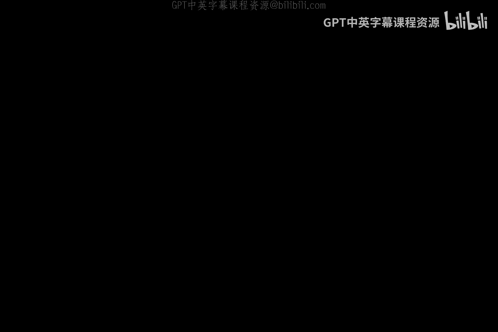
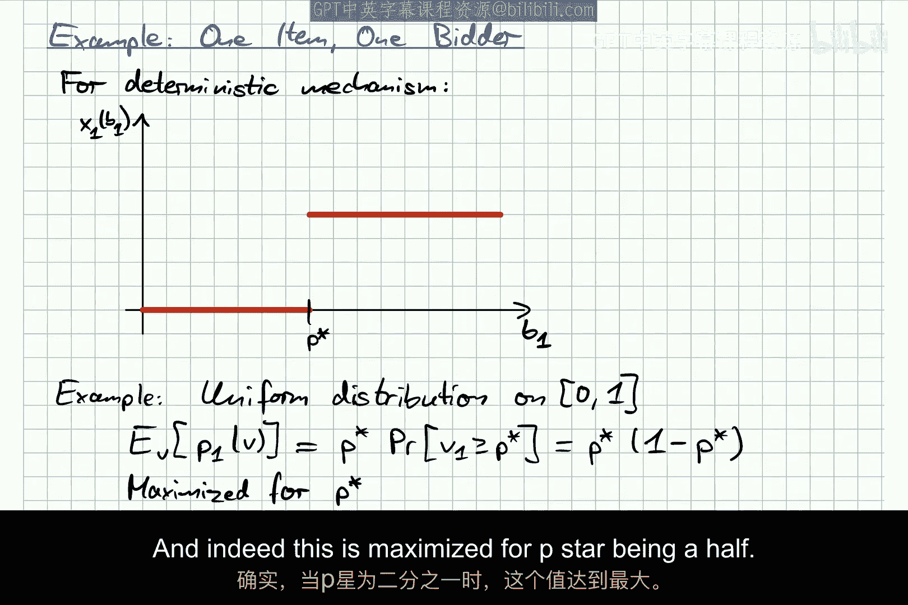
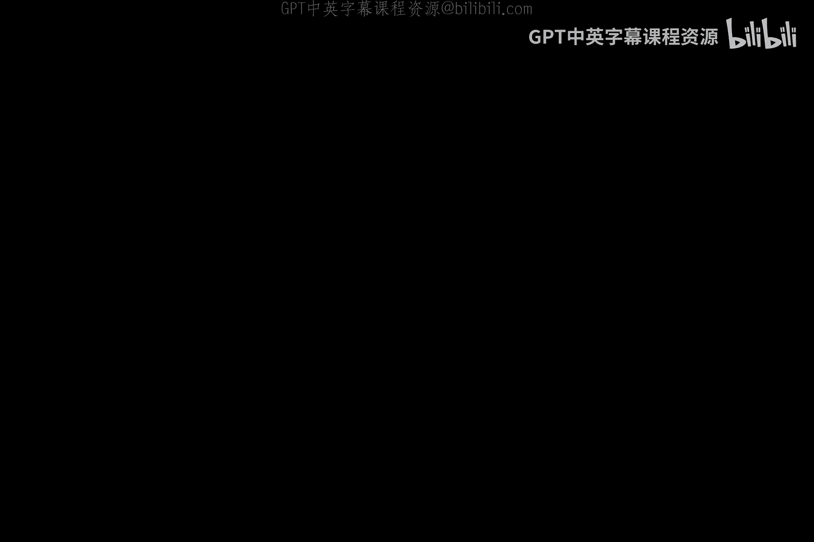
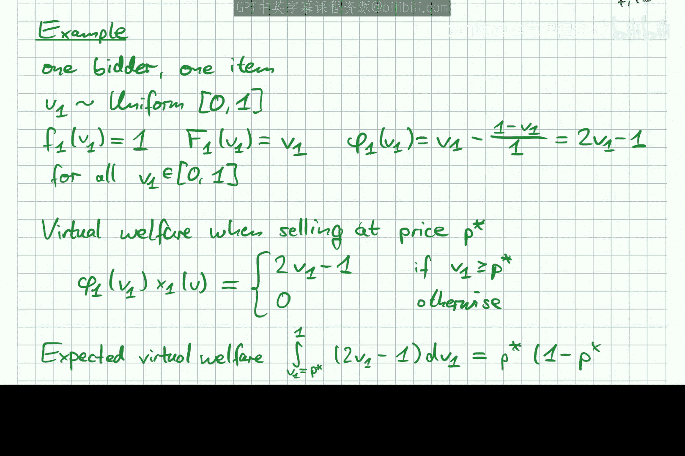
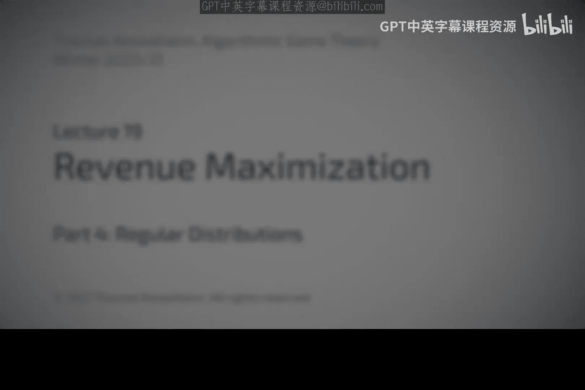
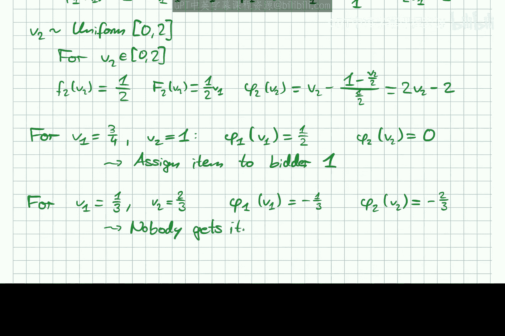

# 波恩大学《算法博弈论｜Algorithmic Game Theory, Winter 2020-21》中英字幕（claude-3.7-s p20 AGT, WS20_21_ Lecture 19 (Revenue Maximization).zh_en -BV1m9ZyYoENg_p20-

Welcome back to our class on algorithmic game theory over the last lectures we've developed a pretty good understanding of mechanism design in particular for the goal of maximizing social welfare。

This means we might have one or multiple items。And we then want to assign the items to the buyers to maximize the sum of their allegations。

Today we are moving to a different objective， namely we want to maximize the revenue。

Which means that we want to maximize the sum of the payments。

And we will go back to just the case of a single item。

You remember maximizing social welfare in case of a single item was rather easy by， for example。

 running a second price auction。And then we even don't have to know anything about the virus in advance。

This is not quite true if we want to maximize revenue， because if， for example。

 we had only one buyer。How would we want to maximize revenue。

 This buyer could claim arbitrarily small values and。

We should probably give them the item and there's no way of enforcing anything。

This is why we assume like we did this also in other cases that in advance we know the。

Valuation the probability distributions the valuations are drawn from。And based on this。

 prior knowledge， we then design a truthful mechanism with the objective of maximizing revenue。So。

 let's first。Write down our model。We'll have N bidders。

And the set of all bidders is again denoted by capital N。And。😔，There is only one item。Each bidder。I。

Ass a private value。VI for the item。And we'll report a bit。B I。And we assume。baad。😔，VI is drawn。

From distribution DI。Independently。DI is known publicly。And the support。Will be something from 0 to。

V max。So there is an upper bound on the。And。On the values that buyers might have， namely it is Vmax。

Furthermore， we assume that these are continuous。So it's density function。Will be called F。And it's。

Q。😔，Cumulative。Distribution function。Will be capital F I。This means。That weekend now right。

The probability。That VI is utmost T。This we can alsoright as capital F of T or as the integral from。

0，2 T of small F I。F g。第几。And what's not our goal， our goal is to design a mechanism。

Still a mechanism consists of an outcome rule and a payment rule now here。

 as we now have the density function called small F， we'll call the allocation rule。

The outcome rule now small x rather than small F word other than that。It is just the same， so。

A goal is to。Design。A mechanism。And。Which is a pair of an outcome rule and a payment rule。

And this outcome rule。Will be mapping。Vactctorors of bids2。

Vactectctorors between vectors of numbers between0 and1。Where。The sum of these entries。

Will be at most one。What does this mean， how can we interpret this？Well， there is the pretty。

Natural way of understanding this， if one of these is indeed one and the others are zero。

 so this could be one option， then this buyer is getting the item。

 otherwise we can also interpret this as a probability distribution。So we could also say， okay。

 now this buyer is getting the item with probability half， this buyer with probability a third。

 and this probability was worth probability a sixth。

But these probabilities don't even have to sum up to one。

 this might also be less than one if we just decide to keep the item。

So one possible allocation is also just to say， okay， nobody's getting the item。We'll just stay。

 we'll just return the all zero of vector， also that's something that is possible。

And what's our goal？Our goal should be that M is truth， should be truthful。And we want to maximize。一。

Some of the payments。When buyers are reporting truthfully。So once again。

We want to design a truthful mechanism。Each truthful mechanism。Now， comes with。A payment rule？

So we restrict ourselves to mechanisms， of course， which don't allocate the item more than once。

And the ones that are truthful， and each of these comes now with a payment rule。And this。

Among all now these truthful mechanisms， we want to now choose the one mechanism or。

There might be even multiple one of the mechanisms which maximize the expected sum of the payments if bidderers report truthfully。

You may not ask， why is it that we're insisting on truthful mechanisms， indeed。

 there's no real need for this。There's also some more general statement than this。

Let's not talk about this right now， so the point is because the mechanism is truthful。

 we can expect the buyers to actually report their true values and that's only why maximizing this thing makes sense if this was not a truthful mechanism。

 then bidders might be lying and this is not necessarily related to the money that were actually getting。

Good。So maybe let's first talk about the case that we have only a single buyer。

Because then things are actually very easy。First， I'd now like to talk about the case that we not only have a single item。

 but also only one bidder。What can our truthful mechanism then look like well let's restrict ourselves to a deterministic。

Mechanism。Then， the。Outcome rule will be something very simple， namely what will this look like？

For a deterministic mechanism。Let's draw the same kind of picture that we were drawing always in when we were talking about Myerserson's lemma。

 so we'll have the bed。Of this bitter。And then we have the allocation。Of this bitter。

And now we can draw。Alloccation curve。And this will be something。Will have to be something monotone。

 which means this will look something like this。Good。Now because this is monotone。

This is actually very simple。 we start from with a value of0 here。

 and then there's the point at which we're getting the item and let's call this。Point P star。

Because this we can understand as a price for the item， if the bidder is bidding less than this。

 then they're not getting the item， if the bidder is bidding more than this then they are getting the item and this clearly is independent of B1 because。

Well， this is just what this picture looks like。UmIf B1 is small， then B star a P star。

 then they're not getting the item if it is larger than P star， then they're getting the item。Good。

 now， if， for example， we have the uniform distribution， how could we maximize。A。The revenue。

Then we might now write down the expected。Payment。Of buyer1。And this will be how much will this be。

 this will always be P star times the probability。That VI is at least P star。

And in the case of a uniform distribution and by which precise uniform distribution do I mean。

 I mean it on the interval zero to1 then。This probability will be exactly1 minus p star。

And so this will be our expected revenue。When we using the price P star？

And now we can ask how can we maximize this？Among all P star and all you'd have to do is。

Just take the derivative by P star and figure out where it is maximized and indeed。This is maximized。

4 P star being a half。

You can also do this argument for other distributions then， of course。

This year would be something different than 1 minus p star and you would also get some other P star that then maximizes this。

But what we'll get to know now？Is a much more general approach to this problem？Namely。

 we'll understand also the problem for multiple bidders where of course this will not look as simple as this because now what made this problem so simple was that there are no other bidders and in general。

 this point where we're switching from not getting the item to getting the item will depend on the other bidders bits。

And how do we generally now design the mechanism so as to maximize the expected sum of the payments？

Feels super complicated， but amazingly because we have Myersersonlemma and we have a precise room for the payments。

 it is not it is。Pretty easy。And that's what we're doing next。

So now we come to the more general problem of having multiple bidders and we have a single item。

 although actually this is not important anymore that we have only a single item。

 this is even true for any single parameter problem that we're。Considering now。

What is it that we will be doing， we will apply Myerserson dilemma。And this is， by the way。

 why it is only called Myersons lelemma， because this is what Myerson actually wanted to do with this。

 This is the famous result of maximizing revenue by Myerson。What does Marison's lemma tell us。

 Myson's lemma gives us a precise formula for the payments。Let's recall that。

We have that the payments。If I'm bidding truthfully， the others are bidding anything。

Will be as follows。This will be。If I bid not truthfully。

 my value times how much I'm getting because we're in a。Single parameter heading here。Minus。

This integral。Here we are integrating over this。Function， so this is the area。Above sorry。

 the area above the curve。If we now assume。That Xi is differentiable。We can。

Interpret this in a different way， namely we can also do integration by parts here。

What is it that we can write and stand， we could write and stand that this is the integral from zero to VI。

T times。X I prime F T commma B minus I Dt。And this holds。If x。Is。Differentiable。

And what it is doing that what it is that we're doing here is integration by parts。Good。

One thing that I actually don't like about what we are doing now is that eventually。

X won't turn out to be differentiable。But what you could still do is approximate all of this by a differential function and then take the limit and what you're doing then。

Is just。All time。So if you really insist on mathematical precision。

 probably you won't be super happy with what we're doing， but。

What I want to focus on is the general idea and how we now get from here to our eventual mechanism。

Good， so this is our formula for the payments。We are designing a truthful mechanism。

And our goal was to maximize the sum of these payments。For truthful。Valuations。

So let's first just rewrite down the expected payment of bitter I when bitter I is bidding truthfully。

 the other bidders are bidding。Something。This now can be written as follows。

Just take the expectation of a VI。The payment of bitter eye。And。Now I use。The property。

Of the distribution。That small Fi is a density function， so we can write this as this integral。Good。

Now， of course， we can replace this PI term。By this integral。And， let me。

Make sure that we don't mix up the integrals here。Okay。

Now Fbinus theorem tells us that we may also switch the order of the integration here。Unless。

 of course， there's something。Nasty happening here， but as I was saying。

 we assume that everything is nice and we may do all these operations that we are doing now。Good。

 so instead we might take the integral from0 to v max。For T。

And then inside we are integrating from VI。From T to V max。F I of V I。DVI。

And then we multiply this by T times X i prime F T comma b minus I。嫡气。Note。That here。This。

Thing just doesn't depend at all on VI。 The only thing in this integral that depends on VI is actually the。

The upper end of the integral。And now。What is happening is that。We are。Now。

 first or the outside integral is now going over T。All possible values for T。

That could possibly appear， and then we have the inner integral。

 which only starts at T and then goes up to V max。And again。

 we have only these things here that depend on VI that does not depend on VI。

 that's why it's outside。Good。😡，Now how big is this？This is exactly。1 minus。F I， capital F I of T。

Why that？Because capital FI， we said was the cumulative distribution function。

And this is indeed just the probability that VI will be somewhere between T and V maxax。

And so this is exactly one minus the probability that it will be below T。Okay。So。Where are we？

We now have。This integral， let me once again write this。And let me use two different colors here。

We'll have1 minus k F I of T。Times t。And then this will be multiplied by Xi prime of t comma B minus I。

And all of this。We integrate over team。Why did I write it now in two different colors because we now have？

Two things here。Two factors， and we'll now do integration by parts。We will。

Take the derivative of this and we will integrate that term。Good， what will this look like？😮。

Tk the derivative。Of this red part。This will be。Minus small F I of T times t。Plus。

1 minus capital F I， F T。Recall that small F is the derivative of capital F。And。

Let's integrate axi prime。That is really easy because we just get X。And this tells us。And that。

The integral。Of。Be。Red thing。Times。The blue thing。This will be。

1 minus capital F I of T times T times x IF T comm be minus I。Minus some integral。

 So where did this come from， we take。This here this red part and the integral of the blue part。

This is what we're getting here， this is just integration by parts and then we still have this remaining integral。

 which is the derivative of the red part。Times the integral of the red part。Good。So。

What does this give us？This gives us that to we now。

We take the integral from 0 to v max of 1 minus F of T。Times t times Xi prime of t can be minus I。

That， this will be。Take。This first thing。From。T equals 0 to v max。And then。From that。

 subtract the integral。Also going from。0，2， V max。Good。Now， let's see。What we're getting here？

There is。This here， how big is this？So we'll plug in the max and zero into this term。

How much is it that we're getting if we plug in V max？How big will this be。 Well。

 we have this one minus F of V max U F I of V max is how much。

 This is the probability that we see a value of at most V max， and this is one。Cool。

So this will be zero then， and so this entire product will be zero， of course。If we plug in zero。

 then because theres the T showing up here， this will also be zero。So this entire thing here。

Will just be 0，-0。So it will always be zero。So all that remains。Is now this funny integral。

And let's move the minus sign inside。We're going to have F of T。Times t minus。

1 minus capital F I F T。And all of this is multiplied by Xi of t comma B minus I dt。

What do we do now？How is any meaningful。We'll now introduce a new function。

And then we'll see that this suddenly becomes something。That does have a meaning。Namely。

 what do we do now？We define。F I F T as T minus。1。Minus F of T。Divided by small F IFt。So then。

This in our part here。This will be what？This in our part here will be equal to small F of T。Times。

V I FT。So。Where are we now。Maybe let's take a step back and let's look again where we've started from and where we are now。

We have now a formula for the expected payment of bitter eye。

When bitter eyes beating truthfully and the other bitters are bidding。Anything。

And this is this formula here。Let's just write this down。The expected payment。

Of bitter eye when bitter eye is bidding truthfully。

 the others are bidding anything this is exactly equal to。The integral from zero to v max。

F I of T times phi I F T times X I of T comma B minus I Dt。Or alternatively。

 we may also rename T to just again VI if we like。Because。😔，Then we get this。😔，Expression。And。

This might indeed look familiar。Because we're taking an integral。Over all possible values of V。

 and then we are multiplying the。嗯。The density of VI at this point with something。And so。

This is nothing but the expectation of this。Something when we're drawing VI from our distribution。O。

Now we add in the other bidders。So， we。Do the same thing for every bidder and we now assume everybody bids truthfully。

Then what is it that we're getting？First。We can take the expectation。Over v minus I。

Because this holds for every p minus I。First， we might now set。

B minus I equal to v minus I and then take the expectation。Over B minus I。

 and then what is it that we're getting， we're getting that the expected payment。Of our。By I。

When everybody's bitting truthfully is the expectation of this V of V times X I of V。

And by the narrativeity of expectation。We also have that the expected。Sun。Of the payments。

Is equal to。第一。Expected some of。These terms V I of VI。Times X， I of V。Good。Now。

 did we get any closer to our goal？Maybe not。For you so far it seems but we did。Because。

This is something talking about the payments。And of course。

 this is what we actually want to maximize。This is something not talking about at all。

 about the payments。Because we have this。CI function。 How was this defined？FI was just something。

That depended on distribution。Di。So this is something that just depends on distribution DI。

And then it takes as input VI and then returns something。And here。This is just how much is。

Beittter I getting when everybody's biating truthfully。So this doesn't relate at all to the payments。

 but this is only something about the allocation that we're doing。And this is。Again。

 the magic of Myson's Lamma actually happening here that the payments are unique for a truthful mechanism。

 we don't actually have a choice， all we have to choose is the allocation function or the outcome rule and this gives us then everything。

Good， so。What does this mean？This？嗯。Looks actually a lot like social welfare。

If we didn't have the P function here。Then this would be exactly social welfare。

 and I mean if instead of VI of VI， who would have VI there。Then we would have。

Exactly social welfare there。Now these PI functions are applied on this。

 and this is why this is now called virtual welfare。The VI functions。

 those are called the virtual value functions， they somehow translate a value into a virtual value。

And then the expected revenue corresponds exactly to the expected virtual welfare。

So if we compare this to。social welfare？Which would be something very similar。Namely just the VI。😔。

Times X I of me。Therefore we call sum V of V times Xi V virtual welfare。And。FI。S V I。Which。

I hope you remember how it was defined。Let me once again tell you this was VR minus。

1 minus capital F I divided by small F I of V I。 This is called the virtual。Value。Good。

So in order to design a truthful mechanism that maximizes this。

 we might as well design a truthful mechanism which maximizes this。

And this is our very first observation， and this is the keylemma。

To help us with everything that we want to do later to maximize revenue， maximizing well。

 revenue is the same as maximizing expected。Revenue is the same as maximizing the expected virtual welfare。

Let's write this down。 This was the R。Observation。From everything that we've。Done so far。If we let。

As be truthful single parameter mechanism。Then we'll have that。😔，Expected。Some are the。Payments。

So the expected revenue will be equal to the expected。Some of the。Virtual values。Where。We again。

 have this。F I of T equal to T minus。1 minus F of T。Divided by small F of T。And once again。

This is the expected revenue。And this here， this is the expected。不要 true。😔，Welfare。Good。Of course。

Maybe not of course， but one thing that you should be aware of is that it's not that pointwise these are equal。

 it's not that whenever you now run the mechanism with a certain valuation profile。

 the revenue that you're getting it' exactly equal to the virtual welfare that you're getting。

But in expectation， they are the same。 so taking the expectation on both sides。But。

This at the same time means that if we now want to design a mechanism that maximize expected virtual welfare。

 it is enough to maximize if we want to maximize expected revenue。

 then it is enough to maximize pointwise virtual welfare。Because if for every。

Valuation profile V that we see if we always maximize virtual welfare。

Then we also make maximize expected virtual welfare and this means。

That the expected revenue will be maximized。Before we do this in more generality。

 let's first come back to our example。We again， have one bitter。One item。And。

E1 should be distributed uniformly。😔，On 0，1。What's the density function of this？Small F1， F V1。

Will be one everywhere。What's the。Cumulative distribution function， this will be V1。

And what's this virtual value function。This will be。V1 minus。1 minus v1 divided it by 1。

 so this will be2 times v1 minus1。And this holds。For all we one。Between 0 and 1。

What's the welfare What's the virtual welfare of。A mechanism selling the item at price P star。

We'll have。Phi1。A v1 times x，1 A v。This will be， of course。Two times v1 minus1。

If we are allocating the item。But if we're keeping the item， then it will be zero。

The expected virtual welfare。Is。To integral from。P star 21。Two times v1-1。D v1。

 and this is exactly equal to p star times 1 minus p star。

Good。So。This is actually coming out as a special case。Of ourlemma。The expected virtual welfare。

This we know has to be equal to the expected revenue。

 which we before already determined as p star times 1 minus p star。

And this is indeed exactly what we're observing here， although this looks a little strange。

 maybe because the virtual welfare。😊，That is something maybe a little weird。Because。We are now。

We now have this virtual value function， which is just this。

Doesn't have a meaning by itself other than this was just the thing that we。

Accumulated in our integration process。And so this will in this case， be exactly。This function here。

Good。And now。What's x1 doing it is deciding whether or not to allocate the item。And in this case。

 it says， yes， I do allocate the item if you want is at least P star， then I'm getting this much。

Virtual welfare， and if I'm not allocating the item。

 then of course I'm getting zero virtual welfare because then this x1 will be zero。Good。

Something that you see here。Is that if you said， for example， P star to zero。

 then your virtual welfare might sometimes even be negative。Because then what you're getting here。

 this for V1 being。Less than a half this will be negative， so virtual welfare can indeed be negative。

And this is usually a little surprising， a little confusing。

And this already tells us that it's not that point wise always virtual welfare is equal to revenue。

But it's only true in expectation， the expectation of virtual welfare is equal to the expectation of the revenue。

Now how do we now maximize expected revenue， we know that we have to maximize expected virtual welfare。

But how do we do that？😮，If we make one further assumption on the distribution。

 then this will be very not very easy， but yes， the resulting mechanism will be。Very easy。

So where are we right now？We have already shown that the expected revenue of a truthful mechanism equals its expected virtual welfare。

So rather than designing a。Truthful mechanism that maximizes expected revenue。

 We might also want to design a truthful mechanism which maximizes expected virtual welfare。No。

We'll introduce one further assumption to make things simpler。Namely。

 we will assume that our distribution is nice。And this is not called nice， it is called regular。

 but you should think of this as just nice distributions。

 most distributions that you will probably have heard of are regular。

 but it's not too difficult to come up with examples of distributions which are not regular。

For example， a uniform distribution。Or a normal distribution。Or an exponential distribution。

 those will all be regular。How is it as regularity defined？We say that distribution DI。Is regular。

If it's associated virtual value function PI is strictly。Increasing。Good。So once again。

 what was this virtual value function？This was P F T was equal to t minus。

1 minus capital F I of T divided by small F I of T。For example。

 we saw this for the uniform distribution。There we had。That。F I of T was equal to。Two times t minus1。

 which would be a strictly increasing function。 So that's just one possible example that you can keep in mind。

谂。Why do we like this if this is a strictly increasing function？

Because now we can use a mechanism to maximize revenue， which just maximizes virtual welfare。

Let's formally write this down。The virtual welfare maximizing mechanism。Its defined。

By allocation rule。X star。That。On input。B maximizes。Virtual welfare， so。

Take the sum over all I and N Phi I。F V， I times the X I star of B this。

And I wrote this year in terms of B。We maximize。And，Virtual declared welfare to be very precise。

And we use payments。According to Myersersonslema。Good。Now， this mechanism。How does this work again。

 it's actually a mechanism that we kind of have already seen， you take as input。

The bids said what the bidders claim there。Their values are from this。

 you compute the virtual values。By applying the respective virtual value function on each of the bits。

And now what you do is you just find whatever maximizes。です。Dlared declared。Virtual welfare。

And this you might do by， for example， giving your item to somebody or keeping the item for yourself。

 we'll see this in a bit。啱。But before we do this， let's first see that if the distribution is regular。

 if all distributions are regular， then this actually gives us a truthful mechanism。Because this。

Wouldn't be true if the distribution wasn't regular。 This will be one of your exercises， by the way。

 to verify that if you have a non。Regular distribution， then this will not be a truthful mechanism。

What we now claim？Is that。If all。Meters。Valuation distributions。A regular。Virtual welfare。

Maximizing mechanism is truthful。Furthermore。It maximizes。Expect a revenue。

Among all truthful mechanisms。Get。What is it that is happening now？Why is this a truthful mechanism？

Well， the thing is。This will be a maximizing this match here will be a monoone allocation rule。

And these PI functions are strictly increasing。Because then。

Bidding more means that also your virtual value， your virtual bid will become more。

And this means you， because this should be maximized， you're only getting more。

So this is why we have a truthful mechanism。Good， so because we are combining this with the payments from Myerson's Lamma。

 this will be truthful mechanism。Now， why does this maximize revenue among all truthful mechanisms？

Let's write down。The mechanism of our the revenue of our mechanism and the revenue of any other mechanism。

That。M。Be any truthful mechanism？And。P star Truopful payments。And by this。

 I mean the unique truth for payments。So that。X star come a P star。Is truthful。Good。

 what do we now have， What's the expected revenue of mechanism M。The expected revenue of mechanism M。

Is equal to its expected virtual。Welfare。What's the。Expected。Welfare of our mechanism。It's， it's。

Expected。V true welfare。And what do we know？Because。We maximize。V true welfare。We not have that the。

Virtual welfare point wise。Of our mechanism will be at least the virtual welfare。

Of that other mechanism。And this means that this inequality。

 of course also holds in expectation if we take the expectation over all V。And this means。Of course。

 that the expected revenue。we're getting from our mechanism。Will be at least。The expected revenue。呃。

That other mechanism。Good。So we now have a mechanism。To maximize declared welfare。A。And。

Not only that， if the distributions are regular， then this will be truthful mechanism。

 and this means this will also maximize the expected revenue。But this still sounds very complicated。

 find the allocation that maximizeizes virtual welfare。How would you do that？

The answer is surprisingly simple what the revenue optimum mechanism will now look like。

If we sell a single item。For a single item。Virerual welfare is maximized。Bye。Assigning the item。

To the bitter。off。Highest。Reported。发出。😔，Value。is if this value is positive。Otherwise。

 the item is left unallocated。Good， so once again， what is it that we do？

We now have a single item option。And in principle， what we could do is， for example。

 run a second price auction。This is something that we're not talking about today in terms of revenue。

 but we'll come to this as well。What would we do in turn in case of the second price auction。

 we would just take the bidder of the highest reported value， take the bidder with the highest bid。

 give them the item， that's the allocation rule and the payment rule just comes out of my dilemma。

Now， we do something。Similar。But before we determine who bid most。

We actually converge all these bids by。Always determining the respective virtue it。

So apply the virtual value function on the respective bid and now give the item to the bidder。

That's the highest reported virtual value。But if this value is then negative。

Keep the item for yourself。This， by the way， is a step that is implicit in something like the second price auction。

If。All bits are negative， which will never happen there。

Then don't give the item away at all here now we have to make this explicit that。

If the highest virtual value is negative， then keep the item。Don't give it away。Let's prove that。

That this indeed maximizes。Virtual welfare。Let's consider any V。And any allocation。X of B。Now。

 what will we have？It may not happen。At the maximum。Vual。Value is。Non negative。And。

Because the item is allocated at most once。ThereAnd therefore we have that the。Virtual welfare。

Will be at most。The maximum。Of these。Virertual values。Why that？Important thing is still。

One of these might be negative， or many of these might be negative。

But because the maximum of these is positive。And those X I sum up to at most one。

All we're getting here is clearly upper bounded by the maximum。Of these virtual values。And the。

Virtual welfare that we're getting from the allocation rule， how much is that？

Who did we give the item， we give the item to exactly the bitder of maximum virtual value。So。

 the virtual value。😔，Virual welfare of the above allocation rule。Will be exactly equal to。

This maximum of all VI of VI。Good， so in this case， we definitely are maximizing。Virtual welfare。Now。

 the other case is that。If。The maximum virtual welfare is non positive。This means that。

The virtual welfare that we're getting。From any allocation cannot be positive。Because。As we see。

 how could this ever be positive if all of these are negative？

And what's the virtual welfare of our allocation rule then we are not giving away the item and in this case our virtual welfare is simply zero。

 and the virtual welfare of any other allocation will also be at most zero。

And this in combinationmination proves。Ourc claim。Namely。And that if we have a single item。

Then how would we maximize virtual welfare， we would maximize virtual welfare by giving it to the one who has the highest reported。

Virtual value。If this is positive， otherwise the item is left unallocated。And。Now。

 if the distributions are。Regular， this will also be a truthful mechanism。Good。

Now what does this mean， let's see this much more precisely。What。A revenue maximizing。

A mechanism for a single item might look like。Well have， for example， V1 being drawn uniformly。

From 0，1。This means that。For everything。😔，Between0 and 1， the。Density will be one。The CDf。Will be V1。

And the virtual volume function。Will be v1 minus。1 minus v1 over 1， so this will be2 times v1 minus1。

And let's take another bidder whose value is drawn uniformly from the interval from  zero to2。Now。

 we'll get something similar。Density function。Will be a half。The CDf。Will be a half times V1。And。

The virtual value function。Willll be2 minus。1 minus v2 over 2， divided by a half。

And this will be two times v2 minus-2。Good。So far。Nothing spectacular is happening。

 we've seen this before。Now， what if。Bits bed what。What will our mechanism do？

Let's consider our first example where。V1 could be three quarters and V2 would be1。

Who is the higher value？Three quarters versus one， that's clear that will be bitter2。But。

We'll have to compare the virtual values。And。This is maybe surprising。Because。What is phi1 of V1？

Well， this is two times three quarters minus1， this will indeed be a half。But V2 of V2。This will be。

Two times 1 minus2， this will be zero。So who's getting the item now？Which of the two is higher？

This one here is higher。 A half is higher。 So we're giving the item to bid one。啱。And。

This means that not necessarily the one who has the highest bid will get the item。Now there's。

The question if。So which of the two is higher， is it a half or zero？It is a half。So。

To maximize virtual welfare， we're giving the item to Bi 1， although Bi 1 has the smaller value。

 we are giving them the item。Because this is we're not maximizing welfare anymore。

 we're not maximizing social welfare anymore， we're maximizing virtual welfare and we do this by giving it to in this case the bidder has the smaller value。

But it may even happen that we're not assigning the item at all。Namely， for example。

 if V1 is a third。And V too is two thirds。Then。第一。Rraual values will be minus a third。And。

inus two third。And these are both negative， so nobody gets the item。

The first time you see this this might be a bit confusing。

 why is it that we're giving the item to the one who has the smaller value。

 why is it that we're not assigning the item at all？Couldn' it be that if we now gave away the item。

 we could at least get some money for it rather than now not getting any money for it，'t this。

 isnsn't this weird？Yes and no。Maybe if we go back to a very first example。One item， one bidder。

There， it isn't actually surprising that we're not at all allocating the item down here because the point is。

That we want to ensure that whenever we are allocating the item。

We get a certain amount of money if we also allocated the item down here。Then。

What the bidder could do is they could just lie about their value and they could say， okay。

You're giving me the item anyway， so I'm making sure that I'm not paying anything for it。

And this is also。Showing up in these examples。Here we're giving the item to bidder one。

Because we are not giving it to bidder2， because bid2 has in this case， actually。rather small value。

With one， because it is distributed。Uniformly。On 0，2。 So half of the time。

 Bider2 will actually have a higher value。 So to now。Extract enough revenue。

We will be giving them only the item when the value is a lot higher。

Similar thing here in the second example， only there we have even。

Two bidders who have a rather small value。 so here the probability for bidder1 to have a higher value is two third and the same thing is for bidder2 so。

They both have a rather small value now， and this means we don't actually want to give them the item。

 We rather want to keep the item now to ensure that whenever they do have a high value that then we are。

Extracting more revenue。Good。😡，So as you see， maximizing revenue。

Is somewhere between trivial and super complicated？

It is somehow trivial because there is just a very easy rule。

 at least if the distributions are regular， but at the same time， this is somehow weird。

It is somehow weird that you're maybe not always getting giving the item to who has the highest value to mention just one case。

This even gets much more complicated if you have multiple items。😊。

That's not what I'm even talking about today。So questions that you might ask now is。What can。

Still say about easier mechanisms。 So for example， if I now ran a second price auction。

 would this give me good revenue？The answer is kind of， yes。

Although the revenue wont be optimal because。By design， you're always giving away the item。

 This is one of the results that we're going to prove in the following lecture， or。How。

Matro revenue could I get if I designed a really simple mechanism and just put a price tag on my item？

How much revenue could I get this way？This will exactly be the questions that we're discussing next time。

Until then， stay safe， have a great day， bye。