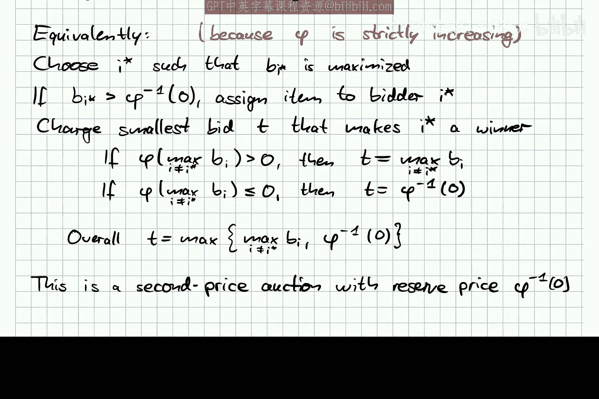
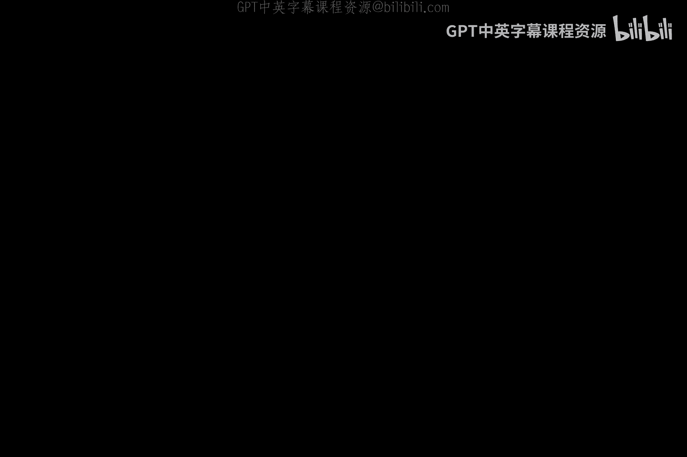
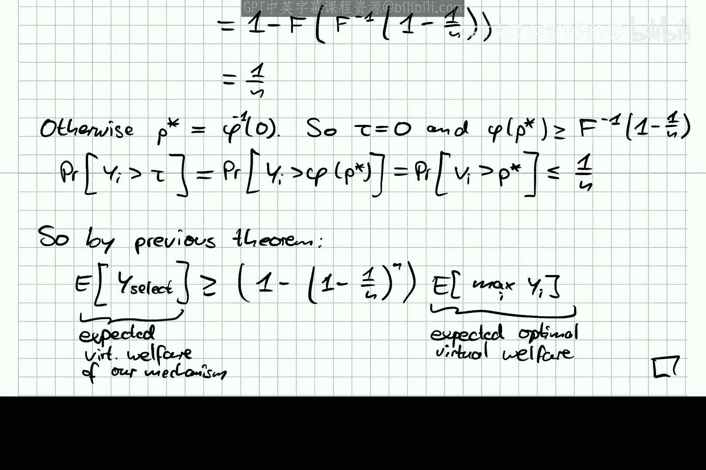
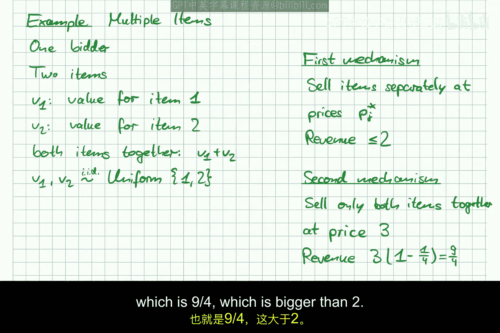

# 波恩大学《算法博弈论｜Algorithmic Game Theory, Winter 2020-21》中英字幕（claude-3.7-s p21 AGT, WS20_21_ Lecture 20 (Revenue Maximization with Identical Distributions) -BV1m9ZyYoENg_p21-

Welcome back to Arothmic Game theory。In the last lecture we introduced the problem of revenue maximization and we already derived the equality of expected revenue and expected virtual welfare。

Today we are continuing our discussion of maximizing revenue。

 but for a special case namely we assume to have only a single item。

 and we furthermore assume that all distributions are identical。Let's first recap the setting。

We have n bidders， which we will again call capital n the set， and we will call them1 through n。

As I was saying we have one item。And then we have these private Vals。Which are we want through VN。

 those are the private valuations of the bidders。Those are drawn from a known distribution。And today。

The thing that we are assuming is that this is。The same。For all bidders。Hi。

And this is why I'm dropping here the subscript。So the distribution will simply be called D and not DI because all DI would be the same anyways。

We assume that this has the accummulative distribution function， capital F and a density function。

 small F。What we showed last time was that。The virtual value function is very crucial。 What was that？

The virtual value function。That was just something that came out of our。weightight of。

Solving for the or finding out what the welfare， what the revenue of a truthful mechanism was。

The virtual value associated to value T is the following。

 we take the value T and then we subtract something。

 so this is something I should have said also last time the virtual value is always smaller than the actual value because we are only subtracting something。

Can even be negative， we've seen an example in which the virtual value was negative。

 and usually it will be negative for small values。Our assumption is。That。

This virtual value function is strictly increasing。

 this is just our assumption for today which means that the distribution that the values are drawn from isreg。

 this is how it's called。Effectively， this just means that this function should be increasing。

And this is the equality that we showed last time， we showed that the expected welfare is equal to the expected virtual。

 the expected revenue is equal to the expected virtual welfare。What was this。

 the expected revenue of a truthful mechanism is？Take just the payment rule and see what happens if every bidder pays their true value。

 what is the sum of the payments that we're getting in expectation？

And we compare this to this quantity here。Here。This looks actually like。The social welfare。

 even instead of fear of VI， we would just be writing VI here。

 then this would be exactly equal to the social welfare。However now。

 the values are reduced to only the virtual values and we are then maximizing the sum of the virtual。

Values。For the。for the。For our allocation。And in particular， if we have only a single item。

Maximizing this expected virtual welfare by a truthful mechanism can be done by just maximizing this。

Inner thing here， always choosing the allocation that maximizes the virtual welfare and this means that we assign the bid the item to the bidder whose virtual bid is highest。

 so just take see whatever they are bidding。To apply the virtual value function on those bids and see who had the highest virtual bid。

And。If this is positive， then we assign the item， otherwise we keep the item。But what does this mean？

What does this mean？In case we have a single item， so S you see I already dropped the subscript I of the P function because the distributions are all identical。

Then there's a much easier way to understand this mechanism because we're applying the same function。

To all of the bits， this is the first thing that I'd like to observe today。So our mechanism will be。

Choose the I star。Such that。😔，F F B， I star。Is maximized。And。I。😊，Fee of B star。😔，It's greater than 0。

Sign the item。2。😔，Bitter， I start。And then we。Charge the payments。According to。Myerson's lemma。

But what does this mean？How would we， first of all， choose this I star？Well。

 if the function phi is monotone。han。It is even strictly increasing by our assumption。Then。

I star will be exactly the one who bid most。And then we also have to figure out what these things mean。

So， we might。Equivalently， say。We choose I star。Such that。PI star is maximized。

And now what we can say is。If。Well。BI star is greater than phi。The inverse of phi applied to 0。Then。

 we would assign。The item。Too bitter。I star。So here we are using。That。Fe is strictly increasing。

And what would the payments be， Well， we know that the payments in this setting。

 how much would you have to pay if you are now bitterized star， you just should bid。

You have to pay the threshold。The smallest bid that makes you a winner。

And the only thing that we have to determine now what is the smallest bit that makes you a winner？

What does this mean？We can not say that。If。The virtual value applied on everything everybody。

 the virtual value of the maximum。Bard of everybody， besides。Ber I star is at least zero。Then。

This will be just。Okay。The maximum of all other bits。Right。嗯。

If there is also somebody else who would get the item instead。Because they also have a non negative。

 maybe I should be consistent here and say that this should be strictly greater than zero。

Although this doesn't actually matter。If。Also somebody else， apart from bitter eyesstar。

Would be getting the item？Then。Well， this bidder I star has to outbid this other bidder。

This smallest bid will exactly be the maximum of all。Other bits。And。What if this is not true？

Then I still have to bid。At least。This。Inverse。Of the virtual value function applied to zero。

So overall。This T， this will be the maximum of two things， namely， the maximum of all other bits。

And the inverse of the virtual value function at0。Good。😡，What kind of mechanism is this？

We are choosing the bidder who bids most。 and then if they are bidding something。

Which is if they're bidding at least something。Then they're getting the item。Otherwise。

 they're not getting behind if they're bidding at least there something。

 then they have to pay the maximum of this something and the highest highest of all other bits。

What you can realize now is actually this is almost the second price auction except for that we have a reserve price。

We have a reserve price of this inverse。Virtual value function， add 0。So。You have to also。

Bid at least this reserve price and you will also have to pay at least this reserve price。

 so this looks nothing but that we are adding another bidder who's always bedding this reserve price。

If that other bidder is winning。Then we are actually keeping the item。But if it is not winning， then。

This also contributes to the possible highest bid。So by introducing more or less this fake bitter。

 we kind of。Increase revenue as opposed to when not having this because it increases the price。

 the payment that has to be made when somebody's winning because maybe the second high bid was smaller than this。

Good。So revenue maximization isn't actually always complicated。

 If you have only single item and identical distributions， then more or less the。

Second price auction will do the trick except for the fact that you already have to know the reserve price。

That you have to suitably set the reserve price。This， by the way might be something that you've also。

Seen before this kind of an auction format。More or less， when you're bidding on eBay， for example。

 then they have a starting bid， meaning you have to bid at least this much。

To be taken into consideration at all。This is what you can actually understand as a reserve price。

And also。When you're。Participating in an auction for some artwork。

 you will also see the same kind of a mechanism in place that there will be a starting bid。

 that there will be some kind of a reserve price and if nobody wants to pay this much，Okay。

 then we are not selling the item at all。At the same time， of course。

 mechanisms and practice have to take into consideration much more than what we are taking into consideration here。

 like for example， that the auction quickly converges to things so there's a lot more to think about when you think about designing an auction but what you see is that。

It doesn't have to be difficult always。 Sometimes a second price auction with a reserve price will be revenue optimal。

But what if you'd want to do things even simpler？What if you just run a second price auction。

 will this also be good or not？Yes， it is at least approximately optimal in a very interesting sense。

And this is what we will show next。

What if now you were still running a second price auction because you're lazy， okay。

 this will be a revenue optimal？But we can show that it is still a reasonably good mechanism。

In terms of revenue， if all distributions are identical and regular。Namely。

 we'll not show two results， the first one being out of all mechanisms that always allocate the item。

The second price option is revenue optimal。Remember that the。That the revenue optimal auctions。

 like for example， the second price auction worth the reserve。

The point is that sometimes we don't give away the item at all。

But if we were now insisting on always giving away the item， then。Among all truthful mechanisms。

 the second price auction is optimal。So if all valuations。A drawn。From the same regular distribution。

The second price option。Maximizes。Expect the revenue。Among all truthful mechanisms。

That always allocate the ion。Let's show this， how do we show this？😮，Well， we just take。

Any truthful mechanism that always allocates the item and we take our second price auction and we just compare their revenue。

How do we compare their revenue， we compare their virtual welfare。So that。M star。

 which is the pair of。X star and P star be the second price option。And M。Which is a pair of X and P。

Be any other truthful mechanism。That always allocates the item。Good。Now。What will happen？

Consider any valuation profile V。Let。Ice star。B啲。Winner。Of M star。Under V。

 and we let I prime be the winner of M under V。So we just now run both of these mechanisms and。

Both always allocate the items。In the second price option， we call the V i star and I prime。

We call the winner of that other mechanism。And now let's compare the virtual welfare。Well。

 what do we have？We now know that VI star。Will be at least VI prime or that because the second price auction always allocates the item to the bidder who bids most。

 so if they bid that true value， this will be the maximum value。And so we also have this if we apply。

The virtual value function because this is a strictly increasing function。

And this means that if we now compare。第一。😔，Virtual welfare。

This will be P VI star for the second price auction。

 and this will be at least as much virtual welfare。As。For that other mechanism。Good。

And now if we take expectations on both sides。Then we gt。At the expected some of the payments。

This will be。For the second price auction。Will be exactly the expected virtual welfare。

And the expected virtual welfare of the second price auction will be at least the expected virtual welfare of that other mechanism。

And this will be at exactly， again， this mechanism expected revenue。Good。So。I really like this。

Statement， because。It proves something。That。It somehow， always。

Floating around when you think of how would you maximize revenue， somehow。

 this revenue optimal thing is sometimes not to allocate the item。Because you w to。

Save words so that sometimes you have higher revenue， but if you're not allowed to do this。

 if you're not allowed。To sometimes not allocate the item。

 then the second price option is indeed the best that you can do。U。Cool。Now， we'll do other。

Comparison of the second price auction。But this time we're even dropping the fact that the mechanisms always have to allocate the item。

But we would rather just see what happens if we introduce one further better。

And this is the following theoryorem。This is by。Beulo and Cler。From 1996。

And it is a little complicated to state。But it is super nice。Consider ir regular distribution D。会。

Any。And。Natural number。We expected。Revenue。Of a second prize auction。With。N plus1。Bderters。

Drawn from the。Is at least。The expected revenue。嗯。要。Is at least。As high。I。Optimmal revenue。

The optim expected revenue to be precise。With enbitters。Drawn from deep。Good。Let's digest this。

We now compare the case that we have n bidders。With a case that we have n plus1 bidders and in both cases。

 all bidders are drawn or more precisely， their values are drawn from the same distribution D。

Now we'll have the optimal expected revenue for n bidders。

And we compare this with the second price auction。For n plus1 bidders。

And we now claim that the expected revenue with the second prize auction。

With these n plus1 bidders is at least as high as the optimal revenue with only n bidder。

One way you can think about this is that here in this second price auction。

 there is just more competition happening。And this more competition。

 meaning that there's only one more bidder。This is much more helpful or maybe not much。

 but is more helpful than carefully crafting your optimal a。In this case。

 meaning that carefully choosing your reserve price。So if you know。

Nothing about your n+1 bidders and you just run a second price auction。

 this will give you at least as much revenue as if here you have to know kind of everything about your bidders。

 at least about the distribution， and you carefully have to choose your reserve price。Interestingly。

This is extremely simple to prove。When you already have the result that we've just shown。

 namely that the second price option is revenue optimal among all mechanisms that always allocate the item。

 What we'll do now is just we'll turn this optimal。

Mechanism in terms of expected revenue for n bidders into a mechanism for n plus1 bidders。

 which always allocates the id。And then this theorem statement follows。

Just by our lelemma that we've just had。Good。What we'll first do is we'll interpret。

The revenue Op mechanism。For n bidders。As a mechanism。M4。N plus1 bidders。How do we do that？Well。

 we have a mechanism that is revenue optimal for n bidders。

 how do we get a mechanism for n+1 bidders？We just ignore。Better n plus1。

And we only run the revenue optimal mechanism on bidders1 to n。The first thing to observe is that。

 of course， the expected revenue of this mechanism is exactly the expected revenue of the original mechanism that we were starting from because this same thing is happening。

Now were only in a setting of n plus one bidders。 Now， what we do is we。Transform。And。

Into a mechanism。And prime。That， always。Allocs the item。How do we do this？Whenever M。

Does not allocate the item。Give it to。Bitter N plus one。So bid n plus1。Absolutely。

Can't do anything because regardless of what they' are bidding here they are totally ignored and then it may happen that M isn't。

Allocating the item to one of bidders1 to n。Then in an M prime， bidder n plus1 is getting the odd。

And not paying anything。The revenue of M prime is the same as the revenue of M because whenever we are。

Collecting money， we're doing exactly the same thing。

And this is also exactly the optimalim revenue that you would get for n bidders。

Now compare this mechanism M prime to the second price option。M prime。

Runs on N plus1 items always allocates the item。The second price auction on n+1 bidders is exactly the same。

 and for that we know that it is revenue optimal。Among these mechanisms。So the expected。Revenue。

Of and prime。Is the。Optimal。Expected。Revenue。For n bidders。The second price auction。

This has expected revenue。On n plus one bidders of。At least。The one that M M prime has。

And this proves this theorem。Good。So as we see。The second prize auction is already performing pretty good。

Here。We can see how powerful it is to。Make this comparison among mechanisms of a certain class。

 namely mechanisms that always allocate the item。What we'll do next is go to an even simpler mechanism which。

All which not necessarily always allocates the item， but which will just have one posted price。

Now as I was promising， we're now coming to an even simpler mechanism。

 which just postss one prize for the item。And whoever comes first。

And if willing to pay this price can buy the item。For a single bidder， this is revenue optimal。

Why so。Because。This is just what the optimal mechanism looks like。

 it just fixes a price and gives away the item if the bidder is willing to pay this much。

 otherwise it keeps the item。This is what we've seen last time。

But let's now just consider this also for many bidders。Actually， they don't bid anymore。

 but they just come along and they see you take it or leave it offer。

 do they want I want to take this item or not？How do you analyze such a thing and how would you choose？

The price。To analyze this kind of a mechanism， we use a result from optimal stopping theory。

 which is called a profit inequality。Namely。Let。Y1 through Yn。The independent。

Identically distributed。Non negative。Random variables。And。Let's tell。B。

He threshold with the property that。The probability that we see。

A value higher than tau is exactly equal to one over n。W。Tau is 0， and。This。The probability that。We。

See a value that is strictly greater than0 is at most1 over n。And we now that why select。

Be the value。Of the first。Why I， for which。Why I is greater than tu。And。Zero otherwise。

 if there is no such thing。And then we have the following， then the expected value that we do select。

This will be， at least。1 minus。1 minus1 over n。To the power of N。

Times the expectation of the maximum of these Yi。Good。What does this mean so。

Independent identically distribute non negative random variables。

 just a sequence of them one after the other。And now we have a threshold tau。

And let's first only consider this part A here， if this threshold now has the property that the probability to be greater than this threshold is exactly one over n for every of the variables。

Then the following is true。We now just stop this sequence of random variables。

At the first time at which we see something that is bigger than how。

Then the expected value that we're getting this way will be at least。

Some factor times the expected maximum value in the sequence。So what we're doing is。

We kind of stopped the sequence at some point。And at this point， we asked。Well。

 how big is this value that we've stopped at？Which was the biggest value up to this point because it was the first to exceed the threshold。

But。This。The maximum in the sequence might of course be larger。And how much are we losing this way。

 what might also of course happen is that nothing is above tab。And if nothing is above tau。

 then we're collecting zero。And we're still comparing ourselves against the maximum in the sequel。

So that's why you see you wouldn't want to choose this threshold too high。

Because if you choose it too high， then chances are that you're not selecting anything。

 if you choose it too low， then you stop too early。

And we now see what we claim is choosing this threshold at the point where the probability that you see something bigger than the threshold is exactly one over end。

 this is a good choice。Or alternatively， it might be that for all thresholds。

 the probability is actually smaller and then you choose。As a special， simply zero。

And then so if you have that the probability choose to see something that is greater than0 is at most one over n。

 then you could also set the threshold simply to zero and then you'll pick the first。Positive。

Of these random variables， so the first one whose value is not equal to zero。Good。

What's this factor that we're seeing down here？This is equal to1 if n is equal to1。

But also for larger N， this is something nice。 This is something。That is constant， namely。

This will be at least one minus1 over E for every n。So。Approximately。int63。Good。

Let's now prove this claim。And what do we want to show。

 we want to show this inequality here regarding to expectations。And to this end， it suffices。To show。

That the probability。Let this y select。Is at least some value Z？That this is at least this factor。

Times the probability at the maximum。Is at least Z。And this is something we want to show for all。Z。

 which are not negative。Good， so let's show this inequality here。And to this end。

 we now distinguish two cases， namely， how big is this Z？Is this Z at most our threshold tau？

Or is it bigger than the threshold？Why do we make this distinction？

For every Z that is at most the threshold， when do we get that y select is at least z？We get it。

If and only if we stop the sequence at any point。Once again。

We impose this threshold and we stop at the first time at which the threshold is exceeded。Now。

 under which circumstances do we get something that is at least tau？Well， we get it if I only if。

We stopped the sequence at some point。And the true is the same is true for everything smaller than the threshold because we are not collecting anything unless we stop。

 unless we see a value that exceeds the threshold。She。Good， so this is our first case。

If Z is at most tau。Then we see that the probability。That why select？Is at least Z。

This is exactly equal to the probability that there exists in I。Such that Y I is。Bigger than tello。

And what's the probability for this？This is1 minus。1 minus1 over n to the n。This is true。

If the probability that Yi is greater than tau is equal to1 over n。Because they are all independent。

Nows。The alternative that。We chose a threshold that is zero。

And the probability that Yi is greater than0 is at most one over n。But in that case。

 we'll have that the probability that。Why select。Is at least Z。

This will be just the probability that。Why select。Is at least zero。

And this is one because we assume that those are non negative random variables。And。😔。

What do we wanted to compare this to， We wanted to compare this to the。

This probability wanted to compare to this factor times the probability that we see and at the maximum values at least z。

But。The probability that the maximum。Is at least Z， this will of course be at most one。And so。

No matter which case you're in， no matter whether this or this case。This inequality will always hold。

 it even holds if you replace this year by one。Good。😡，Now， the more interesting case。

Is that Z is actually great thanile， although you actually can do still the same kind of arguments。

So。If y is greater than tau。是。Sorry。So if Z。Is greater than cho。Then。Let's decompose the event。

That why select。As at least Z。Namely， how can this happen？This can happen if y12 Yi minus1。

 those were all not selected， so they are at most a threshold and Yi is at least z。

Those are disjoint events。And。The event that we're looking for here is just their union。

So we'll have that the probability that y select。Is at least the。

This will be exactly the sum of these individual probabilities。This will be the probability that y1。

Is umost tau and Y too is utmost tau。Answer1 up till y I minus1 is at most tau Y I is at least z。

And now， these are。Independent events。So we'll have the probability that。

Why I is at most tau times that soon times the probability that I-1 is at most tau times the probability that y I is at least Z。

Now。What do we know about all these events， What do we know about the probability？

And why I is at most t， maybe let's go back to our choice。Of why。And we see。

The probability that Yi is bigger than tau is either equal to1 over n or it is at most one over n。

So the probability that tau is at most。W over En。This will sorry。

 the probability that tau y is that most tau this will be at least one minus1 over n。So。

These things here， they are all at least one minus1 over n。So what we're seeing here is just the sum。

Of all these 1 minus1 over n to the power of I minus1 as the probability that Y I is at least z。Yes。

And this we can actually simplify。Because this is a geometric sum。

 we are getting that this is one minus。1 minus-1 over n。The power of N。Divided by。1 minus。

1 minus1 over n。To the power， to no power， the power of。还。Times。

Probability that Yi is greater than z and those are the same， so let me just write y1 at this point。

Now here you see that。This。Deenominator。You can simplify a lot。

And this way we get our fancy factor times n times the probability that y1 is at least z。

And this weekend now right。As。Our fancy factor。Times the sum。Of these probabilities。😔。

Because they are all identically distributed。Now finally。

 we'll have to compare this to the probability that the maximum of these Yi is at least z。

And this is also easy because the probability that the maximum of all I， Y I is at least Z。

 this is something that we can write as。第。Some。OfThe following probabilities。Y1 is less than z。

And y2 and y3 and so on， up to y I minus1， those should all be less than z。

 and then the probability that y I should be at least z。This here， this is something that is。

At most one， So what we're getting here。Is exactly。The sum of these probabilities。And in combination。

 this no。Shows also that here， the probability that。The value that we select is at least。

This factor times。The probability that the maximum is at least the。Good。So why do we care？

Why is this interesting， because now what were。Actually doing is we're setting one price at which we are stopping。

The sequence。 And then the。They respect the first bidder who' is willing to pay this much。

Will pay us the price。And the question is， how good are we doing in terms of revenue this way？And。

It's not entirely straightforward because there's， again， a step in between which uses the。嗯。

The virtual values。So what will our mechanism now look like？So our mechanism for a single item。

Will be？Choose the P star as。The maximum of the。Inverse of the。

Virtual value function evaluated at  zero and the inverse of the CDF evaluated at 1 minus1 for n。

And we sell the item。To the first。别纸。Whose value。Exceeds。P star。And， of course。

This bitter than pace P star。And our claim is。The posted price mechanism。Gives。

Have 1 minus1 minus-1 over n。To the end。Approxiation。To the optimal expected revenue。Good。

So what's the statement here？We呢。Compared to the mechanism with the optimal expected revenue。

 we actually know what this mechanism would be， it would be the second price a where the reserve and this exactly would be the reserve。

But of course you wouldn't want to just take the first bidder who shows up。

 who's willing to pay this reserve， this wouldn't give you optimal revenue because you still need the competition。

Among the bidders。Otherwise， your revenue would be too low。And we do this now by。

Not only having this reserve price from our second price auction here。AndAs part of our posted prize。

 but we'll also have。Something else which kind of replaces the competition。The different bidders。

And now our mechanism is very simple， it just takes this as a poster surprise and whoever is the first one who's willing to pay this price gets the item and pays this match。

And the point should be that this price here should be chosen in a way that。It is not too low。

Which means that。Bders are。嗯。Wwhich would mean that our revenue would be too small because the probability of selling the item gets too high。

 but at the same time it shouldn't be too high because then the probability of selling the item gets too low。

 we'll always have to find the sweet spot of the price and the probability of selling the item。

At this price。Good， let's prove this， and it is surprisingly easy given that we've already proven this other theem。

Let why I？😮，Be the virtual value of。Why are I， but at least zero。So， this is a。

Non negative random variable， and those are independent。The optimal。Viratual welfare。

It's therefore just the maximum。Of all these Yi。Which means that the。Expected。Optimal revenue。

It is the expectation of the maximum。Of these why。And we can now。The previous theorem。With Cao。

Being the revenue and the virtual value function applied to P star。Why can we do this？

What was P star， P star was the maximum of。嗯。The inverse of the virtual value function in 0 and。

This other term， which comes from the inverse of the CDF。Now maybe let's go back to our theorem。

 what will we have to verify， we'll have to verify that tau fulfills one of these two conditions。

The tau that we're choosing now either guarantees that the probability that we exceed that one of the y's exceeds it is equal to 1 over n or that this tau is0 and the probability that we see something positive should be at most one over n。

And。We can do exactly this。Because。We can just。See what happens in which case。

 So it might not happen that this P star is equal to。Inverse of the CDF。Of1 minus1 over n。

What will happen then， then the probability？To see。Something bigger than how this is exactly equal。2。

😔，Wi。Being。At least phi of P star。This tau was equal to phi of p star。And then。P star is exactly。

What we knew it is。And。If we now apply the inverse phi。

 then we can write this also as VI is greater than。The inverse of F add 1 minus1 over n。

But this is exactly one minus。F of。F。Inverse F 1 minus1 over n。And this will be exactly。1 over n。

Okay， so then we are save。Otherwise。P star will be。Phi of0。So tau will be zero。His towel was。

 once again。And a fee of P star。I forgot the this P star with the inverse of phi at0。

 so tileu would be0。And。Phi of P star。Would also be at least。The inverse of f at 1 minus1 over n。

And so we get the same kind of an argument now the probability that Y I is greater than tau。

This will be equal to the probability that Y I is greater than phi of P star。This will be。Equal to。

Proability that VI。Is greater than P star。And this will be at most one over n。Good。

So we've now verified that this choice of tau fulfills。第。啊。

The assumption that we had in the previous theorem。So by the previous theorem。The expected。

Value that we're selecting will be at least。1 minus。😔，1-1 n to the power of n times the expected。

Maximum。And this here， on the left hand side。This is exactly the expected。Virtual welfare。

Of our mechanism。And this year， as I was saying， this， this is。Expected。Optimal virtual welfare。

Indeed， this proof fields。A little complicated to me。Maybe just because。

People who invented them this for them， this first thing that we showed。

This profit inequality was just something that you knew。

And then also dealing with virtual values feels very straightforward。

 but what you see here is that if you know about virtual values。

 then suddenly you can apply theory from all over and now all you have to do is you only have to calculate with virtual values and the funny thing is all this these payments are never actually even appearing anywhere in here。

 so all we're doing is we're always only comparing expected virtual welfare。

When we now want to make any arguments regarding。UmRevenue。Once again， how did this work。

 we set a price and then we showed that this price has the property that either。

The sequence gets stopped at every point in time at with probability exactly equal to one over n or with probability at most one over n and the price is equal to our reserve price of the。

Second price auction with the reserve。Good。😡，So next I'd like to tell you a little more about。

What you can actually do if you do， if you insist， for example， not on truthfulness。

What could you do then and also what if you go beyond just a single item？

It is now time to conclude our discussion of maximizing revenue。

 although we've barely scratched the surface at this point。

We've only seen the very first steps that you could take to maximize revenue and there's so much more to explore。

One thing that you might want to ask， for example， why was it that we were insisting on truthfulness？

What if you took a non truthful mechanism？For example。If you're selling a single item。

 why would you use if you wanted to maximize revenue。

 why would you use the first price the second price a and not the first price a。

 it feels that in the first price auction bidders are paying more。

So doesn't this feel like a good idea？It feels like a good idea。

 but there's something you have to take into consideration namely。

 because this is a non truthruful mechanism， bidders won't usually be their true values。

 but something else。Namely， we can think of bitters being in a base natural equilibrium， for example。

And then we would ask， what's the expected drive of that base natural equilibrium？

And then you could compare the first price auction with the second price auction and see which one gives more expected revenue in equilibrium。

And what you'll come up with is actually， it doesn't matter both of them in expectation in equilibrium give the same revenue。

And in the lectures， you find a proof sketch of an argument。That tells us that。嗯。

If all buyerers distributions are regular， there's no mechanism M prime that has a base NA equilibrium in which the revenue is higher than in the dominant strategic equilibrium of the virtual welfare maximize。

This means that。You could， of course， construct a non truthful mechanism and then look at a base natural equilibrium。

 but eventually。All that you could be doing is exactly what you can also do with this truthful dominant strategy in of compatible mechanisms。

How do you prove such things？You。Shows something like Myerson's lemma。

 but not for dominant strategy instead of compatibility， but in the context of。

basedase Nash equilibrium， the same arguments actually go through。

 that's why we are not covering this in class because eventually it is just doing the exact same steps except for writing expectations around everything。

And then。How would you maximize？嗯。How would you maximize revenue in the base National equilibrium。

 you could actually go through the exact same steps that we went through last time and you would again end up with the virtual welfare。

So maximizing virtual welfare also maximizes the expected revenue among all non truthful mechanisms in their respective base Nash equilibrium。

Good， so。This is one thing that will not give you higher revenue。

One other thing that I'd like to briefly talk about is what happens with multiple items？

What if I now just had， say two items？And I mean not two identical items。

 two identical items then you could just。Understand all of this as a。

As a usual single parameter setting in which you can just apply everything that we've done so far。

But in such a multiparameter setting， where。Valuations are。

Different where you have one item which you value with one value and you have another。

Item which you value at a different value。And then。Pretty strange， strange things can happen。

Let's see this in an example。Let's just assume that we have one buyer。And two items。

The one That is the value。For item1， V2 will be the value for item 2。And we now assume that。

Both items together。We just have a value of v1 plus v2， so just additive。

 maybe the most straightforward way that this could ever be happening。

Now we'll have V1 and V2 distributed。Independently and identically。Drawn from the。

Uniform distribution just on the set。1，2。What can happen now？Well， we now have two items。

We have one buyer and this buyer can actually have。Four different valuation functions。

It can be one for both items， it can be one for item two， two for item two， or two for item1。

 one for item two， and it can be two for both items。How would you maximize revenue here？Well。

 one thing that you might be tempted to say is okay， I just sell each of the items。Independently。

 separately。What kind of revenue would this give here？This would be my first mechanism。

We sell the items。Separately。Add prices。PJ star。Now， what revenue would you be getting？

Depends now on whether you said。PJ star to1 or to two for which item？

And you can just go through all the four cases that you're getting。

 you could set the item the price for the first item to one or to two。

 the second price to one or to two， and what you end up with is，That。Actually。

 you will never get a revenue， an expected revenue that exceeds。2。Why that？

Because the expected revenue from the first item will be。One and also from the second item。

 it will be one。Yeah。Because you could either set a price of one or lower then you would definitely always get this price。

 but this would be one or less or something higher than one， but at most two。

 and that you would get only half of the time。So the revenue。We'll be at most too。But。

Let's see my other mechanism。What we'll do is sell。Only。Both items。Together。Add price。3。

What revenue are we getting now， When is the bidder buying that？

It will buy the item whenever one of the two values is2 and the other。

Is either one or two doesn't matter。So the revenue。Will now be three。Unless。

Both items are valued at only one， which happens with probability 1 minus1 over a quarter。

Which is 9 quarters， which is。

Bigger than two。So what you might have thought here is these items really have nothing to do with each other。

Bta  one just has a value for the first item， for the second item and。

The value for both items together is just the sum， so there's nothing。

that makes Bi one want item two less or more when he has or hasn't item one。But。As it turns out。

 maximizing revenue， you still want to kind of sell both items together。嗯。

This is what makes these things so super complicated， but it doesn't even stop there。

Sometimes you even want to sell lotteries， so you'll find a more complicated example in the lecture notess。

In which。The revenue optimal mechanism isn't even as simple as this。I pay I give you these。

These items for sure， and you pay me this much， but it is rather。Two choices。第。

Bitder cannot buy either a safe choice or they can buy a lottery ticket in which they get one item for sure and another item with a certain probability and suddenly this has a higher revenue。

Offering these two choices， one of which is this strange lottery ticket。

 this suddenly gives you more revenue than any sort of this bundled pricing。Good。

 so the point I want to make here is that things are complicated whenever you move away from a single item。

Nonetheless， there has been a lot of fantastic research on this。

Trying to better understand how you can at least get approximately optimal revenue。

 So one thing that was a great result， for example。

 was showing that taking the better of whatever gives you the higher revenue of selling both items together or selling both selling all items in a bundle。

 this will always give you a constant factor approximation of the optimal revenue。

 if you have one buyer and the valuations are additive。

And there has been a lot of further research on this。Good。😡。

So this concludes our discussion of revenue。I hope that you got some very interesting insights。

I hope it wasn't too confusing。Although， as I was saying。

 we only saw the nice parts to some extent and。I'm showing you that there's a lot more under the surface that we scratched here。

Please reach out to me if you have any questions， stay safe， see you next time， bye。

