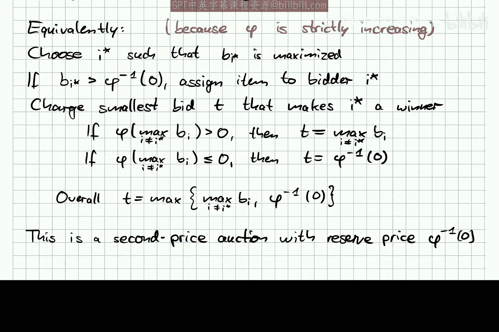
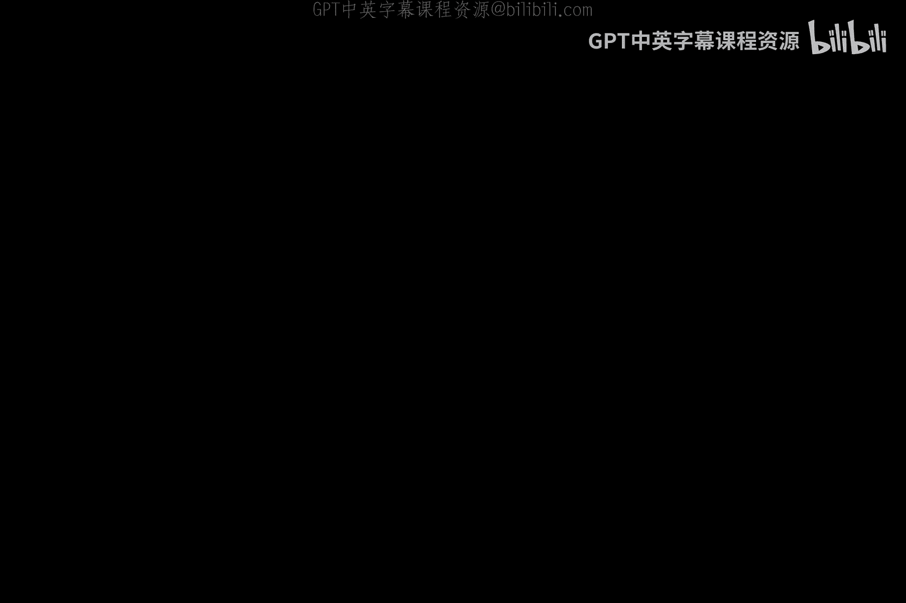
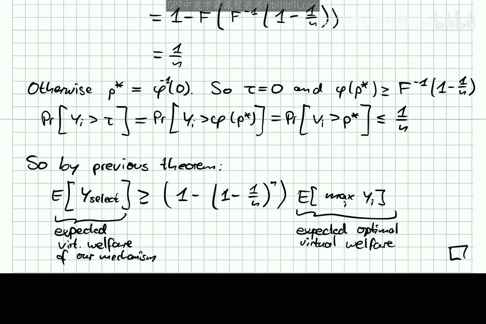
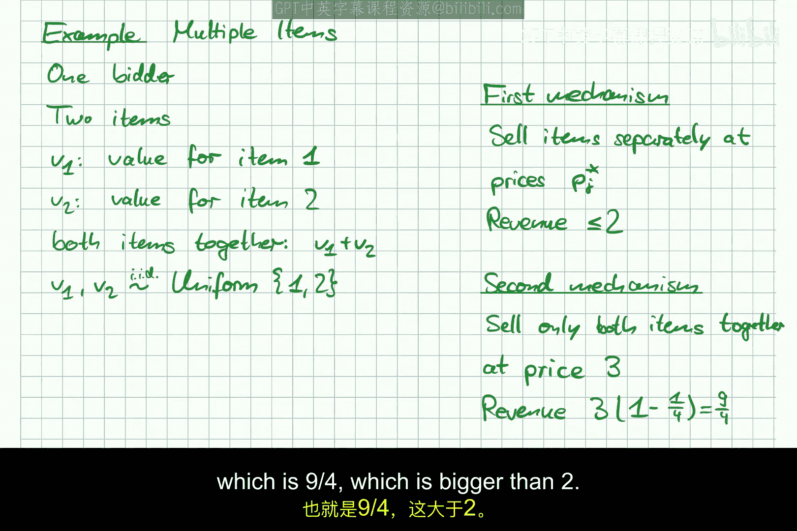

# 算法博弈论：第20讲：同分布下的收益最大化

欢迎回到算法博弈论课程。在上一讲中，我们介绍了收益最大化问题，并推导了期望收益等于期望虚拟福利的等式。

今天，我们将继续讨论收益最大化，但针对一个特殊情况：我们假设只有一个物品，并且进一步假设所有竞拍者的估值分布都是相同的。

## 设定回顾

首先，我们回顾一下基本设定。

我们有 `n` 个竞拍者，我们称这个集合为 `N`，并将他们编号为 `1` 到 `n`。

我们只有一个待售物品。

每个竞拍者 `i` 有一个私人估值 `v_i`，这些估值是从一个已知的分布中独立抽取的。今天，我们假设这个分布对所有竞拍者都是相同的，因此我们去掉下标 `i`，统一用 `D` 表示这个分布。

我们假设该分布具有累积分布函数 `F` 和概率密度函数 `f`。

## 虚拟价值函数

上一讲我们证明了虚拟价值函数至关重要。对于估值 `t`，其虚拟价值 `φ(t)` 定义为：

`φ(t) = t - (1 - F(t)) / f(t)`

虚拟价值总是小于实际价值，因为我们减去了一项。它甚至可能为负，我们之前已经见过例子。通常，对于较小的估值，虚拟价值是负的。

我们今天的假设是：这个虚拟价值函数 `φ` 是严格递增的。这意味着估值分布是“正则”的。这本质上意味着 `φ` 函数应该是递增的。

## 收益与虚拟福利的等式

上一讲我们证明了以下等式：一个真实机制的期望收益等于其期望虚拟福利。

对于一个真实机制，其期望收益 `E[Revenue]` 等于：

`E[∑ φ(v_i) * x_i(v)]`

这里，`x_i(v)` 是分配函数，表示在估值组合 `v` 下，物品是否分配给竞拍者 `i`。这个表达式看起来很像社会福利，只不过我们用虚拟价值 `φ(v_i)` 代替了实际价值 `v_i`。因此，我们称之为“虚拟福利”。

特别地，当我们只有一个物品时，通过真实机制最大化期望虚拟福利，可以通过在每种估值情形下直接最大化虚拟福利来实现。这意味着我们将物品分配给虚拟出价最高的竞拍者。也就是说，我们查看所有竞拍者的出价，应用虚拟价值函数 `φ` 到这些出价上，然后选择虚拟价值最高的竞拍者。如果这个最高的虚拟价值是正的，我们就把物品分配给他；否则，我们保留物品。

## 机制简化：二价拍卖与保留价

在单物品且同分布的情况下，这个机制有更简单的理解方式。因为我们对所有出价应用相同的函数 `φ`。

我们的机制将是：
1.  选择 `i*`，使得 `φ(b_i*)` 最大化。
2.  如果 `φ(b_i*) > 0`，则将物品分配给竞拍者 `i*`。
3.  根据迈尔森引理收取付款。

由于 `φ` 是严格递增的，选择最大化 `φ(b_i)` 的竞拍者 `i*`，等价于选择出价 `b_i` 最高的竞拍者。

那么付款是多少？我们知道，在单物品拍卖中，赢家需要支付其“阈值”，即能使他获胜的最小出价。这个阈值是多少？
*   如果其他竞拍者中有人也能获得物品（即其虚拟出价非负），那么 `i*` 必须超过他们的最高出价。
*   否则，`i*` 的出价至少需要达到 `φ^{-1}(0)`，即虚拟价值为 0 时对应的估值。

因此，总的阈值 `T` 是以下两者的最大值：
1.  所有其他竞拍者的最高出价。
2.  虚拟价值函数的逆在 0 点的值，即 `φ^{-1}(0)`。

这是什么机制？我们选择出价最高的竞拍者，然后如果他出价至少达到某个水平，他就获得物品，并支付“其他竞拍者最高出价”和“某个保留价”中较大的那个。

这几乎就是二价拍卖，只不过我们增加了一个保留价 `r = φ^{-1}(0)`。竞拍者必须出价至少达到这个保留价才能获胜，并且支付额也至少是这个保留价。这就像引入了一个总是出价 `r` 的虚拟竞拍者。如果这个虚拟竞拍者“获胜”，我们实际上就保留了物品；如果他没有获胜，他的出价也会抬高实际赢家需要支付的价格。

所以，收益最大化并不总是复杂的。如果你只有一个物品且估值分布相同，那么二价拍卖加上一个合适设置的保留价就能达到最优收益。这类似于 eBay 上的“起拍价”或艺术品拍卖中的“保留价”。当然，实际机制设计需要考虑更多因素，但我们可以看到，有时一个简单的二价拍卖加保留价就是收益最优的。

## 更简单的机制：纯二价拍卖

如果我们想做得更简单呢？如果我们只运行一个纯二价拍卖（无保留价），它效果好吗？是的，它在一种非常有趣的意义上是近似最优的。接下来我们将展示两个结果。

### 结果一：在“必须分配”的机制中，二价拍卖最优

第一个结果是：在所有**总是分配物品**的真实机制中，二价拍卖是收益最优的。

**定理**：如果所有估值都来自相同的正则分布，那么二价拍卖在所有总是分配物品的真实机制中，最大化期望收益。

**证明**：
设 `M*`（分配规则 `x*`，支付规则 `p*`）为二价拍卖。
设 `M`（分配规则 `x`，支付规则 `p`）为任何其他总是分配物品的真实机制。

对于任意估值组合 `v`，令 `i*` 是 `M*` 下的赢家（即出价最高者），令 `i‘` 是 `M` 下的赢家。
由于二价拍卖总是将物品分配给最高出价者，我们有 `v_i* ≥ v_i‘`。
因为 `φ` 是严格递增的，所以 `φ(v_i*) ≥ φ(v_i‘)`。

因此，在估值组合 `v` 下，二价拍卖的虚拟福利 `φ(v_i*)` 至少与其他机制 `M` 的虚拟福利 `φ(v_i‘)` 一样大。

对两边取期望：
*   二价拍卖的期望收益 = 其期望虚拟福利。
*   其他机制 `M` 的期望收益 = 其期望虚拟福利。

由于在每种情形下二价拍卖的虚拟福利都不小于 `M` 的虚拟福利，因此其期望虚拟福利（从而期望收益）也不小于 `M` 的期望收益。

这个结论很有意义，因为它表明：收益最优机制有时会选择不分配物品以获取更高收益。但如果我们**不被允许**不分配物品，那么二价拍卖确实是最好的选择。

### 结果二：增加竞拍者优于精细设计

第二个结果是一个更巧妙的比较，由 Bulow 和 Klemperer (1996) 提出。

**定理**：考虑一个正则分布 `D` 和任意自然数 `n`。从 `D` 中抽取 `n+1` 个竞拍者，运行二价拍卖所得的期望收益，至少不低于从 `D` 中抽取 `n` 个竞拍者时所能获得的最优期望收益。

**理解**：我们比较两种情况：
1.  有 `n` 个竞拍者时，精心设计的最优机制（如二价拍卖加最优保留价）的期望收益。
2.  有 `n+1` 个竞拍者时，只运行简单二价拍卖（无保留价）的期望收益。

定理声称，情况 2 的收益不低于情况 1。这意味着，**增加一个竞拍者带来的竞争，比针对 `n` 个竞拍者精细优化机制更有效**。

**证明**：
这个证明巧妙地运用了上一个结果。
1.  考虑针对 `n` 个竞拍者的收益最优机制 `M_opt`。
2.  将其转化为一个针对 `n+1` 个竞拍者的新机制 `M‘`：忽略第 `n+1` 个竞拍者，对前 `n` 个竞拍者运行 `M_opt`。如果 `M_opt` 没有分配物品，则把物品免费给第 `n+1` 个竞拍者。
    *   `M‘` 总是分配物品。
    *   `M‘` 的期望收益等于 `M_opt` 的期望收益（因为第 `n+1` 个竞拍者不付款）。
3.  现在，在 `n+1` 个竞拍者的环境中，我们有两个总是分配物品的机制：
    *   `M‘`（我们刚构造的）
    *   二价拍卖 `SPA_{n+1}`
4.  根据上一个结果，在总是分配物品的机制中，二价拍卖是最优的。因此，`SPA_{n+1}` 的期望收益 ≥ `M‘` 的期望收益。
5.  所以，`SPA_{n+1}` 的期望收益 ≥ `M_opt` 的期望收益。证毕。

这个定理展示了竞争的力量：多一个竞拍者，即使使用最简单的拍卖，也至少能和针对较少竞拍者的最优设计一样好。

## 更简单的机制：一口价

正如之前承诺的，我们现在来看一个更简单的机制：一口价。卖家设定一个价格 `p`，第一个愿意支付这个价格的竞拍者获得物品。对于单个竞拍者，这是一口价是收益最优的（就是设定一个保留价）。但对于多个竞拍者呢？他们不再竞标，而是按顺序决定是否接受这个“要么接受，要么放弃”的报价。如何分析这种机制并选择价格呢？

我们使用最优停止理论中的一个结果，称为**利润不等式**。

**利润不等式**：设 `Y_1, ..., Y_n` 是独立同分布的非负随机变量。设 `τ` 是一个阈值，满足以下性质之一：
*   (a) `P(Y_i > τ) = 1/n` 对于所有 `i` 成立。
*   (b) `τ = 0` 且 `P(Y_i > 0) ≤ 1/n`。

定义 `Y_select` 为：序列中第一个超过 `τ` 的 `Y_i` 的值；如果没有，则为 0。
那么，`Y_select` 的期望值满足：
`E[Y_select] ≥ (1 - (1 - 1/n)^n) * E[max(Y_1, ..., Y_n)]`

**理解**：我们有一系列随机变量。我们设定一个阈值 `τ`，并在第一次看到超过 `τ` 的值时停止。我们声称，以此方式获得的值的期望，至少是序列最大值的期望乘以一个因子。这个因子 `(1 - (1 - 1/n)^n)` 是一个常数，对于所有 `n`，它至少为 `1 - 1/e ≈ 0.63`。

### 应用于一口价机制

现在，我们如何将其应用于一口价机制？我们想设定一个价格 `p*`。

**机制**：
1.  设定价格 `p* = max( φ^{-1}(0), F^{-1}(1 - 1/n) )`。
    *   `φ^{-1}(0)` 是虚拟价值为 0 对应的估值（即最优保留价）。
    *   `F^{-1}(1 - 1/n)` 是累积分布函数的逆在 `1 - 1/n` 处的值。
2.  将物品卖给第一个估值 `v_i ≥ p*` 的竞拍者，并收取价格 `p*`。

**定理**：这个一口价机制至少能获得最优期望收益的 `(1 - (1 - 1/n)^n) ≈ 0.63` 倍。

**证明思路**：
1.  令 `Y_i = max(φ(v_i), 0)`。这是一个非负随机变量。
2.  最优期望虚拟福利（即最优期望收益）是 `E[max(Y_1, ..., Y_n)]`。
3.  我们选择的 `p*` 确保了阈值 `τ = φ(p*)` 满足利润不等式的条件 (a) 或 (b)。
    *   如果 `p* = F^{-1}(1 - 1/n)`，则 `P(Y_i > τ) = P(v_i > p*) = 1/n`。
    *   如果 `p* = φ^{-1}(0)`，则 `τ = 0`，且 `P(Y_i > 0) = P(φ(v_i) > 0) = P(v_i > p*) ≤ 1/n`（由 `p*` 的定义保证）。
4.  在我们的机制中，第一个满足 `v_i ≥ p*` 的竞拍者，其虚拟价值 `φ(v_i) = Y_i` 就是 `Y_select`。
5.  因此，我们机制的期望虚拟福利（即期望收益）是 `E[Y_select]`。
6.  根据利润不等式，`E[Y_select] ≥ (1 - (1 - 1/n)^n) * E[max(Y_1, ..., Y_n)]`。
7.  右边正是常数因子乘以最优期望收益。

因此，即使是非常简单的一口价机制，只要价格设置得当，也能保证获得至少约 63% 的最优收益。这个价格 `p*` 既包含了来自虚拟价值的最优保留价思想，也包含了来自利润不等式的、用于模拟竞争环境的调整项 `F^{-1}(1 - 1/n)`。

## 超越真实性：非真实机制与多物品情况

现在，是时候结束我们对收益最大化的讨论了，尽管我们目前只触及了表面。我们只看到了收益最大化的最初几步，还有更多内容值得探索。

### 为什么坚持真实性？非真实机制如何？

你可能会问：为什么我们坚持要求机制是真实的？如果我们使用非真实机制呢？例如，在单物品拍卖中，如果你想最大化收益，为什么使用二价拍卖而不是一价拍卖？在一价拍卖中，赢家支付自己的出价，感觉收益会更高。

这听起来是个好主意，但你必须考虑：因为这是非真实机制，竞拍者通常不会报出真实估值。我们需要考虑他们在某个均衡下的行为，例如贝叶斯-纳什均衡。然后我们可以问：在这个均衡下，期望收益是多少？然后比较一价拍卖和二价拍卖。

有趣的是，你会发现**收益等价定理**：在相当一般的条件下（如估值分布正则），一价拍卖在贝叶斯-纳什均衡下的期望收益，与二价拍卖在占优策略均衡下的期望收益是相同的。

更一般地，可以证明：如果所有竞拍者的分布都是正则的，那么不存在任何一个机制 `M‘`，其在某个贝叶斯-纳什均衡下的收益，能够超过虚拟福利最大化机制在占优策略均衡下的收益。

这意味着，虽然你可以构造非真实机制并考察其均衡，但最终你能达到的收益上限，与真实、占优策略激励相容的机制是一样的。证明思路与 Myerson 引理类似，只是在贝叶斯-纳什均衡的背景下重写期望。因此，最大化贝叶斯-纳什均衡下的期望收益，同样会归结为最大化虚拟福利。

### 多物品情况的复杂性

我想简要讨论的另一点是：多物品情况会怎样？假设我现在有两个**不同**的物品（不是两个相同的物品）。这是一个多参数设定，每个竞拍者对每个物品有不同的估值。这时会发生相当奇怪的事情。

**例子**：假设有 1 个竞拍者，2 个物品。竞拍者对物品 1 的估值是 `v1`，对物品 2 的估值是 `v2`，并且他对两个物品组合的估值是相加的：`v1 + v2`。假设 `v1` 和 `v2` 独立同分布，均以 1/2 的概率取 1 或 2。

**机制一：分开销售**
我们可以为每个物品单独设定价格 `p1`, `p2`。分析发现，无论怎么设定价格（1 或 2），期望收益最多为 2。
*   如果定价为 1，肯定卖出，每件收益 1，总收益 2。
*   如果定价为 2，只有 1/2 概率卖出，每件期望收益 1，总期望收益 2。

**机制二：捆绑销售**
我们只以价格 3 捆绑销售两个物品。竞拍者会购买当且仅当 `v1` 和 `v2` 不都是 1（概率 3/4）。因此期望收益为 `3 * 3/4 = 2.25`，大于 2。

这个例子表明，即使物品之间没有互补或替代关系（估值是相加的），为了最大化收益，卖家也可能希望将物品捆绑销售，而不是分开销售。复杂性还不止于此。有时，收益最优机制甚至不是简单地以固定价格销售物品，而是提供**彩票**。例如，可以让竞拍者选择：要么以固定价格购买一个物品包，要么购买一张彩票，其中保证获得一个物品并以一定概率获得另一个物品。这种更复杂的设计可能带来比任何固定捆绑定价更高的收益。

因此，一旦离开单物品的范畴，事情就变得非常复杂。尽管如此，这方面已有大量出色的研究，试图理解如何至少获得近似最优的收益。一个重要的结果是：对于单个买家且估值可加的情况，采取“捆绑销售所有物品”和“分开销售每个物品”这两种方案中收益较高的那个，总能获得一个常数倍的最优收益近似。这只是一个活跃研究领域的开端。

## 总结

本节课中，我们一起学习了在同分布假设下，单物品拍卖的收益最大化。

我们首先回顾了虚拟价值函数的关键作用，以及期望收益等于期望虚拟福利的等式。我们发现，在单物品同分布的情况下，收益最优机制可以简化为**二价拍卖加上一个精心设置的保留价**。

接着，我们探讨了更简单的机制：
1.  **纯二价拍卖**：在所有“必须分配物品”的机制中是最优的；并且，增加一个竞拍者带来的竞争收益，可能超过针对较少竞拍者进行精细机制设计的收益。
2.  **一口价机制**：通过设定一个结合了保留价和概率调整的价格，可以获得至少约 63% 的最优收益。

最后，我们简要探讨了非真实机制并不能突破真实机制下的收益上限，并指出了多物品拍卖中收益最大化问题的惊人复杂性和丰富性。

希望你能从这些讨论中获得一些有趣的见解。虽然我们只触及了这个领域的冰山一角，但已经可以看到其美妙与深度。请随时联系我提出任何问题。注意安全，下次见。