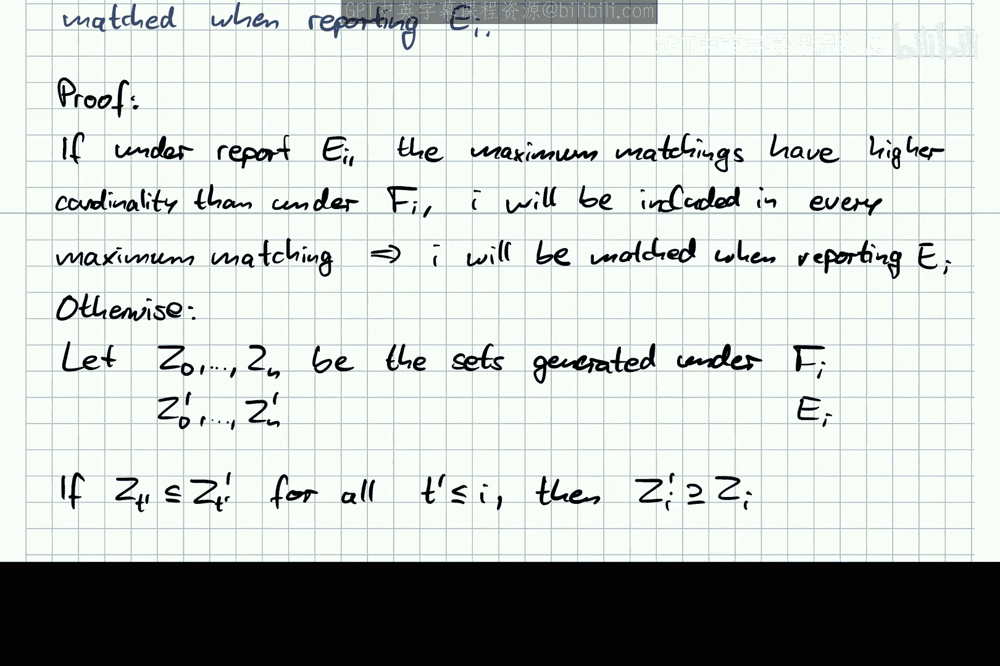
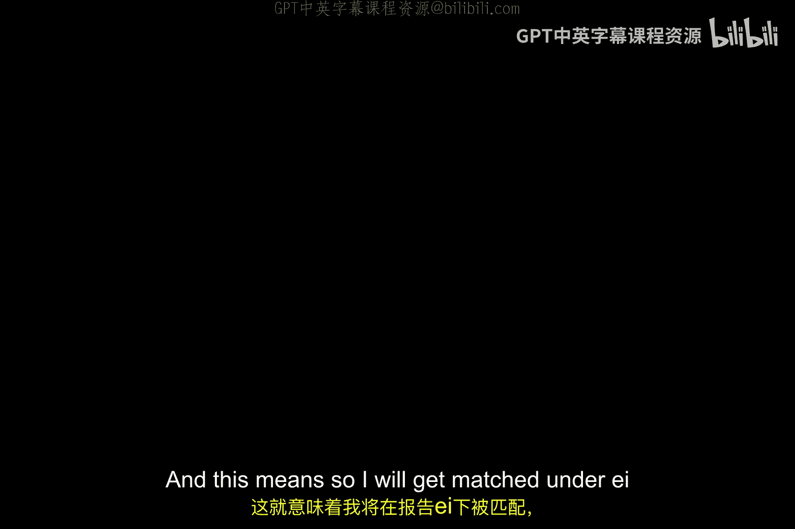
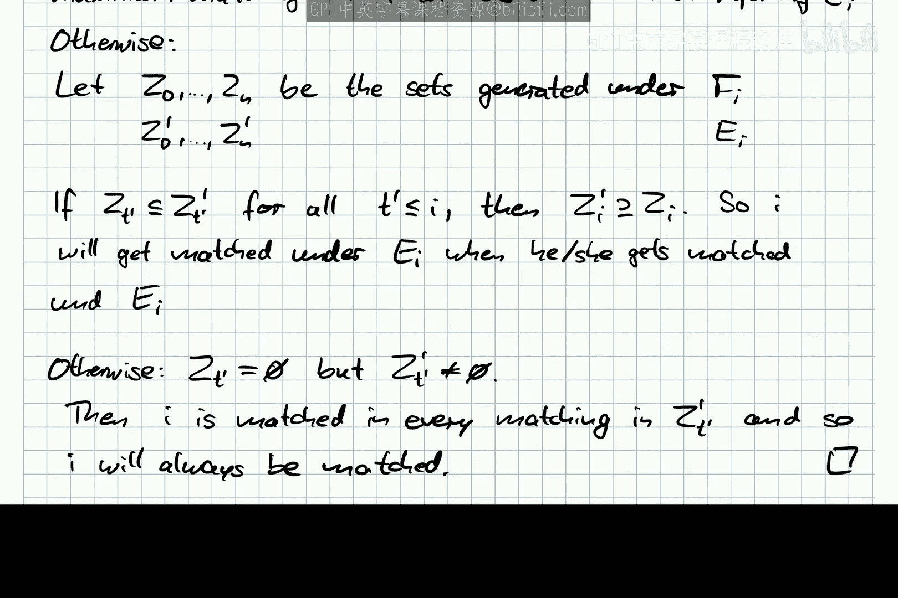
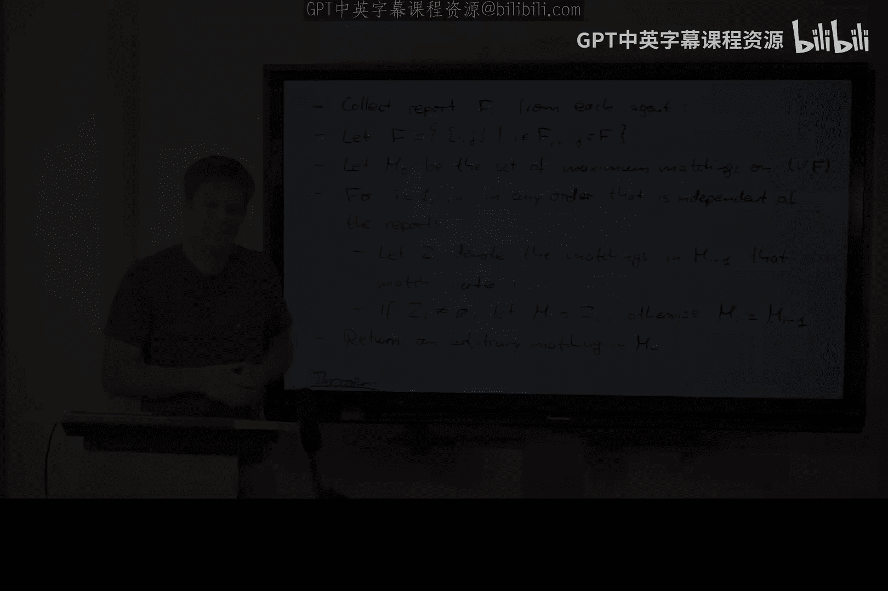

# 波恩大学《算法博弈论｜Algorithmic Game Theory, Winter 2020-21》中英字幕（claude-3.7-s p22 AGT, WS20_21_ Lecture 21 (Allocations without Money).zh_en -BV1m9ZyYoENg_p22-

Welcome back to algorithmgth Game theory。For the last weeks。

 we've learned a lot about mechanism designed with money。But what if you don't want to use money to。

Push people into the right direction so that you actually get the desired outcome。

Why wouldn't you want to use money， maybe it's because it's infeasible to collect the money or maybe because it's unethical for certain reasons。

What can you do then in the next following lectures， we'll get to know。

Something about mechanism design without money。 Unfortunately。

 things are much less clear than the the settings are usually more complicated。For very good reason。

 because so far， everything that we were doing was in units of money。And by that。

 I don't just mean the payments。 I also mean how much do you value this item。

Also to this we expressed in terms of monetary units， we said， okay。

 Im now value this item5 and this item 3， and if you now have a higher value then you should get the item because this is what maximizes social welfare。

No。If we don't have money。How should we compare what is more valuable。For whom。And as you see。

We'll have to。Think about this more carefully， what we actually may mean by getting a desirable outcome。

The first problem I'd like to consider now is a very simple problem in which that。

Every of our agents。Brings one item to the market， which we call a house。

 and what they want to do is they want to exchange these houses so that。

Everybody is as happy as possible after the exchange。You could of course also do this with money。

 so everybody just sells their house and then you buy again the houses。

And this is maybe even a possible mechanism for such a setting。Bt。

Here now we want to do this entirely without money。So what bo this look like。

As usually we have an agents， I I call them for no really good reason。

And those we would still call players。The set is called capital N and。Each of them。Initially。

Has one item。Would we house just to say， okay， you don't you actually only need one house to live in。

 you don't need two houses， but you definitely should have one house to live in。

And what is now our goal？二狗屋。Is to reassign。These houses。To make agents happier。Which means。

We want to find a。One to one correspondence。Pi， which will just be mapping from N to N。

Which means that。After reassignment。Agent I。不用喊。House。Pie eye。Okay。So as I was saying。

 we are not doing this with money。All this making agents happier。

 We won't be expressing in terms of monetary units。 So， of course， you could say， now， okay， I。

 I value this mansion by 2 million and this mansion by 3 million。 And so I prefer。

A3 million mansion to it， two million mansion。But。Why does this make you or why is it more important that you now gain 1 million compared to somebody else。

 So in。In perceived validation than somebody else， who maybe just is getting a thousand more。And。

Therefore， we are not expressing actually all these preferences in terms of monetary units。

 we don't say I value this house by this much， but we rather say， okay。

 this is my preference list of houses， I prefer this house over that house over that other house。收。

一址。Agent。As a full preference list。Overall， houses。With no ties。Let's see what this may look like。

With agents。AB。And see。And they also bring a house， A， B and C。And for example。

 the first agent might prefer house B over house C over house A。

The second agent might prefer house C overhouse A overhouse B。

And the third agent might prefer house A over house C over house B。Okay， in this case。

 things are really easy because the most preferred house。

 This is a different one for each of the agents。 So we could just give agent A， house B， agent B。

 We could give house C， agent C could We could give house A， and all of them would be happy。

 All of them would be。The happiest people in the world because they got their favorite house。

So our mapping pie。我等你逼。This perfect matching in this。Bpartid graph。But， usually。

Things won't be this smooth。Of course。There might be this one mansion that everybody wants to have。

And。Ran。And we can make give everybody what they prefer most。For example， this might look as follows。

So again， we have agents。A， B and C。Each of them brings a house， A， B， and C。

And agent A now prefers house B over house C over house A as before。

But agent B now prefers house A over house C， over house B。And。The preferences of agent and B。

 we don't modify either。What would happen if we now did the same。Exchange。

So how happy are people now。Agent A still gets the preferred house。

 Age B does not get the preferred house， Age B gets only the second preference and agent C gets again the most preferred house。

But。What could Age B now do？Agent B could just talk to agentnt A and say，Well， you know。

 you're getting my house。You know， agent B brought house B。What if just the two of us swapped houses。

You would still get my house， and this wouldn't change anything， but I would then get your house。

 so I would be happier than what I'm getting here。And this is why we call this allocation unstable。

Agent A would be willing to。Join the deal， Agent B would be happier with just this pairwise exchange of only agents A and B。

Let's formalize this property of an allocation being stable or unstable。First， we say that a subset。

A。Of the agents。Is a blocking coalition。Of an allocation pi。Is。There is。An allocation。Sigma。

Which only involves。The agents from a。Such that。No。Agent in a。Prefers。Pi of I。Over sigma of I。And。

At least。1 agent， I and I prefers。Sigma of I。Over pify。And in this allocation。Here。

 we found a block and coalition of namely。Agents。A and B。Because。There is。This blue allocation。

So this would be allocation sigma。The green one， this would be allocation pi。And so he would。

 we would have that。A would be。Consisting of small， A and small B。So in other words。

The blocking coalition。Would rather trade the houses among themselves？Then。Using this。Allocation pi。

And what we will be looking for is the following。Namely， we call an allocation stable。

If there is no blocking coalition。And our goal will be to find such stable allocations。Why that？

Because this ensures in。An allocation being stable if we find a stable allocation。

This ensurets that our agents are actually。Willing to take part in our exchange。

 and they're not deciding to just drop out and do their own thing。But of course， the big question is。

 is there always such a stable allocation and if so， is it difficult to find？Or not。Well。

 as well show。Not only is there always a stable allocation。

 but it is also pretty easy to find with a somewhat simple algorithm。

We'll now show that there is always a stable allocation。

Meaning that there is always an allocation such that no subset the agents would want to do their own thing。

 and they would just rather want to trade houses。Among each other then taking part in our big exchange。

How did we do that？We will devise an algorithm， namely this so called top trading cycle algorithm。

And this is actually a pretty straightforward algorithm。

 namely what we do is we'll first give each agent。AThey most preferred house if we find a cyclic exchange this way。

 if we find an allocation that okay， your preferred house is now my house and my preferred house is your house。

 for example， this would be cycle of length too， this is something that we might start from。

And will then successively eliminate these trading cycles。Let's formally write this down。

We'll initialize。N prime as the set of all agents。And。😔，While there are still agents left。

We do the following。Weconstruct。A directed graph。on。And prime。Each verx。Has。One， outgoing edge。

To the home to the owner。Of。He is her。Most preferred。House。林网。All houses。Owned by N prime。

Importantly。You cant do。 It is also possible to keep your own house。And in this case。

Where does your edge go， Your edge will go to yourself。

 If your most preferred house of the remaining houses is your own house。

 then you will have a self loop just going back to you。

 And this then also counts as a cycle for what we're doing now。Because our next step is。

Find an arbitrary。Directed cycle。In this graph。And。To eat。I， in the cycle。Asign。Your house。

Owned by the successor in the cycle。And then。Vi。😔，Remove。All Asians。On the cycle。From N prime。

Is this a well defined algorithm？Well， to make this a well defined algorithm。

 it will have to terminate。And it will actually terminate。And this was incorrect。

 while N prime is not the empty set of courses。So why does this work？

This will work if there is always， if we can always find a directed cycle in this graph。

If there is always a directed cycle in this graph， then we'll always be removing some some agents and then over time because we have only finite many agents over time will end up with。

The empty set and this way will terminate。Why is there？Always a cycle。Well。

 that's the really easy following observation。Every directed graph。Without sinks。Has a cycle。

What's a sink， A sink is a verex without outgoing edges。But did Algraff have such things。No。

 because every vertex has an outgoing edge， and mean exactly one outgoing edge to the owner of the most preferred house among the remaining houses。

Why is this true？ Well， this is just a。Standard observation。

 as you usually do these in graph theory namely。Start from any vertex。Follow。

An arbitrary outgoing edge。Because there is always such an outgoing edge。Andello。

Keep following outgoing edges。Until。Coming back。To avertex that。As that we have seen before。

And then we have our cycle。And why does this always happen that we come back to a verex that has been visited before？

This always happens。Because the graph is finite。Cool。So。This is a well defined algorithm。

Let's see what it does before we then analyze its properties。Namely， let's come maybe back to our。

Earlier example。We had。These agents preferences agent A preferred house B overhouse C overhouse A。

 Age B preferred house A overhouse C overhouse B。And agency。

Preferred house A over house C over house B。So what's now the graph in the first iteration？We have。

Se what it says。And we'll add outgoing edges。What's the most preferred house of agent A。

 Among all these， This is House B。What's agent B's most preferred house， It's house A。

And what agencys most preferred house A is house A。So where's our cycle。Our cycle is here， or there。

There could， of course， be multiple cycles， but this is one cycle that we see。 So this means that。

Will said。That。Agent A will get house B。Agent B will get house A。

 and then we'll construct the remaining graph， which only has verdex C among all remaining houses。

 which one does agency prefer most well。They have to prefer their。Own houses。

 And so will'll also find again， a cycle。And then， we'll have that。Agency will keep their house。

And I not claim that。Not only here， we're getting a stable allocation， but always。

 which means that there is no。A blocklocking coalition。Why that。How do we prove this stability？Well。

 we have to show that there is no blocking coalition。

 how do we show that there is no blocking coalition？

We assume that there is a blocking coalition and then we'll lead this to a contradiction。

Because then at some point， if there was a blocking coalition， then the。

The algorithm would do something incorrect， namely not give。One of the agents。

 their most preferred house out of all remaining houses。So suppose。Pie is not stable。Then， there is。

Thisす。A， a subset of the agents。And this allocation sigma。Such that。The following holes。Let a。

Unequal。Be the sad of all。Agents。Which are getting something different。In the allocation pi。

 then they getting in the allocation Sigma。Now， what has to hold。It has to hold that。

This set won't be empty。And。我。I， int that sad。Prefer。Sigma i。😔，Over。Pie eye。Now。

 this might be a little confusing。Why this is a way to state that there is a blocking coalition。

 didn't we say？A blocking coalition that's a group of agents such that some of them get happier and some of them don't care。

And is this really equivalent， yes， it is。But why？If you don't care。

 then because you have strict preferences， you are getting the same。

So if you don't care whether you're getting what you're getting in pi or in Sigma。

 then you have to get the same because you have strict preferences among all houses。

And for everybody who's not getting the same， they have to prefer what they're getting in sigma over what they're getting in pi。

 This is what would make the。Alloccation， unstable。Now let's see what's happening。

There is now this set of agents which are unhappy with our allocation pi that we are computing。

Which we will show that this cannot exist。Let's consider。第。Ittereration of the algorithm。

When for the first time。An agent。From this a unequal。Is removed。From N file。

Because eventually all of them will be removed， everybody gets something eventually。

So let's consider the first time that this is happening。And。We now let N star。B。😔，The state。

Of N prime。Before。This allocation before this iteration。Now， what do we have？Well。

 this set a unequal。Eventually they all have to get something， but。😮，First。

 there's something happening and which doesn't involve all of them。

 Let's assume there's something happening， which none of them is involved in。 But then at some point。

 they are getting something。The first one of them is getting something。The in N star。

 they are still all contained。 all of a unequal is still contained in the set n star。

 and then one of them gets removed。From this head N prime， because they're getting。

The most preferred house among all houses in N star， because this was how the algorithm is defined。

 we always。In each iteration， we always give an agent their most preferred house among all remaining houses。

But。The point will not be。Why should the agent be happier with what they're getting in Sigma。

 where should that even be coming from？If we are not giving them what they prefer most。

Because so far。All that was happening in pi was anyway equal to sigma。

 now something different is happening。But now you are if you are the one of them being removed。

You cannot be made happier than what we are giving you right now。So more formally。We。Observe。

That sigma of I。Is also in N star。Because otherwise。

We would have that sigma of I would be in a takeaway， a unequal。Why that because sigma of I is。

Is in the set A， all of a unequal is still contained in N star。

 So this would be would have to be outside a unequal。And what would that mean then？

This would also mean that。Sigma of I。God removed。Before。Because it was on a cycle。And。On this cycle。

Sigma of I will have a predecessor。Which means that。Sigma of I。Will be equal。To pi of i prime。

 which will be equal to sigma of I prime。For some。AI prime， which is an a takeaway a unequal。

And this would be a contradiction。Because。I I prime could not be equal to I。And now。

We've seen that sigma of I is an N star。And by definition。Pie of I。Is eyes。Preferred。houseuse。

In N star， why was that， we were saying that。嗯。We are now removing Age I。Agent I。Would get Sigma I。

 but Sigma I this would actually be an option now。And we're giving the agent I now the preferred house of all this。

And so。As。Pi of I is N N star。 A Sigma of I is N star。This is now a contradiction。And I。Prefers。

Pi of i。Over。Sigma of I。And this proves our claim。So as we see。

 we are not only is there always a stable allocation。

We are also able to find this via this very simple top trading cycles algorithm， namely。

 we suppose that if the allocation was not unstable。

 that then at some point we didn't give the agent one of the agents their most preferred house among all remaining houses。

 which would be a contradiction。What we'll be doing next is。

Deriveve some further properties of the stable allocation。

 namely what we'll show is that this is actually the unique stable allocation。

And we also come back to our。Standard question， what if you misreport your preferences？

Can you benefit from misreporting your preferences here or can't you。

We'll now be showing two further properties， the stable allocations in our house allocation problem。

 the first one being that the stable allocation is actually always unique。So。

While we already know that there is a stable allocation because the top Tra cycles algorithm computes it。

There could be multiple so far， but this is actually not true。Namely。The allocation pi。

Computed by the。A drop training cycles algorithm。Is the unique， stable allocation。

How do you prove such a theorem。If you want to show uniqueness， what you usually do is。

You now have already this one allocation that you now want to see and that you want to show is unique。

 so take any other stable allocation and show that eventually this other stable allocation has to be equal to pi。

So。That pi prime。Bean。Stable allocation。Furthermore， we let。And T。B。The set of agents。Allocated。

In the teeth。Iteration。Now， what we'll do is。We will show。That。Pi of i is equal to pi prime of I。

For all I in N T。And this holds for all tea。Fire induction。On tea。Now。

 the base case of this induction。Is that T is equal to one。By definition。

All I in N1 get their favorite houses。And。Furthermore。Setting。A 2， and1 sigma。And。

Mapping from N1 to N1， which gives each agent what they're getting in pi。Is not。A blocking coalition。

For our pie prime， which is our stable allocation。That we are comparing ourselves to。没。If。

Pi prime of I is not equal to pi of I。It would be a blocking coalition。And by that， I mean。4our。

Annie。I in and1。Why that， because everybody's getting their favorite houses。

So what they'll definitely have to get。Is what they're getting in pie of eye。Good。So。

 this means that。P prime of i is equal to。P of i。For all I in N1。

And let's now consider the induction step。So T will now be greater than 1。

And we know by induction hypothesiss。That pi prime of I is equal to pi of I。4our。哦。I am the union。

Of all these N T prime。What does this mean？This means that。Both pie prime and pie。Relocate。Houses。

Inside。The current at n prime， which is。Exactly， the remaining。Agents。bed。

This looks exactly like the case when we started the algorithm with just the set of N。

Not justice had N prime of agents existing and no other agents existing at all。So。What we can say is。

And。😔，This is the exact argument， as in there。Base case。If an。Take个 away。😔，And prime never existed。

Says you， as we see the。Sttable allocation is even unique。And it's a little hard to write this down。

 but I think。Eventually， it's not that surprising if you think about this carefully。

Because what you're doing in the first situation， there's no way around what you're doing there because otherwise you would already have。

A block and coalition。But if you。Think on from that point and you see， okay。

 now what I'm doing in the first situation that's set in stone。

So it doesn't actually matter whether or not these agents exist because they have to be trading among each other anyway。

So I can just remove them from my consideration and then I'm getting a new first step and also in this new first step。

😊，Okay， I'll have to do it just the way I'm doing it for the exact same reason。Cool。

Now the next property I'd like to discuss is do you actually want to lie about your preferences。

 could you be better off you and the interesting result is no。

Lying about your preferences would not make you better off。Why that。So no agent。😔。

Can improve his allocation。By misreporting。The preference list。😔，To see this， fix。Agent I。And other。

Agents preferences。Like we've already always done this when we were talking about misreporting the preferences。

 we now fix everybody but player I and we see what can player I now do。

And as before we again used the notation net。And T。We call the set of agents。Who are。

Allocated in the teeth iteration。And we let。T star。Be the location。嗯B。The iteration。In which。Agent I。

Is allocated a house。When reporting true preferences。Now， what might be beneficial for Age I？

Agent I sees actually in these earlier steps in and one through N T star-1 there。

 the better houses are allocated。 Those are the houses that I prefer most， because in。

In round T star， I'm getting my most preferred of all remaining houses。

 by Im misreporting my preferences， I could move myself further to the front。

 I could probably get an earlier house。But what I won't be getting is one of these houses that were actually allocated earlier。

And why that？Because there was no incoming edge， and I don't have any influence on incoming edges。

What I'm relying on。To be allocated is that somebody else likes my house。 And this is not。What。

Agent I can influence。Agent I can only misreport his or her own preferences。

 but not make sure that somebody else now suddenly likes。Her house。So。By misreporting。Agent I。

Could be served。In an iteration。Before T star。But。Will， not。Receive a house。From。

This union of all houses that were allocated before T star。No matter。What agent I reports？You she。

Will always。Get a house。From that other half。So， from。T star onwards。And。

The allocation by the algorithm。When reporting truth references。Is。The most preferred。

Of these houses。And this proves our claim。So as we see。

 there's also something like truthfulness in mechanism design without money。For some reason。

 it is often then called。Strategy provenness， but it is really the same thing。

You want to report your true preferences。Because otherwise， you will be worse off。

 or at least you won't be better off when misreporting your preferences。And the arguments。

 they look very similar to what we are seeing in the context of mechanism design with money， namely。

We see， okay， Im I actually cannot influence with the other agents。Are reporting。

 So given what they are reporting。I'm actually best off by auto reporting the truth。

And this is exactly also coming across in this argument。

 maybe it's a little more wordy than these nice inequalities that you would see in the context of for example。

 a second price auction， and this is maybe because we didn't introduce so much notation here。

 but also because we are just not comparing this， these utilities in a。😊，In a way that we just say。

 okay， this is a larger number than that one， but we'd rather just do this comparison by these ordinal preferences that you say。

 okay， I prefer that this one over that one。Next， we'll see another setting in which we'll also want to do mechanism design。

 but certainly without money for ethical reasons。Now let's talk about a different setting in which you want to use mechanism design。

 but for ethical reasons you actually don't want to have money involved in this and this is kidney exchange。

What is this all about？I think you've heard of cases where people donate kidneys， for example。

 to their relatives。One prominent example would be Germany's now President， Frank Baltash Stemeer。

 who donated one of his kidneys to his wife about 10 years ago。And then， both can。

Live with just one kidney， instead of two。And in this case。

 this just worked out fine because he and his wife。

 they had compatible tissue so his wife could actually receive a kidney from him。

But what if you don't have relatives whose。Whose tissue is compatible with yours？

But you have relatives who actually are willing to donate a kidney。Then maybe somebody else。

Somewhere else。Has the same problem， they also have relatives who are willing to donate their kidneys。

 but again， they are not compatible in terms of the tissue。

What is very plausible then what you can do is you can swap the kidneys。

Your relative is then donating their kidney to。There other other patient and you。

 as the patient are receiving a kidney from somebody else。And。

The idea is now to make just these matches that。Well， what you could， for example。

 do is do exactly what we were doing in the case of the top training cycle algorithm and with these stable allocations。

You could now try to find a reallocation of the kidneys such that everybody gets their preferred kidney among all kidneys that are available for exchange。

And this is indeed something that was proposed。So。Very explicitly now。

 each patient donor pair then becomes an agent in this stable allocation problem。

Agents preferences express how likely it is that the other agent's kidney is compatible。

And then we hopefully get a cycle of kidneys to be transplanted。Then， there is。

The patient donor pair， A， the patient donor pair B， the patient donor pair C。

 and maybe then A gets the kidney from B， B gets the kidney from C。

 C gets the kidney from A and so on。I think you're convinced that this is certainly a setting。

 at least for me personally， where I don't want to see money involved and indeed at least in Germany it is forbidden to sell organs for money。

And at least also for me， ethically， this feels like the right thing。

So would you maybe wan to apply this。This top trading cycles algorithm in a kidney exchange。

Feels like a good idea， but unfortunately， there is one flaw， namely。We now have， for example。

 a cycle of length 10 or so， meaning 10 kidneys being transplanted。Just to me。

Come up with one number here。But this means that because every transplant corresponds to actually two surgeries。

We'll have 20 surgeries。And the point is that all of these surgeries should actually happen at the same time。

Because otherwise， you will have the situation that。

Somebody has already received their kidney but not yet donated and the way you should think about this。

 there's a patient and a donor， those are two different people。

 the patient has already received the kidney but the donor has not yet donated it。

And then there is actually no law that requires you to now donate the kidney。

 and this is why all these surgeries will have to take place simultaneously。

And this is just infeasible。And， therefore。There is also a different algorithm which has been proposed。

 a different approach to this entire problem， namely to only consider pairwise exchanges。

And what can these pairwise exchanges look like and how could we model that。

 We are now also using a simpler model to express。Tissue compatibility namely would just say， okay。

 this is compatible or this is not compatible。So what can this now look like？We have。A。

If patient donor repairs？😮，Those will be vertices。V。In a graph。And we'll have。Tissue compatibility。

This is expressed by simply address。Bchweden vertices。Our goal。Is to find a。

Maximum Carinality matching。So we want to make people as happy as possible。

And because agents can actually deny any surgeries without stating any reason。

The situation that we are facing is that actually these edges。Those are private information。

And what we will see is that they just report。Some edges。 And the question for us is。

 do they report all their edges？So the edge is E。Our private information。And each I in V。Reports。

Said F， I。Which is the subset of EI。Where E I。Is。Saad。Of eyes， neighbors。

What kind of what is not our goal， our goal is to design a way to find a maximum personality matching。

Such that， also。Agents report their two neighbors had and not just only a subset of this。

Why should they maybe only report a subset， Because maybe。If they only report a subset， it makes it。

More likely for them to be to be given something or to it makes it more likely that they get a very good match or something like this。

 because this is something that。People have also thought about。

 why don't we give first give kidneys to the ones who are really difficult to match？And then。

What will happen is that eventually because this is somehow private information。

 this is somehow the the outcome of what the respective doctors find out。

Eventually everybody will say， okay， I'm really hard to match。I have a very complicated tissue。

 I have only few relatives， or I have only one relative with a very special tissue type who can donate。

 and I don't have multiple relatives who will have many different ways of。

Being matched with different tissues。So this is why you want to design a mechanism such that you it such that every agent wants to actually report all of their compatbilities。

 they don't want to just report a subset。And indeed， there is a。Mechanism。Or in other words。

 a matching algorithm， which allows this namely。What we do is。We collect a report。F， I。From each。

Agent I。Then。We let F。Be the set of reported addresss。

 so we'll have this pairs icon comma J where I is in FJ and J is in F。Then， we let。M0。Be the set。off。

Maximum matchings。on。V commanda F。And now， we consider the。Agents。In any order。

That is independent of the reports。We now let Z。Deote。The matchings。In M I minus-1。That match。

For X I。And。If there are。Such matchings。We let。M I be equal to。Z I。Otherwise。

MI will be equal to M minus-1。And then the last thing that we do is we will return。

An arbitrary matching。Yin。And， and。This algorithm fields a little。

A little exponential time because it states， okay， now compute all possible matchings and this might be super many。

😊，There are also much more efficient implementations of the exact same idea。

 but this is the easiest way to analyze what's happening here。

So what is it that we're doing are we have our reported graph。

 each agent is claiming some preferences some compatbilities。

We now let M0 be the set of all maximum matchings in this graph。

And now let's consider the first agent in any order。The first agent wena see， is it possible？

Then this Asian gets matched somehow。Is there a maximum matching which involves this agent？If so。

We will。Only from wrist point onward， only consider matchings in which this agent gets matched。

Otherwise， okay， this agent cannot get matched， so。Let's not care about him or her any further。

Then we get to the second agent。And now we ask the same question among all remaining matchings that we are still thinking about。

Is there one that also matches agent 2， if so？Then again。

 restrict your attention to only matchings that involve this agent。Otherwise， okay。

Just move on because this agent will never get matched。And eventually。When we reach this set MN。

Then we're in the situation that。The set of agents who are matched is the same in every matching。

Only how they imagined， this might differ。And what we can now show is that you actually don't want to misreport your edges。

So our theorem will be。Given any reports。Of the other agents。If agent， I。Get matched。When reporting。

Any FI， which is a subset of EI。He or she also gets matched。When reporting。Yiai。

Now how do we prove this？We'll have to have a closer look again at the algorithm。

What happens now if you change your report。The first thing that can happen is that these maximum matchings actually become different。

 So these are the。axMatchings of maximum Partity。And one thing that may happen is that suddenly。

More matches can be made if you're reporting more edges。

But this is great because then you are involved in every maximum matching。Why that。

 Because if you weren't involved in such a maximum matching。

 then this matching could have been made before。Good， so。It may happen that， actually。

We'll get not only more maximum matchings， but also the cardinality of these matchings will increase。

 but this is only possible if we are always matched。

 we as the agent are always matched in any of these maximum matchings。

Or the alternative is that the number of。Matches in such a matching does not change。

 and in this case we'll have to have a closer look at what's happening down here。And then。

What we'll have to see is that。Actually。We'll leave the algorithm， just more options。

Which means that when it's our turn， then we are not eliminated down here or maybe not eliminated down here。

 We are certainly not eliminated down here when we weren't eliminated before。

 So what is happening here， maybe I was precise enough earlier。

 If there is no maximum matching involving you， then you won't be matched。 Otherwise。

 youll be matched for sure。When it's your turn。So let's write this down more formally。收。

If under report。Ei。The maximum matchings。F。Higher。Carinality。And。Under F i。Then， I will be。Included。

In every。Maximum matching。And so because we are computing a maximum matching。

I will always be matched。Or。Otherwise。Li。Cinality of the max weight matching does not change。

In this case。好。Now， let Z 0 to the N。Be the sets generated。

Under report F I and the0 prime to these is the n prime be the sets generated under report EI。

What can happen further？Z。T prime is a subset of Z T prime prime for all T prime。Which are attmost。

 I。Then。We， in particular， get。And Z prime is superet of Z。

And this means。So， I will。

Get matched。Andrew。Yii。When he or she gets matched。Under EI。Now the only way this cannot happen。

Is that。One of these sets will be empty。If reporting FI， but will not be empty。And when reporting Ei。

But then。I is matched。In every。Maching。In Z prime Sub TI。And so。I will。😔，Always。Bematch。

O。😊，So。This is。Again， a little complicated as。To write down as the argument。

 although actually the insights， I hope are not very complicated to see。The point is you。

 when you are now reporting your edges， you are only offering the algorithm more options。And。

Because you're only offering more options， it might be that you change the course of the algorithm。

Maybe you're not changing the course of the algorithm。

 then youre matched if and only if you were matched before， or something changes now。

 but then things change。Into your advantage， namely then。

This is because of your additionally reported edges。Because if you're additionally reported edges。

You now are。You are considered crucial for the maximum matchings。

 and this is why you will definitely get matched。What is maybe a little implicit in the way I wrote then this argument is that all of this relies on the fact。

That we are not。Making this match this order， depending on the reports。 And as it turns out。

 this proof will break down if， for example， you go through the。Agents by。

Decreasing or increasing degree in the graph。Because then suddenly you would have an incentive to misreport because you want to make your degree as small as possible。

 things like these。嗯。I hope you see that generally mechanism design without money isn't a lot different from mechanism design with money in the sense that you can still ask the exact same question。

 do you want a misreport？And why don't you want a mis reportport？The thing is。

 expressing preferences is much more complicated because we don't have these monetary units。

 which we were using before。But eventually。There are also some very nice arguments。

 some very nice mechanisms， one of which we will also see in the next lectures。And。

You will get to the point that。Also， so there is no such general theory as like myosinslemma as VCG。

 but for many specific settings， you will see there are very nice results。

Although I can now already tell you， having this property that you don't want to misreport your preferences。

 this is something that we will often not be able to achieve at least not for everybody。

So that's it for today。Please let me know if if you have any questions。See you next time。 Stay safe。

 bye。

