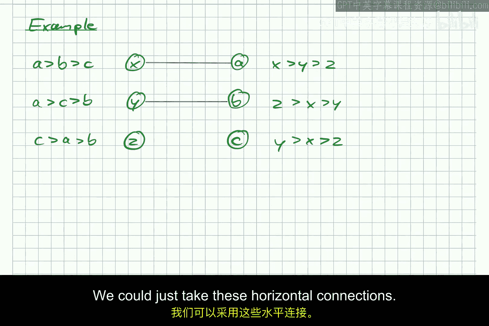
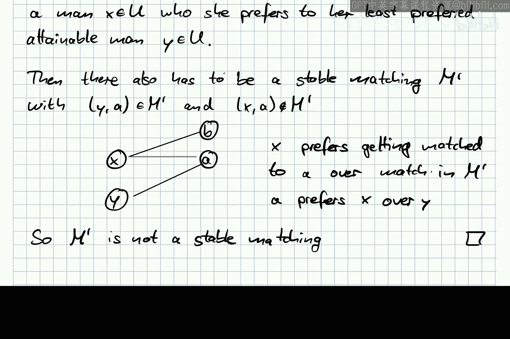

# 波恩大学《算法博弈论｜Algorithmic Game Theory, Winter 2020-21》中英字幕（claude-3.7-s p23 AGT, WS20_21_ Lecture 22 (Stable Matching).zh_en -BV1m9ZyYoENg_p23-

Welcome back to algorithmrithmic game theoryory。In the last lecture。

 we introduced the field of mechanism design without money。And we saw two examples of。

How this might look like。What we saw is that things are more complicated than if we have money because it is much more complicated to express preferences。

Because we cannot just。Express them in terms of monitor units。

 but what we rather always do is just encode them as preference orders。

One example that we got to know was this house's allocation problem。

In which we found a reallocation of the houses so that everybody's happy with this reallocation。

 meaning that there is no coalition of people who would rather do their own thing than joining our exchange。

Today we'll consider a very similar problem with one major difference， namely。

In this house allocation problem， the houses don't care who lives in them。But today。

 we're considering。And setting of matching with two side preferences。

And the traditional way of stating this is as a marriage problem where we have。traditionald。

Hhoome heterosexual。And monogamous relationships， and we just want to match men with women。

I personally find this the weakest of all possible motivations because。

Everything that we will discussing， this is not what marriages look like。And auto， I feel。

This finding a partner for your life shouldn't look like I think it is much more reasonable。

 for example， in the context of matching。Job applicants with employers。

 but as you will always find this in the words of these marriages。

 I'll also stick to this and I'll also speak about men and women。

So what's the setting that we have here？We have。Is that。Of men， which well call you and set of women。

Which we call V。Every man。So that will be a small U in capital U。Has a preference order。

Over the women。And every woman。Has a preference order over the man。Which we will call。

Which is to set。And what do I mean by this， I mean that this is a total order。So， everybody's ranked。

And there are no ties。So what could this look like we might have？The seteth。Man。

 which I will call just。X， Y and Z。And I want to call the women A， B， and C。

And now we'll have to write down the preference lists， so for example。

X might say I prefer A over B over C。W might say I prefer A over C over B。

And Z might say I prefer C over A over B。And then we have similar lists for the women。

 so they also each of them has a list， so A might prefer x over y over Z。

 B might prefer Z over x over y。And C might preferred y over x over z。And what's our goal？

Our goal is just to match men with women。And we want this to be then a stable matching。

Which means something like。What we also said in the context of the house allocation namely。That。

Everybody's happy with what we are assigning them。In the following way。

 namely that there's nobody else who you prefer more than your current match and that somebody else also prefers you。

Over their current match。So let's formally define this。A matching。Is a set of pes。You come a v。

Such that。Yiz。😔，U and U and each。Yanvii。Is matched。At most once。And we'll say that。

Give the matching M。A pair。You can move V。Is a。Blocking hair。Ifve。You prefers。Over。His。Partner。嗯。

In M and V prefers you over her partner。In M。And by that， I mean that。And there's this one important。

Convention。Being matched。Is always。Preferred。Over not being matched。So once again。好。

Take any matching， which just matches men and women in an arbitrary way。

Maybe also nobody gets matched just as one possible matching that you could keep in mind。

And then we say， okay， a pair you come a V is a blocking pair。

If U prefers V over his partner in M and V prefers U over her partner in M。

So both UN and V would rather be together than with their respective partners。In M。And in particular。

 this might mean that both of them are unmatched， in which case they would definitely like this better。

 they would rather be matched than both being unmatched。And now we say that。M is called。Stable。

If there。Is no blocking。Pair。Let's maybe see this again in our earlier example。So we had X。Why。😔。

And Z。And on the man' side， and we had A， B and C on the。

Women's side and what were their preferences， x prefers A over B over C， y prefers A over C over B。

And Z prefers C over A over B。A prefers x of a y over Z。B prefers Z over。X over y。

And C prefers y over x over z。So what could be a matching here we could just take。These horizontal。😔。

Connections。How happy are people now with this？X， for example。

 gets his favorite woman and A also gets her favorite man。Why doesn't get？呃。His favorite woman。

 quite the contrary， he gets the least favorite woman。And B。How about B。B gets。

Her least favorite man。And。Z gets。The most favorite woman。

Whereas C is getting the least favorite man。And this is not a stable matching。

 maybe this doesn't come out of a surprise you because so many are getting not what they like best。

And we could， for example， see this diagonal edge here。This would be a blocking pair。Why that？

Y is getting in this blue matching is getting B。And B is getting y。Sorry， and C。

 that's not important C is getting。Zi。Now we see okay， what if， why instead got C？C。

 and Y likes C better than B。And similarly， C。Likes why。Better than Z。

So both Y and C prefer this diagonal red edge over their respective matches in our matching。

 this is why this matching is not stable。Question is now， is there always a stable matching。

 and if so， how do we find it？This is what we'll discuss today。

One important aspect to mention here is we will now focus on the man's side。

 but as you see actually so far this setting is entirely symmetric。

So you might just swap the roles of men and women entirely because their perspectives are just exactly the same and also the notion of a stable matching。

 this is entirely symmetric。 So if you just swap the roles of men and women。

 the exact same resolve would work， so there is nothing particular about men or about women。And。

So we will now focus on state the algorithm as man choosing something。

 but you might also just buy the symmetry state this algorithm as women choosing something。

Yeah。Is there always a stable matching， Yes， there is。

And why is there always a stable matching because we have an algorithm which can compute it？

And this will even be a polynomial time algorithm， so our proof that a stable matching exists will be constructive in the best possible way。

 namely that it is also easy to compute the respective solution。

 which hasn't always been the case throughout this semester so far。

This algorithm was introduced by Gaylanch Chapley and we'll now state it in the version of a man proposing algorithm。

 but as I was saying， you can also just at。Also stated as the women proposing algorithm just because of the symmetry of men and women。

 so now we are actually breaking the symmetry because we let men choose something。

 but as I was saying before， we could also let women choose something。

The algorithm network as follows。We started。With an empty matching M。And then。

Do you repeat the following？Each man。Propos。To his most。Preferred。我们。Who has not rejected him yet。

If there is any。And then。Each woman。Is tentatively matched。To her favorite proposal。Of course。

 only if there is any。And rejects the rest。And we repeat this。Until。No rejections occur。😔，And then。

Misset。M。To be the tentative matches。Let's see。What this algorithm。De。

Let's just do this in our example。So this is our example from the beginning。

And what does our algorithm there do？It lets each man propose to his most preferred woman who has not rejected him yet。

No woman has rejected any man。嗯。All of them just propose to。They are most preferred women。

So who's proposing to whom Xs is proposing to A？Y is also proposing to8。And Z is proposing to C。

And what happens now？Now， each woman is tentatively matched to her favorite proposal， if any。

 and rejects the rest。So now we look at the。Women's side， and we see。A got two proposals。

And A will now choose X because she likes x better than y。B did not get any proposals。

 so we're sorry but you're not getting anything right now and C doesn't have a choice。

 so C won't be rejecting anyone。So what will be happening is now then why gets rejected？By a。

Now let's move to the second iteration。And see what's happening now。So。All these matches so far。

 they play no role。 But the thing is now a and y got rejected by a。 So that's just。Strike this out。

Now， again， all men propose to their preferred。Woman。Among the ones who have not rejected him yet。

 so x still proposes to a Y now proposes to C。And Z still proposes。2。C。And again， we'll see。

Who is how happy with this match。A this time doesn't have a choice， B doesn't have a choice either。

 but C does have a choice C can say which of the two proposals it likes she likes better and in this case she prefers Y over Z so she'll now reject。

The proposal from Z。And we'll now move to the next iteration。So， now。Z got rejected from C。

And we'll start over。X still proposes to a。Why now proposes to see？And Z proposes to A。Again， we ask。

The women， which do you like best and it's now up to a because a got multiple proposals， A now sees。

 okay， I prefer。X over z。 So Z gets rejected。By eight。And then we move to the next iteration。

And again， we let them。Match proposed to there， preferred。Woman， and this is what we're getting。

And now。Each woman got only one proposal。So there won't be any rejections。

 so this is our final matching。What we'll have to show now is that this actually。

Termininates in finite time and also when it terminates that then we get a stable matching。

And what we claim is that。The man proposing Gail Shepley algorithm terminates。With a stable matching。

😔，After。At most。Cinality of u times cardinality of v plus1。Iterations。How do we prove such。A claim。

Well， the easier thing is maybe let's just talk about the number of iterations。

Because that's something that we should be quite familiar with。

 how do you show that an algorithm has only this many iterations？Well， you show that somehow。

 something is。Reducing in every step， and this is exactly what we're doing here because what is happening in every iteration。

😊，Let's go back to the algorithm in every iteration。😊，Apart from the last one。

 there will always be a rejection。Because if there is no rejection， then this is the last iteration。

 otherwise there has to have been no rejection。And so all we have to count is the number of possible rejections。

And what we observe is that。Once you have been， you as now a man have been rejected by a woman。

 you won't propose to this woman again。Which means that for every pair of a man and a woman will see this rejection at most once。

And so the worst thing that can happen is that in each iteration we see exactly one rejection。

 and the worst that can happen is that every man gets rejected by every woman。This is， of course。

This cannot even happen。But this is clearly in upper bound on the number of iterations that we're seeing here。

And this means that an upper bound on the number of iterations。

 not counting the last one is just the number of pairs of men and women。

So cardinality of u times cardinality of V。So， in every。Iteration。Except the last one。

One woman rejects a man。This woman， this man。我。Never propose。To this woman， again。And so。一。

Will not be。Rejected by this woman again。So this means that we have。Atmost。

Carinality a few times Carinality of V。Iterations。Plus， the last one。So of course。

 the question remains why is this a stable matching， how do you show that we end up？

Because we do terminate that something that we've already shown。

 how do we show that what we end up with is a stable matching？

We all have to show that there is no blocking pair。This means that in our final matching。

 there should be a man and a woman who would rather be together than with their respective matching partners that we chose in the algorithm。

And to get there that there is no blocking pair， let's first make two observations。If a woman。

Is tentatively matched。To man。In an iteration。This man。We'll propose。In the next iteration， again。

Why is this true？How did this happen that we are tentatively matched？We as a woman now。

This was because we got a number of proposals and out of these proposals， we rejected all but one。

And who why did we get these proposals， Because we speaking as the woman were the favorite。A。

Of the women of these men who did not reject them yet。And in particular， for this man that。

We did not reject。😮，We were the most。Favorite woman。Who had not rejected them yet？

And we still remain this because we are not rejecting this man。

So this man will certainly propose again， maybe in this next iteration。

 other men are proposing again。But this man will keep proposing。

So what does this mean from the woman's side？It may not happen that at a later point this woman rejects this man。

Because。There's just a better man for her， showing up。

But it won't happen that this man suddenly vanishes because he finds something better because。

He got from all the women he likes better， he got already rejected and rejections are permanent。

 so this man will keep proposing and it can only happen that now this woman rejects him at some point because she gets a better man。

And this means that over the course of the algorithm。

 the tentative matches from the women's perspective only get better。So this means that。In particular。

Every woman。That is tentatively matched。At some point。Will remain。😔，Tentatively matched。For the rest。

Of the execution。And the reason is just。that this is a special case of my previous argument， namely。

What can happen if I'm not tentatively matched， I know as a woman。

 it may happen that somebody else proposes to me other than who I'm already tentatively matched to。

Then I might reject one of them， but whoever I don't reject will propose again。

 and this just keeps happening。And this then means that。嗯嗯。Also。At all times， I'm。

Remaining tentatively matched， I always get at least one proposal。

Now let's show that there is no blocking pi， this is almost straightforward now。

Suppose you come a Ve。Is a blocking pair。In the final matching。Then， you。Has to。Has proposed。Qvi。😔。

At some point。Because you prefers V over the final match， this means to get there to this point。

 at some point you must have proposed to V。But then God rejected。

And what does this mean from V's perspective， this woman， why would she reject this man？

She would only reject this man if there was a better man。And this means that。The final match。4。Is。

Better。Brand Vier than you。So you come a V。Is no blocking。Pe。😔，Excellent， so once again。

 how did this argument work？Man only cat。Rejected and so the women that they prefer to over the course of the algorithm。

 they get only worse and worse。But from the women's perspective， this is different。Because。

They keep rejecting and they only keep rejecting because they get better proposals。

 so over time they can actually only improve。And this is something that we should also see in our example。

Let's see。How this。Andd up， for example， let's consider C。See， got first a proposal from。Z。

Which she doesn't really like。嗯。And then at some point， she rejected C， she rejected Z in favor of Y。

And at this point。Why will Naki proposing to see？Because， well。He's kind of given up on it。And。

You will now keep proposing to see。Up to the point that C would reject him。

 which will not happen in this case。And for the others， so for a。

 this is pretty straightforward in our example because it was always。啊 her。

Preferred man always kept proposing and there's no reason why this should stop at any time。Good。

 so there is always a stable matching and it's quite easy to find。

What I'd like to discuss next is who actually get matched with whom？

Are there multiple stable matchings？And if so， can we describe the matching that we are finding with our algorithm？

In the case of the house allocation problem， we could show that the stable allocation is actually unique。

 so by what we could find with our algorithm， this was actually the only choice。

Now here in the context of stable matching， things are a little different because there might be multiple stable matchings。

😊，Nonetheless， we can better understand how they differ and。

Whether our stable matching is now a particularly good one or a particularly bad one。

Because let's think of this in terms of social welfare。

Wouldn't we want to find the matching which makes people as happy as possible， yes， certainly。

Are we anywhere close to this or is this maybe even the worst of all stable matchings？The answer。

 unfortunately isn't that simple because it's in a way the best and the worst stable matching。

 depending on which perspective you take， namely if you consider it from the man's or the women's perspective。

And to formalize this， let's first introduce a notion what it means for an agent to be attainable。

For another agent。So。Let's consider any agent I。 So a man or a woman。Re call。

Agent J from the other side。Attainable for I。Ifve。There is a stable matching。In which。i。Gets matched。

To J。So there might be multiple stable matchings。And in many of them， I might get matched。

 maybe not in all of them。Something we'll have to discuss。And when' not called。

A J attainable for I if among all these stable matchings。

 if there's just one where I gets matched to J。And the point is now in our man proposing algorithm。

Every man gets。The respective of most preferred， attainable woman。So in the outcome。

Of the male of the man。Proposing。Arithm。Every man， you。Get matched。To his most preferred。Attainable。

Woman。So what this says is that this matching is somehow man optimal among all stable matchings。

Because every man。😔，So compare any two stable matching。

 so compare our stable matching to any other stable matching， then every man。

 no man will be better off in that other stable matching than in ours。This， by the way。

 is not true for the women。So how do you prove such a thing？Well。

 wheelhiters have to go through the choices of the algorithm and see。If it， if this was not true。

 then there would have to be some。Attainable woman for a man which somehow who he gets rejected from。

So let's write this down more formally。Suppose the statement is false。Then。At some point。A man。

Gets rejected。不好意思。Most preferred。Attainable woman。Because。

What we are claiming is that every man gets match to his most preferred attainable woman。

If this is not true， then at some point this man has to propose to this woman but will be rejected by her。

食。Lettina X。Be the first man。For which this happens。And let A。He is。Most。Most。Preferred。Attainable。

woman。Why did this reaction rejection happen？So， a。Must have。Rejected。X。Because。Why proposed。

And she prefers why。And。Now， the crucial thing is happening because x is。The first man。

Being rejected。From。His most preferred attainable woman。Why。Has not。Yet。Been rejected。

From his most preferred。Attainable woman。And this means that。Why。Likes。A， at least。As much。As his。

Most。Preferred。Attainable。Woman。No。Consider。Any stable matching。In which。X。And A get matched。

So this will look like follows。We'll have。X and Y。We have A and B。

X gets matched to a and y gets matched to。B， and what else do we know？A prefers Y over x。

 This is something that we should have。Found out before。So。This is what we have up here。Then also。

Y likes A， at least as much as his most preferred attainable woman， which in this case。

 his map matched to B， B cannot be better than his most preferred attainable woman。

And he likes A better than B。But this now leads to a contradiction because。

Then it has to happen that。Y comma a is a blocking pair。

 because what we see here from our argument before is that both y and a prefer。

BeBeing matched to each other than being matched with their current match。This is。A contradiction。

So what's the core of this argument？The core is that。All these women that a man gets rejected by。

 he can never be。Match to in any stable matching。And why is this？Because， otherwise。

The respective men that are。A matched to these women now in the matching that we compute together with these women would form blocking pairs。

This argument is a little difficult to make formal just because。

The point should be that these other men。In those other stable matchings， they could also。

 in principle， maybe also then get better women， but。Because there are only finite many women。

 this just cannot happen that everybody's getting something better。And this is what to。

Captured by our point that we were considering the first man who got rejected by his。

Most preferred attainable woman， and this meant that up to this point。

 all men were not rejected by their most preferred attainable women。

As a consequence from this man optimality， we can also now derive。Another result。

 which says that the。Set of men and women who get matched in any stable matchings。

 they will always be the same。 So stable matching may not be unique， but。Whoever gets matched？

Those will be the same sets of men and women。In any stable matching。The set of women。And men。

Who are matched to the other side。Is。The same。And bys symmetrymetry。We show the claim for women only。

So this is just relying on the fact that I was pointing out at the very beginning， men and women。

 this is just entirely symmetric and if we now say okay， the same set of women always gets matched。

 then if we just swap the roads of men and women， the same will be true for men because here this is not pointing out to our particular algorithm which broke the symmetry。

 but this is just a general statement for all。For all stable matchings， so how do you show this？

Let's first observe。That every stable matching。Includes。Exactly。

Minimum of cardinality of U and cardinality of V edges。Why that？Otherwise。

 there would be an unmatched man and an unmatched woman。

 and those together would form a blocking pair。So on one of the two sides。

 namely the smaller of the two sides， the matching has to be perfect。Now， let's see。

And the set of women who are matched to the other side is the same。So now let's。Consider。A woman。A。

Who gets matched。In the man proposing algorithm。And。😔，Suppose。there。Is a stable matching。Mpri。

In which。A does not。Get matched。Now， what will happen？Now， what will happen？We let x。B。第。Partner S a。

In the man proposing solution。And what can I happen？If x comma B。Is an M prime。For any B。Then。

 we know that。X。Prefers。A over B。So， x comma a。Is a blocking pair。For M prime。Why that because？

X prefers a over B， because。A is attainable for x。A will be the most preferred， attainable woman。

And of course。If x comma B is not an M prime。For any be。Then x commma a is， of course。

 also a blocking pair。4 m prime。So what's the point here， the point is that。😔。

Men just they are preferred the most preferred woman by this man proposing algorithm。

 where most preferred attainable woman。And these most preferred attainable women。

 they always are the ones who are matched。 Maybe they are matched in a different way。

 Maybe they are matched in a way that they prefer better than。

What they are getting in the main proposing algorithm。But。At the same time。

They will certainly get matched because these men just like them best。But there was something， I'm。

Already alluding to namely that this is not the best matching for the women's side。More precisely。

 and this is what well show next that in the outcome of this man proposing algorithm。

 every woman actually gets matched to her least preferred attainable man。So in the outcome。😔。

Of the man proposing algorithm。Every woman。😔，Gets matched。Qhe。😔，Least preferred。Attainable man。

How do we show this？We just now assume that this is not true and this way we will immediately come to a contradiction where we will use that of course。

 this man proposing algorithm as we already know in this man proposing algorithm。

 every man gets matched to their most preferred attainable woman。So。Assume that a woman A。

Gets matched。2。😔，A man X。Who she prefers。To。😔，嗯。Least preferred。Attainable man。Why。

In our outcome of our algorithm then。Theyre also。Has to be。He's stable matching。And prime。In which。

Y is match to A？And of course， x is not matched to A。Ax was demand man。

Who she gets matched to in the outcome of our algorithm。

So what will this look like we'll have x and y and we'll have。A and B。

So in this matching m prime x maybe gets matched to B or remains unmatched。

So this is what M prime will look like。But what do we know now？Well， X。Certainly prefers A over B。

And A。Prefers。X over y。And this would mean that。And prime。Is not a stable matching。Or。

 in other words。That this， y just isn't even attainable for for this woman A because。

The fact that there is a stable matching involving Y being matched to A。

 we could lead to a contradiction。

So what we see here is that the men they actually are。

Getting what they prefer most among what is possible， the women。

 they get what they prefer least and somehow this has to be this way because if there was a way that that the women could get something even worse than what they are getting。

 then this could be a stable matching because。We would immediately get to to the point that。

If both the men and the women are getting something worse。Then there has to be a blocking pair。Good。

😡，So of course， once again I'm。Don't stop making this point。 you can again swap men and women。

 and then you get the women proposing algorithm where the situation is best for the women and worst for the men。

 And if it turns out that you get the same outcome， if you are on both the man's at the women's。

Proposing algorithm， then。This stable matching actually has to be unique。Good。So。At this point。

 if we had more time today， we would also talk about the possible benefits of lying about your preferences。

And。The question would， of course， be， can you benefit from lying or can't you？

And the answer in this case would be yes and no。Namely， the point is man cannot benefit from lying。

And this is somehow connected to the fact that they get their most preferred attainable woman。

Whereas the women。They can， indeed。Behave strategically and this way improve their matches。

The way you prove these things is pretty similar to all these arguments that we've seen before。

 although you might not be surprised that here in this world when we just report preference orders。

 things are usually more complicated to write down than if we， for example。

 just have these valuation functions expressing。Bs in terms of monetary units。So let's wrap up here。

We've seen stable matching， which I think is a great model not actually for marriages。

 but it is great for， for example， matching job applicants with employers。

There are also generalizations and modifications of this which are more suitable for other cases。

 for example， there's the hospital residence problem in which you。

And in which every woman in that case could be matched multiple times。 why would that make sense。

 This would exactly be the setting of。Employers who can actually get more than。

Thenhan one who who can hire more than one in this case。

 this would be hospitals who want to have more than one doctor and indeed in the US there's a a system in which。

Matching algorithms are used to actually match doctors to hospitals。

There's also another problem which is called the stable roommates problem。And in that problem。

 the graph is not bipartheid， but we're still looking for a matching。And as it turns out。

 then it is not always possible to find a stable matching。 Of course， then everybody in that。

Not bypartid graph has a preference order among。Over all vertices in the graph。

 but what can happen then is that there is just no stable matching because there will always be a blocking pair。

 you will always have a situation that。This guy wants to share a room with this guy。

And or they prefer being matched to each other than with whoever they are matched right now。

 it's really not difficult to come up with these examples。

But the point is there's also a lot of research on this， for example。

 under which assumptions can you still show that there is a？Stable matching in that case。

So much for now。I hope you enjoyed this today。See you next time， stay safe， bye。

