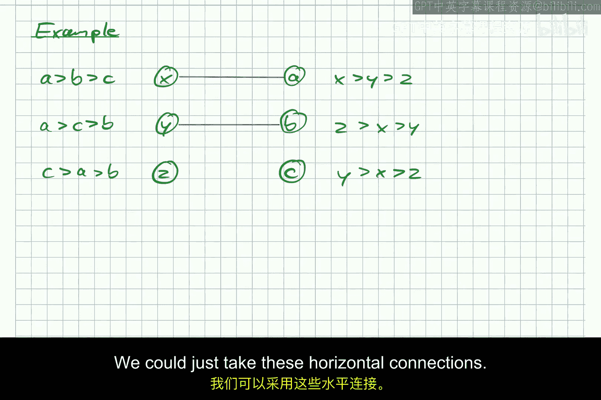
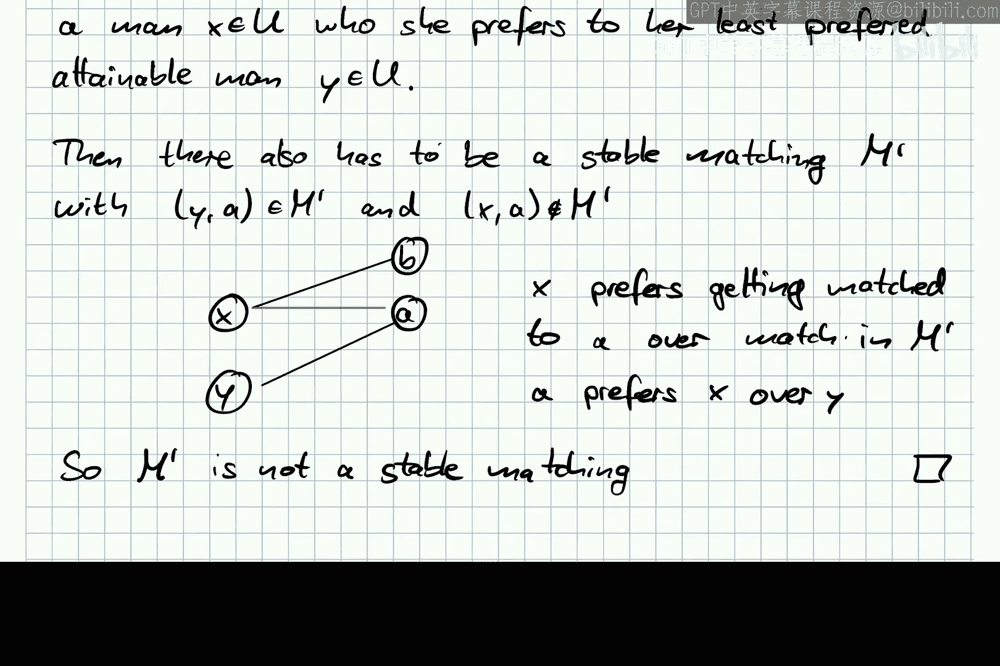

# 算法博弈论：22：稳定匹配

在本节课中，我们将学习一个经典的匹配问题：稳定匹配。我们将介绍问题的定义，学习一个总能找到稳定匹配的算法，并探讨该匹配结果的性质。

## 问题定义

上一节我们介绍了无金钱的机制设计领域。本节中，我们来看看一个非常相似但有一个主要区别的问题：双边偏好匹配。

在之前的房屋分配问题中，房屋不关心谁住在里面。但今天，我们考虑一个双边都有偏好的匹配场景。传统的表述方式是婚姻问题：我们有一组男人（集合 **U**）和一组女人（集合 **V**）。每个男人 **u ∈ U** 对女人有一个偏好排序，每个女人 **v ∈ V** 对男人也有一个偏好排序。这里的排序是**全序**，没有平局。

以下是该问题的一个示例：
*   男人：X, Y, Z
*   女人：A, B, C
*   偏好列表：
    *   X: A > B > C
    *   Y: A > C > B
    *   Z: C > A > B
    *   A: X > Y > Z
    *   B: Z > X > Y
    *   C: Y > X > Z

我们的目标是匹配男人和女人，并希望这个匹配是**稳定**的。

## 稳定匹配的定义

一个**匹配 M** 是一组男人-女人对 **(u, v)** 的集合，其中每个男人和每个女人至多被匹配一次。

给定一个匹配 **M**，一对 **(u, v)** 被称为**阻碍对**，如果：
1.  男人 **u** 比起他在 **M** 中的伴侣，更偏好女人 **v**。
2.  女人 **v** 比起她在 **M** 中的伴侣，更偏好男人 **u**。

这里有一个重要约定：**被匹配总是优于不被匹配**。

如果一个匹配 **M** 中**不存在任何阻碍对**，则称该匹配是**稳定**的。

让我们用之前的例子来检查一个匹配是否稳定。假设我们有一个匹配：`M = {(X, A), (Y, B), (Z, C)}`。

以下是检查过程：
*   X 和 A 都得到了自己最偏好的对象，他们是满意的。
*   Y 得到了 B（他最不喜欢的），B 得到了 Y（她最不喜欢的）。
*   Z 得到了 C（他最喜欢的），C 得到了 Z（她最不喜欢的）。

现在检查阻碍对：考虑 **(Y, C)**。
*   Y 比起 B 更偏好 C。
*   C 比起 Z 更偏好 Y。
因此，**(Y, C)** 是一个阻碍对，匹配 **M** 不稳定。

## Gale-Shapley 算法

一个自然的问题是：稳定匹配是否总是存在？答案是肯定的，并且我们可以通过一个多项式时间算法找到它。这个算法由 Gale 和 Shapley 提出，被称为**Gale-Shapley 算法**（或“延迟接受算法”）。我们将介绍其“男性求婚”版本，但由于问题的对称性，也存在“女性求婚”版本。

以下是算法的步骤：

1.  初始时，匹配 **M** 为空。
2.  重复以下过程，直到没有拒绝发生：
    *   **求婚阶段**：每个尚未被所有女性拒绝的男人，向他尚未求过婚的、偏好列表中最高的女性求婚。
    *   **回应阶段**：每个收到求婚的女性，暂时接受她最偏好的那个求婚者（如果有的话），并拒绝所有其他人。
3.  当没有拒绝发生时，将所有的“暂时接受”转为正式匹配，得到最终的 **M**。

让我们用之前的例子来演示这个算法。

**第一轮**：
*   X 向 A 求婚。
*   Y 向 A 求婚。
*   Z 向 C 求婚。
*   A 收到 X 和 Y 的求婚，她更喜欢 X，所以暂时接受 X，拒绝 Y。
*   B 没有收到求婚。
*   C 收到 Z 的求婚，暂时接受 Z。

**第二轮**：
*   X 继续向 A 求婚。
*   Y 被 A 拒绝后，转向他列表中下一个最高偏好 C 求婚。
*   Z 继续向 C 求婚。
*   A 只收到 X 的求婚，暂时接受 X。
*   C 收到 Y 和 Z 的求婚，她更喜欢 Y，所以暂时接受 Y，拒绝 Z。

**第三轮**：
*   X 继续向 A 求婚。
*   Y 继续向 C 求婚。
*   Z 被 C 拒绝后，转向他列表中下一个最高偏好 A 求婚。
*   A 收到 X 和 Z 的求婚，她更喜欢 X，所以暂时接受 X，拒绝 Z。
*   C 只收到 Y 的求婚，暂时接受 Y。

**第四轮**：
*   X 继续向 A 求婚。
*   Y 继续向 C 求婚。
*   Z 被 A 拒绝后，转向他列表中最后一个偏好 B 求婚。
*   A 只收到 X 的求婚，暂时接受 X。
*   B 收到 Z 的求婚，暂时接受 Z。
*   C 只收到 Y 的求婚，暂时接受 Y。

此时，所有女性都只收到一个求婚，没有拒绝发生。算法终止。最终匹配为：`M = {(X, A), (Y, C), (Z, B)}`。

## 算法正确性与性质

现在我们来证明算法的两个关键性质：它总会终止，并且终止时产生一个稳定匹配。

**终止性**：算法最多在 **|U| × |V| + 1** 轮内终止。
*   除了最后一轮，每一轮都至少发生一次拒绝。
*   一旦一个男人被一个女人拒绝，他永远不会再向她求婚。
*   因此，每对 **(u, v)** 最多导致一次拒绝。
*   最坏情况下，每个男人被每个女人拒绝一次，总拒绝次数不超过 |U| × |V|，加上最后一轮没有拒绝，总轮数不超过 |U| × |V| + 1。

**稳定性**：算法产生的匹配 **M** 是稳定的。
*   假设存在一个阻碍对 **(u, v)**，即 **u** 比起 **M** 中的伴侣更偏好 **v**，且 **v** 比起 **M** 中的伴侣更偏好 **u**。
*   由于 **u** 更偏好 **v**，在算法运行中，**u** 一定在某个时刻向 **v** 求过婚（否则他会先向所有比 **v** 更偏好的女性求婚并被拒，这与 **v** 是他更偏好的对象矛盾）。
*   但 **v** 拒绝了 **u**（否则 **u** 和 **v** 会匹配）。**v** 只有在收到一个比她当前暂时接受的伴侣（或最终伴侣）更偏好的求婚时，才会拒绝 **u**。
*   在算法中，女性暂时接受的伴侣质量只会**变好**（因为她总是保留最好的求婚者）。因此，**v** 在最终匹配 **M** 中的伴侣，至少和她拒绝 **u** 时暂时接受的伴侣一样好。
*   这意味着 **v** 在 **M** 中的伴侣，比她拒绝的 **u** 更受偏好。这与 **(u, v)** 是阻碍对的假设矛盾。
*   因此，不存在阻碍对，匹配 **M** 是稳定的。

## 匹配结果的性质：最优性与唯一性

在房屋分配问题中，稳定配置是唯一的。但在稳定匹配中，可能存在多个稳定匹配。那么，Gale-Shapley 算法找到的是哪一个？它有什么特殊性质？

首先定义一个概念：对于一个参与者 **i**（男人或女人），如果存在某个稳定匹配，其中 **i** 与 **j** 匹配，则称 **j** 是 **i** 的**可达对象**。

以下是关于男性求婚版 Gale-Shapley 算法结果的重要结论：

**男性最优性**：在男性求婚算法产生的稳定匹配中，**每个男人都匹配到了他偏好列表中最高排名的可达女人**。
这意味着，在所有可能的稳定匹配中，没有男人能在其他稳定匹配中获得比在这个匹配中更偏好的伴侣。因此，这个匹配是**男性最优**的。

**女性最劣性**：对称地，在男性求婚算法产生的稳定匹配中，**每个女人都匹配到了她偏好列表中最低排名的可达男人**。
这意味着，在所有可能的稳定匹配中，没有女人会在其他稳定匹配中获得比在这个匹配中更不偏好的伴侣。因此，对这个匹配中的女性而言，这是**女性最劣**的。

> **注意**：由于问题的对称性，如果运行**女性求婚**版算法，则会得到一个**女性最优、男性最劣**的稳定匹配。

**匹配参与者集合的确定性**：在所有稳定匹配中，**被匹配的男人集合和女人集合是相同的**。
也就是说，稳定匹配可能不同，但哪些人能找到伴侣、哪些人保持单身，在所有稳定匹配中都是一样的。

## 总结

本节课我们一起学习了稳定匹配问题。
*   我们定义了具有双边偏好的匹配问题，并引入了**稳定匹配**（即不存在阻碍对）的概念。
*   我们学习了 **Gale-Shapley 算法**，这是一个总能找到稳定匹配的多项式时间算法。该算法通过多轮“求婚”和“延迟接受”来运作。
*   我们证明了算法的正确性，并分析了其输出结果的性质：**男性求婚版本产生男性最优、女性最劣的稳定匹配**。反之，女性求婚版本则产生女性最优、男性最劣的稳定匹配。
*   我们还了解到，稳定匹配可能不唯一，但所有稳定匹配中成功匹配的参与者集合是固定的。

稳定匹配模型有广泛的应用，例如匹配求职者与雇主、学生与学校（如学校录取系统）、医生与医院（住院医师匹配项目）等。它是对双边市场进行机制设计的一个优美而强大的基础模型。